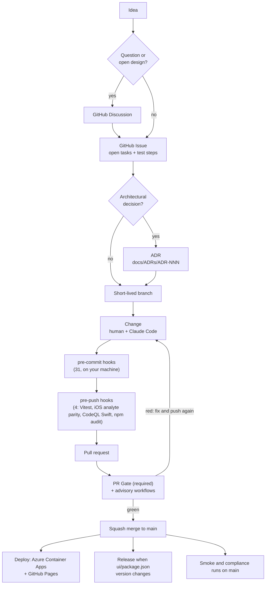

# Software Development Life Cycle (SDLC)

- **Project:** Minimum Viable Health Dataspace v2 (EHDS reference implementation)
- **Audience:** contributors, reviewers, and anyone who wants to know how a
  one-person, AI-assisted project keeps a regulated-domain codebase shippable.
- **Last updated:** 2026-11-07
- **Maintainer:** Matthias ([`@ma3u`](https://github.com/ma3u))

How a change gets from an idea to the live hub: issues and discussions,
branches and pull requests, the hooks on your machine, the checks on GitHub,
the deploys, the releases, and how to contribute from outside. The
plain-language version is [How We Build This Software](./SDLC-explained.md);
how the AI author fits in is [Deterministic Agentic AI Development with Claude
Code](./AGENTIC-DEVELOPMENT-WITH-CLAUDE-CODE.md). Two companion pages go
deeper: [Integration tests through the APIs](developer/api-integration-tests.md)
and [The stack and the development environment](developer/stack-and-environment.md).
Section 12 is the recipe behind all of it: how to define an SDLC for a
DevSecOps and AI project, stage by stage, with the tools.

<details>
<summary><b>Acronyms used in this document</b></summary>

| Acronym                                                                                                                                                                           | Expansion                                                                          |
| --------------------------------------------------------------------------------------------------------------------------------------------------------------------------------- | ---------------------------------------------------------------------------------- |
| **CI/CD**                                                                                                                                                                         | Continuous Integration / Continuous Delivery: the automated build, test and deploy |
| **PR**                                                                                                                                                                            | Pull Request: a proposed change, checked and reviewed before it is merged          |
| **ADR**                                                                                                                                                                           | Architecture Decision Record: a short note of a decision and its reasons           |
| **[OIDC](https://openid.net/specs/openid-connect-core-1_0.html)**                                                                                                                 | OpenID Connect; here the federated login of GitHub Actions to Azure                |
| **[SBOM](https://cyclonedx.org/)**                                                                                                                                                | Software Bill of Materials: the list of every third-party component                |
| **[CVE](https://www.cve.org/)**                                                                                                                                                   | Common Vulnerabilities and Exposures: the public catalogue of known flaws          |
| **[SARIF](https://docs.oasis-open.org/sarif/sarif/v2.1.0/sarif-v2.1.0.html)**                                                                                                     | Static Analysis Results Interchange Format: how scanners report to GitHub          |
| **[DSP](https://eclipse-dataspace-protocol-base.github.io/DataspaceProtocol/2025-1/) / [DCP](https://eclipse-dataspace-dcp.github.io/decentralized-claims-protocol/v1.0/) / TCK** | Dataspace Protocol / Decentralised Claims Protocol / Technology Compatibility Kit  |
| **[ACA](https://learn.microsoft.com/en-us/azure/container-apps/)**                                                                                                                | Azure Container Apps, where the live hub runs                                      |

</details>

---

## 1. Philosophy: deterministic tooling around a non-deterministic author

> **The author proposes; deterministic tooling disposes.**

A senior engineer, a newcomer and an AI agent are all non-deterministic: ask
the same question twice and you may get two answers. The output becomes
trustworthy when the author is wrapped in gates that run the same way every
time, for everyone: formatters, linters, type checks, tests, security scanners
and a CI/CD pipeline.

The project is a team of one plus an AI pair programmer. So it keeps every
deterministic gate a large team would have and collapses the coordination
ceremonies (mandatory human review, sprint rituals, release boards) that only
pay off with more people. Section 11 says what is collapsed and why.

This matters more here than in most projects. It is a reference
implementation of the European Health Data Space, a regulated domain with
health data, patient rights and audit duties. The gates buy trust (whole
classes of mistakes are caught before they ship), auditability (every change
is logged with author, time and reason), repeatability, cheap mistakes (a
local hook costs seconds, a production incident hours) and safe AI assistance.

---

## 2. The lifecycle at a glance



1. **Idea.** An open question or a design to explore starts as a Discussion;
   a piece of work starts as an Issue (section 3).
2. **ADR** when the decision is expensive to reverse or cross-cutting.
3. **Branch** off `main`, short-lived.
4. **Change**, by a human, Claude Code or both.
5. **Hooks** on your machine: 31 at commit, 4 at push (section 5).
6. **Pull request.** The **PR Gate** is the one required check; the other
   workflows are advisory (section 6).
7. **Squash merge** once the PR Gate is green and every review thread is
   resolved.
8. **On `main`:** the live hub and the static demo redeploy, the smoke and
   compliance runs start, and a release is cut when the version changed
   (sections 7 and 8).

---

## 3. Discussions, issues and the planning folder

### Discussion or issue?

[Discussions](https://github.com/ma3u/MinimumViableHealthDataspacev2/discussions)
are enabled, with the categories Announcements, General, Ideas, Polls, Q&A and
Show and tell.

| Open a **Discussion** when                                                                                                                                                                                                                                                                                                                                    | Open an **Issue** when                                                                              |
| ------------------------------------------------------------------------------------------------------------------------------------------------------------------------------------------------------------------------------------------------------------------------------------------------------------------------------------------------------------- | --------------------------------------------------------------------------------------------------- |
| you have a question ("how does the hub map X?"), want to compare options, or propose a direction that is not yet a task (Ideas; recent examples are [#776](https://github.com/ma3u/MinimumViableHealthDataspacev2/discussions/776) on FHIR and OMOP tooling and [#701](https://github.com/ma3u/MinimumViableHealthDataspacev2/discussions/701) on Simpl-Open) | there is something to do: a bug, a feature with a clear outcome, a gap with an acceptance criterion |
| the answer may be "no" or "not now"                                                                                                                                                                                                                                                                                                                           | someone will close it with a commit or a PR                                                         |
| several people should weigh in before anything is decided                                                                                                                                                                                                                                                                                                     | the decision is made, or an ADR will make it                                                        |

A discussion that reaches a decision becomes an issue (and an ADR when the
decision is architectural), linked both ways.

### What an issue carries

Use the templates in [`.github/ISSUE_TEMPLATE/`](https://github.com/ma3u/MinimumViableHealthDataspacev2/tree/main/.github/ISSUE_TEMPLATE)
(bug report, feature request). Every issue that is being worked on carries:

- **The open tasks** as a checklist, kept current. When a PR leaves work
  undone, the issue says what is left; nothing open lives only in a chat or a
  commit message.
- **Manual test steps** with links (to the static docs, a page of the hub, a
  workflow run), so anyone can check the result without asking.
- **The decisions**, each linked to its ADR.

[Labels](https://github.com/ma3u/MinimumViableHealthDataspacev2/labels) in use: `bug`, `enhancement`, `documentation`, `question`, `security`,
`infrastructure`, `azure`, `dependencies`, the priorities `P1` to `P3`, and the
area labels `EHDS-compliance`, `dataspace-discovery`, `simpl`, `NLP`,
`Agentic AI`, `production`, `load test`, `stress test`, `pentest`, `trivy`,
`Cost`. New contributors look for `good first issue` and `help wanted`.

### The planning folder

[`docs/planning/index.md`](./planning/index.md) lists work items as files that
move `future/ → current/ → done/` and are never deleted. A file in `current/`
is the long form of an issue (its phases, measurements, links); the issue
stays the place for the checklist. Roadmap detail lives in
`docs/planning/roadmap-phases-*.md`, and the issue and ADR tables in
[`docs/planning-health-dataspace-v2.md`](./planning-health-dataspace-v2.md).
[`/plan`](../.claude/commands/plan.md) in Claude Code grooms the folder.

Keep any document that is loaded routinely under about 15K tokens
([ADR-026](./ADRs/ADR-026-token-efficient-planning-structure.md)): the index
stays small and the detail moves to archives.

### ADRs

[`docs/ADRs/`](ADRs) holds the ADRs from ADR-001 on (051 is reserved). New ones follow the
[Nygard](https://cognitect.com/blog/2011/11/15/documenting-architecture-decisions) template in [`docs/adr/0000-template.md`](adr/0000-template.md); an accepted ADR is never
edited, only superseded. Write one when a decision is expensive to reverse or
cross-cutting: the database split ([ADR-001](./ADRs/ADR-001-postgresql-neo4j-split.md)),
the testing strategy ([ADR-008](./ADRs/ADR-008-testing-strategy.md)), checks
that must be able to fail ([ADR-031](./ADRs/ADR-031-checks-must-assert.md)),
every API route needing a session ([ADR-044](./ADRs/ADR-044-every-api-route-needs-a-session.md)).

---

## 4. Branches, commits and pull requests

- **Trunk-based.** `main` is always deployable. Work happens on short-lived
  branches named `type/short-slug` (`feat/…`, `fix/…`, `docs/…`, `chore/…`,
  `ci/…`), often with the issue number: `fix/708-ui-sticky-sessions`.
- **[Conventional Commits](https://www.conventionalcommits.org/en/v1.0.0/)** with a
  scope: `feat(spe): workspaces start on demand (ADR-072)`. All of the last 40
  commits on `main` follow it; no hook enforces it yet.
- **Commits carry the author's name.** No AI co-author trailer is added; how
  the AI works in this project is documented in the companion document.
- **A PR links its issue and its ADRs** and says how it was tested; the
  [PR template](https://github.com/ma3u/MinimumViableHealthDataspacev2/blob/main/.github/pull_request_template.md)
  asks for both. [`CODEOWNERS`](https://github.com/ma3u/MinimumViableHealthDataspacev2/blob/main/.github/CODEOWNERS)
  names the maintainer, so a PR from anyone else gets a review request.
- **Squash merge.** The PR title becomes the commit on `main`, so it follows
  the commit convention too.

### 4.1 Branch protection on `main`

A repository ruleset on the default branch:

| Rule                                | Effect                                                                                                   |
| ----------------------------------- | -------------------------------------------------------------------------------------------------------- |
| **Require a pull request**          | No direct pushes to `main`. Zero approvals required (see below).                                         |
| **Require conversation resolution** | Every review thread is resolved before merge, so review findings are answered rather than scrolled past. |
| **Require status checks**           | **PR Gate** must be green. It is the only required check.                                                |
| **Require linear history**          | Squash or rebase only; merge commits are switched off.                                                   |
| **Block force pushes, deletions**   | `main` cannot be rewritten or deleted.                                                                   |

**Zero required approvals is deliberate.** With one maintainer, a required
approval means a second account and a rubber stamp. Review is done by the AI
reviewers and the gates; the mechanical protections (no direct push, no force
push, no merge on red) are the part a solo maintainer cannot supply by
discipline, so they are enforced. When a second regular contributor joins,
this goes to one approval.

**Admins can bypass only on a pull request.** A stuck check can be overridden
on a PR, which is better than being unable to land a hotfix on a live demo; a
direct push to `main` is refused for everyone.

### 4.2 Why exactly one required check

Every other workflow is path-filtered, which is right for cost and wrong for
branch protection: a required check that never starts stays pending, and the
PR can never merge ([#303](https://github.com/ma3u/MinimumViableHealthDataspacev2/pull/303) collected 28 checks, [#305](https://github.com/ma3u/MinimumViableHealthDataspacev2/pull/305) none). So
[`pr-gate.yml`](https://github.com/ma3u/MinimumViableHealthDataspacev2/blob/main/.github/workflows/pr-gate.yml)
has no path filter and is the one required check. Section 6.1 lists what it
runs.

---

## 5. The hooks on your machine

[`.pre-commit-config.yaml`](https://github.com/ma3u/MinimumViableHealthDataspacev2/blob/main/.pre-commit-config.yaml),
run by the [pre-commit framework](https://pre-commit.com/). Install both
stages once per clone (since [#847](https://github.com/ma3u/MinimumViableHealthDataspacev2/issues/847) a plain `pre-commit install` does the same,
through [`default_install_hook_types`](../.pre-commit-config.yaml#L7)):

```bash
pip install pre-commit
pre-commit install --hook-type pre-commit --hook-type pre-push
pre-commit run --all-files     # optional: everything, once
```

Most hooks are scoped by file pattern, so a docs-only commit skips the
TypeScript ones. Hooks that need a tool you have not installed ([gitleaks](https://github.com/gitleaks/gitleaks/releases/tag/v8.29.0),
[Semgrep](https://semgrep.dev/docs/), [lychee](https://github.com/lycheeverse/lychee), [actionlint](https://github.com/rhysd/actionlint)) print a warning and pass; the PR Gate installs
gitleaks and actionlint and runs them anyway. Skip one hook once with
`SKIP=<id> git commit`, never the whole set with `--no-verify`: the PR Gate
runs the same hooks on the PR's diff, so a bypass only moves the failure.

**Hooks that rewrite files** ([Prettier](https://prettier.io/), the whitespace fixers, [`docs-facts`](../.pre-commit-config.yaml#L217))
fail the commit after changing the file. Stage the file again and commit
again, then check that `HEAD` moved: a failed commit leaves it where it was.

### 5.1 At commit: 31 hooks

| Hook (id)                                                                                                                                     | What it does                                                                                                                                                                                                                    | When it fails                                                                                                                                                                              |
| --------------------------------------------------------------------------------------------------------------------------------------------- | ------------------------------------------------------------------------------------------------------------------------------------------------------------------------------------------------------------------------------- | ------------------------------------------------------------------------------------------------------------------------------------------------------------------------------------------ |
| [`trailing-whitespace`](../.pre-commit-config.yaml#L13), [`end-of-file-fixer`](../.pre-commit-config.yaml#L17)                                | strip trailing spaces, end every file with a newline (patches and the vendored HealthDCAT-AP shapes excepted)                                                                                                                   | it fixed the file: stage it again                                                                                                                                                          |
| [`check-yaml`](../.pre-commit-config.yaml#L19), [`check-json`](../.pre-commit-config.yaml#L22)                                                | the files parse (multi-document YAML allowed)                                                                                                                                                                                   | fix the syntax it names                                                                                                                                                                    |
| [`check-added-large-files`](../.pre-commit-config.yaml#L23)                                                                                   | refuses a file over 5,000 KB                                                                                                                                                                                                    | keep it out of git, or make it smaller                                                                                                                                                     |
| [`check-merge-conflict`](../.pre-commit-config.yaml#L25)                                                                                      | refuses leftover `<<<<<<<` markers                                                                                                                                                                                              | finish the merge                                                                                                                                                                           |
| [`detect-private-key`](../.pre-commit-config.yaml#L26)                                                                                        | refuses a private key                                                                                                                                                                                                           | remove it; if it was real, rotate it                                                                                                                                                       |
| [`check-case-conflict`](../.pre-commit-config.yaml#L27), [`check-symlinks`](../.pre-commit-config.yaml#L28)                                   | names that clash on a case-insensitive disk, symlinks that point nowhere                                                                                                                                                        | rename, or fix the link                                                                                                                                                                    |
| [`check-executables-have-shebangs`](../.pre-commit-config.yaml#L29), [`check-shebang-scripts-are-executable`](../.pre-commit-config.yaml#L30) | an executable file has a `#!` line, a `#!` file is executable                                                                                                                                                                   | `chmod +x` (or `-x`), and stage that path explicitly: a stray executable bit on a `.gitkeep` fails here                                                                                    |
| [`shellcheck`](../.pre-commit-config.yaml#L36)                                                                                                | Bash at error severity                                                                                                                                                                                                          | `shellcheck --severity=error <file>` and fix what it reports                                                                                                                               |
| [`hadolint-docker`](../.pre-commit-config.yaml#L44)                                                                                           | Dockerfile best practice                                                                                                                                                                                                        | `hadolint <Dockerfile>`                                                                                                                                                                    |
| [`prettier`](../.pre-commit-config.yaml#L56)                                                                                                  | formats JS, TS, JSON, YAML and Markdown                                                                                                                                                                                         | it rewrote the file: stage it again. Do not fight its output                                                                                                                               |
| [`tsc-ui`](../.pre-commit-config.yaml#L66)                                                                                                    | [`tsc --noEmit -p tsconfig.build.json`](../ui/tsconfig.build.json) in `ui/` (strict, tests excluded)                                                                                                                            | run that command in `ui/`, fix the type error                                                                                                                                              |
| [`eslint-ui`](../.pre-commit-config.yaml#L76)                                                                                                 | [`next lint --max-warnings 55`](https://nextjs.org/docs/15/app/api-reference/config/eslint) in `ui/`                                                                                                                            | an error, or a new warning above the budget of 55: `cd ui && npx next lint`                                                                                                                |
| [`gitleaks`](../.pre-commit-config.yaml#L134)                                                                                                 | secrets in the staged diff                                                                                                                                                                                                      | remove the secret and rotate it; a proven false positive goes in [`.gitleaksignore`](../.gitleaksignore)                                                                                   |
| [`semgrep`](../.pre-commit-config.yaml#L149)                                                                                                  | [Semgrep CE](https://github.com/semgrep/semgrep) on staged code: the registry's TypeScript, Next.js, React and secrets rules, and [`.semgrep/cypher.yml`](../.semgrep/cypher.yml) (request input reaches Cypher as a parameter) | fix it, or `// nosemgrep: <rule-id> -- <reason>` above the line. Behind a TLS-inspecting proxy the registry download fails and the hook exits 2: that is not a finding                     |
| [`semgrep-rule-tests`](../.pre-commit-config.yaml#L155)                                                                                       | the project's own Semgrep rules against [`.semgrep/cypher.ts`](../.semgrep/cypher.ts)                                                                                                                                           | the rule and its test disagree                                                                                                                                                             |
| [`check-broken-links-md`](../.pre-commit-config.yaml#L168)                                                                                    | relative links in Markdown resolve ([lychee](https://github.com/lycheeverse/lychee) offline, or [markdown-link-check](https://github.com/tcort/markdown-link-check)); translations under `docs/i18n/` excepted                  | fix the path                                                                                                                                                                               |
| [`check-no-screenshot-imports`](../.pre-commit-config.yaml#L178)                                                                              | docs pages under `ui/src/app/docs/` do not reference `images/screenshots`                                                                                                                                                       | use a diagram or a guide image instead                                                                                                                                                     |
| [`api-spec-drift`](../.pre-commit-config.yaml#L191)                                                                                           | every route under `ui/src/app/api/` is in [`ui/public/openapi.yaml`](../ui/public/openapi.yaml), and the other way round                                                                                                        | document the operation in the spec and delete its line from [`docs/api-spec-drift-allowlist.txt`](api-spec-drift-allowlist.txt); adding a line is a decision to ship an undocumented route |
| [`api-spec-shapes`](../.pre-commit-config.yaml#L202)                                                                                          | the spec describes the shape the hub answers with (checked against the fixtures in [`ui/public/mock/`](../ui/public/mock))                                                                                                      | correct the schema, or the fixture                                                                                                                                                         |
| [`docs-facts`](../.pre-commit-config.yaml#L217)                                                                                               | regenerates [`ui/src/app/docs/docs-facts.json`](../ui/src/app/docs/docs-facts.json) (routes, hooks, services, ADRs, each docs page's last-updated date)                                                                         | it rewrote the file: stage it and commit again                                                                                                                                             |
| [`docs-content`](../.pre-commit-config.yaml#L226)                                                                                             | the published copies of `docs/` match their sources ([`gen-docs-content.py --check`](../scripts/gen-docs-content.py))                                                                                                           | `python3 scripts/gen-docs-content.py`, stage `ui/src/content/` and `ui/public/published-docs/`                                                                                             |
| [`localized-images`](../.pre-commit-config.yaml#L236)                                                                                         | the manifest of translated screenshots and diagrams matches `ui/public`                                                                                                                                                         | [`python3 scripts/gen-localized-images.py`](../scripts/gen-localized-images.py), stage the manifest                                                                                        |
| [`bruno-coverage`](../.pre-commit-config.yaml#L249)                                                                                           | every API route has a request in [`bruno/MVHDv2/`](../bruno/MVHDv2), every request can fail, no credential in a `.bru` file                                                                                                     | add the request in the persona's folder; delete the one whose route is gone (see [the API tests](developer/api-integration-tests.md))                                                      |
| [`bruno-strength`](../.pre-commit-config.yaml#L260)                                                                                           | a 2xx request asserts more than a container type                                                                                                                                                                                | assert a property's value                                                                                                                                                                  |
| [`workflow-paths`](../.pre-commit-config.yaml#L273)                                                                                           | a workflow's `paths` filter covers every script it runs                                                                                                                                                                         | add the path to the workflow's filter                                                                                                                                                      |
| [`actionlint`](../.pre-commit-config.yaml#L303)                                                                                               | GitHub Actions workflows                                                                                                                                                                                                        | fix the workflow it names                                                                                                                                                                  |
| [`image-scan-coverage`](../.pre-commit-config.yaml#L314)                                                                                      | the CVE scan in [`security-scan.yml`](../.github/workflows/security-scan.yml) covers every image in the compose files                                                                                                           | add the image to the scan matrix                                                                                                                                                           |

### 5.2 At push: 4 hooks

| Hook (id)                                               | What it does                                                                                                                                                                                                                                                      | When it fails                                                                                                                                                                                                                                                                                       |
| ------------------------------------------------------- | ----------------------------------------------------------------------------------------------------------------------------------------------------------------------------------------------------------------------------------------------------------------- | --------------------------------------------------------------------------------------------------------------------------------------------------------------------------------------------------------------------------------------------------------------------------------------------------- |
| [`vitest-ui`](../.pre-commit-config.yaml#L86)           | the whole UI suite, [`vitest run --bail 1`](https://github.com/vitest-dev/vitest/releases/tag/v5.0.2), when the push changes `ui/src` or `ui/__tests__`                                                                                                           | `cd ui && npx vitest run <file>` for the failing file. A hook that resets a mock uses braces: `beforeEach(() => { m.mockReset(); })`                                                                                                                                                                |
| [`npm-audit-ui`](../.pre-commit-config.yaml#L287)       | [`scripts/check-npm-audit.py ui --omit=dev`](../scripts/check-npm-audit.py): no HIGH or CRITICAL advisory in production dependencies                                                                                                                              | update the dependency; when no fix exists, a time-boxed entry in [`docs/npm-audit-exceptions.json`](npm-audit-exceptions.json) with a reason, an issue and an expiry date                                                                                                                           |
| [`ios-analyte-parity`](../.pre-commit-config.yaml#L102) | `swift run AnalyteParity` when the app's shared Swift code, the generated analyte table or `Package.swift` change (seconds once built, macOS)                                                                                                                     | the Swift table resolves a label or unit differently from [`analytes.ts`](../services/epa-ingest/src/analytes.ts): regenerate with `npm run generate:swift` in [`services/epa-ingest`](../services/epa-ingest), or fix the folding in [`clients/ios/Sources/Shared`](../clients/ios/Sources/Shared) |
| [`codeql-swift`](../.pre-commit-config.yaml#L119)       | [CodeQL](https://docs.github.com/en/code-security/code-scanning/creating-an-advanced-setup-for-code-scanning/codeql-code-scanning-for-compiled-languages) on the iPhone app when Swift sources, `Package.swift` or `project.yml` change (about 15 minutes, macOS) | fix the finding, or accept it with its reason in [`clients/ios/Scripts/codeql-accepted.txt`](../clients/ios/Scripts/codeql-accepted.txt); `SKIP=codeql-swift git push` skips it once                                                                                                                |

[Quality Gates](./quality-gates.md) and the
[quality gates page](https://ma3u.github.io/MinimumViableHealthDataspacev2/docs/developer/quality-gates)
have the coverage figures and the gates still to come.

E2E, the WCAG audit and the pentest specs no longer run on each push; they
run once a night when `main` changed
([ADR-074](./ADRs/ADR-074-e2e-and-compliance-suites-run-nightly-when-main-changed.md)).
Before you merge a change to UI pages or their API routes, run them against
the compose stack: `docker compose up -d`, then `cd ui && npm run test:e2e`.

---

## 6. The checks on GitHub

[`.github/workflows/`](../.github/workflows) holds 40 workflows. Only the **PR Gate** blocks a merge.

### 6.1 PR Gate: the required check

On every pull request and merge-queue run, no path filter, about 15 minutes at
most:

1. the pre-commit hooks on the PR's diff ([`pre-commit run --from-ref
origin/main --to-ref HEAD`](../.github/workflows/pr-gate.yml#L69)), which catches a commit made with
   `--no-verify` or from a clone without the hooks;
2. API spec drift ([`scripts/check-api-spec-drift.py`](../.github/workflows/pr-gate.yml#L80));
3. docs facts current, with every changed docs page's date moved
   ([`scripts/gen-docs-facts.py --check`](../.github/workflows/pr-gate.yml#L88));
4. the API collection covers every route ([`scripts/check-bruno-coverage.py`](../.github/workflows/pr-gate.yml#L95));
5. [HealthDCAT-AP Release 8](../.github/workflows/pr-gate.yml#L102-L107) conformance of the catalogue's golden files
   ([pySHACL](https://github.com/RDFLib/pySHACL/releases/tag/v0.30.1) against the [official shapes](https://data.health.europa.eu/healthdcat-ap/releases/release-8/html/shacl/HealthDCAT-AP_validator/config/rdf-validator/ehds/shapes/non-public-shapes.ttl));
6. no unused files, exports or dependencies ([`npm run --prefix ui knip`](../.github/workflows/pr-gate.yml#L115));
7. [gitleaks](../.github/workflows/pr-gate.yml#L123) over the PR's commits, since the staged-only local hook sees
   nothing in CI.

### 6.2 The other workflows

| Workflow                                                                                                                               | Runs on                                                                                                                           | What it does                                                                                                                                                                                                                                                                                                                                                                                                                                                                                                                                                                                                                                             | Blocks        |
| -------------------------------------------------------------------------------------------------------------------------------------- | --------------------------------------------------------------------------------------------------------------------------------- | -------------------------------------------------------------------------------------------------------------------------------------------------------------------------------------------------------------------------------------------------------------------------------------------------------------------------------------------------------------------------------------------------------------------------------------------------------------------------------------------------------------------------------------------------------------------------------------------------------------------------------------------------------- | ------------- |
| [`test.yml`](../.github/workflows/test.yml) Test Suite                                                                                 | push to any branch, PR to `main` (paths: `ui/`, the services, `clients/ios/`, the Klarbefund docs)                                | 8 jobs: Vitest for the UI, proxy, SPE loader and ePA ingest; [OPA](https://www.openpolicyagent.org/docs/policy-testing) policy tests; iOS analyte parity (only when `clients/ios/` changed, decided by a Changed paths job); one job of scans ([Trivy](https://github.com/aquasecurity/trivy/releases/tag/v0.69.3), [Kubescape](https://kubescape.io/), [npm audit](https://docs.npmjs.com/cli/v10/commands/npm-audit), SBOM, licences). Lint and gitleaks run in PR Gate                                                                                                                                                                                | no (advisory) |
| [`codeql.yml`](../.github/workflows/codeql.yml)                                                                                        | push and PR to `main` unless only `docs/`, Markdown or `clients/ios/` changed, weekly                                             | [CodeQL](https://docs.github.com/en/code-security/code-scanning/introduction-to-code-scanning/about-code-scanning-with-codeql) for JavaScript/TypeScript, Python and the workflows; results in the Security tab                                                                                                                                                                                                                                                                                                                                                                                                                                          | no            |
| [`codeql-swift.yml`](../.github/workflows/codeql-swift.yml)                                                                            | weekly, dispatch, and PRs that change the workflow or its script                                                                  | CodeQL for the iPhone app; app changes are checked by the `codeql-swift` pre-push hook                                                                                                                                                                                                                                                                                                                                                                                                                                                                                                                                                                   | no            |
| [`security-scan.yml`](../.github/workflows/security-scan.yml)                                                                          | PR, weekly, dispatch                                                                                                              | source SBOM and CVEs, image CVEs, the deployed images' CVEs, a severity gate; a PR reads the Trivy database that `main` saved and stores none                                                                                                                                                                                                                                                                                                                                                                                                                                                                                                            | no            |
| [`bruno-smoke.yml`](../.github/workflows/bruno-smoke.yml)                                                                              | PR and `main` when the collection or [`ui/src/app/api/`](../ui/src/app/api) change                                                | the API collection against the static fixtures (Static-mock)                                                                                                                                                                                                                                                                                                                                                                                                                                                                                                                                                                                             | no            |
| [`python-services-test.yml`](../.github/workflows/python-services-test.yml)                                                            | PR, push to `main`                                                                                                                | [pytest](https://docs.pytest.org/) for the Python services                                                                                                                                                                                                                                                                                                                                                                                                                                                                                                                                                                                               | no            |
| [`compliance.yml`](../.github/workflows/compliance.yml)                                                                                | called by [`nightly.yml`](../.github/workflows/nightly.yml), dispatch                                                             | DSP, DCP and EHDS domain checks and the full API collection against a fresh JAD stack; the report job fails below the recorded floor                                                                                                                                                                                                                                                                                                                                                                                                                                                                                                                     | no (nightly)  |
| [`nightly.yml`](../.github/workflows/nightly.yml)                                                                                      | once a night when `main` changed, dispatch ([ADR-074](./ADRs/ADR-074-e2e-and-compliance-suites-run-nightly-when-main-changed.md)) | [Playwright](https://github.com/microsoft/playwright/releases/tag/v1.64.1) E2E with [WCAG](https://www.w3.org/TR/WCAG22/) and the [OWASP](https://owasp.org/Top10/2021/)/[BSI](https://www.bsi.bund.de/EN/Themen/Unternehmen-und-Organisationen/Informationen-und-Empfehlungen/Empfehlungen-nach-Angriffszielen/Cloud-Computing/Kriterienkatalog-C5/kriterienkatalog-c5_node.html) checks against a seeded Neo4j (reports go to the Pages site), [Lighthouse](https://developer.chrome.com/docs/lighthouse), gitleaks over the whole history, [`compliance.yml`](../.github/workflows/compliance.yml); a red night opens an issue, a green one closes it | no            |
| [`deploy-azure.yml`](../.github/workflows/deploy-azure.yml)                                                                            | every push to `main`, dispatch                                                                                                    | builds the UI and proxy images, deploys them to Azure Container Apps, checks that sign-in works, then runs Playwright against the live hub                                                                                                                                                                                                                                                                                                                                                                                                                                                                                                               | `main` only   |
| [`pages.yml`](../.github/workflows/pages.yml)                                                                                          | every push to `main`, dispatch                                                                                                    | builds the static export with the latest nightly test reports and publishes it to GitHub Pages (6.4)                                                                                                                                                                                                                                                                                                                                                                                                                                                                                                                                                     | `main` only   |
| [`release.yml`](../.github/workflows/release.yml)                                                                                      | push to `main` changing `ui/package.json`, dispatch                                                                               | tags and publishes a GitHub Release (section 8)                                                                                                                                                                                                                                                                                                                                                                                                                                                                                                                                                                                                          | `main` only   |
| [`demo-smoke.yml`](../.github/workflows/demo-smoke.yml)                                                                                | daily 06:00 UTC (starts hours late), dispatch                                                                                     | is the live hub up, the API collection against it (Azure-Dev), Playwright on public routes, a [ZAP](https://www.zaproxy.org/docs/docker/baseline-scan/) baseline, then removes what the collection created                                                                                                                                                                                                                                                                                                                                                                                                                                               | `main` only   |
| [`catalog-crawler.yml`](../.github/workflows/catalog-crawler.yml), [`catalog-enricher.yml`](../.github/workflows/catalog-enricher.yml) | push to `main` changing the service                                                                                               | tests and deploys the catalogue services                                                                                                                                                                                                                                                                                                                                                                                                                                                                                                                                                                                                                 | `main` only   |
| [`cache-cleanup.yml`](../.github/workflows/cache-cleanup.yml)                                                                          | daily, dispatch                                                                                                                   | deletes Actions caches nothing restores again: those of closed PRs and all but the newest CodeQL, Next.js, Playwright and Trivy entry ([`scripts/prune-actions-caches.py`](../scripts/prune-actions-caches.py), [#847](https://github.com/ma3u/MinimumViableHealthDataspacev2/issues/847))                                                                                                                                                                                                                                                                                                                                                               | n/a           |
| [`aca-schedule.yml`](../.github/workflows/aca-schedule.yml)                                                                            | twice a day, dispatch                                                                                                             | fallback for the off-hours stop and start ([ADR-053](./ADRs/ADR-053-everything-stops-off-hours.md), [ADR-058](./ADRs/ADR-058-azure-triggers-the-off-hours-schedule.md))                                                                                                                                                                                                                                                                                                                                                                                                                                                                                  | n/a           |

The remaining 23 are **operations workflows run by hand** (`workflow_dispatch`)
against Azure: seeding Neo4j, EDC participants, data assets and CFM; the
Vault bootstrap; the FHIR loader; GraphRAG; the EUDI verifier; the Keycloak
domain; cost guards; one-off repairs and retirements, each named after its
issue or ADR. They follow the same rule as everything else: an environment
change is a versioned, re-runnable workflow, not a click in the portal. Those
that delete or rewrite have a `plan` mode that only reads.

### 6.3 Protocol compliance

[`compliance.yml`](../.github/workflows/compliance.yml) brings up the JAD stack inside the job, seeds it, and runs
the DSP, DCP and EHDS domain checks and the API collection. Every suite step
may fail without stopping the job; the **Compliance Report** job then compares
each result with its floor in [`scripts/compliance-baseline.json`](../scripts/compliance-baseline.json) and fails on a
regression. It gates on a recorded baseline, not on green, so a suite that
does not pass yet still cannot get worse. The suites are ours and drive our
APIs; they are not the Eclipse TCKs ([DSP](https://github.com/eclipse-dataspacetck/dsp-tck), [DCP](https://github.com/eclipse-dataspacetck/dcp-tck)) and do not prove conformance ([#338](https://github.com/ma3u/MinimumViableHealthDataspacev2/issues/338)).
Current numbers and how to run them are in
[Integration tests through the APIs](developer/api-integration-tests.md).

### 6.4 GitHub Pages: the static demo

[`pages.yml`](../.github/workflows/pages.yml) builds the public demo at
[ma3u.github.io/MinimumViableHealthDataspacev2](https://ma3u.github.io/MinimumViableHealthDataspacev2/):
it seeds a Neo4j container, refreshes the mock fixtures from the live API
shape, renames [`ui/src/app/api/`](../ui/src/app/api) out of the way, builds with
`NEXT_PUBLIC_STATIC_EXPORT=true`, adds the test reports of the last
[`nightly.yml`](../.github/workflows/nightly.yml) run and publishes. The nightly run seeds its own Neo4j and runs
Vitest, [Playwright](https://github.com/microsoft/playwright/releases/tag/v1.64.1), the [WCAG](https://www.w3.org/TR/WCAG22/) audit and the security checks (report only,
`continue-on-error`). Without API routes every
page reads [`ui/public/mock/*.json`](../ui/public/mock), so a page that GETs an `/api/...` path
needs a fixture there, and [`static-mock-coverage.test.ts`](../ui/__tests__/unit/lib/static-mock-coverage.test.ts) fails without one.

### 6.5 Deploy to Azure

Every push to `main` runs [`deploy-azure.yml`](../.github/workflows/deploy-azure.yml):

1. log in to Azure with **[OIDC](https://docs.github.com/en/actions/security-for-github-actions/security-hardening-your-deployments/configuring-openid-connect-in-azure)** (no stored password: a federated credential
   trusts this repository's `main` branch);
2. build the UI and the Neo4j proxy images, push them to the registry
   `acrmvhdehds`;
3. wait while a load test runs (the `LOAD_TEST_RUNNING` variable), so a merge
   does not redeploy under [k6](https://grafana.com/docs/k6/latest/);
4. deploy both to Container Apps in `rg-mvhd-dev` as a new revision (ACA
   caches [`:latest`](../CLAUDE.md#L75), so a restart alone would not pick up the image);
5. verify the revisions, wait for the UI, and prove sign-in works end to end;
6. if the hub is live (not stopped off hours), run [Playwright](https://github.com/microsoft/playwright/releases/tag/v1.64.1), the [WCAG](https://www.w3.org/TR/WCAG22/) audit
   and the security checks against it.

**OIDC works on `main` only.** The federated credential names
`refs/heads/main`, so an Azure step on a pull request, a fork or another
branch cannot log in. A job that needs Azure is gated to `main`, the schedule
or a dispatch on `main`; letting PRs in means adding a federated credential
in Azure, not editing the workflow. Off hours (Mon to Fri 07:00 to 20:00
Europe/Berlin is on) everything is stopped
([ADR-053](./ADRs/ADR-053-everything-stops-off-hours.md)), so a deploy then
updates the revision without being able to test it live.

---

## 7. Testing strategy

[ADR-008](./ADRs/ADR-008-testing-strategy.md) sets the tiers; the conventions
are in [`.claude/rules/testing.md`](https://github.com/ma3u/MinimumViableHealthDataspacev2/blob/main/.claude/rules/testing.md).

| Tier                | Framework                                                                                                                                        | Scope                                                                                                                           | When it runs                                                       |
| ------------------- | ------------------------------------------------------------------------------------------------------------------------------------------------ | ------------------------------------------------------------------------------------------------------------------------------- | ------------------------------------------------------------------ |
| **Unit**            | [Vitest](https://github.com/vitest-dev/vitest/releases/tag/v5.0.2)                                                                               | functions, components and API route handlers; Neo4j mocked at [`@/lib/neo4j`](../ui/src/lib/neo4j.ts), `fetch` stubbed per test | pre-push, every push ([`test.yml`](../.github/workflows/test.yml)) |
| **Service**         | Vitest, [pytest](https://docs.pytest.org/), [`opa test`](https://www.openpolicyagent.org/docs/policy-testing)                                    | the Neo4j proxy, SPE loader, ePA ingest, the Python services, the Trustee policies                                              | every push touching them                                           |
| **iOS**             | [Swift Testing](https://developer.apple.com/documentation/testing), [XCUITest](https://developer.apple.com/documentation/xctest/xcuiapplication) | the app's parser and model; its screens with a fixed demo seed                                                                  | on the Mac; parity check in CI                                     |
| **API integration** | [Bruno](https://www.usebruno.com/), shell suites                                                                                                 | the hub's routes per persona; DSP, DCP, the health domain                                                                       | PR (fixtures), `main`, weekly, live daily                          |
| **E2E**             | [Playwright](https://github.com/microsoft/playwright/releases/tag/v1.64.1)                                                                       | numbered journeys in [`ui/__tests__/e2e/journeys/`](../ui/__tests__/e2e/journeys)                                               | `main`, dispatch, after each Azure deploy                          |

Route tests run with the auth guard mocked open, so they test business logic,
not the gate; a test that means to pin a gate closes it itself, and the
`09 Access control` folder of the API collection checks the gates against a
real server. Coverage is collected and published but no threshold is enforced
yet.

---

## 8. Releases and versions

[ADR-075](./ADRs/ADR-075-a-minor-release-every-month.md) sets the rhythm:

- **The hub has one version**, the `version` in
  [`ui/package.json`](https://github.com/ma3u/MinimumViableHealthDataspacev2/blob/main/ui/package.json).
- **A minor release on the first working day of each month**, starting with
  [v2.1.0](https://github.com/ma3u/MinimumViableHealthDataspacev2/releases/tag/v2.1.0) on 2026-11-04. A **patch** release in between only for a fix a
  partner needs before the next month; a **major** release when something a
  partner integrates against breaks (an API route or the graph model).
- **A release is a pull request**, `chore(release): vX.Y.Z`: the version in
  `ui/package.json` and the root of [`ui/package-lock.json`](../ui/package-lock.json), and a one-line
  highlight in the developer guide's release list, in all five languages.
- **On merge, [`release.yml`](../.github/workflows/release.yml) cuts the release:** it tags `vX.Y.Z`, writes the
  notes from `git log` since the previous tag, and publishes a GitHub
  Release. A dispatch with `force_version` re-runs it. A short hand-written
  summary may go above the generated list afterwards, as [v2.0.0](https://github.com/ma3u/MinimumViableHealthDataspacev2/releases/tag/v2.0.0) has.
- **`main` is still what runs live.** A release marks a point a reader can
  cite and a changelog of at most a month, not a deployment.
- **Before ADR-075** there was no cadence: eleven tags from [v1.0.0](https://github.com/ma3u/MinimumViableHealthDataspacev2/releases/tag/v1.0.0)
  (2026-03-30) to [v2.0.0](https://github.com/ma3u/MinimumViableHealthDataspacev2/releases/tag/v2.0.0) (2026-09-29), then about 350 commits without a
  release; [v1.4.3](https://github.com/ma3u/MinimumViableHealthDataspacev2/tree/v1.4.3) is a tag without a release.
- **The Neo4j proxy and the other services are not versioned separately**
  ([`services/neo4j-proxy/package.json`](../services/neo4j-proxy/package.json#L3) says `0.1.0`); their images are tagged
  by commit.

### The iPhone app: TestFlight builds

Klarbefund is versioned separately, in
[`clients/ios/project.yml`](https://github.com/ma3u/MinimumViableHealthDataspacev2/blob/main/clients/ios/project.yml):
[`MARKETING_VERSION`](../clients/ios/project.yml#L19) (now `1.0`) and the build number
[`CURRENT_PROJECT_VERSION`](../clients/ios/project.yml#L22) (now `11`). Each [TestFlight](https://developer.apple.com/testflight/) upload is its own PR,
`chore(ios): build N for TestFlight, with its What to Test`, which raises the
build number and writes the tester notes in English and German in
[`clients/ios/appstore/texts.py`](../clients/ios/appstore/texts.py). The upload is
[`clients/ios/Scripts/archive-and-upload.sh`](../clients/ios/Scripts/archive-and-upload.sh), run on the Mac; [App Store Connect](https://developer.apple.com/app-store-connect/)
refuses a build number it has seen. Testers join by the public TestFlight
link ([ADR-050](./ADRs/ADR-050-klarbefund-beta-by-public-testflight-link.md)).
The app has no App Store release yet.

---

## 9. Contributing from outside

The repository is public under the
[Apache License 2.0](https://github.com/ma3u/MinimumViableHealthDataspacev2/blob/main/LICENSE).
The short version is in
[`.github/CONTRIBUTING.md`](https://github.com/ma3u/MinimumViableHealthDataspacev2/blob/main/.github/CONTRIBUTING.md),
which GitHub links from the issue and PR forms.

1. **Start with a Discussion or an issue** (section 3), so the change is
   agreed before the work. Small fixes to docs and typos can go straight to a
   PR.
2. **Fork, branch from `main`**, install the hooks (section 5) and set up the
   stack you need ([The stack and the development environment](developer/stack-and-environment.md)).
3. **Keep the PR to one change.** Follow the conventions in
   [`.claude/rules/`](https://github.com/ma3u/MinimumViableHealthDataspacev2/tree/main/.claude/rules):
   code style, testing and API conventions. A new API route needs
   [`requireAuth()`](../ui/src/lib/auth-guard.ts#L22), a request in the API collection, a mock fixture and an
   entry in [`openapi.yaml`](../ui/public/openapi.yaml); the hooks tell you which is missing.
4. **Fictional organisations only.** Demo data, docs, tests and screenshots
   name AlphaKlinik Berlin, PharmaCo Research AG, MedReg DE, Limburg Medical
   Centre and Institut de Recherche Santé, never a real hospital, company,
   insurer or authority. Real names appear only behind the
   `NEXT_PUBLIC_DEMO_TK` build flag, and real third-party screenshots are
   never committed. No real patient data, ever: the patients are synthetic
   ([Synthea](https://synthetichealth.github.io/synthea/)).
5. **No secrets.** [gitleaks](https://github.com/gitleaks/gitleaks/releases/tag/v8.29.0) runs locally and in the PR Gate; the local
   defaults (`neo4j` / `healthdataspace`) are for development only.
6. **Open the PR.** The PR Gate must be green; Azure steps do not run for a
   fork (6.5), and the maintainer runs what needs the live hub. Answer every
   review thread; the maintainer squash-merges.

You do not need to write code to contribute. Sharper issues, ADR proposals
and reviews of the user-facing docs and journeys improve every later change,
because they are the specifications the AI author reads.

---

## 10. Environments

| Environment              | How                                                                                                                                             | Purpose                                                  |
| ------------------------ | ----------------------------------------------------------------------------------------------------------------------------------------------- | -------------------------------------------------------- |
| **Local, minimal**       | Neo4j in Docker and `npm run dev`                                                                                                               | day-to-day UI and graph work                             |
| **Local, full JAD**      | [`docker-compose.yml`](../docker-compose.yml) + [`docker-compose.jad.yml`](../docker-compose.jad.yml), seed phases 1 to 7                       | every service, sign-in, the protocol flows               |
| **CI**                   | [`compliance.yml`](../.github/workflows/compliance.yml) brings the JAD stack up inside the job                                                  | the compliance suites                                    |
| **GitHub Pages**         | [`pages.yml`](../.github/workflows/pages.yml), static export with fixtures                                                                      | the public demo, no backend                              |
| **Azure Container Apps** | [`deploy-azure.yml`](../.github/workflows/deploy-azure.yml) and the operations workflows, `rg-mvhd-dev`, [ehds.mabu.red](https://ehds.mabu.red) | the live hub, on Mon to Fri 07:00 to 20:00 Europe/Berlin |

---

## 11. The single-maintainer adaptation

| A team of 10 to 30 has… | This project does instead                                                                                           | Why it is acceptable for now                                                  |
| ----------------------- | ------------------------------------------------------------------------------------------------------------------- | ----------------------------------------------------------------------------- |
| mandatory peer review   | AI review ([`/review`](../.claude/commands/review.md), `/code-review`, specialist agents) and the gates; self-merge | the gates catch what a second reviewer would; review threads must be resolved |
| merge blocked on red CI | enforced: PR required, PR Gate green, linear history, no force push                                                 | admin bypass is limited to pull requests                                      |
| a release manager       | [`release.yml`](../.github/workflows/release.yml) and a human decision on the version                               | automation replaces the role, not the judgement                               |
| sprint ceremonies       | issues with open tasks, ADRs, the planning folder                                                                   | lightweight, asynchronous, written down                                       |

### Next steps

1. Give [`test.yml`](../.github/workflows/test.yml) a final job that always runs and require it, so the unit
   suites become non-bypassable like the PR Gate.
2. Enforce Conventional Commits with a commit-message hook.
3. Enforce coverage thresholds on the critical paths, then ratchet.
4. Drive the report-only scanners (WCAG contrast, the pentest suite) to green
   and drop `continue-on-error`.
5. Automate the monthly release PR and the changelog from the commit history
   ([release-please](https://github.com/googleapis/release-please) or [semantic-release](https://semantic-release.gitbook.io/)), once Conventional Commits are
   enforced.
6. Adopt the Eclipse [DSP](https://github.com/eclipse-dataspacetck/dsp-tck) and [DCP](https://github.com/eclipse-dataspacetck/dcp-tck) TCKs and make the compliance floors a PR
   signal; add provenance ([SLSA](https://slsa.dev/)) to releases.

---

## 12. How to define an SDLC for a DevSecOps and AI project

The sections above describe this project. This one is the recipe behind it,
for a team starting its own: what to decide at each stage, which tool does
it, and how this repository does it. One idea carries it:

> **Specs are the input, deterministic gates are the control, evidence is the
> output.** An AI author is treated like any other contributor whose work you
> cannot fully predict: it works from a written spec, inside the same gates,
> and a person owns the merge.

### 12.1 The stages and their tools

| Stage                   | Decide                                                                                                                   | Tools                                                                                                                                                                                                                                                                                                                                                                                                                                                                                                                                                                                                                  | Here                                                                                                                                                                                                                                                                    |
| ----------------------- | ------------------------------------------------------------------------------------------------------------------------ | ---------------------------------------------------------------------------------------------------------------------------------------------------------------------------------------------------------------------------------------------------------------------------------------------------------------------------------------------------------------------------------------------------------------------------------------------------------------------------------------------------------------------------------------------------------------------------------------------------------------------- | ----------------------------------------------------------------------------------------------------------------------------------------------------------------------------------------------------------------------------------------------------------------------- |
| **Explore**             | where open questions and options are discussed before anything is a task                                                 | [GitHub Discussions](https://docs.github.com/en/discussions)                                                                                                                                                                                                                                                                                                                                                                                                                                                                                                                                                           | Discussions, category Ideas (section 3)                                                                                                                                                                                                                                 |
| **Specify**             | the spec format: the problem, requirements, acceptance criteria, then a plan and tasks; where it lives in the repository | [GitHub Spec Kit](https://github.com/github/spec-kit) ([introduction](https://github.blog/ai-and-ml/generative-ai/spec-driven-development-with-ai-get-started-with-a-new-open-source-toolkit/)), [Kiro specs](https://kiro.dev/docs/specs/), [AGENTS.md](https://agents.md/), [Claude Code memory (CLAUDE.md)](https://docs.anthropic.com/en/docs/claude-code/memory)                                                                                                                                                                                                                                                  | the issue's acceptance criteria and open tasks, a file in `docs/planning/current/`, `CLAUDE.md` and `.claude/rules/`                                                                                                                                                    |
| **Decide**              | which decisions need a record, the template, who accepts, that an accepted record is superseded and never edited         | [Nygard's ADR](https://cognitect.com/blog/2011/11/15/documenting-architecture-decisions), [adr.github.io](https://adr.github.io/), [MADR](https://adr.github.io/madr/), [adr-tools](https://github.com/npryce/adr-tools), [Log4brains](https://github.com/thomvaill/log4brains)                                                                                                                                                                                                                                                                                                                                        | `docs/ADRs/`, the Nygard template in `docs/adr/0000-template.md`                                                                                                                                                                                                        |
| **Plan and track**      | issue types and templates, labels and priorities, where open tasks and test steps are written                            | [Issues](https://docs.github.com/en/issues), [issue templates](https://docs.github.com/en/communities/using-templates-to-encourage-useful-issues-and-pull-requests/configuring-issue-templates-for-your-repository), [Projects](https://docs.github.com/en/issues/planning-and-tracking-with-projects)                                                                                                                                                                                                                                                                                                                 | issues with open tasks and manual test steps, `P1` to `P3`, the planning folder                                                                                                                                                                                         |
| **Build with AI**       | what the agent reads, what it may run, which checks run on every edit, how commits are named                             | [Claude Code hooks](https://docs.anthropic.com/en/docs/claude-code/hooks), [subagents](https://docs.anthropic.com/en/docs/claude-code/sub-agents), [pre-commit](https://pre-commit.com/), [Conventional Commits](https://www.conventionalcommits.org/en/v1.0.0/), [commitlint](https://commitlint.js.org/)                                                                                                                                                                                                                                                                                                             | `CLAUDE.md`, `.claude/` hooks and agents, 31 + 4 hooks (section 5)                                                                                                                                                                                                      |
| **Secure**              | secrets, static analysis, dependencies, images, SBOM; the severity that blocks                                           | [gitleaks](https://github.com/gitleaks/gitleaks), [secret scanning](https://docs.github.com/en/code-security/secret-scanning/introduction/about-secret-scanning), [Semgrep](https://semgrep.dev/docs/), [CodeQL](https://docs.github.com/en/code-security/code-scanning/introduction-to-code-scanning/about-code-scanning-with-codeql), [Dependabot](https://docs.github.com/en/code-security/dependabot), [Renovate](https://docs.renovatebot.com/), [Trivy](https://trivy.dev/), [CycloneDX](https://cyclonedx.org/)                                                                                                 | gitleaks, Semgrep and npm audit locally; CodeQL, Trivy, SBOM and Dependabot on GitHub (sections 5 and 6)                                                                                                                                                                |
| **Test**                | the tiers and where each runs; that every check can fail                                                                 | [Vitest](https://vitest.dev/), [Playwright](https://playwright.dev/), [Bruno](https://www.usebruno.com/)                                                                                                                                                                                                                                                                                                                                                                                                                                                                                                               | section 7, [ADR-031](./ADRs/ADR-031-checks-must-assert.md)                                                                                                                                                                                                              |
| **Review and merge**    | required checks, approvals, code owners, merge method                                                                    | [pull requests](https://docs.github.com/en/pull-requests), [rulesets](https://docs.github.com/en/repositories/configuring-branches-and-merges-in-your-repository/managing-rulesets/about-rulesets), [CODEOWNERS](https://docs.github.com/en/repositories/managing-your-repositorys-settings-and-features/customizing-your-repository/about-code-owners), [merge queue](https://docs.github.com/en/repositories/configuring-branches-and-merges-in-your-repository/configuring-pull-request-merges/managing-a-merge-queue), [Claude Code GitHub Actions](https://docs.anthropic.com/en/docs/claude-code/github-actions) | one required check, review threads resolved, squash merge (section 4)                                                                                                                                                                                                   |
| **Deliver**             | how CI reaches the cloud without stored passwords; how builds and releases are proven                                    | [GitHub Actions](https://docs.github.com/en/actions), [OIDC](https://docs.github.com/en/actions/security-for-github-actions/security-hardening-your-deployments/about-security-hardening-with-openid-connect), [artifact attestations](https://docs.github.com/en/actions/security-for-github-actions/using-artifact-attestations/using-artifact-attestations-to-establish-provenance-for-builds), [SLSA](https://slsa.dev/), [release-please](https://github.com/googleapis/release-please), [semantic-release](https://semantic-release.gitbook.io/)                                                                 | OIDC on `main`, `release.yml`; attestations and SLSA not yet (sections 6.5 and 8)                                                                                                                                                                                       |
| **Measure the process** | the framework you hold the SDLC against, and how often                                                                   | [NIST SSDF (SP 800-218)](https://csrc.nist.gov/pubs/sp/800/218/final), [OWASP SAMM](https://owaspsamm.org/), [OpenSSF Scorecard](https://scorecard.dev/)                                                                                                                                                                                                                                                                                                                                                                                                                                                               | the [quality gates](./quality-gates.md) and the security reports                                                                                                                                                                                                        |
| **Govern the AI**       | which AI the product contains and which AI writes the code; the risks of each                                            | [EU AI Act (Regulation (EU) 2024/1689)](https://eur-lex.europa.eu/eli/reg/2024/1689/oj), [NIST AI RMF](https://www.nist.gov/itl/ai-risk-management-framework), [ISO/IEC 42001](https://www.iso.org/standard/42001), [OWASP Top 10 for LLM applications](https://genai.owasp.org/llm-top-10/)                                                                                                                                                                                                                                                                                                                           | the natural-language query refuses to read a patient's identity unless the UI allows it ([`api-conventions.md`](https://github.com/ma3u/MinimumViableHealthDataspacev2/blob/main/.claude/rules/api-conventions.md)); the AI author is covered by the companion document |

### 12.2 Spec-driven development in practice

A spec is written before the code and lives in the repository, so a person and
an agent read the same text. [Spec Kit](https://github.com/github/spec-kit) names the steps: **specify** (what and
why, with acceptance criteria), **plan** (how, within the project's
constraints), **tasks** (small, checkable steps), **implement**. Whatever the
tool, the spec is good when:

- every acceptance criterion can be checked by a test or a manual step with a
  link;
- it names what is out of scope;
- it points to the ADRs it relies on and says when a new one is needed;
- the agent's standing instructions ([`CLAUDE.md`](../CLAUDE.md), [`AGENTS.md`](https://agents.md/), rules files)
  hold what is true for every change, so the spec holds only this one.

This repository does not use Spec Kit. The same steps live in the issue (what,
why, acceptance criteria, open tasks), the ADR (the decision), the planning
file (the plan) and `CLAUDE.md` with `.claude/rules/` (the constraints).

### 12.3 Where each conversation belongs

| It is…                             | Put it in                                   | It ends as                       |
| ---------------------------------- | ------------------------------------------- | -------------------------------- |
| a question, an idea, a comparison  | a Discussion                                | an answer, or an issue           |
| a decision that is hard to reverse | an ADR, proposed in a PR                    | accepted, rejected or superseded |
| something to do                    | an issue with acceptance criteria and tasks | closed by a PR, with test steps  |
| the change itself                  | a pull request linking its issue and ADRs   | a squash merge on green          |
| what happened after the merge      | the workflow run, the release, the issue    | evidence anyone can open         |

### 12.4 Where to start

In this order, each a day's work or less:

1. A ruleset on `main`: pull request required, one required check with no
   path filter, no force push.
2. pre-commit with formatting, type checks and a secret scan, and the same
   hooks re-run in that required check.
3. Discussions on, issue templates, labels for type and priority.
4. An ADR template and a first ADR: how you decide.
5. Standing instructions for the AI author ([`CLAUDE.md`](../CLAUDE.md) or [`AGENTS.md`](https://agents.md/)) and
   the rules it must follow.
6. [CodeQL](https://docs.github.com/en/code-security/code-scanning/introduction-to-code-scanning/about-code-scanning-with-codeql), [Dependabot](https://docs.github.com/en/code-security/dependabot) or [Renovate](https://docs.renovatebot.com/), and an [SBOM](https://cyclonedx.org/).
7. A spec template for features: acceptance criteria and out-of-scope.
8. A release workflow, then provenance (attestations, [SLSA](https://slsa.dev/)) for what you ship.

---

## References

- [`CLAUDE.md`](https://github.com/ma3u/MinimumViableHealthDataspacev2/blob/main/CLAUDE.md): commands, layout, the top gotchas.
- [`.pre-commit-config.yaml`](https://github.com/ma3u/MinimumViableHealthDataspacev2/blob/main/.pre-commit-config.yaml) and [`.github/workflows/`](https://github.com/ma3u/MinimumViableHealthDataspacev2/tree/main/.github/workflows).
- [`.claude/rules/`](https://github.com/ma3u/MinimumViableHealthDataspacev2/tree/main/.claude/rules): code style, testing, API conventions.
- [Integration tests through the APIs](developer/api-integration-tests.md) · [The stack and the development environment](developer/stack-and-environment.md) · [Quality Gates](./quality-gates.md) · [Gotchas](./gotchas.md)
- [ADR-008, testing strategy](./ADRs/ADR-008-testing-strategy.md) · [ADR-026, token-efficient planning](./ADRs/ADR-026-token-efficient-planning-structure.md) · [ADR-031, checks must assert](./ADRs/ADR-031-checks-must-assert.md) · [ADR-032, the persona-organised API collection](./ADRs/ADR-032-persona-organised-api-collection.md)
- [Planning index](./planning/index.md) · [`docs/planning-health-dataspace-v2.md`](./planning-health-dataspace-v2.md)
