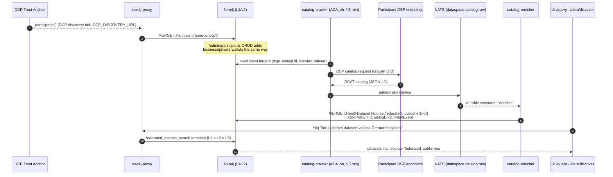

# Federated Catalog Discovery — Architecture

**Tracks:** [ADR-020](../ADRs/ADR-020-cross-participant-dataset-discovery.md) ·
[Issue #8](https://github.com/ma3u/MinimumViableHealthDataspacev2/issues/8) ·
Phase 26 in [planning-health-dataspace-v2.md](../planning-health-dataspace-v2.md)

How a natural-language question like _"find diabetes datasets across German
hospitals"_ reaches datasets published by participants we never pre-configured.

## Component flow

## Freshness SLA

The crawler runs as ACA job `mvhd-catalog-crawler` on a `*/5 * * * *`
schedule; the enricher consumes durably, so a participant added through
`/admin/participants` (or discovered via DCP) surfaces in Discover/NLQ within
**≤ 5 minutes** — no service restart anywhere. `HealthDataset.lastSeenAt`
records the last successful crawl per dataset.

## Privacy rules on the federated query path

Enforced in `services/neo4j-proxy/src/routes/federated.ts` (`POST /federated/query`):

1. **Read-only Cypher** — write patterns (incl. `CALL { CREATE … }`) are
   rejected with 403 before dispatch.
2. **Caller-side ODRL** — the caller's `odrlScope` is evaluated first:
   temporal validity (`checkOdrlTemporal`) and the re-identification
   prohibition heuristic (`checkReIdentification`, name × birth × geo).
3. **Row k-anonymity** — result groups smaller than
   `max(minK, MIN_COHORT_SIZE)` (default 5) are dropped (`filtered` count in
   the response).
4. **Contributor k-anonymity (dual-side)** — any contributor whose row count
   is non-zero but below `minK` is suppressed entirely, and because a missing
   contributor is itself identifying, the **global aggregate is suppressed
   with it**: `{ aggregateSuppressed: true, suppressionReason:
"contributor_k_violation" }`.
5. **Audit** — every federated query writes a `:QueryAuditEvent` with
   `federated: true`, `contributors: [labels]`, `aggregateSuppressed`, and
   `suppressionReason`, so EHDS Art. 53 transparency reports show _who we
   asked_ alongside _what we answered_.

### The same rules on every question

The Federated button on `/query` asks `POST /nlq` with `federated: true`, which
runs the template's Cypher on every SPE. Until 2026-10-30 that path merged the
answers without k-anonymity, so an age group of one person left as `count: 1`,
and a question asked of one SPE listed groups of one patient too. Every `/nlq`
answer, from one SPE or from several, and `/federated/query` now share
`services/neo4j-proxy/src/k-anonymity.ts`:

- An answer that does not read persons (no `Patient`, `OMOPPerson` or clinical
  label, including inside the Art. 71 label expression `(Patient)&!OptedOut`)
  is not filtered: a count of datasets identifies nobody.
- An aggregate answer (the Cypher counts) has every count below k shown as
  `"<5"`, and a percentage in the same row with it, as the Art. 69 statistics
  do (`ui/src/lib/statistics.ts`). `suppressionReason` is `"small_cells"`.
- A row-level answer gets rules 3 and 4 above.

The response carries `minKApplied`, `filtered`, `aggregateSuppressed` and
`suppressionReason`, the audit record the suppression, and `/query` shows it
as a `k = 5` badge. An Art. 69 statistic (`ui/src/lib/statistics.ts`) counts a
cell that arrives as `"<5"` among its suppressed cells.

A question about the SPEs themselves ("How many SPEs can I access?") is the
`spe_access` template: it asks every SPE, Federated button or not.

### Where the two SPEs run

| Stack                       | SPE-1 (AlphaKlinik Berlin)                            | SPE-2 (Limburg Medical Centre)                     |
| --------------------------- | ----------------------------------------------------- | -------------------------------------------------- |
| Compose                     | the hub graph `neo4j` (Bolt 7687)                     | `neo4j-spe2`, profile `federated` (Bolt 7688)      |
| Compose + `trustee` overlay | workspace `neo4j-spe1` (Bolt 7689), loaded per permit | `neo4j-spe2`, loaded per permit, store in memory   |
| Azure (ADR-069, phase 21)   | ACI confidential group `mvhd-spe-1`, Bolt with TLS    | ACI confidential group `mvhd-spe-2`, Bolt with TLS |
| GitHub Pages                | fixtures                                              | none                                               |

Each workspace holds its own half of the hub's synthetic patients (SPE-1 the
first half, SPE-2 the second, ordered by their ids), with their FHIR
records, OMOP rows and codes, the schema and its HealthDCAT-AP registration.
It never holds a record the Klarbefund app or a PID created or connected to.
`services/spe-loader` makes the extract from the hub graph, seals it with
AES-256-GCM under a key per permit and puts the key into the access body's
Trustee; the workspace gets the key only after attesting (ADR-068), decrypts
and loads, and records the attestation (`SpeAttestation`, `SpeEvent`). The
proxy shows them on `GET /spe/status` (read only) and its sync, every
minute, appends the events to the audit chain `spe` (ADR-045) and carries
the hub's Art. 71 opt-outs into the workspaces: a person who opts out after
the extract was sealed stops counting there within one sync interval
(ADR-062, ADR-069).

Locally: `docker compose -f docker-compose.yml -f docker-compose.jad.yml -f
docker-compose.trustee.yml --profile federated up -d --build`, with Trustee's
sample attester and the label "Simulated attestation". On Azure:
`scripts/azure/21-aci-confidential-spe.sh` (`--trustee`, `--extracts`,
`--policy`, `--workspaces`, `--wire-proxy`, `--check`): the SEV-SNP report's
HOST_DATA is the hash of the group's ccePolicy, which is the permit's policy
hash, so the label is "Attested: confidential workload". The proxy pins the
workspaces' CA, keeps retrying a workspace for ten minutes when it is not up,
and never asks the hub graph in its place; `offhours.sh` stops and starts
both groups with the stack (ADR-053, as extended by ADR-069). Without the
overlay or phase 21, SPE-1 is the hub graph and holds every patient, so a
federated total counts SPE-2's patients twice.

Publisher-side ODRL policies arrive verbatim as `:OdrlPolicy` nodes via the
enricher and are enforced at negotiation time (`/negotiate`); VC-gated
dataset visibility (e.g. requiring a DataQualityLabelCredential before a
dataset surfaces at all) stays on the Phase 26 deferred list alongside the
`federation-ops` Grafana board.

## Operational surfaces

| Surface                | Purpose                                                             |
| ---------------------- | ------------------------------------------------------------------- |
| `/admin/participants`  | Directory CRUD — add/remove crawl targets without restarts          |
| `/data/discover`       | Dual-source browse (EDC assets + HealthDCAT-AP, federated included) |
| `/query`               | NLQ incl. `federated_dataset_search` template                       |
| `/admin/audit`         | `:QueryAuditEvent` log incl. federated + suppression fields         |
| `GET /federated/stats` | Contributor/SPE health                                              |
