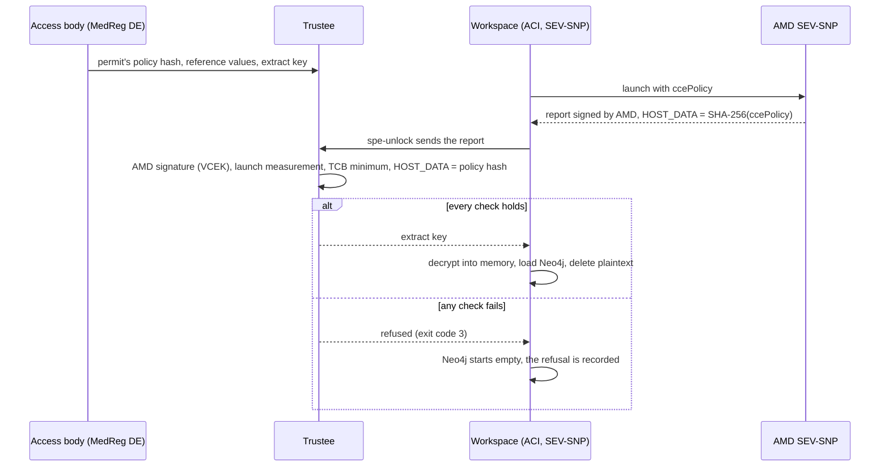

# The secure processing environment and its confidential containers

A data user never receives the patients' rows. They ask a question, the
question runs inside a **secure processing environment** (SPE) next to the
data, and only aggregates that pass the output checks come back (Regulation
(EU) 2025/327, Art. 73). This page explains how the hub builds that
environment from confidential containers, so that the claim "the operator
cannot read the data either" rests on hardware rather than on trust. It
covers what runs where, how a workspace gets its key, what a query goes
through, how to run it on a laptop and what is not done yet.

The decisions are [ADR-037](../ADRs/ADR-037-secure-processing-environment-confidential-computing.md)
(the pattern), [ADR-068](../ADRs/ADR-068-a-sovereign-confidential-spe-on-confidential-containers-and-trustee.md)
(the design), [ADR-069](../ADRs/ADR-069-two-spe-workspaces-as-aci-confidential-containers.md)
(the Azure deployment) and [ADR-072](../ADRs/ADR-072-spe-workspaces-start-on-demand.md)
(start on demand). The operator's step-by-step is the runbook
[SPE attestation on Azure](../knowledge/runbooks/spe-attestation-azure.md).

## 1. The idea in one paragraph

Each of the two data holders has a **workspace**: SPE-1 for AlphaKlinik
Berlin, SPE-2 for Limburg Medical Centre. A workspace is a confidential
container group: its memory is encrypted by the CPU (AMD SEV-SNP), and the
CPU signs a report of exactly what was started in it. The workspace's data
arrives sealed, and the key is held by a **Trustee** that the health data
access body (MedReg DE) runs. Trustee releases the key only when the signed
report proves that the workspace runs the code the data permit was issued
for. **No key, no data**: a changed image, command or environment variable
gives a different policy hash, and the key stays where it is.

## 2. The framework: CNCF Confidential Containers (CoCo)

The SPE is built on [Confidential Containers](https://confidentialcontainers.org/) (CoCo), a
[CNCF incubating project](https://www.cncf.io/blog/2026/07/22/confidential-containers-becomes-a-cncf-incubating-project/) since July 2026 that runs containers inside
hardware TEEs and releases secrets only to workloads that prove what they
are ([ADR-068](../ADRs/ADR-068-a-sovereign-confidential-spe-on-confidential-containers-and-trustee.md), decision 1). CoCo has three parts; the hub uses two
of them today:

| CoCo part                                                                           | What it is                                                                                                                                                                      | Used here                                                                                                                                                                                                                                                                                                                 |
| ----------------------------------------------------------------------------------- | ------------------------------------------------------------------------------------------------------------------------------------------------------------------------------- | ------------------------------------------------------------------------------------------------------------------------------------------------------------------------------------------------------------------------------------------------------------------------------------------------------------------------- |
| **[Trustee](https://github.com/confidential-containers/trustee)**                   | The key broker service (KBS), the attestation service (AS) and the reference value provider service (RVPS): it verifies a TEE's evidence and releases secrets against a policy. | Yes, v0.22.0, run by the access body: ACA app `mvhd-trustee` on Azure, service `trustee` in `docker-compose.trustee.yml` locally.                                                                                                                                                                                         |
| **[Guest components](https://github.com/confidential-containers/guest-components)** | What runs inside the TEE to collect the evidence and talk to Trustee: the attesters and `kbs-client`.                                                                           | Yes: the init container `spe-unlock` uses `kbs-client` with the SEV-SNP attester, patched to ask ACI for the plain report ([`kbs-client.aci.Dockerfile`](https://github.com/ma3u/MinimumViableHealthDataspacev2/blob/main/services/spe-loader/kbs-client.aci.Dockerfile)).                                                |
| **[Kata Containers](https://katacontainers.io/) runtime**                           | Starts each pod in its own confidential micro-VM, through a Kubernetes `RuntimeClass` or as peer pods on a cloud.                                                               | Not on Azure: the tenant policy refused AKS, and the peer pods' Azure tests are switched off. ACI's confidential container groups provide the SEV-SNP utility VM instead ([ADR-069](../ADRs/ADR-069-two-spe-workspaces-as-aci-confidential-containers.md)). On a Mac it is an optional local runtime check (ADR-068, M2). |

So on Azure the isolation comes from ACI, and the trust decision (which
workload gets a key) from CoCo's Trustee. Moving to Kata on Kubernetes later
changes the runtime and the policy generator (`genpolicy` instead of
`az confcom`), not Trustee, the permit or its policy hash.

## 3. Terms

| Term                       | What it is                                                                                                                                                                                                   |
| -------------------------- | ------------------------------------------------------------------------------------------------------------------------------------------------------------------------------------------------------------ |
| **Confidential computing** | Running code in a trusted execution environment (TEE) whose memory the host, the hypervisor and the cloud operator cannot read.                                                                              |
| **AMD SEV-SNP**            | The TEE the workspaces use (EPYC 9V74, Genoa). It encrypts the VM's memory and produces an attestation report signed by a key that chains back to AMD. Intel TDX is not used.                                |
| **Confidential container** | A container group that runs inside its own SEV-SNP utility VM. On Azure: an Azure Container Instances (ACI) group with `sku: Confidential`.                                                                  |
| **ccePolicy**              | The confidential computing enforcement policy of an ACI group: the images by digest, the commands, the environment and the mounts that may run. Generated with `az confcom acipolicygen`.                    |
| **HOST_DATA**              | A field of the SEV-SNP report set at launch. ACI puts the SHA-256 of the ccePolicy there, so the hardware vouches for which policy the group started with.                                                   |
| **Policy hash**            | That SHA-256, recorded on the permit (`HDABApproval.policyHash`) and in Trustee's resource policy. It binds a permit to one exact workload.                                                                  |
| **Trustee**                | The [CNCF Confidential Containers](https://confidentialcontainers.org/) key broker: KBS (key broker service), AS (attestation service) and RVPS (reference values). Version v0.22.0, run by the access body. |
| **Reference values**       | What Trustee compares the report against: the launch measurement of Microsoft's utility VM and the minimum TCB (firmware and microcode versions).                                                            |
| **Sealed extract**         | A workspace's half of the synthetic patients, format `mvhd-spe-extract/1`: JSON lines, gzipped, encrypted with AES-256-GCM under a new key per permit.                                                       |

## 4. Where it runs, and what each place proves

The design is the same everywhere; what differs is whether real hardware
signs the evidence. The UI says which, with one of three labels
([`ui/src/lib/spe.ts`](https://github.com/ma3u/MinimumViableHealthDataspacev2/blob/main/ui/src/lib/spe.ts)),
and never claims more than the evidence shows (ADR-068 decision 5).

| Where                        | What is real                                                                                                                                                                              | Label                             |
| ---------------------------- | ----------------------------------------------------------------------------------------------------------------------------------------------------------------------------------------- | --------------------------------- |
| **Laptop, CI, static demo**  | Trustee, the permit's hash in its policy, key release, the sealed extract, Neo4j loading it, the audit trail. Evidence comes from Trustee's sample attester, because a laptop has no TEE. | "Simulated attestation"           |
| **Azure, node level (A1)**   | SEV-SNP hardware with a measured boot, but not which container ran. Not deployed.                                                                                                         | "Attested: SEV-SNP node"          |
| **Azure, per workload (A2)** | ACI confidential containers in westeurope: the per-workload policy is checked by hardware. Ran end to end on 2026-11-02 (#774).                                                           | "Attested: confidential workload" |

The seeded `SPESession` nodes in the Trust Center graph
([`neo4j/seed-trust-center.cypher`](https://github.com/ma3u/MinimumViableHealthDataspacev2/blob/main/neo4j/seed-trust-center.cypher))
carry `simulated: true`; they illustrate the model and are not evidence.

## 5. The parts on Azure

| Part                      | Azure resource                                                  | What it does                                                                                                                       |
| ------------------------- | --------------------------------------------------------------- | ---------------------------------------------------------------------------------------------------------------------------------- |
| SPE-1, AlphaKlinik Berlin | ACI group `mvhd-spe-1`, `sku: Confidential`, westeurope         | init container `spe-unlock` attests and gets the key; `neo4j` holds the data; sidecar `spe-ingest` loads it                        |
| SPE-2, Limburg MC         | ACI group `mvhd-spe-2`, same shape                              | the same, with the other half of the synthetic patients                                                                            |
| Trustee (MedReg DE)       | ACA app `mvhd-trustee`, job `mvhd-trustee-admin`                | verifies the SEV-SNP evidence against AMD's chain, the reference values and HOST_DATA, then releases `default/spe-<n>/extract-key` |
| Trustee's state           | file shares `trustee-keys`, `trustee-data`                      | admin key, token key, policies, reference values, extract keys. Never the hub's Key Vault                                          |
| Sealed extracts           | share `spe-extracts`, baked into image `mvhd-spe-loader-spe<n>` | ciphertext only; the extract's digest is part of the policy hash                                                                   |
| Federation and audit      | ACA app `mvhd-neo4j-proxy`                                      | sends the federated questions to the workspaces, applies the output checks, appends their `spe.*` events to the audit chain        |

The group template is
[`scripts/azure/aci/spe-workspace.template.json`](https://github.com/ma3u/MinimumViableHealthDataspacev2/blob/main/scripts/azure/aci/spe-workspace.template.json).
Everything else in the hub stays on Azure Container Apps (ACA), which has no
confidential workload profile in an EU region yet. Azure Attestation and Key
Vault secure key release were considered and are deliberately **not** in the
key path: the access body, not the cloud operator, decides who gets a key
(ADR-068 decision 1, ADR-069 "Alternatives considered").

## 6. The chain of trust



1. **The permit fixes the workload.** `21-aci-confidential-spe.sh --policy`
   generates the ccePolicy from the template. Its SHA-256 is written to the
   permit (`HDABApproval`) and into Trustee's resource policy
   ([`trustee/policies/resource-azure.rego.tmpl`](https://github.com/ma3u/MinimumViableHealthDataspacev2/blob/main/trustee/policies/resource-azure.rego.tmpl)).
2. **The hardware vouches for it.** ACI launches the group in a SEV-SNP
   utility VM and puts the policy's hash into HOST_DATA of the signed report.
3. **Trustee checks four things:** the signature back to AMD (VCEK from
   AMD's key distribution service), the utility VM's launch measurement
   against a pinned reference value, the TCB against a minimum per component
   ([ADR-073](../ADRs/ADR-073-the-spe-tcb-is-a-minimum-not-a-list.md),
   [`attestation-ear-cpu.rego`](https://github.com/ma3u/MinimumViableHealthDataspacev2/blob/main/trustee/policies/attestation-ear-cpu.rego)),
   and HOST_DATA against the permit's hash.
4. **Only then does the key leave Trustee.** With no reference value pinned,
   the policy refuses: there is no "unlock on first use".

Secrets do not travel in the policy. They reach the group through its secret
volume, so rotating one does not change the hash.

## 7. Inside a workspace

Each group has three containers, built from
[`services/spe-loader`](https://github.com/ma3u/MinimumViableHealthDataspacev2/tree/main/services/spe-loader):

- **`spe-unlock`** (init container): attests with `kbs-client` built with the
  `snp-attester` feature, gets the key, decrypts the extract into the
  `emptyDir` volume `work`.
- **`neo4j`**: Neo4j 5.26 Community, 1.5 vCPU and 4 GiB, store in the
  `emptyDir` volume `neo4j-data`, Bolt with TLS required, HTTP off. Neo4j is
  **a workspace per permit, not a long-lived store** (ADR-068 decision 3): it
  holds the data only in memory and on ephemeral storage inside the TEE.
- **`spe-ingest`** (sidecar): loads the extract, applies
  `neo4j/init-schema.cypher` and the SPE's HealthDCAT-AP registration,
  deletes the plaintext, records the attestation, and stays up.

**The data.** Each workspace gets half of the hub's synthetic patients: the
FHIR records (Patient, Condition, Observation and the rest), the matching
OMOP CDM person with its records, and the concepts they are coded by. Sandbox
patients and the Klarbefund app's patients are left out. A patient's
`OptedOut` label travels with the data (Art. 71).

**Stopping is deleting.** The stores live in memory, so stopping or deleting
a group loses every row. Each start attests again and loads again. One trap:
`az container restart` does not re-run the init container, so a restarted
group never asks Trustee again; stop and start it instead
([`docs/gotchas.md`](../gotchas.md), 2026-11-01).

**The loader's commands** (`spe-loader <command>`): `policy-hash`,
`trustee-configure`, `record-permit`, `export`, `encrypt`, `extract`,
`unlock`, `ingest` and `load`. Exit code 3 means the key was refused; 2 means
a database or Trustee did not answer.

## 8. What a federated query goes through

1. A data user asks on `/query` or through natural language. The UI calls
   [`/api/federated`](https://github.com/ma3u/MinimumViableHealthDataspacev2/blob/main/ui/src/app/api/federated/route.ts)
   (or `/api/nlq` with `federated: true`).
2. **Cold start** ([ADR-072](../ADRs/ADR-072-spe-workspaces-start-on-demand.md)).
   The workspaces are stopped by default to save cost. A federated query by
   `EDC_ADMIN`, `HDAB_AUTHORITY` or `DATA_USER` starts them; until they are up
   the answer is **503** with `state` `starting` or `stopped`,
   `etaSeconds` (240 from stopped) and a `Retry-After` header. Measured: the
   key arrives after about a minute, the data is loaded after about three,
   SPE-2 answers after about four. The job `mvhd-spe-idle-stop` runs every
   15 minutes and stops a workspace idle for 30.
3. **The proxy fans out.** `services/neo4j-proxy` sends the question to both
   workspaces over Bolt with TLS (`POST /federated/query`,
   `GET /federated/stats`).
4. **Output checks before anything leaves.** Groups smaller than k are
   dropped and cells below k become `<k`, with k = 5 (`MIN_COHORT_SIZE`,
   [`k-anonymity.ts`](https://github.com/ma3u/MinimumViableHealthDataspacev2/blob/main/services/neo4j-proxy/src/k-anonymity.ts));
   opted-out patients are excluded
   ([`opt-out.ts`](https://github.com/ma3u/MinimumViableHealthDataspacev2/blob/main/services/neo4j-proxy/src/opt-out.ts)).
5. **Only aggregates return** to the UI, through the proxy.

**The audit trail.** The proxy reads each workspace's events every minute and
appends them to the hub's audit chain `spe` (ADR-045): `spe.attestation`,
`key_release`, `key_refused`, `workspace_loaded`, `workspace_destroyed` and
`optout_synced`.

**Where to see it in the UI**, signed in as `edcadmin`:

- `/admin/attestation`: the attestation of each workspace and its label.
- `/admin/components`: the SPE topology, with a power button per workspace.
- `/admin/audit`: the `spe` chain.
- `/admin/policies`: which permit is bound to which policy hash.
- `/query`: the cold-start notice while the workspaces start.

## 9. Running it on a laptop

Without the overlay below, SPE-1 is simply the hub graph and SPE-2 a second
Neo4j: federation works, but nothing is sealed or attested. To get the real
flow with simulated evidence, start the Trustee overlay on top of the JAD
stack ([`docker-compose.trustee.yml`](https://github.com/ma3u/MinimumViableHealthDataspacev2/blob/main/docker-compose.trustee.yml)):

```bash
docker compose -f docker-compose.yml -f docker-compose.jad.yml \
  -f docker-compose.trustee.yml --profile federated up -d --build
```

It adds Trustee on <http://localhost:8099>, sets its local policy and
reference values, seals both extracts and records their policy hashes on the
hub, moves both workspaces' stores to `tmpfs`, and runs `spe-loader-spe1` and
`spe-loader-spe2` to attest, unlock and load. Check the result with the
proxy's `GET http://localhost:9090/spe/status` or on `/admin/attestation`.

The tests that guard it, in CI and locally:

```bash
cd services/spe-loader && npm test        # Vitest: extract, seal, unlock, ingest
./scripts/test-trustee-policies.sh        # opa test over trustee/policies/
```

Both run in [`test.yml`](https://github.com/ma3u/MinimumViableHealthDataspacev2/blob/main/.github/workflows/test.yml)
(SPE Loader Tests, Trustee Policy Tests). The policy tests pin every case of
the resource policy, including HOST_DATA in the place where Trustee v0.22.0
puts it.

## 10. Deploying it on Azure

[`scripts/azure/21-aci-confidential-spe.sh`](https://github.com/ma3u/MinimumViableHealthDataspacev2/blob/main/scripts/azure/21-aci-confidential-spe.sh)
does it in phases, in this order: `--trustee`, `--extracts`, `--policy`,
`--workspaces`, `--wire-proxy`, `--check`. The runbook has the
prerequisites (a PIM role activated before `az login`, the one-hour session)
and what each phase prints; read it before the first run. Two phases protect
themselves: `--extracts` refuses to re-key while Trustee holds keys unless
`--rekey`, and `--trustee` keeps a resource policy that Trustee already holds.

## 11. What is not done yet

- **The access body does not yet run its own Trustee.** Trustee's shares sit
  in the hub's subscription, so the subscription owner could read them. For
  the sovereignty claim to hold, MedReg DE runs Trustee in a subscription of
  its own (ADR-069 decision 3).
- **Trust remains in AMD and in Microsoft's utility VM.** Microsoft's
  endorsement of the utility VM's measurement is compared by the operator,
  but its COSE signature is not verified cryptographically yet.
- **ADR-073 is proposed.** The TCB minimum and its tests are on `main`
  (#836); the ADR says it is not applied on Azure yet.
- **AKS is not an option today.** The tenant policy refused it
  (`RequestDisallowedByPolicy`); an exemption is requested. AKS confidential
  containers were also being retired by Microsoft (ADR-068).
- **Not decided** (ADR-068): which EU provider hosts the per-workload case
  outside Azure, and Trustee in a subscription of its own.

Issues: [#774](https://github.com/ma3u/MinimumViableHealthDataspacev2/issues/774)
(the Azure deployment), [#27](https://github.com/ma3u/MinimumViableHealthDataspacev2/issues/27),
[#481](https://github.com/ma3u/MinimumViableHealthDataspacev2/issues/481),
[#716](https://github.com/ma3u/MinimumViableHealthDataspacev2/issues/716),
[#833](https://github.com/ma3u/MinimumViableHealthDataspacev2/issues/833).

## 12. The decisions, in order

| ADR                                                                                               | Decision                                                                              | Status                |
| ------------------------------------------------------------------------------------------------- | ------------------------------------------------------------------------------------- | --------------------- |
| [ADR-037](../ADRs/ADR-037-secure-processing-environment-confidential-computing.md)                | Confidential containers with remote attestation, not trust in the operator            | Accepted              |
| [ADR-052](../ADRs/ADR-052-confidential-spe-on-azure-revisited.md)                                 | AKS with Kata and Azure Attestation                                                   | Superseded by ADR-068 |
| [ADR-068](../ADRs/ADR-068-a-sovereign-confidential-spe-on-confidential-containers-and-trustee.md) | CNCF Confidential Containers, a Trustee the access body runs, Neo4j loaded per permit | Accepted (2026-10-30) |
| [ADR-069](../ADRs/ADR-069-two-spe-workspaces-as-aci-confidential-containers.md)                   | Two workspaces as ACI confidential containers; the policy hash is HOST_DATA           | Accepted (2026-11-02) |
| [ADR-072](../ADRs/ADR-072-spe-workspaces-start-on-demand.md)                                      | Stopped by default, started by a federated query, stopped after 30 idle minutes       | Accepted (2026-11-02) |
| [ADR-073](../ADRs/ADR-073-the-spe-tcb-is-a-minimum-not-a-list.md)                                 | The SEV-SNP TCB is checked against a minimum per component                            | Proposed              |
