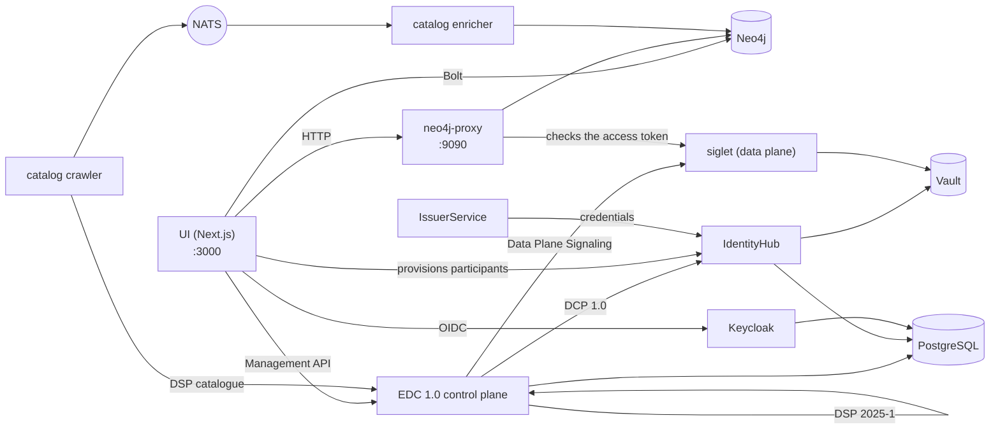

# The stack and the development environment

What each part of the hub is called, what it does and how the parts fit
together, followed by how to run them on a laptop. The decisions behind each
part are in the ADRs linked from its row; the full gotcha log is
[`docs/gotchas.md`](../gotchas.md).

## Glossary

### Protocols

| Term                                                                                          | What it is                                                                                                                                                                                                                                                                                                                                                   | Decision                                                                |
| --------------------------------------------------------------------------------------------- | ------------------------------------------------------------------------------------------------------------------------------------------------------------------------------------------------------------------------------------------------------------------------------------------------------------------------------------------------------------ | ----------------------------------------------------------------------- |
| **[DSP 2025-1](https://eclipse-dataspace-protocol-base.github.io/DataspaceProtocol/2025-1/)** | The Eclipse Dataspace Protocol, version 2025-1: how two connectors exchange a catalogue ([DCAT](https://www.w3.org/TR/vocab-dcat-3/)), negotiate a contract on an [ODRL](https://www.w3.org/TR/odrl-model/) offer and run a transfer. The control plane speaks it under `/api/dsp/<participant>/2025-1/`.                                                    | [ADR-007](../ADRs/ADR-007-did-web-dsp-negotiation.md)                   |
| **[DCP 1.0](https://eclipse-dataspace-dcp.github.io/decentralized-claims-protocol/v1.0/)**    | The Decentralised Claims Protocol: how a participant proves who it is. Each one has a [`did:web`](https://w3c-ccg.github.io/did-method-web/) DID and holds [verifiable credentials](https://www.w3.org/TR/vc-data-model-2.0/) (a `MembershipCredential`, EHDS role credentials); a counterparty asks for a presentation instead of trusting a central login. | [ADR-009](../ADRs/ADR-009-issuerservice-credential-fix.md)              |
| **[ODRL](https://www.w3.org/TR/odrl-model/) 2.2**                                             | The policy language of an offer: who may use a dataset, for what purpose, under which permit.                                                                                                                                                                                                                                                                | [ADR-013](../ADRs/ADR-013-simpl-open-alignment.md)                      |
| **[HealthDCAT-AP](https://data.health.europa.eu/healthdcat-ap/releases/release-8/)**          | The catalogue vocabulary for health datasets, Release 8 since [#700](https://github.com/ma3u/MinimumViableHealthDataspacev2/issues/700).                                                                                                                                                                                                                     | [ADR-063](../ADRs/ADR-063-healthdcat-ap-release-8-and-its-namespace.md) |
| **[did:web](https://w3c-ccg.github.io/did-method-web/)**                                      | A DID resolved over HTTPS. Two forms coexist, a stable one in the graph and the UI and a resolvable one in the EDC layer; [`api-conventions.md`](https://github.com/ma3u/MinimumViableHealthDataspacev2/blob/main/.claude/rules/api-conventions.md) explains which goes where.                                                                               | [ADR-007](../ADRs/ADR-007-did-web-dsp-negotiation.md)                   |

### The connector: EDC-V

| Term                                                                                  | What it is                                                                                                                                                                                                                                                                                                                                                                                                                                                                                                                                                     | Decision                                                                                                                                |
| ------------------------------------------------------------------------------------- | -------------------------------------------------------------------------------------------------------------------------------------------------------------------------------------------------------------------------------------------------------------------------------------------------------------------------------------------------------------------------------------------------------------------------------------------------------------------------------------------------------------------------------------------------------------- | --------------------------------------------------------------------------------------------------------------------------------------- |
| **EDC-V**                                                                             | Eclipse Dataspace Components, virtual: one multi-tenant EDC runtime in which every participant is a _participant context_ rather than its own connector. The hub runs [EDC 1.0](https://github.com/eclipse-edc/Connector/releases/tag/v1.0.0-RC5) (`1.0.0-RC5`): the control plane, IdentityHub and IssuerService are its own launchers, built from [`runtimes/edc`](../../runtimes/edc). EDC 0.18 from the JAD images starts only under the compose profile `edc018`, retired with [#927](https://github.com/ma3u/MinimumViableHealthDataspacev2/issues/927). | [ADR-024](../ADRs/ADR-024-full-edc-provisioning-per-participant.md), [ADR-078](../ADRs/ADR-078-edc-1-on-container-apps-without-cfm.md)  |
| **Control plane**                                                                     | The EDC runtime that holds assets, policies and contract definitions, negotiates contracts over DSP and starts transfers (`controlplane` in [`docker-compose.jad.yml`](../../docker-compose.jad.yml#L277)). Management API on `:11003`.                                                                                                                                                                                                                                                                                                                        | [ADR-002](../ADRs/ADR-002-edc-data-plane-architecture.md), [ADR-078](../ADRs/ADR-078-edc-1-on-container-apps-without-cfm.md)            |
| **Siglet**                                                                            | The data plane on EDC 1.0: [siglet 0.1.6](https://github.com/eclipse-dataplane-core/dsdk-facet-rs/releases/tag/siglet-v0.1.6) from Eclipse Dataplane Core. The control plane signals it per participant context; it issues the access token (EDR) of a transfer, and the neo4j-proxy serves the data at `/dataspace/data` after checking that token against siglet's keys ([`jad/siglet-edc1.toml`](../../jad/siglet-edc1.toml)). No host port.                                                                                                                | [ADR-078](../ADRs/ADR-078-edc-1-on-container-apps-without-cfm.md#decision)                                                              |
| **[IdentityHub](https://github.com/eclipse-edc/IdentityHub/releases/tag/v1.0.0-RC5)** | Each participant's DCP wallet: its DID document, its keys (in Vault) and the credentials it holds; it answers presentation requests. `:11005`.                                                                                                                                                                                                                                                                                                                                                                                                                 | [ADR-009](../ADRs/ADR-009-issuerservice-credential-fix.md)                                                                              |
| **IssuerService**                                                                     | The hub's credential issuer: it holds the credential definitions and issues credentials to holders over DCP. `:10013`. A second instance, `simpl-ga-issuer` (`:10023`), plays the [Simpl](https://code.europa.eu/simpl/simpl-open) governance authority; `rogue-issuer` (`:10033`) is on no trust list and only starts for the identity checks.                                                                                                                                                                                                                | [ADR-009](../ADRs/ADR-009-issuerservice-credential-fix.md), [ADR-064](../ADRs/ADR-064-simpl-open-through-the-outside-agent-dcp-path.md) |
| **DCore data planes**                                                                 | EDC 0.18 only, under the `edc018` profile: `dataplane-fhir` pushed FHIR R4 (`:11002`), `dataplane-omop` served OMOP CDM by pull (`:11012`), each checking the EDR token of a request.                                                                                                                                                                                                                                                                                                                                                                          | [ADR-002](../ADRs/ADR-002-edc-data-plane-architecture.md)                                                                               |

### Running it: JAD and CFM

| Term                                                                     | What it is                                                                                                                                                                                                                                                                                                                                                                                                                                                                                                                                                                                                                                                                                                                                  | Decision                                                                                                                            |
| ------------------------------------------------------------------------ | ------------------------------------------------------------------------------------------------------------------------------------------------------------------------------------------------------------------------------------------------------------------------------------------------------------------------------------------------------------------------------------------------------------------------------------------------------------------------------------------------------------------------------------------------------------------------------------------------------------------------------------------------------------------------------------------------------------------------------------------- | ----------------------------------------------------------------------------------------------------------------------------------- |
| **JAD**                                                                  | Just Another Demonstrator: the [Eclipse demonstrator](https://github.com/eclipse-dataspace-hub/jad) that deploys a whole dataspace as a service on Kubernetes. The hub brought its layout to Docker Compose: here JAD is [`docker-compose.jad.yml`](../../docker-compose.jad.yml) plus the seeds and configuration in [`jad/`](../../jad), layered on [`docker-compose.yml`](../../docker-compose.yml). Its images (`ghcr.io/metaform/jad/*`) remain only under the `edc018` profile. Azure runs the same build.                                                                                                                                                                                                                            | [ADR-055](../ADRs/ADR-055-azure-runs-the-compose-jad-build.md), [ADR-078](../ADRs/ADR-078-edc-1-on-container-apps-without-cfm.md)   |
| **CFM**                                                                  | The Connector Fabric Manager, the management plane above EDC-V on EDC 0.18: the **tenant manager** (`:11006`) created a tenant per organisation, the **provision manager** (`:11007`) provisioned it, and four **agents** did the work (Keycloak client, participant context, registration, onboarding), with [`cfm-cp-shim`](../../docker-compose.jad.yml#L934) bridging the agents to the control plane's API version. EDC 1.0 runs without it: the 2026-03 agents call IdentityHub and IssuerService APIs that 1.0 no longer has, so the hub provisions participants itself. CFM, its agents and the shim start only under the `edc018` profile, retired with [#927](https://github.com/ma3u/MinimumViableHealthDataspacev2/issues/927). | [ADR-078](../ADRs/ADR-078-edc-1-on-container-apps-without-cfm.md#context), [ADR-005](../ADRs/ADR-005-jad-cfm-source-builds.md)      |
| **Vault**                                                                | [HashiCorp Vault](https://github.com/hashicorp/vault/releases/tag/v2.0.0) holds every participant's private keys and the EDC secrets. File-backed locally since 2026-09-26 ([`jad/vault.hcl`](../../jad/vault.hcl), with a `vault-unseal` sidecar), on the [Flexible Server](https://learn.microsoft.com/en-us/azure/postgresql/flexible-server/overview) on Azure. Never [`-dev`](https://developer.hashicorp.com/vault/docs/concepts/dev-server): a restart would take every key.                                                                                                                                                                                                                                                         | [ADR-046](../ADRs/ADR-046-vault-keeps-its-state-on-the-flexible-server.md), [ADR-047](../ADRs/ADR-047-vault-stays-up-off-hours.md)  |
| **[Keycloak](https://github.com/keycloak/keycloak/releases/tag/26.8.0)** | [OIDC](https://openid.net/specs/openid-connect-core-1_0.html) sign-in for the UI and the service clients, realm `edcv`, `:8080`. The UI client is confidential with [PKCE S256](https://datatracker.ietf.org/doc/html/rfc7636#section-4.2).                                                                                                                                                                                                                                                                                                                                                                                                                                                                                                 | [ADR-025](../ADRs/ADR-025-keycloak-custom-domain.md)                                                                                |
| **[PostgreSQL](https://www.postgresql.org/docs/release/17.7/)**          | The runtime store of the EDC services and Keycloak, one database each ([`jad/init-postgres.sql`](../../jad/init-postgres.sql)). The [Flexible Server](https://learn.microsoft.com/en-us/azure/postgresql/flexible-server/overview) on Azure.                                                                                                                                                                                                                                                                                                                                                                                                                                                                                                | [ADR-001](../ADRs/ADR-001-postgresql-neo4j-split.md), [ADR-041](../ADRs/ADR-041-managed-postgres-on-azure-containerised-locally.md) |
| **[NATS](https://github.com/nats-io/nats-server/releases/tag/v2.14.3)**  | The event mesh ([JetStream](https://docs.nats.io/nats-concepts/jetstream)) between the catalogue crawler and enricher, and under `edc018` between CFM's managers and agents. `:4222`.                                                                                                                                                                                                                                                                                                                                                                                                                                                                                                                                                       | [ADR-020](../ADRs/ADR-020-cross-participant-dataset-discovery.md)                                                                   |
| **[Traefik](https://doc.traefik.io/traefik/v3.7/)**                      | The gateway in front of the JAD services, `:80`, dashboard on `:8090`.                                                                                                                                                                                                                                                                                                                                                                                                                                                                                                                                                                                                                                                                      |                                                                                                                                     |

### The hub's own services

| Term                        | What it is                                                                                                                                                                                                                                                                                                                                                                                                                                                                                                                                                                                                                                                                                                                                                                                                                                                                                                                                                                                              | Decision                                                                                                                                                                             |
| --------------------------- | ------------------------------------------------------------------------------------------------------------------------------------------------------------------------------------------------------------------------------------------------------------------------------------------------------------------------------------------------------------------------------------------------------------------------------------------------------------------------------------------------------------------------------------------------------------------------------------------------------------------------------------------------------------------------------------------------------------------------------------------------------------------------------------------------------------------------------------------------------------------------------------------------------------------------------------------------------------------------------------------------------- | ------------------------------------------------------------------------------------------------------------------------------------------------------------------------------------ |
| **UI**                      | The [Next.js](https://github.com/vercel/next.js/releases/tag/v15.5.28) app in [`ui/`](../../ui): every persona's pages and the `/api/*` routes behind them. Container `health-dataspace-ui`.                                                                                                                                                                                                                                                                                                                                                                                                                                                                                                                                                                                                                                                                                                                                                                                                            | [ADR-004](../ADRs/ADR-004-nextjs-unified-frontend.md), [ADR-044](../ADRs/ADR-044-every-api-route-needs-a-session.md)                                                                 |
| **Neo4j**                   | The knowledge graph of five layers: marketplace (DSP), [HealthDCAT-AP](https://data.health.europa.eu/healthdcat-ap/releases/release-8/), [FHIR R4](https://hl7.org/fhir/R4/), [OMOP CDM](https://ohdsi.github.io/CommonDataModel/cdm54.html) and ontologies. [Neo4j 5.26](https://neo4j.com/release-notes/database/neo4j-5/) LTS Community with [APOC](https://neo4j.com/docs/apoc/5/), [APOC Extended](https://github.com/neo4j-contrib/neo4j-apoc-procedures), [Graph Data Science](https://neo4j.com/docs/graph-data-science/current/) and [n10s](https://neo4j.com/labs/neosemantics/). No object mapper or GraphQL layer: the UI, the proxy and the SPE loader use the official [`neo4j-driver`](https://neo4j.com/docs/javascript-manual/current/) with parameterised Cypher ([`runQuery()`](../../ui/src/lib/neo4j.ts#L65) in `ui/src/lib/neo4j.ts`), the catalogue services the official [`neo4j`](https://neo4j.com/docs/python-manual/current/) Python driver. `:7474` browser, `:7687` Bolt. | [ADR-001](../ADRs/ADR-001-postgresql-neo4j-split.md), [ADR-030](../ADRs/ADR-030-neo4j-2025-lts-migration.md), [ADR-043](../ADRs/ADR-043-graph-access-direct-or-through-the-proxy.md) |
| **neo4j-proxy**             | [`services/neo4j-proxy/`](../../services/neo4j-proxy), [Express](https://expressjs.com/en/5x/api.html) on `:9090`: the FHIR and OMOP endpoints a transfer reads (`/dataspace/data`), the natural-language query engine, the federated query and the catalogue in HealthDCAT-AP.                                                                                                                                                                                                                                                                                                                                                                                                                                                                                                                                                                                                                                                                                                                         | [ADR-043](../ADRs/ADR-043-graph-access-direct-or-through-the-proxy.md)                                                                                                               |
| **Catalog crawler**         | [`services/catalog-crawler/`](../../services/catalog-crawler), Python: fetches each participant's DSP catalogue every five minutes and publishes it on NATS (`dataspace.catalog.raw`).                                                                                                                                                                                                                                                                                                                                                                                                                                                                                                                                                                                                                                                                                                                                                                                                                  | [ADR-020](../ADRs/ADR-020-cross-participant-dataset-discovery.md)                                                                                                                    |
| **Catalog enricher**        | [`services/catalog-enricher/`](../../services/catalog-enricher), Python: reads those catalogues off NATS, maps them to HealthDCAT-AP and merges them into Neo4j as `:HealthDataset` nodes, so a question about datasets reaches every participant's.                                                                                                                                                                                                                                                                                                                                                                                                                                                                                                                                                                                                                                                                                                                                                    | [ADR-020](../ADRs/ADR-020-cross-participant-dataset-discovery.md), [ADR-003](../ADRs/ADR-003-healthdcat-ap-alignment.md)                                                             |
| **SPE workspaces, Trustee** | [`services/spe-loader/`](../../services/spe-loader) and [`trustee/`](../../trustee): the two secure processing environments ([Art. 73](https://eur-lex.europa.eu/eli/reg/2025/327/oj/eng#art_73)), confidential containers with [AMD SEV-SNP](https://docs.kernel.org/arch/x86/amd-memory-encryption.html#secure-nested-paging-snp) on Azure, whose sealed data a Trustee run by the access body unlocks only for the workload the permit names. See [the secure processing environment](secure-processing-environment.md).                                                                                                                                                                                                                                                                                                                                                                                                                                                                             | [ADR-068](../ADRs/ADR-068-a-sovereign-confidential-spe-on-confidential-containers-and-trustee.md), [ADR-069](../ADRs/ADR-069-two-spe-workspaces-as-aci-confidential-containers.md)   |
| **Klarbefund**              | The iPhone app in [`clients/ios/`](../../clients/ios): scans a lab report on the device and connects to the hub as the patient's EHR.                                                                                                                                                                                                                                                                                                                                                                                                                                                                                                                                                                                                                                                                                                                                                                                                                                                                   | [ADR-033](../ADRs/ADR-033-lab-report-extraction-pipeline.md), [ADR-049](../ADRs/ADR-049-klarbefund-connects-by-device-grant.md)                                                      |

### How they fit together



A participant is created once, by the hub itself ([`ui/src/lib/edc/provision.ts`](../../ui/src/lib/edc/provision.ts), behind
`POST /api/participants`; [ADR-078](../ADRs/ADR-078-edc-1-on-container-apps-without-cfm.md#decision)): a participant context on the
control plane, the same participant with its DID and keys in the IdentityHub,
its DSP profile, a holder on the IssuerService, and a MembershipCredential
issued over DCP. A failed step undoes the ones before it; seed phase 1 runs
the same sequence. From then on the control plane negotiates on its behalf
over DSP, proving who it is over DCP; once a contract holds, siglet issues the
access token and the neo4j-proxy serves the data against it. The UI reads the
graph directly for its pages and goes through the control plane for anything
that is an exchange. Under the `edc018` profile CFM created participants
instead.

## Development environment

### Prerequisites

| Need                                                                                                                                                                                                            | For                                                                                                                                         |
| --------------------------------------------------------------------------------------------------------------------------------------------------------------------------------------------------------------- | ------------------------------------------------------------------------------------------------------------------------------------------- |
| [Node.js](https://nodejs.org/en/about/previous-releases) 22 or later, npm                                                                                                                                       | the UI and the Neo4j proxy ([`engines`](../../services/neo4j-proxy/package.json#L47), [`ui/Dockerfile`](../../ui/Dockerfile#L1))            |
| Docker with [Compose v2](https://docs.docker.com/compose/)                                                                                                                                                      | Neo4j, and the full JAD stack; give Docker **8 GB of memory** for JAD                                                                       |
| [Python](https://docs.python.org/3.12/) 3.12 or later                                                                                                                                                           | the repository's checks (`scripts/*.py`) and the catalogue services ([`requires-python`](../../services/catalog-crawler/pyproject.toml#L5)) |
| [`pre-commit`](https://pre-commit.com/)                                                                                                                                                                         | the hooks: `pip install pre-commit && pre-commit install --hook-type pre-commit --hook-type pre-push`                                       |
| [gitleaks](https://github.com/gitleaks/gitleaks/releases/tag/v8.29.0), [semgrep](https://semgrep.dev/docs/), [actionlint](https://github.com/rhysd/actionlint), [lychee](https://github.com/lycheeverse/lychee) | optional locally (each hook warns and skips without it); the PR Gate runs what matters                                                      |
| [Xcode 27](https://developer.apple.com/xcode/) and [`xcodegen`](https://github.com/yonaskolb/XcodeGen)                                                                                                          | only for the iPhone app ([iOS 26](../../clients/ios/project.yml#L6) SDK)                                                                    |

### Two ways to run it

| Stack        | Start                                                                                                                                                                                        | What you get                                                                                                            |
| ------------ | -------------------------------------------------------------------------------------------------------------------------------------------------------------------------------------------- | ----------------------------------------------------------------------------------------------------------------------- |
| **Minimal**  | `docker compose up -d neo4j`, load the schema and data, `cd ui && npm install && npm run dev`                                                                                                | the graph and every page that reads it, at http://localhost:3000; no Keycloak, so sign-in needs the static persona mode |
| **Full JAD** | `docker compose -f docker-compose.yml -f docker-compose.jad.yml up -d`, then [`./scripts/bootstrap-jad.sh`](../../scripts/bootstrap-jad.sh) and [`./jad/seed-all.sh`](../../jad/seed-all.sh) | every service in the glossary, the UI container on http://localhost:3003, sign-in through Keycloak                      |

Loading the graph for the minimal stack (both files, [`neo4j/init-schema.cypher`](../../neo4j/init-schema.cypher) and [`neo4j/insert-synthetic-schema-data.cypher`](../../neo4j/insert-synthetic-schema-data.cypher), are idempotent):

```bash
cat neo4j/init-schema.cypher | docker exec -i health-dataspace-neo4j \
  cypher-shell -u neo4j -p healthdataspace
cat neo4j/insert-synthetic-schema-data.cypher | docker exec -i health-dataspace-neo4j \
  cypher-shell -u neo4j -p healthdataspace
```

`docker compose up -d` without a service name also builds the UI as the
container `health-dataspace-ui` on `:3000` and `:3003`; start only `neo4j`
when you want `npm run dev` on `:3000`.

### The seed phases, in order

[`./jad/seed-all.sh`](../../jad/seed-all.sh) runs seven phases, and each needs the one before it, so a
failed phase invalidates every later one. Resume with `--from N`, run one with
`--only N`.

| Phase | Script                                                                      | Does                                                                                                                                                                               |
| ----: | --------------------------------------------------------------------------- | ---------------------------------------------------------------------------------------------------------------------------------------------------------------------------------- |
|     1 | [`../scripts/seed-identity-layer.sh`](../../scripts/seed-identity-layer.sh) | the five participants on EDC 1.0: control plane contexts, IdentityHub, the issuer's identity, holders, a MembershipCredential each (0.18 ran `seed-health-tenants.sh` through CFM) |
|     2 | [`seed-ehds-credentials.sh`](../../jad/seed-ehds-credentials.sh)            | the EHDS credential types on the IssuerService                                                                                                                                     |
|     3 | [`seed-ehds-policies.sh`](../../jad/seed-ehds-policies.sh)                  | ODRL policies for every participant                                                                                                                                                |
|     4 | [`seed-data-assets.sh`](../../jad/seed-data-assets.sh)                      | data assets and contract definitions on EDC-V                                                                                                                                      |
|     5 | [`seed-contract-negotiation.sh`](../../jad/seed-contract-negotiation.sh)    | siglet as each participant's data plane, then PharmaCo to AlphaKlinik negotiations, one of them refused (TERMINATED)                                                               |
|     6 | [`seed-federated-catalog.sh`](../../jad/seed-federated-catalog.sh)          | MedReg to Limburg Medical Centre catalogue negotiation                                                                                                                             |
|     7 | [`seed-data-transfer.sh`](../../jad/seed-data-transfer.sh)                  | EDR tokens from siglet and the transfers the neo4j-proxy serves                                                                                                                    |

The runbook is [JAD stack seeding](../knowledge/runbooks/jad-stack-seeding.md).

### Ports

| Port       | Service                             | Port     | Service                              |
| ---------- | ----------------------------------- | -------- | ------------------------------------ |
| 3000       | UI (`npm run dev` or the container) | 11003    | control plane, Management API        |
| 3003       | UI container (JAD)                  | 11005    | IdentityHub                          |
| 7474, 7687 | Neo4j browser, Bolt                 | 10013    | IssuerService                        |
| 8080, 9000 | Keycloak, its management port       | 10023    | Simpl GA issuer                      |
| 8200       | Vault                               | 10033    | rogue issuer (profile `trust-check`) |
| 9090       | neo4j-proxy                         | 80, 8090 | Traefik, its dashboard               |
| 4222, 8222 | NATS, its monitoring                | 5432     | PostgreSQL                           |

Siglet has no host port. The `edc018` profile adds 11002 and 11012 (the DCore data planes) and 11006, 11007 (CFM's tenant and provision managers).

### Environment variables

The UI reads its configuration from the environment; [`ui/.env.example`](../../ui/.env.example) and
[`ui/.env.local.example`](../../ui/.env.local.example) are the templates to copy. The ones you meet first:

| Variable                                                                                                          | What it sets                                                                                                                                   |
| ----------------------------------------------------------------------------------------------------------------- | ---------------------------------------------------------------------------------------------------------------------------------------------- |
| `NEO4J_URI`, `NEO4J_USER`, `NEO4J_PASSWORD`                                                                       | the graph; `neo4j` / `healthdataspace` is for local development only                                                                           |
| `NEO4J_PROXY_URL`                                                                                                 | the proxy, `http://localhost:9090` by default ([`ui/src/lib/proxy.ts`](../../ui/src/lib/proxy.ts#L8))                                          |
| `NEXTAUTH_URL`, `NEXTAUTH_SECRET`                                                                                 | [NextAuth](https://next-auth.js.org/); the secret also signs the sessions the API tests forge                                                  |
| `KEYCLOAK_PUBLIC_URL`, `KEYCLOAK_INTERNAL_URL`, `KEYCLOAK_ISSUER`, `KEYCLOAK_CLIENT_ID`, `KEYCLOAK_CLIENT_SECRET` | sign-in; never `wellKnown` (gotcha 5 in [`CLAUDE.md`](../../CLAUDE.md#L71))                                                                    |
| `EDC_MANAGEMENT_URL`, `EDC_IDENTITY_URL`, `EDC_ISSUER_URL`, `EDC_TENANT_URL`, `EDC_PROVISION_URL`                 | the EDC services ([`docker-compose.yml`](../../docker-compose.yml#L78-L82)); the last two point at CFM, which only the `edc018` profile starts |
| `CFM_TENANT_URL`, `CFM_CLIENT_SECRET`                                                                             | set, `/onboarding` provisions through CFM ([ADR-085](../ADRs/ADR-085-cfm-stays-as-eclipse-cfm-releases.md)); unset, the hub itself             |
| `NEXT_PUBLIC_STATIC_EXPORT=true`                                                                                  | the GitHub Pages build: no API routes, fixtures from [`ui/public/mock/`](../../ui/public/mock)                                                 |

### The iPhone app

[`clients/ios/`](../../clients/ios) is a Swift package and an [XcodeGen](https://github.com/yonaskolb/XcodeGen) project; it does not need
the hub to build or to run its tests.

```bash
cd clients/ios
brew install xcodegen      # once
swift test                 # the parser and provenance model
xcodegen generate && open MeinBefund.xcodeproj
```

The simulator build needs an ad-hoc signature (`CODE_SIGN_IDENTITY="-"`) or
every Keychain call fails. A device build and a TestFlight upload need an Apple
Developer team: [`Scripts/install-device.sh`](../../clients/ios/Scripts/install-device.sh), [`Scripts/archive-and-upload.sh`](../../clients/ios/Scripts/archive-and-upload.sh).
The [Klarbefund developer guide](../klarbefund/developer-guide.md) has the
rest, and [`Scripts/run-ui-tests.sh`](../../clients/ios/Scripts/run-ui-tests.sh) runs the on-screen tests.

### Gotchas worth knowing on day one

The full log, dated, is [`docs/gotchas.md`](../gotchas.md). The ones that cost
the most time:

- **Vault must keep its state.** If the IdentityHub logs `Private key ... not
found`, check that [`health-dataspace-vault-unseal`](../../docker-compose.jad.yml#L138) reported `ready`.
- **Seed phases are strictly ordered**; resume a failed run with [`--from`](../../jad/seed-all.sh#L71).
- **The static export has no API routes.** Every page that reads `/api/...`
  needs a fixture in [`ui/public/mock/`](../../ui/public/mock), and a test fails without one.
- **Pre-commit rewrites files** ([Prettier](https://prettier.io/), the docs facts). Stage them again
  and commit again; check that `HEAD` moved.
- **A 200 from Keycloak discovery proves nothing**: it is cached. Prove sign-in
  with [`scripts/azure/check-keycloak-health.sh`](../../scripts/azure/check-keycloak-health.sh).
- **Container Apps cache [`:latest`](../../CLAUDE.md#L75)**; a deploy pushes a new revision rather
  than restarting.
