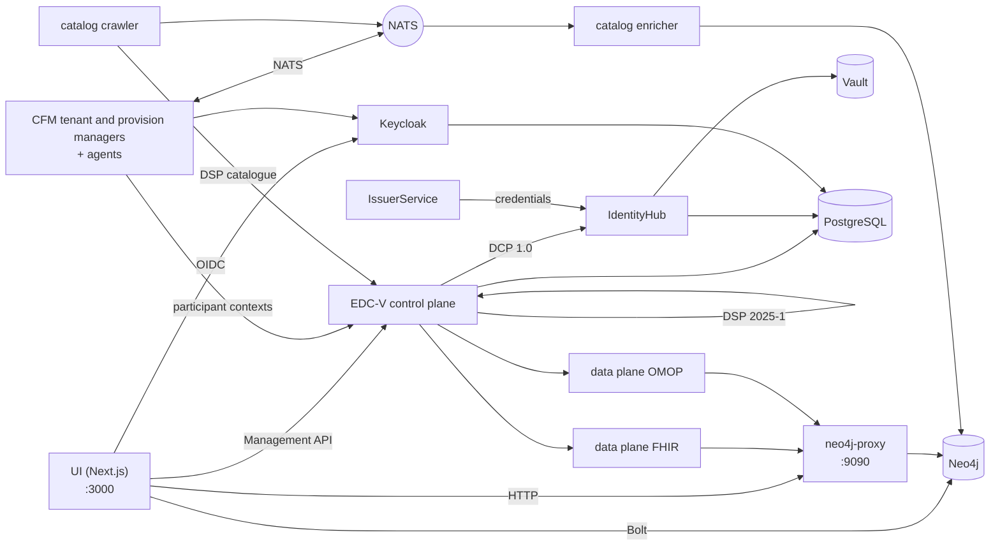

# The stack and the development environment

What each part of the hub is called, what it does and how the parts fit
together, followed by how to run them on a laptop. The decisions behind each
part are in the ADRs linked from its row; the full gotcha log is
[`docs/gotchas.md`](../gotchas.md).

## Glossary

### Protocols

| Term              | What it is                                                                                                                                                                                                                                                                     | Decision                                                                |
| ----------------- | ------------------------------------------------------------------------------------------------------------------------------------------------------------------------------------------------------------------------------------------------------------------------------ | ----------------------------------------------------------------------- |
| **DSP 2025-1**    | The Eclipse Dataspace Protocol, version 2025-1: how two connectors exchange a catalogue (DCAT), negotiate a contract on an ODRL offer and run a transfer. The control plane speaks it under `/api/dsp/<participant>/2025-1/`.                                                  | [ADR-007](../ADRs/ADR-007-did-web-dsp-negotiation.md)                   |
| **DCP 1.0**       | The Decentralised Claims Protocol: how a participant proves who it is. Each one has a `did:web` DID and holds verifiable credentials (a `MembershipCredential`, EHDS role credentials); a counterparty asks for a presentation instead of trusting a central login.            | [ADR-009](../ADRs/ADR-009-issuerservice-credential-fix.md)              |
| **ODRL 2.2**      | The policy language of an offer: who may use a dataset, for what purpose, under which permit.                                                                                                                                                                                  | [ADR-013](../ADRs/ADR-013-simpl-open-alignment.md)                      |
| **HealthDCAT-AP** | The catalogue vocabulary for health datasets, Release 8 since #700.                                                                                                                                                                                                            | [ADR-063](../ADRs/ADR-063-healthdcat-ap-release-8-and-its-namespace.md) |
| **did:web**       | A DID resolved over HTTPS. Two forms coexist, a stable one in the graph and the UI and a resolvable one in the EDC layer; [`api-conventions.md`](https://github.com/ma3u/MinimumViableHealthDataspacev2/blob/main/.claude/rules/api-conventions.md) explains which goes where. | [ADR-007](../ADRs/ADR-007-did-web-dsp-negotiation.md)                   |

### The connector: EDC-V

| Term              | What it is                                                                                                                                                                                                                                                                                           | Decision                                                                                                                                |
| ----------------- | ---------------------------------------------------------------------------------------------------------------------------------------------------------------------------------------------------------------------------------------------------------------------------------------------------- | --------------------------------------------------------------------------------------------------------------------------------------- |
| **EDC-V**         | Eclipse Dataspace Components, virtual: one multi-tenant EDC runtime in which every participant is a _participant context_ rather than its own connector. The hub runs EDC 0.18 from the JAD images.                                                                                                  | [ADR-024](../ADRs/ADR-024-full-edc-provisioning-per-participant.md), [ADR-055](../ADRs/ADR-055-azure-runs-the-compose-jad-build.md)     |
| **Control plane** | The EDC-V runtime that holds assets, policies and contract definitions, negotiates contracts over DSP and starts transfers. Management API on `:11003`.                                                                                                                                              | [ADR-002](../ADRs/ADR-002-edc-data-plane-architecture.md)                                                                               |
| **Data planes**   | Two, one per transfer type: `dataplane-fhir` pushes FHIR R4 (`:11002`), `dataplane-omop` serves OMOP CDM by pull (`:11012`). They move the data the control plane agreed on and check the EDR token of each request.                                                                                 | [ADR-002](../ADRs/ADR-002-edc-data-plane-architecture.md)                                                                               |
| **IdentityHub**   | Each participant's DCP wallet: its DID document, its keys (in Vault) and the credentials it holds; it answers presentation requests. `:11005`.                                                                                                                                                       | [ADR-009](../ADRs/ADR-009-issuerservice-credential-fix.md)                                                                              |
| **IssuerService** | The hub's credential issuer: it holds the credential definitions and issues credentials to holders over DCP. `:10013`. A second instance, `simpl-ga-issuer` (`:10023`), plays the Simpl governance authority; `rogue-issuer` (`:10033`) is on no trust list and only starts for the identity checks. | [ADR-009](../ADRs/ADR-009-issuerservice-credential-fix.md), [ADR-064](../ADRs/ADR-064-simpl-open-through-the-outside-agent-dcp-path.md) |
| **Siglet**        | Signs the tokens of the EDC 0.18 data planes (Eclipse Dataplane Core).                                                                                                                                                                                                                               | [ADR-055](../ADRs/ADR-055-azure-runs-the-compose-jad-build.md)                                                                          |

### Running it: JAD and CFM

| Term           | What it is                                                                                                                                                                                                                                                                                                                                                                     | Decision                                                                                                                            |
| -------------- | ------------------------------------------------------------------------------------------------------------------------------------------------------------------------------------------------------------------------------------------------------------------------------------------------------------------------------------------------------------------------------ | ----------------------------------------------------------------------------------------------------------------------------------- |
| **JAD**        | The Joint Architecture Demo: the reference EDC-V deployment (`ghcr.io/metaform/jad/*` images, pinned by commit). Here it is `docker-compose.jad.yml` plus the seeds and configuration in `jad/`, layered on `docker-compose.yml`. Azure runs the same build.                                                                                                                   | [ADR-005](../ADRs/ADR-005-jad-cfm-source-builds.md), [ADR-055](../ADRs/ADR-055-azure-runs-the-compose-jad-build.md)                 |
| **CFM**        | The Connector Fabric Manager, the management plane above EDC-V: the **tenant manager** (`:11006`) creates a tenant per organisation, the **provision manager** (`:11007`) provisions what it needs, and four **agents** do the work (Keycloak client, EDC-V participant context, registration, onboarding). `cfm-cp-shim` bridges the pinned agents to EDC 0.18's API version. | [ADR-005](../ADRs/ADR-005-jad-cfm-source-builds.md)                                                                                 |
| **Vault**      | HashiCorp Vault holds every participant's private keys and the EDC secrets. File-backed locally since 2026-09-26 (`jad/vault.hcl`, with a `vault-unseal` sidecar), on the Flexible Server on Azure. Never `-dev`: a restart would take every key.                                                                                                                              | [ADR-046](../ADRs/ADR-046-vault-keeps-its-state-on-the-flexible-server.md), [ADR-047](../ADRs/ADR-047-vault-stays-up-off-hours.md)  |
| **Keycloak**   | OIDC sign-in for the UI and the service clients, realm `edcv`, `:8080`. The UI client is confidential with PKCE S256.                                                                                                                                                                                                                                                          | [ADR-025](../ADRs/ADR-025-keycloak-custom-domain.md)                                                                                |
| **PostgreSQL** | The runtime store of the EDC services and Keycloak, one database each (`jad/init-postgres.sql`). The Flexible Server on Azure.                                                                                                                                                                                                                                                 | [ADR-001](../ADRs/ADR-001-postgresql-neo4j-split.md), [ADR-041](../ADRs/ADR-041-managed-postgres-on-azure-containerised-locally.md) |
| **NATS**       | The event mesh (JetStream) between CFM's managers and agents, and between the catalogue crawler and enricher. `:4222`.                                                                                                                                                                                                                                                         | [ADR-020](../ADRs/ADR-020-cross-participant-dataset-discovery.md)                                                                   |
| **Traefik**    | The gateway in front of the JAD services, `:80`, dashboard on `:8090`.                                                                                                                                                                                                                                                                                                         |                                                                                                                                     |

### The hub's own services

| Term                 | What it is                                                                                                                                                                                                        | Decision                                                                                                                        |
| -------------------- | ----------------------------------------------------------------------------------------------------------------------------------------------------------------------------------------------------------------- | ------------------------------------------------------------------------------------------------------------------------------- |
| **UI**               | The Next.js app in `ui/`: every persona's pages and the `/api/*` routes behind them. Container `health-dataspace-ui`.                                                                                             | [ADR-004](../ADRs/ADR-004-nextjs-unified-frontend.md), [ADR-044](../ADRs/ADR-044-every-api-route-needs-a-session.md)            |
| **Neo4j**            | The knowledge graph of five layers: marketplace (DSP), HealthDCAT-AP, FHIR R4, OMOP CDM and ontologies. `:7474` browser, `:7687` Bolt.                                                                            | [ADR-001](../ADRs/ADR-001-postgresql-neo4j-split.md), [ADR-030](../ADRs/ADR-030-neo4j-2025-lts-migration.md)                    |
| **neo4j-proxy**      | `services/neo4j-proxy/`, Express on `:9090`: the FHIR and OMOP endpoints the data planes call, the natural-language query engine, the federated query and the catalogue in HealthDCAT-AP.                         | [ADR-043](../ADRs/ADR-043-graph-access-direct-or-through-the-proxy.md)                                                          |
| **Catalog crawler**  | `services/catalog-crawler/`, Python: fetches each participant's DSP catalogue every five minutes and publishes it on NATS (`dataspace.catalog.raw`).                                                              | [ADR-020](../ADRs/ADR-020-cross-participant-dataset-discovery.md)                                                               |
| **Catalog enricher** | `services/catalog-enricher/`, Python: reads those catalogues off NATS, maps them to HealthDCAT-AP and merges them into Neo4j as `:HealthDataset` nodes, so a question about datasets reaches every participant's. | [ADR-020](../ADRs/ADR-020-cross-participant-dataset-discovery.md), [ADR-003](../ADRs/ADR-003-healthdcat-ap-alignment.md)        |
| **Klarbefund**       | The iPhone app in `clients/ios/`: scans a lab report on the device and connects to the hub as the patient's EHR.                                                                                                  | [ADR-033](../ADRs/ADR-033-lab-report-extraction-pipeline.md), [ADR-049](../ADRs/ADR-049-klarbefund-connects-by-device-grant.md) |

### How they fit together



A participant is created once by CFM: the tenant manager makes the tenant,
the agents give it a Keycloak client, a participant context in EDC-V and a DID
in the IdentityHub, and the IssuerService issues its credentials. From then on
the control plane negotiates on its behalf over DSP, proving who it is over
DCP, and a data plane moves the data from the Neo4j proxy once a contract
holds. The UI reads the graph directly for its pages and goes through the
control plane for anything that is an exchange.

## Development environment

### Prerequisites

| Need                                  | For                                                                                                   |
| ------------------------------------- | ----------------------------------------------------------------------------------------------------- |
| Node.js 20 or later, npm              | the UI and the Neo4j proxy                                                                            |
| Docker with Compose v2                | Neo4j, and the full JAD stack; give Docker **8 GB of memory** for JAD                                 |
| Python 3.11 or later                  | the repository's checks (`scripts/*.py`) and the catalogue services                                   |
| `pre-commit`                          | the hooks: `pip install pre-commit && pre-commit install --hook-type pre-commit --hook-type pre-push` |
| gitleaks, semgrep, actionlint, lychee | optional locally (each hook warns and skips without it); the PR Gate runs what matters                |
| Xcode 27 and `xcodegen`               | only for the iPhone app (iOS 26 SDK)                                                                  |

### Two ways to run it

| Stack        | Start                                                                                                                             | What you get                                                                                                            |
| ------------ | --------------------------------------------------------------------------------------------------------------------------------- | ----------------------------------------------------------------------------------------------------------------------- |
| **Minimal**  | `docker compose up -d neo4j`, load the schema and data, `cd ui && npm install && npm run dev`                                     | the graph and every page that reads it, at http://localhost:3000; no Keycloak, so sign-in needs the static persona mode |
| **Full JAD** | `docker compose -f docker-compose.yml -f docker-compose.jad.yml up -d`, then `./scripts/bootstrap-jad.sh` and `./jad/seed-all.sh` | every service in the glossary, the UI container on http://localhost:3003, sign-in through Keycloak                      |

Loading the graph for the minimal stack (both files are idempotent):

```bash
cat neo4j/init-schema.cypher | docker exec -i health-dataspace-neo4j \
  cypher-shell -u neo4j -p healthdataspace
cat neo4j/insert-synthetic-schema-data.cypher | docker exec -i health-dataspace-neo4j \
  cypher-shell -u neo4j -p healthdataspace
```

`docker compose up -d` without a service name also builds the UI as the
container `health-dataspace-ui` on `:3000` and `:3003`; start only `neo4j`
when you want `npm run dev` on `:3000`.

### The seed phases, in order

`./jad/seed-all.sh` runs seven phases, and each needs the one before it, so a
failed phase invalidates every later one. Resume with `--from N`, run one with
`--only N`.

| Phase | Script                         | Does                                                   |
| ----: | ------------------------------ | ------------------------------------------------------ |
|     1 | `seed-health-tenants.sh`       | five participant tenants through CFM                   |
|     2 | `seed-ehds-credentials.sh`     | the EHDS credential types on the IssuerService         |
|     3 | `seed-ehds-policies.sh`        | ODRL policies for every participant                    |
|     4 | `seed-data-assets.sh`          | data assets and contract definitions on EDC-V          |
|     5 | `seed-contract-negotiation.sh` | PharmaCo to AlphaKlinik negotiations and data planes   |
|     6 | `seed-federated-catalog.sh`    | MedReg to Limburg Medical Centre catalogue negotiation |
|     7 | `seed-data-transfer.sh`        | EDR tokens and transfers through the data planes       |

The runbook is [JAD stack seeding](../knowledge/runbooks/jad-stack-seeding.md).

### Ports

| Port       | Service                             | Port         | Service                           |
| ---------- | ----------------------------------- | ------------ | --------------------------------- |
| 3000       | UI (`npm run dev` or the container) | 11002        | data plane FHIR                   |
| 3003       | UI container (JAD)                  | 11003        | control plane, Management API     |
| 7474, 7687 | Neo4j browser, Bolt                 | 11005        | IdentityHub                       |
| 8080, 9000 | Keycloak, its management port       | 11006, 11007 | CFM tenant and provision managers |
| 8200       | Vault                               | 11012        | data plane OMOP                   |
| 9090       | neo4j-proxy                         | 10013        | IssuerService                     |
| 4222, 8222 | NATS, its monitoring                | 10023, 10033 | Simpl GA issuer, rogue issuer     |
| 5432       | PostgreSQL                          | 80, 8090     | Traefik, its dashboard            |

### Environment variables

The UI reads its configuration from the environment; `ui/.env.example` and
`ui/.env.local.example` are the templates to copy. The ones you meet first:

| Variable                                                                                                          | What it sets                                                           |
| ----------------------------------------------------------------------------------------------------------------- | ---------------------------------------------------------------------- |
| `NEO4J_URI`, `NEO4J_USER`, `NEO4J_PASSWORD`                                                                       | the graph; `neo4j` / `healthdataspace` is for local development only   |
| `NEO4J_PROXY_URL`                                                                                                 | the proxy, `http://localhost:9090` by default (`ui/src/lib/proxy.ts`)  |
| `NEXTAUTH_URL`, `NEXTAUTH_SECRET`                                                                                 | NextAuth; the secret also signs the sessions the API tests forge       |
| `KEYCLOAK_PUBLIC_URL`, `KEYCLOAK_INTERNAL_URL`, `KEYCLOAK_ISSUER`, `KEYCLOAK_CLIENT_ID`, `KEYCLOAK_CLIENT_SECRET` | sign-in; never `wellKnown` (gotcha 5 in `CLAUDE.md`)                   |
| `EDC_MANAGEMENT_URL`, `EDC_IDENTITY_URL`, `EDC_ISSUER_URL`, `EDC_TENANT_URL`, `EDC_PROVISION_URL`                 | the EDC-V and CFM services                                             |
| `NEXT_PUBLIC_STATIC_EXPORT=true`                                                                                  | the GitHub Pages build: no API routes, fixtures from `ui/public/mock/` |

### The iPhone app

`clients/ios/` is a Swift package and an XcodeGen project; it does not need
the hub to build or to run its tests.

```bash
cd clients/ios
brew install xcodegen      # once
swift test                 # the parser and provenance model
xcodegen generate && open MeinBefund.xcodeproj
```

The simulator build needs an ad-hoc signature (`CODE_SIGN_IDENTITY="-"`) or
every Keychain call fails. A device build and a TestFlight upload need an Apple
Developer team: `Scripts/install-device.sh`, `Scripts/archive-and-upload.sh`.
The [Klarbefund developer guide](../klarbefund/developer-guide.md) has the
rest, and `Scripts/run-ui-tests.sh` runs the on-screen tests.

### Gotchas worth knowing on day one

The full log, dated, is [`docs/gotchas.md`](../gotchas.md). The ones that cost
the most time:

- **Vault must keep its state.** If the IdentityHub logs `Private key ... not
found`, check that `health-dataspace-vault-unseal` reported `ready`.
- **Seed phases are strictly ordered**; resume a failed run with `--from`.
- **The static export has no API routes.** Every page that reads `/api/...`
  needs a fixture in `ui/public/mock/`, and a test fails without one.
- **Pre-commit rewrites files** (Prettier, the docs facts). Stage them again
  and commit again; check that `HEAD` moved.
- **A 200 from Keycloak discovery proves nothing**: it is cached. Prove sign-in
  with `scripts/azure/check-keycloak-health.sh`.
- **Container Apps cache `:latest`**; a deploy pushes a new revision rather
  than restarting.
