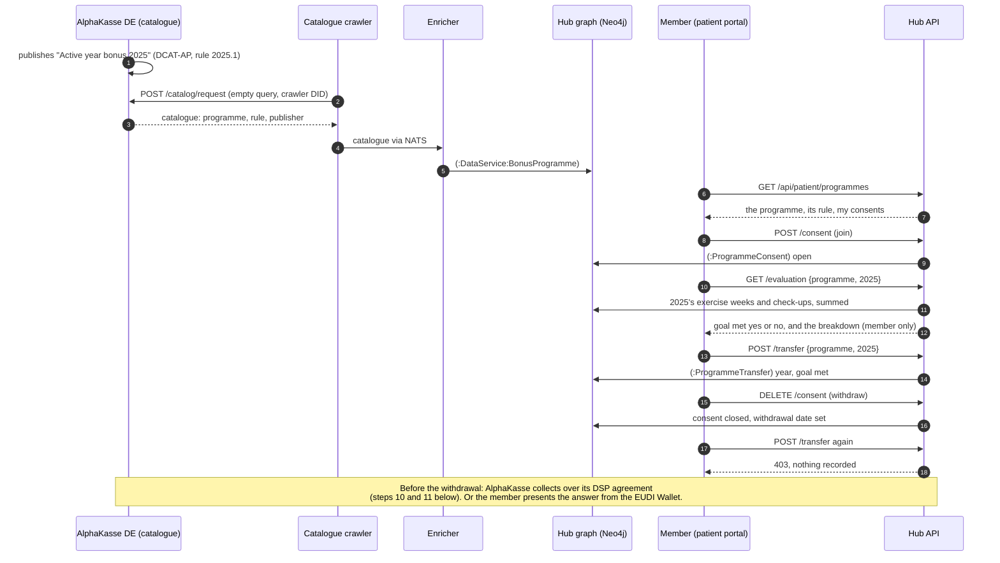

# Bonus programme: which data goes where

AlphaKasse DE, a fictional statutory health insurer in a second data space
("insurance and wellbeing"), offers a bonus to members who stay active through
the year and go to their yearly check-up. This page follows one member through
the programme. It covers what the hub reads, what it stores, what crosses to the
insurer, and what never does. The design decision is
[ADR-080](../ADRs/ADR-080-a-bonus-programme-receives-a-yes-or-no-never-the-data.md);
the plan is [#934](https://github.com/ma3u/MinimumViableHealthDataspacev2/issues/934).

## In short

- **Nothing reaches AlphaKasse until the member says so.** The hub reads
  AlphaKasse's catalogue, the member joins in the patient portal or in the
  Klarbefund app, sees their own result for the ended year, and "Send my
  answer" records the year and goal met inside the hub.
- **AlphaKasse then collects it over its agreement with the hub** (step 8,
  [ADR-091](../ADRs/ADR-091-the-insurer-collects-the-yes-or-no-under-a-reference-the-hub-issues.md)). It
  receives four things: the programme, the year, "goal met: yes" or "no", and
  a reference the member gives it. On compose AlphaKasse is a stand-in on the
  hub's connector; on the live hub no insurer collects yet.
- **It never receives** steps, minutes of activity, heart rate, diagnoses, visit
  details, or any date finer than the year (ADR-080, decision 2).

## Who takes part

| Party                                           | Role                                                            | Where it runs                                                                            |
| ----------------------------------------------- | --------------------------------------------------------------- | ---------------------------------------------------------------------------------------- |
| The member (patient1 in the demo)               | Decides: joins, sends, withdraws                                | Patient portal, `/patient/programmes`, or the Klarbefund app (Connect to EHDS)           |
| The hub (MVHD)                                  | Reads the catalogue, keeps the consent, will compute the answer | `ehds.mabu.red`                                                                          |
| AlphaKasse DE (`did:web:alphakasse.de:insurer`) | Publishes the programme, will receive the yes or no             | A catalogue served for it by the hub's mock DSP route, standing in for its own connector |
| The catalogue crawler and enricher              | Fetch the catalogue every 5 minutes and index the programme     | Azure Container Apps jobs `mvhd-catalog-crawler`, `mvhd-catalog-enricher`                |

## The process



1. **AlphaKasse publishes the programme.** Its catalogue is DCAT-AP 3.0.1, not
   HealthDCAT-AP, because a bonus programme is not a health dataset
   ([`alphakasse-dcat-ap.json`](../../ui/src/content/catalogues/alphakasse-dcat-ap.json)).
   The programme is for 2025 and is claimed once that year is over
   ([ADR-087](../ADRs/ADR-087-the-hub-evaluates-a-bonus-year-once-it-has-ended.md),
   decision 1). It is a `dcat:DataService`. Its rule is a versioned `dct:Standard`
   (`owl:versionInfo` 2025.1), so the member and the insurer read the same rule
   (ADR-080, decision 3). The PR Gate validates the file against the DCAT-AP
   SHACL.
2. **The crawler fetches it.** Every 5 minutes it sends AlphaKasse's
   `dspCatalogUrl` an empty DSP catalogue request
   ([`EMPTY_QUERY_SPEC`](https://github.com/ma3u/MinimumViableHealthDataspacev2/blob/a1c78c3e/services/catalog-crawler/src/dsp_client.py#L22))
   with the crawler's DID. That request carries nothing about any person.
3. **The enricher indexes it** as `(:DataService:BonusProgramme)`, with the rule
   and the publisher
   ([`extract_services`](https://github.com/ma3u/MinimumViableHealthDataspacev2/blob/a1c78c3e/services/catalog-enricher/src/mapping.py#L182)).
   Node labels come from a fixed list in the hub, never from the catalogue.
4. **The member sees it** on `/patient/programmes`, apart from research and from
   the opt-out. The card shows the rule, what AlphaKasse receives and what never
   leaves the record. In the Klarbefund app the same list is under Connect to
   EHDS, then Bonus programs, in the portal's words. The app calls
   `/api/patient/app/programmes` and its `consent` and `transfer` routes, the
   app-token twins of the portal's routes (ADR-049): the same queries and
   answers, the login's own record only, and a join from the phone is recorded
   with `source: "klarbefund"`. The app keeps the programme apart from its
   Consents screen, which notes a study consent, an ePA objection and a
   registry consent held by others (ADR-080, decision 6).
5. **The member joins.** The hub writes an open `(:ProgrammeConsent)` on the
   member's own record
   ([`JOIN_PROGRAMME_CYPHER`](https://github.com/ma3u/MinimumViableHealthDataspacev2/blob/a1c78c3e/ui/src/lib/patient/programme-consent.ts#L32)).
   It is consent to this programme alone (GDPR Art. 9(2)(a)). It enrolls the
   member in no study, and it is separate from the Art. 71 opt-out.
6. **The hub works out the year, and the member sees it first.** Once 2025 has
   ended, the hub reads that year inside the member's record
   ([`programme-rule.ts`](../../ui/src/lib/patient/programme-rule.ts)): the
   weekly exercise means the tracker shared (LOINC 55411-3, minutes a day,
   times seven, summed over 52 weeks, a week without any counting as none)
   and the check-up (an Encounter coded SNOMED CT 185349003). The query
   returns three sums and nothing finer. The member sees goal met, yes or no,
   with the minutes a week, the weeks shared and the check-ups; that
   breakdown is for the member only. Before the year ends the screen says so,
   and nothing can be sent.
7. **The member asks the hub to send the year's answer.** The hub checks for an
   open consent
   ([`programmeTransferAllowed`](https://github.com/ma3u/MinimumViableHealthDataspacev2/blob/a1c78c3e/ui/src/lib/patient/programme-consent.ts#L128)),
   that the rule covers the year (400 otherwise) and that it has ended (409
   otherwise), works the year out again, and records a `(:ProgrammeTransfer)`
   with the programme, the year and goal met, status `evaluated`
   ([`RECORD_TRANSFER_CYPHER`](../../ui/src/lib/patient/programme-consent.ts)).
   Nothing leaves the hub at this point.
8. **The member withdraws.** The consent gets its withdrawal date and stays on
   record with both dates (GDPR Art. 7(3)).
9. **After the withdrawal nothing is sent.** The same instruction is refused
   with 403, and nothing is recorded
   ([transfer route](https://github.com/ma3u/MinimumViableHealthDataspacev2/blob/a1c78c3e/ui/src/app/api/patient/programmes/transfer/route.ts#L59)).
   Every later delivery path, the DSP agreement and the wallet alike, has to
   pass the same gate.
10. **AlphaKasse collects** (step 8, [ADR-091](../ADRs/ADR-091-the-insurer-collects-the-yes-or-no-under-a-reference-the-hub-issues.md)).
    Under its bonus agreement it starts a pull transfer and reads the offer
    `bonus-programme-answer` at the hub's `/dataspace/data` with the access
    token of that transfer. The hub hands over, for the programmes AlphaKasse
    published and the members whose consent is open, the programme, the year,
    goal met and the member's reference
    ([`routes/programmes.ts`](../../services/neo4j-proxy/src/routes/programmes.ts)).
    It marks the transfer `delivered`, with the date and AlphaKasse's DID, and
    the member's page says "AlphaKasse DE collected your answer on" that date.
    A call without the agreement's transfer is refused with 403.
11. **The member gives AlphaKasse the reference.** It is on the member's
    programme page ("Your reference for AlphaKasse DE"), twelve characters
    such as `K9XZ-Z669-AZTN`, one per join. The hub sends no name and no
    insurance number, so the reference is how AlphaKasse knows whose bonus it
    is. After a withdrawal the member's answer is no longer in what AlphaKasse
    collects, also on a transfer it started before.

**The agreement AlphaKasse has to reach first (step 5).** AlphaKlinik offers
the answer under the policy `mvhd-bonus-programme`
([`standard-policies.ts`](../../ui/src/lib/standard-policies.ts),
[ADR-090](../ADRs/ADR-090-the-connector-admits-only-an-attested-bonus-payout-purpose.md)):
use for the bonus payout only; no insurance decision, profiling, advertising
or decision to the member's detriment; delete after the payout. The hub's
connector decides one of its terms itself, `ehds:attestedPurpose`: AlphaKasse
reaches the agreement only when its `DataProcessingPurposeCredential`, issued
by the insurance and wellbeing authority, attests the purpose `bonus-payout`.
A credential that attests "premium-setting" is refused with 400, "Policy in
scope contract.negotiation not fulfilled". The purpose is checked again each
time a transfer starts. The yes or no is collected over that agreement, or the
member presents it from the EUDI Wallet.

## What is stored, and where

| Record                          | Fields                                                                                                                               | Written when                                                                                | Read by                                                                                       |
| ------------------------------- | ------------------------------------------------------------------------------------------------------------------------------------ | ------------------------------------------------------------------------------------------- | --------------------------------------------------------------------------------------------- |
| `(:DataService:BonusProgramme)` | programme id, title, description, publisher, endpoint, themes, keywords, rule title, rule text, rule version, last seen              | Each crawl                                                                                  | Patients and operators (`/api/patient/programmes`), the app (`/api/patient/app/programmes`)   |
| `(:ProgrammeConsent)`           | consent id, patient id, programme id, joined at, withdrawn at, source                                                                | Join, withdraw                                                                              | The member, and an operator who names the record                                              |
| `(:ProgrammeTransfer)`          | transfer id, patient id, programme id, year, goal met, status `evaluated` then `delivered`, requested at, delivered at, delivered to | "Send my answer", only under an open consent; the delivery fields when the insurer collects | The member, an operator who names the record, and the insurer's pull (year and goal met only) |

A patient reads and changes only their own record; naming another record is
refused with 403 (`refuseForeignRecord`). `source` is `patient-portal`,
`klarbefund` or `api-collection`. The API collection marks its own test consents
so that the live clean-up removes them and nothing else
([`remove-api-collection-runs.cypher`](../../neo4j/remove-api-collection-runs.cypher),
section 3).

## What crosses between the hub and AlphaKasse

| Direction                       | What                                                                                       | About a person?       |
| ------------------------------- | ------------------------------------------------------------------------------------------ | --------------------- |
| Hub to AlphaKasse               | The crawler's catalogue request: an empty query and the crawler's DID                      | No                    |
| AlphaKasse to hub               | The catalogue: programme, rule, publisher                                                  | No                    |
| Hub to AlphaKasse, today        | Nothing                                                                                    | n/a                   |
| Hub to AlphaKasse, after step 8 | Programme, year, goal met yes or no, tied to the member reference AlphaKasse already holds | Yes, and nothing more |

## The legal basis

- **Primary use the person directs.** "Primary use" includes reimbursement
  services ([EHDS Art. 2(2)(d)](https://eur-lex.europa.eu/eli/reg/2025/327/oj/eng#002.002)),
  and a person may have part of their data transmitted to a recipient in the
  social security or reimbursement sector
  ([Art. 7(3)](https://eur-lex.europa.eu/eli/reg/2025/327/oj/eng#007.003)).
  That fits a statutory insurer's bonus; for a private insurer only the GDPR
  consent applies, and the use case needs its own review (ADR-080, decision 1).
- **Explicit consent** to the one programme
  ([GDPR Art. 9](https://eur-lex.europa.eu/eli/reg/2016/679/oj/eng#art_9)(2)(a)),
  withdrawable at any time
  ([Art. 7](https://eur-lex.europa.eu/eli/reg/2016/679/oj/eng#art_7)(3)).
- **The line not crossed.** Secondary use may not be used to exclude people from
  insurance or change their premiums
  ([EHDS Art. 54](https://eur-lex.europa.eu/eli/reg/2025/327/oj/eng#art_54)(b)).
  The bonus only rewards: a "no" changes nothing in the member's contract.
  Evaluating whether the programme works is secondary use and needs a permit
  from the access body (step 9).
- **Data minimisation** ([GDPR Art. 5](https://eur-lex.europa.eu/eli/reg/2016/679/oj/eng#art_5)(1)(c)):
  a yes or no per year, not the data behind it.

AlphaKasse DE is fictional. Before a real insurer runs this, national bonus
rules apply to it (in Germany § 65a SGB V), and the design needs a legal review.

## Check it yourself

- **In the portal:** sign in as patient1, open My Health, then Bonus Programs.
  Join; "Your result for 2025" shows "Goal met: yes" with about 181 minutes
  a week from 52 weeks and one check-up. Send ("Recorded for 2025: goal met,
  yes"), withdraw ("Nothing is sent any more"). patient2 sees "Goal met: no":
  about 78 minutes a week from 48 weeks.
- **In Klarbefund:** connect the app (Connect to EHDS), open Bonus programs,
  join, read the result, send, withdraw. Exercise minutes reach the record
  once "Send my device trends" is on. Without a phone,
  `cd clients/ios && Scripts/run-ui-tests.sh BonusProgrammesUITests` runs the
  same steps against the demo hub (`-MBDemoSeed`, `-MBShot programmes`), and
  `swift test --filter BonusProgrammes` pins how the app reads the answers,
  the 403 after a withdrawal among them.
- **API collection:** `bruno/MVHDv2/01 Patient/22` to `27` list the programme,
  join, send (202, the year and goal met only), withdraw, send again (403),
  and read the member's result. `09 Access control/40` to `44` refuse the app
  routes without the app's token (401).
- **Browser journeys:** J1092, J1094 and J1099 in
  [`54-bonus-programmes.spec.ts`](../../ui/__tests__/e2e/journeys/54-bonus-programmes.spec.ts).
  They skip with a reason on a stack where the crawler has not run.
- **The bonus policy at the connector (compose, JAD stack seeded):**
  `./scripts/seed-second-data-space.sh` then
  `./scripts/run-ehds-identity-checks.sh`; PURPOSE-7.1 to 7.4 negotiate the
  offer with the bonus payout purpose (agreed), without a purpose (refused),
  with "premium-setting" (refused by `ehds:attestedPurpose`) and with the bonus
  payout purpose again (agreed).
- **The delivery (compose, JAD stack seeded):** the same two commands;
  DELIVER-8.1 to 8.6 have AlphaKasse agree, start a transfer and pull. They
  check that each answer has four fields and no id, that the hub records the
  collection, that a withdrawn member is left out, that a direct call is
  refused, and that a "premium-setting" credential starts no transfer. The
  two members are throwaway records the checks write and remove.
- **The catalogue against DCAT-AP:**
  `python3 scripts/healthdcat-ap/validate.py ui/src/content/catalogues/alphakasse-dcat-ap.json --dcat-ap`.
- **The records in the graph:**

```cypher
MATCH (p:Patient)-[:GAVE_PROGRAMME_CONSENT]->(c:ProgrammeConsent)-[:FOR_PROGRAMME]->(b:BonusProgramme)
OPTIONAL MATCH (t:ProgrammeTransfer)-[:UNDER_CONSENT]->(c)
RETURN b.title, c.joinedAt, c.withdrawnAt, c.source,
       collect(t {.year, .goalMet, .status, .deliveredAt, .deliveredTo})
```

## Done

- Step 3: the crawled DCAT-AP programme on `/patient/programmes` (#1005).
- Step 4: join, send and withdraw in the portal, and the transfer gate (#1014).
- Klarbefund: the app's join, send and withdraw screen (`source: "klarbefund"`) (#1036).
- Step 6: the hub works out goal met for an ended year inside the record, and
  the member sees it before sending; Klarbefund sends exercise minutes
  ([ADR-087](../ADRs/ADR-087-the-hub-evaluates-a-bonus-year-once-it-has-ended.md)).

- Step 5: the bonus programme policy, its purpose decided by the hub's
  connector against the insurer's purpose credential
  ([ADR-090](../ADRs/ADR-090-the-connector-admits-only-an-attested-bonus-payout-purpose.md)).
- Step 8, the hub's half: AlphaKasse collects the yes or no over its
  agreement, tied to the member's reference
  ([ADR-091](../ADRs/ADR-091-the-insurer-collects-the-yes-or-no-under-a-reference-the-hub-issues.md)).

## Open

- The achievement attestation for the EUDI Wallet (ADR-080, decision 4,
  after #708).
- Steps 7 and 8 against Simpl's own connector, which needs a `simpl-edc` with
  DCP. Until then AlphaKasse is a stand-in on the hub's connector.
- Klarbefund shows the member's reference; today it is on the portal's page.
