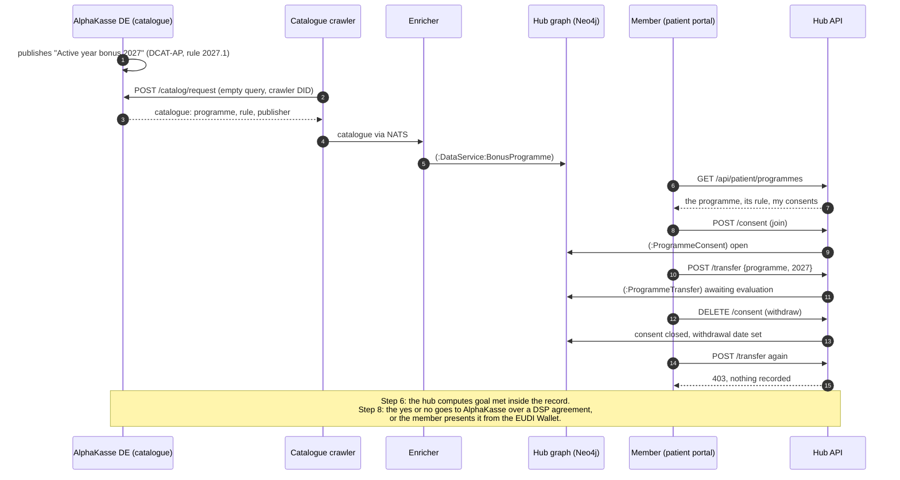

# Bonus programme: which data goes where

AlphaKasse DE, a fictional statutory health insurer in a second data space
("insurance and wellbeing"), offers a bonus to members who stay active through
the year and go to their yearly check-up. This page follows one member through
the programme. It covers what the hub reads, what it stores, what crosses to the
insurer, and what never does. The design decision is
[ADR-080](../ADRs/ADR-080-a-bonus-programme-receives-a-yes-or-no-never-the-data.md);
the plan is [#934](https://github.com/ma3u/MinimumViableHealthDataspacev2/issues/934).

## In short

- **Today (steps 3 and 4 of #934), no data about the member reaches
  AlphaKasse.** The hub reads AlphaKasse's catalogue, the member joins in the
  patient portal, and "Send my answer" records the member's instruction inside
  the hub. The answer itself is computed in step 6 and delivered in step 8, or
  through the member's wallet.
- **When it is delivered, AlphaKasse receives three things:** the programme, the
  year, and "goal met: yes" or "no".
- **It never receives** steps, minutes of activity, heart rate, diagnoses, visit
  details, or any date finer than the year (ADR-080, decision 2).

## Who takes part

| Party                                           | Role                                                            | Where it runs                                                                            |
| ----------------------------------------------- | --------------------------------------------------------------- | ---------------------------------------------------------------------------------------- |
| The member (patient1 in the demo)               | Decides: joins, sends, withdraws                                | Patient portal, `/patient/programmes`                                                    |
| The hub (MVHD)                                  | Reads the catalogue, keeps the consent, will compute the answer | `ehds.mabu.red`                                                                          |
| AlphaKasse DE (`did:web:alphakasse.de:insurer`) | Publishes the programme, will receive the yes or no             | A catalogue served for it by the hub's mock DSP route, standing in for its own connector |
| The catalogue crawler and enricher              | Fetch the catalogue every 5 minutes and index the programme     | Azure Container Apps jobs `mvhd-catalog-crawler`, `mvhd-catalog-enricher`                |

## The process



1. **AlphaKasse publishes the programme.** Its catalogue is DCAT-AP 3.0.1, not
   HealthDCAT-AP, because a bonus programme is not a health dataset
   ([`alphakasse-dcat-ap.json`](../../ui/src/content/catalogues/alphakasse-dcat-ap.json)).
   The programme is a `dcat:DataService`. Its rule is a versioned `dct:Standard`
   (`owl:versionInfo` 2027.1), so the member and the insurer read the same rule
   (ADR-080, decision 3). The PR Gate validates the file against the DCAT-AP
   SHACL.
2. **The crawler fetches it.** Every 5 minutes it sends AlphaKasse's
   `dspCatalogUrl` an empty DSP catalogue request
   ([`EMPTY_QUERY_SPEC`](https://github.com/ma3u/MinimumViableHealthDataspacev2/blob/a1c78c3e/services/catalog-crawler/src/dsp_client.py#L22))
   with the crawler's DID. That request carries nothing about any person.
3. **The enricher indexes it** as `(:DataService:BonusProgramme)`, with the rule
   and the publisher
   ([`extract_services`](https://github.com/ma3u/MinimumViableHealthDataspacev2/blob/a1c78c3e/services/catalog-enricher/src/mapping.py#L182)).
   Node labels come from a fixed list in the hub, never from the catalogue.
4. **The member sees it** on `/patient/programmes`, apart from research and from
   the opt-out. The card shows the rule, what AlphaKasse receives and what never
   leaves the record.
5. **The member joins.** The hub writes an open `(:ProgrammeConsent)` on the
   member's own record
   ([`JOIN_PROGRAMME_CYPHER`](https://github.com/ma3u/MinimumViableHealthDataspacev2/blob/a1c78c3e/ui/src/lib/patient/programme-consent.ts#L32)).
   It is consent to this programme alone (GDPR Art. 9(2)(a)). It enrolls the
   member in no study, and it is separate from the Art. 71 opt-out.
6. **The member asks the hub to send the year's answer.** The hub checks for an
   open consent
   ([`programmeTransferAllowed`](https://github.com/ma3u/MinimumViableHealthDataspacev2/blob/a1c78c3e/ui/src/lib/patient/programme-consent.ts#L128))
   and records a `(:ProgrammeTransfer)` with the programme, the year and an empty
   "goal met", status `awaiting-evaluation`
   ([`RECORD_TRANSFER_CYPHER`](https://github.com/ma3u/MinimumViableHealthDataspacev2/blob/a1c78c3e/ui/src/lib/patient/programme-consent.ts#L78)).
   Nothing leaves the hub at this point.
7. **The member withdraws.** The consent gets its withdrawal date and stays on
   record with both dates (GDPR Art. 7(3)).
8. **After the withdrawal nothing is sent.** The same instruction is refused
   with 403, and nothing is recorded
   ([transfer route](https://github.com/ma3u/MinimumViableHealthDataspacev2/blob/a1c78c3e/ui/src/app/api/patient/programmes/transfer/route.ts#L59)).
   Every later delivery path, the DSP agreement and the wallet alike, has to
   pass the same gate.

Still to come: step 6 computes "goal met" from the member's activity
Observations and the check-up Encounter, inside the hub, and shows the result
to the member before anything is sent. Step 5 adds the bonus policy. It allows
use for the payout only, forbids insurance decisions, profiling and
advertising, and requires deletion after the payout. Step 8 delivers the yes or
no over a DSP agreement with AlphaKasse's connector, or the member presents it
from the EUDI Wallet.

## What is stored, and where

| Record                          | Fields                                                                                                                  | Written when                                 | Read by                                            |
| ------------------------------- | ----------------------------------------------------------------------------------------------------------------------- | -------------------------------------------- | -------------------------------------------------- |
| `(:DataService:BonusProgramme)` | programme id, title, description, publisher, endpoint, themes, keywords, rule title, rule text, rule version, last seen | Each crawl                                   | Patients and operators (`/api/patient/programmes`) |
| `(:ProgrammeConsent)`           | consent id, patient id, programme id, joined at, withdrawn at, source                                                   | Join, withdraw                               | The member, and an operator who names the record   |
| `(:ProgrammeTransfer)`          | transfer id, patient id, programme id, year, goal met (empty until step 6), status, requested at                        | "Send my answer", only under an open consent | The member, and an operator who names the record   |

A patient reads and changes only their own record; naming another record is
refused with 403 (`refuseForeignRecord`). `source` is `patient-portal`,
`klarbefund` or `api-collection`. The API collection marks its own test consents
so that the live clean-up removes them and nothing else
([`remove-api-collection-runs.cypher`](../../neo4j/remove-api-collection-runs.cypher),
section 3).

## What crosses between the hub and AlphaKasse

| Direction                       | What                                                                                       | About a person?       |
| ------------------------------- | ------------------------------------------------------------------------------------------ | --------------------- |
| Hub to AlphaKasse               | The crawler's catalogue request: an empty query and the crawler's DID                      | No                    |
| AlphaKasse to hub               | The catalogue: programme, rule, publisher                                                  | No                    |
| Hub to AlphaKasse, today        | Nothing                                                                                    | n/a                   |
| Hub to AlphaKasse, after step 8 | Programme, year, goal met yes or no, tied to the member reference AlphaKasse already holds | Yes, and nothing more |

## The legal basis

- **Primary use the person directs.** "Primary use" includes reimbursement
  services ([EHDS Art. 2(2)(d)](https://eur-lex.europa.eu/eli/reg/2025/327/oj/eng#002.002)),
  and a person may have part of their data transmitted to a recipient in the
  social security or reimbursement sector
  ([Art. 7(3)](https://eur-lex.europa.eu/eli/reg/2025/327/oj/eng#007.003)).
  That fits a statutory insurer's bonus; for a private insurer only the GDPR
  consent applies, and the use case needs its own review (ADR-080, decision 1).
- **Explicit consent** to the one programme
  ([GDPR Art. 9](https://eur-lex.europa.eu/eli/reg/2016/679/oj/eng#art_9)(2)(a)),
  withdrawable at any time
  ([Art. 7](https://eur-lex.europa.eu/eli/reg/2016/679/oj/eng#art_7)(3)).
- **The line not crossed.** Secondary use may not be used to exclude people from
  insurance or change their premiums
  ([EHDS Art. 54](https://eur-lex.europa.eu/eli/reg/2025/327/oj/eng#art_54)(b)).
  The bonus only rewards: a "no" changes nothing in the member's contract.
  Evaluating whether the programme works is secondary use and needs a permit
  from the access body (step 9).
- **Data minimisation** ([GDPR Art. 5](https://eur-lex.europa.eu/eli/reg/2016/679/oj/eng#art_5)(1)(c)):
  a yes or no per year, not the data behind it.

AlphaKasse DE is fictional. Before a real insurer runs this, national bonus
rules apply to it (in Germany § 65a SGB V), and the design needs a legal review.

## Check it yourself

- **In the portal:** sign in as patient1, open My Health, then Bonus Programs.
  Join, send ("Recorded for 2027"), withdraw ("Nothing is sent any more").
- **API collection:** `bruno/MVHDv2/01 Patient/22` to `26` list the programme,
  join, send (202), withdraw, and send again (403).
- **Browser journeys:** J1092 and J1094 in
  [`54-bonus-programmes.spec.ts`](../../ui/__tests__/e2e/journeys/54-bonus-programmes.spec.ts).
  They skip with a reason on a stack where the crawler has not run.
- **The catalogue against DCAT-AP:**
  `python3 scripts/healthdcat-ap/validate.py ui/src/content/catalogues/alphakasse-dcat-ap.json --dcat-ap`.
- **The records in the graph:**

```cypher
MATCH (p:Patient)-[:GAVE_PROGRAMME_CONSENT]->(c:ProgrammeConsent)-[:FOR_PROGRAMME]->(b:BonusProgramme)
OPTIONAL MATCH (t:ProgrammeTransfer)-[:UNDER_CONSENT]->(c)
RETURN b.title, c.joinedAt, c.withdrawnAt, c.source, collect(t {.year, .goalMet, .status})
```

## Open

- Step 5: the bonus standard policy, enforced at the hub's connector.
- Step 6: computing "goal met" from the member's own data, and the achievement
  attestation for the EUDI Wallet (after #708).
- Step 8: delivery to AlphaKasse's connector, which needs a `simpl-edc` with
  DCP. The member reference AlphaKasse ties the answer to is designed there.
- Klarbefund: the app's join and withdraw screen (`source: "klarbefund"`).
