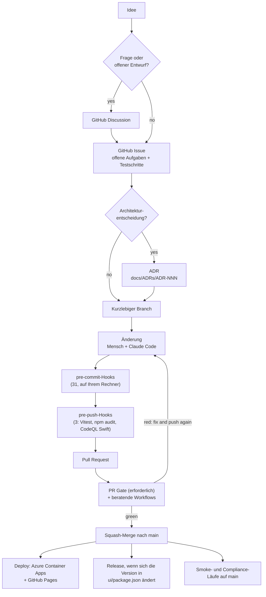

# Software Development Life Cycle (SDLC)

- **Projekt:** Minimum Viable Health Dataspace v2 (EHDS-Referenzimplementierung)
- **Zielgruppe:** Mitwirkende, Reviewer und alle, die wissen möchten, wie ein
  KI-gestütztes Ein-Personen-Projekt eine Codebasis in einem regulierten Bereich auslieferbar hält.
- **Zuletzt aktualisiert:** 2026-11-03
- **Maintainer:** Matthias (`@ma3u`)

Wie eine Änderung von der Idee zum Live-Hub gelangt: Issues und Discussions,
Branches und Pull Requests, die Hooks auf Ihrem Rechner, die Prüfungen auf GitHub,
die Deployments, die Releases und wie Sie von außen beitragen. Die
allgemeinverständliche Fassung ist [Wie wir diese Software bauen](./SDLC-explained.md);
wie der KI-Autor hineinpasst, beschreibt [Deterministische agentische KI-Entwicklung mit Claude
Code](./AGENTIC-DEVELOPMENT-WITH-CLAUDE-CODE.md). Zwei Begleitseiten gehen
tiefer: [Integrationstests über die APIs](developer/api-integration-tests.md)
und [Der Stack und die Entwicklungsumgebung](developer/stack-and-environment.md).
Abschnitt 12 ist das Rezept hinter all dem: wie Sie einen SDLC für ein
DevSecOps- und KI-Projekt festlegen, Phase für Phase, mit den Werkzeugen.

<details>
<summary><b>In diesem Dokument verwendete Abkürzungen</b></summary>

| Abkürzung           | Bedeutung                                                                                     |
| ------------------- | --------------------------------------------------------------------------------------------- |
| **CI/CD**           | Continuous Integration / Continuous Delivery: das automatisierte Bauen, Testen und Ausliefern |
| **PR**              | Pull Request: eine vorgeschlagene Änderung, geprüft und begutachtet, bevor sie gemergt wird   |
| **ADR**             | Architecture Decision Record: eine kurze Notiz zu einer Entscheidung und ihren Gründen        |
| **OIDC**            | OpenID Connect; hier die föderierte Anmeldung von GitHub Actions bei Azure                    |
| **SBOM**            | Software Bill of Materials: die Liste aller Komponenten von Drittanbietern                    |
| **CVE**             | Common Vulnerabilities and Exposures: der öffentliche Katalog bekannter Schwachstellen        |
| **SARIF**           | Static Analysis Results Interchange Format: wie Scanner an GitHub berichten                   |
| **DSP / DCP / TCK** | Dataspace Protocol / Decentralised Claims Protocol / Technology Compatibility Kit             |
| **ACA**             | Azure Container Apps, wo der Live-Hub läuft                                                   |

</details>

---

## 1. Philosophie: deterministische Werkzeuge um einen nicht deterministischen Autor

> **Der Autor schlägt vor; deterministische Werkzeuge entscheiden.**

Eine erfahrene Entwicklerin, ein Neuling und ein KI-Agent sind alle nicht deterministisch: Stellen Sie
dieselbe Frage zweimal, erhalten Sie womöglich zwei Antworten. Das Ergebnis wird
vertrauenswürdig, wenn der Autor von Gates umgeben ist, die jedes Mal und für alle
gleich laufen: Formatierer, Linter, Typprüfungen, Tests, Sicherheitsscanner
und eine CI/CD-Pipeline.

Das Projekt ist ein Team aus einer Person plus einem KI-Pair-Programmer. Es behält daher jedes
deterministische Gate, das ein großes Team hätte, und streicht die Koordinationsrituale
(verpflichtendes menschliches Review, Sprint-Rituale, Release-Gremien), die sich erst
mit mehr Personen lohnen. Abschnitt 11 sagt, was gestrichen ist und warum.

Hier ist das wichtiger als in den meisten Projekten. Es ist eine Referenzimplementierung
des Europäischen Gesundheitsdatenraums, eines regulierten Bereichs mit
Gesundheitsdaten, Patientenrechten und Prüfpflichten. Die Gates schaffen Vertrauen (ganze
Fehlerklassen werden abgefangen, bevor sie ausgeliefert werden), Nachvollziehbarkeit (jede Änderung
wird mit Autor, Zeitpunkt und Grund protokolliert), Wiederholbarkeit, günstige Fehler (ein
lokaler Hook kostet Sekunden, ein Produktionsvorfall Stunden) und sichere KI-Unterstützung.

---

## 2. Der Lebenszyklus im Überblick



1. **Idee.** Eine offene Frage oder ein zu erkundender Entwurf beginnt als Discussion;
   ein Arbeitspaket beginnt als Issue (Abschnitt 3).
2. **ADR**, wenn die Entscheidung teuer rückgängig zu machen ist oder übergreifend wirkt.
3. **Branch** von `main`, kurzlebig.
4. **Änderung**, durch einen Menschen, Claude Code oder beide.
5. **Hooks** auf Ihrem Rechner: 31 beim Commit, 3 beim Push (Abschnitt 5).
6. **Pull Request.** Das **PR Gate** ist die einzige erforderliche Prüfung; die übrigen
   Workflows sind beratend (Abschnitt 6).
7. **Squash-Merge**, sobald das PR Gate grün ist und jeder Review-Thread
   aufgelöst ist.
8. **Auf `main`:** Der Live-Hub und die statische Demo werden neu ausgerollt, die Smoke- und
   Compliance-Läufe starten, und ein Release wird erstellt, wenn sich die Version geändert hat
   (Abschnitte 7 und 8).

---

## 3. Discussions, Issues und der Planungsordner

### Discussion oder Issue?

[Discussions](https://github.com/ma3u/MinimumViableHealthDataspacev2/discussions)
sind aktiviert, mit den Kategorien Announcements, General, Ideas, Polls, Q&A und
Show and tell.

| Eröffnen Sie eine **Discussion**, wenn                                                                                                                                                                                              | Eröffnen Sie ein **Issue**, wenn                                                                       |
| ----------------------------------------------------------------------------------------------------------------------------------------------------------------------------------------------------------------------------------- | ------------------------------------------------------------------------------------------------------ |
| Sie eine Frage haben ("wie bildet der Hub X ab?"), Optionen vergleichen oder eine Richtung vorschlagen möchten, die noch keine Aufgabe ist (Ideas; jüngste Beispiele sind #776 zu FHIR- und OMOP-Werkzeugen und #701 zu Simpl-Open) | etwas zu tun ist: ein Fehler, ein Feature mit klarem Ergebnis, eine Lücke mit einem Akzeptanzkriterium |
| die Antwort "nein" oder "nicht jetzt" lauten kann                                                                                                                                                                                   | jemand es mit einem Commit oder einem PR schließen wird                                                |
| mehrere Personen sich äußern sollten, bevor etwas entschieden wird                                                                                                                                                                  | die Entscheidung gefallen ist oder ein ADR sie treffen wird                                            |

Eine Discussion, die zu einer Entscheidung führt, wird zu einem Issue (und zu einem ADR, wenn die
Entscheidung architektonisch ist), in beide Richtungen verlinkt.

### Was ein Issue enthält

Verwenden Sie die Vorlagen in [`.github/ISSUE_TEMPLATE/`](https://github.com/ma3u/MinimumViableHealthDataspacev2/tree/main/.github/ISSUE_TEMPLATE)
(Fehlerbericht, Feature-Wunsch). Jedes Issue, an dem gearbeitet wird, enthält:

- **Die offenen Aufgaben** als Checkliste, aktuell gehalten. Wenn ein PR Arbeit
  offen lässt, sagt das Issue, was übrig ist; nichts Offenes existiert nur in einem Chat oder einer
  Commit-Nachricht.
- **Manuelle Testschritte** mit Links (zu den statischen Docs, einer Seite des Hubs, einem
  Workflow-Lauf), damit jede Person das Ergebnis ohne Nachfrage prüfen kann.
- **Die Entscheidungen**, jede mit ihrem ADR verlinkt.

Verwendete Labels: `bug`, `enhancement`, `documentation`, `question`, `security`,
`infrastructure`, `azure`, `dependencies`, die Prioritäten `P1` bis `P3` und die
Bereichslabels `EHDS-compliance`, `dataspace-discovery`, `simpl`, `NLP`,
`Agentic AI`, `production`, `load test`, `stress test`, `pentest`, `trivy`,
`Cost`. Neue Mitwirkende suchen nach `good first issue` und `help wanted`.

### Der Planungsordner

[`docs/planning/index.md`](./planning/index.md) listet Arbeitspakete als Dateien, die
von `future/ → current/ → done/` wandern und nie gelöscht werden. Eine Datei in `current/`
ist die Langfassung eines Issues (ihre Phasen, Messungen, Links); das Issue
bleibt der Ort für die Checkliste. Details zur Roadmap stehen in
`docs/planning/roadmap-phases-*.md`, die Issue- und ADR-Tabellen in
[`docs/planning-health-dataspace-v2.md`](./planning-health-dataspace-v2.md).
`/plan` in Claude Code pflegt den Ordner.

Halten Sie jedes regelmäßig geladene Dokument unter etwa 15K Tokens
([ADR-026](./ADRs/ADR-026-token-efficient-planning-structure.md)): Der Index
bleibt klein, und die Details wandern in Archive.

### ADRs

`docs/ADRs/` enthält die ADRs ab ADR-001 (051 ist reserviert). Neue folgen der
Nygard-Vorlage in `docs/adr/0000-template.md`; ein angenommenes ADR wird nie
bearbeitet, nur abgelöst. Schreiben Sie eines, wenn eine Entscheidung teuer rückgängig zu machen ist oder
übergreifend wirkt: die Aufteilung der Datenbanken ([ADR-001](./ADRs/ADR-001-postgresql-neo4j-split.md)),
die Teststrategie ([ADR-008](./ADRs/ADR-008-testing-strategy.md)), Prüfungen,
die fehlschlagen können müssen ([ADR-031](./ADRs/ADR-031-checks-must-assert.md)),
die Sitzungspflicht für jede API-Route ([ADR-044](./ADRs/ADR-044-every-api-route-needs-a-session.md)).

---

## 4. Branches, Commits und Pull Requests

- **Trunk-basiert.** `main` ist immer auslieferbar. Gearbeitet wird auf kurzlebigen
  Branches mit dem Namen `type/short-slug` (`feat/…`, `fix/…`, `docs/…`, `chore/…`,
  `ci/…`), oft mit der Issue-Nummer: `fix/708-ui-sticky-sessions`.
- **[Conventional Commits](https://www.conventionalcommits.org/)** mit einem
  Scope: `feat(spe): workspaces start on demand (ADR-072)`. Alle der letzten 40
  Commits auf `main` folgen dem; noch erzwingt es kein Hook.
- **Commits tragen den Namen des Autors.** Kein KI-Co-Autor-Trailer wird ergänzt; wie
  die KI in diesem Projekt arbeitet, ist im Begleitdokument beschrieben.
- **Ein PR verlinkt sein Issue und seine ADRs** und sagt, wie getestet wurde; die
  [PR-Vorlage](https://github.com/ma3u/MinimumViableHealthDataspacev2/blob/main/.github/pull_request_template.md)
  fragt beides ab. [`CODEOWNERS`](https://github.com/ma3u/MinimumViableHealthDataspacev2/blob/main/.github/CODEOWNERS)
  nennt den Maintainer, sodass ein PR von anderen eine Review-Anfrage erhält.
- **Squash-Merge.** Der PR-Titel wird zum Commit auf `main` und folgt daher
  ebenfalls der Commit-Konvention.

### 4.1 Branch-Schutz auf `main`

Ein Repository-Ruleset auf dem Standard-Branch:

| Regel                                         | Wirkung                                                                                                      |
| --------------------------------------------- | ------------------------------------------------------------------------------------------------------------ |
| **Pull Request erforderlich**                 | Keine direkten Pushes auf `main`. Null Freigaben erforderlich (siehe unten).                                 |
| **Auflösung der Konversationen erforderlich** | Jeder Review-Thread ist vor dem Merge aufgelöst, sodass Review-Befunde beantwortet statt überscrollt werden. |
| **Statusprüfungen erforderlich**              | **PR Gate** muss grün sein. Es ist die einzige erforderliche Prüfung.                                        |
| **Lineare Historie erforderlich**             | Nur Squash oder Rebase; Merge-Commits sind abgeschaltet.                                                     |
| **Force-Pushes und Löschungen blockiert**     | `main` kann weder umgeschrieben noch gelöscht werden.                                                        |

**Null erforderliche Freigaben sind Absicht.** Mit einem Maintainer bedeutet eine erforderliche
Freigabe ein zweites Konto und einen Gummistempel. Das Review übernehmen die KI-Reviewer
und die Gates; die mechanischen Schutzmaßnahmen (kein direkter Push, kein Force-Push,
kein Merge bei Rot) sind der Teil, den ein einzelner Maintainer nicht durch
Disziplin sicherstellen kann, daher werden sie erzwungen. Kommt eine zweite regelmäßig mitwirkende Person hinzu,
steigt dies auf eine Freigabe.

**Admins können nur in einem Pull Request umgehen.** Eine hängende Prüfung lässt sich
in einem PR übergehen, was besser ist, als einen Hotfix für eine Live-Demo nicht einspielen zu können; ein
direkter Push auf `main` wird für alle abgelehnt.

### 4.2 Warum genau eine erforderliche Prüfung

Jeder andere Workflow ist pfadgefiltert, was für die Kosten richtig und für den
Branch-Schutz falsch ist: Eine erforderliche Prüfung, die nie startet, bleibt ausstehend, und der
PR kann nie gemergt werden (#303 sammelte 28 Prüfungen, #305 keine). Deshalb
hat [`pr-gate.yml`](https://github.com/ma3u/MinimumViableHealthDataspacev2/blob/main/.github/workflows/pr-gate.yml)
keinen Pfadfilter und ist die einzige erforderliche Prüfung. Abschnitt 6.1 listet, was es
ausführt.

---

## 5. Die Hooks auf Ihrem Rechner

[`.pre-commit-config.yaml`](https://github.com/ma3u/MinimumViableHealthDataspacev2/blob/main/.pre-commit-config.yaml),
ausgeführt vom [pre-commit-Framework](https://pre-commit.com/). Installieren Sie beide
Stufen einmal pro Klon:

```bash
pip install pre-commit
pre-commit install --hook-type pre-commit --hook-type pre-push
pre-commit run --all-files     # optional: everything, once
```

Die meisten Hooks sind per Dateimuster eingegrenzt, sodass ein reiner Docs-Commit die
TypeScript-Hooks überspringt. Hooks, die ein nicht installiertes Werkzeug brauchen (gitleaks,
Semgrep, lychee, actionlint), geben eine Warnung aus und bestehen; das PR Gate installiert
gitleaks und actionlint und führt sie trotzdem aus. Überspringen Sie einen Hook einmalig mit
`SKIP=<id> git commit`, nie den ganzen Satz mit `--no-verify`: Das PR Gate
führt dieselben Hooks auf dem Diff des PR aus, eine Umgehung verschiebt den Fehlschlag also nur.

**Hooks, die Dateien umschreiben** (Prettier, die Whitespace-Korrekturen, `docs-facts`),
lassen den Commit nach der Änderung der Datei fehlschlagen. Stagen Sie die Datei erneut, committen Sie
erneut und prüfen Sie dann, dass sich `HEAD` bewegt hat: Ein fehlgeschlagener Commit lässt ihn, wo er war.

### 5.1 Beim Commit: 31 Hooks

| Hook (id)                                                                 | Was er tut                                                                                                                                                                    | Wenn er fehlschlägt                                                                                                                                                                                      |
| ------------------------------------------------------------------------- | ----------------------------------------------------------------------------------------------------------------------------------------------------------------------------- | -------------------------------------------------------------------------------------------------------------------------------------------------------------------------------------------------------- |
| `trailing-whitespace`, `end-of-file-fixer`                                | entfernt Leerzeichen am Zeilenende, beendet jede Datei mit einem Zeilenumbruch (ausgenommen Patches und die eingebundenen HealthDCAT-AP-Shapes)                               | er hat die Datei korrigiert: erneut stagen                                                                                                                                                               |
| `check-yaml`, `check-json`                                                | die Dateien lassen sich parsen (YAML mit mehreren Dokumenten erlaubt)                                                                                                         | den genannten Syntaxfehler beheben                                                                                                                                                                       |
| `check-added-large-files`                                                 | lehnt eine Datei über 5,000 KB ab                                                                                                                                             | aus git heraushalten oder verkleinern                                                                                                                                                                    |
| `check-merge-conflict`                                                    | lehnt übrig gebliebene `<<<<<<<`-Markierungen ab                                                                                                                              | den Merge abschließen                                                                                                                                                                                    |
| `detect-private-key`                                                      | lehnt einen privaten Schlüssel ab                                                                                                                                             | entfernen; falls er echt war, rotieren                                                                                                                                                                   |
| `check-case-conflict`, `check-symlinks`                                   | Namen, die auf einem Datenträger ohne Unterscheidung der Groß- und Kleinschreibung kollidieren, Symlinks, die ins Leere zeigen                                                | umbenennen oder den Link korrigieren                                                                                                                                                                     |
| `check-executables-have-shebangs`, `check-shebang-scripts-are-executable` | eine ausführbare Datei hat eine `#!`-Zeile, eine `#!`-Datei ist ausführbar                                                                                                    | `chmod +x` (oder `-x`) und diesen Pfad ausdrücklich stagen: Ein verirrtes Ausführungsbit auf einer `.gitkeep` scheitert hier                                                                             |
| `shellcheck`                                                              | Bash auf Fehlerschwere                                                                                                                                                        | `shellcheck --severity=error <file>` und beheben, was es meldet                                                                                                                                          |
| `hadolint-docker`                                                         | Best Practices für Dockerfiles                                                                                                                                                | `hadolint <Dockerfile>`                                                                                                                                                                                  |
| `prettier`                                                                | formatiert JS, TS, JSON, YAML und Markdown                                                                                                                                    | er hat die Datei umgeschrieben: erneut stagen. Kämpfen Sie nicht gegen seine Ausgabe an                                                                                                                  |
| `tsc-ui`                                                                  | `tsc --noEmit -p tsconfig.build.json` in `ui/` (strikt, ohne Tests)                                                                                                           | diesen Befehl in `ui/` ausführen, den Typfehler beheben                                                                                                                                                  |
| `eslint-ui`                                                               | `next lint --max-warnings 55` in `ui/`                                                                                                                                        | ein Fehler oder eine neue Warnung über dem Budget von 55: `cd ui && npx next lint`                                                                                                                       |
| `gitleaks`                                                                | Secrets im gestagten Diff                                                                                                                                                     | das Secret entfernen und rotieren; ein nachgewiesener Fehlalarm kommt in `.gitleaksignore`                                                                                                               |
| `semgrep`                                                                 | Semgrep CE auf gestagtem Code: die TypeScript-, Next.js-, React- und Secrets-Regeln der Registry sowie `.semgrep/cypher.yml` (Anfrageeingaben erreichen Cypher als Parameter) | beheben oder `// nosemgrep: <rule-id> -- <reason>` über die Zeile setzen. Hinter einem TLS-inspizierenden Proxy schlägt der Download aus der Registry fehl und der Hook endet mit 2: Das ist kein Befund |
| `semgrep-rule-tests`                                                      | die eigenen Semgrep-Regeln des Projekts gegen `.semgrep/cypher.ts`                                                                                                            | die Regel und ihr Test widersprechen sich                                                                                                                                                                |
| `check-broken-links-md`                                                   | relative Links in Markdown lösen sich auf (lychee offline oder markdown-link-check); Übersetzungen unter `docs/i18n/` ausgenommen                                             | den Pfad korrigieren                                                                                                                                                                                     |
| `check-no-screenshot-imports`                                             | Docs-Seiten unter `ui/src/app/docs/` verweisen nicht auf `images/screenshots`                                                                                                 | stattdessen ein Diagramm oder ein Anleitungsbild verwenden                                                                                                                                               |
| `api-spec-drift`                                                          | jede Route unter `ui/src/app/api/` steht in `ui/public/openapi.yaml` und umgekehrt                                                                                            | die Operation in der Spezifikation dokumentieren und ihre Zeile aus `docs/api-spec-drift-allowlist.txt` löschen; eine Zeile hinzuzufügen ist die Entscheidung, eine undokumentierte Route auszuliefern   |
| `api-spec-shapes`                                                         | die Spezifikation beschreibt die Struktur, mit der der Hub antwortet (geprüft gegen die Fixtures in `ui/public/mock/`)                                                        | das Schema oder das Fixture korrigieren                                                                                                                                                                  |
| `docs-facts`                                                              | erzeugt `ui/src/app/docs/docs-facts.json` neu (Routen, Hooks, Dienste, ADRs, das Aktualisierungsdatum jeder Docs-Seite)                                                       | er hat die Datei umgeschrieben: stagen und erneut committen                                                                                                                                              |
| `docs-content`                                                            | die veröffentlichten Kopien von `docs/` stimmen mit ihren Quellen überein (`gen-docs-content.py --check`)                                                                     | `python3 scripts/gen-docs-content.py`, `ui/src/content/` und `ui/public/published-docs/` stagen                                                                                                          |
| `localized-images`                                                        | das Manifest der übersetzten Screenshots und Diagramme stimmt mit `ui/public` überein                                                                                         | `python3 scripts/gen-localized-images.py`, das Manifest stagen                                                                                                                                           |
| `bruno-coverage`                                                          | jede API-Route hat eine Anfrage in `bruno/MVHDv2/`, jede Anfrage kann fehlschlagen, keine Anmeldeinformation in einer `.bru`-Datei                                            | die Anfrage im Ordner der Persona ergänzen; diejenige löschen, deren Route entfallen ist (siehe [die API-Tests](developer/api-integration-tests.md))                                                     |
| `bruno-strength`                                                          | eine 2xx-Anfrage prüft mehr als einen Containertyp                                                                                                                            | den Wert einer Eigenschaft prüfen                                                                                                                                                                        |
| `workflow-paths`                                                          | der `paths`-Filter eines Workflows deckt jedes Skript ab, das er ausführt                                                                                                     | den Pfad zum Filter des Workflows hinzufügen                                                                                                                                                             |
| `actionlint`                                                              | GitHub-Actions-Workflows                                                                                                                                                      | den genannten Workflow korrigieren                                                                                                                                                                       |
| `image-scan-coverage`                                                     | der CVE-Scan in `security-scan.yml` deckt jedes Image in den Compose-Dateien ab                                                                                               | das Image zur Scan-Matrix hinzufügen                                                                                                                                                                     |

### 5.2 Beim Push: 3 Hooks

| Hook (id)      | Was er tut                                                                                                             | Wenn er fehlschlägt                                                                                                                                                         |
| -------------- | ---------------------------------------------------------------------------------------------------------------------- | --------------------------------------------------------------------------------------------------------------------------------------------------------------------------- |
| `vitest-ui`    | die gesamte UI-Suite, `vitest run --bail 1`, wenn der Push `ui/src` oder `ui/__tests__` ändert                         | `cd ui && npx vitest run <file>` für die fehlschlagende Datei. Ein Hook, der einen Mock zurücksetzt, verwendet geschweifte Klammern: `beforeEach(() => { m.mockReset(); })` |
| `npm-audit-ui` | `scripts/check-npm-audit.py ui --omit=dev`: keine HIGH- oder CRITICAL-Meldung in Produktionsabhängigkeiten             | die Abhängigkeit aktualisieren; gibt es keinen Fix, ein befristeter Eintrag in `docs/npm-audit-exceptions.json` mit Begründung, Issue und Ablaufdatum                       |
| `codeql-swift` | CodeQL für die iPhone-App, wenn sich Swift-Quellen, `Package.swift` oder `project.yml` ändern (etwa 15 Minuten, macOS) | den Befund beheben oder ihn mit Begründung in `clients/ios/Scripts/codeql-accepted.txt` akzeptieren; `SKIP=codeql-swift git push` überspringt ihn einmalig                  |

[Quality Gates](./quality-gates.md) und die
[Seite zu den Quality Gates](https://ma3u.github.io/MinimumViableHealthDataspacev2/docs/developer/quality-gates)
enthalten die Abdeckungszahlen und die noch ausstehenden Gates.

---

## 6. Die Prüfungen auf GitHub

`.github/workflows/` enthält 37 Workflows. Nur das **PR Gate** blockiert einen Merge.

### 6.1 PR Gate: die erforderliche Prüfung

Bei jedem Pull Request und jedem Merge-Queue-Lauf, ohne Pfadfilter, höchstens etwa 15 Minuten:

1. die pre-commit-Hooks auf dem Diff des PR (`pre-commit run --from-ref
origin/main --to-ref HEAD`), was einen Commit erfasst, der mit
   `--no-verify` oder aus einem Klon ohne die Hooks erstellt wurde;
2. Abweichungen der API-Spezifikation (`scripts/check-api-spec-drift.py`);
3. aktuelle Docs-Facts, wobei das Datum jeder geänderten Docs-Seite fortgeschrieben ist
   (`scripts/gen-docs-facts.py --check`);
4. die API-Sammlung deckt jede Route ab (`scripts/check-bruno-coverage.py`);
5. Konformität der Golden Files des Katalogs mit HealthDCAT-AP Release 8
   (pySHACL gegen die offiziellen Shapes);
6. keine ungenutzten Dateien, Exporte oder Abhängigkeiten (`npm run --prefix ui knip`);
7. gitleaks über die Commits des PR, da der lokale Hook, der nur Gestagtes prüft, in CI
   nichts sieht.

### 6.2 Die übrigen Workflows

| Workflow                                      | Läuft bei                                                                                                                                               | Was er tut                                                                                                                                                                                                                                            | Blockiert        |
| --------------------------------------------- | ------------------------------------------------------------------------------------------------------------------------------------------------------- | ----------------------------------------------------------------------------------------------------------------------------------------------------------------------------------------------------------------------------------------------------- | ---------------- |
| `test.yml` Test Suite                         | Push auf jeden Branch, PR auf `main` (Pfade: `ui/`, die Dienste, `clients/ios/`, die Klarbefund-Docs)                                                   | 14 Jobs: Vitest für UI, Proxy, SPE-Loader und ePA-Ingest; OPA-Richtlinientests; iOS-Analytparität (nur wenn sich `clients/ios/` geändert hat, entschieden durch einen Job Changed paths); gitleaks; npm audit; SBOM; Lizenzen; Trivy; Kubescape; Lint | nein (beratend)  |
| `codeql.yml`                                  | Push und PR auf `main`, wöchentlich                                                                                                                     | CodeQL für JavaScript/TypeScript, Python und die Workflows; Ergebnisse im Security-Tab                                                                                                                                                                | nein             |
| `codeql-swift.yml`                            | wöchentlich, manueller Start und PRs, die den Workflow oder sein Skript ändern                                                                          | CodeQL für die iPhone-App; App-Änderungen prüft der pre-push-Hook `codeql-swift`                                                                                                                                                                      | nein             |
| `security-scan.yml`                           | PR, wöchentlich, manueller Start                                                                                                                        | SBOM und CVEs des Quellcodes, Image-CVEs, die CVEs der ausgerollten Images, ein Schweregrad-Gate                                                                                                                                                      | nein             |
| `bruno-smoke.yml`                             | PR und `main`, wenn sich die Sammlung oder `ui/src/app/api/` ändern                                                                                     | die API-Sammlung gegen die statischen Fixtures (Static-mock)                                                                                                                                                                                          | nein             |
| `python-services-test.yml`                    | PR, Push auf `main`                                                                                                                                     | pytest für die Python-Dienste                                                                                                                                                                                                                         | nein             |
| `compliance.yml`                              | aufgerufen von `nightly.yml`, manueller Start                                                                                                           | DSP-, DCP- und EHDS-Domänenprüfungen und die vollständige API-Sammlung gegen einen frischen JAD-Stack; der Berichtsjob schlägt unterhalb der hinterlegten Untergrenze fehl                                                                            | nein (nächtlich) |
| `nightly.yml`                                 | einmal pro Nacht, wenn sich `main` geändert hat, manueller Start ([ADR-074](./ADRs/ADR-074-e2e-and-compliance-suites-run-nightly-when-main-changed.md)) | Playwright-E2E mit WCAG und den OWASP/BSI-Prüfungen gegen ein befülltes Neo4j (Berichte gehen auf die Pages-Seite), Lighthouse, `compliance.yml`; eine rote Nacht eröffnet ein Issue, eine grüne schließt es                                          | nein             |
| `deploy-azure.yml`                            | jeder Push auf `main`, manueller Start                                                                                                                  | baut die UI- und Proxy-Images, rollt sie auf Azure Container Apps aus, prüft, dass die Anmeldung funktioniert, und führt dann Playwright gegen den Live-Hub aus                                                                                       | nur `main`       |
| `pages.yml`                                   | jeder Push auf `main`, manueller Start                                                                                                                  | baut den statischen Export mit den neuesten nächtlichen Testberichten und veröffentlicht ihn auf GitHub Pages (6.4)                                                                                                                                   | nur `main`       |
| `release.yml`                                 | Push auf `main`, der `ui/package.json` ändert, manueller Start                                                                                          | taggt und veröffentlicht ein GitHub Release (Abschnitt 8)                                                                                                                                                                                             | nur `main`       |
| `demo-smoke.yml`                              | Push auf `main` (`ui/`, `bruno/`), täglich 06:00 UTC                                                                                                    | ob der Live-Hub erreichbar ist, die API-Sammlung dagegen (Azure-Dev), Playwright auf öffentlichen Routen, eine ZAP-Baseline, danach Entfernen dessen, was die Sammlung angelegt hat                                                                   | nur `main`       |
| `catalog-crawler.yml`, `catalog-enricher.yml` | Push auf `main`, der den Dienst ändert                                                                                                                  | testet und rollt die Katalogdienste aus                                                                                                                                                                                                               | nur `main`       |
| `aca-schedule.yml`                            | zweimal täglich, manueller Start                                                                                                                        | Rückfallebene für das Stoppen und Starten außerhalb der Betriebszeiten ([ADR-053](./ADRs/ADR-053-everything-stops-off-hours.md), [ADR-058](./ADRs/ADR-058-azure-triggers-the-off-hours-schedule.md))                                                  | n/a              |

Die übrigen 22 sind **Betriebs-Workflows, die von Hand gestartet werden** (`workflow_dispatch`),
gegen Azure: Befüllen von Neo4j, EDC-Teilnehmer, Daten-Assets und CFM; das
Vault-Bootstrap; der FHIR-Loader; GraphRAG; der EUDI-Verifier; die Keycloak-Domain;
Kostenwächter; einmalige Reparaturen und Stilllegungen, jeweils nach ihrem
Issue oder ADR benannt. Sie folgen derselben Regel wie alles andere: Eine Änderung der Umgebung
ist ein versionierter, wiederholbarer Workflow, kein Klick im Portal. Diejenigen,
die löschen oder umschreiben, haben einen `plan`-Modus, der nur liest.

### 6.3 Protokollkonformität

`compliance.yml` startet den JAD-Stack innerhalb des Jobs, befüllt ihn und führt
die DSP-, DCP- und EHDS-Domänenprüfungen sowie die API-Sammlung aus. Jeder Suite-Schritt
darf fehlschlagen, ohne den Job anzuhalten; der Job **Compliance Report** vergleicht dann
jedes Ergebnis mit seiner Untergrenze in `scripts/compliance-baseline.json` und schlägt bei einer
Verschlechterung fehl. Er prüft gegen eine hinterlegte Baseline, nicht auf Grün, sodass eine Suite, die
noch nicht besteht, trotzdem nicht schlechter werden kann. Die Suiten sind unsere eigenen und steuern unsere
APIs; sie sind nicht die Eclipse-TCKs und beweisen keine Konformität (#338).
Aktuelle Zahlen und wie Sie sie ausführen, stehen in
[Integrationstests über die APIs](developer/api-integration-tests.md).

### 6.4 GitHub Pages: die statische Demo

`pages.yml` baut die öffentliche Demo unter
[ma3u.github.io/MinimumViableHealthDataspacev2](https://ma3u.github.io/MinimumViableHealthDataspacev2/):
Es befüllt einen Neo4j-Container, aktualisiert die Mock-Fixtures anhand der Struktur der Live-API,
benennt `ui/src/app/api/` aus dem Weg, baut mit
`NEXT_PUBLIC_STATIC_EXPORT=true`, fügt die Testberichte des letzten
`nightly.yml`-Laufs hinzu und veröffentlicht. Der nächtliche Lauf befüllt sein eigenes Neo4j und führt
Vitest, Playwright, das WCAG-Audit und die Sicherheitsprüfungen aus (nur Bericht,
`continue-on-error`). Ohne API-Routen liest jede
Seite `ui/public/mock/*.json`; eine Seite, die einen `/api/...`-Pfad per GET abruft,
braucht daher dort ein Fixture, und `static-mock-coverage.test.ts` schlägt ohne eines fehl.

### 6.5 Deployment nach Azure

Jeder Push auf `main` führt `deploy-azure.yml` aus:

1. Anmeldung bei Azure mit **OIDC** (kein gespeichertes Passwort: Ein föderierter Nachweis
   vertraut dem `main`-Branch dieses Repositorys);
2. Bauen der UI- und Neo4j-Proxy-Images, Push in die Registry
   `acrmvhdehds`;
3. Warten, während ein Lasttest läuft (die Variable `LOAD_TEST_RUNNING`), damit ein Merge
   nicht unter k6 neu ausrollt;
4. Ausrollen beider auf Container Apps in `rg-mvhd-dev` als neue Revision (ACA
   cacht `:latest`, ein Neustart allein würde das Image also nicht übernehmen);
5. Prüfen der Revisionen, Warten auf die UI und Nachweis, dass die Anmeldung durchgängig funktioniert;
6. wenn der Hub live ist (nicht außerhalb der Betriebszeiten gestoppt), Ausführen von Playwright, des WCAG-Audits
   und der Sicherheitsprüfungen gegen ihn.

**OIDC funktioniert nur auf `main`.** Der föderierte Nachweis nennt
`refs/heads/main`, daher kann sich ein Azure-Schritt in einem Pull Request, einem Fork oder einem anderen
Branch nicht anmelden. Ein Job, der Azure braucht, ist auf `main`, den Zeitplan
oder einen manuellen Start auf `main` beschränkt; PRs zuzulassen heißt, in Azure einen föderierten Nachweis
hinzuzufügen, nicht den Workflow zu bearbeiten. Außerhalb der Betriebszeiten (Mo bis Fr 07:00 bis 20:00
Europe/Berlin ist eingeschaltet) ist alles gestoppt
([ADR-053](./ADRs/ADR-053-everything-stops-off-hours.md)), sodass ein Deployment dann
die Revision aktualisiert, ohne sie live testen zu können.

---

## 7. Teststrategie

[ADR-008](./ADRs/ADR-008-testing-strategy.md) legt die Stufen fest; die Konventionen
stehen in [`.claude/rules/testing.md`](https://github.com/ma3u/MinimumViableHealthDataspacev2/blob/main/.claude/rules/testing.md).

| Stufe               | Framework                  | Umfang                                                                                                    | Wann sie läuft                                       |
| ------------------- | -------------------------- | --------------------------------------------------------------------------------------------------------- | ---------------------------------------------------- |
| **Unit**            | Vitest                     | Funktionen, Komponenten und API-Routen-Handler; Neo4j gemockt bei `@/lib/neo4j`, `fetch` je Test gestubbt | pre-push, jeder Push (`test.yml`)                    |
| **Dienst**          | Vitest, pytest, `opa test` | der Neo4j-Proxy, SPE-Loader, ePA-Ingest, die Python-Dienste, die Trustee-Richtlinien                      | jeder Push, der sie berührt                          |
| **iOS**             | Swift Testing, XCUITest    | Parser und Modell der App; ihre Bildschirme mit festem Demo-Datensatz                                     | auf dem Mac; Paritätsprüfung in CI                   |
| **API-Integration** | Bruno, Shell-Suiten        | die Routen des Hubs je Persona; DSP, DCP, die Gesundheitsdomäne                                           | PR (Fixtures), `main`, wöchentlich, live täglich     |
| **E2E**             | Playwright                 | nummerierte Journeys in `ui/__tests__/e2e/journeys/`                                                      | `main`, manueller Start, nach jedem Azure-Deployment |

Routentests laufen mit offen gemocktem Auth-Guard, sie testen also Geschäftslogik,
nicht das Gate; ein Test, der ein Gate festschreiben will, schließt es selbst, und der
Ordner `09 Access control` der API-Sammlung prüft die Gates gegen einen
echten Server. Abdeckung wird erhoben und veröffentlicht, aber noch kein Schwellenwert
erzwungen.

---

## 8. Releases und Versionen

Was es heute gibt, ohne Beschönigung:

- **Der Hub hat eine Version**, die `version` in
  [`ui/package.json`](https://github.com/ma3u/MinimumViableHealthDataspacev2/blob/main/ui/package.json),
  derzeit `2.0.0`. Eine Person entscheidet über die Erhöhung (semantische Versionierung, nach Ermessen)
  und ändert sie in einem PR.
- **Beim Merge erstellt `release.yml` das Release:** Es taggt `vX.Y.Z`, wenn der Tag
  fehlt, schreibt Notizen aus `git log` seit dem vorherigen Tag und
  veröffentlicht ein GitHub Release. Es tut nichts, wenn das Release existiert, und ein
  manueller Start mit `force_version` führt es erneut aus.
- **Release Notes für eine Hauptversion werden von Hand neu geschrieben.** Die Notizen zu v2.0.0
  sind ein Essay, nicht die Commit-Liste, die der Workflow schreibt.
- **Es gibt keinen festen Rhythmus.** Bisher elf Tags, v1.0.0 (2026-03-30) bis v2.0.0
  (2026-09-29); `main` ist seit v2.0.0 um mehr als 350 Commits fortgeschritten, ohne ein
  Release. `main` ist, was live läuft, daher markiert ein Release einen Meilenstein und nicht
  ein Deployment. v1.4.3 ist ein Tag ohne Release.
- **Der Neo4j-Proxy und die übrigen Dienste werden nicht getrennt versioniert**
  (`services/neo4j-proxy/package.json` sagt `0.1.0`); ihre Images werden
  per Commit getaggt.

### Die iPhone-App: TestFlight-Builds

Klarbefund wird getrennt versioniert, in
[`clients/ios/project.yml`](https://github.com/ma3u/MinimumViableHealthDataspacev2/blob/main/clients/ios/project.yml):
`MARKETING_VERSION` (derzeit `1.0`) und die Build-Nummer
`CURRENT_PROJECT_VERSION` (derzeit `11`). Jeder TestFlight-Upload ist ein eigener PR,
`chore(ios): build N for TestFlight, with its What to Test`, der die
Build-Nummer erhöht und die Hinweise für Testende auf Englisch und Deutsch in
`clients/ios/appstore/texts.py` schreibt. Der Upload ist
`clients/ios/Scripts/archive-and-upload.sh`, ausgeführt auf dem Mac; App Store Connect
lehnt eine bereits bekannte Build-Nummer ab. Testende treten über den öffentlichen TestFlight-Link
bei ([ADR-050](./ADRs/ADR-050-klarbefund-beta-by-public-testflight-link.md)).
Die App hat noch kein App-Store-Release.

---

## 9. Von außen beitragen

Das Repository ist öffentlich unter der
[Apache License 2.0](https://github.com/ma3u/MinimumViableHealthDataspacev2/blob/main/LICENSE).
Die Kurzfassung steht in
[`.github/CONTRIBUTING.md`](https://github.com/ma3u/MinimumViableHealthDataspacev2/blob/main/.github/CONTRIBUTING.md),
die GitHub aus den Issue- und PR-Formularen verlinkt.

1. **Beginnen Sie mit einer Discussion oder einem Issue** (Abschnitt 3), damit die Änderung
   vor der Arbeit abgestimmt ist. Kleine Korrekturen an Docs und Tippfehlern können direkt als
   PR kommen.
2. **Forken Sie, branchen Sie von `main`**, installieren Sie die Hooks (Abschnitt 5) und richten Sie den
   Stack ein, den Sie brauchen ([Der Stack und die Entwicklungsumgebung](developer/stack-and-environment.md)).
3. **Beschränken Sie den PR auf eine Änderung.** Folgen Sie den Konventionen in
   [`.claude/rules/`](https://github.com/ma3u/MinimumViableHealthDataspacev2/tree/main/.claude/rules):
   Codestil, Tests und API-Konventionen. Eine neue API-Route braucht
   `requireAuth()`, eine Anfrage in der API-Sammlung, ein Mock-Fixture und einen
   Eintrag in `openapi.yaml`; die Hooks sagen Ihnen, was fehlt.
4. **Nur fiktive Organisationen.** Demodaten, Docs, Tests und Screenshots
   nennen AlphaKlinik Berlin, PharmaCo Research AG, MedReg DE, Limburg Medical
   Centre und Institut de Recherche Santé, nie ein echtes Krankenhaus, Unternehmen,
   eine echte Versicherung oder Behörde. Echte Namen erscheinen nur hinter dem
   Build-Flag `NEXT_PUBLIC_DEMO_TK`, und echte Screenshots Dritter werden
   nie committet. Niemals echte Patientendaten: Die Patientinnen und Patienten sind synthetisch
   (Synthea).
5. **Keine Secrets.** gitleaks läuft lokal und im PR Gate; die lokalen
   Standardwerte (`neo4j` / `healthdataspace`) sind nur für die Entwicklung.
6. **Eröffnen Sie den PR.** Das PR Gate muss grün sein; Azure-Schritte laufen für einen
   Fork nicht (6.5), und der Maintainer führt aus, was den Live-Hub braucht. Beantworten Sie jeden
   Review-Thread; der Maintainer führt den Squash-Merge durch.

Sie müssen keinen Code schreiben, um beizutragen. Präzisere Issues, ADR-Vorschläge
und Reviews der nutzerseitigen Docs und Journeys verbessern jede spätere Änderung,
weil sie die Spezifikationen sind, die der KI-Autor liest.

---

## 10. Umgebungen

| Umgebung                 | Wie                                                                                 | Zweck                                                               |
| ------------------------ | ----------------------------------------------------------------------------------- | ------------------------------------------------------------------- |
| **Lokal, minimal**       | Neo4j in Docker und `npm run dev`                                                   | tägliche Arbeit an UI und Graph                                     |
| **Lokal, volles JAD**    | `docker-compose.yml` + `docker-compose.jad.yml`, Seed-Phasen 1 bis 7                | jeder Dienst, die Anmeldung, die Protokollabläufe                   |
| **CI**                   | `compliance.yml` startet den JAD-Stack innerhalb des Jobs                           | die Compliance-Suiten                                               |
| **GitHub Pages**         | `pages.yml`, statischer Export mit Fixtures                                         | die öffentliche Demo, ohne Backend                                  |
| **Azure Container Apps** | `deploy-azure.yml` und die Betriebs-Workflows, `rg-mvhd-dev`, https://ehds.mabu.red | der Live-Hub, eingeschaltet Mo bis Fr 07:00 bis 20:00 Europe/Berlin |

---

## 11. Die Anpassung an einen einzelnen Maintainer

| Ein Team von 10 bis 30 hat … | Dieses Projekt macht stattdessen                                                          | Warum das vorerst vertretbar ist                                                            |
| ---------------------------- | ----------------------------------------------------------------------------------------- | ------------------------------------------------------------------------------------------- |
| verpflichtendes Peer-Review  | KI-Review (`/review`, `/code-review`, spezialisierte Agents) und die Gates; eigener Merge | die Gates fangen ab, was eine zweite Reviewerin fände; Review-Threads müssen aufgelöst sein |
| Merge blockiert bei roter CI | erzwungen: PR erforderlich, PR Gate grün, lineare Historie, kein Force-Push               | die Admin-Umgehung ist auf Pull Requests beschränkt                                         |
| einen Release-Manager        | `release.yml` und eine menschliche Entscheidung über die Version                          | die Automatisierung ersetzt die Rolle, nicht das Urteil                                     |
| Sprint-Zeremonien            | Issues mit offenen Aufgaben, ADRs, der Planungsordner                                     | leichtgewichtig, asynchron, schriftlich festgehalten                                        |

### Nächste Schritte

1. `test.yml` einen abschließenden Job geben, der immer läuft, und ihn verpflichtend machen, damit die Unit-Suiten
   wie das PR Gate nicht umgangen werden können.
2. Conventional Commits mit einem Commit-Message-Hook erzwingen.
3. Abdeckungsschwellen auf den kritischen Pfaden erzwingen, dann schrittweise anheben.
4. Die nur berichtenden Scanner (WCAG-Kontrast, die Pentest-Suite) auf Grün bringen
   und `continue-on-error` entfernen.
5. Versionserhöhung und Changelog aus der Commit-Historie automatisieren und
   einen Release-Rhythmus festlegen.
6. Die Eclipse-DSP- und -DCP-TCKs übernehmen und die Compliance-Untergrenzen zu einem PR-Signal
   machen; Releases mit Herkunftsnachweisen (SLSA) versehen.

---

## 12. Wie Sie einen SDLC für ein DevSecOps- und KI-Projekt festlegen

Die Abschnitte oben beschreiben dieses Projekt. Dieser hier ist das Rezept dahinter,
für ein Team, das ein eigenes beginnt: was in jeder Phase zu entscheiden ist, welches Werkzeug es
übernimmt und wie dieses Repository es macht. Ein Gedanke trägt alles:

> **Spezifikationen sind die Eingabe, deterministische Gates die Steuerung, Nachweise die
> Ausgabe.** Ein KI-Autor wird wie jede andere mitwirkende Person behandelt, deren Arbeit Sie
> nicht vollständig vorhersagen können: Er arbeitet nach einer schriftlichen Spezifikation, innerhalb derselben Gates,
> und eine Person verantwortet den Merge.

### 12.1 Die Phasen und ihre Werkzeuge

| Phase                    | Entscheiden                                                                                                                            | Werkzeuge                                                                                                                                                                                                                                                                                                                                                                                                                                                                                                                                                                                                              | Hier                                                                                                                                                                                                                                                                                                               |
| ------------------------ | -------------------------------------------------------------------------------------------------------------------------------------- | ---------------------------------------------------------------------------------------------------------------------------------------------------------------------------------------------------------------------------------------------------------------------------------------------------------------------------------------------------------------------------------------------------------------------------------------------------------------------------------------------------------------------------------------------------------------------------------------------------------------------- | ------------------------------------------------------------------------------------------------------------------------------------------------------------------------------------------------------------------------------------------------------------------------------------------------------------------ |
| **Erkunden**             | wo offene Fragen und Optionen diskutiert werden, bevor etwas zur Aufgabe wird                                                          | [GitHub Discussions](https://docs.github.com/en/discussions)                                                                                                                                                                                                                                                                                                                                                                                                                                                                                                                                                           | Discussions, Kategorie Ideas (Abschnitt 3)                                                                                                                                                                                                                                                                         |
| **Spezifizieren**        | das Format der Spezifikation: das Problem, Anforderungen, Akzeptanzkriterien, dann ein Plan und Aufgaben; wo sie im Repository liegt   | [GitHub Spec Kit](https://github.com/github/spec-kit) ([Einführung](https://github.blog/ai-and-ml/generative-ai/spec-driven-development-with-ai-get-started-with-a-new-open-source-toolkit/)), [Kiro-Spezifikationen](https://kiro.dev/docs/specs/), [AGENTS.md](https://agents.md/), [Claude-Code-Gedächtnis (CLAUDE.md)](https://docs.anthropic.com/en/docs/claude-code/memory)                                                                                                                                                                                                                                      | die Akzeptanzkriterien und offenen Aufgaben des Issues, eine Datei in `docs/planning/current/`, `CLAUDE.md` und `.claude/rules/`                                                                                                                                                                                   |
| **Entscheiden**          | welche Entscheidungen einen Eintrag brauchen, die Vorlage, wer annimmt, dass ein angenommener Eintrag abgelöst und nie bearbeitet wird | [Nygards ADR](https://cognitect.com/blog/2011/11/15/documenting-architecture-decisions), [adr.github.io](https://adr.github.io/), [MADR](https://adr.github.io/madr/), [adr-tools](https://github.com/npryce/adr-tools), [Log4brains](https://github.com/thomvaill/log4brains)                                                                                                                                                                                                                                                                                                                                         | `docs/ADRs/`, die Nygard-Vorlage in `docs/adr/0000-template.md`                                                                                                                                                                                                                                                    |
| **Planen und verfolgen** | Issue-Typen und -Vorlagen, Labels und Prioritäten, wo offene Aufgaben und Testschritte festgehalten werden                             | [Issues](https://docs.github.com/en/issues), [Issue-Vorlagen](https://docs.github.com/en/communities/using-templates-to-encourage-useful-issues-and-pull-requests/configuring-issue-templates-for-your-repository), [Projects](https://docs.github.com/en/issues/planning-and-tracking-with-projects)                                                                                                                                                                                                                                                                                                                  | Issues mit offenen Aufgaben und manuellen Testschritten, `P1` bis `P3`, der Planungsordner                                                                                                                                                                                                                         |
| **Mit KI bauen**         | was der Agent liest, was er ausführen darf, welche Prüfungen bei jeder Bearbeitung laufen, wie Commits benannt werden                  | [Claude-Code-Hooks](https://docs.anthropic.com/en/docs/claude-code/hooks), [Subagents](https://docs.anthropic.com/en/docs/claude-code/sub-agents), [pre-commit](https://pre-commit.com/), [Conventional Commits](https://www.conventionalcommits.org/), [commitlint](https://commitlint.js.org/)                                                                                                                                                                                                                                                                                                                       | `CLAUDE.md`, Hooks und Agents in `.claude/`, 31 + 3 Hooks (Abschnitt 5)                                                                                                                                                                                                                                            |
| **Absichern**            | Secrets, statische Analyse, Abhängigkeiten, Images, SBOM; der Schweregrad, der blockiert                                               | [gitleaks](https://github.com/gitleaks/gitleaks), [Secret Scanning](https://docs.github.com/en/code-security/secret-scanning/introduction/about-secret-scanning), [Semgrep](https://semgrep.dev/docs/), [CodeQL](https://docs.github.com/en/code-security/code-scanning/introduction-to-code-scanning/about-code-scanning-with-codeql), [Dependabot](https://docs.github.com/en/code-security/dependabot), [Renovate](https://docs.renovatebot.com/), [Trivy](https://trivy.dev/), [CycloneDX](https://cyclonedx.org/)                                                                                                 | gitleaks, Semgrep und npm audit lokal; CodeQL, Trivy, SBOM und Dependabot auf GitHub (Abschnitte 5 und 6)                                                                                                                                                                                                          |
| **Testen**               | die Stufen und wo jede läuft; dass jede Prüfung fehlschlagen kann                                                                      | [Vitest](https://vitest.dev/), [Playwright](https://playwright.dev/), [Bruno](https://www.usebruno.com/)                                                                                                                                                                                                                                                                                                                                                                                                                                                                                                               | Abschnitt 7, [ADR-031](./ADRs/ADR-031-checks-must-assert.md)                                                                                                                                                                                                                                                       |
| **Review und Merge**     | erforderliche Prüfungen, Freigaben, Code-Owner, Merge-Methode                                                                          | [Pull Requests](https://docs.github.com/en/pull-requests), [Rulesets](https://docs.github.com/en/repositories/configuring-branches-and-merges-in-your-repository/managing-rulesets/about-rulesets), [CODEOWNERS](https://docs.github.com/en/repositories/managing-your-repositorys-settings-and-features/customizing-your-repository/about-code-owners), [Merge Queue](https://docs.github.com/en/repositories/configuring-branches-and-merges-in-your-repository/configuring-pull-request-merges/managing-a-merge-queue), [Claude Code GitHub Actions](https://docs.anthropic.com/en/docs/claude-code/github-actions) | eine erforderliche Prüfung, aufgelöste Review-Threads, Squash-Merge (Abschnitt 4)                                                                                                                                                                                                                                  |
| **Ausliefern**           | wie CI die Cloud ohne gespeicherte Passwörter erreicht; wie Builds und Releases nachgewiesen werden                                    | [GitHub Actions](https://docs.github.com/en/actions), [OIDC](https://docs.github.com/en/actions/security-for-github-actions/security-hardening-your-deployments/about-security-hardening-with-openid-connect), [Artefakt-Attestierungen](https://docs.github.com/en/actions/security-for-github-actions/using-artifact-attestations/using-artifact-attestations-to-establish-provenance-for-builds), [SLSA](https://slsa.dev/), [release-please](https://github.com/googleapis/release-please), [semantic-release](https://semantic-release.gitbook.io/)                                                               | OIDC auf `main`, `release.yml`; Attestierungen und SLSA noch nicht (Abschnitte 6.5 und 8)                                                                                                                                                                                                                          |
| **Den Prozess messen**   | das Rahmenwerk, an dem Sie den SDLC messen, und wie oft                                                                                | [NIST SSDF (SP 800-218)](https://csrc.nist.gov/pubs/sp/800/218/final), [OWASP SAMM](https://owaspsamm.org/), [OpenSSF Scorecard](https://scorecard.dev/)                                                                                                                                                                                                                                                                                                                                                                                                                                                               | die [Quality Gates](./quality-gates.md) und die Sicherheitsberichte                                                                                                                                                                                                                                                |
| **Die KI steuern**       | welche KI das Produkt enthält und welche KI den Code schreibt; die Risiken beider                                                      | [EU-KI-Verordnung (Verordnung (EU) 2024/1689)](https://eur-lex.europa.eu/eli/reg/2024/1689/oj), [NIST AI RMF](https://www.nist.gov/itl/ai-risk-management-framework), [ISO/IEC 42001](https://www.iso.org/standard/42001), [OWASP Top 10 für LLM-Anwendungen](https://genai.owasp.org/llm-top-10/)                                                                                                                                                                                                                                                                                                                     | die Abfrage in natürlicher Sprache verweigert das Lesen der Identität einer Patientin oder eines Patienten, sofern die UI es nicht erlaubt ([`api-conventions.md`](https://github.com/ma3u/MinimumViableHealthDataspacev2/blob/main/.claude/rules/api-conventions.md)); den KI-Autor behandelt das Begleitdokument |

### 12.2 Spezifikationsgetriebene Entwicklung in der Praxis

Eine Spezifikation wird vor dem Code geschrieben und liegt im Repository, sodass eine Person und
ein Agent denselben Text lesen. Spec Kit benennt die Schritte: **specify** (was und
warum, mit Akzeptanzkriterien), **plan** (wie, innerhalb der Rahmenbedingungen des
Projekts), **tasks** (kleine, prüfbare Schritte), **implement**. Unabhängig vom
Werkzeug ist die Spezifikation gut, wenn:

- jedes Akzeptanzkriterium durch einen Test oder einen manuellen Schritt mit einem
  Link geprüft werden kann;
- sie benennt, was nicht zum Umfang gehört;
- sie auf die ADRs verweist, auf die sie sich stützt, und sagt, wann ein neues nötig ist;
- die dauerhaften Anweisungen des Agents (`CLAUDE.md`, `AGENTS.md`, Regeldateien)
  enthalten, was für jede Änderung gilt, sodass die Spezifikation nur diese eine enthält.

Dieses Repository verwendet Spec Kit nicht. Dieselben Schritte stehen im Issue (was,
warum, Akzeptanzkriterien, offene Aufgaben), im ADR (die Entscheidung), in der Planungsdatei
(der Plan) und in `CLAUDE.md` mit `.claude/rules/` (die Rahmenbedingungen).

### 12.3 Wohin jedes Gespräch gehört

| Es ist …                             | Gehört in                                                | Endet als                                     |
| ------------------------------------ | -------------------------------------------------------- | --------------------------------------------- |
| eine Frage, eine Idee, ein Vergleich | eine Discussion                                          | eine Antwort oder ein Issue                   |
| eine schwer umkehrbare Entscheidung  | ein ADR, vorgeschlagen in einem PR                       | angenommen, abgelehnt oder abgelöst           |
| etwas zu tun                         | ein Issue mit Akzeptanzkriterien und Aufgaben            | geschlossen durch einen PR, mit Testschritten |
| die Änderung selbst                  | ein Pull Request, der sein Issue und seine ADRs verlinkt | ein Squash-Merge bei Grün                     |
| was nach dem Merge geschah           | der Workflow-Lauf, das Release, das Issue                | Nachweise, die jede Person öffnen kann        |

### 12.4 Wo Sie anfangen

In dieser Reihenfolge, jeweils höchstens ein Tag Arbeit:

1. Ein Ruleset auf `main`: Pull Request erforderlich, eine erforderliche Prüfung ohne
   Pfadfilter, kein Force-Push.
2. pre-commit mit Formatierung, Typprüfungen und einem Secret-Scan, und dieselben
   Hooks erneut in jener erforderlichen Prüfung ausgeführt.
3. Discussions eingeschaltet, Issue-Vorlagen, Labels für Typ und Priorität.
4. Eine ADR-Vorlage und ein erstes ADR: wie Sie entscheiden.
5. Dauerhafte Anweisungen für den KI-Autor (`CLAUDE.md` oder `AGENTS.md`) und
   die Regeln, die er befolgen muss.
6. CodeQL, Dependabot oder Renovate und eine SBOM.
7. Eine Spezifikationsvorlage für Features: Akzeptanzkriterien und Abgrenzung des Umfangs.
8. Ein Release-Workflow, dann Herkunftsnachweise (Attestierungen, SLSA) für das, was Sie ausliefern.

---

## Referenzen

- [`CLAUDE.md`](https://github.com/ma3u/MinimumViableHealthDataspacev2/blob/main/CLAUDE.md): Befehle, Aufbau, die wichtigsten Stolpersteine.
- [`.pre-commit-config.yaml`](https://github.com/ma3u/MinimumViableHealthDataspacev2/blob/main/.pre-commit-config.yaml) und [`.github/workflows/`](https://github.com/ma3u/MinimumViableHealthDataspacev2/tree/main/.github/workflows).
- [`.claude/rules/`](https://github.com/ma3u/MinimumViableHealthDataspacev2/tree/main/.claude/rules): Codestil, Tests, API-Konventionen.
- [Integrationstests über die APIs](developer/api-integration-tests.md) · [Der Stack und die Entwicklungsumgebung](developer/stack-and-environment.md) · [Quality Gates](./quality-gates.md) · [Gotchas](./gotchas.md)
- [ADR-008, Teststrategie](./ADRs/ADR-008-testing-strategy.md) · [ADR-026, tokeneffiziente Planung](./ADRs/ADR-026-token-efficient-planning-structure.md) · [ADR-031, Prüfungen müssen etwas zusichern](./ADRs/ADR-031-checks-must-assert.md) · [ADR-032, die nach Personas geordnete API-Sammlung](./ADRs/ADR-032-persona-organised-api-collection.md)
- [Planungsindex](./planning/index.md) · [`docs/planning-health-dataspace-v2.md`](./planning-health-dataspace-v2.md)
