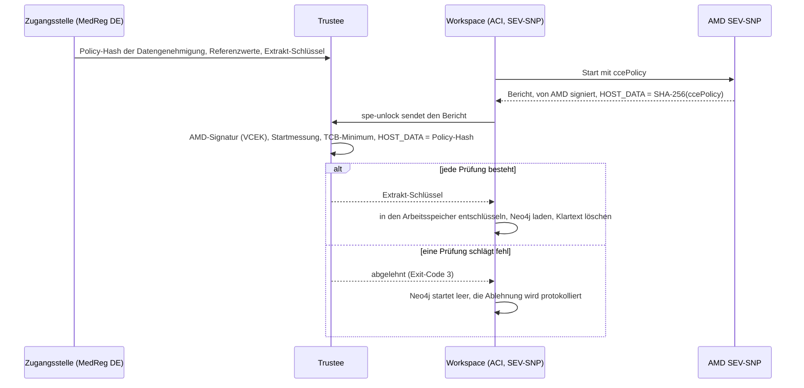

# Die sichere Verarbeitungsumgebung und ihre Confidential Containers

Ein Gesundheitsdatennutzer erhält nie die Zeilen der Patientinnen und Patienten. Er stellt eine Frage, die
Frage läuft in einer **sicheren Verarbeitungsumgebung** (SPE) direkt bei den
Daten, und zurück kommen nur Aggregate, die die Ausgabeprüfungen bestehen (Verordnung
(EU) 2025/327, Art. 73). Diese Seite erklärt, wie der Hub diese
Umgebung aus Confidential Containers aufbaut, sodass die Aussage „auch der Betreiber
kann die Daten nicht lesen“ auf Hardware beruht statt auf Vertrauen. Sie
behandelt, was wo läuft, wie ein Workspace seinen Schlüssel erhält, was eine Abfrage
durchläuft, wie Sie alles auf einem Laptop ausführen und was noch fehlt.

Die Entscheidungen sind [ADR-037](../ADRs/ADR-037-secure-processing-environment-confidential-computing.md)
(das Muster), [ADR-068](../ADRs/ADR-068-a-sovereign-confidential-spe-on-confidential-containers-and-trustee.md)
(der Entwurf), [ADR-069](../ADRs/ADR-069-two-spe-workspaces-as-aci-confidential-containers.md)
(das Azure-Deployment) und [ADR-072](../ADRs/ADR-072-spe-workspaces-start-on-demand.md)
(Start bei Bedarf). Die Schritt-für-Schritt-Anleitung für den Betrieb ist das Runbook
[SPE-Attestierung auf Azure](../knowledge/runbooks/spe-attestation-azure.md).

## 1. Die Idee in einem Absatz

Jeder der beiden Gesundheitsdateninhaber hat einen **Workspace**: SPE-1 für AlphaKlinik
Berlin, SPE-2 für Limburg Medical Centre. Ein Workspace ist eine vertrauliche
Containergruppe: Ihr Arbeitsspeicher wird von der CPU verschlüsselt (AMD SEV-SNP), und die
CPU signiert einen Bericht darüber, was genau darin gestartet wurde. Die Daten des Workspaces
kommen versiegelt an, und den Schlüssel hält ein **Trustee**, den die Zugangsstelle für
Gesundheitsdaten (MedReg DE) betreibt. Der Trustee gibt den Schlüssel nur frei, wenn der signierte
Bericht belegt, dass der Workspace genau den Code ausführt, für den die Datengenehmigung erteilt
wurde. **Kein Schlüssel, keine Daten**: Ein geändertes Image, ein geänderter Befehl oder eine geänderte Umgebungsvariable
ergibt einen anderen Policy-Hash, und der Schlüssel bleibt, wo er ist.

## 2. Begriffe

| Begriff                    | Was es ist                                                                                                                                                                                                                              |
| -------------------------- | --------------------------------------------------------------------------------------------------------------------------------------------------------------------------------------------------------------------------------------- |
| **Confidential Computing** | Code in einer vertrauenswürdigen Ausführungsumgebung (TEE) ausführen, deren Arbeitsspeicher weder Host noch Hypervisor noch Cloud-Betreiber lesen können.                                                                               |
| **AMD SEV-SNP**            | Die TEE, die die Workspaces nutzen (EPYC 9V74, Genoa). Sie verschlüsselt den Arbeitsspeicher der VM und erzeugt einen Attestierungsbericht, signiert mit einem Schlüssel, dessen Kette bis zu AMD reicht. Intel TDX wird nicht genutzt. |
| **Confidential Container** | Eine Containergruppe, die in ihrer eigenen SEV-SNP-Utility-VM läuft. Auf Azure: eine Gruppe in Azure Container Instances (ACI) mit `sku: Confidential`.                                                                                 |
| **ccePolicy**              | Die Confidential Computing Enforcement Policy einer ACI-Gruppe: die Images per Digest, die Befehle, die Umgebung und die Mounts, die laufen dürfen. Erzeugt mit `az confcom acipolicygen`.                                              |
| **HOST_DATA**              | Ein Feld des SEV-SNP-Berichts, das beim Start gesetzt wird. ACI legt dort den SHA-256 der ccePolicy ab, sodass die Hardware dafür bürgt, mit welcher Policy die Gruppe gestartet ist.                                                   |
| **Policy-Hash**            | Dieser SHA-256, festgehalten in der Datengenehmigung (`HDABApproval.policyHash`) und in der Ressourcen-Policy des Trustee. Er bindet eine Datengenehmigung an genau eine Workload.                                                      |
| **Trustee**                | Der Key Broker von [CNCF Confidential Containers](https://confidentialcontainers.org/): KBS (Key Broker Service), AS (Attestation Service) und RVPS (Referenzwerte). Version v0.22.0, betrieben von der Zugangsstelle.                  |
| **Referenzwerte**          | Womit der Trustee den Bericht vergleicht: die Startmessung der Utility-VM von Microsoft und die Mindest-TCB (Firmware- und Microcode-Versionen).                                                                                        |
| **Versiegelter Extrakt**   | Die Hälfte der synthetischen Patientinnen und Patienten, die ein Workspace erhält, Format `mvhd-spe-extract/1`: JSON Lines, gzip-komprimiert, mit AES-256-GCM verschlüsselt unter einem neuen Schlüssel je Datengenehmigung.            |

## 3. Wo es läuft und was jeder Ort belegt

Der Entwurf ist überall derselbe; der Unterschied liegt darin, ob echte Hardware
die Nachweise signiert. Die UI sagt, welcher Fall vorliegt, mit einem von drei Labels
([`ui/src/lib/spe.ts`](https://github.com/ma3u/MinimumViableHealthDataspacev2/blob/main/ui/src/lib/spe.ts)),
und behauptet nie mehr, als die Nachweise zeigen (ADR-068, Entscheidung 5).

| Wo                             | Was echt ist                                                                                                                                                                                                                          | Label                             |
| ------------------------------ | ------------------------------------------------------------------------------------------------------------------------------------------------------------------------------------------------------------------------------------- | --------------------------------- |
| **Laptop, CI, statische Demo** | Trustee, der Hash der Datengenehmigung in seiner Policy, die Schlüsselfreigabe, der versiegelte Extrakt, Neo4j, das ihn lädt, der Audit-Trail. Die Nachweise kommen vom Beispiel-Attester des Trustee, weil ein Laptop keine TEE hat. | "Simulated attestation"           |
| **Azure, Knotenebene (A1)**    | SEV-SNP-Hardware mit gemessenem Boot, aber nicht, welcher Container lief. Nicht bereitgestellt.                                                                                                                                       | "Attested: SEV-SNP node"          |
| **Azure, je Workload (A2)**    | ACI Confidential Containers in westeurope: Die Policy je Workload wird von der Hardware geprüft. Lief am 2026-11-02 durchgängig (#774).                                                                                               | "Attested: confidential workload" |

Die geseedeten `SPESession`-Knoten im Trust-Center-Graphen
([`neo4j/seed-trust-center.cypher`](https://github.com/ma3u/MinimumViableHealthDataspacev2/blob/main/neo4j/seed-trust-center.cypher))
tragen `simulated: true`; sie veranschaulichen das Modell und sind keine Nachweise.

## 4. Die Teile auf Azure

| Teil                      | Azure-Ressource                                                       | Was es tut                                                                                                                            |
| ------------------------- | --------------------------------------------------------------------- | ------------------------------------------------------------------------------------------------------------------------------------- |
| SPE-1, AlphaKlinik Berlin | ACI-Gruppe `mvhd-spe-1`, `sku: Confidential`, westeurope              | Init-Container `spe-unlock` attestiert und holt den Schlüssel; `neo4j` hält die Daten; Sidecar `spe-ingest` lädt sie                  |
| SPE-2, Limburg MC         | ACI-Gruppe `mvhd-spe-2`, gleicher Aufbau                              | dasselbe, mit der anderen Hälfte der synthetischen Patientinnen und Patienten                                                         |
| Trustee (MedReg DE)       | ACA-App `mvhd-trustee`, Job `mvhd-trustee-admin`                      | prüft die SEV-SNP-Nachweise gegen die Kette von AMD, die Referenzwerte und HOST_DATA und gibt dann `default/spe-<n>/extract-key` frei |
| Zustand des Trustee       | Dateifreigaben `trustee-keys`, `trustee-data`                         | Admin-Schlüssel, Token-Schlüssel, Policies, Referenzwerte, Extrakt-Schlüssel. Nie der Key Vault des Hubs                              |
| Versiegelte Extrakte      | Freigabe `spe-extracts`, eingebaut ins Image `mvhd-spe-loader-spe<n>` | nur Chiffretext; der Digest des Extrakts ist Teil des Policy-Hashs                                                                    |
| Föderation und Audit      | ACA-App `mvhd-neo4j-proxy`                                            | schickt die föderierten Fragen an die Workspaces, wendet die Ausgabeprüfungen an, hängt ihre `spe.*`-Ereignisse an die Audit-Kette an |

Die Gruppenvorlage ist
[`scripts/azure/aci/spe-workspace.template.json`](https://github.com/ma3u/MinimumViableHealthDataspacev2/blob/main/scripts/azure/aci/spe-workspace.template.json).
Alles andere im Hub bleibt auf Azure Container Apps (ACA), das in einer EU-Region
noch kein vertrauliches Workload-Profil hat. Azure Attestation und Secure Key Release
aus Key Vault wurden erwogen und sind bewusst **nicht** im Schlüsselpfad:
Die Zugangsstelle entscheidet, wer einen Schlüssel erhält, nicht der Cloud-Betreiber
(ADR-068, Entscheidung 1, ADR-069 „Alternatives considered“).

## 5. Die Vertrauenskette



1. **Die Datengenehmigung legt die Workload fest.** `21-aci-confidential-spe.sh --policy`
   erzeugt die ccePolicy aus der Vorlage. Ihr SHA-256 wird in die
   Datengenehmigung (`HDABApproval`) und in die Ressourcen-Policy des Trustee geschrieben
   ([`trustee/policies/resource-azure.rego.tmpl`](https://github.com/ma3u/MinimumViableHealthDataspacev2/blob/main/trustee/policies/resource-azure.rego.tmpl)).
2. **Die Hardware bürgt dafür.** ACI startet die Gruppe in einer SEV-SNP-Utility-VM
   und legt den Hash der Policy in HOST_DATA des signierten Berichts ab.
3. **Der Trustee prüft vier Dinge:** die Signatur zurück bis zu AMD (VCEK aus dem
   Key Distribution Service von AMD), die Startmessung der Utility-VM
   gegen einen fixierten Referenzwert, die TCB gegen ein Minimum je Komponente
   ([ADR-073](../ADRs/ADR-073-the-spe-tcb-is-a-minimum-not-a-list.md),
   [`attestation-ear-cpu.rego`](https://github.com/ma3u/MinimumViableHealthDataspacev2/blob/main/trustee/policies/attestation-ear-cpu.rego))
   und HOST_DATA gegen den Hash der Datengenehmigung.
4. **Erst dann verlässt der Schlüssel den Trustee.** Ist kein Referenzwert fixiert,
   lehnt die Policy ab: Ein „Entsperren bei erster Nutzung“ gibt es nicht.

Secrets reisen nicht in der Policy. Sie erreichen die Gruppe über deren Secret-Volume,
sodass das Rotieren eines Secrets den Hash nicht ändert.

## 6. Im Inneren eines Workspaces

Jede Gruppe hat drei Container, gebaut aus
[`services/spe-loader`](https://github.com/ma3u/MinimumViableHealthDataspacev2/tree/main/services/spe-loader):

- **`spe-unlock`** (Init-Container): attestiert mit `kbs-client`, gebaut mit dem
  Feature `snp-attester`, holt den Schlüssel und entschlüsselt den Extrakt in das
  `emptyDir`-Volume `work`.
- **`neo4j`**: Neo4j 5.26 Community, 1,5 vCPU und 4 GiB, Speicher im
  `emptyDir`-Volume `neo4j-data`, Bolt mit verpflichtendem TLS, HTTP aus. Neo4j ist
  **ein Workspace je Datengenehmigung, kein langlebiger Speicher** (ADR-068, Entscheidung 3): Es
  hält die Daten nur im Arbeitsspeicher und auf flüchtigem Speicher innerhalb der TEE.
- **`spe-ingest`** (Sidecar): lädt den Extrakt, wendet
  `neo4j/init-schema.cypher` und die HealthDCAT-AP-Registrierung der SPE an,
  löscht den Klartext, protokolliert die Attestierung und läuft weiter.

**Die Daten.** Jeder Workspace erhält die Hälfte der synthetischen Patientinnen und Patienten des Hubs: die
FHIR-Datensätze (Patient, Condition, Observation und der Rest), die passende
OMOP-CDM-Person mit ihren Datensätzen und die Konzepte, mit denen sie kodiert sind. Sandbox-Patientinnen
und -Patienten sowie die der Klarbefund-App bleiben außen vor. Das Label
`OptedOut` einer Person reist mit den Daten (Art. 71).

**Stoppen heißt Löschen.** Die Speicher liegen im Arbeitsspeicher, daher verliert eine
gestoppte oder gelöschte Gruppe jede Zeile. Jeder Start attestiert erneut und lädt erneut. Eine Falle:
`az container restart` führt den Init-Container nicht erneut aus, daher fragt eine neu gestartete
Gruppe den Trustee nie wieder; stoppen und starten Sie sie stattdessen
([`docs/gotchas.md`](../gotchas.md), 2026-11-01).

**Die Befehle des Loaders** (`spe-loader <command>`): `policy-hash`,
`trustee-configure`, `record-permit`, `export`, `encrypt`, `extract`,
`unlock`, `ingest` und `load`. Exit-Code 3 bedeutet, dass der Schlüssel abgelehnt wurde; 2 bedeutet,
dass eine Datenbank oder der Trustee nicht geantwortet hat.

## 7. Was eine föderierte Abfrage durchläuft

1. Ein Gesundheitsdatennutzer fragt auf `/query` oder in natürlicher Sprache. Die UI ruft
   [`/api/federated`](https://github.com/ma3u/MinimumViableHealthDataspacev2/blob/main/ui/src/app/api/federated/route.ts)
   auf (oder `/api/nlq` mit `federated: true`).
2. **Kaltstart** ([ADR-072](../ADRs/ADR-072-spe-workspaces-start-on-demand.md)).
   Die Workspaces sind standardmäßig gestoppt, um Kosten zu sparen. Eine föderierte Abfrage durch
   `EDC_ADMIN`, `HDAB_AUTHORITY` oder `DATA_USER` startet sie; bis sie laufen,
   lautet die Antwort **503** mit `state` `starting` oder `stopped`,
   `etaSeconds` (240 aus dem gestoppten Zustand) und einem `Retry-After`-Header. Gemessen: Der
   Schlüssel kommt nach etwa einer Minute, die Daten sind nach etwa drei geladen,
   SPE-2 antwortet nach etwa vier. Der Job `mvhd-spe-idle-stop` läuft alle
   15 Minuten und stoppt einen Workspace, der 30 Minuten untätig war.
3. **Der Proxy verteilt die Frage.** `services/neo4j-proxy` schickt die Frage an beide
   Workspaces über Bolt mit TLS (`POST /federated/query`,
   `GET /federated/stats`).
4. **Ausgabeprüfungen, bevor etwas hinausgeht.** Gruppen kleiner als k werden
   verworfen, und Zellen unter k werden zu `<k`, mit k = 5 (`MIN_COHORT_SIZE`,
   [`k-anonymity.ts`](https://github.com/ma3u/MinimumViableHealthDataspacev2/blob/main/services/neo4j-proxy/src/k-anonymity.ts));
   Personen mit Widerspruch werden ausgeschlossen
   ([`opt-out.ts`](https://github.com/ma3u/MinimumViableHealthDataspacev2/blob/main/services/neo4j-proxy/src/opt-out.ts)).
5. **Nur Aggregate kommen zurück** zur UI, über den Proxy.

**Der Audit-Trail.** Der Proxy liest jede Minute die Ereignisse jedes Workspaces und
hängt sie an die Audit-Kette `spe` des Hubs an (ADR-045): `spe.attestation`,
`key_release`, `key_refused`, `workspace_loaded`, `workspace_destroyed` und
`optout_synced`.

**Wo Sie es in der UI sehen**, angemeldet als `edcadmin`:

- `/admin/attestation`: die Attestierung jedes Workspaces und sein Label.
- `/admin/components`: die SPE-Topologie, mit einem Ein-/Aus-Schalter je Workspace.
- `/admin/audit`: die Kette `spe`.
- `/admin/policies`: welche Datengenehmigung an welchen Policy-Hash gebunden ist.
- `/query`: der Kaltstart-Hinweis, während die Workspaces starten.

## 8. Auf einem Laptop ausführen

Ohne das unten genannte Overlay ist SPE-1 einfach der Graph des Hubs und SPE-2 ein zweites
Neo4j: Die Föderation funktioniert, aber nichts ist versiegelt oder attestiert. Für den echten
Ablauf mit simulierten Nachweisen starten Sie das Trustee-Overlay auf dem JAD-Stack
([`docker-compose.trustee.yml`](https://github.com/ma3u/MinimumViableHealthDataspacev2/blob/main/docker-compose.trustee.yml)):

```bash
docker compose -f docker-compose.yml -f docker-compose.jad.yml \
  -f docker-compose.trustee.yml --profile federated up -d --build
```

Es fügt den Trustee unter <http://localhost:8099> hinzu, setzt dessen lokale Policy und
Referenzwerte, versiegelt beide Extrakte und hält ihre Policy-Hashes im
Hub fest, verlegt die Speicher beider Workspaces auf `tmpfs` und führt `spe-loader-spe1` und
`spe-loader-spe2` aus, um zu attestieren, zu entsperren und zu laden. Prüfen Sie das Ergebnis mit
`GET http://localhost:9090/spe/status` des Proxys oder auf `/admin/attestation`.

Die Tests, die es absichern, in der CI und lokal:

```bash
cd services/spe-loader && npm test        # Vitest: extract, seal, unlock, ingest
./scripts/test-trustee-policies.sh        # opa test over trustee/policies/
```

Beide laufen in [`test.yml`](https://github.com/ma3u/MinimumViableHealthDataspacev2/blob/main/.github/workflows/test.yml)
(SPE Loader Tests, Trustee Policy Tests). Die Policy-Tests fixieren jeden Fall
der Ressourcen-Policy, einschließlich HOST_DATA an der Stelle, an der Trustee v0.22.0
es ablegt.

## 9. Auf Azure bereitstellen

[`scripts/azure/21-aci-confidential-spe.sh`](https://github.com/ma3u/MinimumViableHealthDataspacev2/blob/main/scripts/azure/21-aci-confidential-spe.sh)
erledigt das in Phasen, in dieser Reihenfolge: `--trustee`, `--extracts`, `--policy`,
`--workspaces`, `--wire-proxy`, `--check`. Das Runbook nennt die
Voraussetzungen (eine PIM-Rolle, aktiviert vor `az login`, die einstündige Sitzung)
und was jede Phase ausgibt; lesen Sie es vor dem ersten Lauf. Zwei Phasen schützen
sich selbst: `--extracts` verweigert ein Neuverschlüsseln, solange der Trustee Schlüssel hält, außer mit
`--rekey`, und `--trustee` behält eine Ressourcen-Policy, die der Trustee bereits hält.

## 10. Was noch fehlt

- **Die Zugangsstelle betreibt noch keinen eigenen Trustee.** Die Freigaben des Trustee liegen
  im Abonnement des Hubs, sodass der Inhaber des Abonnements sie lesen könnte. Damit
  die Aussage zur Souveränität trägt, betreibt MedReg DE den Trustee in einem eigenen
  Abonnement (ADR-069, Entscheidung 3).
- **Das Vertrauen in AMD und in die Utility-VM von Microsoft bleibt.** Die Bestätigung
  der Messung der Utility-VM durch Microsoft wird vom Betreiber verglichen,
  ihre COSE-Signatur wird aber noch nicht kryptografisch geprüft.
- **ADR-073 ist vorgeschlagen.** Das TCB-Minimum und seine Tests sind auf `main`
  (#836); das ADR sagt, dass es auf Azure noch nicht angewandt wird.
- **AKS ist heute keine Option.** Die Tenant-Policy hat es abgelehnt
  (`RequestDisallowedByPolicy`); eine Ausnahme ist beantragt. AKS Confidential
  Containers wurden zudem von Microsoft eingestellt (ADR-068).
- **Nicht entschieden** (ADR-068): welcher EU-Anbieter den Fall je Workload
  außerhalb von Azure betreibt, und der Trustee in einem eigenen Abonnement.

Issues: [#774](https://github.com/ma3u/MinimumViableHealthDataspacev2/issues/774)
(das Azure-Deployment), [#27](https://github.com/ma3u/MinimumViableHealthDataspacev2/issues/27),
[#481](https://github.com/ma3u/MinimumViableHealthDataspacev2/issues/481),
[#716](https://github.com/ma3u/MinimumViableHealthDataspacev2/issues/716),
[#833](https://github.com/ma3u/MinimumViableHealthDataspacev2/issues/833).

## 11. Die Entscheidungen, der Reihe nach

| ADR                                                                                               | Entscheidung                                                                                                 | Status                  |
| ------------------------------------------------------------------------------------------------- | ------------------------------------------------------------------------------------------------------------ | ----------------------- |
| [ADR-037](../ADRs/ADR-037-secure-processing-environment-confidential-computing.md)                | Confidential Containers mit Remote-Attestierung statt Vertrauen in den Betreiber                             | Angenommen              |
| [ADR-052](../ADRs/ADR-052-confidential-spe-on-azure-revisited.md)                                 | AKS mit Kata und Azure Attestation                                                                           | Ersetzt durch ADR-068   |
| [ADR-068](../ADRs/ADR-068-a-sovereign-confidential-spe-on-confidential-containers-and-trustee.md) | CNCF Confidential Containers, ein Trustee, den die Zugangsstelle betreibt, Neo4j je Datengenehmigung geladen | Angenommen (2026-10-30) |
| [ADR-069](../ADRs/ADR-069-two-spe-workspaces-as-aci-confidential-containers.md)                   | Zwei Workspaces als ACI Confidential Containers; der Policy-Hash ist HOST_DATA                               | Angenommen (2026-11-02) |
| [ADR-072](../ADRs/ADR-072-spe-workspaces-start-on-demand.md)                                      | Standardmäßig gestoppt, von einer föderierten Abfrage gestartet, nach 30 untätigen Minuten gestoppt          | Angenommen (2026-11-02) |
| [ADR-073](../ADRs/ADR-073-the-spe-tcb-is-a-minimum-not-a-list.md)                                 | Die SEV-SNP-TCB wird gegen ein Minimum je Komponente geprüft                                                 | Vorgeschlagen           |
