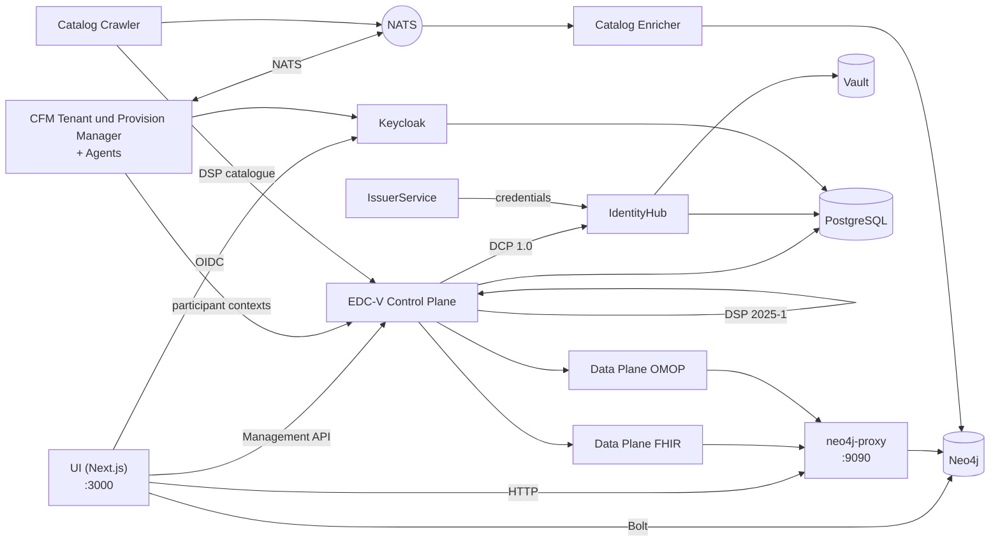

# Der Stack und die Entwicklungsumgebung

Wie jeder Teil des Hubs heißt, was er tut und wie die Teile zusammenwirken,
gefolgt davon, wie Sie sie auf einem Laptop ausführen. Die Entscheidungen hinter jedem
Teil stehen in den ADRs, die in seiner Zeile verlinkt sind; das vollständige Gotcha-Protokoll ist
[`docs/gotchas.md`](../gotchas.md).

## Glossar

### Protokolle

| Begriff           | Was es ist                                                                                                                                                                                                                                                                                                | Entscheidung                                                            |
| ----------------- | --------------------------------------------------------------------------------------------------------------------------------------------------------------------------------------------------------------------------------------------------------------------------------------------------------- | ----------------------------------------------------------------------- |
| **DSP 2025-1**    | Das Eclipse Dataspace Protocol in der Version 2025-1: wie zwei Konnektoren einen Katalog (DCAT) austauschen, einen Vertrag über ein ODRL-Angebot aushandeln und eine Übertragung durchführen. Die Control Plane spricht es unter `/api/dsp/<participant>/2025-1/`.                                        | [ADR-007](../ADRs/ADR-007-did-web-dsp-negotiation.md)                   |
| **DCP 1.0**       | Das Decentralised Claims Protocol: wie ein Teilnehmer nachweist, wer er ist. Jeder hat eine `did:web`-DID und hält verifizierbare Nachweise (ein `MembershipCredential`, EHDS-Rollennachweise); eine Gegenpartei fordert eine Präsentation an, statt einer zentralen Anmeldung zu vertrauen.              | [ADR-009](../ADRs/ADR-009-issuerservice-credential-fix.md)              |
| **ODRL 2.2**      | Die Richtliniensprache eines Angebots: wer einen Datensatz nutzen darf, zu welchem Zweck und unter welcher Genehmigung.                                                                                                                                                                                   | [ADR-013](../ADRs/ADR-013-simpl-open-alignment.md)                      |
| **HealthDCAT-AP** | Das Katalogvokabular für Gesundheitsdatensätze, seit #700 in Release 8.                                                                                                                                                                                                                                   | [ADR-063](../ADRs/ADR-063-healthdcat-ap-release-8-and-its-namespace.md) |
| **did:web**       | Eine über HTTPS aufgelöste DID. Zwei Formen bestehen nebeneinander, eine stabile im Graphen und in der UI und eine auflösbare in der EDC-Schicht; [`api-conventions.md`](https://github.com/ma3u/MinimumViableHealthDataspacev2/blob/main/.claude/rules/api-conventions.md) erklärt, welche wohin gehört. | [ADR-007](../ADRs/ADR-007-did-web-dsp-negotiation.md)                   |

### Der Konnektor: EDC-V

| Begriff           | Was es ist                                                                                                                                                                                                                                                                                                              | Entscheidung                                                                                                                            |
| ----------------- | ----------------------------------------------------------------------------------------------------------------------------------------------------------------------------------------------------------------------------------------------------------------------------------------------------------------------- | --------------------------------------------------------------------------------------------------------------------------------------- |
| **EDC-V**         | Eclipse Dataspace Components, virtuell: eine mandantenfähige EDC-Laufzeit, in der jeder Teilnehmer ein _Teilnehmerkontext_ ist statt eines eigenen Konnektors. Der Hub betreibt EDC 0.18 aus den JAD-Images.                                                                                                            | [ADR-024](../ADRs/ADR-024-full-edc-provisioning-per-participant.md), [ADR-055](../ADRs/ADR-055-azure-runs-the-compose-jad-build.md)     |
| **Control Plane** | Die EDC-V-Laufzeit, die Assets, Richtlinien und Vertragsdefinitionen hält, Verträge über DSP aushandelt und Übertragungen startet. Management API auf `:11003`.                                                                                                                                                         | [ADR-002](../ADRs/ADR-002-edc-data-plane-architecture.md)                                                                               |
| **Data Planes**   | Zwei, eine je Übertragungsart: `dataplane-fhir` überträgt FHIR R4 per Push (`:11002`), `dataplane-omop` stellt OMOP CDM per Pull bereit (`:11012`). Sie bewegen die Daten, auf die sich die Control Plane geeinigt hat, und prüfen das EDR-Token jeder Anfrage.                                                         | [ADR-002](../ADRs/ADR-002-edc-data-plane-architecture.md)                                                                               |
| **IdentityHub**   | Die DCP-Wallet jedes Teilnehmers: sein DID-Dokument, seine Schlüssel (in Vault) und die Nachweise, die er hält; sie beantwortet Präsentationsanfragen. `:11005`.                                                                                                                                                        | [ADR-009](../ADRs/ADR-009-issuerservice-credential-fix.md)                                                                              |
| **IssuerService** | Der Nachweisaussteller des Hubs: Er hält die Nachweisdefinitionen und stellt Inhabern Nachweise über DCP aus. `:10013`. Eine zweite Instanz, `simpl-ga-issuer` (`:10023`), spielt die Simpl-Governance-Behörde; `rogue-issuer` (`:10033`) steht auf keiner Vertrauensliste und startet nur für die Identitätsprüfungen. | [ADR-009](../ADRs/ADR-009-issuerservice-credential-fix.md), [ADR-064](../ADRs/ADR-064-simpl-open-through-the-outside-agent-dcp-path.md) |
| **Siglet**        | Signiert die Tokens der EDC-0.18-Data-Planes (Eclipse Dataplane Core).                                                                                                                                                                                                                                                  | [ADR-055](../ADRs/ADR-055-azure-runs-the-compose-jad-build.md)                                                                          |

### Betrieb: JAD und CFM

| Begriff        | Was es ist                                                                                                                                                                                                                                                                                                                                                                                                       | Entscheidung                                                                                                                        |
| -------------- | ---------------------------------------------------------------------------------------------------------------------------------------------------------------------------------------------------------------------------------------------------------------------------------------------------------------------------------------------------------------------------------------------------------------- | ----------------------------------------------------------------------------------------------------------------------------------- |
| **JAD**        | Die Joint Architecture Demo: das Referenz-Deployment von EDC-V (Images `ghcr.io/metaform/jad/*`, per Commit fixiert). Hier ist es `docker-compose.jad.yml` plus die Seeds und die Konfiguration in `jad/`, aufgesetzt auf `docker-compose.yml`. Azure betreibt denselben Build.                                                                                                                                  | [ADR-005](../ADRs/ADR-005-jad-cfm-source-builds.md), [ADR-055](../ADRs/ADR-055-azure-runs-the-compose-jad-build.md)                 |
| **CFM**        | Der Connector Fabric Manager, die Verwaltungsebene über EDC-V: Der **Tenant Manager** (`:11006`) legt je Organisation einen Mandanten an, der **Provision Manager** (`:11007`) stellt bereit, was dieser braucht, und vier **Agents** erledigen die Arbeit (Keycloak-Client, EDC-V-Teilnehmerkontext, Registrierung, Onboarding). `cfm-cp-shim` verbindet die fixierten Agents mit der API-Version von EDC 0.18. | [ADR-005](../ADRs/ADR-005-jad-cfm-source-builds.md)                                                                                 |
| **Vault**      | HashiCorp Vault hält die privaten Schlüssel jedes Teilnehmers und die EDC-Secrets. Lokal seit 2026-09-26 dateibasiert (`jad/vault.hcl`, mit einem `vault-unseal`-Sidecar), auf Azure auf dem Flexible Server. Nie `-dev`: Ein Neustart würde jeden Schlüssel löschen.                                                                                                                                            | [ADR-046](../ADRs/ADR-046-vault-keeps-its-state-on-the-flexible-server.md), [ADR-047](../ADRs/ADR-047-vault-stays-up-off-hours.md)  |
| **Keycloak**   | OIDC-Anmeldung für die UI und die Dienst-Clients, Realm `edcv`, `:8080`. Der UI-Client ist vertraulich (confidential) mit PKCE S256.                                                                                                                                                                                                                                                                             | [ADR-025](../ADRs/ADR-025-keycloak-custom-domain.md)                                                                                |
| **PostgreSQL** | Der Laufzeitspeicher der EDC-Dienste und von Keycloak, je eine Datenbank (`jad/init-postgres.sql`). Auf Azure der Flexible Server.                                                                                                                                                                                                                                                                               | [ADR-001](../ADRs/ADR-001-postgresql-neo4j-split.md), [ADR-041](../ADRs/ADR-041-managed-postgres-on-azure-containerised-locally.md) |
| **NATS**       | Das Event-Mesh (JetStream) zwischen den Managern und Agents von CFM sowie zwischen Katalog-Crawler und -Enricher. `:4222`.                                                                                                                                                                                                                                                                                       | [ADR-020](../ADRs/ADR-020-cross-participant-dataset-discovery.md)                                                                   |
| **Traefik**    | Das Gateway vor den JAD-Diensten, `:80`, Dashboard auf `:8090`.                                                                                                                                                                                                                                                                                                                                                  |                                                                                                                                     |

### Die eigenen Dienste des Hubs

| Begriff                     | Was es ist                                                                                                                                                                                                                                                                                                                                                                                                                                                         | Entscheidung                                                                                                                                                                         |
| --------------------------- | ------------------------------------------------------------------------------------------------------------------------------------------------------------------------------------------------------------------------------------------------------------------------------------------------------------------------------------------------------------------------------------------------------------------------------------------------------------------ | ------------------------------------------------------------------------------------------------------------------------------------------------------------------------------------ |
| **UI**                      | Die Next.js-App in `ui/`: die Seiten jeder Persona und die `/api/*`-Routen dahinter. Container `health-dataspace-ui`.                                                                                                                                                                                                                                                                                                                                              | [ADR-004](../ADRs/ADR-004-nextjs-unified-frontend.md), [ADR-044](../ADRs/ADR-044-every-api-route-needs-a-session.md)                                                                 |
| **Neo4j**                   | Der Wissensgraph aus fünf Schichten: Marktplatz (DSP), HealthDCAT-AP, FHIR R4, OMOP CDM und Ontologien. Neo4j 5.26 LTS Community mit APOC, APOC Extended, Graph Data Science und n10s. Kein Object Mapper und keine GraphQL-Schicht: UI, Proxy und SPE-Loader nutzen den offiziellen `neo4j-driver` mit parametrisiertem Cypher (`runQuery()` in `ui/src/lib/neo4j.ts`), die Katalogdienste den offiziellen Python-Treiber `neo4j`. `:7474` Browser, `:7687` Bolt. | [ADR-001](../ADRs/ADR-001-postgresql-neo4j-split.md), [ADR-030](../ADRs/ADR-030-neo4j-2025-lts-migration.md), [ADR-043](../ADRs/ADR-043-graph-access-direct-or-through-the-proxy.md) |
| **neo4j-proxy**             | `services/neo4j-proxy/`, Express auf `:9090`: die FHIR- und OMOP-Endpunkte, die die Data Planes aufrufen, die Abfrage-Engine für natürliche Sprache, die föderierte Abfrage und der Katalog in HealthDCAT-AP.                                                                                                                                                                                                                                                      | [ADR-043](../ADRs/ADR-043-graph-access-direct-or-through-the-proxy.md)                                                                                                               |
| **Catalog Crawler**         | `services/catalog-crawler/`, Python: ruft alle fünf Minuten den DSP-Katalog jedes Teilnehmers ab und veröffentlicht ihn auf NATS (`dataspace.catalog.raw`).                                                                                                                                                                                                                                                                                                        | [ADR-020](../ADRs/ADR-020-cross-participant-dataset-discovery.md)                                                                                                                    |
| **Catalog Enricher**        | `services/catalog-enricher/`, Python: liest diese Kataloge aus NATS, bildet sie auf HealthDCAT-AP ab und führt sie als `:HealthDataset`-Knoten in Neo4j zusammen, sodass eine Frage nach Datensätzen die Datensätze jedes Teilnehmers erreicht.                                                                                                                                                                                                                    | [ADR-020](../ADRs/ADR-020-cross-participant-dataset-discovery.md), [ADR-003](../ADRs/ADR-003-healthdcat-ap-alignment.md)                                                             |
| **SPE-Workspaces, Trustee** | `services/spe-loader/` und `trustee/`: die beiden sicheren Verarbeitungsumgebungen (Art. 73), Confidential Containers mit AMD SEV-SNP auf Azure, deren versiegelte Daten ein Trustee der Zugangsstelle nur für die Workload entsperrt, die die Genehmigung nennt. Siehe [die sichere Verarbeitungsumgebung](secure-processing-environment.md).                                                                                                                     | [ADR-068](../ADRs/ADR-068-a-sovereign-confidential-spe-on-confidential-containers-and-trustee.md), [ADR-069](../ADRs/ADR-069-two-spe-workspaces-as-aci-confidential-containers.md)   |
| **Klarbefund**              | Die iPhone-App in `clients/ios/`: scannt einen Laborbefund auf dem Gerät und verbindet sich mit dem Hub als elektronische Patientenakte der Patientin oder des Patienten.                                                                                                                                                                                                                                                                                          | [ADR-033](../ADRs/ADR-033-lab-report-extraction-pipeline.md), [ADR-049](../ADRs/ADR-049-klarbefund-connects-by-device-grant.md)                                                      |

### Wie sie zusammenwirken



Ein Teilnehmer wird einmal durch CFM angelegt: Der Tenant Manager erstellt den Mandanten,
die Agents geben ihm einen Keycloak-Client, einen Teilnehmerkontext in EDC-V und eine DID
im IdentityHub, und der IssuerService stellt seine Nachweise aus. Von da an
verhandelt die Control Plane in seinem Namen über DSP, weist über DCP nach, wer er ist,
und eine Data Plane bewegt die Daten aus dem Neo4j-Proxy, sobald ein Vertrag
besteht. Die UI liest den Graphen für ihre Seiten direkt und geht für alles, was ein
Austausch ist, über die Control Plane.

## Entwicklungsumgebung

### Voraussetzungen

| Bedarf                                | Wofür                                                                                                 |
| ------------------------------------- | ----------------------------------------------------------------------------------------------------- |
| Node.js 20 oder neuer, npm            | die UI und den Neo4j-Proxy                                                                            |
| Docker mit Compose v2                 | Neo4j und den vollständigen JAD-Stack; geben Sie Docker für JAD **8 GB Arbeitsspeicher**              |
| Python 3.11 oder neuer                | die Prüfungen des Repositorys (`scripts/*.py`) und die Katalogdienste                                 |
| `pre-commit`                          | die Hooks: `pip install pre-commit && pre-commit install --hook-type pre-commit --hook-type pre-push` |
| gitleaks, semgrep, actionlint, lychee | lokal optional (jeder Hook warnt und überspringt ohne das Werkzeug); das PR Gate führt aus, was zählt |
| Xcode 27 und `xcodegen`               | nur für die iPhone-App (iOS 26 SDK)                                                                   |

### Zwei Wege, ihn auszuführen

| Stack                 | Start                                                                                                                             | Was Sie bekommen                                                                                                                                |
| --------------------- | --------------------------------------------------------------------------------------------------------------------------------- | ----------------------------------------------------------------------------------------------------------------------------------------------- |
| **Minimal**           | `docker compose up -d neo4j`, Schema und Daten laden, `cd ui && npm install && npm run dev`                                       | den Graphen und jede Seite, die ihn liest, unter http://localhost:3000; kein Keycloak, daher braucht die Anmeldung den statischen Persona-Modus |
| **Vollständiges JAD** | `docker compose -f docker-compose.yml -f docker-compose.jad.yml up -d`, dann `./scripts/bootstrap-jad.sh` und `./jad/seed-all.sh` | jeden Dienst aus dem Glossar, den UI-Container unter http://localhost:3003, Anmeldung über Keycloak                                             |

Den Graphen für den minimalen Stack laden (beide Dateien sind idempotent):

```bash
cat neo4j/init-schema.cypher | docker exec -i health-dataspace-neo4j \
  cypher-shell -u neo4j -p healthdataspace
cat neo4j/insert-synthetic-schema-data.cypher | docker exec -i health-dataspace-neo4j \
  cypher-shell -u neo4j -p healthdataspace
```

`docker compose up -d` ohne Dienstnamen baut zusätzlich die UI als
Container `health-dataspace-ui` auf `:3000` und `:3003`; starten Sie nur `neo4j`,
wenn Sie `npm run dev` auf `:3000` wollen.

### Die Seed-Phasen, der Reihe nach

`./jad/seed-all.sh` führt sieben Phasen aus, und jede braucht die vorherige; eine
fehlgeschlagene Phase macht daher jede spätere ungültig. Setzen Sie mit `--from N` fort, führen Sie eine einzelne mit
`--only N` aus.

| Phase | Skript                         | Bewirkt                                                    |
| ----: | ------------------------------ | ---------------------------------------------------------- |
|     1 | `seed-health-tenants.sh`       | fünf Teilnehmermandanten über CFM                          |
|     2 | `seed-ehds-credentials.sh`     | die EHDS-Nachweistypen im IssuerService                    |
|     3 | `seed-ehds-policies.sh`        | ODRL-Richtlinien für jeden Teilnehmer                      |
|     4 | `seed-data-assets.sh`          | Daten-Assets und Vertragsdefinitionen in EDC-V             |
|     5 | `seed-contract-negotiation.sh` | Verhandlungen von PharmaCo mit AlphaKlinik und Data Planes |
|     6 | `seed-federated-catalog.sh`    | Katalogverhandlung von MedReg mit Limburg Medical Centre   |
|     7 | `seed-data-transfer.sh`        | EDR-Tokens und Übertragungen über die Data Planes          |

Das Runbook ist [JAD-Stack-Seeding](../knowledge/runbooks/jad-stack-seeding.md).

### Ports

| Port       | Dienst                                | Port         | Dienst                           |
| ---------- | ------------------------------------- | ------------ | -------------------------------- |
| 3000       | UI (`npm run dev` oder der Container) | 11002        | Data Plane FHIR                  |
| 3003       | UI-Container (JAD)                    | 11003        | Control Plane, Management API    |
| 7474, 7687 | Neo4j-Browser, Bolt                   | 11005        | IdentityHub                      |
| 8080, 9000 | Keycloak, sein Management-Port        | 11006, 11007 | CFM Tenant und Provision Manager |
| 8200       | Vault                                 | 11012        | Data Plane OMOP                  |
| 9090       | neo4j-proxy                           | 10013        | IssuerService                    |
| 4222, 8222 | NATS, sein Monitoring                 | 10023, 10033 | Simpl-GA-Issuer, Rogue Issuer    |
| 5432       | PostgreSQL                            | 80, 8090     | Traefik, sein Dashboard          |

### Umgebungsvariablen

Die UI liest ihre Konfiguration aus der Umgebung; `ui/.env.example` und
`ui/.env.local.example` sind die Vorlagen zum Kopieren. Diejenigen, denen Sie zuerst begegnen:

| Variable                                                                                                          | Was sie festlegt                                                             |
| ----------------------------------------------------------------------------------------------------------------- | ---------------------------------------------------------------------------- |
| `NEO4J_URI`, `NEO4J_USER`, `NEO4J_PASSWORD`                                                                       | den Graphen; `neo4j` / `healthdataspace` ist nur für die lokale Entwicklung  |
| `NEO4J_PROXY_URL`                                                                                                 | den Proxy, standardmäßig `http://localhost:9090` (`ui/src/lib/proxy.ts`)     |
| `NEXTAUTH_URL`, `NEXTAUTH_SECRET`                                                                                 | NextAuth; das Secret signiert auch die Sitzungen, die die API-Tests erzeugen |
| `KEYCLOAK_PUBLIC_URL`, `KEYCLOAK_INTERNAL_URL`, `KEYCLOAK_ISSUER`, `KEYCLOAK_CLIENT_ID`, `KEYCLOAK_CLIENT_SECRET` | die Anmeldung; nie `wellKnown` (Gotcha 5 in `CLAUDE.md`)                     |
| `EDC_MANAGEMENT_URL`, `EDC_IDENTITY_URL`, `EDC_ISSUER_URL`, `EDC_TENANT_URL`, `EDC_PROVISION_URL`                 | die EDC-V- und CFM-Dienste                                                   |
| `NEXT_PUBLIC_STATIC_EXPORT=true`                                                                                  | den GitHub-Pages-Build: keine API-Routen, Fixtures aus `ui/public/mock/`     |

### Die iPhone-App

`clients/ios/` ist ein Swift-Paket und ein XcodeGen-Projekt; zum Bauen und für
seine Tests braucht es den Hub nicht.

```bash
cd clients/ios
brew install xcodegen      # once
swift test                 # the parser and provenance model
xcodegen generate && open MeinBefund.xcodeproj
```

Der Simulator-Build braucht eine Ad-hoc-Signatur (`CODE_SIGN_IDENTITY="-"`), sonst
schlägt jeder Keychain-Aufruf fehl. Ein Geräte-Build und ein TestFlight-Upload brauchen ein Apple
Developer Team: `Scripts/install-device.sh`, `Scripts/archive-and-upload.sh`.
Das [Entwicklerhandbuch für Klarbefund](../klarbefund/developer-guide.md) enthält den
Rest, und `Scripts/run-ui-tests.sh` führt die Bildschirmtests aus.

### Stolpersteine, die Sie am ersten Tag kennen sollten

Das vollständige, datierte Protokoll ist [`docs/gotchas.md`](../gotchas.md). Diejenigen, die
am meisten Zeit gekostet haben:

- **Vault muss seinen Zustand behalten.** Wenn der IdentityHub `Private key ... not
found` protokolliert, prüfen Sie, ob `health-dataspace-vault-unseal` `ready` gemeldet hat.
- **Die Seed-Phasen sind streng geordnet**; setzen Sie einen fehlgeschlagenen Lauf mit `--from` fort.
- **Der statische Export hat keine API-Routen.** Jede Seite, die `/api/...` liest,
  braucht ein Fixture in `ui/public/mock/`, und ohne eines schlägt ein Test fehl.
- **Pre-commit schreibt Dateien um** (Prettier, die Docs-Facts). Stagen Sie sie erneut
  und committen Sie erneut; prüfen Sie, dass sich `HEAD` bewegt hat.
- **Ein 200 von der Keycloak-Discovery beweist nichts**: Die Antwort ist gecacht. Weisen Sie die Anmeldung
  mit `scripts/azure/check-keycloak-health.sh` nach.
- **Container Apps cachen `:latest`**; ein Deploy legt eine neue Revision an, statt
  neu zu starten.
