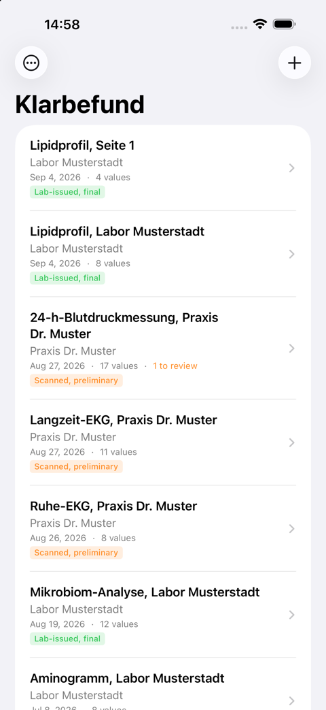
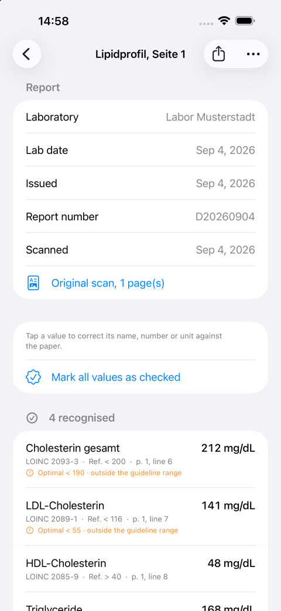

# Entwicklerhandbuch für Klarbefund

Wie Sie die iPhone-App in
[`clients/ios/`](../../../../clients/ios/) bauen, ausführen, testen und ändern. Das [Benutzerhandbuch](user-guide.md) zeigt,
was eine Person sieht; dieses Handbuch zeigt, was dahintersteht. Die kurze Befehlsübersicht
ist [`clients/ios/README.md`](../../../../clients/ios/README.md); die Arbeit wird
in [Issue #186](https://github.com/ma3u/MinimumViableHealthDataspacev2/issues/186) verfolgt.

Jeder Screenshot und jede Zahl in diesem Handbuch stammt aus dem eigenen
fiktiven Entwicklungsdatensatz der App. Nirgends im Repository ist ein realer Befund
beteiligt, und [die zwei Regeln am Ende](#two-rules-that-are-not-negotiable)
sagen, warum das nicht verhandelbar ist.

## Was Sie brauchen

| Werkzeug           | Version                      | Wozu                                                                                    |
| ------------------ | ---------------------------- | --------------------------------------------------------------------------------------- |
| macOS mit Xcode    | Xcode 27, iOS 26 SDK         | Die App zielt auf iOS 26; das Swift-Paket deklariert macOS 26 für die Werkzeuge         |
| Swift              | 6.0, strikte Nebenläufigkeit | `Package.swift` und `project.yml` legen es beide fest                                   |
| XcodeGen           | `brew install xcodegen`      | Das `.xcodeproj` wird aus `project.yml` erzeugt und nie committet                       |
| Node               | wie für `ui/`                | Nur um das Wörterbuch aus `services/epa-ingest` neu zu erzeugen                         |
| PlantUML, Graphviz | `brew install plantuml`      | Nur um die Diagramme in diesem Handbuch neu zu rendern                                  |
| Ein iPhone         | iOS 26 oder neuer            | Nur für die Kamera, Face ID, App Attest und TestFlight; alles andere läuft im Simulator |

## Wie es aufgebaut ist


Quelle: [`diagrams/klarbefund-architecture.puml`](../../../klarbefund/diagrams/klarbefund-architecture.puml),
gerendert mit `scripts/render-plantuml.sh docs/klarbefund/diagrams/*.puml`.

Die Sicht folgt ArchiMate 3.2: Die Geschäftsschicht (gelb) zeigt, wer was
tut, die Anwendungsschicht (blau) die Dienste, die die Software bereitstellt, und
die Komponenten, die sie realisieren, die Technologieschicht (grün), worauf alles
läuft. Ein Pfeil von einem unteren Band zu einem oberen bedeutet „dient“; ein gepunkteter
Pfeil mit hohler Spitze bedeutet „realisiert“. Drei Dinge lassen sich daraus ablesen:

- **`Sources/Shared`** ist ein Swift-Paket, das für iOS und macOS kompiliert. Es
  enthält den Parser, die Nachverarbeitung der Texterkennung, das generierte Wörterbuch der Parameter
  und die Referenzbereiche, das Datensatzmodell mit seiner Herkunft sowie
  die Exportformate (FHIR R4, OMOP CDM, das Diagnosepaket). Nichts darin
  berührt das Netzwerk, den Schlüsselbund oder den Speicher, weshalb jede
  Zahl, die die App berechnet, auf einem Mac mit `swift test` reproduziert werden kann.
- **`Sources/MeinBefund`** ist die App: SwiftUI-Views, VisionKit-Scannen, der
  versiegelte Speicher, das Teilen-Menü der Exporte, die EHDS-Verbindung, die App-Sperre,
  die Analyse-Anbieter sowie die nur im Debug-Build vorhandenen Demodaten und der Selbsttest.
- **`Tools/`** sind vier Kommandozeilenprogramme auf Basis des Shared-Pakets:
  `LabFile` importiert ein PDF oder Bild genau so, wie es die App täte, `ScanReplay`
  lässt einen Diagnoseexport erneut durch den aktuellen Parser laufen, `AnalyteParity`
  belegt, dass das generierte Wörterbuch seiner TypeScript-Quelle entspricht, und `IconGen`
  zeichnet das App-Symbol.

```
clients/ios/
  project.yml                    XcodeGen spec: the Shared framework and the MeinBefund app
  Package.swift                  SwiftPM: Shared, the four tools, SharedTests
  Sources/Shared/                parser, provenance model, formats; *.generated.swift are generated
  Sources/MeinBefund/            the app; en.lproj and de.lproj hold the strings
  Tools/{LabFile,ScanReplay,AnalyteParity,IconGen}/
  Tests/SharedTests/             Swift Testing: what the app computes
  Tests/UITests/                 XCUITest: what it shows, and what a tap does
  Scripts/                       build, install, upload, screenshots, localisation, CodeQL
  appstore/                      App Store Connect texts and the screenshot upload
```

## Bauen und ausführen

```bash
cd clients/ios
brew install xcodegen                          # once
swift test                                     # the Shared package, on the Mac
swift run AnalyteParity                        # the generated table agrees with its source
xcodegen generate && open MeinBefund.xcodeproj # then run the MeinBefund scheme in Xcode
```

Von der Kommandozeile in einen Simulator beachten Sie die **Ad-hoc-Signatur**:
Ohne sie schlägt jeder Schlüsselbund-Aufruf mit `-34018` fehl, und der Speicher kann
seinen Schlüssel nicht anlegen.

```bash
xcodebuild -project MeinBefund.xcodeproj -scheme MeinBefund \
  -sdk iphonesimulator -destination 'platform=iOS Simulator,name=iPhone 17 Pro' \
  CODE_SIGN_IDENTITY="-" CODE_SIGNING_REQUIRED=YES build
```

Auf ein angeschlossenes iPhone: `Scripts/install-device.sh`. Das generierte Projekt
enthält kein Signing-Team, daher schlägt ein einfaches `xcodebuild` für ein Gerät fehl; das
Skript ergänzt eines aus `TEAM_ID` oder aus dem Schlüsselbund und installiert, was es
gebaut hat. TestFlight: `Scripts/archive-and-upload.sh`; sein Kopf nennt die vier
Dinge, die zuvor im Apple-Developer-Konto vorhanden sein müssen. Die Version ist
in `project.yml` festgelegt: `MARKETING_VERSION` entspricht dem Eintrag in App Store Connect,
und `CURRENT_PROJECT_VERSION` steigt mit jedem Upload, weil App
Store Connect eine bereits gesehene Build-Nummer ablehnt, und zwar erst nach dem Upload.

## Demodaten und Startargumente

 

Jedes der folgenden Startargumente existiert nur in einem Debug-Build. Die Prüfungen sind
`#if DEBUG`, nicht nur ein Flag: Ein Flag kann entdeckt werden, Code, der nicht
kompiliert ist, nicht.

| Argument               | Was es bewirkt                                                                                                                                                                      |
| ---------------------- | ----------------------------------------------------------------------------------------------------------------------------------------------------------------------------------- |
| `-MBDemoSeed`          | Zwei fiktive Befunde, nur im Arbeitsspeicher. Genug für einen Screenshot; damit startet jeder UI-Test.                                                                              |
| `-MBDevData`           | Sieben fiktive Befunde über drei Jahre und vier Quellen, im Code erzeugt: Ein Verlauf hat eine Form, die Liste der nicht zugeordneten Zeilen hat Einträge, jeder Befund hat Seiten. |
| `-MBShot <screen>`     | Öffnet einen Bildschirm direkt, sobald die Befunde geladen sind: `list detail scan trends reference history profile consent settings privacy consents connect`.                     |
| `-MBSelfTest`          | Führt einen synthetischen Befund durch die gesamte Pipeline im App-Target und protokolliert 27 Prüfungen (siehe [Der Selbsttest](#the-self-test)).                                  |
| `-MBExportDiagnostics` | Erstellt das Diagnosearchiv im temporären Verzeichnis der App für `Scripts/pull-diagnostics.sh`.                                                                                    |

Der Entwicklungsdatensatz wird **erzeugt, nicht gespeichert**. Eine Zeile gibt die Bezeichnung, den Wert,
die Einheit und den vom Labor gedruckten Bereich an, und `Analytes.lookup` codiert sie
genau so, wie es einen Scan codiert. Kein Code im Datensatz kann falsch sein, eine Zeile, die das
Wörterbuch nicht codieren kann, landet von selbst in der Liste der nicht zugeordneten Zeilen, und der
Datensatz folgt dem Wörterbuch, wenn sich das Wörterbuch ändert. Die Seiten werden
von `SyntheticSheet` gezeichnet, demselben Renderer, den die Tests lesen.

Ein Demostart sperrt nie: Die App-Sperre liest das Seed-Flag und bleibt offen,
sodass die UI-Tests und das Screenshot-Skript dort laufen, wo niemand eine
Code-Abfrage beantworten kann. In einem Release-Build existieren weder das Flag noch die Ausnahme.

Screenshots für die Dokumentation und den App Store stammen aus einem Skript,
das jeden Bildschirm per Argument statt per gescripteter Tipps startet, sodass
eine neue Aufnahme nach einer Layoutänderung keine neuen Koordinaten braucht:

```bash
SEED=-MBDevData OUT=/tmp/shots SCREENS="list detail trends" Scripts/capture-screenshots.sh
Scripts/capture-screenshots.sh                 # the App Store set, size-checked, into appstore/screenshots/en
```

## Von der Kamera in den Speicher


Quelle: [`diagrams/klarbefund-scan-pipeline.puml`](../../../klarbefund/diagrams/klarbefund-scan-pipeline.puml).

Die Reihenfolge ist fest, und jeder Schritt hat genau einen Verantwortlichen
([ADR-033](../../../ADRs/ADR-033-lab-report-extraction-pipeline.md)):

1. **Zuerst die Herkunft.** `LabImport` entscheidet anhand der Datei, nie anhand ihrer
   Endung: Ein PDF mit der eigenen Textebene des Labors ist
   `lab-issued-digital`, und seine Observations sind `final`; alles, was
   durch die Texterkennung muss, ist `ocr-transcribed` und `preliminary`. Das ist
   bewusst streng, denn eine Transkription als `final` zu kennzeichnen, ist der Fehler,
   auf den es ankommt.
2. **Erkennung.** `VisionDocumentReader` führt zwei Vision-Durchläufe aus, Deutsch und
   Englisch, mit **ausgeschalteter** Sprachkorrektur: `Lp(a)` oder ein
   Dezimalkomma zu „korrigieren“, schadet aktiv. `DocumentReconciler` führt die Durchläufe zusammen,
   und `TableRoles` leitet je Tabelle ab, welche Spalte die Bezeichnung, den Wert, die Einheit
   und den Bereich enthält.
3. **Parsen.** `LabLineParser` liest jede Zeile. Wenn das gewöhnliche Parsen
   nichts findet, kommen die Blattleser zum Zug: ambulante Blutdruckmessung,
   Ruhe- und Belastungs-EKG, Langzeit-EKG, Spiroergometrie, Laktat,
   CGM-Glukoseprofil, DXA und die Anzeige einer Körperanalysewaage, die
   eine Anzeige und kein Befund ist und nur auf ihren Hauptwert hin gelesen wird.
4. **Codierung.** `Analytes.lookup(label, unit)` wählt den LOINC-Code. Die Einheit
   entscheidet, nie der Name allein. Eine Größe, die LOINC nicht codiert (viszerales Fett
   als Masse, ein Wasseranteil), wird mit ihrer Einheit, ohne Code und mit einer verpflichtenden
   Begründung mitgeführt; ein Organismus aus einem Stuhlbefund trägt seine NCBI-Taxonomy-ID,
   weil LOINC Tests benennt und keine Organismen.
5. **Der Kopf.** `ReportMetadata` und `PrintedFields` lesen das Labor,
   das Labordatum, das Ausstellungsdatum und die Befundnummer vom Blatt; das Labordatum
   hat Vorrang vor Eingangs- und Ausstellungsdatum, und die Person bestätigt
   es vor dem Speichern.
6. **Erhaltung.** Jede Zeile, die wie ein Messwert aussieht, endet als codiert,
   nicht zugeordnet oder nicht gelesen. Eine Zeile in keiner der drei Gruppen ist nicht zu unterscheiden von
   einer Zeile, die nie gedruckt wurde, und genau so ist einmal eine HbA1c-Zeile
   verloren gegangen (`docs/gotchas.md`, 2026-09-19). Der Selbsttest prüft das.
7. **Prüfen und speichern.** `ReviewViews` zeigt, was gelesen wurde; `ReportStore`
   versiegelt es.

`swift run LabFile ~/Downloads/befund.pdf` führt die Schritte 1 bis 6 auf einem Mac aus und
gibt die Herkunft, den Kopf und jede Zeile als codiert, nicht zugeordnet oder
nicht gelesen aus; `--values` ergänzt die Zahlen, `--rows` ergänzt das Layout der Texterkennung.
Es lehnt einen Pfad innerhalb dieses Repositorys ab.

## Der Speicher und die Sperre

Drei versiegelte Dateien je Befund unter `Application Support/Reports`, jede
AES-GCM unter demselben Schlüsselbund-Schlüssel, vollständiger Dateischutz, vom
Backup ausgeschlossen:

```
<id>.sealed         the record (LabReport)
<id>.scan.sealed    the pages as one PDF
<id>.diag.sealed    the scan's diagnostics (ScanDiagnostics)
profile.sealed      sex, date of birth, height (Profile)
consents.sealed     the three consent decisions (ConsentLedger)
```

Der Schlüssel ist `ThisDeviceOnly` und bei gesperrtem Telefon nicht verfügbar, sodass eine
Kopie des Containers nur Chiffretext liefert und der systemeigene Schnappschuss der App
mit `EPERM` fehlschlägt; `SecurityPostureTests` legt die Build-Einstellungen fest, und die
[Selbstbewertung](../../../klarbefund/self-assessment.md) dokumentiert die Messung. Datensätze,
die geschrieben wurden, bevor ein Feld existierte, lassen sich weiterhin decodieren: Jedes spätere Feld ist optional oder
hat einen Standardwert.

Die App-Sperre ([ADR-060](../../../ADRs/ADR-060-the-app-locks-with-face-id-and-answers-pinning-and-jailbreak-detection.md))
besteht aus zwei Typen. `AppLockPolicy` in Shared entscheidet, _ob_ eine Abfrage fällig ist,
und ist rein, sodass `AppLockPolicyTests` auf einem Mac läuft; `AppLock` in der App fragt
LocalAuthentication, _wie_, per Face ID, Touch ID oder Code, und
`PrivacyCover` zeichnet die Abdeckung, die der App-Umschalter sieht. Dieselbe ADR begründet, warum
Certificate Pinning und Jailbreak-Erkennung abgelehnt wurden.

## Das Wörterbuch wird generiert, nie kopiert

`Sources/Shared/Analytes.generated.swift`, `ReferenceRanges.generated.swift`
und `PromptText.generated.swift` werden erzeugt aus
[`services/epa-ingest`](../../../../services/epa-ingest):

```bash
cd services/epa-ingest && npm run generate:swift
cd clients/ios && swift run AnalyteParity      # 1589 codings, 71 units today
```

Bearbeiten Sie sie nicht von Hand. Fügen Sie einen Parameter in `analytes.ts` oder einen Bereich in
`reference-ranges.ts` hinzu, erzeugen Sie neu und committen Sie beides. Die CI schlägt fehl, wenn eine generierte Datei
nicht mehr zu ihrer Quelle passt, denn eine veraltete Kopie ist genau die stille
Abweichung, die das Monorepo verhindern soll: ein iPhone, das Lp(a) auf eine Weise codiert,
und der Ingest-Dienst auf eine andere, bemerkt erst, wenn ein Wert bei einer Ärztin oder einem Arzt ankommt.

Der Generator für Referenzbereiche lehnt einen Bereich ab, dessen Parameter das Wörterbuch
nicht kennt oder für dessen Einheit dieser Parameter nicht definiert ist. Nur Parameter mit
einer zitierbaren veröffentlichten Quelle erhalten einen Bereich
([ADR-039](../../../ADRs/ADR-039-published-reference-ranges.md)); für jeden anderen
Parameter zeichnet der Bildschirm Verlauf den Bereich, den das eigene Labor der Person gedruckt hat.

## Tests und wozu sie jeweils dienen

```bash
swift test                                     # Swift Testing: what the app computes
Scripts/run-ui-tests.sh                        # XCUITest: what it shows, and what a tap does
swift test --filter ExtractionAccuracyTests    # the accuracy benchmark, JSON to docs/klarbefund/accuracy-benchmark.json
swift test --filter SecurityPostureTests       # the build settings the self-assessment relies on
```

**Die Unit-Suite** (`Tests/SharedTests/`) ist die größere und fängt ab, was
sich durchdenken lässt: eine Einheit, die den falschen Code wählt, ein Datum, das aus der
falschen Zeile gelesen wird, eine Exportspalte an der falschen Stelle. `FhirBundleParityTests` bindet
das Bundle an das Referenz-Bundle, das `services/epa-ingest` schreibt, sodass beide Schreiber
für dasselbe Blatt dasselbe FHIR ausgeben.

**Die UI-Suite** (`Tests/UITests/`) existiert, weil die Unit-Suite keinen
der letzten Fehler gefunden hat: eine Karte, die am Rand des Diagramms abgeschnitten war, eine Auswahl,
die sich beim nächsten Rendern vergaß, `LOINC Optional("2093-3")` auf genau dem
Bildschirm, den eine Person mit ihrem eigenen Papier vergleicht. Jeder Test startet mit
`-MBDemoSeed` und erreicht seinen Bildschirm mit `-MBShot`, sodass er bricht, wenn sich das ändert, was er
prüft, und nicht, wenn sich eine Schaltfläche verschiebt. Drei auf die harte Tour gelernte Dinge
stehen in `docs/gotchas.md`: Ein `accessibilityIdentifier` auf einem Container benennt
alles darin um; ein `Button`, dessen Label `Color.clear` ist, ist nicht im
Accessibility-Baum; die Auswahl in Swift Charts reagiert auf einen Finger und nicht auf einen
synthetischen Tipp, daher liegen echte Schaltflächen über den Markierungen.

### Der Selbsttest

Alles nach der Kamera läuft im App-Target und daher nicht in
`swift test`: der versiegelte Speicher, das PDF der Seiten, der Export. `-MBSelfTest`
führt einen synthetischen Befund durch die ganze Kette und protokolliert jede seiner 27
Prüfungen: Erkennung und Codierung, eine Quellenangabe je Wert, das aus dem
Kopf gelesene Labordatum, die Seiten als PDF, das Entschlüsseln der drei versiegelten Dateien, die Wiedergabe
des Diagnosedatensatzes, die die Extraktion exakt reproduziert, das Erstellen des Archivs
und den Export für die Praxis, der mit den angehängten Seiten in die 25 MB der ePA passt.

```bash
xcrun simctl launch <udid> red.mabu.meinbefund -MBSelfTest
xcrun simctl spawn <udid> log show --last 2m --predicate 'subsystem == "red.mabu.meinbefund"' --style compact
```

### Der Genauigkeits-Benchmark

`ExtractionAccuracyTests` liest synthetische Blätter mit bekanntem Inhalt und schreibt
die Genauigkeit auf Feldebene nach `docs/klarbefund/accuracy-benchmark.json`; die Seite
[Nachweise](../../../klarbefund/evidence.md) zitiert sie, und [run-on-mac](../../../klarbefund/run-on-mac.md)
reproduziert jede Zahl. Ein realer Befund wird auf dieselbe Weise gemessen, auf dem
eigenen Mac der Person und nie im Repository, mit `ScanReplay --truth`
gegen eine von Hand geschriebene `truth.json` neben dem Export: Es gibt aus, welche Felder
welcher Zeilen falsch waren, nie die Werte.

## Ein falsch gelesenes Blatt debuggen

Der Speicher liefert nur Chiffretext, daher verlässt das Beweismaterial das Telefon über die eigene Funktion
**Diagnosedaten exportieren** der App, die in Worten um Bestätigung bittet und eine
ZIP-Datei an das Teilen-Menü übergibt
([ADR-038](../../../ADRs/ADR-038-scan-retained-diagnostics-export.md)):

```
klarbefund-diagnostics-<date>/
  about.json                 build, device, dictionary size, counts
  log.txt                    this session's log lines: counts and codes only
  <title>-<id8>/
    report.json              the stored record: values, metadata, page text
    diagnostics.json         both Vision passes, the reconciled rows, the layout
    scan.pdf                 the pages as scanned
```

Mit dem Telefon an USB und einem installierten Debug-Build erledigt
`Scripts/pull-diagnostics.sh` den Export und das Entpacken in einem Schritt, unter
`~/Downloads`. Entpacken Sie **außerhalb dieses Repositorys**, dann:

```bash
swift run ScanReplay ~/Downloads/klarbefund-diagnostics-<date>          # every report, with the current parser
swift run ScanReplay ~/Downloads/klarbefund-diagnostics-<date> --ocr    # re-run Vision on scan.pdf
swift run ScanReplay ~/Downloads/klarbefund-diagnostics-<date> --truth  # accuracy against truth.json
```

Die Wiedergabe gibt aus, was das Telefon codiert hat, was jetzt codiert wird, was neu codiert
oder verloren ist, und jede Zeile mit ihrem Grund. Fügen Sie einen Parameter in `analytes.ts` hinzu,
erzeugen Sie neu, spielen Sie erneut ab und sehen Sie zu, wie die Zeilen des echten Blatts von nicht zugeordnet zu
codiert wandern, ohne es erneut zu scannen. Beide Werkzeuge lehnen einen Pfad innerhalb von
`clients/ios/` ab.

## Die Verbindung zum EHDS-Hub

Der Patientenbildschirm des Hubs startet einen OAuth 2.0 Device Grant für den öffentlichen
Keycloak-Client `klarbefund-app` und zeigt ihn als QR-Code mit einem
`klarbefund://connect`-Link an; die App fragt Keycloak nach dem Token ab und
registriert sich beim Hub
([ADR-049](../../../ADRs/ADR-049-klarbefund-connects-by-device-grant.md)).

- `Shared/EHDSConnect.swift`: der Link, abgelehnt, sofern sein Hub und Aussteller nicht
  in `TrustedHub.production` (plus `.development` in einem Debug-Build) stehen, und der
  Poller mit seinen vier Antworten. `EHDSConnectTests` deckt jede ab.
- `EHDSConnection.swift`: Tokens und eine Geräte-ID im Schlüsselbund als
  `ThisDeviceOnly`, Aktualisieren, Registrieren, Lesen der Akte, Trennen (das
  das Refresh-Token bei Keycloak widerruft) und die zwei Synchronisierungsschalter.
- `ConnectView.swift`: das Sheet, der Datenscanner von VisionKit nur für QR-Codes,
  ein Einfügefeld und „Ist das Ihr Konto?“.
- **EHDS-Konto anlegen** ([ADR-054](../../../ADRs/ADR-054-klarbefund-creates-a-sandbox-account-with-app-attest.md))
  ruft die zwei Routen des Hubs auf, die ohne Sitzung antworten; das Konto
  wird nur für eine Anfrage angelegt, deren Apple-App-Attest-Attestierung sich verifizieren lässt,
  weshalb der Simulator die Schaltfläche deaktiviert mit Begründung zeigt.
- **Meine Befunde senden** und **Meine Geräte-Trends senden**
  ([ADR-057](../../../ADRs/ADR-057-klarbefund-sends-weekly-device-means.md)) senden
  an die eigene Akte der Person; die Akte selbst enthält Befundberichte, Impfungen
  und den Medikationsplan ([ADR-059](../../../ADRs/ADR-059-the-record-holds-reports-vaccinations-and-the-medication-plan.md)).
- `ConnectUITests` und `AccountUITests` laufen gegen `DemoEHDSTransport` unter
  `-MBDemoSeed`; `LiveConnectUITests` und `LiveAccountUITests` laufen gegen einen
  echten Hub, wenn sie einen frischen Link erhalten
  (`docs/knowledge/runbooks/klarbefund-connect.md`).

## Exporte

| Aktion                               | Schreiber                    | Inhalt                                                                                          |
| ------------------------------------ | ---------------------------- | ----------------------------------------------------------------------------------------------- |
| Für meine Praxis teilen              | `ReportExport`, `FhirBundle` | PDF-Zusammenfassung mit den angehängten Originalseiten sowie ein FHIR R4 Bundle                 |
| Für die Forschung exportieren (OMOP) | `OmopExport`                 | OMOP CDM v5.4 `measurement.csv`, `person.csv`, `observation_period.csv`                         |
| Alle meine Daten exportieren         | `DataExport`                 | jeder Befund, jede Seite, jeder Wert, jedes Profilfeld und jede Einwilligung, als JSON und PDFs |
| Diagnosedaten exportieren            | `DiagnosticsBundle`          | der Datensatz, beide Vision-Durchläufe, die Seiten, das Sitzungsprotokoll                       |

Die OMOP-Tabellen tragen durchgängig `measurement_concept_id = 0`, mit Absicht:
LOINC auf ein OMOP-Konzept abzubilden, erfordert das Athena-Vokabular, das nicht auf
einem Telefon liegt, und eine erfundene ID würde einen falschen Bezeichner an einen echten
Messwert hängen. Der gedruckte Bereich wird wörtlich in `RawLabValue.referenceText` aufbewahrt
und reist als `referenceRange.text`; ein Bereich ohne Zahl darin überlebt
nur dort, und rng-2 von FHIR erlaubt das.

## Sprachen

Englisch ist die Basis, Deutsch die Übersetzung, entsprechend der Sprache des Telefons.
`Scripts/check-localization.sh` schlägt fehl, wenn ein für Nutzende sichtbarer String kein
Deutsch hat oder wenn ein deutscher Satz in der englischen Basis stehen geblieben ist; es verwendet
`xcodebuild -exportLocalizations`, denselben Extraktor, den der Editor von Xcode verwendet, und
sieht so SwiftUI-`Text`-Literale und `INFOPLIST_KEY_*`-Werte, die kein grep über
die Quellen finden würde. Die Kamera-Berechtigungsabfrage wurde einmal auf Deutsch an
jedes englische Telefon ausgeliefert, und deshalb gibt es das Skript.

## Statische Analyse und CI

```bash
Scripts/codeql-swift.sh                        # CodeQL on the app and Shared, about 15 minutes
```

CodeQL braucht einen echten Build, um Swift zu sehen, daher läuft es auf GitHub nur, wenn
sich `clients/ios/` ändert (`.github/workflows/codeql-swift.yml`), auf einem macOS-Runner.
Der Pre-Push-Hook `codeql-swift` führt dieselbe Suite aus, wenn ein Push
die Swift-Quellen ändert; er endet mit 1 bei jedem Befund, der nicht mit seiner
Begründung in `Scripts/codeql-accepted.txt` aufgeführt ist. Swift braucht einen macOS-Runner, der
weniger Parallelität bietet als Linux, daher ist der iOS-Job per Pfad auf
`clients/ios/**` gefiltert und blockiert nie die Web- oder Dienst-Suiten; umgekehrt schließen die
Workflows für `ui/**` und `services/**` `clients/ios/**` aus.

Die Sicherheitslage der App, ihr Bedrohungsmodell und was ein unabhängiger
Test ergänzen würde, stehen im [Bedrohungsmodell](../../../security/threat-model-klarbefund.md),
im [Sicherheitstestbericht](../../../security/security-test-report-2026-10-15.md)
und in der [Selbstbewertung](../../../klarbefund/self-assessment.md).

## Zwei Regeln, die nicht verhandelbar sind

1. **Keine Gesundheitsdaten in `clients/ios/`, niemals.** Keine Laborbefunde, keine Scans, keine
   exportierten HealthKit-Archive, keine Screenshots mit echten Werten, nicht
   einmal vorübergehend, nicht einmal per gitignore ausgeschlossen. Testfixtures sind synthetisch, so wie
   es `services/epa-ingest/__tests__/fixtures/` bereits ist. Die Werkzeuge lehnen aus demselben Grund
   einen Pfad innerhalb des Repositorys ab.
2. **Keine reale Organisation in Demoinhalten.** `CLAUDE.md` verbietet das außerhalb
   des Flags `NEXT_PUBLIC_DEMO_TK`. Die Studie, für die diese App gebaut ist, ist real;
   das Demozentrum, das Labor und die Praxis im Entwicklungsdatensatz sind
   fiktiv.

## Wo die Entscheidungen stehen

| ADR                                                                                                        | Entscheidet                                                             |
| ---------------------------------------------------------------------------------------------------------- | ----------------------------------------------------------------------- |
| [ADR-033](../../../ADRs/ADR-033-lab-report-extraction-pipeline.md)                                         | Die Extraktions-Pipeline und ihre Reihenfolge                           |
| [ADR-038](../../../ADRs/ADR-038-scan-retained-diagnostics-export.md)                                       | Diagnosedaten werden mit dem Scan aufbewahrt und auf Anfrage exportiert |
| [ADR-039](../../../ADRs/ADR-039-published-reference-ranges.md)                                             | Nur zitierbare veröffentlichte Bereiche, neben denen des Labors         |
| [ADR-049](../../../ADRs/ADR-049-klarbefund-connects-by-device-grant.md)                                    | Verbinden per OAuth Device Grant und QR-Code                            |
| [ADR-050](../../../ADRs/ADR-050-klarbefund-beta-by-public-testflight-link.md)                              | Die Beta über einen öffentlichen TestFlight-Link                        |
| [ADR-054](../../../ADRs/ADR-054-klarbefund-creates-a-sandbox-account-with-app-attest.md)                   | Kontoanlage, abgesichert durch App Attest                               |
| [ADR-057](../../../ADRs/ADR-057-klarbefund-sends-weekly-device-means.md)                                   | Senden der wöchentlichen Gerätemittel, hinter einem eigenen Schalter    |
| [ADR-059](../../../ADRs/ADR-059-the-record-holds-reports-vaccinations-and-the-medication-plan.md)          | Was die Akte enthält                                                    |
| [ADR-060](../../../ADRs/ADR-060-the-app-locks-with-face-id-and-answers-pinning-and-jailbreak-detection.md) | Die App-Sperre; Pinning und Jailbreak-Erkennung abgelehnt               |
