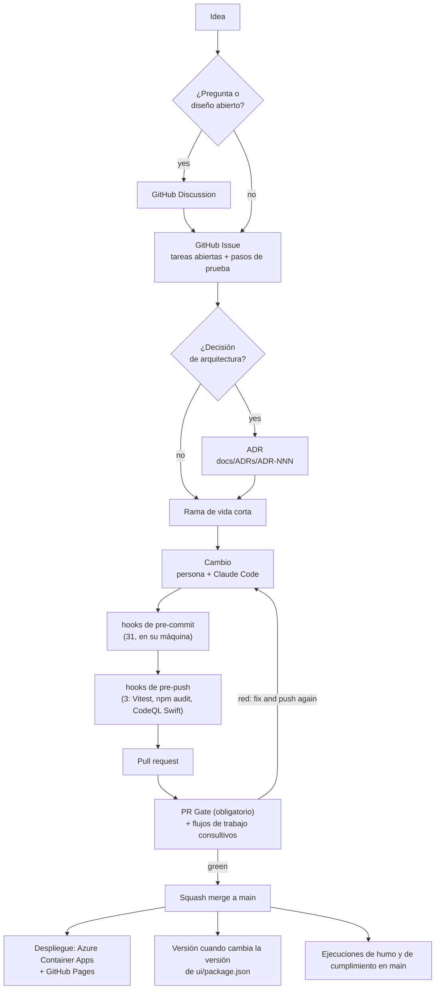

# Ciclo de vida del desarrollo de software (SDLC)

- **Proyecto:** Minimum Viable Health Dataspace v2 (implementación de referencia del EEDS)
- **Destinatarios:** colaboradores, revisores y cualquiera que quiera saber cómo un
  proyecto de una sola persona, asistido por IA, mantiene publicable un código de un ámbito regulado.
- **Última actualización:** 2026-11-03
- **Responsable:** Matthias (`@ma3u`)

Cómo pasa un cambio de una idea al hub en vivo: incidencias y debates,
ramas y pull requests, los hooks en su máquina, las comprobaciones en GitHub,
los despliegues, las versiones y cómo contribuir desde fuera. La
versión en lenguaje sencillo es [Cómo construimos este software](./SDLC-explained.md);
cómo encaja el autor de IA se explica en [Desarrollo agéntico determinista con IA mediante Claude
Code](./AGENTIC-DEVELOPMENT-WITH-CLAUDE-CODE.md). Dos páginas complementarias profundizan
más: [Pruebas de integración a través de las API](developer/api-integration-tests.md)
y [La pila y el entorno de desarrollo](developer/stack-and-environment.md).
La sección 12 es la receta que hay detrás de todo ello: cómo definir un SDLC para un
proyecto de DevSecOps e IA, etapa por etapa, con las herramientas.

<details>
<summary><b>Siglas utilizadas en este documento</b></summary>

| Sigla               | Desarrollo                                                                                                                                |
| ------------------- | ----------------------------------------------------------------------------------------------------------------------------------------- |
| **CI/CD**           | Continuous Integration / Continuous Delivery (integración y entrega continuas): la compilación, las pruebas y el despliegue automatizados |
| **PR**              | Pull Request: un cambio propuesto, comprobado y revisado antes de fusionarse                                                              |
| **ADR**             | Architecture Decision Record (registro de decisión de arquitectura): una nota breve de una decisión y sus razones                         |
| **OIDC**            | OpenID Connect; aquí, el inicio de sesión federado de GitHub Actions en Azure                                                             |
| **SBOM**            | Software Bill of Materials: la lista de cada componente de terceros                                                                       |
| **CVE**             | Common Vulnerabilities and Exposures: el catálogo público de fallos conocidos                                                             |
| **SARIF**           | Static Analysis Results Interchange Format: cómo los escáneres informan a GitHub                                                          |
| **DSP / DCP / TCK** | Dataspace Protocol / Decentralised Claims Protocol / Technology Compatibility Kit                                                         |
| **ACA**             | Azure Container Apps, donde se ejecuta el hub en vivo                                                                                     |

</details>

---

## 1. Filosofía: herramientas deterministas alrededor de un autor no determinista

> **El autor propone; las herramientas deterministas disponen.**

Un ingeniero sénior, un recién llegado y un agente de IA son todos no deterministas: haga
la misma pregunta dos veces y puede obtener dos respuestas. El resultado se vuelve
fiable cuando el autor está rodeado de puertas que funcionan igual cada
vez, para todos: formateadores, linters, comprobaciones de tipos, pruebas, escáneres de seguridad
y un pipeline de CI/CD.

El proyecto es un equipo de una persona más un programador de IA en pareja. Así que conserva cada
puerta determinista que tendría un equipo grande y reduce las ceremonias de
coordinación (revisión humana obligatoria, rituales de sprint, comités de versiones) que solo
compensan con más personas. La sección 11 indica qué se reduce y por qué.

Esto importa aquí más que en la mayoría de los proyectos. Es una implementación de
referencia del Espacio Europeo de Datos Sanitarios, un ámbito regulado con
datos de salud, derechos de los pacientes y obligaciones de auditoría. Las puertas aportan confianza (clases
enteras de errores se detectan antes de publicarse), auditabilidad (cada cambio
queda registrado con autor, hora y motivo), repetibilidad, errores baratos (un
hook local cuesta segundos, un incidente en producción horas) y asistencia de IA segura.

---

## 2. El ciclo de vida de un vistazo



1. **Idea.** Una pregunta abierta o un diseño por explorar empieza como un debate (Discussion);
   un trabajo empieza como una incidencia (Issue) (sección 3).
2. **ADR** cuando la decisión es cara de revertir o transversal.
3. **Rama** a partir de `main`, de vida corta.
4. **Cambio**, de una persona, de Claude Code o de ambos.
5. **Hooks** en su máquina: 31 al hacer commit, 3 al hacer push (sección 5).
6. **Pull request.** El **PR Gate** es la única comprobación obligatoria; los demás
   flujos de trabajo son consultivos (sección 6).
7. **Squash merge** una vez que el PR Gate está en verde y cada hilo de revisión
   está resuelto.
8. **En `main`:** el hub en vivo y la demostración estática se vuelven a desplegar, arrancan las ejecuciones de humo y
   de cumplimiento, y se publica una versión cuando la versión ha cambiado
   (secciones 7 y 8).

---

## 3. Debates, incidencias y la carpeta de planificación

### ¿Debate o incidencia?

Los [debates (Discussions)](https://github.com/ma3u/MinimumViableHealthDataspacev2/discussions)
están activados, con las categorías Announcements, General, Ideas, Polls, Q&A y
Show and tell.

| Abra un **debate** cuando                                                                                                                                                                                               | Abra una **incidencia** cuando                                                                                      |
| ----------------------------------------------------------------------------------------------------------------------------------------------------------------------------------------------------------------------- | ------------------------------------------------------------------------------------------------------------------- |
| tenga una pregunta ("¿cómo asigna el hub X?"), quiera comparar opciones o proponga una dirección que aún no es una tarea (Ideas; ejemplos recientes son #776 sobre herramientas de FHIR y OMOP y #701 sobre Simpl-Open) | haya algo que hacer: un error, una funcionalidad con un resultado claro, una carencia con un criterio de aceptación |
| la respuesta pueda ser "no" o "ahora no"                                                                                                                                                                                | alguien la vaya a cerrar con un commit o un PR                                                                      |
| varias personas deban opinar antes de decidir nada                                                                                                                                                                      | la decisión esté tomada, o la vaya a tomar un ADR                                                                   |

Un debate que llega a una decisión se convierte en una incidencia (y en un ADR cuando la
decisión es de arquitectura), enlazados en ambos sentidos.

### Qué contiene una incidencia

Utilice las plantillas de [`.github/ISSUE_TEMPLATE/`](https://github.com/ma3u/MinimumViableHealthDataspacev2/tree/main/.github/ISSUE_TEMPLATE)
(informe de error, solicitud de funcionalidad). Cada incidencia en la que se está trabajando contiene:

- **Las tareas abiertas** como lista de comprobación, mantenida al día. Cuando un PR deja trabajo
  sin hacer, la incidencia dice qué queda; nada pendiente vive solo en un chat o en un
  mensaje de commit.
- **Pasos de prueba manuales** con enlaces (a la documentación estática, a una página del hub, a una
  ejecución de un flujo de trabajo), para que cualquiera pueda comprobar el resultado sin preguntar.
- **Las decisiones**, cada una enlazada a su ADR.

Etiquetas en uso: `bug`, `enhancement`, `documentation`, `question`, `security`,
`infrastructure`, `azure`, `dependencies`, las prioridades `P1` a `P3`, y las
etiquetas de área `EHDS-compliance`, `dataspace-discovery`, `simpl`, `NLP`,
`Agentic AI`, `production`, `load test`, `stress test`, `pentest`, `trivy`,
`Cost`. Los nuevos colaboradores buscan `good first issue` y `help wanted`.

### La carpeta de planificación

[`docs/planning/index.md`](./planning/index.md) enumera los elementos de trabajo como archivos que
se mueven `future/ → current/ → done/` y nunca se borran. Un archivo en `current/`
es la versión larga de una incidencia (sus fases, mediciones, enlaces); la incidencia
sigue siendo el lugar de la lista de comprobación. El detalle de la hoja de ruta está en
`docs/planning/roadmap-phases-*.md`, y las tablas de incidencias y de ADR en
[`docs/planning-health-dataspace-v2.md`](./planning-health-dataspace-v2.md).
`/plan` en Claude Code ordena la carpeta.

Mantenga cualquier documento que se cargue de forma rutinaria por debajo de unos 15K tokens
([ADR-026](./ADRs/ADR-026-token-efficient-planning-structure.md)): el índice
sigue siendo pequeño y el detalle pasa a los archivos históricos.

### ADRs

`docs/ADRs/` contiene los ADR a partir del ADR-001 (el 051 está reservado). Los nuevos siguen la
plantilla de Nygard de `docs/adr/0000-template.md`; un ADR aceptado nunca se
edita, solo se sustituye. Escriba uno cuando una decisión sea cara de revertir o
transversal: la separación de bases de datos ([ADR-001](./ADRs/ADR-001-postgresql-neo4j-split.md)),
la estrategia de pruebas ([ADR-008](./ADRs/ADR-008-testing-strategy.md)), comprobaciones
que deben poder fallar ([ADR-031](./ADRs/ADR-031-checks-must-assert.md)),
que cada ruta de API necesite una sesión ([ADR-044](./ADRs/ADR-044-every-api-route-needs-a-session.md)).

---

## 4. Ramas, commits y pull requests

- **Basado en trunk.** `main` siempre se puede desplegar. El trabajo se hace en ramas de vida corta
  llamadas `type/short-slug` (`feat/…`, `fix/…`, `docs/…`, `chore/…`,
  `ci/…`), a menudo con el número de la incidencia: `fix/708-ui-sticky-sessions`.
- **[Conventional Commits](https://www.conventionalcommits.org/)** con un
  ámbito: `feat(spe): workspaces start on demand (ADR-072)`. Los últimos 40
  commits en `main` lo siguen todos; todavía no lo impone ningún hook.
- **Los commits llevan el nombre del autor.** No se añade ningún trailer de coautoría de IA; cómo
  trabaja la IA en este proyecto se documenta en el documento complementario.
- **Un PR enlaza su incidencia y sus ADR** e indica cómo se probó; la
  [plantilla de PR](https://github.com/ma3u/MinimumViableHealthDataspacev2/blob/main/.github/pull_request_template.md)
  pide ambas cosas. [`CODEOWNERS`](https://github.com/ma3u/MinimumViableHealthDataspacev2/blob/main/.github/CODEOWNERS)
  nombra al responsable, de modo que un PR de cualquier otra persona recibe una solicitud de revisión.
- **Squash merge.** El título del PR se convierte en el commit de `main`, por lo que también sigue
  la convención de commits.

### 4.1 Protección de la rama `main`

Un conjunto de reglas del repositorio sobre la rama por defecto:

| Regla                                          | Efecto                                                                                                                                       |
| ---------------------------------------------- | -------------------------------------------------------------------------------------------------------------------------------------------- |
| **Exigir un pull request**                     | Ningún push directo a `main`. Se exigen cero aprobaciones (véase más abajo).                                                                 |
| **Exigir la resolución de las conversaciones** | Cada hilo de revisión se resuelve antes de fusionar, de modo que las observaciones de la revisión se responden en lugar de pasarse por alto. |
| **Exigir comprobaciones de estado**            | El **PR Gate** debe estar en verde. Es la única comprobación obligatoria.                                                                    |
| **Exigir un historial lineal**                 | Solo squash o rebase; los commits de fusión están desactivados.                                                                              |
| **Bloquear force push y borrados**             | `main` no se puede reescribir ni borrar.                                                                                                     |

**Cero aprobaciones obligatorias es deliberado.** Con un solo responsable, una aprobación
obligatoria significa una segunda cuenta y un sello automático. La revisión la hacen los revisores
de IA y las puertas; las protecciones mecánicas (ningún push directo, ningún force
push, ninguna fusión en rojo) son la parte que un responsable en solitario no puede aportar con
disciplina, así que se imponen. Cuando se incorpore un segundo colaborador habitual,
pasará a una aprobación.

**Los administradores solo pueden saltárselas en un pull request.** Una comprobación atascada puede anularse
en un PR, lo cual es mejor que no poder aplicar una corrección urgente en una demostración en vivo; un
push directo a `main` se rechaza para todos.

### 4.2 Por qué exactamente una comprobación obligatoria

Todos los demás flujos de trabajo están filtrados por rutas, lo cual es correcto para el coste e incorrecto para la
protección de ramas: una comprobación obligatoria que nunca arranca queda pendiente, y el
PR no se puede fusionar nunca (#303 reunió 28 comprobaciones, #305 ninguna). Por eso
[`pr-gate.yml`](https://github.com/ma3u/MinimumViableHealthDataspacev2/blob/main/.github/workflows/pr-gate.yml)
no tiene filtro de rutas y es la única comprobación obligatoria. La sección 6.1 enumera lo que
ejecuta.

---

## 5. Los hooks en su máquina

[`.pre-commit-config.yaml`](https://github.com/ma3u/MinimumViableHealthDataspacev2/blob/main/.pre-commit-config.yaml),
ejecutado por el [framework pre-commit](https://pre-commit.com/). Instale ambas
etapas una vez por clon (desde #847, un simple `pre-commit install` hace lo mismo,
mediante `default_install_hook_types`):

```bash
pip install pre-commit
pre-commit install --hook-type pre-commit --hook-type pre-push
pre-commit run --all-files     # optional: everything, once
```

La mayoría de los hooks se limitan por patrón de archivo, de modo que un commit solo de documentación omite los
de TypeScript. Los hooks que necesitan una herramienta que usted no ha instalado (gitleaks,
Semgrep, lychee, actionlint) muestran un aviso y pasan; el PR Gate instala
gitleaks y actionlint y los ejecuta de todos modos. Omita un hook una vez con
`SKIP=<id> git commit`, nunca el conjunto entero con `--no-verify`: el PR Gate
ejecuta los mismos hooks sobre el diff del PR, así que saltárselos solo desplaza el fallo.

**Los hooks que reescriben archivos** (Prettier, los correctores de espacios en blanco, `docs-facts`)
hacen fallar el commit después de modificar el archivo. Vuelva a preparar el archivo y haga commit
de nuevo; después compruebe que `HEAD` se ha movido: un commit fallido lo deja donde estaba.

### 5.1 Al hacer commit: 31 hooks

| Hook (id)                                                                 | Qué hace                                                                                                                                                                                    | Cuándo falla                                                                                                                                                                             |
| ------------------------------------------------------------------------- | ------------------------------------------------------------------------------------------------------------------------------------------------------------------------------------------- | ---------------------------------------------------------------------------------------------------------------------------------------------------------------------------------------- |
| `trailing-whitespace`, `end-of-file-fixer`                                | elimina los espacios finales y termina cada archivo con un salto de línea (salvo los parches y las formas HealthDCAT-AP incluidas en el repositorio)                                        | ha corregido el archivo: vuelva a prepararlo                                                                                                                                             |
| `check-yaml`, `check-json`                                                | los archivos se pueden analizar (se admite YAML de varios documentos)                                                                                                                       | corrija la sintaxis que indica                                                                                                                                                           |
| `check-added-large-files`                                                 | rechaza un archivo de más de 5,000 KB                                                                                                                                                       | manténgalo fuera de git, o hágalo más pequeño                                                                                                                                            |
| `check-merge-conflict`                                                    | rechaza marcadores `<<<<<<<` sobrantes                                                                                                                                                      | termine la fusión                                                                                                                                                                        |
| `detect-private-key`                                                      | rechaza una clave privada                                                                                                                                                                   | elimínela; si era real, rótela                                                                                                                                                           |
| `check-case-conflict`, `check-symlinks`                                   | nombres que chocan en un disco que no distingue mayúsculas, enlaces simbólicos que no apuntan a nada                                                                                        | cambie el nombre o corrija el enlace                                                                                                                                                     |
| `check-executables-have-shebangs`, `check-shebang-scripts-are-executable` | un archivo ejecutable tiene una línea `#!`, un archivo con `#!` es ejecutable                                                                                                               | `chmod +x` (o `-x`), y prepare esa ruta de forma explícita: un bit de ejecución extraviado en un `.gitkeep` falla aquí                                                                   |
| `shellcheck`                                                              | Bash con severidad de error                                                                                                                                                                 | `shellcheck --severity=error <file>` y corrija lo que indique                                                                                                                            |
| `hadolint-docker`                                                         | buenas prácticas de Dockerfile                                                                                                                                                              | `hadolint <Dockerfile>`                                                                                                                                                                  |
| `prettier`                                                                | da formato a JS, TS, JSON, YAML y Markdown                                                                                                                                                  | ha reescrito el archivo: vuelva a prepararlo. No luche contra su resultado                                                                                                               |
| `tsc-ui`                                                                  | `tsc --noEmit -p tsconfig.build.json` en `ui/` (estricto, sin las pruebas)                                                                                                                  | ejecute ese comando en `ui/` y corrija el error de tipos                                                                                                                                 |
| `eslint-ui`                                                               | `next lint --max-warnings 55` en `ui/`                                                                                                                                                      | un error, o un aviso nuevo por encima del presupuesto de 55: `cd ui && npx next lint`                                                                                                    |
| `gitleaks`                                                                | secretos en el diff preparado                                                                                                                                                               | elimine el secreto y rótelo; un falso positivo demostrado va en `.gitleaksignore`                                                                                                        |
| `semgrep`                                                                 | Semgrep CE sobre el código preparado: las reglas del registro para TypeScript, Next.js, React y secretos, y `.semgrep/cypher.yml` (la entrada de la petición llega a Cypher como parámetro) | corríjalo, o `// nosemgrep: <rule-id> -- <reason>` encima de la línea. Detrás de un proxy que inspecciona TLS la descarga del registro falla y el hook sale con 2: eso no es un hallazgo |
| `semgrep-rule-tests`                                                      | las reglas Semgrep propias del proyecto contra `.semgrep/cypher.ts`                                                                                                                         | la regla y su prueba no coinciden                                                                                                                                                        |
| `check-broken-links-md`                                                   | los enlaces relativos en Markdown se resuelven (lychee sin conexión, o markdown-link-check); se exceptúan las traducciones de `docs/i18n/`                                                  | corrija la ruta                                                                                                                                                                          |
| `check-no-screenshot-imports`                                             | las páginas de documentación de `ui/src/app/docs/` no hacen referencia a `images/screenshots`                                                                                               | utilice un diagrama o una imagen de guía en su lugar                                                                                                                                     |
| `api-spec-drift`                                                          | cada ruta de `ui/src/app/api/` está en `ui/public/openapi.yaml`, y a la inversa                                                                                                             | documente la operación en la especificación y borre su línea de `docs/api-spec-drift-allowlist.txt`; añadir una línea es decidir publicar una ruta sin documentar                        |
| `api-spec-shapes`                                                         | la especificación describe la forma con la que responde el hub (comprobada contra los fixtures de `ui/public/mock/`)                                                                        | corrija el esquema, o el fixture                                                                                                                                                         |
| `docs-facts`                                                              | regenera `ui/src/app/docs/docs-facts.json` (rutas, hooks, servicios, ADR, la fecha de última actualización de cada página de documentación)                                                 | ha reescrito el archivo: prepárelo y vuelva a hacer commit                                                                                                                               |
| `docs-content`                                                            | las copias publicadas de `docs/` coinciden con sus fuentes (`gen-docs-content.py --check`)                                                                                                  | `python3 scripts/gen-docs-content.py`, prepare `ui/src/content/` y `ui/public/published-docs/`                                                                                           |
| `localized-images`                                                        | el manifiesto de capturas de pantalla y diagramas traducidos coincide con `ui/public`                                                                                                       | `python3 scripts/gen-localized-images.py`, prepare el manifiesto                                                                                                                         |
| `bruno-coverage`                                                          | cada ruta de API tiene una petición en `bruno/MVHDv2/`, cada petición puede fallar, ninguna credencial en un archivo `.bru`                                                                 | añada la petición en la carpeta del perfil; borre aquella cuya ruta ya no existe (consulte [las pruebas de API](developer/api-integration-tests.md))                                     |
| `bruno-strength`                                                          | una petición 2xx comprueba algo más que un tipo contenedor                                                                                                                                  | compruebe el valor de una propiedad                                                                                                                                                      |
| `workflow-paths`                                                          | el filtro `paths` de un flujo de trabajo cubre cada script que ejecuta                                                                                                                      | añada la ruta al filtro del flujo de trabajo                                                                                                                                             |
| `actionlint`                                                              | flujos de trabajo de GitHub Actions                                                                                                                                                         | corrija el flujo de trabajo que indica                                                                                                                                                   |
| `image-scan-coverage`                                                     | el análisis de CVE de `security-scan.yml` cubre cada imagen de los archivos compose                                                                                                         | añada la imagen a la matriz de análisis                                                                                                                                                  |

### 5.2 Al hacer push: 4 hooks

| Hook (id)            | Qué hace                                                                                                                                                           | Cuándo falla                                                                                                                                                                                                  |
| -------------------- | ------------------------------------------------------------------------------------------------------------------------------------------------------------------ | ------------------------------------------------------------------------------------------------------------------------------------------------------------------------------------------------------------- |
| `vitest-ui`          | todo el conjunto de la UI, `vitest run --bail 1`, cuando el push cambia `ui/src` o `ui/__tests__`                                                                  | `cd ui && npx vitest run <file>` para el archivo que falla. Un hook que reinicia un mock usa llaves: `beforeEach(() => { m.mockReset(); })`                                                                   |
| `npm-audit-ui`       | `scripts/check-npm-audit.py ui --omit=dev`: ningún aviso HIGH o CRITICAL en las dependencias de producción                                                         | actualice la dependencia; cuando no existe corrección, una entrada con plazo en `docs/npm-audit-exceptions.json` con un motivo, una incidencia y una fecha de caducidad                                       |
| `ios-analyte-parity` | `swift run AnalyteParity` cuando cambian el código Swift compartido de la app, la tabla de analitos generada o `Package.swift` (segundos una vez compilado, macOS) | la tabla Swift resuelve una etiqueta o unidad de forma distinta a `analytes.ts`: regenérela con `npm run generate:swift` en `services/epa-ingest`, o corrija la normalización en `clients/ios/Sources/Shared` |
| `codeql-swift`       | CodeQL sobre la app de iPhone cuando cambian las fuentes Swift, `Package.swift` o `project.yml` (unos 15 minutos, macOS)                                           | corrija el hallazgo, o acéptelo con su motivo en `clients/ios/Scripts/codeql-accepted.txt`; `SKIP=codeql-swift git push` lo omite una vez                                                                     |

[Quality Gates](./quality-gates.md) y la
[página de puertas de calidad](https://ma3u.github.io/MinimumViableHealthDataspacev2/docs/developer/quality-gates)
contienen las cifras de cobertura y las puertas que aún están por llegar.

Las pruebas E2E, la auditoría WCAG y las specs de pentest ya no se ejecutan en cada
push: se ejecutan una vez por noche cuando `main` ha cambiado
([ADR-074](./ADRs/ADR-074-e2e-and-compliance-suites-run-nightly-when-main-changed.md)).
Antes de fusionar un cambio en páginas de la UI o en sus rutas de API, ejecútelas
contra la pila de compose: `docker compose up -d`, después `cd ui && npm run test:e2e`.

---

## 6. Las comprobaciones en GitHub

`.github/workflows/` contiene 39 flujos de trabajo. Solo el **PR Gate** bloquea una fusión.

### 6.1 PR Gate: la comprobación obligatoria

En cada pull request y cada ejecución de la cola de fusión, sin filtro de rutas, unos 15 minutos
como máximo:

1. los hooks de pre-commit sobre el diff del PR (`pre-commit run --from-ref origin/main --to-ref HEAD`), que detecta un commit hecho con
   `--no-verify` o desde un clon sin los hooks;
2. la deriva de la especificación de la API (`scripts/check-api-spec-drift.py`);
3. los docs facts al día, con la fecha de cada página de documentación modificada actualizada
   (`scripts/gen-docs-facts.py --check`);
4. la colección de API cubre cada ruta (`scripts/check-bruno-coverage.py`);
5. la conformidad con HealthDCAT-AP Release 8 de los archivos de referencia del catálogo
   (pySHACL contra las formas oficiales);
6. ningún archivo, exportación ni dependencia sin usar (`npm run --prefix ui knip`);
7. gitleaks sobre los commits del PR, ya que el hook local, que solo ve lo preparado, no ve
   nada en CI.

### 6.2 Los demás flujos de trabajo

| Flujo de trabajo                              | Se ejecuta en                                                                                                                                     | Qué hace                                                                                                                                                                                                                                                                                                                   | Bloquea         |
| --------------------------------------------- | ------------------------------------------------------------------------------------------------------------------------------------------------- | -------------------------------------------------------------------------------------------------------------------------------------------------------------------------------------------------------------------------------------------------------------------------------------------------------------------------- | --------------- |
| `test.yml` Test Suite                         | push a cualquier rama, PR a `main` (rutas: `ui/`, los servicios, `clients/ios/`, la documentación de Klarbefund)                                  | 8 jobs: Vitest para la UI, el proxy, el cargador del SPE y la ingesta de la ePA; pruebas de políticas OPA; paridad de analitos de iOS (solo cuando cambió `clients/ios/`, lo decide un job Changed paths); un job de análisis (Trivy, Kubescape, npm audit, SBOM, licencias). El lint y gitleaks se ejecutan en el PR Gate | no (consultivo) |
| `codeql.yml`                                  | push y PR a `main`, semanal                                                                                                                       | CodeQL para JavaScript/TypeScript, Python y los flujos de trabajo; resultados en la pestaña Security                                                                                                                                                                                                                       | no              |
| `codeql-swift.yml`                            | semanal, lanzamiento manual, y PR que cambian el flujo de trabajo o su script                                                                     | CodeQL para la app de iPhone; los cambios de la app los comprueba el hook de pre-push `codeql-swift`                                                                                                                                                                                                                       | no              |
| `security-scan.yml`                           | PR, semanal, lanzamiento manual                                                                                                                   | SBOM y CVE del código fuente, CVE de las imágenes, CVE de las imágenes desplegadas, una puerta de severidad                                                                                                                                                                                                                | no              |
| `bruno-smoke.yml`                             | PR y `main` cuando cambian la colección o `ui/src/app/api/`                                                                                       | la colección de API contra los fixtures estáticos (Static-mock)                                                                                                                                                                                                                                                            | no              |
| `python-services-test.yml`                    | PR, push a `main`                                                                                                                                 | pytest para los servicios Python                                                                                                                                                                                                                                                                                           | no              |
| `compliance.yml`                              | llamado por `nightly.yml`, lanzamiento manual                                                                                                     | las comprobaciones de DSP, DCP y del dominio del EEDS y la colección de API completa contra una pila JAD nueva; el job de informe falla por debajo del mínimo registrado                                                                                                                                                   | no (nocturno)   |
| `nightly.yml`                                 | una vez por noche cuando `main` cambió, lanzamiento manual ([ADR-074](./ADRs/ADR-074-e2e-and-compliance-suites-run-nightly-when-main-changed.md)) | Playwright E2E con WCAG y las comprobaciones OWASP/BSI contra un Neo4j cargado (los informes van al sitio de Pages), Lighthouse, gitleaks sobre todo el historial, `compliance.yml`; una noche en rojo abre una incidencia, una en verde la cierra                                                                         | no              |
| `deploy-azure.yml`                            | cada push a `main`, lanzamiento manual                                                                                                            | compila las imágenes de la UI y del proxy, las despliega en Azure Container Apps, comprueba que el inicio de sesión funciona y después ejecuta Playwright contra el hub en vivo                                                                                                                                            | solo `main`     |
| `pages.yml`                                   | cada push a `main`, lanzamiento manual                                                                                                            | compila la exportación estática con los últimos informes de pruebas nocturnos y la publica en GitHub Pages (6.4)                                                                                                                                                                                                           | solo `main`     |
| `release.yml`                                 | push a `main` que cambia `ui/package.json`, lanzamiento manual                                                                                    | etiqueta y publica una GitHub Release (sección 8)                                                                                                                                                                                                                                                                          | solo `main`     |
| `demo-smoke.yml`                              | a diario a las 06:00 UTC (arranca con horas de retraso), lanzamiento manual                                                                       | comprueba si el hub en vivo está activo, la colección de API contra él (Azure-Dev), Playwright en las rutas públicas, una línea base de ZAP, y después elimina lo que creó la colección                                                                                                                                    | solo `main`     |
| `catalog-crawler.yml`, `catalog-enricher.yml` | push a `main` que cambia el servicio                                                                                                              | prueba y despliega los servicios de catálogo                                                                                                                                                                                                                                                                               | solo `main`     |
| `aca-schedule.yml`                            | dos veces al día, lanzamiento manual                                                                                                              | respaldo para la parada y el arranque fuera de horario ([ADR-053](./ADRs/ADR-053-everything-stops-off-hours.md), [ADR-058](./ADRs/ADR-058-azure-triggers-the-off-hours-schedule.md))                                                                                                                                       | n/a             |

Los 22 restantes son **flujos de trabajo de operaciones que se ejecutan a mano** (`workflow_dispatch`)
contra Azure: carga de Neo4j, participantes EDC, activos de datos y CFM; el
arranque de Vault; el cargador de FHIR; GraphRAG; el verificador EUDI; el dominio
de Keycloak; los controles de coste; reparaciones y retiradas puntuales, cada uno con el nombre de su
incidencia o ADR. Siguen la misma regla que todo lo demás: un cambio de entorno
es un flujo de trabajo versionado y repetible, no un clic en el portal. Los
que borran o reescriben tienen un modo `plan` que solo lee.

### 6.3 Cumplimiento de los protocolos

`compliance.yml` levanta la pila JAD dentro del job, la carga y ejecuta
las comprobaciones de DSP, DCP y del dominio del EEDS y la colección de API. Cada paso de un conjunto
puede fallar sin detener el job; el job **Compliance Report** compara después
cada resultado con su mínimo en `scripts/compliance-baseline.json` y falla ante una
regresión. Se basa en una línea base registrada, no en el verde, de modo que un conjunto que
aún no pasa tampoco puede empeorar. Los conjuntos son nuestros y ejercitan nuestras
API; no son los TCK de Eclipse y no demuestran la conformidad (#338).
Las cifras actuales y cómo ejecutarlos están en
[Pruebas de integración a través de las API](developer/api-integration-tests.md).

### 6.4 GitHub Pages: la demostración estática

`pages.yml` compila la demostración pública en
[ma3u.github.io/MinimumViableHealthDataspacev2](https://ma3u.github.io/MinimumViableHealthDataspacev2/):
carga un contenedor de Neo4j, actualiza los fixtures simulados a partir de la forma de la API
en vivo, aparta `ui/src/app/api/` cambiándole el nombre, compila con
`NEXT_PUBLIC_STATIC_EXPORT=true`, añade los informes de pruebas de la última
ejecución de `nightly.yml` y publica. La ejecución nocturna carga su propio Neo4j y ejecuta
Vitest, Playwright, la auditoría WCAG y las comprobaciones de seguridad (solo informe,
`continue-on-error`). Sin rutas de API, cada
página lee `ui/public/mock/*.json`, de modo que una página que hace GET a una ruta `/api/...`
necesita un fixture allí, y `static-mock-coverage.test.ts` falla si no lo tiene.

### 6.5 Despliegue en Azure

Cada push a `main` ejecuta `deploy-azure.yml`:

1. inicia sesión en Azure con **OIDC** (sin contraseña almacenada: una credencial federada
   confía en la rama `main` de este repositorio);
2. compila las imágenes de la UI y del proxy de Neo4j y las envía al registro
   `acrmvhdehds`;
3. espera mientras se ejecuta una prueba de carga (la variable `LOAD_TEST_RUNNING`), para que una fusión
   no vuelva a desplegar bajo k6;
4. despliega ambas en Container Apps en `rg-mvhd-dev` como una revisión nueva (ACA
   almacena en caché `:latest`, por lo que un simple reinicio no recogería la imagen);
5. verifica las revisiones, espera a la UI y demuestra que el inicio de sesión funciona de extremo a extremo;
6. si el hub está en vivo (no detenido fuera de horario), ejecuta Playwright, la auditoría WCAG
   y las comprobaciones de seguridad contra él.

**OIDC solo funciona en `main`.** La credencial federada nombra
`refs/heads/main`, de modo que un paso de Azure en un pull request, un fork u otra
rama no puede iniciar sesión. Un job que necesita Azure está limitado a `main`, a la programación
o a un lanzamiento manual en `main`; admitir los PR supone añadir una credencial federada
en Azure, no editar el flujo de trabajo. Fuera de horario (de lunes a viernes de 07:00 a 20:00
Europe/Berlin está encendido) todo está detenido
([ADR-053](./ADRs/ADR-053-everything-stops-off-hours.md)), así que un despliegue en ese momento
actualiza la revisión sin poder probarla en vivo.

---

## 7. Estrategia de pruebas

[ADR-008](./ADRs/ADR-008-testing-strategy.md) define los niveles; las convenciones
están en [`.claude/rules/testing.md`](https://github.com/ma3u/MinimumViableHealthDataspacev2/blob/main/.claude/rules/testing.md).

| Nivel                  | Framework                  | Alcance                                                                                                                  | Cuándo se ejecuta                                               |
| ---------------------- | -------------------------- | ------------------------------------------------------------------------------------------------------------------------ | --------------------------------------------------------------- |
| **Unitarias**          | Vitest                     | funciones, componentes y manejadores de rutas de API; Neo4j simulado en `@/lib/neo4j`, `fetch` sustituido en cada prueba | pre-push, cada push (`test.yml`)                                |
| **De servicio**        | Vitest, pytest, `opa test` | el proxy de Neo4j, el cargador del SPE, la ingesta de la ePA, los servicios Python, las políticas del Trustee            | cada push que los toca                                          |
| **iOS**                | Swift Testing, XCUITest    | el analizador y el modelo de la app; sus pantallas con un conjunto de demostración fijo                                  | en el Mac; comprobación de paridad en CI                        |
| **Integración de API** | Bruno, conjuntos de shell  | las rutas del hub por perfil; DSP, DCP, el dominio sanitario                                                             | PR (fixtures), `main`, semanal, en vivo a diario                |
| **E2E**                | Playwright                 | recorridos numerados en `ui/__tests__/e2e/journeys/`                                                                     | `main`, lanzamiento manual, después de cada despliegue en Azure |

Las pruebas de rutas se ejecutan con la guarda de autenticación simulada como abierta, de modo que prueban la lógica de negocio,
no la puerta; una prueba que pretende fijar una puerta la cierra ella misma, y la
carpeta `09 Access control` de la colección de API comprueba las puertas contra un
servidor real. La cobertura se recoge y se publica, pero aún no se impone ningún
umbral.

---

## 8. Versiones y lanzamientos

[ADR-075](./ADRs/ADR-075-a-minor-release-every-month.md) fija el ritmo:

- **El hub tiene una sola versión**, la `version` de
  [`ui/package.json`](https://github.com/ma3u/MinimumViableHealthDataspacev2/blob/main/ui/package.json).
- **Una versión menor el primer día laborable de cada mes**, empezando por
  v2.1.0 el 2026-11-04. Una versión de **parche** entre medias solo para una corrección que un
  socio necesita antes del mes siguiente; una versión **mayor** cuando se rompe algo contra lo que
  un socio se integra (una ruta de la API o el modelo del grafo).
- **Una versión es un pull request**, `chore(release): vX.Y.Z`: la versión en
  `ui/package.json` y en la raíz de `ui/package-lock.json`, y una línea de
  novedades en la lista de versiones de la guía del desarrollador, en los cinco idiomas.
- **Al fusionar, `release.yml` crea la versión:** etiqueta `vX.Y.Z`, escribe las
  notas a partir de `git log` desde la etiqueta anterior y publica una GitHub
  Release. Un lanzamiento manual con `force_version` la vuelve a ejecutar. Después se puede poner un
  breve resumen escrito a mano encima de la lista generada, como tiene v2.0.0.
- **`main` sigue siendo lo que se ejecuta en vivo.** Una versión marca un estado que se puede
  citar y un registro de cambios de un mes como mucho, no un despliegue.
- **Antes del ADR-075** no había cadencia: once etiquetas de v1.0.0
  (2026-03-30) a v2.0.0 (2026-09-29), y después unos 350 commits sin
  versión; v1.4.3 es una etiqueta sin versión publicada.
- **El proxy de Neo4j y los demás servicios no se versionan por separado**
  (`services/neo4j-proxy/package.json` dice `0.1.0`); sus imágenes se etiquetan
  por commit.

### La app de iPhone: compilaciones de TestFlight

Klarbefund se versiona por separado, en
[`clients/ios/project.yml`](https://github.com/ma3u/MinimumViableHealthDataspacev2/blob/main/clients/ios/project.yml):
`MARKETING_VERSION` (ahora `1.0`) y el número de compilación
`CURRENT_PROJECT_VERSION` (ahora `11`). Cada subida a TestFlight es su propio PR,
`chore(ios): build N for TestFlight, with its What to Test`, que sube el
número de compilación y escribe las notas para los probadores en inglés y alemán en
`clients/ios/appstore/texts.py`. La subida es
`clients/ios/Scripts/archive-and-upload.sh`, ejecutado en el Mac; App Store Connect
rechaza un número de compilación que ya ha visto. Los probadores se unen mediante el enlace público
de TestFlight ([ADR-050](./ADRs/ADR-050-klarbefund-beta-by-public-testflight-link.md)).
La app aún no tiene ninguna versión en la App Store.

---

## 9. Contribuir desde fuera

El repositorio es público bajo la
[Apache License 2.0](https://github.com/ma3u/MinimumViableHealthDataspacev2/blob/main/LICENSE).
La versión breve está en
[`.github/CONTRIBUTING.md`](https://github.com/ma3u/MinimumViableHealthDataspacev2/blob/main/.github/CONTRIBUTING.md),
que GitHub enlaza desde los formularios de incidencias y de PR.

1. **Empiece con un debate o una incidencia** (sección 3), para que el cambio se
   acuerde antes del trabajo. Las pequeñas correcciones de documentación y de erratas pueden ir directamente a un
   PR.
2. **Haga un fork, cree una rama desde `main`**, instale los hooks (sección 5) y prepare la
   pila que necesite ([La pila y el entorno de desarrollo](developer/stack-and-environment.md)).
3. **Limite el PR a un solo cambio.** Siga las convenciones de
   [`.claude/rules/`](https://github.com/ma3u/MinimumViableHealthDataspacev2/tree/main/.claude/rules):
   estilo de código, pruebas y convenciones de API. Una nueva ruta de API necesita
   `requireAuth()`, una petición en la colección de API, un fixture simulado y una
   entrada en `openapi.yaml`; los hooks le indican cuál falta.
4. **Solo organizaciones ficticias.** Los datos de demostración, la documentación, las pruebas y las capturas de pantalla
   nombran a AlphaKlinik Berlin, PharmaCo Research AG, MedReg DE, Limburg Medical
   Centre e Institut de Recherche Santé, nunca a un hospital, empresa,
   aseguradora o autoridad real. Los nombres reales solo aparecen detrás del
   indicador de compilación `NEXT_PUBLIC_DEMO_TK`, y las capturas de pantalla reales de terceros nunca
   se incluyen en un commit. Nunca datos reales de pacientes: los pacientes son sintéticos
   (Synthea).
5. **Ningún secreto.** gitleaks se ejecuta en local y en el PR Gate; los valores
   locales por defecto (`neo4j` / `healthdataspace`) son solo para desarrollo.
6. **Abra el PR.** El PR Gate debe estar en verde; los pasos de Azure no se ejecutan para un
   fork (6.5), y el responsable ejecuta lo que necesita el hub en vivo. Responda a cada
   hilo de revisión; el responsable hace el squash merge.

No necesita escribir código para contribuir. Incidencias más precisas, propuestas de ADR
y revisiones de la documentación y los recorridos de cara al usuario mejoran cada cambio posterior,
porque son las especificaciones que lee el autor de IA.

---

## 10. Entornos

| Entorno                  | Cómo                                                                                            | Finalidad                                                                   |
| ------------------------ | ----------------------------------------------------------------------------------------------- | --------------------------------------------------------------------------- |
| **Local, mínimo**        | Neo4j en Docker y `npm run dev`                                                                 | el trabajo diario en la UI y el grafo                                       |
| **Local, JAD completo**  | `docker-compose.yml` + `docker-compose.jad.yml`, fases de carga 1 a 7                           | todos los servicios, el inicio de sesión, los flujos del protocolo          |
| **CI**                   | `compliance.yml` levanta la pila JAD dentro del job                                             | los conjuntos de cumplimiento                                               |
| **GitHub Pages**         | `pages.yml`, exportación estática con fixtures                                                  | la demostración pública, sin backend                                        |
| **Azure Container Apps** | `deploy-azure.yml` y los flujos de trabajo de operaciones, `rg-mvhd-dev`, https://ehds.mabu.red | el hub en vivo, encendido de lunes a viernes de 07:00 a 20:00 Europe/Berlin |

---

## 11. La adaptación a un único responsable

| Un equipo de 10 a 30 personas tiene… | Este proyecto hace en su lugar                                                                   | Por qué es aceptable por ahora                                                                    |
| ------------------------------------ | ------------------------------------------------------------------------------------------------ | ------------------------------------------------------------------------------------------------- |
| revisión obligatoria por pares       | revisión por IA (`/review`, `/code-review`, agentes especializados) y las puertas; fusión propia | las puertas detectan lo que detectaría un segundo revisor; los hilos de revisión deben resolverse |
| fusión bloqueada con la CI en rojo   | impuesta: PR obligatorio, PR Gate en verde, historial lineal, sin force push                     | el salto de los administradores se limita a los pull requests                                     |
| un gestor de versiones               | `release.yml` y una decisión humana sobre la versión                                             | la automatización sustituye la función, no el criterio                                            |
| ceremonias de sprint                 | incidencias con tareas abiertas, ADR, la carpeta de planificación                                | ligero, asíncrono, por escrito                                                                    |

### Próximos pasos

1. Dar a `test.yml` un job final que siempre se ejecute y hacerlo obligatorio, para que los conjuntos
   unitarios no se puedan saltar, como el PR Gate.
2. Imponer Conventional Commits con un hook de mensaje de commit.
3. Imponer umbrales de cobertura en las rutas críticas y después ir subiéndolos.
4. Llevar a verde los escáneres que solo informan (contraste WCAG, el conjunto de pruebas de penetración)
   y quitar `continue-on-error`.
5. Automatizar el PR de versión mensual y el registro de cambios a partir del historial de commits
   (release-please o semantic-release), en cuanto se impongan los Conventional Commits.
6. Adoptar los TCK de DSP y DCP de Eclipse y convertir los mínimos de cumplimiento en una señal
   del PR; añadir procedencia (SLSA) a las versiones.

---

## 12. Cómo definir un SDLC para un proyecto de DevSecOps e IA

Las secciones anteriores describen este proyecto. Esta es la receta que hay detrás,
para un equipo que empieza el suyo: qué decidir en cada etapa, qué herramienta
lo hace y cómo lo hace este repositorio. Una idea lo sostiene todo:

> **Las especificaciones son la entrada, las puertas deterministas son el control, las evidencias son la
> salida.** Un autor de IA se trata como cualquier otro colaborador cuyo trabajo no se
> puede predecir del todo: trabaja a partir de una especificación escrita, dentro de las mismas puertas,
> y una persona es responsable de la fusión.

### 12.1 Las etapas y sus herramientas

| Etapa                   | Decidir                                                                                                                                                | Herramientas                                                                                                                                                                                                                                                                                                                                                                                                                                                                                                                                                                                                                         | Aquí                                                                                                                                                                                                                                                                                       |
| ----------------------- | ------------------------------------------------------------------------------------------------------------------------------------------------------ | ------------------------------------------------------------------------------------------------------------------------------------------------------------------------------------------------------------------------------------------------------------------------------------------------------------------------------------------------------------------------------------------------------------------------------------------------------------------------------------------------------------------------------------------------------------------------------------------------------------------------------------ | ------------------------------------------------------------------------------------------------------------------------------------------------------------------------------------------------------------------------------------------------------------------------------------------ |
| **Explorar**            | dónde se discuten las preguntas abiertas y las opciones antes de que algo sea una tarea                                                                | [GitHub Discussions](https://docs.github.com/en/discussions)                                                                                                                                                                                                                                                                                                                                                                                                                                                                                                                                                                         | Debates, categoría Ideas (sección 3)                                                                                                                                                                                                                                                       |
| **Especificar**         | el formato de la especificación: el problema, los requisitos, los criterios de aceptación, después un plan y unas tareas; dónde vive en el repositorio | [GitHub Spec Kit](https://github.com/github/spec-kit) ([introducción](https://github.blog/ai-and-ml/generative-ai/spec-driven-development-with-ai-get-started-with-a-new-open-source-toolkit/)), [especificaciones de Kiro](https://kiro.dev/docs/specs/), [AGENTS.md](https://agents.md/), [memoria de Claude Code (CLAUDE.md)](https://docs.anthropic.com/en/docs/claude-code/memory)                                                                                                                                                                                                                                              | los criterios de aceptación y las tareas abiertas de la incidencia, un archivo en `docs/planning/current/`, `CLAUDE.md` y `.claude/rules/`                                                                                                                                                 |
| **Decidir**             | qué decisiones necesitan un registro, la plantilla, quién acepta, que un registro aceptado se sustituye y nunca se edita                               | [ADR de Nygard](https://cognitect.com/blog/2011/11/15/documenting-architecture-decisions), [adr.github.io](https://adr.github.io/), [MADR](https://adr.github.io/madr/), [adr-tools](https://github.com/npryce/adr-tools), [Log4brains](https://github.com/thomvaill/log4brains)                                                                                                                                                                                                                                                                                                                                                     | `docs/ADRs/`, la plantilla de Nygard de `docs/adr/0000-template.md`                                                                                                                                                                                                                        |
| **Planificar y seguir** | tipos y plantillas de incidencias, etiquetas y prioridades, dónde se escriben las tareas abiertas y los pasos de prueba                                | [Issues](https://docs.github.com/en/issues), [plantillas de incidencias](https://docs.github.com/en/communities/using-templates-to-encourage-useful-issues-and-pull-requests/configuring-issue-templates-for-your-repository), [Projects](https://docs.github.com/en/issues/planning-and-tracking-with-projects)                                                                                                                                                                                                                                                                                                                     | incidencias con tareas abiertas y pasos de prueba manuales, `P1` a `P3`, la carpeta de planificación                                                                                                                                                                                       |
| **Construir con IA**    | qué lee el agente, qué puede ejecutar, qué comprobaciones se ejecutan en cada edición, cómo se nombran los commits                                     | [hooks de Claude Code](https://docs.anthropic.com/en/docs/claude-code/hooks), [subagentes](https://docs.anthropic.com/en/docs/claude-code/sub-agents), [pre-commit](https://pre-commit.com/), [Conventional Commits](https://www.conventionalcommits.org/), [commitlint](https://commitlint.js.org/)                                                                                                                                                                                                                                                                                                                                 | `CLAUDE.md`, los hooks y agentes de `.claude/`, 31 + 3 hooks (sección 5)                                                                                                                                                                                                                   |
| **Asegurar**            | secretos, análisis estático, dependencias, imágenes, SBOM; la severidad que bloquea                                                                    | [gitleaks](https://github.com/gitleaks/gitleaks), [escaneo de secretos](https://docs.github.com/en/code-security/secret-scanning/introduction/about-secret-scanning), [Semgrep](https://semgrep.dev/docs/), [CodeQL](https://docs.github.com/en/code-security/code-scanning/introduction-to-code-scanning/about-code-scanning-with-codeql), [Dependabot](https://docs.github.com/en/code-security/dependabot), [Renovate](https://docs.renovatebot.com/), [Trivy](https://trivy.dev/), [CycloneDX](https://cyclonedx.org/)                                                                                                           | gitleaks, Semgrep y npm audit en local; CodeQL, Trivy, SBOM y Dependabot en GitHub (secciones 5 y 6)                                                                                                                                                                                       |
| **Probar**              | los niveles y dónde se ejecuta cada uno; que cada comprobación pueda fallar                                                                            | [Vitest](https://vitest.dev/), [Playwright](https://playwright.dev/), [Bruno](https://www.usebruno.com/)                                                                                                                                                                                                                                                                                                                                                                                                                                                                                                                             | sección 7, [ADR-031](./ADRs/ADR-031-checks-must-assert.md)                                                                                                                                                                                                                                 |
| **Revisar y fusionar**  | comprobaciones obligatorias, aprobaciones, propietarios del código, método de fusión                                                                   | [pull requests](https://docs.github.com/en/pull-requests), [conjuntos de reglas](https://docs.github.com/en/repositories/configuring-branches-and-merges-in-your-repository/managing-rulesets/about-rulesets), [CODEOWNERS](https://docs.github.com/en/repositories/managing-your-repositorys-settings-and-features/customizing-your-repository/about-code-owners), [cola de fusión](https://docs.github.com/en/repositories/configuring-branches-and-merges-in-your-repository/configuring-pull-request-merges/managing-a-merge-queue), [Claude Code GitHub Actions](https://docs.anthropic.com/en/docs/claude-code/github-actions) | una comprobación obligatoria, hilos de revisión resueltos, squash merge (sección 4)                                                                                                                                                                                                        |
| **Entregar**            | cómo llega la CI a la nube sin contraseñas almacenadas; cómo se demuestran las compilaciones y las versiones                                           | [GitHub Actions](https://docs.github.com/en/actions), [OIDC](https://docs.github.com/en/actions/security-for-github-actions/security-hardening-your-deployments/about-security-hardening-with-openid-connect), [atestaciones de artefactos](https://docs.github.com/en/actions/security-for-github-actions/using-artifact-attestations/using-artifact-attestations-to-establish-provenance-for-builds), [SLSA](https://slsa.dev/), [release-please](https://github.com/googleapis/release-please), [semantic-release](https://semantic-release.gitbook.io/)                                                                          | OIDC en `main`, `release.yml`; atestaciones y SLSA todavía no (secciones 6.5 y 8)                                                                                                                                                                                                          |
| **Medir el proceso**    | el marco con el que se contrasta el SDLC, y con qué frecuencia                                                                                         | [NIST SSDF (SP 800-218)](https://csrc.nist.gov/pubs/sp/800/218/final), [OWASP SAMM](https://owaspsamm.org/), [OpenSSF Scorecard](https://scorecard.dev/)                                                                                                                                                                                                                                                                                                                                                                                                                                                                             | las [puertas de calidad](./quality-gates.md) y los informes de seguridad                                                                                                                                                                                                                   |
| **Gobernar la IA**      | qué IA contiene el producto y qué IA escribe el código; los riesgos de cada una                                                                        | [Ley de IA de la UE (Reglamento (UE) 2024/1689)](https://eur-lex.europa.eu/eli/reg/2024/1689/oj), [NIST AI RMF](https://www.nist.gov/itl/ai-risk-management-framework), [ISO/IEC 42001](https://www.iso.org/standard/42001), [OWASP Top 10 para aplicaciones LLM](https://genai.owasp.org/llm-top-10/)                                                                                                                                                                                                                                                                                                                               | la consulta en lenguaje natural se niega a leer la identidad de un paciente salvo que la UI lo permita ([`api-conventions.md`](https://github.com/ma3u/MinimumViableHealthDataspacev2/blob/main/.claude/rules/api-conventions.md)); el autor de IA se trata en el documento complementario |

### 12.2 El desarrollo guiado por especificaciones en la práctica

Una especificación se escribe antes que el código y vive en el repositorio, de modo que una persona y
un agente leen el mismo texto. Spec Kit da nombre a los pasos: **specify** (qué y
por qué, con criterios de aceptación), **plan** (cómo, dentro de las restricciones
del proyecto), **tasks** (pasos pequeños y comprobables), **implement**. Sea cual sea la
herramienta, la especificación es buena cuando:

- cada criterio de aceptación puede comprobarse con una prueba o con un paso manual con un
  enlace;
- nombra lo que queda fuera del alcance;
- remite a los ADR en los que se apoya e indica cuándo hace falta uno nuevo;
- las instrucciones permanentes del agente (`CLAUDE.md`, `AGENTS.md`, archivos de reglas)
  contienen lo que es cierto para cada cambio, de modo que la especificación contiene solo este.

Este repositorio no utiliza Spec Kit. Los mismos pasos viven en la incidencia (qué,
por qué, criterios de aceptación, tareas abiertas), el ADR (la decisión), el archivo de
planificación (el plan) y `CLAUDE.md` con `.claude/rules/` (las restricciones).

### 12.3 Dónde va cada conversación

| Es…                                     | Póngalo en                                                   | Termina como                           |
| --------------------------------------- | ------------------------------------------------------------ | -------------------------------------- |
| una pregunta, una idea, una comparación | un debate                                                    | una respuesta, o una incidencia        |
| una decisión difícil de revertir        | un ADR, propuesto en un PR                                   | aceptado, rechazado o sustituido       |
| algo que hacer                          | una incidencia con criterios de aceptación y tareas          | cerrada por un PR, con pasos de prueba |
| el cambio en sí                         | un pull request que enlaza su incidencia y sus ADR           | un squash merge en verde               |
| lo que ocurrió después de la fusión     | la ejecución del flujo de trabajo, la versión, la incidencia | evidencias que cualquiera puede abrir  |

### 12.4 Por dónde empezar

En este orden, cada uno de un día de trabajo o menos:

1. Un conjunto de reglas en `main`: pull request obligatorio, una comprobación obligatoria sin
   filtro de rutas, sin force push.
2. pre-commit con formato, comprobaciones de tipos y un escaneo de secretos, y los mismos
   hooks ejecutados de nuevo en esa comprobación obligatoria.
3. Debates activados, plantillas de incidencias, etiquetas de tipo y prioridad.
4. Una plantilla de ADR y un primer ADR: cómo decide usted.
5. Instrucciones permanentes para el autor de IA (`CLAUDE.md` o `AGENTS.md`) y
   las reglas que debe seguir.
6. CodeQL, Dependabot o Renovate, y un SBOM.
7. Una plantilla de especificación para funcionalidades: criterios de aceptación y lo que queda fuera del alcance.
8. Un flujo de trabajo de versiones y, después, procedencia (atestaciones, SLSA) para lo que publica.

---

## Referencias

- [`CLAUDE.md`](https://github.com/ma3u/MinimumViableHealthDataspacev2/blob/main/CLAUDE.md): comandos, estructura, los principales gotchas.
- [`.pre-commit-config.yaml`](https://github.com/ma3u/MinimumViableHealthDataspacev2/blob/main/.pre-commit-config.yaml) y [`.github/workflows/`](https://github.com/ma3u/MinimumViableHealthDataspacev2/tree/main/.github/workflows).
- [`.claude/rules/`](https://github.com/ma3u/MinimumViableHealthDataspacev2/tree/main/.claude/rules): estilo de código, pruebas, convenciones de API.
- [Pruebas de integración a través de las API](developer/api-integration-tests.md) · [La pila y el entorno de desarrollo](developer/stack-and-environment.md) · [Quality Gates](./quality-gates.md) · [Gotchas](./gotchas.md)
- [ADR-008, estrategia de pruebas](./ADRs/ADR-008-testing-strategy.md) · [ADR-026, planificación eficiente en tokens](./ADRs/ADR-026-token-efficient-planning-structure.md) · [ADR-031, las comprobaciones deben comprobar algo](./ADRs/ADR-031-checks-must-assert.md) · [ADR-032, la colección de API organizada por perfiles](./ADRs/ADR-032-persona-organised-api-collection.md)
- [Índice de planificación](./planning/index.md) · [`docs/planning-health-dataspace-v2.md`](./planning-health-dataspace-v2.md)
