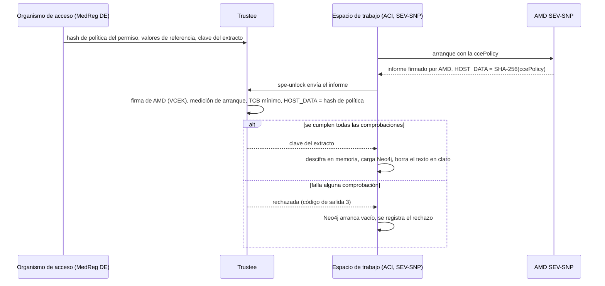

# El entorno de tratamiento seguro y sus contenedores confidenciales

Un usuario de datos nunca recibe las filas de los pacientes. Formula una
pregunta, la pregunta se ejecuta dentro de un **entorno de tratamiento seguro**
(SPE) junto a los datos, y solo vuelven los agregados que superan los controles
de salida (Reglamento (UE) 2025/327, [art. 73](https://eur-lex.europa.eu/eli/reg/2025/327/oj/eng#art_73)). Esta página explica cómo construye
el hub ese entorno a partir de contenedores confidenciales, de modo que la
afirmación "tampoco el operador puede leer los datos" se apoye en el hardware y
no en la confianza. Cubre qué se ejecuta dónde, cómo obtiene un espacio de
trabajo su clave, qué recorre una consulta, cómo ejecutarlo en un portátil y
qué falta por hacer.

Las decisiones son [ADR-037](../ADRs/ADR-037-secure-processing-environment-confidential-computing.md)
(el patrón), [ADR-068](../ADRs/ADR-068-a-sovereign-confidential-spe-on-confidential-containers-and-trustee.md)
(el diseño), [ADR-069](../ADRs/ADR-069-two-spe-workspaces-as-aci-confidential-containers.md)
(el despliegue en Azure) y [ADR-072](../ADRs/ADR-072-spe-workspaces-start-on-demand.md)
(arranque bajo demanda). El paso a paso del operador está en el runbook
[Atestación del SPE en Azure](../knowledge/runbooks/spe-attestation-azure.md).

## 1. La idea en un párrafo

Cada uno de los dos tenedores de datos tiene un **espacio de trabajo**: SPE-1
para AlphaKlinik Berlin, SPE-2 para Limburg Medical Centre. Un espacio de trabajo
es un grupo de contenedores confidencial: la CPU cifra su memoria ([AMD SEV-SNP](https://docs.kernel.org/arch/x86/amd-memory-encryption.html#secure-nested-paging-snp))
y firma un informe de exactamente lo que se arrancó en él. Los datos del espacio
de trabajo llegan sellados, y la clave la guarda un **Trustee** que ejecuta el
organismo de acceso a datos de salud (MedReg DE). Trustee solo entrega la clave
cuando el informe firmado demuestra que el espacio de trabajo ejecuta el código
para el que se concedió el permiso de datos. **Sin clave no hay datos**: una
imagen, un comando o una variable de entorno distintos dan otro hash de
política, y la clave se queda donde está.

## 2. El framework: CNCF Confidential Containers (CoCo)

El SPE se basa en [Confidential Containers](https://confidentialcontainers.org/) (CoCo),
[proyecto en incubación de la CNCF](https://www.cncf.io/blog/2026/07/22/confidential-containers-becomes-a-cncf-incubating-project/) desde julio de 2026. CoCo ejecuta
contenedores dentro de TEE de hardware y solo entrega secretos a las cargas
de trabajo que demuestran lo que son ([ADR-068](../ADRs/ADR-068-a-sovereign-confidential-spe-on-confidential-containers-and-trustee.md), decisión 1). CoCo
tiene tres partes; el hub usa hoy dos de ellas:

| Parte de CoCo                                                                            | Qué es                                                                                                                                                                                                                                                                                                                                                                                                                                    | Usada aquí                                                                                                                                                                                                                                                                                                                                                                                                                                                                                   |
| ---------------------------------------------------------------------------------------- | ----------------------------------------------------------------------------------------------------------------------------------------------------------------------------------------------------------------------------------------------------------------------------------------------------------------------------------------------------------------------------------------------------------------------------------------- | -------------------------------------------------------------------------------------------------------------------------------------------------------------------------------------------------------------------------------------------------------------------------------------------------------------------------------------------------------------------------------------------------------------------------------------------------------------------------------------------- |
| **[Trustee](https://github.com/confidential-containers/trustee)**                        | El servicio de intermediación de claves ([KBS](https://github.com/confidential-containers/trustee/tree/v0.22.0/kbs)), el servicio de atestación ([AS](https://github.com/confidential-containers/trustee/tree/v0.22.0/attestation-service)) y el servicio de valores de referencia ([RVPS](https://github.com/confidential-containers/trustee/tree/v0.22.0/rvps)): verifica la evidencia de un TEE y entrega secretos según una política. | Sí, [v0.22.0](https://github.com/confidential-containers/trustee/releases/tag/v0.22.0), gestionado por el organismo de acceso: la app de ACA `mvhd-trustee` en Azure y el servicio `trustee` de [`docker-compose.trustee.yml`](../../docker-compose.trustee.yml#L61) en local.                                                                                                                                                                                                               |
| **[Componentes invitados](https://github.com/confidential-containers/guest-components)** | Lo que se ejecuta dentro del TEE para reunir la evidencia y hablar con Trustee: los [atestadores](https://github.com/confidential-containers/guest-components/tree/v0.22.0/attestation-agent/attester) y [`kbs-client`](https://github.com/confidential-containers/trustee/tree/v0.22.0/tools/kbs-client).                                                                                                                                | Sí: el contenedor de inicio `spe-unlock` usa `kbs-client` con el atestador SEV-SNP, parcheado para pedir a ACI el informe simple ([`kbs-client.aci.Dockerfile`](https://github.com/ma3u/MinimumViableHealthDataspacev2/blob/main/services/spe-loader/kbs-client.aci.Dockerfile)).                                                                                                                                                                                                            |
| **Entorno de ejecución [Kata Containers](https://katacontainers.io/)**                   | Arranca cada pod en su propia microVM confidencial, mediante una [`RuntimeClass`](https://kubernetes.io/docs/concepts/containers/runtime-class/) de Kubernetes o como [peer pods](https://github.com/confidential-containers/cloud-api-adaptor) en una nube.                                                                                                                                                                              | No en Azure: la política del tenant rechazó AKS y las pruebas de Azure de los peer pods están desactivadas. En su lugar, los grupos de contenedores confidenciales de ACI aportan la VM de utilidad SEV-SNP ([ADR-069](../ADRs/ADR-069-two-spe-workspaces-as-aci-confidential-containers.md)). En un Mac, Kata es una comprobación local opcional del entorno de ejecución ([ADR-068](../ADRs/ADR-068-a-sovereign-confidential-spe-on-confidential-containers-and-trustee.md#decision), M2). |

Así, en Azure el aislamiento lo aporta ACI, y la decisión de confianza (qué
carga de trabajo recibe una clave) el Trustee de CoCo. Pasar más adelante a
Kata en Kubernetes cambia el entorno de ejecución y el generador de políticas
([`genpolicy`](https://github.com/kata-containers/kata-containers/tree/main/src/tools/genpolicy) en lugar de [`az confcom`](https://learn.microsoft.com/en-us/cli/azure/confcom)), no Trustee, el permiso ni su hash de
política.

## 3. Términos

| Término                                                                                                                                                            | Qué es                                                                                                                                                                                                                                                                                                                                |
| ------------------------------------------------------------------------------------------------------------------------------------------------------------------ | ------------------------------------------------------------------------------------------------------------------------------------------------------------------------------------------------------------------------------------------------------------------------------------------------------------------------------------- |
| **Computación confidencial**                                                                                                                                       | Ejecutar código en un entorno de ejecución de confianza (TEE) cuya memoria no pueden leer ni el host, ni el hipervisor, ni el operador de la nube.                                                                                                                                                                                    |
| **[AMD SEV-SNP](https://docs.kernel.org/arch/x86/amd-memory-encryption.html#secure-nested-paging-snp)**                                                            | El TEE que usan los espacios de trabajo (EPYC 9V74, Genoa). Cifra la memoria de la VM y produce un informe de atestación firmado con una clave cuya cadena llega hasta AMD. No se usa Intel TDX.                                                                                                                                      |
| **Contenedor confidencial**                                                                                                                                        | Un grupo de contenedores que se ejecuta dentro de su propia VM de utilidad SEV-SNP. En Azure: un grupo de [Azure Container Instances](https://learn.microsoft.com/en-us/azure/container-instances/container-instances-confidential-overview) (ACI) con `sku: Confidential`.                                                           |
| **[ccePolicy](https://learn.microsoft.com/en-us/azure/container-instances/container-instances-confidential-overview#confidential-computing-enforcement-policies)** | La política de aplicación de computación confidencial de un grupo de ACI: las imágenes por digest, los comandos, el entorno y los montajes que pueden ejecutarse. Se genera con [`az confcom acipolicygen`](https://learn.microsoft.com/en-us/cli/azure/confcom#az-confcom-acipolicygen).                                             |
| **HOST_DATA**                                                                                                                                                      | Un campo del informe SEV-SNP que se fija al arrancar. ACI pone ahí el [SHA-256](https://csrc.nist.gov/pubs/fips/180-4/upd1/final) de la ccePolicy, de modo que el hardware garantiza con qué política arrancó el grupo.                                                                                                               |
| **Hash de política**                                                                                                                                               | Ese SHA-256, registrado en el permiso (`HDABApproval.policyHash`) y en la política de recursos de Trustee. Vincula un permiso a una carga de trabajo exacta.                                                                                                                                                                          |
| **Trustee**                                                                                                                                                        | El intermediario de claves de [CNCF Confidential Containers](https://confidentialcontainers.org/): KBS (servicio intermediario de claves), AS (servicio de atestación) y RVPS (valores de referencia). Versión [v0.22.0](https://github.com/confidential-containers/trustee/releases/tag/v0.22.0), lo ejecuta el organismo de acceso. |
| **Valores de referencia**                                                                                                                                          | Aquello con lo que Trustee compara el informe: la medición de arranque de la VM de utilidad de Microsoft y el TCB mínimo (versiones de firmware y microcódigo).                                                                                                                                                                       |
| **Extracto sellado**                                                                                                                                               | La mitad de los pacientes sintéticos que corresponde a un espacio de trabajo, formato `mvhd-spe-extract/1`: líneas JSON, comprimidas con gzip, cifradas con [AES-256-GCM](https://nvlpubs.nist.gov/nistpubs/Legacy/SP/nistspecialpublication800-38d.pdf) bajo una clave nueva por permiso.                                            |

## 4. Dónde se ejecuta y qué demuestra cada lugar

El diseño es el mismo en todas partes; lo que cambia es si un hardware real
firma la evidencia. La UI dice cuál es el caso con una de tres etiquetas
([`ui/src/lib/spe.ts`](https://github.com/ma3u/MinimumViableHealthDataspacev2/blob/main/ui/src/lib/spe.ts)),
y nunca afirma más de lo que muestra la evidencia ([ADR-068](../ADRs/ADR-068-a-sovereign-confidential-spe-on-confidential-containers-and-trustee.md#decision), decisión 5).

| Dónde                                | Qué es real                                                                                                                                                                                                                                      | Etiqueta                          |
| ------------------------------------ | ------------------------------------------------------------------------------------------------------------------------------------------------------------------------------------------------------------------------------------------------ | --------------------------------- |
| **Portátil, CI, demo estática**      | Trustee, el hash del permiso en su política, la entrega de la clave, el extracto sellado, Neo4j cargándolo, el registro de auditoría. La evidencia procede del atestador de ejemplo de Trustee, porque un portátil no tiene TEE.                 | "Simulated attestation"           |
| **Azure, nivel de nodo (A1)**        | Hardware SEV-SNP con arranque medido, pero sin saber qué contenedor se ejecutó. No desplegado.                                                                                                                                                   | "Attested: SEV-SNP node"          |
| **Azure, por carga de trabajo (A2)** | Contenedores confidenciales de ACI en westeurope: el hardware comprueba la política de cada carga de trabajo. Funcionó de principio a fin el 2 de noviembre de 2026 ([#774](https://github.com/ma3u/MinimumViableHealthDataspacev2/issues/774)). | "Attested: confidential workload" |

Los nodos `SPESession` sembrados en el grafo del Trust Center
([`neo4j/seed-trust-center.cypher`](https://github.com/ma3u/MinimumViableHealthDataspacev2/blob/main/neo4j/seed-trust-center.cypher))
llevan `simulated: true`; ilustran el modelo y no son evidencia.

## 5. Las piezas en Azure

| Pieza                     | Recurso de Azure                                                                   | Qué hace                                                                                                                                           |
| ------------------------- | ---------------------------------------------------------------------------------- | -------------------------------------------------------------------------------------------------------------------------------------------------- |
| SPE-1, AlphaKlinik Berlin | Grupo de ACI `mvhd-spe-1`, `sku: Confidential`, westeurope                         | el contenedor de inicialización `spe-unlock` realiza la atestación y obtiene la clave; `neo4j` guarda los datos; el sidecar `spe-ingest` los carga |
| SPE-2, Limburg MC         | Grupo de ACI `mvhd-spe-2`, misma forma                                             | lo mismo, con la otra mitad de los pacientes sintéticos                                                                                            |
| Trustee (MedReg DE)       | App de ACA `mvhd-trustee`, job `mvhd-trustee-admin`                                | verifica la evidencia SEV-SNP frente a la cadena de AMD, los valores de referencia y HOST_DATA, y después entrega `default/spe-<n>/extract-key`    |
| Estado de Trustee         | Recursos compartidos de archivos `trustee-keys`, `trustee-data`                    | clave de administración, clave de tokens, políticas, valores de referencia, claves de los extractos. Nunca el Key Vault del hub                    |
| Extractos sellados        | Recurso compartido `spe-extracts`, integrado en la imagen `mvhd-spe-loader-spe<n>` | solo texto cifrado; el digest del extracto forma parte del hash de política                                                                        |
| Federación y auditoría    | App de ACA `mvhd-neo4j-proxy`                                                      | envía las preguntas federadas a los espacios de trabajo, aplica los controles de salida y añade sus eventos `spe.*` a la cadena de auditoría       |

La plantilla del grupo es
[`scripts/azure/aci/spe-workspace.template.json`](https://github.com/ma3u/MinimumViableHealthDataspacev2/blob/main/scripts/azure/aci/spe-workspace.template.json).
Todo lo demás del hub sigue en Azure Container Apps (ACA), que todavía no tiene
un perfil de carga de trabajo confidencial en una región de la UE. Se valoraron
[Azure Attestation](https://learn.microsoft.com/en-us/azure/attestation/overview) y la [entrega segura de claves de Key Vault](https://learn.microsoft.com/en-us/azure/confidential-computing/concept-skr-attestation), y deliberadamente
**no** están en el camino de la clave: quien decide quién recibe una clave es el
organismo de acceso, no el operador de la nube ([ADR-068](../ADRs/ADR-068-a-sovereign-confidential-spe-on-confidential-containers-and-trustee.md#decision), decisión 1; [ADR-069](../ADRs/ADR-069-two-spe-workspaces-as-aci-confidential-containers.md#alternatives-considered),
"Alternatives considered").

## 6. La cadena de confianza



1. **El permiso fija la carga de trabajo.** [`21-aci-confidential-spe.sh --policy`](../../scripts/azure/21-aci-confidential-spe.sh)
   genera la ccePolicy a partir de la plantilla. Su SHA-256 se escribe en el
   permiso (`HDABApproval`) y en la política de recursos de Trustee
   ([`trustee/policies/resource-azure.rego.tmpl`](https://github.com/ma3u/MinimumViableHealthDataspacev2/blob/main/trustee/policies/resource-azure.rego.tmpl)).
2. **El hardware la garantiza.** ACI arranca el grupo en una VM de utilidad
   SEV-SNP y pone el hash de la política en HOST_DATA del informe firmado.
3. **Trustee comprueba cuatro cosas:** la firma hasta AMD ([VCEK](https://kdsintf.amd.com/) del servicio
   de distribución de claves de AMD), la medición de arranque de la VM de
   utilidad frente a un valor de referencia fijado, el TCB frente a un mínimo
   por componente
   ([ADR-073](../ADRs/ADR-073-the-spe-tcb-is-a-minimum-not-a-list.md),
   [`attestation-ear-cpu.rego`](https://github.com/ma3u/MinimumViableHealthDataspacev2/blob/main/trustee/policies/attestation-ear-cpu.rego)),
   y HOST_DATA frente al hash del permiso.
4. **Solo entonces sale la clave de Trustee.** Sin un valor de referencia
   fijado, la política rechaza: no existe "desbloquear en el primer uso".

Los secretos no viajan en la política. Llegan al grupo a través de su volumen
de secretos, de modo que rotar uno no cambia el hash.

## 7. Dentro de un espacio de trabajo

Cada grupo tiene tres contenedores, construidos a partir de
[`services/spe-loader`](https://github.com/ma3u/MinimumViableHealthDataspacev2/tree/main/services/spe-loader):

- **`spe-unlock`** (contenedor de inicialización): realiza la atestación con
  `kbs-client` compilado con la función `snp-attester`, obtiene la clave y
  descifra el extracto en el volumen `emptyDir` `work`.
- **`neo4j`**: [Neo4j 5.26](https://neo4j.com/release-notes/database/neo4j-5/) Community, [1,5 vCPU](../../scripts/azure/aci/spe-workspace.template.json#L126) y 4 GiB, almacén en el volumen
  `emptyDir` `neo4j-data`, Bolt con TLS obligatorio, HTTP desactivado. Neo4j es
  **un espacio de trabajo por permiso, no un almacén de larga duración**
  ([ADR-068](../ADRs/ADR-068-a-sovereign-confidential-spe-on-confidential-containers-and-trustee.md#decision), decisión 3): guarda los datos solo en memoria y en almacenamiento
  efímero dentro del TEE.
- **`spe-ingest`** (sidecar): carga el extracto, aplica
  [`neo4j/init-schema.cypher`](../../neo4j/init-schema.cypher) y el registro del SPE en HealthDCAT-AP, borra el
  texto en claro, registra la atestación y sigue en marcha.

**Los datos.** Cada espacio de trabajo recibe la mitad de los pacientes
sintéticos del hub: los registros FHIR ([Patient](https://hl7.org/fhir/R4/patient.html), [Condition](https://hl7.org/fhir/R4/condition.html), [Observation](https://hl7.org/fhir/R4/observation.html) y el
resto), la persona [OMOP CDM](https://ohdsi.github.io/CommonDataModel/cdm54.html#person) correspondiente con sus registros y los conceptos
con los que están codificados. Quedan fuera los pacientes de sandbox y los de
la app Klarbefund. La etiqueta `OptedOut` de un paciente viaja con los datos
([art. 71](https://eur-lex.europa.eu/eli/reg/2025/327/oj/eng#art_71)).

**Detener es borrar.** Los almacenes viven en memoria, así que detener o
eliminar un grupo pierde todas las filas. Cada arranque vuelve a realizar la
atestación y vuelve a cargar. Una trampa: [`az container restart`](https://learn.microsoft.com/en-us/cli/azure/container#az-container-restart) no vuelve a
ejecutar el contenedor de inicialización, de modo que un grupo reiniciado nunca
vuelve a preguntar a Trustee; deténgalo y arránquelo en su lugar
([`docs/gotchas.md`](../gotchas.md), 1 de noviembre de 2026).

**Los comandos del cargador** (`spe-loader <command>`): `policy-hash`,
`trustee-configure`, `record-permit`, `export`, `encrypt`, `extract`,
`unlock`, `ingest` y `load`. El código de salida 3 significa que se rechazó la
clave; 2 significa que una base de datos o Trustee no respondió.

## 8. Qué recorre una consulta federada

1. Un usuario de datos pregunta en `/query` o en lenguaje natural. La UI llama a
   [`/api/federated`](https://github.com/ma3u/MinimumViableHealthDataspacev2/blob/main/ui/src/app/api/federated/route.ts)
   (o a [`/api/nlq`](../../ui/src/app/api/nlq/route.ts) con `federated: true`).
2. **Arranque en frío** ([ADR-072](../ADRs/ADR-072-spe-workspaces-start-on-demand.md)).
   Los espacios de trabajo están detenidos por defecto para ahorrar costes. Una
   consulta federada de `EDC_ADMIN`, `HDAB_AUTHORITY` o `DATA_USER` los arranca;
   hasta que están en marcha, la respuesta es **503** con `state` `starting` o
   `stopped`, `etaSeconds` (240 desde detenido) y una cabecera [`Retry-After`](https://www.rfc-editor.org/rfc/rfc9110#section-10.2.3).
   Medido: la clave llega al cabo de un minuto aproximadamente, los datos están
   cargados al cabo de unos tres, SPE-2 responde al cabo de unos cuatro. El job
   `mvhd-spe-idle-stop` se ejecuta cada 15 minutos y detiene un espacio de
   trabajo inactivo durante 30.
3. **El proxy reparte la pregunta.** [`services/neo4j-proxy`](../../services/neo4j-proxy) envía la pregunta a
   ambos espacios de trabajo por Bolt con TLS (`POST /federated/query`,
   `GET /federated/stats`).
4. **Controles de salida antes de que salga nada.** Los grupos menores que k se
   descartan y las celdas por debajo de k pasan a ser `<k`, con k = 5
   ([`MIN_COHORT_SIZE`](../../services/neo4j-proxy/src/config.ts#L94),
   [`k-anonymity.ts`](https://github.com/ma3u/MinimumViableHealthDataspacev2/blob/main/services/neo4j-proxy/src/k-anonymity.ts));
   se excluyen los pacientes que han ejercido la autoexclusión
   ([`opt-out.ts`](https://github.com/ma3u/MinimumViableHealthDataspacev2/blob/main/services/neo4j-proxy/src/opt-out.ts)).
5. **Solo vuelven agregados** a la UI, a través del proxy.

**El registro de auditoría.** El proxy lee los eventos de cada espacio de
trabajo cada minuto y los añade a la cadena de auditoría `spe` del hub
([ADR-045](../ADRs/ADR-045-observability-and-regulatory-audit-trail.md)): `spe.attestation`, `key_release`, `key_refused`,
`workspace_loaded`, `workspace_destroyed` y `optout_synced`.

**Dónde verlo en la UI**, con la sesión iniciada como `edcadmin`:

- `/admin/attestation`: la atestación de cada espacio de trabajo y su etiqueta.
- `/admin/components`: la topología del SPE, con un botón de encendido por espacio de trabajo.
- `/admin/audit`: la cadena `spe`.
- `/admin/policies`: qué permiso está vinculado a qué hash de política.
- `/query`: el aviso de arranque en frío mientras arrancan los espacios de trabajo.

## 9. Ejecutarlo en un portátil

Sin la capa adicional que se indica a continuación, SPE-1 es simplemente el
grafo del hub y SPE-2 un segundo Neo4j: la federación funciona, pero nada está
sellado ni atestado. Para obtener el flujo real con evidencia simulada, arranque
la capa de Trustee sobre la pila JAD
([`docker-compose.trustee.yml`](https://github.com/ma3u/MinimumViableHealthDataspacev2/blob/main/docker-compose.trustee.yml)):

```bash
docker compose -f docker-compose.yml -f docker-compose.jad.yml \
  -f docker-compose.trustee.yml --profile federated up -d --build
```

Añade Trustee en <http://localhost:8099>, fija su política local y sus valores
de referencia, sella ambos extractos y registra sus hashes de política en el
hub, mueve los almacenes de ambos espacios de trabajo a `tmpfs` y ejecuta
`spe-loader-spe1` y `spe-loader-spe2` para atestar, desbloquear y cargar.
Compruebe el resultado con `GET http://localhost:9090/spe/status` del proxy o
en `/admin/attestation`.

Las pruebas que lo protegen, en la CI y en local: [Vitest](https://vitest.dev/) en [`services/spe-loader`](../../services/spe-loader), y [`opa test`](https://www.openpolicyagent.org/docs/policy-testing) sobre [`trustee/policies/`](../../trustee/policies) con [`scripts/test-trustee-policies.sh`](../../scripts/test-trustee-policies.sh):

```bash
cd services/spe-loader && npm test        # Vitest: extract, seal, unlock, ingest
./scripts/test-trustee-policies.sh        # opa test over trustee/policies/
```

Ambas se ejecutan en [`test.yml`](https://github.com/ma3u/MinimumViableHealthDataspacev2/blob/main/.github/workflows/test.yml)
(SPE Loader Tests, Trustee Policy Tests). Las pruebas de políticas fijan cada
caso de la política de recursos, incluido HOST_DATA en el lugar donde lo pone
[Trustee v0.22.0](https://github.com/confidential-containers/trustee/releases/tag/v0.22.0).

## 10. Desplegarlo en Azure

[`scripts/azure/21-aci-confidential-spe.sh`](https://github.com/ma3u/MinimumViableHealthDataspacev2/blob/main/scripts/azure/21-aci-confidential-spe.sh)
lo hace por fases, en este orden: `--trustee`, `--extracts`, `--policy`,
`--workspaces`, `--wire-proxy`, `--check`. El runbook recoge los requisitos
previos (un rol de [PIM](https://learn.microsoft.com/en-us/entra/id-governance/privileged-identity-management/pim-configure) activado antes de `az login`, la sesión de una hora) y lo
que imprime cada fase; léalo antes de la primera ejecución. Dos fases se
protegen a sí mismas: `--extracts` se niega a cambiar las claves mientras
Trustee guarde claves, salvo con `--rekey`, y `--trustee` conserva una política
de recursos que Trustee ya tenga.

## 11. Qué falta por hacer

- **El organismo de acceso todavía no ejecuta su propio Trustee.** Los recursos
  compartidos de Trustee están en la suscripción del hub, así que el
  propietario de la suscripción podría leerlos. Para que la afirmación de
  soberanía se sostenga, MedReg DE ejecuta Trustee en una suscripción propia
  ([ADR-069](../ADRs/ADR-069-two-spe-workspaces-as-aci-confidential-containers.md#decision), decisión 3).
- **Se sigue confiando en AMD y en la VM de utilidad de Microsoft.** El
  operador compara el respaldo de Microsoft a la medición de la VM de utilidad,
  pero su firma [COSE](https://datatracker.ietf.org/doc/html/rfc9052) todavía no se verifica criptográficamente.
- **[ADR-073](../ADRs/ADR-073-the-spe-tcb-is-a-minimum-not-a-list.md) está propuesto.** El TCB mínimo y sus pruebas están en `main`
  ([#836](https://github.com/ma3u/MinimumViableHealthDataspacev2/pull/836)); el ADR dice que todavía no se aplica en Azure.
- **AKS no es una opción hoy.** La política del tenant lo rechazó
  (`RequestDisallowedByPolicy`); se ha solicitado una exención. Además,
  Microsoft [estaba retirando](https://github.com/Azure/AKS/issues/3781) los contenedores confidenciales de AKS ([ADR-068](../ADRs/ADR-068-a-sovereign-confidential-spe-on-confidential-containers-and-trustee.md#decision)).
- **Sin decidir** ([ADR-068](../ADRs/ADR-068-a-sovereign-confidential-spe-on-confidential-containers-and-trustee.md#not-decided-here)): qué proveedor de la UE aloja el caso por carga de
  trabajo fuera de Azure, y Trustee en una suscripción propia.

Incidencias: [#774](https://github.com/ma3u/MinimumViableHealthDataspacev2/issues/774)
(el despliegue en Azure), [#27](https://github.com/ma3u/MinimumViableHealthDataspacev2/issues/27),
[#481](https://github.com/ma3u/MinimumViableHealthDataspacev2/issues/481),
[#716](https://github.com/ma3u/MinimumViableHealthDataspacev2/issues/716),
[#833](https://github.com/ma3u/MinimumViableHealthDataspacev2/issues/833).

## 12. Las decisiones, por orden

| ADR                                                                                               | Decisión                                                                                               | Estado                            |
| ------------------------------------------------------------------------------------------------- | ------------------------------------------------------------------------------------------------------ | --------------------------------- |
| [ADR-037](../ADRs/ADR-037-secure-processing-environment-confidential-computing.md)                | Contenedores confidenciales con atestación remota, no confianza en el operador                         | Aceptado                          |
| [ADR-052](../ADRs/ADR-052-confidential-spe-on-azure-revisited.md)                                 | AKS con Kata y Azure Attestation                                                                       | Sustituido por ADR-068            |
| [ADR-068](../ADRs/ADR-068-a-sovereign-confidential-spe-on-confidential-containers-and-trustee.md) | CNCF Confidential Containers, un Trustee que ejecuta el organismo de acceso, Neo4j cargado por permiso | Aceptado (30 de octubre de 2026)  |
| [ADR-069](../ADRs/ADR-069-two-spe-workspaces-as-aci-confidential-containers.md)                   | Dos espacios de trabajo como contenedores confidenciales de ACI; el hash de política es HOST_DATA      | Aceptado (2 de noviembre de 2026) |
| [ADR-072](../ADRs/ADR-072-spe-workspaces-start-on-demand.md)                                      | Detenidos por defecto, arrancados por una consulta federada, detenidos tras 30 minutos de inactividad  | Aceptado (2 de noviembre de 2026) |
| [ADR-073](../ADRs/ADR-073-the-spe-tcb-is-a-minimum-not-a-list.md)                                 | El TCB de SEV-SNP se comprueba frente a un mínimo por componente                                       | Propuesto                         |
