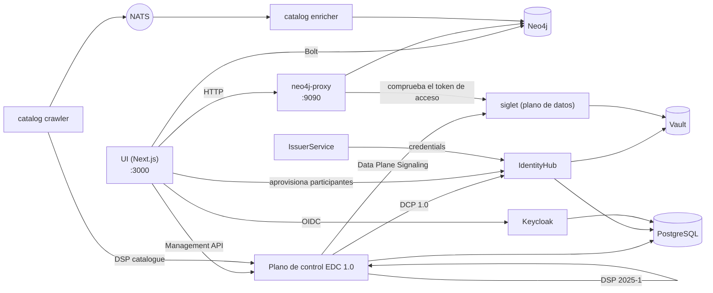

# La pila y el entorno de desarrollo

Cómo se llama cada parte del hub, qué hace y cómo encajan las partes,
seguido de cómo ejecutarlas en un portátil. Las decisiones detrás de cada
parte están en los ADR enlazados desde su fila; el registro completo de gotchas es
[`docs/gotchas.md`](../gotchas.md).

## Glosario

### Protocolos

| Término                                                                                       | Qué es                                                                                                                                                                                                                                                                                                                                                                                          | Decisión                                                                |
| --------------------------------------------------------------------------------------------- | ----------------------------------------------------------------------------------------------------------------------------------------------------------------------------------------------------------------------------------------------------------------------------------------------------------------------------------------------------------------------------------------------- | ----------------------------------------------------------------------- |
| **[DSP 2025-1](https://eclipse-dataspace-protocol-base.github.io/DataspaceProtocol/2025-1/)** | El Eclipse Dataspace Protocol, versión 2025-1: cómo dos conectores intercambian un catálogo ([DCAT](https://www.w3.org/TR/vocab-dcat-3/)), negocian un contrato sobre una oferta [ODRL](https://www.w3.org/TR/odrl-model/) y ejecutan una transferencia. El plano de control lo habla bajo `/api/dsp/<participant>/2025-1/`.                                                                    | [ADR-007](../ADRs/ADR-007-did-web-dsp-negotiation.md)                   |
| **[DCP 1.0](https://eclipse-dataspace-dcp.github.io/decentralized-claims-protocol/v1.0/)**    | El Decentralised Claims Protocol: cómo un participante demuestra quién es. Cada uno tiene un DID [`did:web`](https://w3c-ccg.github.io/did-method-web/) y posee [credenciales verificables](https://www.w3.org/TR/vc-data-model-2.0/) (una `MembershipCredential`, credenciales de función del EEDS); una contraparte pide una presentación en lugar de confiar en un inicio de sesión central. | [ADR-009](../ADRs/ADR-009-issuerservice-credential-fix.md)              |
| **[ODRL](https://www.w3.org/TR/odrl-model/) 2.2**                                             | El lenguaje de políticas de una oferta: quién puede usar un conjunto de datos, con qué finalidad y en virtud de qué permiso.                                                                                                                                                                                                                                                                    | [ADR-013](../ADRs/ADR-013-simpl-open-alignment.md)                      |
| **[HealthDCAT-AP](https://data.health.europa.eu/healthdcat-ap/releases/release-8/)**          | El vocabulario de catálogo para conjuntos de datos de salud, Release 8 desde [#700](https://github.com/ma3u/MinimumViableHealthDataspacev2/issues/700).                                                                                                                                                                                                                                         | [ADR-063](../ADRs/ADR-063-healthdcat-ap-release-8-and-its-namespace.md) |
| **[did:web](https://w3c-ccg.github.io/did-method-web/)**                                      | Un DID que se resuelve por HTTPS. Coexisten dos formas, una estable en el grafo y la UI y una resoluble en la capa EDC; [`api-conventions.md`](https://github.com/ma3u/MinimumViableHealthDataspacev2/blob/main/.claude/rules/api-conventions.md) explica cuál va dónde.                                                                                                                        | [ADR-007](../ADRs/ADR-007-did-web-dsp-negotiation.md)                   |

### El conector: EDC-V

| Término                                                                               | Qué es                                                                                                                                                                                                                                                                                                                                                                                                                                                                                                                                                                                                      | Decisión                                                                                                                                |
| ------------------------------------------------------------------------------------- | ----------------------------------------------------------------------------------------------------------------------------------------------------------------------------------------------------------------------------------------------------------------------------------------------------------------------------------------------------------------------------------------------------------------------------------------------------------------------------------------------------------------------------------------------------------------------------------------------------------- | --------------------------------------------------------------------------------------------------------------------------------------- |
| **EDC-V**                                                                             | Eclipse Dataspace Components, virtual: un único runtime EDC multiinquilino en el que cada participante es un _contexto de participante_ en lugar de su propio conector. El hub ejecuta [EDC 1.0](https://github.com/eclipse-edc/Connector/releases/tag/v1.0.0-RC5) (`1.0.0-RC5`): el plano de control, el IdentityHub y el IssuerService son lanzadores propios, construidos a partir de [`runtimes/edc`](../../runtimes/edc). EDC 0.18 de las imágenes de JAD solo arranca con el perfil de Compose `edc018`, que se retira con [#927](https://github.com/ma3u/MinimumViableHealthDataspacev2/issues/927). | [ADR-024](../ADRs/ADR-024-full-edc-provisioning-per-participant.md), [ADR-078](../ADRs/ADR-078-edc-1-on-container-apps-without-cfm.md)  |
| **Plano de control**                                                                  | El runtime EDC que guarda los assets, las políticas y las definiciones de contrato, negocia contratos mediante DSP e inicia las transferencias (`controlplane` en [`docker-compose.jad.yml`](../../docker-compose.jad.yml#L277)). Management API en `:11003`.                                                                                                                                                                                                                                                                                                                                               | [ADR-002](../ADRs/ADR-002-edc-data-plane-architecture.md), [ADR-078](../ADRs/ADR-078-edc-1-on-container-apps-without-cfm.md)            |
| **Siglet**                                                                            | El plano de datos con EDC 1.0: [siglet 0.1.6](https://github.com/eclipse-dataplane-core/dsdk-facet-rs/releases/tag/siglet-v0.1.6), de Eclipse Dataplane Core. El plano de control lo señaliza por contexto de participante; emite el token de acceso (EDR) de una transferencia, y el neo4j-proxy sirve los datos en `/dataspace/data` tras comprobar ese token con las claves de siglet ([`jad/siglet-edc1.toml`](../../jad/siglet-edc1.toml)). Sin puerto en el host.                                                                                                                                     | [ADR-078](../ADRs/ADR-078-edc-1-on-container-apps-without-cfm.md#decision)                                                              |
| **[IdentityHub](https://github.com/eclipse-edc/IdentityHub/releases/tag/v1.0.0-RC5)** | La cartera DCP de cada participante: su documento DID, sus claves (en Vault) y las credenciales que posee; responde a las peticiones de presentación. `:11005`.                                                                                                                                                                                                                                                                                                                                                                                                                                             | [ADR-009](../ADRs/ADR-009-issuerservice-credential-fix.md)                                                                              |
| **IssuerService**                                                                     | El emisor de credenciales del hub: guarda las definiciones de credenciales y emite credenciales a los titulares por DCP. `:10013`. Una segunda instancia, `simpl-ga-issuer` (`:10023`), hace de autoridad de gobernanza de [Simpl](https://code.europa.eu/simpl/simpl-open); `rogue-issuer` (`:10033`) no figura en ninguna lista de confianza y solo se inicia para las comprobaciones de identidad.                                                                                                                                                                                                       | [ADR-009](../ADRs/ADR-009-issuerservice-credential-fix.md), [ADR-064](../ADRs/ADR-064-simpl-open-through-the-outside-agent-dcp-path.md) |
| **Planos de datos DCore**                                                             | Solo EDC 0.18, con el perfil `edc018`: `dataplane-fhir` enviaba FHIR R4 por push (`:11002`), `dataplane-omop` servía OMOP CDM por pull (`:11012`), y cada uno comprobaba el token EDR de cada solicitud.                                                                                                                                                                                                                                                                                                                                                                                                    | [ADR-002](../ADRs/ADR-002-edc-data-plane-architecture.md)                                                                               |

### Cómo se ejecuta: JAD y CFM

| Término                                                                  | Qué es                                                                                                                                                                                                                                                                                                                                                                                                                                                                                                                                                                                                                                                                                                                                                                                                                               | Decisión                                                                                                                            |
| ------------------------------------------------------------------------ | ------------------------------------------------------------------------------------------------------------------------------------------------------------------------------------------------------------------------------------------------------------------------------------------------------------------------------------------------------------------------------------------------------------------------------------------------------------------------------------------------------------------------------------------------------------------------------------------------------------------------------------------------------------------------------------------------------------------------------------------------------------------------------------------------------------------------------------ | ----------------------------------------------------------------------------------------------------------------------------------- |
| **JAD**                                                                  | Just Another Demonstrator: el [demostrador de Eclipse](https://github.com/eclipse-dataspace-hub/jad) que despliega un espacio de datos completo como servicio en Kubernetes. El hub trasladó su estructura a Docker Compose: aquí JAD es [`docker-compose.jad.yml`](../../docker-compose.jad.yml) más las semillas y la configuración de [`jad/`](../../jad), superpuestos a [`docker-compose.yml`](../../docker-compose.yml). Sus imágenes (`ghcr.io/metaform/jad/*`) solo quedan en el perfil `edc018`. Azure ejecuta la misma compilación.                                                                                                                                                                                                                                                                                        | [ADR-055](../ADRs/ADR-055-azure-runs-the-compose-jad-build.md), [ADR-078](../ADRs/ADR-078-edc-1-on-container-apps-without-cfm.md)   |
| **CFM**                                                                  | El Connector Fabric Manager, el plano de gestión por encima de EDC-V con EDC 0.18: el **gestor de inquilinos** (`:11006`) creaba un inquilino por organización, el **gestor de aprovisionamiento** (`:11007`) lo aprovisionaba, y cuatro **agentes** hacían el trabajo (cliente de Keycloak, contexto de participante, registro, incorporación), con [`cfm-cp-shim`](../../docker-compose.jad.yml#L934) como puente entre los agentes y la versión de la API del plano de control. EDC 1.0 funciona sin él: los agentes de 2026-03 llaman a API del IdentityHub y del IssuerService que la 1.0 ya no tiene, así que el hub aprovisiona los participantes por sí mismo. CFM, sus agentes y el shim solo arrancan con el perfil `edc018`, que se retira con [#927](https://github.com/ma3u/MinimumViableHealthDataspacev2/issues/927). | [ADR-078](../ADRs/ADR-078-edc-1-on-container-apps-without-cfm.md#context), [ADR-005](../ADRs/ADR-005-jad-cfm-source-builds.md)      |
| **Vault**                                                                | [HashiCorp Vault](https://github.com/hashicorp/vault/releases/tag/v2.0.0) guarda las claves privadas de cada participante y los secretos de EDC. Respaldado en archivo en local desde el 2026-09-26 ([`jad/vault.hcl`](../../jad/vault.hcl), con un sidecar `vault-unseal`), en el [Flexible Server](https://learn.microsoft.com/en-us/azure/postgresql/flexible-server/overview) en Azure. Nunca [`-dev`](https://developer.hashicorp.com/vault/docs/concepts/dev-server): un reinicio se llevaría todas las claves.                                                                                                                                                                                                                                                                                                                | [ADR-046](../ADRs/ADR-046-vault-keeps-its-state-on-the-flexible-server.md), [ADR-047](../ADRs/ADR-047-vault-stays-up-off-hours.md)  |
| **[Keycloak](https://github.com/keycloak/keycloak/releases/tag/26.8.0)** | Inicio de sesión [OIDC](https://openid.net/specs/openid-connect-core-1_0.html) para la UI y los clientes de servicio, realm `edcv`, `:8080`. El cliente de la UI es confidencial con [PKCE S256](https://datatracker.ietf.org/doc/html/rfc7636#section-4.2).                                                                                                                                                                                                                                                                                                                                                                                                                                                                                                                                                                         | [ADR-025](../ADRs/ADR-025-keycloak-custom-domain.md)                                                                                |
| **[PostgreSQL](https://www.postgresql.org/docs/release/17.7/)**          | El almacén en tiempo de ejecución de los servicios EDC y de Keycloak, una base de datos cada uno ([`jad/init-postgres.sql`](../../jad/init-postgres.sql)). El [Flexible Server](https://learn.microsoft.com/en-us/azure/postgresql/flexible-server/overview) en Azure.                                                                                                                                                                                                                                                                                                                                                                                                                                                                                                                                                               | [ADR-001](../ADRs/ADR-001-postgresql-neo4j-split.md), [ADR-041](../ADRs/ADR-041-managed-postgres-on-azure-containerised-locally.md) |
| **[NATS](https://github.com/nats-io/nats-server/releases/tag/v2.14.3)**  | La malla de eventos ([JetStream](https://docs.nats.io/nats-concepts/jetstream)) entre el crawler y el enriquecedor del catálogo y, con el perfil `edc018`, entre los gestores y los agentes de CFM. `:4222`.                                                                                                                                                                                                                                                                                                                                                                                                                                                                                                                                                                                                                         | [ADR-020](../ADRs/ADR-020-cross-participant-dataset-discovery.md)                                                                   |
| **[Traefik](https://doc.traefik.io/traefik/v3.7/)**                      | La pasarela delante de los servicios de JAD, `:80`, panel en `:8090`.                                                                                                                                                                                                                                                                                                                                                                                                                                                                                                                                                                                                                                                                                                                                                                |                                                                                                                                     |

### Los servicios propios del hub

| Término                              | Qué es                                                                                                                                                                                                                                                                                                                                                                                                                                                                                                                                                                                                                                                                                                                                                                                                                                                                                                                                                                                                              | Decisión                                                                                                                                                                             |
| ------------------------------------ | ------------------------------------------------------------------------------------------------------------------------------------------------------------------------------------------------------------------------------------------------------------------------------------------------------------------------------------------------------------------------------------------------------------------------------------------------------------------------------------------------------------------------------------------------------------------------------------------------------------------------------------------------------------------------------------------------------------------------------------------------------------------------------------------------------------------------------------------------------------------------------------------------------------------------------------------------------------------------------------------------------------------- | ------------------------------------------------------------------------------------------------------------------------------------------------------------------------------------ |
| **UI**                               | La app [Next.js](https://github.com/vercel/next.js/releases/tag/v15.5.28) de [`ui/`](../../ui): las páginas de cada perfil y las rutas `/api/*` que las respaldan. Contenedor `health-dataspace-ui`.                                                                                                                                                                                                                                                                                                                                                                                                                                                                                                                                                                                                                                                                                                                                                                                                                | [ADR-004](../ADRs/ADR-004-nextjs-unified-frontend.md), [ADR-044](../ADRs/ADR-044-every-api-route-needs-a-session.md)                                                                 |
| **Neo4j**                            | El grafo de conocimiento de cinco capas: mercado (DSP), [HealthDCAT-AP](https://data.health.europa.eu/healthdcat-ap/releases/release-8/), [FHIR R4](https://hl7.org/fhir/R4/), [OMOP CDM](https://ohdsi.github.io/CommonDataModel/cdm54.html) y ontologías. [Neo4j 5.26](https://neo4j.com/release-notes/database/neo4j-5/) LTS Community con [APOC](https://neo4j.com/docs/apoc/5/), [APOC Extended](https://github.com/neo4j-contrib/neo4j-apoc-procedures), [Graph Data Science](https://neo4j.com/docs/graph-data-science/current/) y [n10s](https://neo4j.com/labs/neosemantics/). Sin mapeador de objetos ni capa GraphQL: la UI, el proxy y el cargador del SPE usan el [`neo4j-driver`](https://neo4j.com/docs/javascript-manual/current/) oficial con Cypher parametrizado ([`runQuery()`](../../ui/src/lib/neo4j.ts#L65) en `ui/src/lib/neo4j.ts`), los servicios de catálogo el controlador oficial de Python [`neo4j`](https://neo4j.com/docs/python-manual/current/). `:7474` navegador, `:7687` Bolt. | [ADR-001](../ADRs/ADR-001-postgresql-neo4j-split.md), [ADR-030](../ADRs/ADR-030-neo4j-2025-lts-migration.md), [ADR-043](../ADRs/ADR-043-graph-access-direct-or-through-the-proxy.md) |
| **neo4j-proxy**                      | [`services/neo4j-proxy/`](../../services/neo4j-proxy), [Express](https://expressjs.com/en/5x/api.html) en `:9090`: los endpoints FHIR y OMOP que lee una transferencia (`/dataspace/data`), el motor de consultas en lenguaje natural, la consulta federada y el catálogo en HealthDCAT-AP.                                                                                                                                                                                                                                                                                                                                                                                                                                                                                                                                                                                                                                                                                                                         | [ADR-043](../ADRs/ADR-043-graph-access-direct-or-through-the-proxy.md)                                                                                                               |
| **Catalog crawler**                  | [`services/catalog-crawler/`](../../services/catalog-crawler), Python: obtiene el catálogo DSP de cada participante cada cinco minutos y lo publica en NATS (`dataspace.catalog.raw`).                                                                                                                                                                                                                                                                                                                                                                                                                                                                                                                                                                                                                                                                                                                                                                                                                              | [ADR-020](../ADRs/ADR-020-cross-participant-dataset-discovery.md)                                                                                                                    |
| **Catalog enricher**                 | [`services/catalog-enricher/`](../../services/catalog-enricher), Python: lee esos catálogos de NATS, los transforma a HealthDCAT-AP y los fusiona en Neo4j como nodos `:HealthDataset`, de modo que una pregunta sobre conjuntos de datos alcanza los de cada participante.                                                                                                                                                                                                                                                                                                                                                                                                                                                                                                                                                                                                                                                                                                                                         | [ADR-020](../ADRs/ADR-020-cross-participant-dataset-discovery.md), [ADR-003](../ADRs/ADR-003-healthdcat-ap-alignment.md)                                                             |
| **Espacios de trabajo SPE, Trustee** | [`services/spe-loader/`](../../services/spe-loader) y [`trustee/`](../../trustee): los dos entornos de tratamiento seguro ([art. 73](https://eur-lex.europa.eu/eli/reg/2025/327/oj/eng#art_73)), contenedores confidenciales con [AMD SEV-SNP](https://docs.kernel.org/arch/x86/amd-memory-encryption.html#secure-nested-paging-snp) en Azure, cuyos datos sellados solo desbloquea un Trustee del organismo de acceso para la carga de trabajo que nombra el permiso. Véase [el entorno de tratamiento seguro](secure-processing-environment.md).                                                                                                                                                                                                                                                                                                                                                                                                                                                                  | [ADR-068](../ADRs/ADR-068-a-sovereign-confidential-spe-on-confidential-containers-and-trustee.md), [ADR-069](../ADRs/ADR-069-two-spe-workspaces-as-aci-confidential-containers.md)   |
| **Klarbefund**                       | La app de iPhone de [`clients/ios/`](../../clients/ios): escanea un informe de laboratorio en el dispositivo y se conecta al hub como la historia clínica electrónica del paciente.                                                                                                                                                                                                                                                                                                                                                                                                                                                                                                                                                                                                                                                                                                                                                                                                                                 | [ADR-033](../ADRs/ADR-033-lab-report-extraction-pipeline.md), [ADR-049](../ADRs/ADR-049-klarbefund-connects-by-device-grant.md)                                                      |

### Cómo encajan



Un participante se crea una sola vez, por el propio hub ([`ui/src/lib/edc/provision.ts`](../../ui/src/lib/edc/provision.ts),
detrás de `POST /api/participants`; [ADR-078](../ADRs/ADR-078-edc-1-on-container-apps-without-cfm.md#decision)): un contexto de
participante en el plano de control, el mismo participante con su DID y sus
claves en el IdentityHub, su perfil DSP, un titular en el IssuerService y una
MembershipCredential emitida mediante DCP. Un paso que falla deshace los
anteriores; la fase de carga 1 ejecuta la misma secuencia. A partir de ahí, el
plano de control negocia en su nombre mediante DSP y demuestra quién es
mediante DCP; en cuanto rige un contrato, siglet emite el token de acceso y el
neo4j-proxy sirve los datos contra él. La UI lee el grafo directamente para
sus páginas y pasa por el plano de control para todo lo que sea un
intercambio. Con el perfil `edc018`, era CFM quien creaba los participantes.

## Entorno de desarrollo

### Requisitos previos

| Necesita                                                                                                                                                                                                        | Para                                                                                                                                                    |
| --------------------------------------------------------------------------------------------------------------------------------------------------------------------------------------------------------------- | ------------------------------------------------------------------------------------------------------------------------------------------------------- |
| [Node.js](https://nodejs.org/en/about/previous-releases) 22 o posterior, npm                                                                                                                                    | la UI y el proxy de Neo4j ([`engines`](../../services/neo4j-proxy/package.json#L47), [`ui/Dockerfile`](../../ui/Dockerfile#L1))                         |
| Docker con [Compose v2](https://docs.docker.com/compose/)                                                                                                                                                       | Neo4j y la pila JAD completa; asigne a Docker **8 GB de memoria** para JAD                                                                              |
| [Python](https://docs.python.org/3.12/) 3.12 o posterior                                                                                                                                                        | las comprobaciones del repositorio (`scripts/*.py`) y los servicios de catálogo ([`requires-python`](../../services/catalog-crawler/pyproject.toml#L5)) |
| [`pre-commit`](https://pre-commit.com/)                                                                                                                                                                         | los hooks: `pip install pre-commit && pre-commit install --hook-type pre-commit --hook-type pre-push`                                                   |
| [gitleaks](https://github.com/gitleaks/gitleaks/releases/tag/v8.29.0), [semgrep](https://semgrep.dev/docs/), [actionlint](https://github.com/rhysd/actionlint), [lychee](https://github.com/lycheeverse/lychee) | opcionales en local (cada hook avisa y se omite sin ellos); el PR Gate ejecuta lo que importa                                                           |
| [Xcode 27](https://developer.apple.com/xcode/) y [`xcodegen`](https://github.com/yonaskolb/XcodeGen)                                                                                                            | solo para la app de iPhone (SDK de [iOS 26](../../clients/ios/project.yml#L6))                                                                          |

### Dos formas de ejecutarlo

| Pila             | Inicio                                                                                                                                                                                        | Qué obtiene                                                                                                                                   |
| ---------------- | --------------------------------------------------------------------------------------------------------------------------------------------------------------------------------------------- | --------------------------------------------------------------------------------------------------------------------------------------------- |
| **Mínima**       | `docker compose up -d neo4j`, cargar el esquema y los datos, `cd ui && npm install && npm run dev`                                                                                            | el grafo y cada página que lo lee, en http://localhost:3000; sin Keycloak, por lo que el inicio de sesión necesita el modo de perfil estático |
| **JAD completa** | `docker compose -f docker-compose.yml -f docker-compose.jad.yml up -d`, después [`./scripts/bootstrap-jad.sh`](../../scripts/bootstrap-jad.sh) y [`./jad/seed-all.sh`](../../jad/seed-all.sh) | todos los servicios del glosario, el contenedor de la UI en http://localhost:3003, inicio de sesión mediante Keycloak                         |

Carga del grafo para la pila mínima (ambos archivos, [`neo4j/init-schema.cypher`](../../neo4j/init-schema.cypher) y [`neo4j/insert-synthetic-schema-data.cypher`](../../neo4j/insert-synthetic-schema-data.cypher), son idempotentes):

```bash
cat neo4j/init-schema.cypher | docker exec -i health-dataspace-neo4j \
  cypher-shell -u neo4j -p healthdataspace
cat neo4j/insert-synthetic-schema-data.cypher | docker exec -i health-dataspace-neo4j \
  cypher-shell -u neo4j -p healthdataspace
```

`docker compose up -d` sin nombre de servicio también compila la UI como el
contenedor `health-dataspace-ui` en `:3000` y `:3003`; inicie solo `neo4j`
cuando quiera `npm run dev` en `:3000`.

### Las fases de carga, en orden

[`./jad/seed-all.sh`](../../jad/seed-all.sh) ejecuta siete fases, y cada una necesita la anterior, de modo que una
fase fallida invalida todas las siguientes. Reanude con `--from N`, ejecute una sola con
`--only N`.

| Fase | Script                                                                      | Hace                                                                                                                                                                                                        |
| ---: | --------------------------------------------------------------------------- | ----------------------------------------------------------------------------------------------------------------------------------------------------------------------------------------------------------- |
|    1 | [`../scripts/seed-identity-layer.sh`](../../scripts/seed-identity-layer.sh) | los cinco participantes con EDC 1.0: contextos del plano de control, IdentityHub, la identidad del emisor, titulares, una MembershipCredential cada uno (con 0.18, `seed-health-tenants.sh` pasaba por CFM) |
|    2 | [`seed-ehds-credentials.sh`](../../jad/seed-ehds-credentials.sh)            | los tipos de credenciales del EEDS en el IssuerService                                                                                                                                                      |
|    3 | [`seed-ehds-policies.sh`](../../jad/seed-ehds-policies.sh)                  | políticas ODRL para cada participante                                                                                                                                                                       |
|    4 | [`seed-data-assets.sh`](../../jad/seed-data-assets.sh)                      | activos de datos y definiciones de contrato en EDC-V                                                                                                                                                        |
|    5 | [`seed-contract-negotiation.sh`](../../jad/seed-contract-negotiation.sh)    | siglet como plano de datos de cada participante y, después, las negociaciones de PharmaCo con AlphaKlinik                                                                                                   |
|    6 | [`seed-federated-catalog.sh`](../../jad/seed-federated-catalog.sh)          | negociación de catálogo de MedReg con Limburg Medical Centre                                                                                                                                                |
|    7 | [`seed-data-transfer.sh`](../../jad/seed-data-transfer.sh)                  | tokens EDR de siglet y las transferencias que sirve el neo4j-proxy                                                                                                                                          |

El runbook es [Carga de la pila JAD](../knowledge/runbooks/jad-stack-seeding.md).

### Puertos

| Puerto     | Servicio                           | Puerto   | Servicio                                              |
| ---------- | ---------------------------------- | -------- | ----------------------------------------------------- |
| 3000       | UI (`npm run dev` o el contenedor) | 11003    | plano de control, Management API                      |
| 3003       | contenedor de la UI (JAD)          | 11005    | IdentityHub                                           |
| 7474, 7687 | navegador de Neo4j, Bolt           | 10013    | IssuerService                                         |
| 8080, 9000 | Keycloak, su puerto de gestión     | 10023    | emisor Simpl GA                                       |
| 8200       | Vault                              | 10033    | emisor no fiable (rogue issuer, perfil `trust-check`) |
| 9090       | neo4j-proxy                        | 80, 8090 | Traefik, su panel                                     |
| 4222, 8222 | NATS, su monitorización            | 5432     | PostgreSQL                                            |

Siglet no tiene puerto en el host. El perfil `edc018` añade 11002 y 11012 (los planos de datos DCore) y 11006, 11007 (los gestores de inquilinos y de aprovisionamiento de CFM).

### Variables de entorno

La UI lee su configuración del entorno; [`ui/.env.example`](../../ui/.env.example) y
[`ui/.env.local.example`](../../ui/.env.local.example) son las plantillas que debe copiar. Las primeras que encontrará:

| Variable                                                                                                          | Qué establece                                                                                                                                       |
| ----------------------------------------------------------------------------------------------------------------- | --------------------------------------------------------------------------------------------------------------------------------------------------- |
| `NEO4J_URI`, `NEO4J_USER`, `NEO4J_PASSWORD`                                                                       | el grafo; `neo4j` / `healthdataspace` es solo para desarrollo local                                                                                 |
| `NEO4J_PROXY_URL`                                                                                                 | el proxy, `http://localhost:9090` por defecto ([`ui/src/lib/proxy.ts`](../../ui/src/lib/proxy.ts#L8))                                               |
| `NEXTAUTH_URL`, `NEXTAUTH_SECRET`                                                                                 | [NextAuth](https://next-auth.js.org/); el secreto también firma las sesiones que forjan las pruebas de API                                          |
| `KEYCLOAK_PUBLIC_URL`, `KEYCLOAK_INTERNAL_URL`, `KEYCLOAK_ISSUER`, `KEYCLOAK_CLIENT_ID`, `KEYCLOAK_CLIENT_SECRET` | el inicio de sesión; nunca `wellKnown` (gotcha 5 de [`CLAUDE.md`](../../CLAUDE.md#L71))                                                             |
| `EDC_MANAGEMENT_URL`, `EDC_IDENTITY_URL`, `EDC_ISSUER_URL`, `EDC_TENANT_URL`, `EDC_PROVISION_URL`                 | los servicios de EDC ([`docker-compose.yml`](../../docker-compose.yml#L78-L82)); los dos últimos apuntan a CFM, que solo arranca el perfil `edc018` |
| `NEXT_PUBLIC_STATIC_EXPORT=true`                                                                                  | la compilación de GitHub Pages: sin rutas de API, fixtures de [`ui/public/mock/`](../../ui/public/mock)                                             |

### La app de iPhone

[`clients/ios/`](../../clients/ios) es un paquete Swift y un proyecto [XcodeGen](https://github.com/yonaskolb/XcodeGen); no necesita
el hub para compilarse ni para ejecutar sus pruebas.

```bash
cd clients/ios
brew install xcodegen      # once
swift test                 # the parser and provenance model
xcodegen generate && open MeinBefund.xcodeproj
```

La compilación para el simulador necesita una firma ad hoc (`CODE_SIGN_IDENTITY="-"`) o
falla cada llamada al Llavero. Una compilación para dispositivo y una subida a TestFlight necesitan un
equipo de Apple Developer: [`Scripts/install-device.sh`](../../clients/ios/Scripts/install-device.sh), [`Scripts/archive-and-upload.sh`](../../clients/ios/Scripts/archive-and-upload.sh).
La [guía para desarrolladores de Klarbefund](../klarbefund/developer-guide.md) contiene el
resto, y [`Scripts/run-ui-tests.sh`](../../clients/ios/Scripts/run-ui-tests.sh) ejecuta las pruebas en pantalla.

### Gotchas que conviene conocer el primer día

El registro completo, con fechas, es [`docs/gotchas.md`](../gotchas.md). Los que más
tiempo han costado:

- **Vault debe conservar su estado.** Si el IdentityHub registra `Private key ... not found`, compruebe que [`health-dataspace-vault-unseal`](../../docker-compose.jad.yml#L138) ha informado `ready`.
- **Las fases de carga siguen un orden estricto**; reanude una ejecución fallida con [`--from`](../../jad/seed-all.sh#L71).
- **La exportación estática no tiene rutas de API.** Cada página que lee `/api/...`
  necesita un fixture en [`ui/public/mock/`](../../ui/public/mock), y una prueba falla si no lo tiene.
- **Pre-commit reescribe archivos** ([Prettier](https://prettier.io/), los docs facts). Vuelva a prepararlos
  y vuelva a hacer commit; compruebe que `HEAD` se ha movido.
- **Un 200 del descubrimiento de Keycloak no prueba nada**: está en caché. Demuestre que el inicio de sesión funciona
  con [`scripts/azure/check-keycloak-health.sh`](../../scripts/azure/check-keycloak-health.sh).
- **Container Apps almacena en caché [`:latest`](../../CLAUDE.md#L75)**; un despliegue publica una nueva revisión en lugar
  de reiniciar.
