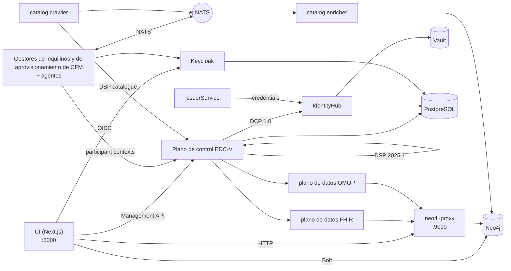

# La pila y el entorno de desarrollo

Cómo se llama cada parte del hub, qué hace y cómo encajan las partes,
seguido de cómo ejecutarlas en un portátil. Las decisiones detrás de cada
parte están en los ADR enlazados desde su fila; el registro completo de gotchas es
[`docs/gotchas.md`](../gotchas.md).

## Glosario

### Protocolos

| Término           | Qué es                                                                                                                                                                                                                                                                                                 | Decisión                                                                |
| ----------------- | ------------------------------------------------------------------------------------------------------------------------------------------------------------------------------------------------------------------------------------------------------------------------------------------------------ | ----------------------------------------------------------------------- |
| **DSP 2025-1**    | El Eclipse Dataspace Protocol, versión 2025-1: cómo dos conectores intercambian un catálogo (DCAT), negocian un contrato sobre una oferta ODRL y ejecutan una transferencia. El plano de control lo habla bajo `/api/dsp/<participant>/2025-1/`.                                                       | [ADR-007](../ADRs/ADR-007-did-web-dsp-negotiation.md)                   |
| **DCP 1.0**       | El Decentralised Claims Protocol: cómo un participante demuestra quién es. Cada uno tiene un DID `did:web` y posee credenciales verificables (una `MembershipCredential`, credenciales de función del EEDS); una contraparte pide una presentación en lugar de confiar en un inicio de sesión central. | [ADR-009](../ADRs/ADR-009-issuerservice-credential-fix.md)              |
| **ODRL 2.2**      | El lenguaje de políticas de una oferta: quién puede usar un conjunto de datos, con qué finalidad y en virtud de qué permiso.                                                                                                                                                                           | [ADR-013](../ADRs/ADR-013-simpl-open-alignment.md)                      |
| **HealthDCAT-AP** | El vocabulario de catálogo para conjuntos de datos de salud, Release 8 desde #700.                                                                                                                                                                                                                     | [ADR-063](../ADRs/ADR-063-healthdcat-ap-release-8-and-its-namespace.md) |
| **did:web**       | Un DID que se resuelve por HTTPS. Coexisten dos formas, una estable en el grafo y la UI y una resoluble en la capa EDC; [`api-conventions.md`](https://github.com/ma3u/MinimumViableHealthDataspacev2/blob/main/.claude/rules/api-conventions.md) explica cuál va dónde.                               | [ADR-007](../ADRs/ADR-007-did-web-dsp-negotiation.md)                   |

### El conector: EDC-V

| Término              | Qué es                                                                                                                                                                                                                                                                                                                                                     | Decisión                                                                                                                                |
| -------------------- | ---------------------------------------------------------------------------------------------------------------------------------------------------------------------------------------------------------------------------------------------------------------------------------------------------------------------------------------------------------- | --------------------------------------------------------------------------------------------------------------------------------------- |
| **EDC-V**            | Eclipse Dataspace Components, virtual: un único runtime EDC multiinquilino en el que cada participante es un _contexto de participante_ en lugar de su propio conector. El hub ejecuta EDC 0.18 a partir de las imágenes de JAD.                                                                                                                           | [ADR-024](../ADRs/ADR-024-full-edc-provisioning-per-participant.md), [ADR-055](../ADRs/ADR-055-azure-runs-the-compose-jad-build.md)     |
| **Plano de control** | El runtime EDC-V que guarda los activos, las políticas y las definiciones de contrato, negocia contratos por DSP e inicia transferencias. Management API en `:11003`.                                                                                                                                                                                      | [ADR-002](../ADRs/ADR-002-edc-data-plane-architecture.md)                                                                               |
| **Planos de datos**  | Dos, uno por tipo de transferencia: `dataplane-fhir` envía FHIR R4 (`:11002`), `dataplane-omop` sirve OMOP CDM por extracción (`:11012`). Mueven los datos que acordó el plano de control y comprueban el token EDR de cada petición.                                                                                                                      | [ADR-002](../ADRs/ADR-002-edc-data-plane-architecture.md)                                                                               |
| **IdentityHub**      | La cartera DCP de cada participante: su documento DID, sus claves (en Vault) y las credenciales que posee; responde a las peticiones de presentación. `:11005`.                                                                                                                                                                                            | [ADR-009](../ADRs/ADR-009-issuerservice-credential-fix.md)                                                                              |
| **IssuerService**    | El emisor de credenciales del hub: guarda las definiciones de credenciales y emite credenciales a los titulares por DCP. `:10013`. Una segunda instancia, `simpl-ga-issuer` (`:10023`), hace de autoridad de gobernanza de Simpl; `rogue-issuer` (`:10033`) no figura en ninguna lista de confianza y solo se inicia para las comprobaciones de identidad. | [ADR-009](../ADRs/ADR-009-issuerservice-credential-fix.md), [ADR-064](../ADRs/ADR-064-simpl-open-through-the-outside-agent-dcp-path.md) |
| **Siglet**           | Firma los tokens de los planos de datos de EDC 0.18 (Eclipse Dataplane Core).                                                                                                                                                                                                                                                                              | [ADR-055](../ADRs/ADR-055-azure-runs-the-compose-jad-build.md)                                                                          |

### Cómo se ejecuta: JAD y CFM

| Término        | Qué es                                                                                                                                                                                                                                                                                                                                                                                                               | Decisión                                                                                                                            |
| -------------- | -------------------------------------------------------------------------------------------------------------------------------------------------------------------------------------------------------------------------------------------------------------------------------------------------------------------------------------------------------------------------------------------------------------------- | ----------------------------------------------------------------------------------------------------------------------------------- |
| **JAD**        | El Joint Architecture Demo: el despliegue de referencia de EDC-V (imágenes `ghcr.io/metaform/jad/*`, fijadas por commit). Aquí es `docker-compose.jad.yml` más las cargas y la configuración de `jad/`, superpuesto a `docker-compose.yml`. Azure ejecuta la misma compilación.                                                                                                                                      | [ADR-005](../ADRs/ADR-005-jad-cfm-source-builds.md), [ADR-055](../ADRs/ADR-055-azure-runs-the-compose-jad-build.md)                 |
| **CFM**        | El Connector Fabric Manager, el plano de gestión por encima de EDC-V: el **tenant manager** (`:11006`) crea un inquilino por organización, el **provision manager** (`:11007`) aprovisiona lo que necesita, y cuatro **agentes** hacen el trabajo (cliente de Keycloak, contexto de participante de EDC-V, registro, incorporación). `cfm-cp-shim` conecta los agentes fijados con la versión de la API de EDC 0.18. | [ADR-005](../ADRs/ADR-005-jad-cfm-source-builds.md)                                                                                 |
| **Vault**      | HashiCorp Vault guarda las claves privadas de cada participante y los secretos de EDC. Respaldado en archivo en local desde el 2026-09-26 (`jad/vault.hcl`, con un sidecar `vault-unseal`), en el Flexible Server en Azure. Nunca `-dev`: un reinicio se llevaría todas las claves.                                                                                                                                  | [ADR-046](../ADRs/ADR-046-vault-keeps-its-state-on-the-flexible-server.md), [ADR-047](../ADRs/ADR-047-vault-stays-up-off-hours.md)  |
| **Keycloak**   | Inicio de sesión OIDC para la UI y los clientes de servicio, realm `edcv`, `:8080`. El cliente de la UI es confidencial con PKCE S256.                                                                                                                                                                                                                                                                               | [ADR-025](../ADRs/ADR-025-keycloak-custom-domain.md)                                                                                |
| **PostgreSQL** | El almacén en tiempo de ejecución de los servicios EDC y de Keycloak, una base de datos cada uno (`jad/init-postgres.sql`). El Flexible Server en Azure.                                                                                                                                                                                                                                                             | [ADR-001](../ADRs/ADR-001-postgresql-neo4j-split.md), [ADR-041](../ADRs/ADR-041-managed-postgres-on-azure-containerised-locally.md) |
| **NATS**       | La malla de eventos (JetStream) entre los gestores y agentes de CFM, y entre el crawler y el enricher del catálogo. `:4222`.                                                                                                                                                                                                                                                                                         | [ADR-020](../ADRs/ADR-020-cross-participant-dataset-discovery.md)                                                                   |
| **Traefik**    | La pasarela delante de los servicios de JAD, `:80`, panel en `:8090`.                                                                                                                                                                                                                                                                                                                                                |                                                                                                                                     |

### Los servicios propios del hub

| Término              | Qué es                                                                                                                                                                                                                                   | Decisión                                                                                                                        |
| -------------------- | ---------------------------------------------------------------------------------------------------------------------------------------------------------------------------------------------------------------------------------------- | ------------------------------------------------------------------------------------------------------------------------------- |
| **UI**               | La app Next.js de `ui/`: las páginas de cada perfil y las rutas `/api/*` que las respaldan. Contenedor `health-dataspace-ui`.                                                                                                            | [ADR-004](../ADRs/ADR-004-nextjs-unified-frontend.md), [ADR-044](../ADRs/ADR-044-every-api-route-needs-a-session.md)            |
| **Neo4j**            | El grafo de conocimiento de cinco capas: mercado (DSP), HealthDCAT-AP, FHIR R4, OMOP CDM y ontologías. `:7474` navegador, `:7687` Bolt.                                                                                                  | [ADR-001](../ADRs/ADR-001-postgresql-neo4j-split.md), [ADR-030](../ADRs/ADR-030-neo4j-2025-lts-migration.md)                    |
| **neo4j-proxy**      | `services/neo4j-proxy/`, Express en `:9090`: los endpoints FHIR y OMOP a los que llaman los planos de datos, el motor de consultas en lenguaje natural, la consulta federada y el catálogo en HealthDCAT-AP.                             | [ADR-043](../ADRs/ADR-043-graph-access-direct-or-through-the-proxy.md)                                                          |
| **Catalog crawler**  | `services/catalog-crawler/`, Python: obtiene el catálogo DSP de cada participante cada cinco minutos y lo publica en NATS (`dataspace.catalog.raw`).                                                                                     | [ADR-020](../ADRs/ADR-020-cross-participant-dataset-discovery.md)                                                               |
| **Catalog enricher** | `services/catalog-enricher/`, Python: lee esos catálogos de NATS, los transforma a HealthDCAT-AP y los fusiona en Neo4j como nodos `:HealthDataset`, de modo que una pregunta sobre conjuntos de datos alcanza los de cada participante. | [ADR-020](../ADRs/ADR-020-cross-participant-dataset-discovery.md), [ADR-003](../ADRs/ADR-003-healthdcat-ap-alignment.md)        |
| **Klarbefund**       | La app de iPhone de `clients/ios/`: escanea un informe de laboratorio en el dispositivo y se conecta al hub como la historia clínica electrónica del paciente.                                                                           | [ADR-033](../ADRs/ADR-033-lab-report-extraction-pipeline.md), [ADR-049](../ADRs/ADR-049-klarbefund-connects-by-device-grant.md) |

### Cómo encajan



CFM crea un participante una sola vez: el tenant manager crea el inquilino,
los agentes le dan un cliente de Keycloak, un contexto de participante en EDC-V y un DID
en el IdentityHub, y el IssuerService emite sus credenciales. A partir de ahí,
el plano de control negocia en su nombre por DSP, demostrando quién es por
DCP, y un plano de datos mueve los datos desde el proxy de Neo4j una vez que existe un contrato.
La UI lee el grafo directamente para sus páginas y pasa por el
plano de control para todo lo que sea un intercambio.

## Entorno de desarrollo

### Requisitos previos

| Necesita                              | Para                                                                                                  |
| ------------------------------------- | ----------------------------------------------------------------------------------------------------- |
| Node.js 20 o posterior, npm           | la UI y el proxy de Neo4j                                                                             |
| Docker con Compose v2                 | Neo4j y la pila JAD completa; asigne a Docker **8 GB de memoria** para JAD                            |
| Python 3.11 o posterior               | las comprobaciones del repositorio (`scripts/*.py`) y los servicios de catálogo                       |
| `pre-commit`                          | los hooks: `pip install pre-commit && pre-commit install --hook-type pre-commit --hook-type pre-push` |
| gitleaks, semgrep, actionlint, lychee | opcionales en local (cada hook avisa y se omite sin ellos); el PR Gate ejecuta lo que importa         |
| Xcode 27 y `xcodegen`                 | solo para la app de iPhone (SDK de iOS 26)                                                            |

### Dos formas de ejecutarlo

| Pila             | Inicio                                                                                                                             | Qué obtiene                                                                                                                                   |
| ---------------- | ---------------------------------------------------------------------------------------------------------------------------------- | --------------------------------------------------------------------------------------------------------------------------------------------- |
| **Mínima**       | `docker compose up -d neo4j`, cargar el esquema y los datos, `cd ui && npm install && npm run dev`                                 | el grafo y cada página que lo lee, en http://localhost:3000; sin Keycloak, por lo que el inicio de sesión necesita el modo de perfil estático |
| **JAD completa** | `docker compose -f docker-compose.yml -f docker-compose.jad.yml up -d`, después `./scripts/bootstrap-jad.sh` y `./jad/seed-all.sh` | todos los servicios del glosario, el contenedor de la UI en http://localhost:3003, inicio de sesión mediante Keycloak                         |

Carga del grafo para la pila mínima (ambos archivos son idempotentes):

```bash
cat neo4j/init-schema.cypher | docker exec -i health-dataspace-neo4j \
  cypher-shell -u neo4j -p healthdataspace
cat neo4j/insert-synthetic-schema-data.cypher | docker exec -i health-dataspace-neo4j \
  cypher-shell -u neo4j -p healthdataspace
```

`docker compose up -d` sin nombre de servicio también compila la UI como el
contenedor `health-dataspace-ui` en `:3000` y `:3003`; inicie solo `neo4j`
cuando quiera `npm run dev` en `:3000`.

### Las fases de carga, en orden

`./jad/seed-all.sh` ejecuta siete fases, y cada una necesita la anterior, de modo que una
fase fallida invalida todas las siguientes. Reanude con `--from N`, ejecute una sola con
`--only N`.

| Fase | Script                         | Hace                                                         |
| ---: | ------------------------------ | ------------------------------------------------------------ |
|    1 | `seed-health-tenants.sh`       | cinco inquilinos participantes mediante CFM                  |
|    2 | `seed-ehds-credentials.sh`     | los tipos de credenciales del EEDS en el IssuerService       |
|    3 | `seed-ehds-policies.sh`        | políticas ODRL para cada participante                        |
|    4 | `seed-data-assets.sh`          | activos de datos y definiciones de contrato en EDC-V         |
|    5 | `seed-contract-negotiation.sh` | negociaciones de PharmaCo con AlphaKlinik y planos de datos  |
|    6 | `seed-federated-catalog.sh`    | negociación de catálogo de MedReg con Limburg Medical Centre |
|    7 | `seed-data-transfer.sh`        | tokens EDR y transferencias a través de los planos de datos  |

El runbook es [Carga de la pila JAD](../knowledge/runbooks/jad-stack-seeding.md).

### Puertos

| Puerto     | Servicio                           | Puerto       | Servicio                                             |
| ---------- | ---------------------------------- | ------------ | ---------------------------------------------------- |
| 3000       | UI (`npm run dev` o el contenedor) | 11002        | plano de datos FHIR                                  |
| 3003       | contenedor de la UI (JAD)          | 11003        | plano de control, Management API                     |
| 7474, 7687 | navegador de Neo4j, Bolt           | 11005        | IdentityHub                                          |
| 8080, 9000 | Keycloak, su puerto de gestión     | 11006, 11007 | gestores de inquilinos y de aprovisionamiento de CFM |
| 8200       | Vault                              | 11012        | plano de datos OMOP                                  |
| 9090       | neo4j-proxy                        | 10013        | IssuerService                                        |
| 4222, 8222 | NATS, su monitorización            | 10023, 10033 | emisor Simpl GA, emisor no fiable (rogue issuer)     |
| 5432       | PostgreSQL                         | 80, 8090     | Traefik, su panel                                    |

### Variables de entorno

La UI lee su configuración del entorno; `ui/.env.example` y
`ui/.env.local.example` son las plantillas que debe copiar. Las primeras que encontrará:

| Variable                                                                                                          | Qué establece                                                                   |
| ----------------------------------------------------------------------------------------------------------------- | ------------------------------------------------------------------------------- |
| `NEO4J_URI`, `NEO4J_USER`, `NEO4J_PASSWORD`                                                                       | el grafo; `neo4j` / `healthdataspace` es solo para desarrollo local             |
| `NEO4J_PROXY_URL`                                                                                                 | el proxy, `http://localhost:9090` por defecto (`ui/src/lib/proxy.ts`)           |
| `NEXTAUTH_URL`, `NEXTAUTH_SECRET`                                                                                 | NextAuth; el secreto también firma las sesiones que forjan las pruebas de API   |
| `KEYCLOAK_PUBLIC_URL`, `KEYCLOAK_INTERNAL_URL`, `KEYCLOAK_ISSUER`, `KEYCLOAK_CLIENT_ID`, `KEYCLOAK_CLIENT_SECRET` | el inicio de sesión; nunca `wellKnown` (gotcha 5 de `CLAUDE.md`)                |
| `EDC_MANAGEMENT_URL`, `EDC_IDENTITY_URL`, `EDC_ISSUER_URL`, `EDC_TENANT_URL`, `EDC_PROVISION_URL`                 | los servicios de EDC-V y CFM                                                    |
| `NEXT_PUBLIC_STATIC_EXPORT=true`                                                                                  | la compilación de GitHub Pages: sin rutas de API, fixtures de `ui/public/mock/` |

### La app de iPhone

`clients/ios/` es un paquete Swift y un proyecto XcodeGen; no necesita
el hub para compilarse ni para ejecutar sus pruebas.

```bash
cd clients/ios
brew install xcodegen      # once
swift test                 # the parser and provenance model
xcodegen generate && open MeinBefund.xcodeproj
```

La compilación para el simulador necesita una firma ad hoc (`CODE_SIGN_IDENTITY="-"`) o
falla cada llamada al Llavero. Una compilación para dispositivo y una subida a TestFlight necesitan un
equipo de Apple Developer: `Scripts/install-device.sh`, `Scripts/archive-and-upload.sh`.
La [guía para desarrolladores de Klarbefund](../klarbefund/developer-guide.md) contiene el
resto, y `Scripts/run-ui-tests.sh` ejecuta las pruebas en pantalla.

### Gotchas que conviene conocer el primer día

El registro completo, con fechas, es [`docs/gotchas.md`](../gotchas.md). Los que más
tiempo han costado:

- **Vault debe conservar su estado.** Si el IdentityHub registra `Private key ... not found`, compruebe que `health-dataspace-vault-unseal` ha informado `ready`.
- **Las fases de carga siguen un orden estricto**; reanude una ejecución fallida con `--from`.
- **La exportación estática no tiene rutas de API.** Cada página que lee `/api/...`
  necesita un fixture en `ui/public/mock/`, y una prueba falla si no lo tiene.
- **Pre-commit reescribe archivos** (Prettier, los docs facts). Vuelva a prepararlos
  y vuelva a hacer commit; compruebe que `HEAD` se ha movido.
- **Un 200 del descubrimiento de Keycloak no prueba nada**: está en caché. Demuestre que el inicio de sesión funciona
  con `scripts/azure/check-keycloak-health.sh`.
- **Container Apps almacena en caché `:latest`**; un despliegue publica una nueva revisión en lugar
  de reiniciar.
