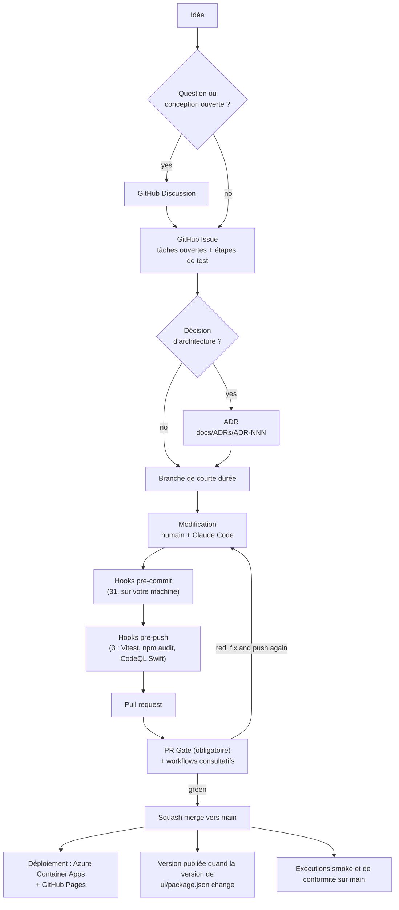

# Cycle de vie du développement logiciel (SDLC)

- **Projet :** Minimum Viable Health Dataspace v2 (implémentation de référence de l’EEDS)
- **Public :** contributeurs, relecteurs et toute personne qui veut savoir comment un
  projet mené par une seule personne, assistée par l’IA, garde livrable une base de code d’un domaine réglementé.
- **Dernière mise à jour :** 2026-11-03
- **Mainteneur :** Matthias (`@ma3u`)

Comment une modification passe d’une idée au hub en production : tickets et discussions,
branches et pull requests, les hooks sur votre machine, les contrôles sur GitHub,
les déploiements, les versions publiées, et la manière de contribuer de l’extérieur. La
version en langage courant est [Comment nous construisons ce logiciel](./SDLC-explained.md) ;
la place de l’auteur IA est décrite dans [Développement agentique déterministe avec Claude
Code](./AGENTIC-DEVELOPMENT-WITH-CLAUDE-CODE.md). Deux pages complémentaires vont
plus loin : [Tests d’intégration par les API](developer/api-integration-tests.md)
et [La pile et l’environnement de développement](developer/stack-and-environment.md).
La section 12 est la recette qui sous-tend l’ensemble : comment définir un SDLC pour un
projet DevSecOps et IA, étape par étape, avec les outils.

<details>
<summary><b>Acronymes utilisés dans ce document</b></summary>

| Acronyme            | Développement                                                                                           |
| ------------------- | ------------------------------------------------------------------------------------------------------- |
| **CI/CD**           | Continuous Integration / Continuous Delivery : la construction, les tests et le déploiement automatisés |
| **PR**              | Pull Request : une modification proposée, contrôlée et relue avant d’être fusionnée                     |
| **ADR**             | Architecture Decision Record : une note courte consignant une décision et ses raisons                   |
| **OIDC**            | OpenID Connect ; ici, la connexion fédérée de GitHub Actions à Azure                                    |
| **SBOM**            | Software Bill of Materials : la liste de chaque composant tiers                                         |
| **CVE**             | Common Vulnerabilities and Exposures : le catalogue public des failles connues                          |
| **SARIF**           | Static Analysis Results Interchange Format : la manière dont les scanners rendent compte à GitHub       |
| **DSP / DCP / TCK** | Dataspace Protocol / Decentralised Claims Protocol / Technology Compatibility Kit                       |
| **ACA**             | Azure Container Apps, où tourne le hub en production                                                    |

</details>

---

## 1. Philosophie : un outillage déterministe autour d’un auteur non déterministe

> **L’auteur propose ; l’outillage déterministe dispose.**

Un ingénieur expérimenté, un nouveau venu et un agent IA sont tous non déterministes : posez
deux fois la même question et vous obtiendrez peut-être deux réponses. Le résultat devient
digne de confiance quand l’auteur est entouré de contrôles qui s’exécutent de la même manière à chaque
fois, pour tout le monde : formateurs, linters, vérifications de types, tests, scanners de sécurité
et un pipeline CI/CD.

Le projet est une équipe d’une personne plus un binôme de programmation IA. Il conserve donc chaque
contrôle déterministe qu’aurait une grande équipe et réduit les cérémonies de coordination
(relecture humaine obligatoire, rituels de sprint, comités de publication) qui ne
sont rentables qu’avec davantage de personnes. La section 11 indique ce qui est réduit et pourquoi.

Cela compte davantage ici que dans la plupart des projets. Il s’agit d’une implémentation
de référence de l’espace européen des données de santé, un domaine réglementé comportant des
données de santé, des droits des patients et des obligations d’audit. Les contrôles apportent la confiance (des
catégories entières d’erreurs sont détectées avant la livraison), l’auditabilité (chaque modification
est journalisée avec son auteur, son heure et sa raison), la répétabilité, des erreurs peu coûteuses (un
hook local coûte des secondes, un incident en production des heures) et une assistance IA sûre.

---

## 2. Le cycle de vie en un coup d’œil



1. **Idée.** Une question ouverte ou une conception à explorer commence par une Discussion ;
   un travail à faire commence par un ticket (section 3).
2. **ADR** quand la décision est coûteuse à annuler ou transversale.
3. **Branche** à partir de `main`, de courte durée.
4. **Modification**, par un humain, par Claude Code ou par les deux.
5. **Hooks** sur votre machine : 31 au commit, 3 au push (section 5).
6. **Pull request.** Le **PR Gate** est le seul contrôle obligatoire ; les autres
   workflows sont consultatifs (section 6).
7. **Squash merge** une fois le PR Gate au vert et chaque fil de relecture
   résolu.
8. **Sur `main` :** le hub en production et la démo statique sont redéployés, les exécutions smoke et de
   conformité démarrent, et une version est publiée quand le numéro de version a changé
   (sections 7 et 8).

---

## 3. Discussions, tickets et le dossier de planification

### Discussion ou ticket ?

Les [Discussions](https://github.com/ma3u/MinimumViableHealthDataspacev2/discussions)
sont activées, avec les catégories Announcements, General, Ideas, Polls, Q&A et
Show and tell.

| Ouvrez une **Discussion** quand                                                                                                                                                                                                          | Ouvrez un **ticket** quand                                                                                                  |
| ---------------------------------------------------------------------------------------------------------------------------------------------------------------------------------------------------------------------------------------- | --------------------------------------------------------------------------------------------------------------------------- |
| vous avez une question (« comment le hub mappe-t-il X ? »), voulez comparer des options ou proposer une orientation qui n’est pas encore une tâche (Ideas ; exemples récents : #776 sur l’outillage FHIR et OMOP et #701 sur Simpl-Open) | il y a quelque chose à faire : un bogue, une fonctionnalité au résultat clair, un manque assorti d’un critère d’acceptation |
| la réponse peut être « non » ou « pas maintenant »                                                                                                                                                                                       | quelqu’un le fermera par un commit ou une PR                                                                                |
| plusieurs personnes doivent donner leur avis avant toute décision                                                                                                                                                                        | la décision est prise, ou un ADR la prendra                                                                                 |

Une discussion qui aboutit à une décision devient un ticket (et un ADR quand la
décision relève de l’architecture), avec des liens dans les deux sens.

### Ce que contient un ticket

Utilisez les modèles de [`.github/ISSUE_TEMPLATE/`](https://github.com/ma3u/MinimumViableHealthDataspacev2/tree/main/.github/ISSUE_TEMPLATE)
(rapport de bogue, demande de fonctionnalité). Chaque ticket en cours de traitement contient :

- **Les tâches ouvertes** sous forme de liste de cases à cocher, tenue à jour. Quand une PR laisse du travail
  inachevé, le ticket indique ce qui reste ; rien d’ouvert ne vit seulement dans une conversation ou un
  message de commit.
- **Les étapes de test manuel** avec des liens (vers la documentation statique, une page du hub, une
  exécution de workflow), pour que chacun puisse vérifier le résultat sans avoir à demander.
- **Les décisions**, chacune liée à son ADR.

Étiquettes utilisées : `bug`, `enhancement`, `documentation`, `question`, `security`,
`infrastructure`, `azure`, `dependencies`, les priorités `P1` à `P3`, et les
étiquettes de domaine `EHDS-compliance`, `dataspace-discovery`, `simpl`, `NLP`,
`Agentic AI`, `production`, `load test`, `stress test`, `pentest`, `trivy`,
`Cost`. Les nouveaux contributeurs cherchent `good first issue` et `help wanted`.

### Le dossier de planification

[`docs/planning/index.md`](./planning/index.md) liste les éléments de travail sous forme de fichiers qui
passent de `future/ → current/ → done/` et ne sont jamais supprimés. Un fichier dans `current/`
est la forme longue d’un ticket (ses phases, ses mesures, ses liens) ; le ticket
reste l’endroit de la liste de tâches. Le détail de la feuille de route se trouve dans
`docs/planning/roadmap-phases-*.md`, et les tableaux des tickets et des ADR dans
[`docs/planning-health-dataspace-v2.md`](./planning-health-dataspace-v2.md).
`/plan` dans Claude Code entretient le dossier.

Gardez tout document chargé régulièrement sous environ 15K jetons
([ADR-026](./ADRs/ADR-026-token-efficient-planning-structure.md)) : l’index
reste petit et le détail part dans les archives.

### ADR

`docs/ADRs/` contient les ADR à partir de l’ADR-001 (le 051 est réservé). Les nouveaux suivent le
modèle de Nygard de `docs/adr/0000-template.md` ; un ADR accepté n’est jamais
modifié, seulement remplacé. Rédigez-en un quand une décision est coûteuse à annuler ou
transversale : la séparation des bases de données ([ADR-001](./ADRs/ADR-001-postgresql-neo4j-split.md)),
la stratégie de test ([ADR-008](./ADRs/ADR-008-testing-strategy.md)), des contrôles
qui doivent pouvoir échouer ([ADR-031](./ADRs/ADR-031-checks-must-assert.md)),
chaque route d’API exigeant une session ([ADR-044](./ADRs/ADR-044-every-api-route-needs-a-session.md)).

---

## 4. Branches, commits et pull requests

- **Développement sur le tronc.** `main` est toujours déployable. Le travail se fait sur des
  branches de courte durée nommées `type/short-slug` (`feat/…`, `fix/…`, `docs/…`, `chore/…`,
  `ci/…`), souvent avec le numéro du ticket : `fix/708-ui-sticky-sessions`.
- **[Conventional Commits](https://www.conventionalcommits.org/)** avec une
  portée : `feat(spe): workspaces start on demand (ADR-072)`. Les 40 derniers
  commits sur `main` le suivent tous ; aucun hook ne l’impose encore.
- **Les commits portent le nom de l’auteur.** Aucune mention de co-auteur IA n’est ajoutée ; la manière
  dont l’IA travaille dans ce projet est documentée dans le document complémentaire.
- **Une PR renvoie à son ticket et à ses ADR** et indique comment elle a été testée ; le
  [modèle de PR](https://github.com/ma3u/MinimumViableHealthDataspacev2/blob/main/.github/pull_request_template.md)
  demande les deux. [`CODEOWNERS`](https://github.com/ma3u/MinimumViableHealthDataspacev2/blob/main/.github/CODEOWNERS)
  désigne le mainteneur, si bien qu’une PR de toute autre personne reçoit une demande de relecture.
- **Squash merge.** Le titre de la PR devient le commit sur `main`, il suit donc
  aussi la convention de commit.

### 4.1 Protection de la branche `main`

Un ruleset du dépôt sur la branche par défaut :

| Règle                                          | Effet                                                                                                                                       |
| ---------------------------------------------- | ------------------------------------------------------------------------------------------------------------------------------------------- |
| **Exiger une pull request**                    | Aucun push direct vers `main`. Zéro approbation exigée (voir ci-dessous).                                                                   |
| **Exiger la résolution des conversations**     | Chaque fil de relecture est résolu avant la fusion, de sorte que les remarques de relecture reçoivent une réponse au lieu d’être survolées. |
| **Exiger des contrôles de statut**             | Le **PR Gate** doit être au vert. C’est le seul contrôle obligatoire.                                                                       |
| **Exiger un historique linéaire**              | Squash ou rebase uniquement ; les commits de fusion sont désactivés.                                                                        |
| **Bloquer les force push et les suppressions** | `main` ne peut être ni réécrite ni supprimée.                                                                                               |

**Zéro approbation exigée est un choix délibéré.** Avec un seul mainteneur, une
approbation exigée signifie un second compte et un tampon de complaisance. La relecture est faite par les
relecteurs IA et les contrôles ; les protections mécaniques (pas de push direct, pas de force
push, pas de fusion au rouge) sont la partie qu’un mainteneur seul ne peut pas garantir par
la discipline, elles sont donc imposées. Quand un deuxième contributeur régulier arrivera,
on passera à une approbation.

**Les administrateurs ne peuvent passer outre que sur une pull request.** Un contrôle bloqué peut être forcé
sur une PR, ce qui vaut mieux que de ne pas pouvoir livrer un correctif urgent sur une démo en production ; un
push direct vers `main` est refusé pour tout le monde.

### 4.2 Pourquoi exactement un contrôle obligatoire

Tous les autres workflows sont filtrés par chemin, ce qui est juste pour le coût et faux pour
la protection de branche : un contrôle obligatoire qui ne démarre jamais reste en attente, et la
PR ne peut jamais être fusionnée (#303 a recueilli 28 contrôles, #305 aucun). Ainsi
[`pr-gate.yml`](https://github.com/ma3u/MinimumViableHealthDataspacev2/blob/main/.github/workflows/pr-gate.yml)
n’a pas de filtre de chemin et est le seul contrôle obligatoire. La section 6.1 liste ce qu’il
exécute.

---

## 5. Les hooks sur votre machine

[`.pre-commit-config.yaml`](https://github.com/ma3u/MinimumViableHealthDataspacev2/blob/main/.pre-commit-config.yaml),
exécuté par le [framework pre-commit](https://pre-commit.com/). Installez les deux
étapes une fois par clone (depuis #847, un simple `pre-commit install` fait de même,
via `default_install_hook_types`) :

```bash
pip install pre-commit
pre-commit install --hook-type pre-commit --hook-type pre-push
pre-commit run --all-files     # optional: everything, once
```

La plupart des hooks sont limités par motif de fichier, si bien qu’un commit qui ne touche que la documentation ignore
ceux pour TypeScript. Les hooks qui ont besoin d’un outil que vous n’avez pas installé (gitleaks,
Semgrep, lychee, actionlint) affichent un avertissement et réussissent ; le PR Gate installe
gitleaks et actionlint et les exécute quand même. Ignorez un hook une fois avec
`SKIP=<id> git commit`, jamais l’ensemble avec `--no-verify` : le PR Gate
exécute les mêmes hooks sur le diff de la PR, si bien qu’un contournement ne fait que déplacer l’échec.

**Les hooks qui réécrivent des fichiers** (Prettier, les correcteurs d’espaces, `docs-facts`)
font échouer le commit après avoir modifié le fichier. Indexez à nouveau le fichier et commitez
à nouveau, puis vérifiez que `HEAD` a bougé : un commit en échec le laisse où il était.

### 5.1 Au commit : 31 hooks

| Hook (id)                                                                 | Ce qu’il fait                                                                                                                                                                                 | Quand il échoue                                                                                                                                                                                                           |
| ------------------------------------------------------------------------- | --------------------------------------------------------------------------------------------------------------------------------------------------------------------------------------------- | ------------------------------------------------------------------------------------------------------------------------------------------------------------------------------------------------------------------------- |
| `trailing-whitespace`, `end-of-file-fixer`                                | supprime les espaces en fin de ligne, termine chaque fichier par un saut de ligne (sauf les patchs et les shapes HealthDCAT-AP intégrées au dépôt)                                            | il a corrigé le fichier : indexez-le à nouveau                                                                                                                                                                            |
| `check-yaml`, `check-json`                                                | les fichiers s’analysent correctement (YAML multi-documents autorisé)                                                                                                                         | corrigez la syntaxe qu’il signale                                                                                                                                                                                         |
| `check-added-large-files`                                                 | refuse un fichier de plus de 5,000 KB                                                                                                                                                         | gardez-le hors de git, ou réduisez-le                                                                                                                                                                                     |
| `check-merge-conflict`                                                    | refuse les marqueurs `<<<<<<<` restants                                                                                                                                                       | terminez la fusion                                                                                                                                                                                                        |
| `detect-private-key`                                                      | refuse une clé privée                                                                                                                                                                         | supprimez-la ; si elle était réelle, renouvelez-la                                                                                                                                                                        |
| `check-case-conflict`, `check-symlinks`                                   | des noms qui entrent en conflit sur un disque insensible à la casse, des liens symboliques qui ne pointent nulle part                                                                         | renommez, ou corrigez le lien                                                                                                                                                                                             |
| `check-executables-have-shebangs`, `check-shebang-scripts-are-executable` | un fichier exécutable a une ligne `#!`, un fichier `#!` est exécutable                                                                                                                        | `chmod +x` (ou `-x`), et indexez ce chemin explicitement : un bit exécutable égaré sur un `.gitkeep` échoue ici                                                                                                           |
| `shellcheck`                                                              | Bash au niveau de gravité error                                                                                                                                                               | `shellcheck --severity=error <file>` et corrigez ce qu’il signale                                                                                                                                                         |
| `hadolint-docker`                                                         | bonnes pratiques pour Dockerfile                                                                                                                                                              | `hadolint <Dockerfile>`                                                                                                                                                                                                   |
| `prettier`                                                                | formate JS, TS, JSON, YAML et Markdown                                                                                                                                                        | il a réécrit le fichier : indexez-le à nouveau. Ne luttez pas contre son résultat                                                                                                                                         |
| `tsc-ui`                                                                  | `tsc --noEmit -p tsconfig.build.json` dans `ui/` (strict, tests exclus)                                                                                                                       | exécutez cette commande dans `ui/`, corrigez l’erreur de type                                                                                                                                                             |
| `eslint-ui`                                                               | `next lint --max-warnings 55` dans `ui/`                                                                                                                                                      | une erreur, ou un nouvel avertissement au-delà du budget de 55 : `cd ui && npx next lint`                                                                                                                                 |
| `gitleaks`                                                                | des secrets dans le diff indexé                                                                                                                                                               | supprimez le secret et renouvelez-le ; un faux positif avéré va dans `.gitleaksignore`                                                                                                                                    |
| `semgrep`                                                                 | Semgrep CE sur le code indexé : les règles du registre pour TypeScript, Next.js, React et les secrets, et `.semgrep/cypher.yml` (l’entrée d’une requête atteint Cypher en tant que paramètre) | corrigez, ou `// nosemgrep: <rule-id> -- <reason>` au-dessus de la ligne. Derrière un proxy qui inspecte le TLS, le téléchargement du registre échoue et le hook sort avec le code 2 : ce n’est pas un résultat d’analyse |
| `semgrep-rule-tests`                                                      | les règles Semgrep propres au projet contre `.semgrep/cypher.ts`                                                                                                                              | la règle et son test ne concordent pas                                                                                                                                                                                    |
| `check-broken-links-md`                                                   | les liens relatifs en Markdown se résolvent (lychee hors ligne, ou markdown-link-check) ; sauf les traductions sous `docs/i18n/`                                                              | corrigez le chemin                                                                                                                                                                                                        |
| `check-no-screenshot-imports`                                             | les pages de documentation sous `ui/src/app/docs/` ne font pas référence à `images/screenshots`                                                                                               | utilisez plutôt un diagramme ou une image de guide                                                                                                                                                                        |
| `api-spec-drift`                                                          | chaque route sous `ui/src/app/api/` figure dans `ui/public/openapi.yaml`, et inversement                                                                                                      | documentez l’opération dans la spécification et supprimez sa ligne de `docs/api-spec-drift-allowlist.txt` ; ajouter une ligne revient à décider de livrer une route non documentée                                        |
| `api-spec-shapes`                                                         | la spécification décrit la forme de la réponse du hub (vérifiée par rapport aux fixtures de `ui/public/mock/`)                                                                                | corrigez le schéma, ou la fixture                                                                                                                                                                                         |
| `docs-facts`                                                              | régénère `ui/src/app/docs/docs-facts.json` (routes, hooks, services, ADR, date de dernière mise à jour de chaque page de documentation)                                                       | il a réécrit le fichier : indexez-le et commitez à nouveau                                                                                                                                                                |
| `docs-content`                                                            | les copies publiées de `docs/` correspondent à leurs sources (`gen-docs-content.py --check`)                                                                                                  | `python3 scripts/gen-docs-content.py`, indexez `ui/src/content/` et `ui/public/published-docs/`                                                                                                                           |
| `localized-images`                                                        | le manifeste des captures d’écran et diagrammes traduits correspond à `ui/public`                                                                                                             | `python3 scripts/gen-localized-images.py`, indexez le manifeste                                                                                                                                                           |
| `bruno-coverage`                                                          | chaque route d’API a une requête dans `bruno/MVHDv2/`, chaque requête peut échouer, aucun identifiant dans un fichier `.bru`                                                                  | ajoutez la requête dans le dossier de la persona ; supprimez celle dont la route a disparu (voir [les tests d’API](developer/api-integration-tests.md))                                                                   |
| `bruno-strength`                                                          | une requête 2xx vérifie davantage qu’un type de conteneur                                                                                                                                     | vérifiez la valeur d’une propriété                                                                                                                                                                                        |
| `workflow-paths`                                                          | le filtre `paths` d’un workflow couvre chaque script qu’il exécute                                                                                                                            | ajoutez le chemin au filtre du workflow                                                                                                                                                                                   |
| `actionlint`                                                              | les workflows GitHub Actions                                                                                                                                                                  | corrigez le workflow qu’il signale                                                                                                                                                                                        |
| `image-scan-coverage`                                                     | l’analyse des CVE de `security-scan.yml` couvre chaque image des fichiers compose                                                                                                             | ajoutez l’image à la matrice d’analyse                                                                                                                                                                                    |

### 5.2 Au push : 4 hooks

| Hook (id)            | Ce qu’il fait                                                                                                                                                               | Quand il échoue                                                                                                                                                                                                   |
| -------------------- | --------------------------------------------------------------------------------------------------------------------------------------------------------------------------- | ----------------------------------------------------------------------------------------------------------------------------------------------------------------------------------------------------------------- |
| `vitest-ui`          | toute la suite de l’UI, `vitest run --bail 1`, quand le push modifie `ui/src` ou `ui/__tests__`                                                                             | `cd ui && npx vitest run <file>` pour le fichier en échec. Un hook qui réinitialise un mock utilise des accolades : `beforeEach(() => { m.mockReset(); })`                                                        |
| `npm-audit-ui`       | `scripts/check-npm-audit.py ui --omit=dev` : aucun avis HIGH ou CRITICAL dans les dépendances de production                                                                 | mettez à jour la dépendance ; quand aucun correctif n’existe, une entrée limitée dans le temps dans `docs/npm-audit-exceptions.json` avec une raison, un ticket et une date d’expiration                          |
| `ios-analyte-parity` | `swift run AnalyteParity` quand le code Swift partagé de l’application, la table d’analytes générée ou `Package.swift` changent (quelques secondes une fois compilé, macOS) | la table Swift résout un libellé ou une unité autrement que `analytes.ts` : régénérez-la avec `npm run generate:swift` dans `services/epa-ingest`, ou corrigez la normalisation dans `clients/ios/Sources/Shared` |
| `codeql-swift`       | CodeQL sur l’application iPhone quand les sources Swift, `Package.swift` ou `project.yml` changent (environ 15 minutes, macOS)                                              | corrigez le résultat, ou acceptez-le avec sa raison dans `clients/ios/Scripts/codeql-accepted.txt` ; `SKIP=codeql-swift git push` l’ignore une fois                                                               |

[Quality Gates](./quality-gates.md) et la
[page des contrôles qualité](https://ma3u.github.io/MinimumViableHealthDataspacev2/docs/developer/quality-gates)
présentent les chiffres de couverture et les contrôles encore à venir.

Les tests E2E, l’audit WCAG et les specs de pentest ne s’exécutent plus à chaque
push : ils tournent une fois par nuit quand `main` a changé
([ADR-074](./ADRs/ADR-074-e2e-and-compliance-suites-run-nightly-when-main-changed.md)).
Avant de fusionner une modification des pages de l’UI ou de leurs routes d’API,
exécutez-les contre la stack compose : `docker compose up -d`, puis `cd ui && npm run test:e2e`.

---

## 6. Les contrôles sur GitHub

`.github/workflows/` contient 39 workflows. Seul le **PR Gate** bloque une fusion.

### 6.1 PR Gate : le contrôle obligatoire

À chaque pull request et à chaque exécution de la file de fusion, sans filtre de chemin, environ 15 minutes au
plus :

1. les hooks pre-commit sur le diff de la PR (`pre-commit run --from-ref
origin/main --to-ref HEAD`), ce qui détecte un commit fait avec
   `--no-verify` ou depuis un clone sans les hooks ;
2. la dérive de la spécification d’API (`scripts/check-api-spec-drift.py`) ;
3. les docs facts à jour, avec la date de chaque page de documentation modifiée avancée
   (`scripts/gen-docs-facts.py --check`) ;
4. la collection d’API couvre chaque route (`scripts/check-bruno-coverage.py`) ;
5. la conformité HealthDCAT-AP Release 8 des fichiers de référence du catalogue
   (pySHACL contre les shapes officielles) ;
6. aucun fichier, export ou dépendance inutilisé (`npm run --prefix ui knip`) ;
7. gitleaks sur les commits de la PR, puisque le hook local, limité à l’index, ne voit
   rien en CI.

### 6.2 Les autres workflows

| Workflow                                      | Déclenché par                                                                                                                                        | Ce qu’il fait                                                                                                                                                                                                                                                                                                                | Bloque            |
| --------------------------------------------- | ---------------------------------------------------------------------------------------------------------------------------------------------------- | ---------------------------------------------------------------------------------------------------------------------------------------------------------------------------------------------------------------------------------------------------------------------------------------------------------------------------- | ----------------- |
| `test.yml` Test Suite                         | push vers n’importe quelle branche, PR vers `main` (chemins : `ui/`, les services, `clients/ios/`, la documentation de Klarbefund)                   | 8 jobs : Vitest pour l’UI, le proxy, le chargeur SPE et l’ingestion ePA ; tests des politiques OPA ; parité des analytes iOS (uniquement quand `clients/ios/` a changé, déterminé par un job Changed paths) ; un job de scans (Trivy, Kubescape, npm audit, SBOM, licences). Le lint et gitleaks s’exécutent dans le PR Gate | non (consultatif) |
| `codeql.yml`                                  | push et PR vers `main` sauf quand seuls `docs/`, du Markdown ou `clients/ios/` ont changé, chaque semaine                                            | CodeQL pour JavaScript/TypeScript, Python et les workflows ; résultats dans l’onglet Security                                                                                                                                                                                                                                | non               |
| `codeql-swift.yml`                            | chaque semaine, déclenchement manuel, et les PR qui modifient le workflow ou son script                                                              | CodeQL pour l’application iPhone ; les modifications de l’application sont contrôlées par le hook pre-push `codeql-swift`                                                                                                                                                                                                    | non               |
| `security-scan.yml`                           | PR, chaque semaine, déclenchement manuel                                                                                                             | SBOM et CVE des sources, CVE des images, CVE des images déployées, un seuil de gravité ; une PR lit la base Trivy que `main` a enregistrée et n’en enregistre aucune                                                                                                                                                         | non               |
| `bruno-smoke.yml`                             | PR et `main` quand la collection ou `ui/src/app/api/` changent                                                                                       | la collection d’API contre les fixtures statiques (Static-mock)                                                                                                                                                                                                                                                              | non               |
| `python-services-test.yml`                    | PR, push vers `main`                                                                                                                                 | pytest pour les services Python                                                                                                                                                                                                                                                                                              | non               |
| `compliance.yml`                              | appelé par `nightly.yml`, déclenchement manuel                                                                                                       | les contrôles DSP, DCP et du domaine EEDS et la collection d’API complète contre une pile JAD neuve ; le job de rapport échoue sous le plancher enregistré                                                                                                                                                                   | non (chaque nuit) |
| `nightly.yml`                                 | une fois par nuit quand `main` a changé, déclenchement manuel ([ADR-074](./ADRs/ADR-074-e2e-and-compliance-suites-run-nightly-when-main-changed.md)) | Playwright E2E avec les contrôles WCAG et OWASP/BSI contre un Neo4j amorcé (les rapports vont sur le site Pages), Lighthouse, gitleaks sur tout l’historique, `compliance.yml` ; une nuit rouge ouvre un ticket, une nuit verte le ferme                                                                                     | non               |
| `deploy-azure.yml`                            | chaque push vers `main`, déclenchement manuel                                                                                                        | construit les images de l’UI et du proxy, les déploie sur Azure Container Apps, vérifie que la connexion fonctionne, puis exécute Playwright contre le hub en production                                                                                                                                                     | `main` uniquement |
| `pages.yml`                                   | chaque push vers `main`, déclenchement manuel                                                                                                        | construit l’export statique avec les derniers rapports de test nocturnes et le publie sur GitHub Pages (6.4)                                                                                                                                                                                                                 | `main` uniquement |
| `release.yml`                                 | push vers `main` modifiant `ui/package.json`, déclenchement manuel                                                                                   | pose une étiquette et publie une GitHub Release (section 8)                                                                                                                                                                                                                                                                  | `main` uniquement |
| `demo-smoke.yml`                              | chaque jour à 06:00 UTC (démarre avec des heures de retard), déclenchement manuel                                                                    | vérifie que le hub en production répond, exécute contre lui la collection d’API (Azure-Dev), Playwright sur les routes publiques, une base ZAP, puis supprime ce que la collection a créé                                                                                                                                    | `main` uniquement |
| `catalog-crawler.yml`, `catalog-enricher.yml` | push vers `main` modifiant le service                                                                                                                | teste et déploie les services de catalogue                                                                                                                                                                                                                                                                                   | `main` uniquement |
| `cache-cleanup.yml`                           | chaque jour, déclenchement manuel                                                                                                                    | supprime les caches Actions que plus rien ne restaure : ceux des PR fermées et tous sauf l’entrée la plus récente de CodeQL, Next.js, Playwright et Trivy (`scripts/prune-actions-caches.py`, #847)                                                                                                                          | n/a               |
| `aca-schedule.yml`                            | deux fois par jour, déclenchement manuel                                                                                                             | solution de repli pour l’arrêt et le redémarrage hors des heures ouvrées ([ADR-053](./ADRs/ADR-053-everything-stops-off-hours.md), [ADR-058](./ADRs/ADR-058-azure-triggers-the-off-hours-schedule.md))                                                                                                                       | sans objet        |

Les 22 restants sont des **workflows d’exploitation lancés à la main** (`workflow_dispatch`)
contre Azure : amorçage de Neo4j, des participants EDC, des data assets et de CFM ; l’amorçage de
Vault ; le chargeur FHIR ; GraphRAG ; le vérificateur EUDI ; le domaine
Keycloak ; les garde-fous de coût ; des réparations et des retraits ponctuels, chacun nommé d’après son
ticket ou son ADR. Ils suivent la même règle que tout le reste : une modification
d’environnement est un workflow versionné et réexécutable, pas un clic dans le portail. Ceux
qui suppriment ou réécrivent ont un mode `plan` qui ne fait que lire.

### 6.3 Conformité aux protocoles

`compliance.yml` lance la pile JAD à l’intérieur du job, l’amorce et exécute
les contrôles DSP, DCP et du domaine EEDS ainsi que la collection d’API. Chaque étape de suite
peut échouer sans arrêter le job ; le job **Compliance Report** compare ensuite
chaque résultat à son plancher dans `scripts/compliance-baseline.json` et échoue en cas de
régression. Il se fonde sur une référence enregistrée, pas sur le vert, si bien qu’une suite qui
ne réussit pas encore ne peut tout de même pas se dégrader. Les suites sont les nôtres et pilotent nos
API ; ce ne sont pas les TCK Eclipse et elles ne prouvent pas la conformité (#338).
Les chiffres actuels et la manière de les exécuter se trouvent dans
[Tests d’intégration par les API](developer/api-integration-tests.md).

### 6.4 GitHub Pages : la démo statique

`pages.yml` construit la démo publique sur
[ma3u.github.io/MinimumViableHealthDataspacev2](https://ma3u.github.io/MinimumViableHealthDataspacev2/) :
il amorce un conteneur Neo4j, actualise les fixtures de mock à partir de la forme de l’API
en production, met `ui/src/app/api/` de côté en le renommant, construit avec
`NEXT_PUBLIC_STATIC_EXPORT=true`, ajoute les rapports de test de la dernière
exécution de `nightly.yml` et publie. L’exécution nocturne amorce son propre Neo4j et exécute
Vitest, Playwright, l’audit WCAG et les contrôles de sécurité (en rapport seulement,
`continue-on-error`). Sans routes d’API, chaque
page lit `ui/public/mock/*.json`, si bien qu’une page qui fait un GET sur un chemin `/api/...`
a besoin d’une fixture à cet endroit, et `static-mock-coverage.test.ts` échoue sans elle.

### 6.5 Déploiement sur Azure

Chaque push vers `main` exécute `deploy-azure.yml` :

1. connexion à Azure avec **OIDC** (aucun mot de passe stocké : un identifiant fédéré
   fait confiance à la branche `main` de ce dépôt) ;
2. construction des images de l’UI et du proxy Neo4j, envoi vers le registre
   `acrmvhdehds` ;
3. attente pendant qu’un test de charge tourne (la variable `LOAD_TEST_RUNNING`), afin qu’une fusion
   ne redéploie pas sous k6 ;
4. déploiement des deux sur Container Apps dans `rg-mvhd-dev` sous forme de nouvelle révision (ACA
   met `:latest` en cache, si bien qu’un simple redémarrage ne récupérerait pas l’image) ;
5. vérification des révisions, attente de l’UI, et preuve que la connexion fonctionne de bout en bout ;
6. si le hub est en service (pas arrêté hors des heures ouvrées), exécution de Playwright, de l’audit WCAG
   et des contrôles de sécurité contre lui.

**OIDC ne fonctionne que sur `main`.** L’identifiant fédéré désigne
`refs/heads/main`, si bien qu’une étape Azure sur une pull request, un fork ou une autre
branche ne peut pas se connecter. Un job qui a besoin d’Azure est limité à `main`, à la planification
ou à un déclenchement manuel sur `main` ; ouvrir l’accès aux PR suppose d’ajouter un identifiant fédéré
dans Azure, et non de modifier le workflow. Hors des heures ouvrées (le hub est en service du lundi au vendredi de 07:00 à 20:00
Europe/Berlin), tout est arrêté
([ADR-053](./ADRs/ADR-053-everything-stops-off-hours.md)), si bien qu’un déploiement
met alors à jour la révision sans pouvoir la tester en production.

---

## 7. Stratégie de test

L’[ADR-008](./ADRs/ADR-008-testing-strategy.md) fixe les niveaux ; les conventions
se trouvent dans [`.claude/rules/testing.md`](https://github.com/ma3u/MinimumViableHealthDataspacev2/blob/main/.claude/rules/testing.md).

| Niveau                | Framework                  | Périmètre                                                                                                                           | Quand il s’exécute                                               |
| --------------------- | -------------------------- | ----------------------------------------------------------------------------------------------------------------------------------- | ---------------------------------------------------------------- |
| **Unitaire**          | Vitest                     | fonctions, composants et gestionnaires de routes d’API ; Neo4j simulé au niveau de `@/lib/neo4j`, `fetch` remplacé dans chaque test | pre-push, chaque push (`test.yml`)                               |
| **Service**           | Vitest, pytest, `opa test` | le proxy Neo4j, le chargeur SPE, l’ingestion ePA, les services Python, les politiques Trustee                                       | chaque push qui les touche                                       |
| **iOS**               | Swift Testing, XCUITest    | le parseur et le modèle de l’application ; ses écrans avec un jeu de démonstration fixe                                             | sur le Mac ; contrôle de parité en CI                            |
| **Intégration d’API** | Bruno, suites shell        | les routes du hub par persona ; DSP, DCP, le domaine de la santé                                                                    | PR (fixtures), `main`, chaque semaine, en production chaque jour |
| **E2E**               | Playwright                 | parcours numérotés dans `ui/__tests__/e2e/journeys/`                                                                                | `main`, déclenchement manuel, après chaque déploiement Azure     |

Les tests de routes s’exécutent avec le garde d’authentification simulé ouvert, ils testent donc la logique métier,
pas le contrôle d’accès ; un test destiné à verrouiller un contrôle d’accès le ferme lui-même, et le
dossier `09 Access control` de la collection d’API vérifie les contrôles d’accès contre un
vrai serveur. La couverture est collectée et publiée, mais aucun seuil n’est encore
imposé.

---

## 8. Versions publiées et numéros de version

[ADR-075](./ADRs/ADR-075-a-minor-release-every-month.md) fixe le rythme :

- **Le hub a un seul numéro de version**, le `version` de
  [`ui/package.json`](https://github.com/ma3u/MinimumViableHealthDataspacev2/blob/main/ui/package.json).
- **Une version mineure le premier jour ouvré de chaque mois**, à partir de
  v2.1.0 le 2026-11-04. Une version **corrective** entre-temps uniquement pour une correction dont un
  partenaire a besoin avant le mois suivant ; une version **majeure** quand ce sur quoi un
  partenaire s’intègre est cassé (une route d’API ou le modèle de graphe).
- **Une version publiée est une pull request**, `chore(release): vX.Y.Z` : le numéro dans
  `ui/package.json` et à la racine de `ui/package-lock.json`, et une ligne de
  points forts dans la liste des versions du guide du développeur, dans les cinq langues.
- **À la fusion, `release.yml` publie la version :** il pose l’étiquette `vX.Y.Z`, rédige les
  notes à partir de `git log` depuis l’étiquette précédente, et publie une GitHub
  Release. Un déclenchement manuel avec `force_version` le relance. Un court résumé écrit à la main
  peut ensuite être placé au-dessus de la liste générée, comme pour v2.0.0.
- **`main` reste ce qui tourne en production.** Une version publiée marque un état que l’on peut
  citer et un journal des modifications d’au plus un mois, pas un déploiement.
- **Avant l’ADR-075**, il n’y avait pas de cadence : onze étiquettes de v1.0.0
  (2026-03-30) à v2.0.0 (2026-09-29), puis environ 350 commits sans
  version publiée ; v1.4.3 est une étiquette sans version publiée.
- **Le proxy Neo4j et les autres services ne sont pas versionnés séparément**
  (`services/neo4j-proxy/package.json` indique `0.1.0`) ; leurs images sont étiquetées
  par commit.

### L’application iPhone : les builds TestFlight

Klarbefund est versionnée séparément, dans
[`clients/ios/project.yml`](https://github.com/ma3u/MinimumViableHealthDataspacev2/blob/main/clients/ios/project.yml) :
`MARKETING_VERSION` (actuellement `1.0`) et le numéro de build
`CURRENT_PROJECT_VERSION` (actuellement `11`). Chaque envoi vers TestFlight est sa propre PR,
`chore(ios): build N for TestFlight, with its What to Test`, qui augmente le
numéro de build et rédige les notes pour les testeurs en anglais et en allemand dans
`clients/ios/appstore/texts.py`. L’envoi se fait avec
`clients/ios/Scripts/archive-and-upload.sh`, exécuté sur le Mac ; App Store Connect
refuse un numéro de build qu’il a déjà vu. Les testeurs rejoignent la bêta par le lien
TestFlight public ([ADR-050](./ADRs/ADR-050-klarbefund-beta-by-public-testflight-link.md)).
L’application n’a pas encore de version publiée sur l’App Store.

---

## 9. Contribuer de l’extérieur

Le dépôt est public sous la
[Apache License 2.0](https://github.com/ma3u/MinimumViableHealthDataspacev2/blob/main/LICENSE).
La version courte se trouve dans
[`.github/CONTRIBUTING.md`](https://github.com/ma3u/MinimumViableHealthDataspacev2/blob/main/.github/CONTRIBUTING.md),
que GitHub lie depuis les formulaires de ticket et de PR.

1. **Commencez par une Discussion ou un ticket** (section 3), afin que la modification soit
   convenue avant le travail. Les petites corrections de documentation et de coquilles peuvent aller directement dans une
   PR.
2. **Forkez, créez une branche à partir de `main`**, installez les hooks (section 5) et mettez en place la
   pile dont vous avez besoin ([La pile et l’environnement de développement](developer/stack-and-environment.md)).
3. **Limitez la PR à une seule modification.** Suivez les conventions de
   [`.claude/rules/`](https://github.com/ma3u/MinimumViableHealthDataspacev2/tree/main/.claude/rules) :
   style de code, tests et conventions d’API. Une nouvelle route d’API nécessite
   `requireAuth()`, une requête dans la collection d’API, une fixture de mock et une
   entrée dans `openapi.yaml` ; les hooks vous disent ce qui manque.
4. **Uniquement des organisations fictives.** Les données de démonstration, la documentation, les tests et les captures d’écran
   nomment AlphaKlinik Berlin, PharmaCo Research AG, MedReg DE, Limburg Medical
   Centre et Institut de Recherche Santé, jamais un hôpital, une entreprise,
   un assureur ou une autorité réels. Les noms réels n’apparaissent que derrière l’option de construction
   `NEXT_PUBLIC_DEMO_TK`, et les captures d’écran réelles de tiers ne sont
   jamais commitées. Jamais de données réelles de patients : les patients sont synthétiques
   (Synthea).
5. **Pas de secrets.** gitleaks s’exécute en local et dans le PR Gate ; les valeurs locales
   par défaut (`neo4j` / `healthdataspace`) sont réservées au développement.
6. **Ouvrez la PR.** Le PR Gate doit être au vert ; les étapes Azure ne s’exécutent pas pour un
   fork (6.5), et le mainteneur exécute ce qui nécessite le hub en production. Répondez à chaque
   fil de relecture ; le mainteneur effectue le squash merge.

Vous n’avez pas besoin d’écrire du code pour contribuer. Des tickets plus précis, des propositions d’ADR
et des relectures de la documentation destinée aux utilisateurs et des parcours améliorent chaque modification ultérieure,
car ce sont les spécifications que lit l’auteur IA.

---

## 10. Environnements

| Environnement            | Comment                                                                                  | Objectif                                                                             |
| ------------------------ | ---------------------------------------------------------------------------------------- | ------------------------------------------------------------------------------------ |
| **Local, minimal**       | Neo4j dans Docker et `npm run dev`                                                       | le travail quotidien sur l’UI et le graphe                                           |
| **Local, JAD complète**  | `docker-compose.yml` + `docker-compose.jad.yml`, phases d’amorçage 1 à 7                 | chaque service, la connexion, les flux de protocole                                  |
| **CI**                   | `compliance.yml` lance la pile JAD à l’intérieur du job                                  | les suites de conformité                                                             |
| **GitHub Pages**         | `pages.yml`, export statique avec fixtures                                               | la démo publique, sans backend                                                       |
| **Azure Container Apps** | `deploy-azure.yml` et les workflows d’exploitation, `rg-mvhd-dev`, https://ehds.mabu.red | le hub en production, en service du lundi au vendredi de 07:00 à 20:00 Europe/Berlin |

---

## 11. L’adaptation à un mainteneur unique

| Une équipe de 10 à 30 personnes a…       | Ce projet fait à la place                                                                                        | Pourquoi c’est acceptable pour l’instant                                                                    |
| ---------------------------------------- | ---------------------------------------------------------------------------------------------------------------- | ----------------------------------------------------------------------------------------------------------- |
| une relecture par les pairs obligatoire  | une relecture IA (`/review`, `/code-review`, agents spécialisés) et les contrôles ; fusion par l’auteur lui-même | les contrôles détectent ce que détecterait un second relecteur ; les fils de relecture doivent être résolus |
| une fusion bloquée quand la CI est rouge | imposée : PR obligatoire, PR Gate au vert, historique linéaire, pas de force push                                | le contournement par un administrateur est limité aux pull requests                                         |
| un responsable des versions              | `release.yml` et une décision humaine sur la version                                                             | l’automatisation remplace le rôle, pas le jugement                                                          |
| des cérémonies de sprint                 | des tickets avec des tâches ouvertes, des ADR, le dossier de planification                                       | léger, asynchrone, consigné par écrit                                                                       |

### Prochaines étapes

1. Donner à `test.yml` un job final qui s’exécute toujours et l’exiger, afin que les
   suites unitaires deviennent impossibles à contourner, comme le PR Gate.
2. Imposer Conventional Commits avec un hook sur le message de commit.
3. Imposer des seuils de couverture sur les chemins critiques, puis les relever progressivement.
4. Amener au vert les scanners en mode rapport seul (contraste WCAG, la suite de tests d’intrusion)
   et supprimer `continue-on-error`.
5. Automatiser la PR de version mensuelle et le journal des modifications à partir de l’historique des commits
   (release-please ou semantic-release), dès que les Conventional Commits seront imposés.
6. Adopter les TCK Eclipse DSP et DCP et faire des planchers de conformité un signal
   sur les PR ; ajouter la provenance (SLSA) aux versions publiées.

---

## 12. Comment définir un SDLC pour un projet DevSecOps et IA

Les sections précédentes décrivent ce projet. Celle-ci est la recette qui le sous-tend,
pour une équipe qui démarre le sien : ce qu’il faut décider à chaque étape, quel outil s’en
charge, et comment ce dépôt le fait. Une idée la porte :

> **Les spécifications sont l’entrée, les contrôles déterministes sont le pilotage, les preuves sont la
> sortie.** Un auteur IA est traité comme tout autre contributeur dont vous
> ne pouvez pas entièrement prévoir le travail : il travaille à partir d’une spécification écrite, à l’intérieur des mêmes contrôles,
> et une personne est responsable de la fusion.

### 12.1 Les étapes et leurs outils

| Étape                    | À décider                                                                                                                                       | Outils                                                                                                                                                                                                                                                                                                                                                                                                                                                                                                                                                                                                                    | Ici                                                                                                                                                                                                                                                                               |
| ------------------------ | ----------------------------------------------------------------------------------------------------------------------------------------------- | ------------------------------------------------------------------------------------------------------------------------------------------------------------------------------------------------------------------------------------------------------------------------------------------------------------------------------------------------------------------------------------------------------------------------------------------------------------------------------------------------------------------------------------------------------------------------------------------------------------------------- | --------------------------------------------------------------------------------------------------------------------------------------------------------------------------------------------------------------------------------------------------------------------------------- |
| **Explorer**             | où les questions ouvertes et les options sont discutées avant que quoi que ce soit ne devienne une tâche                                        | [GitHub Discussions](https://docs.github.com/en/discussions)                                                                                                                                                                                                                                                                                                                                                                                                                                                                                                                                                              | Discussions, catégorie Ideas (section 3)                                                                                                                                                                                                                                          |
| **Spécifier**            | le format de spécification : le problème, les exigences, les critères d’acceptation, puis un plan et des tâches ; où il se trouve dans le dépôt | [GitHub Spec Kit](https://github.com/github/spec-kit) ([introduction](https://github.blog/ai-and-ml/generative-ai/spec-driven-development-with-ai-get-started-with-a-new-open-source-toolkit/)), [spécifications Kiro](https://kiro.dev/docs/specs/), [AGENTS.md](https://agents.md/), [mémoire de Claude Code (CLAUDE.md)](https://docs.anthropic.com/en/docs/claude-code/memory)                                                                                                                                                                                                                                        | les critères d’acceptation et les tâches ouvertes du ticket, un fichier dans `docs/planning/current/`, `CLAUDE.md` et `.claude/rules/`                                                                                                                                            |
| **Décider**              | quelles décisions nécessitent un enregistrement, le modèle, qui accepte, et qu’un enregistrement accepté est remplacé et jamais modifié         | [ADR de Nygard](https://cognitect.com/blog/2011/11/15/documenting-architecture-decisions), [adr.github.io](https://adr.github.io/), [MADR](https://adr.github.io/madr/), [adr-tools](https://github.com/npryce/adr-tools), [Log4brains](https://github.com/thomvaill/log4brains)                                                                                                                                                                                                                                                                                                                                          | `docs/ADRs/`, le modèle de Nygard de `docs/adr/0000-template.md`                                                                                                                                                                                                                  |
| **Planifier et suivre**  | les types et modèles de tickets, les étiquettes et les priorités, où sont écrites les tâches ouvertes et les étapes de test                     | [Issues](https://docs.github.com/en/issues), [modèles de tickets](https://docs.github.com/en/communities/using-templates-to-encourage-useful-issues-and-pull-requests/configuring-issue-templates-for-your-repository), [Projects](https://docs.github.com/en/issues/planning-and-tracking-with-projects)                                                                                                                                                                                                                                                                                                                 | des tickets avec des tâches ouvertes et des étapes de test manuel, `P1` à `P3`, le dossier de planification                                                                                                                                                                       |
| **Construire avec l’IA** | ce que lit l’agent, ce qu’il peut exécuter, quels contrôles s’exécutent à chaque modification, comment les commits sont nommés                  | [hooks de Claude Code](https://docs.anthropic.com/en/docs/claude-code/hooks), [sous-agents](https://docs.anthropic.com/en/docs/claude-code/sub-agents), [pre-commit](https://pre-commit.com/), [Conventional Commits](https://www.conventionalcommits.org/), [commitlint](https://commitlint.js.org/)                                                                                                                                                                                                                                                                                                                     | `CLAUDE.md`, les hooks et agents de `.claude/`, 31 + 3 hooks (section 5)                                                                                                                                                                                                          |
| **Sécuriser**            | secrets, analyse statique, dépendances, images, SBOM ; la gravité qui bloque                                                                    | [gitleaks](https://github.com/gitleaks/gitleaks), [analyse des secrets](https://docs.github.com/en/code-security/secret-scanning/introduction/about-secret-scanning), [Semgrep](https://semgrep.dev/docs/), [CodeQL](https://docs.github.com/en/code-security/code-scanning/introduction-to-code-scanning/about-code-scanning-with-codeql), [Dependabot](https://docs.github.com/en/code-security/dependabot), [Renovate](https://docs.renovatebot.com/), [Trivy](https://trivy.dev/), [CycloneDX](https://cyclonedx.org/)                                                                                                | gitleaks, Semgrep et npm audit en local ; CodeQL, Trivy, SBOM et Dependabot sur GitHub (sections 5 et 6)                                                                                                                                                                          |
| **Tester**               | les niveaux et où chacun s’exécute ; que chaque contrôle puisse échouer                                                                         | [Vitest](https://vitest.dev/), [Playwright](https://playwright.dev/), [Bruno](https://www.usebruno.com/)                                                                                                                                                                                                                                                                                                                                                                                                                                                                                                                  | section 7, [ADR-031](./ADRs/ADR-031-checks-must-assert.md)                                                                                                                                                                                                                        |
| **Relire et fusionner**  | contrôles obligatoires, approbations, propriétaires du code, méthode de fusion                                                                  | [pull requests](https://docs.github.com/en/pull-requests), [rulesets](https://docs.github.com/en/repositories/configuring-branches-and-merges-in-your-repository/managing-rulesets/about-rulesets), [CODEOWNERS](https://docs.github.com/en/repositories/managing-your-repositorys-settings-and-features/customizing-your-repository/about-code-owners), [file de fusion](https://docs.github.com/en/repositories/configuring-branches-and-merges-in-your-repository/configuring-pull-request-merges/managing-a-merge-queue), [Claude Code GitHub Actions](https://docs.anthropic.com/en/docs/claude-code/github-actions) | un contrôle obligatoire, fils de relecture résolus, squash merge (section 4)                                                                                                                                                                                                      |
| **Livrer**               | comment la CI atteint le cloud sans mots de passe stockés ; comment les constructions et les versions publiées sont prouvées                    | [GitHub Actions](https://docs.github.com/en/actions), [OIDC](https://docs.github.com/en/actions/security-for-github-actions/security-hardening-your-deployments/about-security-hardening-with-openid-connect), [attestations d’artefacts](https://docs.github.com/en/actions/security-for-github-actions/using-artifact-attestations/using-artifact-attestations-to-establish-provenance-for-builds), [SLSA](https://slsa.dev/), [release-please](https://github.com/googleapis/release-please), [semantic-release](https://semantic-release.gitbook.io/)                                                                 | OIDC sur `main`, `release.yml` ; attestations et SLSA pas encore (sections 6.5 et 8)                                                                                                                                                                                              |
| **Mesurer le processus** | le cadre auquel vous confrontez le SDLC, et à quelle fréquence                                                                                  | [NIST SSDF (SP 800-218)](https://csrc.nist.gov/pubs/sp/800/218/final), [OWASP SAMM](https://owaspsamm.org/), [OpenSSF Scorecard](https://scorecard.dev/)                                                                                                                                                                                                                                                                                                                                                                                                                                                                  | les [contrôles qualité](./quality-gates.md) et les rapports de sécurité                                                                                                                                                                                                           |
| **Gouverner l’IA**       | quelle IA contient le produit et quelle IA écrit le code ; les risques de chacune                                                               | [AI Act de l’UE (règlement (UE) 2024/1689)](https://eur-lex.europa.eu/eli/reg/2024/1689/oj), [NIST AI RMF](https://www.nist.gov/itl/ai-risk-management-framework), [ISO/IEC 42001](https://www.iso.org/standard/42001), [OWASP Top 10 pour les applications LLM](https://genai.owasp.org/llm-top-10/)                                                                                                                                                                                                                                                                                                                     | la requête en langage naturel refuse de lire l’identité d’un patient sauf si l’UI l’autorise ([`api-conventions.md`](https://github.com/ma3u/MinimumViableHealthDataspacev2/blob/main/.claude/rules/api-conventions.md)) ; l’auteur IA est couvert par le document complémentaire |

### 12.2 Le développement piloté par les spécifications en pratique

Une spécification est écrite avant le code et vit dans le dépôt, de sorte qu’une personne et
un agent lisent le même texte. Spec Kit nomme les étapes : **specify** (quoi et
pourquoi, avec les critères d’acceptation), **plan** (comment, dans les contraintes
du projet), **tasks** (des étapes petites et vérifiables), **implement**. Quel que soit
l’outil, la spécification est bonne quand :

- chaque critère d’acceptation peut être vérifié par un test ou par une étape manuelle avec un
  lien ;
- elle nomme ce qui est hors périmètre ;
- elle renvoie aux ADR sur lesquels elle s’appuie et indique quand un nouvel ADR est nécessaire ;
- les instructions permanentes de l’agent (`CLAUDE.md`, `AGENTS.md`, fichiers de règles)
  contiennent ce qui vaut pour chaque modification, de sorte que la spécification ne contient que celle-ci.

Ce dépôt n’utilise pas Spec Kit. Les mêmes étapes vivent dans le ticket (quoi,
pourquoi, critères d’acceptation, tâches ouvertes), l’ADR (la décision), le fichier de
planification (le plan) et `CLAUDE.md` avec `.claude/rules/` (les contraintes).

### 12.3 Où chaque conversation a sa place

| C’est…                                  | Mettez-le dans                                          | Cela se termine par                       |
| --------------------------------------- | ------------------------------------------------------- | ----------------------------------------- |
| une question, une idée, une comparaison | une Discussion                                          | une réponse, ou un ticket                 |
| une décision difficile à annuler        | un ADR, proposé dans une PR                             | accepté, rejeté ou remplacé               |
| quelque chose à faire                   | un ticket avec des critères d’acceptation et des tâches | fermé par une PR, avec des étapes de test |
| la modification elle-même               | une pull request qui renvoie à son ticket et à ses ADR  | un squash merge au vert                   |
| ce qui s’est passé après la fusion      | l’exécution du workflow, la version publiée, le ticket  | des preuves que chacun peut ouvrir        |

### 12.4 Par où commencer

Dans cet ordre, chaque étape représentant une journée de travail ou moins :

1. Un ruleset sur `main` : pull request obligatoire, un contrôle obligatoire sans
   filtre de chemin, pas de force push.
2. pre-commit avec le formatage, les vérifications de types et une analyse des secrets, et les mêmes
   hooks réexécutés dans ce contrôle obligatoire.
3. Les Discussions activées, des modèles de tickets, des étiquettes de type et de priorité.
4. Un modèle d’ADR et un premier ADR : la manière dont vous décidez.
5. Des instructions permanentes pour l’auteur IA (`CLAUDE.md` ou `AGENTS.md`) et
   les règles qu’il doit suivre.
6. CodeQL, Dependabot ou Renovate, et un SBOM.
7. Un modèle de spécification pour les fonctionnalités : critères d’acceptation et hors périmètre.
8. Un workflow de publication, puis la provenance (attestations, SLSA) de ce que vous livrez.

---

## Références

- [`CLAUDE.md`](https://github.com/ma3u/MinimumViableHealthDataspacev2/blob/main/CLAUDE.md) : commandes, organisation, les principaux pièges.
- [`.pre-commit-config.yaml`](https://github.com/ma3u/MinimumViableHealthDataspacev2/blob/main/.pre-commit-config.yaml) et [`.github/workflows/`](https://github.com/ma3u/MinimumViableHealthDataspacev2/tree/main/.github/workflows).
- [`.claude/rules/`](https://github.com/ma3u/MinimumViableHealthDataspacev2/tree/main/.claude/rules) : style de code, tests, conventions d’API.
- [Tests d’intégration par les API](developer/api-integration-tests.md) · [La pile et l’environnement de développement](developer/stack-and-environment.md) · [Quality Gates](./quality-gates.md) · [Pièges](./gotchas.md)
- [ADR-008, stratégie de test](./ADRs/ADR-008-testing-strategy.md) · [ADR-026, planification économe en jetons](./ADRs/ADR-026-token-efficient-planning-structure.md) · [ADR-031, les contrôles doivent vérifier](./ADRs/ADR-031-checks-must-assert.md) · [ADR-032, la collection d’API organisée par persona](./ADRs/ADR-032-persona-organised-api-collection.md)
- [Index de la planification](./planning/index.md) · [`docs/planning-health-dataspace-v2.md`](./planning-health-dataspace-v2.md)
