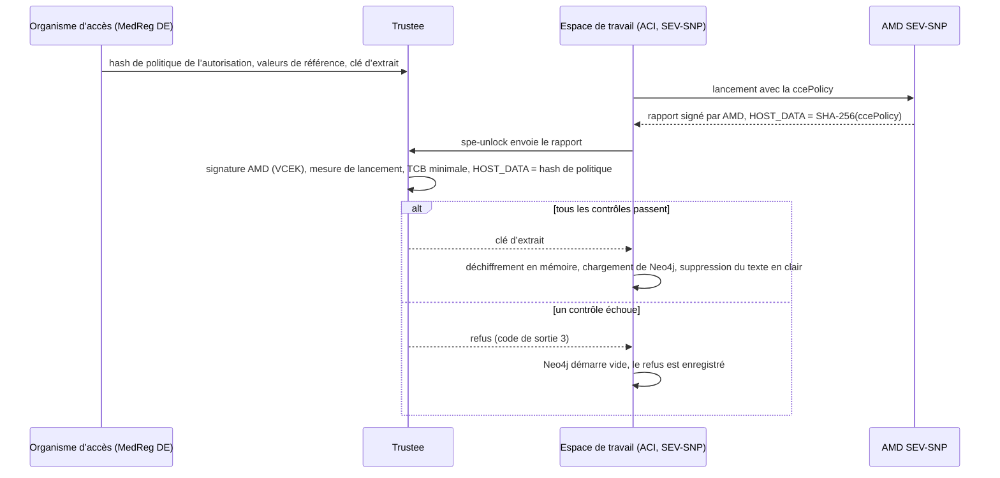

# L’environnement de traitement sécurisé et ses conteneurs confidentiels

Un utilisateur de données ne reçoit jamais les lignes des patients. Il pose une question, la
question s’exécute dans un **environnement de traitement sécurisé** (SPE) à côté des
données, et seuls reviennent les agrégats qui passent les contrôles de sortie (règlement
(UE) 2025/327, art. 73). Cette page explique comment le hub construit cet
environnement à partir de conteneurs confidentiels, afin que l’affirmation « l’opérateur
ne peut pas lire les données non plus » repose sur le matériel plutôt que sur la confiance. Elle
décrit ce qui s’exécute où, comment un espace de travail obtient sa clé, ce que traverse une requête,
comment l’exécuter sur un ordinateur portable et ce qui reste à faire.

Les décisions sont [ADR-037](../ADRs/ADR-037-secure-processing-environment-confidential-computing.md)
(le modèle), [ADR-068](../ADRs/ADR-068-a-sovereign-confidential-spe-on-confidential-containers-and-trustee.md)
(la conception), [ADR-069](../ADRs/ADR-069-two-spe-workspaces-as-aci-confidential-containers.md)
(le déploiement sur Azure) et [ADR-072](../ADRs/ADR-072-spe-workspaces-start-on-demand.md)
(le démarrage à la demande). La marche à suivre de l’opérateur est le runbook
[Attestation du SPE sur Azure](../knowledge/runbooks/spe-attestation-azure.md).

## 1. L’idée en un paragraphe

Chacun des deux détenteurs de données a un **espace de travail** : SPE-1 pour AlphaKlinik
Berlin, SPE-2 pour Limburg Medical Centre. Un espace de travail est un groupe de conteneurs
confidentiel : sa mémoire est chiffrée par le processeur (AMD SEV-SNP), et le
processeur signe un rapport de ce qui y a été démarré, exactement. Les données de l’espace de travail
arrivent scellées, et la clé est détenue par un **Trustee** que gère l’organisme responsable
de l’accès aux données de santé (MedReg DE). Trustee ne libère la clé que lorsque le rapport
signé prouve que l’espace de travail exécute le code pour lequel l’autorisation de traitement de données a été
délivrée. **Pas de clé, pas de données** : une image, une commande ou une variable d’environnement modifiée
donne un autre hash de politique, et la clé reste où elle est.

## 2. Termes

| Terme                           | Ce que c’est                                                                                                                                                                                                                               |
| ------------------------------- | ------------------------------------------------------------------------------------------------------------------------------------------------------------------------------------------------------------------------------------------ |
| **Informatique confidentielle** | Exécuter du code dans un environnement d’exécution de confiance (TEE) dont l’hôte, l’hyperviseur et l’opérateur du cloud ne peuvent pas lire la mémoire.                                                                                   |
| **AMD SEV-SNP**                 | Le TEE qu’utilisent les espaces de travail (EPYC 9V74, Genoa). Il chiffre la mémoire de la VM et produit un rapport d’attestation signé par une clé dont la chaîne remonte à AMD. Intel TDX n’est pas utilisé.                             |
| **Conteneur confidentiel**      | Un groupe de conteneurs qui s’exécute dans sa propre VM utilitaire SEV-SNP. Sur Azure : un groupe Azure Container Instances (ACI) avec `sku: Confidential`.                                                                                |
| **ccePolicy**                   | La politique d’application de l’informatique confidentielle d’un groupe ACI : les images par digest, les commandes, l’environnement et les montages autorisés à s’exécuter. Générée avec `az confcom acipolicygen`.                        |
| **HOST_DATA**                   | Un champ du rapport SEV-SNP fixé au lancement. ACI y place le SHA-256 de la ccePolicy, si bien que le matériel atteste la politique avec laquelle le groupe a démarré.                                                                     |
| **Hash de politique**           | Ce SHA-256, enregistré sur l’autorisation (`HDABApproval.policyHash`) et dans la politique de ressources de Trustee. Il lie une autorisation à une seule charge de travail, exactement.                                                    |
| **Trustee**                     | Le courtier de clés de [CNCF Confidential Containers](https://confidentialcontainers.org/) : KBS (service de courtage de clés), AS (service d’attestation) et RVPS (valeurs de référence). Version v0.22.0, gérée par l’organisme d’accès. |
| **Valeurs de référence**        | Ce à quoi Trustee compare le rapport : la mesure de lancement de la VM utilitaire de Microsoft et la TCB minimale (versions du firmware et du microcode).                                                                                  |
| **Extrait scellé**              | La moitié des patients synthétiques qui revient à un espace de travail, au format `mvhd-spe-extract/1` : des lignes JSON, compressées en gzip, chiffrées en AES-256-GCM sous une nouvelle clé par autorisation.                            |

## 3. Où il s’exécute, et ce que chaque lieu prouve

La conception est partout la même ; ce qui change, c’est si un vrai matériel
signe la preuve. L’UI l’indique par l’une de trois étiquettes
([`ui/src/lib/spe.ts`](https://github.com/ma3u/MinimumViableHealthDataspacev2/blob/main/ui/src/lib/spe.ts)),
et n’affirme jamais plus que ce que montre la preuve (ADR-068, décision 5).

| Où                                         | Ce qui est réel                                                                                                                                                                                                                         | Étiquette                         |
| ------------------------------------------ | --------------------------------------------------------------------------------------------------------------------------------------------------------------------------------------------------------------------------------------- | --------------------------------- |
| **Ordinateur portable, CI, démo statique** | Trustee, le hash de l’autorisation dans sa politique, la libération de la clé, l’extrait scellé, Neo4j qui le charge, la piste d’audit. La preuve vient de l’attesteur d’exemple de Trustee, car un ordinateur portable n’a pas de TEE. | "Simulated attestation"           |
| **Azure, au niveau du nœud (A1)**          | Un matériel SEV-SNP avec un démarrage mesuré, mais pas le conteneur qui s’est exécuté. Non déployé.                                                                                                                                     | "Attested: SEV-SNP node"          |
| **Azure, par charge de travail (A2)**      | Des conteneurs confidentiels ACI en westeurope : la politique propre à chaque charge de travail est vérifiée par le matériel. Exécuté de bout en bout le 2026-11-02 (#774).                                                             | "Attested: confidential workload" |

Les nœuds `SPESession` amorcés dans le graphe du Trust Center
([`neo4j/seed-trust-center.cypher`](https://github.com/ma3u/MinimumViableHealthDataspacev2/blob/main/neo4j/seed-trust-center.cypher))
portent `simulated: true` ; ils illustrent le modèle et ne constituent pas une preuve.

## 4. Les éléments sur Azure

| Élément                   | Ressource Azure                                                    | Ce qu’il fait                                                                                                                               |
| ------------------------- | ------------------------------------------------------------------ | ------------------------------------------------------------------------------------------------------------------------------------------- |
| SPE-1, AlphaKlinik Berlin | groupe ACI `mvhd-spe-1`, `sku: Confidential`, westeurope           | le conteneur d’initialisation `spe-unlock` atteste et obtient la clé ; `neo4j` détient les données ; le sidecar `spe-ingest` les charge     |
| SPE-2, Limburg MC         | groupe ACI `mvhd-spe-2`, même forme                                | la même chose, avec l’autre moitié des patients synthétiques                                                                                |
| Trustee (MedReg DE)       | app ACA `mvhd-trustee`, job `mvhd-trustee-admin`                   | vérifie la preuve SEV-SNP par rapport à la chaîne d’AMD, aux valeurs de référence et à HOST_DATA, puis libère `default/spe-<n>/extract-key` |
| L’état de Trustee         | partages de fichiers `trustee-keys`, `trustee-data`                | clé d’administration, clé de jeton, politiques, valeurs de référence, clés d’extrait. Jamais le Key Vault du hub                            |
| Extraits scellés          | partage `spe-extracts`, intégré à l’image `mvhd-spe-loader-spe<n>` | uniquement du texte chiffré ; le digest de l’extrait fait partie du hash de politique                                                       |
| Fédération et audit       | app ACA `mvhd-neo4j-proxy`                                         | envoie les questions fédérées aux espaces de travail, applique les contrôles de sortie, ajoute leurs événements `spe.*` à la chaîne d’audit |

Le modèle de groupe est
[`scripts/azure/aci/spe-workspace.template.json`](https://github.com/ma3u/MinimumViableHealthDataspacev2/blob/main/scripts/azure/aci/spe-workspace.template.json).
Tout le reste du hub reste sur Azure Container Apps (ACA), qui n’a pas encore de
profil de charge de travail confidentiel dans une région de l’UE. Azure Attestation et la
libération sécurisée de clés de Key Vault ont été envisagées et ne sont délibérément **pas** sur le
chemin de la clé : c’est l’organisme d’accès, et non l’opérateur du cloud, qui décide qui obtient une clé
(ADR-068, décision 1 ; ADR-069, « Alternatives considered »).

## 5. La chaîne de confiance



1. **L’autorisation fixe la charge de travail.** `21-aci-confidential-spe.sh --policy`
   génère la ccePolicy à partir du modèle. Son SHA-256 est écrit dans
   l’autorisation (`HDABApproval`) et dans la politique de ressources de Trustee
   ([`trustee/policies/resource-azure.rego.tmpl`](https://github.com/ma3u/MinimumViableHealthDataspacev2/blob/main/trustee/policies/resource-azure.rego.tmpl)).
2. **Le matériel s’en porte garant.** ACI lance le groupe dans une VM utilitaire
   SEV-SNP et place le hash de la politique dans le HOST_DATA du rapport signé.
3. **Trustee vérifie quatre choses :** la signature jusqu’à AMD (VCEK venant du
   service de distribution de clés d’AMD), la mesure de lancement de la VM utilitaire
   par rapport à une valeur de référence épinglée, la TCB par rapport à un minimum par composant
   ([ADR-073](../ADRs/ADR-073-the-spe-tcb-is-a-minimum-not-a-list.md),
   [`attestation-ear-cpu.rego`](https://github.com/ma3u/MinimumViableHealthDataspacev2/blob/main/trustee/policies/attestation-ear-cpu.rego)),
   et HOST_DATA par rapport au hash de l’autorisation.
4. **Alors seulement, la clé quitte Trustee.** Sans valeur de référence épinglée,
   la politique refuse : il n’y a pas de « déverrouillage à la première utilisation ».

Les secrets ne passent pas par la politique. Ils parviennent au groupe par son volume
de secrets, si bien qu’en renouveler un ne change pas le hash.

## 6. À l’intérieur d’un espace de travail

Chaque groupe a trois conteneurs, construits à partir de
[`services/spe-loader`](https://github.com/ma3u/MinimumViableHealthDataspacev2/tree/main/services/spe-loader) :

- **`spe-unlock`** (conteneur d’initialisation) : atteste avec `kbs-client`, construit avec la
  fonctionnalité `snp-attester`, obtient la clé, déchiffre l’extrait dans le
  volume `emptyDir` `work`.
- **`neo4j`** : Neo4j 5.26 Community, 1,5 vCPU et 4 Gio, stockage dans le
  volume `emptyDir` `neo4j-data`, Bolt avec TLS obligatoire, HTTP désactivé. Neo4j est
  **un espace de travail par autorisation, pas un stockage durable** (ADR-068, décision 3) : il
  ne détient les données qu’en mémoire et sur un stockage éphémère à l’intérieur du TEE.
- **`spe-ingest`** (sidecar) : charge l’extrait, applique
  `neo4j/init-schema.cypher` et l’enregistrement HealthDCAT-AP du SPE,
  supprime le texte en clair, enregistre l’attestation et reste actif.

**Les données.** Chaque espace de travail reçoit la moitié des patients synthétiques du hub : les
dossiers FHIR (Patient, Condition, Observation et le reste), la personne
OMOP CDM correspondante avec ses enregistrements, et les concepts qui les codent. Les patients
du bac à sable et ceux de l’application Klarbefund sont exclus. L’étiquette
`OptedOut` d’un patient accompagne les données (art. 71).

**Arrêter, c’est supprimer.** Les stockages vivent en mémoire, si bien qu’arrêter ou supprimer
un groupe perd toutes les lignes. Chaque démarrage atteste à nouveau et charge à nouveau. Un piège :
`az container restart` ne relance pas le conteneur d’initialisation, si bien qu’un groupe
redémarré ne redemande jamais rien à Trustee ; arrêtez-le puis démarrez-le à la place
([`docs/gotchas.md`](../gotchas.md), 2026-11-01).

**Les commandes du chargeur** (`spe-loader <command>`) : `policy-hash`,
`trustee-configure`, `record-permit`, `export`, `encrypt`, `extract`,
`unlock`, `ingest` et `load`. Le code de sortie 3 signifie que la clé a été refusée ; 2 signifie
qu’une base de données ou Trustee n’a pas répondu.

## 7. Ce que traverse une requête fédérée

1. Un utilisateur de données pose sa question sur `/query` ou en langage naturel. L’UI appelle
   [`/api/federated`](https://github.com/ma3u/MinimumViableHealthDataspacev2/blob/main/ui/src/app/api/federated/route.ts)
   (ou `/api/nlq` avec `federated: true`).
2. **Démarrage à froid** ([ADR-072](../ADRs/ADR-072-spe-workspaces-start-on-demand.md)).
   Les espaces de travail sont arrêtés par défaut pour économiser les coûts. Une requête fédérée de
   `EDC_ADMIN`, `HDAB_AUTHORITY` ou `DATA_USER` les démarre ; tant qu’ils ne sont pas prêts,
   la réponse est un **503** avec `state` `starting` ou `stopped`,
   `etaSeconds` (240 depuis l’arrêt) et un en-tête `Retry-After`. Mesuré : la
   clé arrive après environ une minute, les données sont chargées après environ trois,
   SPE-2 répond après environ quatre. Le job `mvhd-spe-idle-stop` s’exécute toutes les
   15 minutes et arrête un espace de travail inactif depuis 30.
3. **Le proxy distribue la question.** `services/neo4j-proxy` envoie la question aux deux
   espaces de travail via Bolt avec TLS (`POST /federated/query`,
   `GET /federated/stats`).
4. **Les contrôles de sortie avant que quoi que ce soit ne sorte.** Les groupes plus petits que k sont
   écartés et les cellules inférieures à k deviennent `<k`, avec k = 5 (`MIN_COHORT_SIZE`,
   [`k-anonymity.ts`](https://github.com/ma3u/MinimumViableHealthDataspacev2/blob/main/services/neo4j-proxy/src/k-anonymity.ts)) ;
   les patients qui se sont opposés sont exclus
   ([`opt-out.ts`](https://github.com/ma3u/MinimumViableHealthDataspacev2/blob/main/services/neo4j-proxy/src/opt-out.ts)).
5. **Seuls les agrégats reviennent** à l’UI, en passant par le proxy.

**La piste d’audit.** Le proxy lit les événements de chaque espace de travail toutes les minutes et
les ajoute à la chaîne d’audit `spe` du hub (ADR-045) : `spe.attestation`,
`key_release`, `key_refused`, `workspace_loaded`, `workspace_destroyed` et
`optout_synced`.

**Où le voir dans l’UI**, connecté en tant que `edcadmin` :

- `/admin/attestation` : l’attestation de chaque espace de travail et son étiquette.
- `/admin/components` : la topologie du SPE, avec un bouton d’alimentation par espace de travail.
- `/admin/audit` : la chaîne `spe`.
- `/admin/policies` : quelle autorisation est liée à quel hash de politique.
- `/query` : l’avis de démarrage à froid pendant que les espaces de travail démarrent.

## 8. L’exécuter sur un ordinateur portable

Sans la surcouche ci-dessous, SPE-1 est simplement le graphe du hub et SPE-2 un second
Neo4j : la fédération fonctionne, mais rien n’est scellé ni attesté. Pour obtenir le vrai
flux avec une preuve simulée, démarrez la surcouche Trustee par-dessus la pile
JAD ([`docker-compose.trustee.yml`](https://github.com/ma3u/MinimumViableHealthDataspacev2/blob/main/docker-compose.trustee.yml)) :

```bash
docker compose -f docker-compose.yml -f docker-compose.jad.yml \
  -f docker-compose.trustee.yml --profile federated up -d --build
```

Elle ajoute Trustee sur <http://localhost:8099>, définit sa politique locale et ses
valeurs de référence, scelle les deux extraits et enregistre leurs hashes de politique sur le
hub, déplace les stockages des deux espaces de travail vers `tmpfs`, et exécute `spe-loader-spe1` et
`spe-loader-spe2` pour attester, déverrouiller et charger. Vérifiez le résultat avec
`GET http://localhost:9090/spe/status` sur le proxy ou sur `/admin/attestation`.

Les tests qui le protègent, en CI et en local :

```bash
cd services/spe-loader && npm test        # Vitest: extract, seal, unlock, ingest
./scripts/test-trustee-policies.sh        # opa test over trustee/policies/
```

Les deux s’exécutent dans [`test.yml`](https://github.com/ma3u/MinimumViableHealthDataspacev2/blob/main/.github/workflows/test.yml)
(SPE Loader Tests, Trustee Policy Tests). Les tests de politique épinglent chaque cas de
la politique de ressources, y compris HOST_DATA à l’endroit où Trustee v0.22.0
le place.

## 9. Le déployer sur Azure

[`scripts/azure/21-aci-confidential-spe.sh`](https://github.com/ma3u/MinimumViableHealthDataspacev2/blob/main/scripts/azure/21-aci-confidential-spe.sh)
procède par phases, dans cet ordre : `--trustee`, `--extracts`, `--policy`,
`--workspaces`, `--wire-proxy`, `--check`. Le runbook donne les
prérequis (un rôle PIM activé avant `az login`, la session d’une heure)
et ce qu’affiche chaque phase ; lisez-le avant la première exécution. Deux phases se protègent
elles-mêmes : `--extracts` refuse de changer les clés tant que Trustee en détient, sauf avec
`--rekey`, et `--trustee` conserve une politique de ressources que Trustee détient déjà.

## 10. Ce qui reste à faire

- **L’organisme d’accès ne gère pas encore son propre Trustee.** Les partages de Trustee se trouvent
  dans l’abonnement du hub, si bien que le propriétaire de l’abonnement pourrait les lire. Pour
  que l’affirmation de souveraineté tienne, MedReg DE gère Trustee dans un abonnement qui
  lui est propre (ADR-069, décision 3).
- **La confiance reste placée dans AMD et dans la VM utilitaire de Microsoft.** L’approbation par
  Microsoft de la mesure de la VM utilitaire est comparée par l’opérateur,
  mais sa signature COSE n’est pas encore vérifiée cryptographiquement.
- **ADR-073 est proposée.** Le minimum de TCB et ses tests sont sur `main`
  (#836) ; l’ADR indique qu’il n’est pas encore appliqué sur Azure.
- **AKS n’est pas une option aujourd’hui.** La politique du tenant l’a refusé
  (`RequestDisallowedByPolicy`) ; une exemption est demandée. Les conteneurs confidentiels
  d’AKS étaient en outre en cours de retrait par Microsoft (ADR-068).
- **Non décidé** (ADR-068) : quel fournisseur de l’UE héberge le cas par charge de travail
  en dehors d’Azure, et Trustee dans un abonnement qui lui est propre.

Tickets : [#774](https://github.com/ma3u/MinimumViableHealthDataspacev2/issues/774)
(le déploiement sur Azure), [#27](https://github.com/ma3u/MinimumViableHealthDataspacev2/issues/27),
[#481](https://github.com/ma3u/MinimumViableHealthDataspacev2/issues/481),
[#716](https://github.com/ma3u/MinimumViableHealthDataspacev2/issues/716),
[#833](https://github.com/ma3u/MinimumViableHealthDataspacev2/issues/833).

## 11. Les décisions, dans l’ordre

| ADR                                                                                               | Décision                                                                                             | Statut                |
| ------------------------------------------------------------------------------------------------- | ---------------------------------------------------------------------------------------------------- | --------------------- |
| [ADR-037](../ADRs/ADR-037-secure-processing-environment-confidential-computing.md)                | Des conteneurs confidentiels avec attestation à distance, et non la confiance dans l’opérateur       | Acceptée              |
| [ADR-052](../ADRs/ADR-052-confidential-spe-on-azure-revisited.md)                                 | AKS avec Kata et Azure Attestation                                                                   | Remplacée par ADR-068 |
| [ADR-068](../ADRs/ADR-068-a-sovereign-confidential-spe-on-confidential-containers-and-trustee.md) | CNCF Confidential Containers, un Trustee que gère l’organisme d’accès, Neo4j chargé par autorisation | Acceptée (2026-10-30) |
| [ADR-069](../ADRs/ADR-069-two-spe-workspaces-as-aci-confidential-containers.md)                   | Deux espaces de travail en conteneurs confidentiels ACI ; le hash de politique est HOST_DATA         | Acceptée (2026-11-02) |
| [ADR-072](../ADRs/ADR-072-spe-workspaces-start-on-demand.md)                                      | Arrêtés par défaut, démarrés par une requête fédérée, arrêtés après 30 minutes d’inactivité          | Acceptée (2026-11-02) |
| [ADR-073](../ADRs/ADR-073-the-spe-tcb-is-a-minimum-not-a-list.md)                                 | La TCB SEV-SNP est vérifiée par rapport à un minimum par composant                                   | Proposée              |
