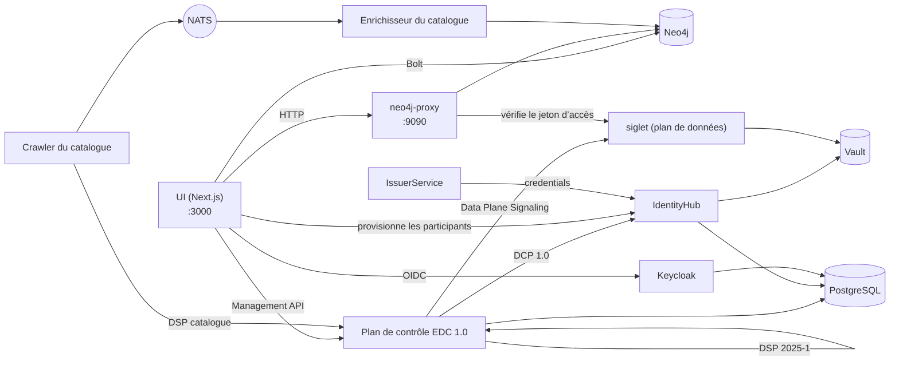

# La pile et l’environnement de développement

Le nom de chaque partie du hub, ce qu’elle fait et comment les parties
s’assemblent, puis la manière de les exécuter sur un ordinateur portable. Les décisions derrière chaque
partie se trouvent dans les ADR liés depuis sa ligne ; le journal complet des pièges est
[`docs/gotchas.md`](../gotchas.md).

## Glossaire

### Protocoles

| Terme                                                                                         | Ce que c’est                                                                                                                                                                                                                                                                                                                                                                                                    | Décision                                                                |
| --------------------------------------------------------------------------------------------- | --------------------------------------------------------------------------------------------------------------------------------------------------------------------------------------------------------------------------------------------------------------------------------------------------------------------------------------------------------------------------------------------------------------- | ----------------------------------------------------------------------- |
| **[DSP 2025-1](https://eclipse-dataspace-protocol-base.github.io/DataspaceProtocol/2025-1/)** | L’Eclipse Dataspace Protocol, version 2025-1 : la manière dont deux connecteurs échangent un catalogue ([DCAT](https://www.w3.org/TR/vocab-dcat-3/)), négocient un contrat sur une offre [ODRL](https://www.w3.org/TR/odrl-model/) et exécutent un transfert. Le plan de contrôle le parle sous `/api/dsp/<participant>/2025-1/`.                                                                               | [ADR-007](../ADRs/ADR-007-did-web-dsp-negotiation.md)                   |
| **[DCP 1.0](https://eclipse-dataspace-dcp.github.io/decentralized-claims-protocol/v1.0/)**    | Le Decentralised Claims Protocol : la manière dont un participant prouve qui il est. Chacun possède un DID [`did:web`](https://w3c-ccg.github.io/did-method-web/) et détient des [attestations vérifiables](https://www.w3.org/TR/vc-data-model-2.0/) (une `MembershipCredential`, des attestations de rôle de l’EEDS) ; une contrepartie demande une présentation au lieu de se fier à une connexion centrale. | [ADR-009](../ADRs/ADR-009-issuerservice-credential-fix.md)              |
| **[ODRL](https://www.w3.org/TR/odrl-model/) 2.2**                                             | Le langage de politique d’une offre : qui peut utiliser un ensemble de données, dans quel but, au titre de quelle autorisation.                                                                                                                                                                                                                                                                                 | [ADR-013](../ADRs/ADR-013-simpl-open-alignment.md)                      |
| **[HealthDCAT-AP](https://data.health.europa.eu/healthdcat-ap/releases/release-8/)**          | Le vocabulaire de catalogue des ensembles de données de santé, Release 8 depuis [#700](https://github.com/ma3u/MinimumViableHealthDataspacev2/issues/700).                                                                                                                                                                                                                                                      | [ADR-063](../ADRs/ADR-063-healthdcat-ap-release-8-and-its-namespace.md) |
| **[did:web](https://w3c-ccg.github.io/did-method-web/)**                                      | Un DID résolu via HTTPS. Deux formes coexistent, une forme stable dans le graphe et l’UI et une forme résolvable dans la couche EDC ; [`api-conventions.md`](https://github.com/ma3u/MinimumViableHealthDataspacev2/blob/main/.claude/rules/api-conventions.md) explique laquelle va où.                                                                                                                        | [ADR-007](../ADRs/ADR-007-did-web-dsp-negotiation.md)                   |

### Le connecteur : EDC-V

| Terme                                                                                 | Ce que c’est                                                                                                                                                                                                                                                                                                                                                                                                                                                                                                                                                               | Décision                                                                                                                                |
| ------------------------------------------------------------------------------------- | -------------------------------------------------------------------------------------------------------------------------------------------------------------------------------------------------------------------------------------------------------------------------------------------------------------------------------------------------------------------------------------------------------------------------------------------------------------------------------------------------------------------------------------------------------------------------- | --------------------------------------------------------------------------------------------------------------------------------------- |
| **EDC-V**                                                                             | Eclipse Dataspace Components, en version virtuelle : un seul runtime EDC multi-tenant dans lequel chaque participant est un _contexte de participant_ plutôt que son propre connecteur. Le hub exécute [EDC 1.0](https://github.com/eclipse-edc/Connector/releases/tag/v1.0.0-RC5) (`1.0.0-RC5`) : le plan de contrôle, l’IdentityHub et l’IssuerService sont ses propres lanceurs, construits à partir de [`runtimes/edc`](../../runtimes/edc). EDC 0.18 issu des images JAD a été retiré avec [#927](https://github.com/ma3u/MinimumViableHealthDataspacev2/issues/927). | [ADR-024](../ADRs/ADR-024-full-edc-provisioning-per-participant.md), [ADR-078](../ADRs/ADR-078-edc-1-on-container-apps-without-cfm.md)  |
| **Plan de contrôle**                                                                  | Le runtime EDC qui détient les assets, les politiques et les définitions de contrat, négocie les contrats via DSP et lance les transferts (`controlplane` dans [`docker-compose.jad.yml`](../../docker-compose.jad.yml#L277)). Management API sur `:11003`.                                                                                                                                                                                                                                                                                                                | [ADR-002](../ADRs/ADR-002-edc-data-plane-architecture.md), [ADR-078](../ADRs/ADR-078-edc-1-on-container-apps-without-cfm.md)            |
| **Siglet**                                                                            | Le plan de données sous EDC 1.0 : [siglet 0.1.6](https://github.com/eclipse-dataplane-core/dsdk-facet-rs/releases/tag/siglet-v0.1.6), d’Eclipse Dataplane Core. Le plan de contrôle le signale par contexte de participant ; il émet le jeton d’accès (EDR) d’un transfert, et le neo4j-proxy sert les données sous `/dataspace/data` après avoir vérifié ce jeton avec les clés de siglet ([`jad/siglet-edc1.toml`](../../jad/siglet-edc1.toml)). Pas de port sur l’hôte.                                                                                                 | [ADR-078](../ADRs/ADR-078-edc-1-on-container-apps-without-cfm.md#decision)                                                              |
| **[IdentityHub](https://github.com/eclipse-edc/IdentityHub/releases/tag/v1.0.0-RC5)** | Le portefeuille DCP de chaque participant : son document DID, ses clés (dans Vault) et les attestations qu’il détient ; il répond aux demandes de présentation. `:11005`.                                                                                                                                                                                                                                                                                                                                                                                                  | [ADR-009](../ADRs/ADR-009-issuerservice-credential-fix.md)                                                                              |
| **IssuerService**                                                                     | L’émetteur d’attestations du hub : il détient les définitions d’attestations et émet des attestations aux détenteurs via DCP. `:10013`. Une deuxième instance, `simpl-ga-issuer` (`:10023`), joue l’autorité de gouvernance [Simpl](https://code.europa.eu/simpl/simpl-open) ; `rogue-issuer` (`:10033`) ne figure sur aucune liste de confiance et ne démarre que pour les contrôles d’identité.                                                                                                                                                                          | [ADR-009](../ADRs/ADR-009-issuerservice-credential-fix.md), [ADR-064](../ADRs/ADR-064-simpl-open-through-the-outside-agent-dcp-path.md) |

### L’exécuter : JAD et CFM

| Terme                                                                    | Ce que c’est                                                                                                                                                                                                                                                                                                                                                                                                                                                                                                                                                                                                                            | Décision                                                                                                                                                                                                                          |
| ------------------------------------------------------------------------ | --------------------------------------------------------------------------------------------------------------------------------------------------------------------------------------------------------------------------------------------------------------------------------------------------------------------------------------------------------------------------------------------------------------------------------------------------------------------------------------------------------------------------------------------------------------------------------------------------------------------------------------- | --------------------------------------------------------------------------------------------------------------------------------------------------------------------------------------------------------------------------------- |
| **JAD**                                                                  | Just Another Demonstrator : le [démonstrateur Eclipse](https://github.com/eclipse-dataspace-hub/jad) qui déploie un espace de données complet en tant que service sur Kubernetes. Le hub a transposé son organisation dans Docker Compose : ici, JAD, c’est [`docker-compose.jad.yml`](../../docker-compose.jad.yml) plus les seeds et la configuration de [`jad/`](../../jad), superposés à [`docker-compose.yml`](../../docker-compose.yml). Ses images (`ghcr.io/metaform/jad/*`) ont disparu avec EDC 0.18 ([#927](https://github.com/ma3u/MinimumViableHealthDataspacev2/issues/927)). Azure exécute la même construction.         | [ADR-055](../ADRs/ADR-055-azure-runs-the-compose-jad-build.md), [ADR-078](../ADRs/ADR-078-edc-1-on-container-apps-without-cfm.md)                                                                                                 |
| **CFM**                                                                  | Le Connector Fabric Manager : un **gestionnaire de locataires** et un **gestionnaire de provisionnement** dont les **agents** provisionnent un participant dans les services EDC. Il tourne en tant qu’eclipse-cfm 0.0.7, depuis notre fork jusqu’à ce que l’amont reprenne les correctifs, et seulement avec le profil `cfm` ; si `CFM_TENANT_URL` est défini, le hub provisionne par lui, sinon le hub provisionne lui-même les participants. La version de 2026-03, avec ses agents et `cfm-cp-shim`, ne tournait que sous EDC 0.18 et a été retirée avec [#927](https://github.com/ma3u/MinimumViableHealthDataspacev2/issues/927). | [ADR-085](../ADRs/ADR-085-cfm-stays-as-eclipse-cfm-releases.md), [ADR-088](../ADRs/ADR-088-cfm-runs-from-our-fork-until-upstream-takes-the-patches.md), [ADR-078](../ADRs/ADR-078-edc-1-on-container-apps-without-cfm.md#context) |
| **Vault**                                                                | [HashiCorp Vault](https://github.com/hashicorp/vault/releases/tag/v2.0.0) détient les clés privées de chaque participant et les secrets EDC. Adossé à des fichiers en local depuis le 2026-09-26 ([`jad/vault.hcl`](../../jad/vault.hcl), avec un sidecar `vault-unseal`), sur le [Flexible Server](https://learn.microsoft.com/en-us/azure/postgresql/flexible-server/overview) sur Azure. Jamais [`-dev`](https://developer.hashicorp.com/vault/docs/concepts/dev-server) : un redémarrage emporterait toutes les clés.                                                                                                               | [ADR-046](../ADRs/ADR-046-vault-keeps-its-state-on-the-flexible-server.md), [ADR-047](../ADRs/ADR-047-vault-stays-up-off-hours.md)                                                                                                |
| **[Keycloak](https://github.com/keycloak/keycloak/releases/tag/26.8.0)** | Connexion [OIDC](https://openid.net/specs/openid-connect-core-1_0.html) pour l’UI et les clients de service, realm `edcv`, `:8080`. Le client de l’UI est confidentiel, avec [PKCE S256](https://datatracker.ietf.org/doc/html/rfc7636#section-4.2).                                                                                                                                                                                                                                                                                                                                                                                    | [ADR-025](../ADRs/ADR-025-keycloak-custom-domain.md)                                                                                                                                                                              |
| **[PostgreSQL](https://www.postgresql.org/docs/release/17.7/)**          | Le stockage d’exécution des services EDC et de Keycloak, une base de données chacun ([`jad/init-postgres.sql`](../../jad/init-postgres.sql)). Le [Flexible Server](https://learn.microsoft.com/en-us/azure/postgresql/flexible-server/overview) sur Azure.                                                                                                                                                                                                                                                                                                                                                                              | [ADR-001](../ADRs/ADR-001-postgresql-neo4j-split.md), [ADR-041](../ADRs/ADR-041-managed-postgres-on-azure-containerised-locally.md)                                                                                               |
| **[NATS](https://github.com/nats-io/nats-server/releases/tag/v2.14.3)**  | Le maillage d’événements ([JetStream](https://docs.nats.io/nats-concepts/jetstream)) entre le crawler et l’enrichisseur du catalogue. `:4222`.                                                                                                                                                                                                                                                                                                                                                                                                                                                                                          | [ADR-020](../ADRs/ADR-020-cross-participant-dataset-discovery.md)                                                                                                                                                                 |
| **[Traefik](https://doc.traefik.io/traefik/v3.7/)**                      | La passerelle devant les services JAD, `:80`, tableau de bord sur `:8090`.                                                                                                                                                                                                                                                                                                                                                                                                                                                                                                                                                              |                                                                                                                                                                                                                                   |

### Les services propres au hub

| Terme                               | Ce que c’est                                                                                                                                                                                                                                                                                                                                                                                                                                                                                                                                                                                                                                                                                                                                                                                                                                                                                                                                                                                                                | Décision                                                                                                                                                                             |
| ----------------------------------- | --------------------------------------------------------------------------------------------------------------------------------------------------------------------------------------------------------------------------------------------------------------------------------------------------------------------------------------------------------------------------------------------------------------------------------------------------------------------------------------------------------------------------------------------------------------------------------------------------------------------------------------------------------------------------------------------------------------------------------------------------------------------------------------------------------------------------------------------------------------------------------------------------------------------------------------------------------------------------------------------------------------------------- | ------------------------------------------------------------------------------------------------------------------------------------------------------------------------------------ |
| **UI**                              | L’application [Next.js](https://github.com/vercel/next.js/releases/tag/v15.5.28) dans [`ui/`](../../ui) : les pages de chaque persona et les routes `/api/*` qui les servent. Conteneur `health-dataspace-ui`.                                                                                                                                                                                                                                                                                                                                                                                                                                                                                                                                                                                                                                                                                                                                                                                                              | [ADR-004](../ADRs/ADR-004-nextjs-unified-frontend.md), [ADR-044](../ADRs/ADR-044-every-api-route-needs-a-session.md)                                                                 |
| **Neo4j**                           | Le graphe de connaissances à cinq couches : place de marché (DSP), [HealthDCAT-AP](https://data.health.europa.eu/healthdcat-ap/releases/release-8/), [FHIR R4](https://hl7.org/fhir/R4/), [OMOP CDM](https://ohdsi.github.io/CommonDataModel/cdm54.html) et ontologies. [Neo4j 5.26](https://neo4j.com/release-notes/database/neo4j-5/) LTS Community avec [APOC](https://neo4j.com/docs/apoc/5/), [APOC Extended](https://github.com/neo4j-contrib/neo4j-apoc-procedures), [Graph Data Science](https://neo4j.com/docs/graph-data-science/current/) et [n10s](https://neo4j.com/labs/neosemantics/). Ni mappeur objet ni couche GraphQL : l’UI, le proxy et le chargeur SPE utilisent le [`neo4j-driver`](https://neo4j.com/docs/javascript-manual/current/) officiel avec du Cypher paramétré ([`runQuery()`](../../ui/src/lib/neo4j.ts#L65) dans `ui/src/lib/neo4j.ts`), les services de catalogue le pilote Python officiel [`neo4j`](https://neo4j.com/docs/python-manual/current/). `:7474` navigateur, `:7687` Bolt. | [ADR-001](../ADRs/ADR-001-postgresql-neo4j-split.md), [ADR-030](../ADRs/ADR-030-neo4j-2025-lts-migration.md), [ADR-043](../ADRs/ADR-043-graph-access-direct-or-through-the-proxy.md) |
| **neo4j-proxy**                     | [`services/neo4j-proxy/`](../../services/neo4j-proxy), [Express](https://expressjs.com/en/5x/api.html) sur `:9090` : les points de terminaison FHIR et OMOP que lit un transfert (`/dataspace/data`), le moteur de requêtes en langage naturel, la requête fédérée et le catalogue en HealthDCAT-AP.                                                                                                                                                                                                                                                                                                                                                                                                                                                                                                                                                                                                                                                                                                                        | [ADR-043](../ADRs/ADR-043-graph-access-direct-or-through-the-proxy.md)                                                                                                               |
| **Catalog crawler**                 | [`services/catalog-crawler/`](../../services/catalog-crawler), Python : récupère le catalogue DSP de chaque participant toutes les cinq minutes et le publie sur NATS (`dataspace.catalog.raw`).                                                                                                                                                                                                                                                                                                                                                                                                                                                                                                                                                                                                                                                                                                                                                                                                                            | [ADR-020](../ADRs/ADR-020-cross-participant-dataset-discovery.md)                                                                                                                    |
| **Catalog enricher**                | [`services/catalog-enricher/`](../../services/catalog-enricher), Python : lit ces catalogues depuis NATS, les convertit en HealthDCAT-AP et les fusionne dans Neo4j sous forme de nœuds `:HealthDataset`, de sorte qu’une question sur les ensembles de données atteigne ceux de chaque participant.                                                                                                                                                                                                                                                                                                                                                                                                                                                                                                                                                                                                                                                                                                                        | [ADR-020](../ADRs/ADR-020-cross-participant-dataset-discovery.md), [ADR-003](../ADRs/ADR-003-healthdcat-ap-alignment.md)                                                             |
| **Espaces de travail SPE, Trustee** | [`services/spe-loader/`](../../services/spe-loader) et [`trustee/`](../../trustee) : les deux environnements de traitement sécurisés ([art. 73](https://eur-lex.europa.eu/eli/reg/2025/327/oj/eng#art_73)), des conteneurs confidentiels avec [AMD SEV-SNP](https://docs.kernel.org/arch/x86/amd-memory-encryption.html#secure-nested-paging-snp) sur Azure, dont un Trustee géré par l’organisme d’accès ne déverrouille les données scellées que pour la charge de travail que nomme l’autorisation. Voir [l’environnement de traitement sécurisé](secure-processing-environment.md).                                                                                                                                                                                                                                                                                                                                                                                                                                     | [ADR-068](../ADRs/ADR-068-a-sovereign-confidential-spe-on-confidential-containers-and-trustee.md), [ADR-069](../ADRs/ADR-069-two-spe-workspaces-as-aci-confidential-containers.md)   |
| **Klarbefund**                      | L’application iPhone dans [`clients/ios/`](../../clients/ios) : elle numérise un compte rendu de laboratoire sur l’appareil et se connecte au hub comme dossier médical électronique du patient.                                                                                                                                                                                                                                                                                                                                                                                                                                                                                                                                                                                                                                                                                                                                                                                                                            | [ADR-033](../ADRs/ADR-033-lab-report-extraction-pipeline.md), [ADR-049](../ADRs/ADR-049-klarbefund-connects-by-device-grant.md)                                                      |

### Comment les éléments s’assemblent



Un participant est créé une seule fois, par le hub lui-même ([`ui/src/lib/edc/provision.ts`](../../ui/src/lib/edc/provision.ts),
derrière `POST /api/participants` ; [ADR-078](../ADRs/ADR-078-edc-1-on-container-apps-without-cfm.md#decision)) : un contexte de
participant dans le plan de contrôle, le même participant avec son DID et ses
clés dans l’IdentityHub, son profil DSP, un détenteur dans l’IssuerService et
une MembershipCredential émise via DCP. Une étape qui échoue annule les
précédentes ; la phase d’amorçage 1 exécute la même séquence. À partir de là,
le plan de contrôle négocie en son nom via DSP, en prouvant qui il est via
DCP ; dès qu’un contrat est en vigueur, siglet émet le jeton d’accès et le
neo4j-proxy sert les données sur présentation de ce jeton. L’UI lit le graphe
directement pour ses pages et passe par le plan de contrôle pour tout ce qui
relève d’un échange. Si `CFM_TENANT_URL` est défini, c’est CFM 0.0.7 qui crée les
participants ([ADR-085](../ADRs/ADR-085-cfm-stays-as-eclipse-cfm-releases.md)).

## Environnement de développement

### Prérequis

| Besoin                                                                                                                                                                                                          | Pour                                                                                                                                         |
| --------------------------------------------------------------------------------------------------------------------------------------------------------------------------------------------------------------- | -------------------------------------------------------------------------------------------------------------------------------------------- |
| [Node.js](https://nodejs.org/en/about/previous-releases) 22 ou ultérieur, npm                                                                                                                                   | l’UI et le proxy Neo4j ([`engines`](../../services/neo4j-proxy/package.json#L47), [`ui/Dockerfile`](../../ui/Dockerfile#L1))                 |
| Docker avec [Compose v2](https://docs.docker.com/compose/)                                                                                                                                                      | Neo4j, et la pile JAD complète ; donnez à Docker **8 Go de mémoire** pour JAD                                                                |
| [Python](https://docs.python.org/3.12/) 3.12 ou ultérieur                                                                                                                                                       | les contrôles du dépôt (`scripts/*.py`) et les services de catalogue ([`requires-python`](../../services/catalog-crawler/pyproject.toml#L5)) |
| [`pre-commit`](https://pre-commit.com/)                                                                                                                                                                         | les hooks : `pip install pre-commit && pre-commit install --hook-type pre-commit --hook-type pre-push`                                       |
| [gitleaks](https://github.com/gitleaks/gitleaks/releases/tag/v8.29.0), [semgrep](https://semgrep.dev/docs/), [actionlint](https://github.com/rhysd/actionlint), [lychee](https://github.com/lycheeverse/lychee) | facultatifs en local (chaque hook avertit et passe son tour sans eux) ; le PR Gate exécute ce qui compte                                     |
| [Xcode 27](https://developer.apple.com/xcode/) et [`xcodegen`](https://github.com/yonaskolb/XcodeGen)                                                                                                           | uniquement pour l’application iPhone (SDK [iOS 26](../../clients/ios/project.yml#L6))                                                        |

### Deux manières de l’exécuter

| Pile             | Démarrage                                                                                                                                                                                   | Ce que vous obtenez                                                                                                                    |
| ---------------- | ------------------------------------------------------------------------------------------------------------------------------------------------------------------------------------------- | -------------------------------------------------------------------------------------------------------------------------------------- |
| **Minimale**     | `docker compose up -d neo4j`, charger le schéma et les données, `cd ui && npm install && npm run dev`                                                                                       | le graphe et chaque page qui le lit, sur http://localhost:3000 ; pas de Keycloak, donc la connexion nécessite le mode persona statique |
| **JAD complète** | `docker compose -f docker-compose.yml -f docker-compose.jad.yml up -d`, puis [`./scripts/bootstrap-jad.sh`](../../scripts/bootstrap-jad.sh) et [`./jad/seed-all.sh`](../../jad/seed-all.sh) | chaque service du glossaire, le conteneur de l’UI sur http://localhost:3003, la connexion via Keycloak                                 |

Chargement du graphe pour la pile minimale (les deux fichiers, [`neo4j/init-schema.cypher`](../../neo4j/init-schema.cypher) et [`neo4j/insert-synthetic-schema-data.cypher`](../../neo4j/insert-synthetic-schema-data.cypher), sont idempotents) :

```bash
cat neo4j/init-schema.cypher | docker exec -i health-dataspace-neo4j \
  cypher-shell -u neo4j -p healthdataspace
cat neo4j/insert-synthetic-schema-data.cypher | docker exec -i health-dataspace-neo4j \
  cypher-shell -u neo4j -p healthdataspace
```

`docker compose up -d` sans nom de service construit aussi l’UI sous forme de
conteneur `health-dataspace-ui` sur `:3000` et `:3003` ; ne démarrez que `neo4j`
si vous voulez `npm run dev` sur `:3000`.

### Les phases d’amorçage, dans l’ordre

[`./jad/seed-all.sh`](../../jad/seed-all.sh) exécute sept phases, et chacune a besoin de la précédente, si bien qu’une
phase en échec invalide toutes les suivantes. Reprenez avec `--from N`, exécutez-en une seule avec
`--only N`.

| Phase | Script                                                                      | Effet                                                                                                                                                                                                      |
| ----: | --------------------------------------------------------------------------- | ---------------------------------------------------------------------------------------------------------------------------------------------------------------------------------------------------------- |
|     1 | [`../scripts/seed-identity-layer.sh`](../../scripts/seed-identity-layer.sh) | les cinq participants sous EDC 1.0 : contextes du plan de contrôle, IdentityHub, identité de l’émetteur, détenteurs, une MembershipCredential chacun (sous 0.18, `seed-health-tenants.sh` passait par CFM) |
|     2 | [`seed-ehds-credentials.sh`](../../jad/seed-ehds-credentials.sh)            | les types d’attestations de l’EEDS sur l’IssuerService                                                                                                                                                     |
|     3 | [`seed-ehds-policies.sh`](../../jad/seed-ehds-policies.sh)                  | les politiques ODRL de chaque participant                                                                                                                                                                  |
|     4 | [`seed-data-assets.sh`](../../jad/seed-data-assets.sh)                      | les data assets et les définitions de contrat sur EDC-V                                                                                                                                                    |
|     5 | [`seed-contract-negotiation.sh`](../../jad/seed-contract-negotiation.sh)    | siglet comme plan de données de chaque participant, puis les négociations de PharmaCo avec AlphaKlinik, dont une refusée (TERMINATED)                                                                      |
|     6 | [`seed-federated-catalog.sh`](../../jad/seed-federated-catalog.sh)          | la négociation de catalogue de MedReg vers Limburg Medical Centre                                                                                                                                          |
|     7 | [`seed-data-transfer.sh`](../../jad/seed-data-transfer.sh)                  | jetons EDR de siglet et transferts servis par le neo4j-proxy                                                                                                                                               |

Le runbook est [Amorçage de la pile JAD](../knowledge/runbooks/jad-stack-seeding.md).

### Ports

| Port       | Service                            | Port     | Service                                     |
| ---------- | ---------------------------------- | -------- | ------------------------------------------- |
| 3000       | UI (`npm run dev` ou le conteneur) | 11003    | plan de contrôle, Management API            |
| 3003       | conteneur de l’UI (JAD)            | 11005    | IdentityHub                                 |
| 7474, 7687 | navigateur Neo4j, Bolt             | 10013    | IssuerService                               |
| 8080, 9000 | Keycloak, son port de gestion      | 10023    | émetteur Simpl GA                           |
| 8200       | Vault                              | 10033    | émetteur malveillant (profil `trust-check`) |
| 9090       | neo4j-proxy                        | 80, 8090 | Traefik, son tableau de bord                |
| 4222, 8222 | NATS, sa supervision               | 5432     | PostgreSQL                                  |

Siglet n’a pas de port sur l’hôte. Le profil `cfm` ajoute 18181 et 18182 (les gestionnaires de locataires et de provisionnement de CFM).

### Variables d’environnement

L’UI lit sa configuration dans l’environnement ; [`ui/.env.example`](../../ui/.env.example) et
[`ui/.env.local.example`](../../ui/.env.local.example) sont les modèles à copier. Celles que vous rencontrez en premier :

| Variable                                                                                                          | Ce qu’elle définit                                                                                                                                                                               |
| ----------------------------------------------------------------------------------------------------------------- | ------------------------------------------------------------------------------------------------------------------------------------------------------------------------------------------------ |
| `NEO4J_URI`, `NEO4J_USER`, `NEO4J_PASSWORD`                                                                       | le graphe ; `neo4j` / `healthdataspace` est réservé au développement local                                                                                                                       |
| `NEO4J_PROXY_URL`                                                                                                 | le proxy, `http://localhost:9090` par défaut ([`ui/src/lib/proxy.ts`](../../ui/src/lib/proxy.ts#L8))                                                                                             |
| `NEXTAUTH_URL`, `NEXTAUTH_SECRET`                                                                                 | [NextAuth](https://next-auth.js.org/) ; le secret signe aussi les sessions que forgent les tests d’API                                                                                           |
| `KEYCLOAK_PUBLIC_URL`, `KEYCLOAK_INTERNAL_URL`, `KEYCLOAK_ISSUER`, `KEYCLOAK_CLIENT_ID`, `KEYCLOAK_CLIENT_SECRET` | la connexion ; jamais `wellKnown` (piège 5 dans [`CLAUDE.md`](../../CLAUDE.md#L71))                                                                                                              |
| `EDC_MANAGEMENT_URL`, `EDC_IDENTITY_URL`, `EDC_ISSUER_URL`, `EDC_TENANT_URL`, `EDC_PROVISION_URL`                 | les services EDC ([`docker-compose.yml`](../../docker-compose.yml#L78-L82)) ; les deux derniers pointent vers les gestionnaires de CFM, que seul le profil `cfm` démarre                         |
| `CFM_TENANT_URL`, `CFM_CLIENT_SECRET`                                                                             | définies, `/onboarding` provisionne via CFM et `/api/participants` montre l’état CFM de chacun ([ADR-085](../ADRs/ADR-085-cfm-stays-as-eclipse-cfm-releases.md)) ; non définies, le hub lui-même |
| `NEXT_PUBLIC_STATIC_EXPORT=true`                                                                                  | la construction GitHub Pages : pas de routes d’API, des fixtures tirées de [`ui/public/mock/`](../../ui/public/mock)                                                                             |

### L’application iPhone

[`clients/ios/`](../../clients/ios) est un paquet Swift et un projet [XcodeGen](https://github.com/yonaskolb/XcodeGen) ; il n’a pas besoin
du hub pour se construire ni pour exécuter ses tests.

```bash
cd clients/ios
brew install xcodegen      # once
swift test                 # the parser and provenance model
xcodegen generate && open MeinBefund.xcodeproj
```

La construction pour le simulateur nécessite une signature ad hoc (`CODE_SIGN_IDENTITY="-"`), sinon
chaque appel au trousseau échoue. Une construction pour l’appareil et un envoi vers TestFlight nécessitent une équipe
Apple Developer : [`Scripts/install-device.sh`](../../clients/ios/Scripts/install-device.sh), [`Scripts/archive-and-upload.sh`](../../clients/ios/Scripts/archive-and-upload.sh).
Le [guide du développeur de Klarbefund](../klarbefund/developer-guide.md) contient le
reste, et [`Scripts/run-ui-tests.sh`](../../clients/ios/Scripts/run-ui-tests.sh) exécute les tests à l’écran.

### Les pièges à connaître dès le premier jour

Le journal complet, daté, est [`docs/gotchas.md`](../gotchas.md). Ceux qui ont coûté
le plus de temps :

- **Vault doit conserver son état.** Si l’IdentityHub journalise `Private key ... not
found`, vérifiez que [`health-dataspace-vault-unseal`](../../docker-compose.jad.yml#L138) a signalé `ready`.
- **Les phases d’amorçage sont strictement ordonnées** ; reprenez une exécution en échec avec [`--from`](../../jad/seed-all.sh#L71).
- **L’export statique n’a pas de routes d’API.** Chaque page qui lit `/api/...`
  a besoin d’une fixture dans [`ui/public/mock/`](../../ui/public/mock), et un test échoue sans elle.
- **Pre-commit réécrit des fichiers** ([Prettier](https://prettier.io/), les docs facts). Indexez-les à nouveau
  et commitez à nouveau ; vérifiez que `HEAD` a bougé.
- **Un 200 de la découverte Keycloak ne prouve rien** : il vient du cache. Prouvez la connexion
  avec [`scripts/azure/check-keycloak-health.sh`](../../scripts/azure/check-keycloak-health.sh).
- **Container Apps met [`:latest`](../../CLAUDE.md#L75) en cache** ; un déploiement pousse une nouvelle révision plutôt
  que de redémarrer.
