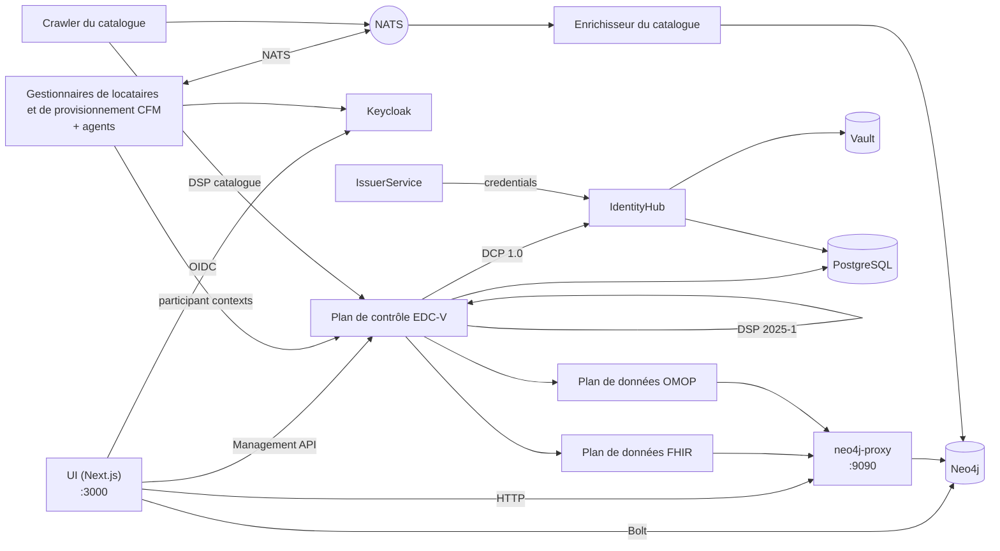

# La pile et l’environnement de développement

Le nom de chaque partie du hub, ce qu’elle fait et comment les parties
s’assemblent, puis la manière de les exécuter sur un ordinateur portable. Les décisions derrière chaque
partie se trouvent dans les ADR liés depuis sa ligne ; le journal complet des pièges est
[`docs/gotchas.md`](../gotchas.md).

## Glossaire

### Protocoles

| Terme             | Ce que c’est                                                                                                                                                                                                                                                                                                           | Décision                                                                |
| ----------------- | ---------------------------------------------------------------------------------------------------------------------------------------------------------------------------------------------------------------------------------------------------------------------------------------------------------------------- | ----------------------------------------------------------------------- |
| **DSP 2025-1**    | L’Eclipse Dataspace Protocol, version 2025-1 : la manière dont deux connecteurs échangent un catalogue (DCAT), négocient un contrat sur une offre ODRL et exécutent un transfert. Le plan de contrôle le parle sous `/api/dsp/<participant>/2025-1/`.                                                                  | [ADR-007](../ADRs/ADR-007-did-web-dsp-negotiation.md)                   |
| **DCP 1.0**       | Le Decentralised Claims Protocol : la manière dont un participant prouve qui il est. Chacun possède un DID `did:web` et détient des attestations vérifiables (une `MembershipCredential`, des attestations de rôle de l’EEDS) ; une contrepartie demande une présentation au lieu de se fier à une connexion centrale. | [ADR-009](../ADRs/ADR-009-issuerservice-credential-fix.md)              |
| **ODRL 2.2**      | Le langage de politique d’une offre : qui peut utiliser un ensemble de données, dans quel but, au titre de quelle autorisation.                                                                                                                                                                                        | [ADR-013](../ADRs/ADR-013-simpl-open-alignment.md)                      |
| **HealthDCAT-AP** | Le vocabulaire de catalogue des ensembles de données de santé, Release 8 depuis #700.                                                                                                                                                                                                                                  | [ADR-063](../ADRs/ADR-063-healthdcat-ap-release-8-and-its-namespace.md) |
| **did:web**       | Un DID résolu via HTTPS. Deux formes coexistent, une forme stable dans le graphe et l’UI et une forme résolvable dans la couche EDC ; [`api-conventions.md`](https://github.com/ma3u/MinimumViableHealthDataspacev2/blob/main/.claude/rules/api-conventions.md) explique laquelle va où.                               | [ADR-007](../ADRs/ADR-007-did-web-dsp-negotiation.md)                   |

### Le connecteur : EDC-V

| Terme                | Ce que c’est                                                                                                                                                                                                                                                                                                                                           | Décision                                                                                                                                |
| -------------------- | ------------------------------------------------------------------------------------------------------------------------------------------------------------------------------------------------------------------------------------------------------------------------------------------------------------------------------------------------------ | --------------------------------------------------------------------------------------------------------------------------------------- |
| **EDC-V**            | Eclipse Dataspace Components, en version virtuelle : un seul runtime EDC multi-tenant dans lequel chaque participant est un _contexte de participant_ plutôt que son propre connecteur. Le hub exécute EDC 0.18 à partir des images JAD.                                                                                                               | [ADR-024](../ADRs/ADR-024-full-edc-provisioning-per-participant.md), [ADR-055](../ADRs/ADR-055-azure-runs-the-compose-jad-build.md)     |
| **Plan de contrôle** | Le runtime EDC-V qui détient les assets, les politiques et les définitions de contrat, négocie les contrats via DSP et lance les transferts. Management API sur `:11003`.                                                                                                                                                                              | [ADR-002](../ADRs/ADR-002-edc-data-plane-architecture.md)                                                                               |
| **Plans de données** | Deux, un par type de transfert : `dataplane-fhir` pousse du FHIR R4 (`:11002`), `dataplane-omop` sert l’OMOP CDM en mode pull (`:11012`). Ils déplacent les données sur lesquelles le plan de contrôle s’est accordé et vérifient le jeton EDR de chaque requête.                                                                                      | [ADR-002](../ADRs/ADR-002-edc-data-plane-architecture.md)                                                                               |
| **IdentityHub**      | Le portefeuille DCP de chaque participant : son document DID, ses clés (dans Vault) et les attestations qu’il détient ; il répond aux demandes de présentation. `:11005`.                                                                                                                                                                              | [ADR-009](../ADRs/ADR-009-issuerservice-credential-fix.md)                                                                              |
| **IssuerService**    | L’émetteur d’attestations du hub : il détient les définitions d’attestations et émet des attestations aux détenteurs via DCP. `:10013`. Une deuxième instance, `simpl-ga-issuer` (`:10023`), joue l’autorité de gouvernance Simpl ; `rogue-issuer` (`:10033`) ne figure sur aucune liste de confiance et ne démarre que pour les contrôles d’identité. | [ADR-009](../ADRs/ADR-009-issuerservice-credential-fix.md), [ADR-064](../ADRs/ADR-064-simpl-open-through-the-outside-agent-dcp-path.md) |
| **Siglet**           | Signe les jetons des plans de données d’EDC 0.18 (Eclipse Dataplane Core).                                                                                                                                                                                                                                                                             | [ADR-055](../ADRs/ADR-055-azure-runs-the-compose-jad-build.md)                                                                          |

### L’exécuter : JAD et CFM

| Terme          | Ce que c’est                                                                                                                                                                                                                                                                                                                                                                                                                                     | Décision                                                                                                                            |
| -------------- | ------------------------------------------------------------------------------------------------------------------------------------------------------------------------------------------------------------------------------------------------------------------------------------------------------------------------------------------------------------------------------------------------------------------------------------------------ | ----------------------------------------------------------------------------------------------------------------------------------- |
| **JAD**        | La Joint Architecture Demo : le déploiement de référence d’EDC-V (images `ghcr.io/metaform/jad/*`, épinglées par commit). Ici, c’est `docker-compose.jad.yml` plus les seeds et la configuration de `jad/`, superposés à `docker-compose.yml`. Azure exécute la même construction.                                                                                                                                                               | [ADR-005](../ADRs/ADR-005-jad-cfm-source-builds.md), [ADR-055](../ADRs/ADR-055-azure-runs-the-compose-jad-build.md)                 |
| **CFM**        | Le Connector Fabric Manager, le plan de gestion au-dessus d’EDC-V : le **gestionnaire de locataires** (`:11006`) crée un locataire par organisation, le **gestionnaire de provisionnement** (`:11007`) provisionne ce dont il a besoin, et quatre **agents** font le travail (client Keycloak, contexte de participant EDC-V, enregistrement, intégration). `cfm-cp-shim` fait le pont entre les agents épinglés et la version d’API d’EDC 0.18. | [ADR-005](../ADRs/ADR-005-jad-cfm-source-builds.md)                                                                                 |
| **Vault**      | HashiCorp Vault détient les clés privées de chaque participant et les secrets EDC. Adossé à des fichiers en local depuis le 2026-09-26 (`jad/vault.hcl`, avec un sidecar `vault-unseal`), sur le Flexible Server sur Azure. Jamais `-dev` : un redémarrage emporterait toutes les clés.                                                                                                                                                          | [ADR-046](../ADRs/ADR-046-vault-keeps-its-state-on-the-flexible-server.md), [ADR-047](../ADRs/ADR-047-vault-stays-up-off-hours.md)  |
| **Keycloak**   | Connexion OIDC pour l’UI et les clients de service, realm `edcv`, `:8080`. Le client de l’UI est confidentiel, avec PKCE S256.                                                                                                                                                                                                                                                                                                                   | [ADR-025](../ADRs/ADR-025-keycloak-custom-domain.md)                                                                                |
| **PostgreSQL** | Le stockage d’exécution des services EDC et de Keycloak, une base de données chacun (`jad/init-postgres.sql`). Le Flexible Server sur Azure.                                                                                                                                                                                                                                                                                                     | [ADR-001](../ADRs/ADR-001-postgresql-neo4j-split.md), [ADR-041](../ADRs/ADR-041-managed-postgres-on-azure-containerised-locally.md) |
| **NATS**       | Le maillage d’événements (JetStream) entre les gestionnaires et les agents de CFM, et entre le crawler et l’enrichisseur du catalogue. `:4222`.                                                                                                                                                                                                                                                                                                  | [ADR-020](../ADRs/ADR-020-cross-participant-dataset-discovery.md)                                                                   |
| **Traefik**    | La passerelle devant les services JAD, `:80`, tableau de bord sur `:8090`.                                                                                                                                                                                                                                                                                                                                                                       |                                                                                                                                     |

### Les services propres au hub

| Terme                | Ce que c’est                                                                                                                                                                                                                                                      | Décision                                                                                                                        |
| -------------------- | ----------------------------------------------------------------------------------------------------------------------------------------------------------------------------------------------------------------------------------------------------------------- | ------------------------------------------------------------------------------------------------------------------------------- |
| **UI**               | L’application Next.js dans `ui/` : les pages de chaque persona et les routes `/api/*` qui les servent. Conteneur `health-dataspace-ui`.                                                                                                                           | [ADR-004](../ADRs/ADR-004-nextjs-unified-frontend.md), [ADR-044](../ADRs/ADR-044-every-api-route-needs-a-session.md)            |
| **Neo4j**            | Le graphe de connaissances à cinq couches : place de marché (DSP), HealthDCAT-AP, FHIR R4, OMOP CDM et ontologies. `:7474` navigateur, `:7687` Bolt.                                                                                                              | [ADR-001](../ADRs/ADR-001-postgresql-neo4j-split.md), [ADR-030](../ADRs/ADR-030-neo4j-2025-lts-migration.md)                    |
| **neo4j-proxy**      | `services/neo4j-proxy/`, Express sur `:9090` : les points de terminaison FHIR et OMOP qu’appellent les plans de données, le moteur de requêtes en langage naturel, la requête fédérée et le catalogue en HealthDCAT-AP.                                           | [ADR-043](../ADRs/ADR-043-graph-access-direct-or-through-the-proxy.md)                                                          |
| **Catalog crawler**  | `services/catalog-crawler/`, Python : récupère le catalogue DSP de chaque participant toutes les cinq minutes et le publie sur NATS (`dataspace.catalog.raw`).                                                                                                    | [ADR-020](../ADRs/ADR-020-cross-participant-dataset-discovery.md)                                                               |
| **Catalog enricher** | `services/catalog-enricher/`, Python : lit ces catalogues depuis NATS, les convertit en HealthDCAT-AP et les fusionne dans Neo4j sous forme de nœuds `:HealthDataset`, de sorte qu’une question sur les ensembles de données atteigne ceux de chaque participant. | [ADR-020](../ADRs/ADR-020-cross-participant-dataset-discovery.md), [ADR-003](../ADRs/ADR-003-healthdcat-ap-alignment.md)        |
| **Klarbefund**       | L’application iPhone dans `clients/ios/` : elle numérise un compte rendu de laboratoire sur l’appareil et se connecte au hub comme dossier médical électronique du patient.                                                                                       | [ADR-033](../ADRs/ADR-033-lab-report-extraction-pipeline.md), [ADR-049](../ADRs/ADR-049-klarbefund-connects-by-device-grant.md) |

### Comment les éléments s’assemblent



Un participant est créé une seule fois par CFM : le gestionnaire de locataires crée le locataire,
les agents lui donnent un client Keycloak, un contexte de participant dans EDC-V et un DID
dans l’IdentityHub, et l’IssuerService émet ses attestations. À partir de là,
le plan de contrôle négocie en son nom via DSP, en prouvant qui il est via
DCP, et un plan de données déplace les données depuis le proxy Neo4j dès qu’un contrat
est en vigueur. L’UI lit le graphe directement pour ses pages et passe par le
plan de contrôle pour tout ce qui relève d’un échange.

## Environnement de développement

### Prérequis

| Besoin                                | Pour                                                                                                     |
| ------------------------------------- | -------------------------------------------------------------------------------------------------------- |
| Node.js 20 ou ultérieur, npm          | l’UI et le proxy Neo4j                                                                                   |
| Docker avec Compose v2                | Neo4j, et la pile JAD complète ; donnez à Docker **8 Go de mémoire** pour JAD                            |
| Python 3.11 ou ultérieur              | les contrôles du dépôt (`scripts/*.py`) et les services de catalogue                                     |
| `pre-commit`                          | les hooks : `pip install pre-commit && pre-commit install --hook-type pre-commit --hook-type pre-push`   |
| gitleaks, semgrep, actionlint, lychee | facultatifs en local (chaque hook avertit et passe son tour sans eux) ; le PR Gate exécute ce qui compte |
| Xcode 27 et `xcodegen`                | uniquement pour l’application iPhone (SDK iOS 26)                                                        |

### Deux manières de l’exécuter

| Pile             | Démarrage                                                                                                                        | Ce que vous obtenez                                                                                                                    |
| ---------------- | -------------------------------------------------------------------------------------------------------------------------------- | -------------------------------------------------------------------------------------------------------------------------------------- |
| **Minimale**     | `docker compose up -d neo4j`, charger le schéma et les données, `cd ui && npm install && npm run dev`                            | le graphe et chaque page qui le lit, sur http://localhost:3000 ; pas de Keycloak, donc la connexion nécessite le mode persona statique |
| **JAD complète** | `docker compose -f docker-compose.yml -f docker-compose.jad.yml up -d`, puis `./scripts/bootstrap-jad.sh` et `./jad/seed-all.sh` | chaque service du glossaire, le conteneur de l’UI sur http://localhost:3003, la connexion via Keycloak                                 |

Chargement du graphe pour la pile minimale (les deux fichiers sont idempotents) :

```bash
cat neo4j/init-schema.cypher | docker exec -i health-dataspace-neo4j \
  cypher-shell -u neo4j -p healthdataspace
cat neo4j/insert-synthetic-schema-data.cypher | docker exec -i health-dataspace-neo4j \
  cypher-shell -u neo4j -p healthdataspace
```

`docker compose up -d` sans nom de service construit aussi l’UI sous forme de
conteneur `health-dataspace-ui` sur `:3000` et `:3003` ; ne démarrez que `neo4j`
si vous voulez `npm run dev` sur `:3000`.

### Les phases d’amorçage, dans l’ordre

`./jad/seed-all.sh` exécute sept phases, et chacune a besoin de la précédente, si bien qu’une
phase en échec invalide toutes les suivantes. Reprenez avec `--from N`, exécutez-en une seule avec
`--only N`.

| Phase | Script                         | Effet                                                                 |
| ----: | ------------------------------ | --------------------------------------------------------------------- |
|     1 | `seed-health-tenants.sh`       | cinq locataires participants via CFM                                  |
|     2 | `seed-ehds-credentials.sh`     | les types d’attestations de l’EEDS sur l’IssuerService                |
|     3 | `seed-ehds-policies.sh`        | les politiques ODRL de chaque participant                             |
|     4 | `seed-data-assets.sh`          | les data assets et les définitions de contrat sur EDC-V               |
|     5 | `seed-contract-negotiation.sh` | les négociations de PharmaCo vers AlphaKlinik et les plans de données |
|     6 | `seed-federated-catalog.sh`    | la négociation de catalogue de MedReg vers Limburg Medical Centre     |
|     7 | `seed-data-transfer.sh`        | les jetons EDR et les transferts via les plans de données             |

Le runbook est [Amorçage de la pile JAD](../knowledge/runbooks/jad-stack-seeding.md).

### Ports

| Port       | Service                            | Port         | Service                                               |
| ---------- | ---------------------------------- | ------------ | ----------------------------------------------------- |
| 3000       | UI (`npm run dev` ou le conteneur) | 11002        | plan de données FHIR                                  |
| 3003       | conteneur de l’UI (JAD)            | 11003        | plan de contrôle, Management API                      |
| 7474, 7687 | navigateur Neo4j, Bolt             | 11005        | IdentityHub                                           |
| 8080, 9000 | Keycloak, son port de gestion      | 11006, 11007 | gestionnaires de locataires et de provisionnement CFM |
| 8200       | Vault                              | 11012        | plan de données OMOP                                  |
| 9090       | neo4j-proxy                        | 10013        | IssuerService                                         |
| 4222, 8222 | NATS, sa supervision               | 10023, 10033 | émetteur Simpl GA, émetteur malveillant               |
| 5432       | PostgreSQL                         | 80, 8090     | Traefik, son tableau de bord                          |

### Variables d’environnement

L’UI lit sa configuration dans l’environnement ; `ui/.env.example` et
`ui/.env.local.example` sont les modèles à copier. Celles que vous rencontrez en premier :

| Variable                                                                                                          | Ce qu’elle définit                                                                           |
| ----------------------------------------------------------------------------------------------------------------- | -------------------------------------------------------------------------------------------- |
| `NEO4J_URI`, `NEO4J_USER`, `NEO4J_PASSWORD`                                                                       | le graphe ; `neo4j` / `healthdataspace` est réservé au développement local                   |
| `NEO4J_PROXY_URL`                                                                                                 | le proxy, `http://localhost:9090` par défaut (`ui/src/lib/proxy.ts`)                         |
| `NEXTAUTH_URL`, `NEXTAUTH_SECRET`                                                                                 | NextAuth ; le secret signe aussi les sessions que forgent les tests d’API                    |
| `KEYCLOAK_PUBLIC_URL`, `KEYCLOAK_INTERNAL_URL`, `KEYCLOAK_ISSUER`, `KEYCLOAK_CLIENT_ID`, `KEYCLOAK_CLIENT_SECRET` | la connexion ; jamais `wellKnown` (piège 5 dans `CLAUDE.md`)                                 |
| `EDC_MANAGEMENT_URL`, `EDC_IDENTITY_URL`, `EDC_ISSUER_URL`, `EDC_TENANT_URL`, `EDC_PROVISION_URL`                 | les services EDC-V et CFM                                                                    |
| `NEXT_PUBLIC_STATIC_EXPORT=true`                                                                                  | la construction GitHub Pages : pas de routes d’API, des fixtures tirées de `ui/public/mock/` |

### L’application iPhone

`clients/ios/` est un paquet Swift et un projet XcodeGen ; il n’a pas besoin
du hub pour se construire ni pour exécuter ses tests.

```bash
cd clients/ios
brew install xcodegen      # once
swift test                 # the parser and provenance model
xcodegen generate && open MeinBefund.xcodeproj
```

La construction pour le simulateur nécessite une signature ad hoc (`CODE_SIGN_IDENTITY="-"`), sinon
chaque appel au trousseau échoue. Une construction pour l’appareil et un envoi vers TestFlight nécessitent une équipe
Apple Developer : `Scripts/install-device.sh`, `Scripts/archive-and-upload.sh`.
Le [guide du développeur de Klarbefund](../klarbefund/developer-guide.md) contient le
reste, et `Scripts/run-ui-tests.sh` exécute les tests à l’écran.

### Les pièges à connaître dès le premier jour

Le journal complet, daté, est [`docs/gotchas.md`](../gotchas.md). Ceux qui ont coûté
le plus de temps :

- **Vault doit conserver son état.** Si l’IdentityHub journalise `Private key ... not
found`, vérifiez que `health-dataspace-vault-unseal` a signalé `ready`.
- **Les phases d’amorçage sont strictement ordonnées** ; reprenez une exécution en échec avec `--from`.
- **L’export statique n’a pas de routes d’API.** Chaque page qui lit `/api/...`
  a besoin d’une fixture dans `ui/public/mock/`, et un test échoue sans elle.
- **Pre-commit réécrit des fichiers** (Prettier, les docs facts). Indexez-les à nouveau
  et commitez à nouveau ; vérifiez que `HEAD` a bougé.
- **Un 200 de la découverte Keycloak ne prouve rien** : il vient du cache. Prouvez la connexion
  avec `scripts/azure/check-keycloak-health.sh`.
- **Container Apps met `:latest` en cache** ; un déploiement pousse une nouvelle révision plutôt
  que de redémarrer.
