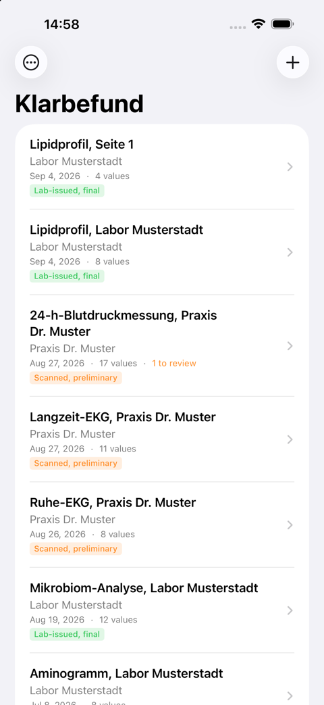
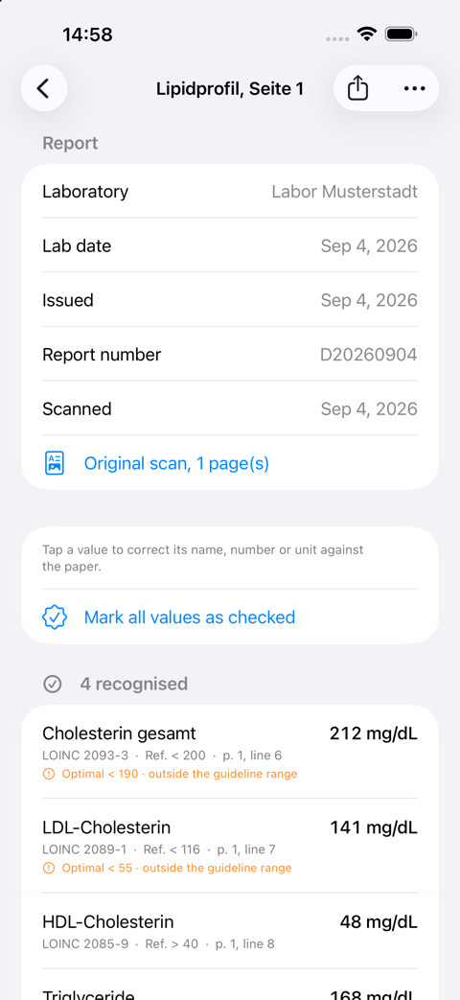

# Guide du développeur de Klarbefund

Comment compiler, exécuter, tester et modifier l’application iPhone dans
[`clients/ios/`](../../../../clients/ios/). Le [guide d’utilisation](user-guide.md) montre
ce que voit une personne ; ce guide montre ce qui le rend possible. La fiche de commandes
abrégée est [`clients/ios/README.md`](../../../../clients/ios/README.md) ; le travail est suivi
dans le [ticket #186](https://github.com/ma3u/MinimumViableHealthDataspacev2/issues/186).

Chaque capture d’écran et chaque nombre de ce guide proviennent du jeu de données de développement
fictif de l’application. Aucun compte rendu réel n’intervient nulle part dans le
dépôt, et [les deux règles de la fin](#two-rules-that-are-not-negotiable)
expliquent pourquoi ce point n’est pas négociable.

## Ce dont vous avez besoin

| Outil              | Version                  | Pourquoi                                                                                                          |
| ------------------ | ------------------------ | ----------------------------------------------------------------------------------------------------------------- |
| macOS avec Xcode   | Xcode 27, SDK iOS 26     | L’application cible iOS 26 ; le paquet Swift déclare macOS 26 pour les outils                                     |
| Swift              | 6.0, concurrence stricte | `Package.swift` et `project.yml` la fixent tous deux                                                              |
| XcodeGen           | `brew install xcodegen`  | Le `.xcodeproj` est généré à partir de `project.yml` et n’est jamais commité                                      |
| Node               | comme pour `ui/`         | Uniquement pour régénérer le dictionnaire à partir de `services/epa-ingest`                                       |
| PlantUML, Graphviz | `brew install plantuml`  | Uniquement pour refaire le rendu des diagrammes de ce guide                                                       |
| Un iPhone          | iOS 26 ou ultérieur      | Uniquement pour l’appareil photo, Face ID, App Attest et TestFlight ; tout le reste fonctionne dans le simulateur |

## Comment l’ensemble est construit


Source : [`diagrams/klarbefund-architecture.puml`](../../../klarbefund/diagrams/klarbefund-architecture.puml),
rendu avec `scripts/render-plantuml.sh docs/klarbefund/diagrams/*.puml`.

La vue suit ArchiMate 3.2 : la couche métier (jaune) indique qui fait
quoi, la couche applicative (bleue) les services que fournit le logiciel et
les composants qui les réalisent, la couche technologique (verte) ce sur quoi tout
fonctionne. Une flèche allant d’une bande inférieure vers une bande supérieure signifie « sert » ; une flèche
en pointillés à tête creuse signifie « réalise ». Trois choses à en retenir :

- **`Sources/Shared`** est un paquet Swift qui se compile pour iOS et macOS. Il
  contient le parseur, le post-traitement de la reconnaissance de texte, le dictionnaire généré des analytes
  et les plages de référence, le modèle d’enregistrement avec sa provenance, et
  les formats d’export (FHIR R4, OMOP CDM, le paquet de diagnostics). Rien de ce qu’il
  contient ne touche au réseau, au trousseau ou au stockage, c’est pourquoi chaque
  nombre que calcule l’application peut être reproduit sur un Mac avec `swift test`.
- **`Sources/MeinBefund`** est l’application : les vues SwiftUI, la numérisation VisionKit, le
  stockage scellé, la feuille de partage des exports, la connexion à l’EEDS, le verrouillage de l’application,
  les fournisseurs d’analyse, ainsi que les données de démonstration et l’autotest réservés au mode debug.
- **`Tools/`** sont quatre programmes en ligne de commande s’appuyant sur le paquet Shared :
  `LabFile` importe un PDF ou une image exactement comme le ferait l’application, `ScanReplay`
  fait repasser un export de diagnostics par le parseur actuel, `AnalyteParity`
  prouve que le dictionnaire généré est identique à sa source TypeScript, et `IconGen`
  dessine l’icône de l’application.

```
clients/ios/
  project.yml                    XcodeGen spec: the Shared framework and the MeinBefund app
  Package.swift                  SwiftPM: Shared, the four tools, SharedTests
  Sources/Shared/                parser, provenance model, formats; *.generated.swift are generated
  Sources/MeinBefund/            the app; en.lproj and de.lproj hold the strings
  Tools/{LabFile,ScanReplay,AnalyteParity,IconGen}/
  Tests/SharedTests/             Swift Testing: what the app computes
  Tests/UITests/                 XCUITest: what it shows, and what a tap does
  Scripts/                       build, install, upload, screenshots, localisation, CodeQL
  appstore/                      App Store Connect texts and the screenshot upload
```

## Compiler et exécuter

```bash
cd clients/ios
brew install xcodegen                          # once
swift test                                     # the Shared package, on the Mac
swift run AnalyteParity                        # the generated table agrees with its source
xcodegen generate && open MeinBefund.xcodeproj # then run the MeinBefund scheme in Xcode
```

Depuis la ligne de commande vers un simulateur, notez la **signature ad hoc** :
sans elle, chaque appel au trousseau échoue avec `-34018` et le stockage ne peut pas
créer sa clé.

```bash
xcodebuild -project MeinBefund.xcodeproj -scheme MeinBefund \
  -sdk iphonesimulator -destination 'platform=iOS Simulator,name=iPhone 17 Pro' \
  CODE_SIGN_IDENTITY="-" CODE_SIGNING_REQUIRED=YES build
```

Sur un iPhone connecté : `Scripts/install-device.sh`. Le projet généré
ne comporte aucune équipe de signature, si bien qu’un simple `xcodebuild` pour un appareil échoue ; le
script en fournit une à partir de `TEAM_ID` ou du trousseau, et installe ce qu’il a
compilé. TestFlight : `Scripts/archive-and-upload.sh` ; son en-tête nomme les quatre
éléments qui doivent d’abord exister dans le compte Apple Developer. La version est
fixée dans `project.yml` : `MARKETING_VERSION` correspond à la fiche App Store Connect
et `CURRENT_PROJECT_VERSION` augmente à chaque téléversement, car App
Store Connect refuse un numéro de build qu’il a déjà vu, et ce après le téléversement.

## Données de démonstration et arguments de lancement

 

Chacun des arguments de lancement ci-dessous n’existe que dans un build Debug. Les contrôles reposent sur
`#if DEBUG`, et pas seulement sur un indicateur : un indicateur peut être découvert, du code qui n’est pas
compilé ne le peut pas.

| Argument               | Ce qu’il fait                                                                                                                                                                                            |
| ---------------------- | -------------------------------------------------------------------------------------------------------------------------------------------------------------------------------------------------------- |
| `-MBDemoSeed`          | Deux comptes rendus fictifs, en mémoire uniquement. Suffisant pour une capture d’écran ; c’est avec lui que se lance chaque test d’interface.                                                            |
| `-MBDevData`           | Sept comptes rendus fictifs sur trois ans et quatre sources, construits dans le code : une tendance a une forme, la liste des lignes non associées contient des lignes, chaque compte rendu a des pages. |
| `-MBShot <screen>`     | Ouvre directement un écran une fois les comptes rendus chargés : `list detail scan trends reference history profile consent settings privacy consents connect`.                                          |
| `-MBSelfTest`          | Fait passer un compte rendu synthétique par l’ensemble du pipeline dans la cible de l’application et journalise 27 contrôles (voir [L’autotest](#the-self-test)).                                        |
| `-MBExportDiagnostics` | Construit l’archive de diagnostics dans le répertoire temporaire de l’application pour `Scripts/pull-diagnostics.sh`.                                                                                    |

Le jeu de données de développement est **construit, pas stocké**. Une ligne indique le libellé, la valeur,
l’unité et la plage imprimée par le laboratoire, et `Analytes.lookup` la code
exactement comme il code une numérisation. Aucun code du jeu de données ne peut être faux, une ligne que le
dictionnaire ne sait pas coder atterrit d’elle-même dans la liste des lignes non associées, et le
jeu de données suit le dictionnaire lorsque celui-ci change. Les pages sont
dessinées par `SyntheticSheet`, le même moteur de rendu que lisent les tests.

Un lancement de démonstration ne se verrouille jamais : le verrouillage de l’application lit l’indicateur de seed et reste ouvert,
de sorte que les tests d’interface et le script de captures d’écran s’exécutent là où personne ne peut répondre à une
demande de code. Dans un build de production, ni l’indicateur ni l’exception n’existent.

Les captures d’écran pour la documentation et l’App Store proviennent d’un seul script,
qui lance chaque écran par argument plutôt que par des touchers scriptés, de sorte qu’une
nouvelle prise de vue après un changement de mise en page ne nécessite pas de nouvelles coordonnées :

```bash
SEED=-MBDevData OUT=/tmp/shots SCREENS="list detail trends" Scripts/capture-screenshots.sh
Scripts/capture-screenshots.sh                 # the App Store set, size-checked, into appstore/screenshots/en
```

## De l’appareil photo au stockage


Source : [`diagrams/klarbefund-scan-pipeline.puml`](../../../klarbefund/diagrams/klarbefund-scan-pipeline.puml).

L’ordre est fixe et chaque étape a un seul responsable
([ADR-033](../../../ADRs/ADR-033-lab-report-extraction-pipeline.md)) :

1. **La provenance d’abord.** `LabImport` décide d’après le fichier, jamais d’après son
   extension : un PDF contenant la couche de texte propre du laboratoire est
   `lab-issued-digital` et ses Observations sont `final` ; tout ce qui doit
   passer par la reconnaissance de texte est `ocr-transcribed` et `preliminary`. C’est
   strict à dessein, car marquer une transcription comme `final` est la défaillance
   qui compte.
2. **Reconnaissance.** `VisionDocumentReader` exécute deux passes Vision, en allemand et en
   anglais, avec la correction linguistique **désactivée** : « corriger » `Lp(a)` ou une
   virgule décimale est franchement nuisible. `DocumentReconciler` fusionne les passes
   et `TableRoles` déduit, pour chaque tableau, quelle colonne contient le libellé, la valeur, l’unité
   et la plage.
3. **Analyse syntaxique.** `LabLineParser` lit chaque ligne. Lorsque l’analyse ordinaire ne trouve
   rien, les lecteurs de feuilles prennent le relais : mesure ambulatoire de la pression artérielle,
   ECG de repos et d’effort, Holter, épreuve d’effort cardio-respiratoire, lactate,
   profil glycémique CGM, DXA, et l’écran d’une balance à impédancemétrie, qui est
   un tableau de bord et non un compte rendu, et dont seule la valeur principale est lue.
4. **Codage.** `Analytes.lookup(label, unit)` choisit le code LOINC. L’unité
   décide, jamais le nom seul. Une grandeur que LOINC ne code pas (la graisse viscérale
   en tant que masse, un ratio d’eau) est conservée avec son unité, sans code et avec une
   justification obligatoire ; un organisme issu d’une analyse de selles porte son identifiant NCBI Taxonomy,
   car LOINC nomme des tests et non des organismes.
5. **L’en-tête.** `ReportMetadata` et `PrintedFields` lisent sur la feuille le laboratoire,
   la date de laboratoire, la date d’émission et le numéro du compte rendu ; la date de laboratoire
   est préférée aux dates de réception et d’émission, et la personne la confirme
   avant l’enregistrement.
6. **Conservation.** Chaque ligne qui ressemble à une mesure finit codée,
   non associée ou non lue. Une ligne qui ne figure dans aucune des trois catégories est impossible à distinguer
   d’une ligne qui n’a jamais été imprimée, et c’est exactement ainsi qu’une ligne d’HbA1c a un jour
   disparu (`docs/gotchas.md`, 2026-09-19). L’autotest le vérifie.
7. **Vérification et enregistrement.** `ReviewViews` montre ce qui a été lu ; `ReportStore`
   le scelle.

`swift run LabFile ~/Downloads/befund.pdf` exécute les étapes 1 à 6 sur un Mac et
affiche la provenance, l’en-tête et chaque ligne comme codée, non associée ou
non lue ; `--values` ajoute les nombres, `--rows` ajoute la mise en page de la reconnaissance de texte.
Il refuse tout chemin situé à l’intérieur de ce dépôt.

## Le stockage et le verrouillage

Trois fichiers scellés par compte rendu sous `Application Support/Reports`, chacun
en AES-GCM sous la même clé du trousseau, avec protection complète des fichiers, exclus de la
sauvegarde :

```
<id>.sealed         the record (LabReport)
<id>.scan.sealed    the pages as one PDF
<id>.diag.sealed    the scan's diagnostics (ScanDiagnostics)
profile.sealed      sex, date of birth, height (Profile)
consents.sealed     the three consent decisions (ConsentLedger)
```

La clé est `ThisDeviceOnly` et indisponible tant que le téléphone est verrouillé, de sorte qu’une
copie du conteneur ne donne que du texte chiffré et que l’instantané que le système prend de l’application
échoue avec `EPERM` ; `SecurityPostureTests` fige les réglages de build et
l’[auto-évaluation](../../../klarbefund/self-assessment.md) consigne la mesure. Les enregistrements
écrits avant l’existence d’un champ se décodent toujours : chaque champ ultérieur est facultatif ou
a une valeur par défaut.

Le verrouillage de l’application ([ADR-060](../../../ADRs/ADR-060-the-app-locks-with-face-id-and-answers-pinning-and-jailbreak-detection.md))
se compose de deux types. `AppLockPolicy`, dans Shared, décide _si_ une vérification est due
et est pur, de sorte que `AppLockPolicyTests` s’exécute sur un Mac ; `AppLock`, dans l’application, demande
à LocalAuthentication _comment_, par Face ID, Touch ID ou le code, et
`PrivacyCover` dessine le cache que voit le sélecteur d’applications. Le même ADR explique pourquoi
l’épinglage de certificats et la détection du jailbreak ont été écartés.

## Le dictionnaire est généré, jamais copié

`Sources/Shared/Analytes.generated.swift`, `ReferenceRanges.generated.swift`
et `PromptText.generated.swift` sont produits à partir de
[`services/epa-ingest`](../../../../services/epa-ingest) :

```bash
cd services/epa-ingest && npm run generate:swift
cd clients/ios && swift run AnalyteParity      # 1589 codings, 71 units today
```

Ne les modifiez pas à la main. Ajoutez un analyte dans `analytes.ts` ou une plage dans
`reference-ranges.ts`, régénérez, commitez les deux. La CI échoue lorsqu’un fichier généré
n’est plus à jour par rapport à sa source, car une copie périmée est exactement la divergence
silencieuse que le monorepo a été choisi pour empêcher : un iPhone qui code Lp(a) d’une manière
et le service d’ingestion d’une autre, constaté au moment où une valeur parvient à un médecin.

Le générateur de plages de référence refuse une plage dont le dictionnaire ne
connaît pas l’analyte ou dont l’unité n’est pas définie pour cet analyte. Seuls les analytes disposant
d’une source publiée citable reçoivent une plage
([ADR-039](../../../ADRs/ADR-039-published-reference-ranges.md)) ; pour tout autre
analyte, l’écran Tendances trace la plage imprimée par le propre laboratoire de la personne.

## Les tests, et à quoi sert chacun

```bash
swift test                                     # Swift Testing: what the app computes
Scripts/run-ui-tests.sh                        # XCUITest: what it shows, and what a tap does
swift test --filter ExtractionAccuracyTests    # the accuracy benchmark, JSON to docs/klarbefund/accuracy-benchmark.json
swift test --filter SecurityPostureTests       # the build settings the self-assessment relies on
```

**La suite unitaire** (`Tests/SharedTests/`) est la plus grande et détecte ce qui
peut se raisonner : une unité qui choisit le mauvais code, une date lue sur la
mauvaise ligne, une colonne d’export au mauvais endroit. `FhirBundleParityTests` aligne
le bundle sur le bundle de référence qu’écrit `services/epa-ingest`, de sorte que les deux producteurs
émettent le même FHIR pour la même feuille.

**La suite d’interface** (`Tests/UITests/`) existe parce que la suite unitaire n’a détecté aucun
des derniers défauts : une fiche rognée au bord du graphique, une sélection
qui s’oubliait au rendu suivant, `LOINC Optional("2093-3")` sur le seul
écran qu’une personne compare avec son propre papier. Chaque test se lance avec
`-MBDemoSeed` et atteint son écran avec `-MBShot`, de sorte qu’il échoue lorsque ce qu’il
vérifie change, et non lorsqu’un bouton se déplace. Trois leçons apprises à la dure
figurent dans `docs/gotchas.md` : un `accessibilityIdentifier` sur un conteneur renomme
tout ce qu’il contient ; un `Button` dont le libellé est `Color.clear` n’est pas dans
l’arbre d’accessibilité ; la sélection de Swift Charts répond à un doigt et non à un
toucher synthétisé, si bien que de vrais boutons sont posés sur les marques.

### L’autotest

Tout ce qui suit l’appareil photo s’exécute dans la cible de l’application, et donc pas dans
`swift test` : le stockage scellé, le PDF des pages, l’export. `-MBSelfTest`
fait passer un compte rendu synthétique par toute la chaîne et journalise chacun de ses 27
contrôles : reconnaissance et codage, une citation par valeur, la date de laboratoire lue dans
l’en-tête, les pages en PDF, le déchiffrement des trois fichiers scellés, la relecture
de l’enregistrement de diagnostics qui reproduit exactement l’extraction, la construction de l’archive,
et l’export pour le médecin qui tient dans les 25 Mo de l’ePA avec les pages
jointes.

```bash
xcrun simctl launch <udid> red.mabu.meinbefund -MBSelfTest
xcrun simctl spawn <udid> log show --last 2m --predicate 'subsystem == "red.mabu.meinbefund"' --style compact
```

### Le banc d’essai de précision

`ExtractionAccuracyTests` lit des feuilles synthétiques au contenu connu et écrit
la précision au niveau des champs dans `docs/klarbefund/accuracy-benchmark.json` ; la page des
[preuves](../../../klarbefund/evidence.md) la cite et [run-on-mac](../../../klarbefund/run-on-mac.md)
reproduit chaque nombre. Un compte rendu réel se mesure de la même manière, sur le
propre Mac de la personne et jamais dans le dépôt, avec `ScanReplay --truth`
par rapport à un `truth.json` écrit à la main à côté de l’export : il affiche quels champs
de quelles lignes étaient erronés, jamais les valeurs.

## Déboguer une feuille mal lue

Le stockage ne livre que du texte chiffré ; les éléments de preuve quittent donc le téléphone par la fonction
**Exporter les diagnostics** de l’application elle-même, qui demande une confirmation en toutes lettres et remet une
archive zip à la feuille de partage
([ADR-038](../../../ADRs/ADR-038-scan-retained-diagnostics-export.md)) :

```
klarbefund-diagnostics-<date>/
  about.json                 build, device, dictionary size, counts
  log.txt                    this session's log lines: counts and codes only
  <title>-<id8>/
    report.json              the stored record: values, metadata, page text
    diagnostics.json         both Vision passes, the reconciled rows, the layout
    scan.pdf                 the pages as scanned
```

Avec le téléphone branché en USB et un build Debug installé,
`Scripts/pull-diagnostics.sh` effectue l’export et la décompression en une seule fois, dans
`~/Downloads`. Décompressez **en dehors de ce dépôt**, puis :

```bash
swift run ScanReplay ~/Downloads/klarbefund-diagnostics-<date>          # every report, with the current parser
swift run ScanReplay ~/Downloads/klarbefund-diagnostics-<date> --ocr    # re-run Vision on scan.pdf
swift run ScanReplay ~/Downloads/klarbefund-diagnostics-<date> --truth  # accuracy against truth.json
```

La relecture affiche ce que le téléphone a codé, ce qui se code maintenant, ce qui est nouvellement codé
ou perdu, et chaque ligne avec sa raison. Ajoutez un analyte dans `analytes.ts`,
régénérez, relancez la relecture, et regardez les lignes de la vraie feuille passer de non associées à
codées sans la numériser à nouveau. Les deux outils refusent tout chemin situé à l’intérieur de
`clients/ios/`.

## La connexion au hub EEDS

L’écran patient du hub lance un octroi d’appareil (device grant) OAuth 2.0 pour le client
Keycloak public `klarbefund-app` et l’affiche sous forme de code QR portant un
lien `klarbefund://connect` ; l’application interroge Keycloak pour obtenir le jeton et
s’enregistre auprès du hub
([ADR-049](../../../ADRs/ADR-049-klarbefund-connects-by-device-grant.md)).

- `Shared/EHDSConnect.swift` : le lien, refusé à moins que son hub et son émetteur ne figurent
  dans `TrustedHub.production` (plus `.development` dans un build debug), et le
  mécanisme d’interrogation avec ses quatre réponses. `EHDSConnectTests` couvre chacune d’elles.
- `EHDSConnection.swift` : les jetons et un identifiant d’appareil dans le trousseau en
  `ThisDeviceOnly`, le rafraîchissement, l’enregistrement, la lecture du dossier, la déconnexion (qui
  révoque le jeton de rafraîchissement auprès de Keycloak), et les deux interrupteurs de synchronisation.
- `ConnectView.swift` : la feuille, le scanner de données de VisionKit limité aux codes QR,
  un champ de collage et « Est-ce votre compte ? ».
- **Créer un compte EEDS** ([ADR-054](../../../ADRs/ADR-054-klarbefund-creates-a-sandbox-account-with-app-attest.md))
  appelle les deux routes du hub qui répondent sans session ; le compte
  n’est créé que pour une demande dont l’attestation Apple App Attest est vérifiée,
  c’est pourquoi le simulateur affiche le bouton désactivé avec sa raison.
- **Envoyer mes comptes rendus** et **Envoyer les tendances de mes appareils**
  ([ADR-057](../../../ADRs/ADR-057-klarbefund-sends-weekly-device-means.md)) publient
  vers le propre dossier de la personne ; le dossier lui-même contient les comptes rendus, les vaccinations
  et le plan de médication ([ADR-059](../../../ADRs/ADR-059-the-record-holds-reports-vaccinations-and-the-medication-plan.md)).
- `ConnectUITests` et `AccountUITests` s’exécutent contre `DemoEHDSTransport` sous
  `-MBDemoSeed` ; `LiveConnectUITests` et `LiveAccountUITests` s’exécutent contre un
  vrai hub lorsqu’on leur fournit un lien récent
  (`docs/knowledge/runbooks/klarbefund-connect.md`).

## Exports

| Action                            | Producteur                   | Contenu                                                                               |
| --------------------------------- | ---------------------------- | ------------------------------------------------------------------------------------- |
| Partager pour mon médecin         | `ReportExport`, `FhirBundle` | Résumé PDF avec les pages originales en annexe, plus un bundle FHIR R4                |
| Exporter pour la recherche (OMOP) | `OmopExport`                 | OMOP CDM v5.4 `measurement.csv`, `person.csv`, `observation_period.csv`               |
| Exporter toutes mes données       | `DataExport`                 | chaque compte rendu, page, valeur, champ du profil et consentement, en JSON et en PDF |
| Exporter les diagnostics          | `DiagnosticsBundle`          | l’enregistrement, les deux passes Vision, les pages, le journal de session            |

Les tables OMOP portent partout `measurement_concept_id = 0`, délibérément :
associer LOINC à un concept OMOP nécessite le vocabulaire Athena, qui n’est pas sur
un téléphone, et inventer un identifiant placerait un identifiant erroné sur une vraie
mesure. La plage imprimée est conservée telle quelle dans `RawLabValue.referenceText`
et voyage sous la forme `referenceRange.text` ; une plage ne contenant aucun nombre ne survit
que là, et la règle rng-2 de FHIR le permet.

## Langues

L’anglais est la base, l’allemand la traduction, selon la langue du téléphone.
`Scripts/check-localization.sh` échoue lorsqu’une chaîne visible par l’utilisateur n’a pas
d’allemand ou lorsqu’une phrase allemande a été laissée dans la base anglaise ; il utilise
`xcodebuild -exportLocalizations`, le même extracteur que celui de l’éditeur de Xcode, de sorte
qu’il voit les littéraux `Text` de SwiftUI et les valeurs `INFOPLIST_KEY_*` qu’aucun grep sur
les sources ne trouverait. La demande d’autorisation de l’appareil photo a un jour été livrée en allemand à
tous les téléphones en anglais, et c’est pourquoi le script existe.

## Analyse statique et CI

```bash
Scripts/codeql-swift.sh                        # CodeQL on the app and Shared, about 15 minutes
```

CodeQL a besoin d’un vrai build pour voir Swift ; sur GitHub, il ne s’exécute donc que lorsque
`clients/ios/` change (`.github/workflows/codeql-swift.yml`), sur un runner
macOS. Le hook pre-push `codeql-swift` exécute la même suite lorsqu’un push
modifie les sources Swift ; il se termine avec 1 pour tout résultat qui ne figure pas, avec sa
raison, dans `Scripts/codeql-accepted.txt`. Swift nécessite un runner macOS, qui
offre moins de concurrence que Linux ; le job iOS est donc filtré par chemin sur
`clients/ios/**` et ne bloque jamais les suites web ou de services ; inversement, les
workflows `ui/**` et `services/**` excluent `clients/ios/**`.

La posture de sécurité de l’application, son modèle de menaces et ce qu’un test indépendant
apporterait figurent dans le [modèle de menaces](../../../security/threat-model-klarbefund.md),
le [rapport de test de sécurité](../../../security/security-test-report-2026-10-15.md)
et l’[auto-évaluation](../../../klarbefund/self-assessment.md).

## Deux règles non négociables

1. **Aucune donnée de santé dans `clients/ios/`, jamais.** Pas de comptes rendus de laboratoire, pas de numérisations, pas
   d’archives HealthKit exportées, pas de captures d’écran contenant des valeurs réelles, pas
   même temporairement, pas même ignorées par git. Les fixtures de test sont synthétiques, comme
   l’est déjà `services/epa-ingest/__tests__/fixtures/`. Les outils refusent un
   chemin situé à l’intérieur du dépôt pour la même raison.
2. **Aucune organisation réelle dans le contenu de démonstration.** `CLAUDE.md` l’interdit en dehors
   de l’indicateur `NEXT_PUBLIC_DEMO_TK`. L’étude pour laquelle cette application est conçue est réelle ;
   le centre de démonstration, le laboratoire et le cabinet du jeu de données de développement sont
   fictifs.

## Où se trouvent les décisions

| ADR                                                                                                        | Décide                                                                           |
| ---------------------------------------------------------------------------------------------------------- | -------------------------------------------------------------------------------- |
| [ADR-033](../../../ADRs/ADR-033-lab-report-extraction-pipeline.md)                                         | Le pipeline d’extraction et son ordre                                            |
| [ADR-038](../../../ADRs/ADR-038-scan-retained-diagnostics-export.md)                                       | Diagnostics conservés avec la numérisation, exportés sur demande                 |
| [ADR-039](../../../ADRs/ADR-039-published-reference-ranges.md)                                             | Uniquement des plages publiées citables, à côté de celles du laboratoire         |
| [ADR-049](../../../ADRs/ADR-049-klarbefund-connects-by-device-grant.md)                                    | La connexion par octroi d’appareil OAuth et code QR                              |
| [ADR-050](../../../ADRs/ADR-050-klarbefund-beta-by-public-testflight-link.md)                              | La bêta par lien TestFlight public                                               |
| [ADR-054](../../../ADRs/ADR-054-klarbefund-creates-a-sandbox-account-with-app-attest.md)                   | La création d’un compte, conditionnée par App Attest                             |
| [ADR-057](../../../ADRs/ADR-057-klarbefund-sends-weekly-device-means.md)                                   | L’envoi des moyennes hebdomadaires des appareils, derrière un interrupteur dédié |
| [ADR-059](../../../ADRs/ADR-059-the-record-holds-reports-vaccinations-and-the-medication-plan.md)          | Ce que contient le dossier                                                       |
| [ADR-060](../../../ADRs/ADR-060-the-app-locks-with-face-id-and-answers-pinning-and-jailbreak-detection.md) | Le verrouillage de l’application ; épinglage et détection du jailbreak écartés   |
