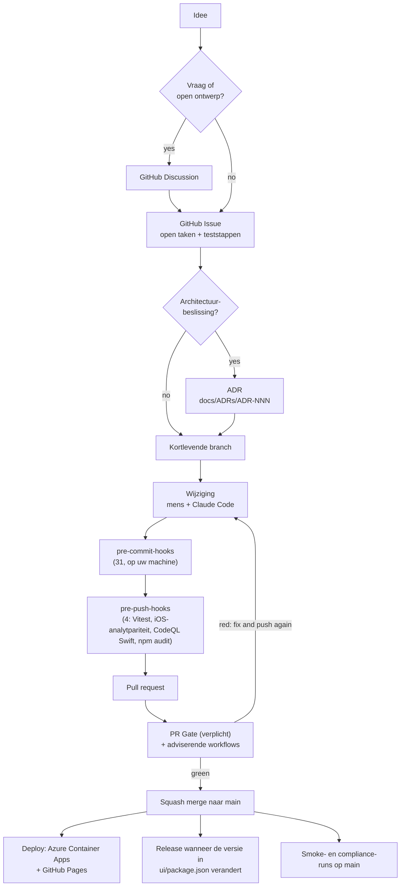

# Software Development Life Cycle (SDLC)

- **Project:** Minimum Viable Health Dataspace v2 (EHDS-referentie-implementatie)
- **Doelgroep:** bijdragers, reviewers en iedereen die wil weten hoe een
  project van één persoon, ondersteund door AI, een codebase in een gereguleerd domein leverbaar houdt.
- **Laatst bijgewerkt:** 2026-11-07
- **Beheerder:** Matthias ([`@ma3u`](https://github.com/ma3u))

Hoe een wijziging van een idee bij de live hub komt: issues en discussies,
branches en pull requests, de hooks op uw machine, de controles op GitHub,
de deploys, de releases, en hoe u van buitenaf bijdraagt. De
versie in gewone taal is [How We Build This Software](./SDLC-explained.md);
hoe de AI-auteur erin past, staat in [Deterministic Agentic AI Development with Claude
Code](./AGENTIC-DEVELOPMENT-WITH-CLAUDE-CODE.md). Twee begeleidende pagina's gaan
dieper: [Integratietests via de API's](developer/api-integration-tests.md)
en [De stack en de ontwikkelomgeving](developer/stack-and-environment.md).
Sectie 12 is het recept achter dit alles: hoe u een SDLC definieert voor een
DevSecOps- en AI-project, fase voor fase, met de tools.

<details>
<summary><b>Afkortingen in dit document</b></summary>

| Afkorting                                                                                                                                                                         | Uitgeschreven                                                                                   |
| --------------------------------------------------------------------------------------------------------------------------------------------------------------------------------- | ----------------------------------------------------------------------------------------------- |
| **CI/CD**                                                                                                                                                                         | Continuous Integration / Continuous Delivery: het geautomatiseerde bouwen, testen en uitrollen  |
| **PR**                                                                                                                                                                            | Pull Request: een voorgestelde wijziging, gecontroleerd en beoordeeld voordat ze wordt gemerged |
| **ADR**                                                                                                                                                                           | Architecture Decision Record: een korte notitie van een beslissing en de redenen ervoor         |
| **[OIDC](https://openid.net/specs/openid-connect-core-1_0.html)**                                                                                                                 | OpenID Connect; hier de gefedereerde aanmelding van GitHub Actions bij Azure                    |
| **[SBOM](https://cyclonedx.org/)**                                                                                                                                                | Software Bill of Materials: de lijst van elk onderdeel van derden                               |
| **[CVE](https://www.cve.org/)**                                                                                                                                                   | Common Vulnerabilities and Exposures: de openbare catalogus van bekende kwetsbaarheden          |
| **[SARIF](https://docs.oasis-open.org/sarif/sarif/v2.1.0/sarif-v2.1.0.html)**                                                                                                     | Static Analysis Results Interchange Format: hoe scanners aan GitHub rapporteren                 |
| **[DSP](https://eclipse-dataspace-protocol-base.github.io/DataspaceProtocol/2025-1/) / [DCP](https://eclipse-dataspace-dcp.github.io/decentralized-claims-protocol/v1.0/) / TCK** | Dataspace Protocol / Decentralised Claims Protocol / Technology Compatibility Kit               |
| **[ACA](https://learn.microsoft.com/en-us/azure/container-apps/)**                                                                                                                | Azure Container Apps, waar de live hub draait                                                   |

</details>

---

## 1. Filosofie: deterministische tooling rond een niet-deterministische auteur

> **De auteur stelt voor; deterministische tooling beslist.**

Een senior engineer, een nieuwkomer en een AI-agent zijn allemaal niet-deterministisch: stel
dezelfde vraag twee keer en u krijgt misschien twee antwoorden. De uitvoer wordt
betrouwbaar wanneer de auteur omringd is door poorten die elke keer op dezelfde manier werken,
voor iedereen: formatters, linters, typecontroles, tests, beveiligingsscanners
en een CI/CD-pijplijn.

Het project is een team van één plus een AI-pairprogrammeur. Daarom houdt het elke
deterministische poort die een groot team zou hebben, en schrapt het de coördinatie-
rituelen (verplichte menselijke review, sprintrituelen, releaseboards) die pas
lonen met meer mensen. Sectie 11 zegt wat er geschrapt is en waarom.

Dat weegt hier zwaarder dan in de meeste projecten. Het is een referentie-
implementatie van de Europese ruimte voor gezondheidsgegevens, een gereguleerd domein met
gezondheidsgegevens, patiëntenrechten en auditverplichtingen. De poorten leveren vertrouwen (hele
klassen fouten worden onderschept voordat ze worden uitgerold), controleerbaarheid (elke wijziging
wordt gelogd met auteur, tijd en reden), herhaalbaarheid, goedkope fouten (een
lokale hook kost seconden, een productie-incident uren) en veilige AI-ondersteuning.

---

## 2. De levenscyclus in één oogopslag



1. **Idee.** Een open vraag of een ontwerp om te verkennen begint als een Discussion;
   een stuk werk begint als een Issue (sectie 3).
2. **ADR** wanneer de beslissing duur is om terug te draaien of doorsnijdend is.
3. **Branch** vanaf `main`, kortlevend.
4. **Wijziging**, door een mens, Claude Code of beide.
5. **Hooks** op uw machine: 31 bij het committen, 4 bij het pushen (sectie 5).
6. **Pull request.** De **PR Gate** is de enige verplichte controle; de andere
   workflows zijn adviserend (sectie 6).
7. **Squash merge** zodra de PR Gate groen is en elke reviewthread is
   afgehandeld.
8. **Op `main`:** de live hub en de statische demo worden opnieuw uitgerold, de smoke- en
   compliance-runs starten, en er wordt een release gemaakt wanneer de versie is veranderd
   (secties 7 en 8).

---

## 3. Discussies, issues en de planningsmap

### Discussie of issue?

[Discussions](https://github.com/ma3u/MinimumViableHealthDataspacev2/discussions)
zijn ingeschakeld, met de categorieën Announcements, General, Ideas, Polls, Q&A en
Show and tell.

| Open een **Discussion** wanneer                                                                                                                                                                                                                                                                                                                                      | Open een **Issue** wanneer                                                                                   |
| -------------------------------------------------------------------------------------------------------------------------------------------------------------------------------------------------------------------------------------------------------------------------------------------------------------------------------------------------------------------- | ------------------------------------------------------------------------------------------------------------ |
| u een vraag hebt ("hoe zet de hub X om?"), opties wilt vergelijken, of een richting voorstelt die nog geen taak is (Ideas; recente voorbeelden zijn [#776](https://github.com/ma3u/MinimumViableHealthDataspacev2/discussions/776) over tooling voor FHIR en OMOP en [#701](https://github.com/ma3u/MinimumViableHealthDataspacev2/discussions/701) over Simpl-Open) | er iets te doen is: een bug, een feature met een duidelijke uitkomst, een lacune met een acceptatiecriterium |
| het antwoord "nee" of "nu niet" kan zijn                                                                                                                                                                                                                                                                                                                             | iemand het zal sluiten met een commit of een PR                                                              |
| meerdere mensen hun mening moeten geven voordat er iets wordt besloten                                                                                                                                                                                                                                                                                               | de beslissing is genomen, of een ADR die zal nemen                                                           |

Een discussie die tot een beslissing komt, wordt een issue (en een ADR wanneer de
beslissing architecturaal is), in beide richtingen gelinkt.

### Wat een issue bevat

Gebruik de sjablonen in [`.github/ISSUE_TEMPLATE/`](https://github.com/ma3u/MinimumViableHealthDataspacev2/tree/main/.github/ISSUE_TEMPLATE)
(bugrapport, featureverzoek). Elk issue waaraan wordt gewerkt, bevat:

- **De open taken** als checklist, actueel gehouden. Wanneer een PR werk
  onaf laat, zegt het issue wat er nog over is; niets wat open staat, bestaat alleen in een chat of een
  commitbericht.
- **Handmatige teststappen** met links (naar de statische documentatie, een pagina van de hub, een
  workflowrun), zodat iedereen het resultaat kan controleren zonder te vragen.
- **De beslissingen**, elk gelinkt aan de bijbehorende ADR.

Gebruikte [labels](https://github.com/ma3u/MinimumViableHealthDataspacev2/labels): `bug`, `enhancement`, `documentation`, `question`, `security`,
`infrastructure`, `azure`, `dependencies`, de prioriteiten `P1` tot `P3`, en de
gebiedslabels `EHDS-compliance`, `dataspace-discovery`, `simpl`, `NLP`,
`Agentic AI`, `production`, `load test`, `stress test`, `pentest`, `trivy`,
`Cost`. Nieuwe bijdragers zoeken naar `good first issue` en `help wanted`.

### De planningsmap

[`docs/planning/index.md`](./planning/index.md) somt werkitems op als bestanden die
van `future/ → current/ → done/` verhuizen en nooit worden verwijderd. Een bestand in `current/`
is de lange vorm van een issue (de fasen, metingen en links ervan); het issue
blijft de plaats voor de checklist. Details van de roadmap staan in
`docs/planning/roadmap-phases-*.md`, en de tabellen met issues en ADR's in
[`docs/planning-health-dataspace-v2.md`](./planning-health-dataspace-v2.md).
[`/plan`](../.claude/commands/plan.md) in Claude Code onderhoudt de map.

Houd elk document dat routinematig wordt geladen onder ongeveer 15K tokens
([ADR-026](./ADRs/ADR-026-token-efficient-planning-structure.md)): de index
blijft klein en de details verhuizen naar archieven.

### ADR's

[`docs/ADRs/`](ADRs) bevat de ADR's vanaf ADR-001 (051 is gereserveerd). Nieuwe volgen het
[Nygard](https://cognitect.com/blog/2011/11/15/documenting-architecture-decisions)-sjabloon in [`docs/adr/0000-template.md`](adr/0000-template.md); een geaccepteerde ADR wordt nooit
bewerkt, alleen vervangen. Schrijf er een wanneer een beslissing duur is om terug te draaien of
doorsnijdend is: de splitsing van de databases ([ADR-001](./ADRs/ADR-001-postgresql-neo4j-split.md)),
de teststrategie ([ADR-008](./ADRs/ADR-008-testing-strategy.md)), controles
die moeten kunnen falen ([ADR-031](./ADRs/ADR-031-checks-must-assert.md)),
elke API-route die een sessie nodig heeft ([ADR-044](./ADRs/ADR-044-every-api-route-needs-a-session.md)).

---

## 4. Branches, commits en pull requests

- **Trunk-based.** `main` is altijd uitrolbaar. Er wordt gewerkt op kortlevende
  branches met de naam `type/short-slug` (`feat/…`, `fix/…`, `docs/…`, `chore/…`,
  `ci/…`), vaak met het issuenummer: `fix/708-ui-sticky-sessions`.
- **[Conventional Commits](https://www.conventionalcommits.org/en/v1.0.0/)** met een
  scope: `feat(spe): workspaces start on demand (ADR-072)`. Alle laatste 40
  commits op `main` volgen die conventie; nog geen hook dwingt haar af.
- **Commits dragen de naam van de auteur.** Er wordt geen AI-co-auteurtrailer toegevoegd; hoe
  de AI in dit project werkt, staat in het begeleidende document.
- **Een PR linkt naar zijn issue en zijn ADR's** en zegt hoe hij is getest; het
  [PR-sjabloon](https://github.com/ma3u/MinimumViableHealthDataspacev2/blob/main/.github/pull_request_template.md)
  vraagt om beide. [`CODEOWNERS`](https://github.com/ma3u/MinimumViableHealthDataspacev2/blob/main/.github/CODEOWNERS)
  noemt de beheerder, zodat een PR van iemand anders een reviewverzoek krijgt.
- **Squash merge.** De titel van de PR wordt de commit op `main`, dus die volgt
  ook de commitconventie.

### 4.1 Branchbeveiliging op `main`

Een ruleset van de repository op de standaardbranch:

| Regel                                        | Effect                                                                                                               |
| -------------------------------------------- | -------------------------------------------------------------------------------------------------------------------- |
| **Een pull request vereisen**                | Geen directe pushes naar `main`. Nul goedkeuringen vereist (zie hieronder).                                          |
| **Afhandeling van gesprekken vereisen**      | Elke reviewthread is afgehandeld vóór de merge, zodat reviewbevindingen worden beantwoord in plaats van weggescrold. |
| **Statuscontroles vereisen**                 | **PR Gate** moet groen zijn. Het is de enige verplichte controle.                                                    |
| **Lineaire geschiedenis vereisen**           | Alleen squash of rebase; mergecommits zijn uitgeschakeld.                                                            |
| **Force pushes en verwijderingen blokkeren** | `main` kan niet worden herschreven of verwijderd.                                                                    |

**Nul verplichte goedkeuringen is een bewuste keuze.** Met één beheerder betekent een verplichte
goedkeuring een tweede account en een stempel zonder inhoud. Review gebeurt door de AI-
reviewers en de poorten; de mechanische beveiligingen (geen directe push, geen force
push, geen merge bij rood) zijn het deel dat een beheerder alleen niet met
discipline kan leveren, dus worden ze afgedwongen. Wanneer een tweede vaste bijdrager zich aansluit,
gaat dit naar één goedkeuring.

**Admins kunnen alleen bij een pull request omzeilen.** Een vastgelopen controle kan
op een PR worden overruled, wat beter is dan geen hotfix op een live demo kunnen landen; een
directe push naar `main` wordt voor iedereen geweigerd.

### 4.2 Waarom precies één verplichte controle

Elke andere workflow heeft een padfilter, wat goed is voor de kosten en verkeerd voor
branchbeveiliging: een verplichte controle die nooit start, blijft in afwachting, en de
PR kan nooit worden gemerged ([#303](https://github.com/ma3u/MinimumViableHealthDataspacev2/pull/303) verzamelde 28 controles, [#305](https://github.com/ma3u/MinimumViableHealthDataspacev2/pull/305) geen). Daarom
heeft [`pr-gate.yml`](https://github.com/ma3u/MinimumViableHealthDataspacev2/blob/main/.github/workflows/pr-gate.yml)
geen padfilter en is het de enige verplichte controle. Sectie 6.1 somt op wat het
uitvoert.

---

## 5. De hooks op uw machine

[`.pre-commit-config.yaml`](https://github.com/ma3u/MinimumViableHealthDataspacev2/blob/main/.pre-commit-config.yaml),
uitgevoerd door het [pre-commit-framework](https://pre-commit.com/). Installeer beide
fasen eenmaal per clone (sinds [#847](https://github.com/ma3u/MinimumViableHealthDataspacev2/issues/847) doet een gewone `pre-commit install` hetzelfde,
via [`default_install_hook_types`](../.pre-commit-config.yaml#L7)):

```bash
pip install pre-commit
pre-commit install --hook-type pre-commit --hook-type pre-push
pre-commit run --all-files     # optional: everything, once
```

De meeste hooks zijn beperkt tot een bestandspatroon, zodat een commit met alleen documentatie de
TypeScript-hooks overslaat. Hooks die een tool nodig hebben die u niet hebt geïnstalleerd ([gitleaks](https://github.com/gitleaks/gitleaks/releases/tag/v8.29.0),
[Semgrep](https://semgrep.dev/docs/), [lychee](https://github.com/lycheeverse/lychee), [actionlint](https://github.com/rhysd/actionlint)) geven een waarschuwing en slagen; de PR Gate installeert
gitleaks en actionlint en voert ze toch uit. Sla één hook eenmalig over met
`SKIP=<id> git commit`, nooit de hele set met `--no-verify`: de PR Gate
voert dezelfde hooks uit op de diff van de PR, dus omzeilen verplaatst alleen de fout.

**Hooks die bestanden herschrijven** ([Prettier](https://prettier.io/), de witruimtefixers, [`docs-facts`](../.pre-commit-config.yaml#L217))
laten de commit falen nadat ze het bestand hebben gewijzigd. Stage het bestand opnieuw en commit
opnieuw, en controleer daarna of `HEAD` is verschoven: een mislukte commit laat het staan waar het was.

### 5.1 Bij het committen: 31 hooks

| Hook (id)                                                                                                                                     | Wat hij doet                                                                                                                                                                                                                                      | Wanneer hij faalt                                                                                                                                                                                                          |
| --------------------------------------------------------------------------------------------------------------------------------------------- | ------------------------------------------------------------------------------------------------------------------------------------------------------------------------------------------------------------------------------------------------- | -------------------------------------------------------------------------------------------------------------------------------------------------------------------------------------------------------------------------- |
| [`trailing-whitespace`](../.pre-commit-config.yaml#L13), [`end-of-file-fixer`](../.pre-commit-config.yaml#L17)                                | verwijdert spaties aan het regeleinde, sluit elk bestand af met een newline (behalve patches en de meegeleverde HealthDCAT-AP-shapes)                                                                                                             | hij heeft het bestand gerepareerd: stage het opnieuw                                                                                                                                                                       |
| [`check-yaml`](../.pre-commit-config.yaml#L19), [`check-json`](../.pre-commit-config.yaml#L22)                                                | de bestanden zijn te parsen (YAML met meerdere documenten toegestaan)                                                                                                                                                                             | herstel de syntaxis die hij noemt                                                                                                                                                                                          |
| [`check-added-large-files`](../.pre-commit-config.yaml#L23)                                                                                   | weigert een bestand boven 5,000 KB                                                                                                                                                                                                                | houd het buiten git, of maak het kleiner                                                                                                                                                                                   |
| [`check-merge-conflict`](../.pre-commit-config.yaml#L25)                                                                                      | weigert achtergebleven `<<<<<<<`-markeringen                                                                                                                                                                                                      | maak de merge af                                                                                                                                                                                                           |
| [`detect-private-key`](../.pre-commit-config.yaml#L26)                                                                                        | weigert een privésleutel                                                                                                                                                                                                                          | verwijder hem; als hij echt was, roteer hem                                                                                                                                                                                |
| [`check-case-conflict`](../.pre-commit-config.yaml#L27), [`check-symlinks`](../.pre-commit-config.yaml#L28)                                   | namen die botsen op een hoofdletterongevoelige schijf, symlinks die nergens naartoe wijzen                                                                                                                                                        | hernoem, of herstel de link                                                                                                                                                                                                |
| [`check-executables-have-shebangs`](../.pre-commit-config.yaml#L29), [`check-shebang-scripts-are-executable`](../.pre-commit-config.yaml#L30) | een uitvoerbaar bestand heeft een `#!`-regel, een `#!`-bestand is uitvoerbaar                                                                                                                                                                     | `chmod +x` (of `-x`), en stage dat pad expliciet: een verdwaalde uitvoerbit op een `.gitkeep` faalt hier                                                                                                                   |
| [`shellcheck`](../.pre-commit-config.yaml#L36)                                                                                                | Bash op foutniveau                                                                                                                                                                                                                                | `shellcheck --severity=error <file>` en herstel wat hij meldt                                                                                                                                                              |
| [`hadolint-docker`](../.pre-commit-config.yaml#L44)                                                                                           | best practices voor Dockerfiles                                                                                                                                                                                                                   | `hadolint <Dockerfile>`                                                                                                                                                                                                    |
| [`prettier`](../.pre-commit-config.yaml#L56)                                                                                                  | formatteert JS, TS, JSON, YAML en Markdown                                                                                                                                                                                                        | hij heeft het bestand herschreven: stage het opnieuw. Vecht niet tegen zijn uitvoer                                                                                                                                        |
| [`tsc-ui`](../.pre-commit-config.yaml#L66)                                                                                                    | [`tsc --noEmit -p tsconfig.build.json`](../ui/tsconfig.build.json) in `ui/` (strict, tests uitgesloten)                                                                                                                                           | voer dat commando uit in `ui/`, herstel de typefout                                                                                                                                                                        |
| [`eslint-ui`](../.pre-commit-config.yaml#L76)                                                                                                 | [`next lint --max-warnings 55`](https://nextjs.org/docs/15/app/api-reference/config/eslint) in `ui/`                                                                                                                                              | een fout, of een nieuwe waarschuwing boven het budget van 55: `cd ui && npx next lint`                                                                                                                                     |
| [`gitleaks`](../.pre-commit-config.yaml#L134)                                                                                                 | geheimen in de gestagede diff                                                                                                                                                                                                                     | verwijder het geheim en roteer het; een bewezen fout-positief komt in [`.gitleaksignore`](../.gitleaksignore)                                                                                                              |
| [`semgrep`](../.pre-commit-config.yaml#L149)                                                                                                  | [Semgrep CE](https://github.com/semgrep/semgrep) op gestagede code: de regels van de registry voor TypeScript, Next.js, React en geheimen, en [`.semgrep/cypher.yml`](../.semgrep/cypher.yml) (invoer uit verzoeken bereikt Cypher als parameter) | herstel het, of `// nosemgrep: <rule-id> -- <reason>` boven de regel. Achter een proxy met TLS-inspectie mislukt de download van de registry en eindigt de hook met 2: dat is geen bevinding                               |
| [`semgrep-rule-tests`](../.pre-commit-config.yaml#L155)                                                                                       | de eigen Semgrep-regels van het project tegen [`.semgrep/cypher.ts`](../.semgrep/cypher.ts)                                                                                                                                                       | de regel en zijn test zijn het niet eens                                                                                                                                                                                   |
| [`check-broken-links-md`](../.pre-commit-config.yaml#L168)                                                                                    | relatieve links in Markdown worden opgelost ([lychee](https://github.com/lycheeverse/lychee) offline, of [markdown-link-check](https://github.com/tcort/markdown-link-check)); vertalingen onder `docs/i18n/` uitgezonderd                        | herstel het pad                                                                                                                                                                                                            |
| [`check-no-screenshot-imports`](../.pre-commit-config.yaml#L178)                                                                              | documentatiepagina's onder `ui/src/app/docs/` verwijzen niet naar `images/screenshots`                                                                                                                                                            | gebruik in plaats daarvan een diagram of een afbeelding uit een handleiding                                                                                                                                                |
| [`api-spec-drift`](../.pre-commit-config.yaml#L191)                                                                                           | elke route onder `ui/src/app/api/` staat in [`ui/public/openapi.yaml`](../ui/public/openapi.yaml), en omgekeerd                                                                                                                                   | documenteer de operatie in de spec en verwijder de regel ervan uit [`docs/api-spec-drift-allowlist.txt`](api-spec-drift-allowlist.txt); een regel toevoegen is een beslissing om een ongedocumenteerde route uit te rollen |
| [`api-spec-shapes`](../.pre-commit-config.yaml#L202)                                                                                          | de spec beschrijft de vorm waarmee de hub antwoordt (gecontroleerd tegen de fixtures in [`ui/public/mock/`](../ui/public/mock))                                                                                                                   | corrigeer het schema, of de fixture                                                                                                                                                                                        |
| [`docs-facts`](../.pre-commit-config.yaml#L217)                                                                                               | genereert [`ui/src/app/docs/docs-facts.json`](../ui/src/app/docs/docs-facts.json) opnieuw (routes, hooks, diensten, ADR's, de datum van laatste wijziging van elke documentatiepagina)                                                            | hij heeft het bestand herschreven: stage het en commit opnieuw                                                                                                                                                             |
| [`docs-content`](../.pre-commit-config.yaml#L226)                                                                                             | de gepubliceerde kopieën van `docs/` komen overeen met hun bronnen ([`gen-docs-content.py --check`](../scripts/gen-docs-content.py))                                                                                                              | `python3 scripts/gen-docs-content.py`, stage `ui/src/content/` en `ui/public/published-docs/`                                                                                                                              |
| [`localized-images`](../.pre-commit-config.yaml#L236)                                                                                         | het manifest van vertaalde schermafbeeldingen en diagrammen komt overeen met `ui/public`                                                                                                                                                          | [`python3 scripts/gen-localized-images.py`](../scripts/gen-localized-images.py), stage het manifest                                                                                                                        |
| [`bruno-coverage`](../.pre-commit-config.yaml#L249)                                                                                           | elke API-route heeft een verzoek in [`bruno/MVHDv2/`](../bruno/MVHDv2), elk verzoek kan falen, geen inloggegevens in een `.bru`-bestand                                                                                                           | voeg het verzoek toe in de map van de persona; verwijder het verzoek waarvan de route weg is (zie [de API-tests](developer/api-integration-tests.md))                                                                      |
| [`bruno-strength`](../.pre-commit-config.yaml#L260)                                                                                           | een 2xx-verzoek controleert meer dan een containertype                                                                                                                                                                                            | controleer de waarde van een eigenschap                                                                                                                                                                                    |
| [`workflow-paths`](../.pre-commit-config.yaml#L273)                                                                                           | het `paths`-filter van een workflow dekt elk script dat hij uitvoert                                                                                                                                                                              | voeg het pad toe aan het filter van de workflow                                                                                                                                                                            |
| [`actionlint`](../.pre-commit-config.yaml#L303)                                                                                               | GitHub Actions-workflows                                                                                                                                                                                                                          | herstel de workflow die hij noemt                                                                                                                                                                                          |
| [`image-scan-coverage`](../.pre-commit-config.yaml#L314)                                                                                      | de CVE-scan in [`security-scan.yml`](../.github/workflows/security-scan.yml) dekt elke image in de compose-bestanden                                                                                                                              | voeg de image toe aan de scanmatrix                                                                                                                                                                                        |

### 5.2 Bij het pushen: 4 hooks

| Hook (id)                                               | Wat hij doet                                                                                                                                                                                                                                                               | Wanneer hij faalt                                                                                                                                                                                                                                                                                              |
| ------------------------------------------------------- | -------------------------------------------------------------------------------------------------------------------------------------------------------------------------------------------------------------------------------------------------------------------------- | -------------------------------------------------------------------------------------------------------------------------------------------------------------------------------------------------------------------------------------------------------------------------------------------------------------- |
| [`vitest-ui`](../.pre-commit-config.yaml#L86)           | de hele UI-suite, [`vitest run --bail 1`](https://github.com/vitest-dev/vitest/releases/tag/v5.0.2), wanneer de push `ui/src` of `ui/__tests__` wijzigt                                                                                                                    | `cd ui && npx vitest run <file>` voor het falende bestand. Een hook die een mock reset, gebruikt accolades: `beforeEach(() => { m.mockReset(); })`                                                                                                                                                             |
| [`npm-audit-ui`](../.pre-commit-config.yaml#L287)       | [`scripts/check-npm-audit.py ui --omit=dev`](../scripts/check-npm-audit.py): geen HIGH- of CRITICAL-advisory in productieafhankelijkheden                                                                                                                                  | werk de afhankelijkheid bij; wanneer er geen fix bestaat, een tijdgebonden vermelding in [`docs/npm-audit-exceptions.json`](npm-audit-exceptions.json) met een reden, een issue en een vervaldatum                                                                                                             |
| [`ios-analyte-parity`](../.pre-commit-config.yaml#L102) | `swift run AnalyteParity` wanneer de gedeelde Swift-code van de app, de gegenereerde analyttabel of `Package.swift` veranderen (seconden zodra gebouwd, macOS)                                                                                                             | de Swift-tabel herleidt een label of eenheid anders dan [`analytes.ts`](../services/epa-ingest/src/analytes.ts): genereer opnieuw met `npm run generate:swift` in [`services/epa-ingest`](../services/epa-ingest), of herstel de normalisatie in [`clients/ios/Sources/Shared`](../clients/ios/Sources/Shared) |
| [`codeql-swift`](../.pre-commit-config.yaml#L119)       | [CodeQL](https://docs.github.com/en/code-security/code-scanning/creating-an-advanced-setup-for-code-scanning/codeql-code-scanning-for-compiled-languages) op de iPhone-app wanneer Swift-bronnen, `Package.swift` of `project.yml` veranderen (ongeveer 15 minuten, macOS) | herstel de bevinding, of accepteer haar met haar reden in [`clients/ios/Scripts/codeql-accepted.txt`](../clients/ios/Scripts/codeql-accepted.txt); `SKIP=codeql-swift git push` slaat haar eenmalig over                                                                                                       |

[Quality Gates](./quality-gates.md) en de
[pagina over de kwaliteitspoorten](https://ma3u.github.io/MinimumViableHealthDataspacev2/docs/developer/quality-gates)
bevatten de dekkingscijfers en de poorten die nog moeten komen.

E2E, de WCAG-audit en de pentest-specs draaien niet meer bij elke push, maar
één keer per nacht wanneer `main` veranderd is
([ADR-074](./ADRs/ADR-074-e2e-and-compliance-suites-run-nightly-when-main-changed.md)).
Voordat u een wijziging aan UI-pagina's of hun API-routes merget, draait u ze
tegen de compose-stack: `docker compose up -d`, dan `cd ui && npm run test:e2e`.

---

## 6. De controles op GitHub

[`.github/workflows/`](../.github/workflows) bevat 40 workflows. Alleen de **PR Gate** blokkeert een merge.

### 6.1 PR Gate: de verplichte controle

Bij elke pull request en elke merge-queue-run, geen padfilter, hooguit ongeveer 15
minuten:

1. de pre-commit-hooks op de diff van de PR ([`pre-commit run --from-ref
origin/main --to-ref HEAD`](../.github/workflows/pr-gate.yml#L69)), wat een commit onderschept die is gemaakt met
   `--no-verify` of vanuit een clone zonder de hooks;
2. drift van de API-spec ([`scripts/check-api-spec-drift.py`](../.github/workflows/pr-gate.yml#L80));
3. actuele docs facts, met de datum van elke gewijzigde documentatiepagina verschoven
   ([`scripts/gen-docs-facts.py --check`](../.github/workflows/pr-gate.yml#L88));
4. de API-collectie dekt elke route ([`scripts/check-bruno-coverage.py`](../.github/workflows/pr-gate.yml#L95));
5. conformiteit met [HealthDCAT-AP Release 8](../.github/workflows/pr-gate.yml#L102-L107) van de golden files van de catalogus
   ([pySHACL](https://github.com/RDFLib/pySHACL/releases/tag/v0.30.1) tegen de [officiële shapes](https://data.health.europa.eu/healthdcat-ap/releases/release-8/html/shacl/HealthDCAT-AP_validator/config/rdf-validator/ehds/shapes/non-public-shapes.ttl));
6. geen ongebruikte bestanden, exports of afhankelijkheden ([`npm run --prefix ui knip`](../.github/workflows/pr-gate.yml#L115));
7. [gitleaks](../.github/workflows/pr-gate.yml#L123) over de commits van de PR, omdat de lokale hook die alleen gestagede bestanden ziet,
   in CI niets ziet.

### 6.2 De andere workflows

| Workflow                                                                                                                               | Draait bij                                                                                                                                     | Wat hij doet                                                                                                                                                                                                                                                                                                                                                                                                                                                                                                                                                                                         | Blokkeert        |
| -------------------------------------------------------------------------------------------------------------------------------------- | ---------------------------------------------------------------------------------------------------------------------------------------------- | ---------------------------------------------------------------------------------------------------------------------------------------------------------------------------------------------------------------------------------------------------------------------------------------------------------------------------------------------------------------------------------------------------------------------------------------------------------------------------------------------------------------------------------------------------------------------------------------------------- | ---------------- |
| [`test.yml`](../.github/workflows/test.yml) Test Suite                                                                                 | push naar elke branch, PR naar `main` (paden: `ui/`, de diensten, `clients/ios/`, de documentatie van Klarbefund)                              | 8 jobs: Vitest voor de UI, de proxy, de SPE-loader en ePA-ingest; [OPA](https://www.openpolicyagent.org/docs/policy-testing)-beleidstests; analytpariteit van iOS (alleen wanneer `clients/ios/` is gewijzigd, bepaald door een job Changed paths); één job met scans ([Trivy](https://github.com/aquasecurity/trivy/releases/tag/v0.69.3), [Kubescape](https://kubescape.io/), [npm audit](https://docs.npmjs.com/cli/v10/commands/npm-audit), SBOM, licenties). Lint en gitleaks draaien in de PR Gate                                                                                             | nee (adviserend) |
| [`codeql.yml`](../.github/workflows/codeql.yml)                                                                                        | push en PR naar `main`, behalve als alleen `docs/`, Markdown of `clients/ios/` is gewijzigd, wekelijks                                         | [CodeQL](https://docs.github.com/en/code-security/code-scanning/introduction-to-code-scanning/about-code-scanning-with-codeql) voor JavaScript/TypeScript, Python en de workflows; resultaten in het tabblad Security                                                                                                                                                                                                                                                                                                                                                                                | nee              |
| [`codeql-swift.yml`](../.github/workflows/codeql-swift.yml)                                                                            | wekelijks, dispatch, en PR's die de workflow of zijn script wijzigen                                                                           | CodeQL voor de iPhone-app; wijzigingen aan de app worden gecontroleerd door de pre-push-hook `codeql-swift`                                                                                                                                                                                                                                                                                                                                                                                                                                                                                          | nee              |
| [`security-scan.yml`](../.github/workflows/security-scan.yml)                                                                          | PR, wekelijks, dispatch                                                                                                                        | SBOM en CVE's van de broncode, CVE's van images, CVE's van de uitgerolde images, een ernstpoort; een PR leest de Trivy-database die `main` heeft opgeslagen en slaat er zelf geen op                                                                                                                                                                                                                                                                                                                                                                                                                 | nee              |
| [`bruno-smoke.yml`](../.github/workflows/bruno-smoke.yml)                                                                              | PR en `main` wanneer de collectie of [`ui/src/app/api/`](../ui/src/app/api) verandert                                                          | de API-collectie tegen de statische fixtures (Static-mock)                                                                                                                                                                                                                                                                                                                                                                                                                                                                                                                                           | nee              |
| [`python-services-test.yml`](../.github/workflows/python-services-test.yml)                                                            | PR, push naar `main`                                                                                                                           | [pytest](https://docs.pytest.org/) voor de Python-diensten                                                                                                                                                                                                                                                                                                                                                                                                                                                                                                                                           | nee              |
| [`compliance.yml`](../.github/workflows/compliance.yml)                                                                                | aangeroepen door [`nightly.yml`](../.github/workflows/nightly.yml), dispatch                                                                   | DSP-, DCP- en EHDS-domeincontroles en de volledige API-collectie tegen een verse JAD-stack; de rapportjob faalt onder de vastgelegde ondergrens                                                                                                                                                                                                                                                                                                                                                                                                                                                      | nee (nachtelijk) |
| [`nightly.yml`](../.github/workflows/nightly.yml)                                                                                      | eenmaal per nacht wanneer `main` is gewijzigd, dispatch ([ADR-074](./ADRs/ADR-074-e2e-and-compliance-suites-run-nightly-when-main-changed.md)) | Playwright-E2E met [WCAG](https://www.w3.org/TR/WCAG22/) en de [OWASP](https://owasp.org/Top10/2021/)/[BSI](https://www.bsi.bund.de/EN/Themen/Unternehmen-und-Organisationen/Informationen-und-Empfehlungen/Empfehlungen-nach-Angriffszielen/Cloud-Computing/Kriterienkatalog-C5/kriterienkatalog-c5_node.html)-controles tegen een geseede Neo4j (rapporten gaan naar de Pages-site), [Lighthouse](https://developer.chrome.com/docs/lighthouse), gitleaks over de hele geschiedenis, [`compliance.yml`](../.github/workflows/compliance.yml); een rode nacht opent een issue, een groene sluit het | nee              |
| [`deploy-azure.yml`](../.github/workflows/deploy-azure.yml)                                                                            | elke push naar `main`, dispatch                                                                                                                | bouwt de images van de UI en de proxy, rolt ze uit naar Azure Container Apps, controleert dat aanmelden werkt en voert daarna [Playwright](https://github.com/microsoft/playwright/releases/tag/v1.64.1) uit tegen de live hub                                                                                                                                                                                                                                                                                                                                                                       | alleen `main`    |
| [`pages.yml`](../.github/workflows/pages.yml)                                                                                          | elke push naar `main`, dispatch                                                                                                                | bouwt de statische export met de nieuwste nachtelijke testrapporten en publiceert die op GitHub Pages (6.4)                                                                                                                                                                                                                                                                                                                                                                                                                                                                                          | alleen `main`    |
| [`release.yml`](../.github/workflows/release.yml)                                                                                      | push naar `main` die `ui/package.json` wijzigt, dispatch                                                                                       | tagt en publiceert een GitHub Release (sectie 8)                                                                                                                                                                                                                                                                                                                                                                                                                                                                                                                                                     | alleen `main`    |
| [`demo-smoke.yml`](../.github/workflows/demo-smoke.yml)                                                                                | dagelijks 06:00 UTC (start uren later), dispatch                                                                                               | is de live hub bereikbaar, de API-collectie ertegen (Azure-Dev), Playwright op openbare routes, een [ZAP](https://www.zaproxy.org/docs/docker/baseline-scan/)-baseline, en daarna verwijdert hij wat de collectie heeft aangemaakt                                                                                                                                                                                                                                                                                                                                                                   | alleen `main`    |
| [`catalog-crawler.yml`](../.github/workflows/catalog-crawler.yml), [`catalog-enricher.yml`](../.github/workflows/catalog-enricher.yml) | push naar `main` die de dienst wijzigt                                                                                                         | test en rolt de catalogusdiensten uit                                                                                                                                                                                                                                                                                                                                                                                                                                                                                                                                                                | alleen `main`    |
| [`cache-cleanup.yml`](../.github/workflows/cache-cleanup.yml)                                                                          | dagelijks, dispatch                                                                                                                            | verwijdert Actions-caches die niets meer terugzet: die van gesloten PR's en alle behalve het nieuwste item van CodeQL, Next.js, Playwright en Trivy ([`scripts/prune-actions-caches.py`](../scripts/prune-actions-caches.py), [#847](https://github.com/ma3u/MinimumViableHealthDataspacev2/issues/847))                                                                                                                                                                                                                                                                                             | n/a              |
| [`aca-schedule.yml`](../.github/workflows/aca-schedule.yml)                                                                            | twee keer per dag, dispatch                                                                                                                    | terugvaloptie voor het stoppen en starten buiten kantooruren ([ADR-053](./ADRs/ADR-053-everything-stops-off-hours.md), [ADR-058](./ADRs/ADR-058-azure-triggers-the-off-hours-schedule.md))                                                                                                                                                                                                                                                                                                                                                                                                           | n.v.t.           |

De overige 23 zijn **operationele workflows die met de hand worden gestart** (`workflow_dispatch`)
tegen Azure: Neo4j, EDC-deelnemers, data-assets en CFM seeden; de
bootstrap van Vault; de FHIR-loader; GraphRAG; de EUDI-verifier; het Keycloak-
domein; kostenbewaking; eenmalige reparaties en uitfaseringen, elk genoemd naar zijn
issue of ADR. Ze volgen dezelfde regel als al het andere: een wijziging in de omgeving
is een geversioneerde, herhaalbare workflow, geen klik in het portaal. De workflows
die verwijderen of herschrijven, hebben een `plan`-modus die alleen leest.

### 6.3 Protocolcompliance

[`compliance.yml`](../.github/workflows/compliance.yml) start de JAD-stack binnen de job, seedt hem en voert
de DSP-, DCP- en EHDS-domeincontroles en de API-collectie uit. Elke suitestap
mag falen zonder de job te stoppen; de job **Compliance Report** vergelijkt daarna
elk resultaat met zijn ondergrens in [`scripts/compliance-baseline.json`](../scripts/compliance-baseline.json) en faalt bij een
achteruitgang. Hij beslist op een vastgelegde baseline, niet op groen, zodat een suite die
nog niet slaagt toch niet slechter kan worden. De suites zijn van ons en sturen onze
API's aan; het zijn niet de Eclipse-TCK's ([DSP](https://github.com/eclipse-dataspacetck/dsp-tck), [DCP](https://github.com/eclipse-dataspacetck/dcp-tck)) en ze bewijzen geen conformiteit ([#338](https://github.com/ma3u/MinimumViableHealthDataspacev2/issues/338)).
De actuele getallen en hoe u ze uitvoert, staan in
[Integratietests via de API's](developer/api-integration-tests.md).

### 6.4 GitHub Pages: de statische demo

[`pages.yml`](../.github/workflows/pages.yml) bouwt de openbare demo op
[ma3u.github.io/MinimumViableHealthDataspacev2](https://ma3u.github.io/MinimumViableHealthDataspacev2/):
hij seedt een Neo4j-container, ververst de mock-fixtures vanuit de vorm van de live API,
zet [`ui/src/app/api/`](../ui/src/app/api) opzij door de map te hernoemen, bouwt met
`NEXT_PUBLIC_STATIC_EXPORT=true`, voegt de testrapporten van de laatste
[`nightly.yml`](../.github/workflows/nightly.yml)-run toe en publiceert. De nachtelijke run seedt zijn eigen Neo4j en voert
Vitest, [Playwright](https://github.com/microsoft/playwright/releases/tag/v1.64.1), de [WCAG](https://www.w3.org/TR/WCAG22/)-audit en de beveiligingscontroles uit (alleen rapportage,
`continue-on-error`). Zonder API-routes leest elke
pagina [`ui/public/mock/*.json`](../ui/public/mock), dus een pagina die een `/api/...`-pad met GET opvraagt,
heeft daar een fixture nodig, en [`static-mock-coverage.test.ts`](../ui/__tests__/unit/lib/static-mock-coverage.test.ts) faalt zonder die fixture.

### 6.5 Uitrollen naar Azure

Elke push naar `main` voert [`deploy-azure.yml`](../.github/workflows/deploy-azure.yml) uit:

1. aanmelden bij Azure met **[OIDC](https://docs.github.com/en/actions/security-for-github-actions/security-hardening-your-deployments/configuring-openid-connect-in-azure)** (geen opgeslagen wachtwoord: een gefedereerde credential
   vertrouwt de `main`-branch van deze repository);
2. de images van de UI en de Neo4j-proxy bouwen en naar de registry
   `acrmvhdehds` pushen;
3. wachten zolang er een loadtest draait (de variabele `LOAD_TEST_RUNNING`), zodat een merge
   niet opnieuw uitrolt terwijl [k6](https://grafana.com/docs/k6/latest/) draait;
4. beide uitrollen naar Container Apps in `rg-mvhd-dev` als nieuwe revisie (ACA
   cachet [`:latest`](../CLAUDE.md#L75), dus alleen een herstart zou de image niet ophalen);
5. de revisies verifiëren, op de UI wachten en bewijzen dat aanmelden van begin tot eind werkt;
6. als de hub live is (niet gestopt buiten kantooruren), [Playwright](https://github.com/microsoft/playwright/releases/tag/v1.64.1), de [WCAG](https://www.w3.org/TR/WCAG22/)-audit
   en de beveiligingscontroles ertegen uitvoeren.

**OIDC werkt alleen op `main`.** De gefedereerde credential noemt
`refs/heads/main`, dus een Azure-stap op een pull request, een fork of een andere
branch kan zich niet aanmelden. Een job die Azure nodig heeft, is beperkt tot `main`, het schema
of een dispatch op `main`; PR's toelaten betekent een gefedereerde credential toevoegen
in Azure, niet de workflow bewerken. Buiten kantooruren (ma tot vr 07:00 tot 20:00
Europe/Berlin is aan) is alles gestopt
([ADR-053](./ADRs/ADR-053-everything-stops-off-hours.md)), dus een deploy
werkt dan de revisie bij zonder die live te kunnen testen.

---

## 7. Teststrategie

[ADR-008](./ADRs/ADR-008-testing-strategy.md) legt de niveaus vast; de conventies
staan in [`.claude/rules/testing.md`](https://github.com/ma3u/MinimumViableHealthDataspacev2/blob/main/.claude/rules/testing.md).

| Niveau             | Framework                                                                                                                                        | Bereik                                                                                                                               | Wanneer het draait                                                |
| ------------------ | ------------------------------------------------------------------------------------------------------------------------------------------------ | ------------------------------------------------------------------------------------------------------------------------------------ | ----------------------------------------------------------------- |
| **Unit**           | [Vitest](https://github.com/vitest-dev/vitest/releases/tag/v5.0.2)                                                                               | functies, componenten en handlers van API-routes; Neo4j gemockt op [`@/lib/neo4j`](../ui/src/lib/neo4j.ts), `fetch` per test gestubd | pre-push, elke push ([`test.yml`](../.github/workflows/test.yml)) |
| **Dienst**         | Vitest, [pytest](https://docs.pytest.org/), [`opa test`](https://www.openpolicyagent.org/docs/policy-testing)                                    | de Neo4j-proxy, de SPE-loader, ePA-ingest, de Python-diensten, het Trustee-beleid                                                    | elke push die ze raakt                                            |
| **iOS**            | [Swift Testing](https://developer.apple.com/documentation/testing), [XCUITest](https://developer.apple.com/documentation/xctest/xcuiapplication) | de parser en het model van de app; de schermen ervan met een vaste demo-seed                                                         | op de Mac; pariteitscontrole in CI                                |
| **API-integratie** | [Bruno](https://www.usebruno.com/), shell-suites                                                                                                 | de routes van de hub per persona; DSP, DCP, het gezondheidsdomein                                                                    | PR (fixtures), `main`, wekelijks, live dagelijks                  |
| **E2E**            | [Playwright](https://github.com/microsoft/playwright/releases/tag/v1.64.1)                                                                       | genummerde journeys in [`ui/__tests__/e2e/journeys/`](../ui/__tests__/e2e/journeys)                                                  | `main`, dispatch, na elke Azure-deploy                            |

Routetests draaien met de authenticatiewacht open gemockt, dus ze testen bedrijfslogica,
niet de poort; een test die een poort wil vastleggen, sluit hem zelf, en de
map `09 Access control` van de API-collectie controleert de poorten tegen een
echte server. Dekking wordt verzameld en gepubliceerd, maar er wordt nog geen drempel
afgedwongen.

---

## 8. Releases en versies

[ADR-075](./ADRs/ADR-075-a-minor-release-every-month.md) legt het ritme vast:

- **De hub heeft één versie**, de `version` in
  [`ui/package.json`](https://github.com/ma3u/MinimumViableHealthDataspacev2/blob/main/ui/package.json).
- **Een minor release op de eerste werkdag van elke maand**, te beginnen met
  [v2.1.0](https://github.com/ma3u/MinimumViableHealthDataspacev2/releases/tag/v2.1.0) op 2026-11-04. Een **patch**release daartussen alleen voor een correctie die een
  partner vóór de volgende maand nodig heeft; een **major** release wanneer iets breekt waartegen
  een partner integreert (een API-route of het graafmodel).
- **Een release is een pull request**, `chore(release): vX.Y.Z`: de versie in
  `ui/package.json` en in de root van [`ui/package-lock.json`](../ui/package-lock.json), en een highlight van één regel
  in de releaselijst van de ontwikkelaarsgids, in alle vijf talen.
- **Bij de merge maakt [`release.yml`](../.github/workflows/release.yml) de release:** hij tagt `vX.Y.Z`, schrijft de
  notities uit `git log` sinds de vorige tag en publiceert een GitHub
  Release. Een dispatch met `force_version` voert hem opnieuw uit. Een korte, met de hand geschreven
  samenvatting mag daarna boven de gegenereerde lijst komen, zoals bij [v2.0.0](https://github.com/ma3u/MinimumViableHealthDataspacev2/releases/tag/v2.0.0).
- **`main` is nog steeds wat live draait.** Een release markeert een stand die een lezer kan
  citeren en een changelog van hooguit een maand, geen deployment.
- **Vóór ADR-075** was er geen ritme: elf tags van [v1.0.0](https://github.com/ma3u/MinimumViableHealthDataspacev2/releases/tag/v1.0.0)
  (2026-03-30) tot [v2.0.0](https://github.com/ma3u/MinimumViableHealthDataspacev2/releases/tag/v2.0.0) (2026-09-29), daarna ongeveer 350 commits zonder
  release; [v1.4.3](https://github.com/ma3u/MinimumViableHealthDataspacev2/tree/v1.4.3) is een tag zonder release.
- **De Neo4j-proxy en de andere diensten worden niet apart geversioneerd**
  ([`services/neo4j-proxy/package.json`](../services/neo4j-proxy/package.json#L3) zegt `0.1.0`); hun images worden getagd
  op commit.

### De iPhone-app: TestFlight-builds

Klarbefund wordt apart geversioneerd, in
[`clients/ios/project.yml`](https://github.com/ma3u/MinimumViableHealthDataspacev2/blob/main/clients/ios/project.yml):
[`MARKETING_VERSION`](../clients/ios/project.yml#L19) (nu `1.0`) en het buildnummer
[`CURRENT_PROJECT_VERSION`](../clients/ios/project.yml#L22) (nu `11`). Elke upload naar [TestFlight](https://developer.apple.com/testflight/) is een eigen PR,
`chore(ios): build N for TestFlight, with its What to Test`, die het
buildnummer verhoogt en de notities voor testers in het Engels en het Duits schrijft in
[`clients/ios/appstore/texts.py`](../clients/ios/appstore/texts.py). De upload is
[`clients/ios/Scripts/archive-and-upload.sh`](../clients/ios/Scripts/archive-and-upload.sh), uitgevoerd op de Mac; [App Store Connect](https://developer.apple.com/app-store-connect/)
weigert een buildnummer dat het al heeft gezien. Testers doen mee via de openbare TestFlight-
link ([ADR-050](./ADRs/ADR-050-klarbefund-beta-by-public-testflight-link.md)).
De app heeft nog geen release in de App Store.

---

## 9. Van buitenaf bijdragen

De repository is openbaar onder de
[Apache License 2.0](https://github.com/ma3u/MinimumViableHealthDataspacev2/blob/main/LICENSE).
De korte versie staat in
[`.github/CONTRIBUTING.md`](https://github.com/ma3u/MinimumViableHealthDataspacev2/blob/main/.github/CONTRIBUTING.md),
waarnaar GitHub linkt vanuit de formulieren voor issues en PR's.

1. **Begin met een Discussion of een issue** (sectie 3), zodat over de wijziging
   overeenstemming is voordat het werk begint. Kleine correcties aan documentatie en typfouten kunnen direct naar een
   PR.
2. **Fork, branch vanaf `main`**, installeer de hooks (sectie 5) en zet de
   stack op die u nodig hebt ([De stack en de ontwikkelomgeving](developer/stack-and-environment.md)).
3. **Beperk de PR tot één wijziging.** Volg de conventies in
   [`.claude/rules/`](https://github.com/ma3u/MinimumViableHealthDataspacev2/tree/main/.claude/rules):
   codestijl, testen en API-conventies. Een nieuwe API-route heeft
   [`requireAuth()`](../ui/src/lib/auth-guard.ts#L22) nodig, een verzoek in de API-collectie, een mock-fixture en een
   vermelding in [`openapi.yaml`](../ui/public/openapi.yaml); de hooks vertellen u wat er ontbreekt.
4. **Alleen fictieve organisaties.** Demogegevens, documentatie, tests en schermafbeeldingen
   noemen AlphaKlinik Berlin, PharmaCo Research AG, MedReg DE, Limburg Medical
   Centre en Institut de Recherche Santé, nooit een echt ziekenhuis, bedrijf,
   verzekeraar of overheidsinstantie. Echte namen verschijnen alleen achter de
   buildvlag `NEXT_PUBLIC_DEMO_TK`, en echte schermafbeeldingen van derden worden
   nooit gecommit. Nooit echte patiëntgegevens: de patiënten zijn synthetisch
   ([Synthea](https://synthetichealth.github.io/synthea/)).
5. **Geen geheimen.** [gitleaks](https://github.com/gitleaks/gitleaks/releases/tag/v8.29.0) draait lokaal en in de PR Gate; de lokale
   standaardwaarden (`neo4j` / `healthdataspace`) zijn alleen voor ontwikkeling.
6. **Open de PR.** De PR Gate moet groen zijn; Azure-stappen draaien niet voor een
   fork (6.5), en de beheerder voert uit wat de live hub nodig heeft. Beantwoord elke
   reviewthread; de beheerder doet de squash merge.

U hoeft geen code te schrijven om bij te dragen. Scherpere issues, ADR-voorstellen
en reviews van de documentatie en journeys voor gebruikers verbeteren elke latere wijziging,
omdat dat de specificaties zijn die de AI-auteur leest.

---

## 10. Omgevingen

| Omgeving                 | Hoe                                                                                                                                             | Doel                                                         |
| ------------------------ | ----------------------------------------------------------------------------------------------------------------------------------------------- | ------------------------------------------------------------ |
| **Lokaal, minimaal**     | Neo4j in Docker en `npm run dev`                                                                                                                | dagelijks werk aan de UI en de graaf                         |
| **Lokaal, volledig JAD** | [`docker-compose.yml`](../docker-compose.yml) + [`docker-compose.jad.yml`](../docker-compose.jad.yml), seedfasen 1 tot en met 7                 | elke dienst, aanmelden, de protocolstromen                   |
| **CI**                   | [`compliance.yml`](../.github/workflows/compliance.yml) start de JAD-stack binnen de job                                                        | de compliance-suites                                         |
| **GitHub Pages**         | [`pages.yml`](../.github/workflows/pages.yml), statische export met fixtures                                                                    | de openbare demo, zonder backend                             |
| **Azure Container Apps** | [`deploy-azure.yml`](../.github/workflows/deploy-azure.yml) en de operationele workflows, `rg-mvhd-dev`, [ehds.mabu.red](https://ehds.mabu.red) | de live hub, aan van ma tot vr 07:00 tot 20:00 Europe/Berlin |

---

## 11. De aanpassing voor één beheerder

| Een team van 10 tot 30 heeft… | Dit project doet in plaats daarvan                                                                                         | Waarom dat voorlopig aanvaardbaar is                                                          |
| ----------------------------- | -------------------------------------------------------------------------------------------------------------------------- | --------------------------------------------------------------------------------------------- |
| verplichte peer review        | AI-review ([`/review`](../.claude/commands/review.md), `/code-review`, gespecialiseerde agents) en de poorten; zelf mergen | de poorten vangen wat een tweede reviewer zou vangen; reviewthreads moeten worden afgehandeld |
| merge geblokkeerd bij rode CI | afgedwongen: PR vereist, PR Gate groen, lineaire geschiedenis, geen force push                                             | omzeilen door admins is beperkt tot pull requests                                             |
| een releasemanager            | [`release.yml`](../.github/workflows/release.yml) en een menselijke beslissing over de versie                              | automatisering vervangt de rol, niet het oordeel                                              |
| sprintceremonies              | issues met open taken, ADR's, de planningsmap                                                                              | lichtgewicht, asynchroon, op schrift                                                          |

### Volgende stappen

1. Geef [`test.yml`](../.github/workflows/test.yml) een laatste job die altijd draait en maak die verplicht, zodat de unit-
   suites net als de PR Gate niet te omzeilen zijn.
2. Conventional Commits afdwingen met een commit-message-hook.
3. Dekkingsdrempels op de kritieke paden afdwingen en die daarna stapsgewijs verhogen.
4. De scanners die alleen rapporteren (WCAG-contrast, de pentestsuite) naar groen brengen
   en `continue-on-error` laten vallen.
5. De maandelijkse release-PR en de changelog automatiseren vanuit de commitgeschiedenis
   ([release-please](https://github.com/googleapis/release-please) of [semantic-release](https://semantic-release.gitbook.io/)), zodra Conventional Commits worden afgedwongen.
6. De Eclipse-TCK's voor [DSP](https://github.com/eclipse-dataspacetck/dsp-tck) en [DCP](https://github.com/eclipse-dataspacetck/dcp-tck) invoeren en de compliance-ondergrenzen een PR-
   signaal maken; herkomst ([SLSA](https://slsa.dev/)) toevoegen aan releases.

---

## 12. Een SDLC definiëren voor een DevSecOps- en AI-project

De secties hierboven beschrijven dit project. Deze sectie is het recept erachter,
voor een team dat zijn eigen SDLC opzet: wat u in elke fase beslist, welke tool dat
doet, en hoe deze repository het doet. Eén idee draagt het geheel:

> **Specificaties zijn de invoer, deterministische poorten de controle, bewijs is de
> uitvoer.** Een AI-auteur wordt behandeld als elke andere bijdrager wiens werk u
> niet volledig kunt voorspellen: hij werkt vanuit een geschreven specificatie, binnen dezelfde poorten,
> en een persoon is eigenaar van de merge.

### 12.1 De fasen en hun tools

| Fase                   | Beslis                                                                                                                                            | Tools                                                                                                                                                                                                                                                                                                                                                                                                                                                                                                                                                                                                                  | Hier                                                                                                                                                                                                                                                                                         |
| ---------------------- | ------------------------------------------------------------------------------------------------------------------------------------------------- | ---------------------------------------------------------------------------------------------------------------------------------------------------------------------------------------------------------------------------------------------------------------------------------------------------------------------------------------------------------------------------------------------------------------------------------------------------------------------------------------------------------------------------------------------------------------------------------------------------------------------- | -------------------------------------------------------------------------------------------------------------------------------------------------------------------------------------------------------------------------------------------------------------------------------------------- |
| **Verkennen**          | waar open vragen en opties worden besproken voordat iets een taak is                                                                              | [GitHub Discussions](https://docs.github.com/en/discussions)                                                                                                                                                                                                                                                                                                                                                                                                                                                                                                                                                           | Discussions, categorie Ideas (sectie 3)                                                                                                                                                                                                                                                      |
| **Specificeren**       | het specificatieformaat: het probleem, eisen, acceptatiecriteria, daarna een plan en taken; waar het in de repository staat                       | [GitHub Spec Kit](https://github.com/github/spec-kit) ([introductie](https://github.blog/ai-and-ml/generative-ai/spec-driven-development-with-ai-get-started-with-a-new-open-source-toolkit/)), [Kiro specs](https://kiro.dev/docs/specs/), [AGENTS.md](https://agents.md/), [Claude Code-geheugen (CLAUDE.md)](https://docs.anthropic.com/en/docs/claude-code/memory)                                                                                                                                                                                                                                                 | de acceptatiecriteria en open taken van het issue, een bestand in `docs/planning/current/`, `CLAUDE.md` en `.claude/rules/`                                                                                                                                                                  |
| **Beslissen**          | welke beslissingen een vastlegging nodig hebben, het sjabloon, wie accepteert, dat een geaccepteerde vastlegging wordt vervangen en nooit bewerkt | [Nygards ADR](https://cognitect.com/blog/2011/11/15/documenting-architecture-decisions), [adr.github.io](https://adr.github.io/), [MADR](https://adr.github.io/madr/), [adr-tools](https://github.com/npryce/adr-tools), [Log4brains](https://github.com/thomvaill/log4brains)                                                                                                                                                                                                                                                                                                                                         | `docs/ADRs/`, het Nygard-sjabloon in `docs/adr/0000-template.md`                                                                                                                                                                                                                             |
| **Plannen en volgen**  | issuetypen en -sjablonen, labels en prioriteiten, waar open taken en teststappen worden opgeschreven                                              | [Issues](https://docs.github.com/en/issues), [issuesjablonen](https://docs.github.com/en/communities/using-templates-to-encourage-useful-issues-and-pull-requests/configuring-issue-templates-for-your-repository), [Projects](https://docs.github.com/en/issues/planning-and-tracking-with-projects)                                                                                                                                                                                                                                                                                                                  | issues met open taken en handmatige teststappen, `P1` tot `P3`, de planningsmap                                                                                                                                                                                                              |
| **Bouwen met AI**      | wat de agent leest, wat hij mag uitvoeren, welke controles bij elke bewerking draaien, hoe commits worden benoemd                                 | [Claude Code-hooks](https://docs.anthropic.com/en/docs/claude-code/hooks), [subagents](https://docs.anthropic.com/en/docs/claude-code/sub-agents), [pre-commit](https://pre-commit.com/), [Conventional Commits](https://www.conventionalcommits.org/en/v1.0.0/), [commitlint](https://commitlint.js.org/)                                                                                                                                                                                                                                                                                                             | `CLAUDE.md`, hooks en agents in `.claude/`, 31 + 4 hooks (sectie 5)                                                                                                                                                                                                                          |
| **Beveiligen**         | geheimen, statische analyse, afhankelijkheden, images, SBOM; de ernst die blokkeert                                                               | [gitleaks](https://github.com/gitleaks/gitleaks), [secret scanning](https://docs.github.com/en/code-security/secret-scanning/introduction/about-secret-scanning), [Semgrep](https://semgrep.dev/docs/), [CodeQL](https://docs.github.com/en/code-security/code-scanning/introduction-to-code-scanning/about-code-scanning-with-codeql), [Dependabot](https://docs.github.com/en/code-security/dependabot), [Renovate](https://docs.renovatebot.com/), [Trivy](https://trivy.dev/), [CycloneDX](https://cyclonedx.org/)                                                                                                 | gitleaks, Semgrep en npm audit lokaal; CodeQL, Trivy, SBOM en Dependabot op GitHub (secties 5 en 6)                                                                                                                                                                                          |
| **Testen**             | de niveaus en waar elk draait; dat elke controle kan falen                                                                                        | [Vitest](https://vitest.dev/), [Playwright](https://playwright.dev/), [Bruno](https://www.usebruno.com/)                                                                                                                                                                                                                                                                                                                                                                                                                                                                                                               | sectie 7, [ADR-031](./ADRs/ADR-031-checks-must-assert.md)                                                                                                                                                                                                                                    |
| **Reviewen en mergen** | verplichte controles, goedkeuringen, code-eigenaren, mergemethode                                                                                 | [pull requests](https://docs.github.com/en/pull-requests), [rulesets](https://docs.github.com/en/repositories/configuring-branches-and-merges-in-your-repository/managing-rulesets/about-rulesets), [CODEOWNERS](https://docs.github.com/en/repositories/managing-your-repositorys-settings-and-features/customizing-your-repository/about-code-owners), [merge queue](https://docs.github.com/en/repositories/configuring-branches-and-merges-in-your-repository/configuring-pull-request-merges/managing-a-merge-queue), [Claude Code GitHub Actions](https://docs.anthropic.com/en/docs/claude-code/github-actions) | één verplichte controle, reviewthreads afgehandeld, squash merge (sectie 4)                                                                                                                                                                                                                  |
| **Leveren**            | hoe CI de cloud bereikt zonder opgeslagen wachtwoorden; hoe builds en releases worden aangetoond                                                  | [GitHub Actions](https://docs.github.com/en/actions), [OIDC](https://docs.github.com/en/actions/security-for-github-actions/security-hardening-your-deployments/about-security-hardening-with-openid-connect), [artifact attestations](https://docs.github.com/en/actions/security-for-github-actions/using-artifact-attestations/using-artifact-attestations-to-establish-provenance-for-builds), [SLSA](https://slsa.dev/), [release-please](https://github.com/googleapis/release-please), [semantic-release](https://semantic-release.gitbook.io/)                                                                 | OIDC op `main`, `release.yml`; attestations en SLSA nog niet (secties 6.5 en 8)                                                                                                                                                                                                              |
| **Het proces meten**   | het raamwerk waaraan u de SDLC toetst, en hoe vaak                                                                                                | [NIST SSDF (SP 800-218)](https://csrc.nist.gov/pubs/sp/800/218/final), [OWASP SAMM](https://owaspsamm.org/), [OpenSSF Scorecard](https://scorecard.dev/)                                                                                                                                                                                                                                                                                                                                                                                                                                                               | de [kwaliteitspoorten](./quality-gates.md) en de beveiligingsrapporten                                                                                                                                                                                                                       |
| **De AI besturen**     | welke AI het product bevat en welke AI de code schrijft; de risico's van elk                                                                      | [EU AI Act (Verordening (EU) 2024/1689)](https://eur-lex.europa.eu/eli/reg/2024/1689/oj), [NIST AI RMF](https://www.nist.gov/itl/ai-risk-management-framework), [ISO/IEC 42001](https://www.iso.org/standard/42001), [OWASP Top 10 voor LLM-toepassingen](https://genai.owasp.org/llm-top-10/)                                                                                                                                                                                                                                                                                                                         | de query in natuurlijke taal weigert de identiteit van een patiënt te lezen tenzij de UI dat toestaat ([`api-conventions.md`](https://github.com/ma3u/MinimumViableHealthDataspacev2/blob/main/.claude/rules/api-conventions.md)); de AI-auteur wordt behandeld in het begeleidende document |

### 12.2 Specificatiegedreven ontwikkeling in de praktijk

Een specificatie wordt vóór de code geschreven en staat in de repository, zodat een persoon en
een agent dezelfde tekst lezen. [Spec Kit](https://github.com/github/spec-kit) benoemt de stappen: **specify** (wat en
waarom, met acceptatiecriteria), **plan** (hoe, binnen de beperkingen van het
project), **tasks** (kleine, controleerbare stappen), **implement**. Welke
tool het ook is, de specificatie is goed wanneer:

- elk acceptatiecriterium kan worden gecontroleerd met een test of een handmatige stap met een
  link;
- ze noemt wat buiten de scope valt;
- ze verwijst naar de ADR's waarop ze steunt en zegt wanneer er een nieuwe nodig is;
- de vaste instructies van de agent ([`CLAUDE.md`](../CLAUDE.md), [`AGENTS.md`](https://agents.md/), regelbestanden)
  bevatten wat voor elke wijziging geldt, zodat de specificatie alleen deze ene bevat.

Deze repository gebruikt Spec Kit niet. Dezelfde stappen staan in het issue (wat,
waarom, acceptatiecriteria, open taken), de ADR (de beslissing), het planning-
bestand (het plan) en `CLAUDE.md` met `.claude/rules/` (de beperkingen).

### 12.3 Waar elk gesprek thuishoort

| Het is…                                         | Zet het in                                          | Het eindigt als                       |
| ----------------------------------------------- | --------------------------------------------------- | ------------------------------------- |
| een vraag, een idee, een vergelijking           | een Discussion                                      | een antwoord, of een issue            |
| een beslissing die moeilijk terug te draaien is | een ADR, voorgesteld in een PR                      | geaccepteerd, afgewezen of vervangen  |
| iets om te doen                                 | een issue met acceptatiecriteria en taken           | gesloten door een PR, met teststappen |
| de wijziging zelf                               | een pull request die naar zijn issue en ADR's linkt | een squash merge bij groen            |
| wat er na de merge gebeurde                     | de workflowrun, de release, het issue               | bewijs dat iedereen kan openen        |

### 12.4 Waar u begint

In deze volgorde, elk een dag werk of minder:

1. Een ruleset op `main`: pull request vereist, één verplichte controle zonder
   padfilter, geen force push.
2. pre-commit met formattering, typecontroles en een scan op geheimen, en dezelfde
   hooks opnieuw uitgevoerd in die verplichte controle.
3. Discussions aan, issuesjablonen, labels voor type en prioriteit.
4. Een ADR-sjabloon en een eerste ADR: hoe u beslist.
5. Vaste instructies voor de AI-auteur ([`CLAUDE.md`](../CLAUDE.md) of [`AGENTS.md`](https://agents.md/)) en
   de regels die hij moet volgen.
6. [CodeQL](https://docs.github.com/en/code-security/code-scanning/introduction-to-code-scanning/about-code-scanning-with-codeql), [Dependabot](https://docs.github.com/en/code-security/dependabot) of [Renovate](https://docs.renovatebot.com/), en een [SBOM](https://cyclonedx.org/).
7. Een specificatiesjabloon voor features: acceptatiecriteria en wat buiten de scope valt.
8. Een releaseworkflow, daarna herkomst (attestations, [SLSA](https://slsa.dev/)) voor wat u levert.

---

## Referenties

- [`CLAUDE.md`](https://github.com/ma3u/MinimumViableHealthDataspacev2/blob/main/CLAUDE.md): commando's, indeling, de belangrijkste valkuilen.
- [`.pre-commit-config.yaml`](https://github.com/ma3u/MinimumViableHealthDataspacev2/blob/main/.pre-commit-config.yaml) en [`.github/workflows/`](https://github.com/ma3u/MinimumViableHealthDataspacev2/tree/main/.github/workflows).
- [`.claude/rules/`](https://github.com/ma3u/MinimumViableHealthDataspacev2/tree/main/.claude/rules): codestijl, testen, API-conventies.
- [Integratietests via de API's](developer/api-integration-tests.md) · [De stack en de ontwikkelomgeving](developer/stack-and-environment.md) · [Quality Gates](./quality-gates.md) · [Valkuilen](./gotchas.md)
- [ADR-008, teststrategie](./ADRs/ADR-008-testing-strategy.md) · [ADR-026, tokenzuinige planning](./ADRs/ADR-026-token-efficient-planning-structure.md) · [ADR-031, controles moeten iets toetsen](./ADRs/ADR-031-checks-must-assert.md) · [ADR-032, de API-collectie geordend naar persona](./ADRs/ADR-032-persona-organised-api-collection.md)
- [Planningsindex](./planning/index.md) · [`docs/planning-health-dataspace-v2.md`](./planning-health-dataspace-v2.md)
