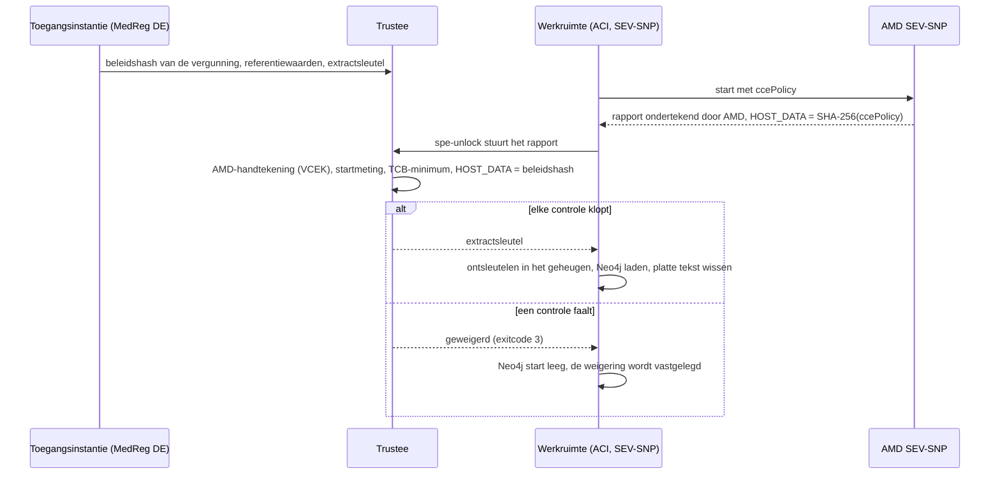

# De beveiligde verwerkingsomgeving en haar confidential containers

Een gegevensgebruiker krijgt nooit de rijen van de patiënten. Hij stelt een
vraag, die vraag draait in een **beveiligde verwerkingsomgeving** (SPE) naast
de gegevens, en alleen aggregaten die door de outputcontroles komen, gaan terug
(Verordening (EU) 2025/327, [art. 73](https://eur-lex.europa.eu/eli/reg/2025/327/oj/eng#art_73)). Deze pagina legt uit hoe de hub die
omgeving bouwt uit confidential containers, zodat de bewering "ook de beheerder
kan de gegevens niet lezen" op hardware berust en niet op vertrouwen. Ze
behandelt wat waar draait, hoe een werkruimte haar sleutel krijgt, wat een
query doorloopt, hoe u het op een laptop draait en wat nog niet klaar is.

De beslissingen zijn [ADR-037](../ADRs/ADR-037-secure-processing-environment-confidential-computing.md)
(het patroon), [ADR-068](../ADRs/ADR-068-a-sovereign-confidential-spe-on-confidential-containers-and-trustee.md)
(het ontwerp), [ADR-069](../ADRs/ADR-069-two-spe-workspaces-as-aci-confidential-containers.md)
(de deployment op Azure) en [ADR-072](../ADRs/ADR-072-spe-workspaces-start-on-demand.md)
(starten op aanvraag). Het stappenplan voor de beheerder is het runbook
[SPE-attestatie op Azure](../knowledge/runbooks/spe-attestation-azure.md).

## 1. Het idee in één alinea

Elk van de twee gegevenshouders heeft een **werkruimte**: SPE-1 voor
AlphaKlinik Berlin, SPE-2 voor Limburg Medical Centre. Een werkruimte is een
confidential containergroep: haar geheugen wordt door de CPU versleuteld ([AMD
SEV-SNP](https://docs.kernel.org/arch/x86/amd-memory-encryption.html#secure-nested-paging-snp)), en de CPU ondertekent een rapport van precies wat erin is gestart. De
gegevens van de werkruimte komen verzegeld aan, en de sleutel ligt bij een
**Trustee** die de instantie voor toegang tot gezondheidsgegevens (MedReg DE)
draait. Trustee geeft de sleutel alleen vrij als het ondertekende rapport
bewijst dat de werkruimte de code draait waarvoor de gegevensvergunning is
afgegeven. **Geen sleutel, geen gegevens**: een gewijzigde image, opdracht of
omgevingsvariabele geeft een andere beleidshash, en de sleutel blijft waar hij
is.

## 2. Het framework: CNCF Confidential Containers (CoCo)

De SPE is gebouwd op [Confidential Containers](https://confidentialcontainers.org/) (CoCo), sinds juli
2026 een [CNCF-incubatieproject](https://www.cncf.io/blog/2026/07/22/confidential-containers-becomes-a-cncf-incubating-project/). CoCo draait containers in
hardware-TEE's en geeft geheimen alleen vrij aan workloads die aantonen wat
ze zijn ([ADR-068](../ADRs/ADR-068-a-sovereign-confidential-spe-on-confidential-containers-and-trustee.md), besluit 1). CoCo heeft drie onderdelen; de hub
gebruikt er vandaag twee:

| CoCo-onderdeel                                                                      | Wat het is                                                                                                                                                                                                                                                                                                                                                                                                          | Hier gebruikt                                                                                                                                                                                                                                                                                                                                                                                                                                       |
| ----------------------------------------------------------------------------------- | ------------------------------------------------------------------------------------------------------------------------------------------------------------------------------------------------------------------------------------------------------------------------------------------------------------------------------------------------------------------------------------------------------------------- | --------------------------------------------------------------------------------------------------------------------------------------------------------------------------------------------------------------------------------------------------------------------------------------------------------------------------------------------------------------------------------------------------------------------------------------------------- |
| **[Trustee](https://github.com/confidential-containers/trustee)**                   | De key broker service ([KBS](https://github.com/confidential-containers/trustee/tree/v0.22.0/kbs)), de attestatiedienst ([AS](https://github.com/confidential-containers/trustee/tree/v0.22.0/attestation-service)) en de referentiewaardendienst ([RVPS](https://github.com/confidential-containers/trustee/tree/v0.22.0/rvps)): hij controleert het bewijs van een TEE en geeft geheimen vrij volgens een beleid. | Ja, [v0.22.0](https://github.com/confidential-containers/trustee/releases/tag/v0.22.0), beheerd door de toegangsinstantie: ACA-app `mvhd-trustee` op Azure, lokaal de dienst `trustee` in [`docker-compose.trustee.yml`](../../docker-compose.trustee.yml#L61).                                                                                                                                                                                     |
| **[Guest components](https://github.com/confidential-containers/guest-components)** | Wat in de TEE draait om het bewijs te verzamelen en met Trustee te praten: de [attesters](https://github.com/confidential-containers/guest-components/tree/v0.22.0/attestation-agent/attester) en [`kbs-client`](https://github.com/confidential-containers/trustee/tree/v0.22.0/tools/kbs-client).                                                                                                                 | Ja: de init-container `spe-unlock` gebruikt `kbs-client` met de SEV-SNP-attester, gepatcht zodat hij ACI om het gewone rapport vraagt ([`kbs-client.aci.Dockerfile`](https://github.com/ma3u/MinimumViableHealthDataspacev2/blob/main/services/spe-loader/kbs-client.aci.Dockerfile)).                                                                                                                                                              |
| **[Kata Containers](https://katacontainers.io/) als runtime**                       | Start elke pod in een eigen vertrouwelijke micro-VM, via een Kubernetes-[`RuntimeClass`](https://kubernetes.io/docs/concepts/containers/runtime-class/) of als [peer pods](https://github.com/confidential-containers/cloud-api-adaptor) in een cloud.                                                                                                                                                              | Niet op Azure: het tenantbeleid weigerde AKS, en de Azure-tests van de peer pods staan uit. In plaats daarvan leveren de vertrouwelijke containergroepen van ACI de SEV-SNP-utility-VM ([ADR-069](../ADRs/ADR-069-two-spe-workspaces-as-aci-confidential-containers.md)). Op een Mac is Kata een optionele lokale runtimecontrole ([ADR-068](../ADRs/ADR-068-a-sovereign-confidential-spe-on-confidential-containers-and-trustee.md#decision), M2). |

Op Azure komt de isolatie dus van ACI, en de vertrouwensbeslissing (welke
workload een sleutel krijgt) van de Trustee van CoCo. Later overstappen op
Kata op Kubernetes verandert de runtime en de beleidsgenerator ([`genpolicy`](https://github.com/kata-containers/kata-containers/tree/main/src/tools/genpolicy)
in plaats van [`az confcom`](https://learn.microsoft.com/en-us/cli/azure/confcom)), niet Trustee, de vergunning of haar beleidshash.

## 3. Begrippen

| Begrip                                                                                                                                                             | Wat het is                                                                                                                                                                                                                                                                                            |
| ------------------------------------------------------------------------------------------------------------------------------------------------------------------ | ----------------------------------------------------------------------------------------------------------------------------------------------------------------------------------------------------------------------------------------------------------------------------------------------------- |
| **Confidential computing**                                                                                                                                         | Code draaien in een trusted execution environment (TEE) waarvan de host, de hypervisor en de cloudbeheerder het geheugen niet kunnen lezen.                                                                                                                                                           |
| **[AMD SEV-SNP](https://docs.kernel.org/arch/x86/amd-memory-encryption.html#secure-nested-paging-snp)**                                                            | De TEE die de werkruimten gebruiken (EPYC 9V74, Genoa). Hij versleutelt het geheugen van de VM en levert een attestatierapport, ondertekend met een sleutel die terug te voeren is op AMD. Intel TDX wordt niet gebruikt.                                                                             |
| **Confidential container**                                                                                                                                         | Een containergroep die in een eigen SEV-SNP-utility-VM draait. Op Azure: een groep in [Azure Container Instances](https://learn.microsoft.com/en-us/azure/container-instances/container-instances-confidential-overview) (ACI) met `sku: Confidential`.                                               |
| **[ccePolicy](https://learn.microsoft.com/en-us/azure/container-instances/container-instances-confidential-overview#confidential-computing-enforcement-policies)** | Het beleid voor de handhaving van confidential computing van een ACI-groep: de images per digest, de opdrachten, de omgeving en de mounts die mogen draaien. Gegenereerd met [`az confcom acipolicygen`](https://learn.microsoft.com/en-us/cli/azure/confcom#az-confcom-acipolicygen).                |
| **HOST_DATA**                                                                                                                                                      | Een veld van het SEV-SNP-rapport dat bij de start wordt gezet. ACI zet daar de [SHA-256](https://csrc.nist.gov/pubs/fips/180-4/upd1/final) van de ccePolicy in, zodat de hardware instaat voor het beleid waarmee de groep is gestart.                                                                |
| **Beleidshash**                                                                                                                                                    | Die SHA-256, vastgelegd op de vergunning (`HDABApproval.policyHash`) en in het resourcebeleid van Trustee. Hij koppelt een vergunning aan precies één workload.                                                                                                                                       |
| **Trustee**                                                                                                                                                        | De key broker van [CNCF Confidential Containers](https://confidentialcontainers.org/): KBS (key broker service), AS (attestation service) en RVPS (referentiewaarden). Versie [v0.22.0](https://github.com/confidential-containers/trustee/releases/tag/v0.22.0), gedraaid door de toegangsinstantie. |
| **Referentiewaarden**                                                                                                                                              | Waarmee Trustee het rapport vergelijkt: de startmeting van de utility-VM van Microsoft en de minimale TCB (versies van firmware en microcode).                                                                                                                                                        |
| **Verzegeld extract**                                                                                                                                              | De helft van de synthetische patiënten voor één werkruimte, formaat `mvhd-spe-extract/1`: JSON-regels, met gzip gecomprimeerd, versleuteld met [AES-256-GCM](https://nvlpubs.nist.gov/nistpubs/Legacy/SP/nistspecialpublication800-38d.pdf) onder een nieuwe sleutel per vergunning.                  |

## 4. Waar het draait, en wat elke plek bewijst

Het ontwerp is overal hetzelfde; het verschil is of echte hardware het bewijs
ondertekent. De UI zegt welk van beide, met een van drie labels
([`ui/src/lib/spe.ts`](https://github.com/ma3u/MinimumViableHealthDataspacev2/blob/main/ui/src/lib/spe.ts)),
en claimt nooit meer dan het bewijs toont ([ADR-068](../ADRs/ADR-068-a-sovereign-confidential-spe-on-confidential-containers-and-trustee.md#decision), beslissing 5).

| Waar                           | Wat echt is                                                                                                                                                                                                                        | Label                             |
| ------------------------------ | ---------------------------------------------------------------------------------------------------------------------------------------------------------------------------------------------------------------------------------- | --------------------------------- |
| **Laptop, CI, statische demo** | Trustee, de hash van de vergunning in zijn beleid, het vrijgeven van de sleutel, het verzegelde extract, Neo4j dat het laadt, het audittrail. Het bewijs komt van de sample attester van Trustee, omdat een laptop geen TEE heeft. | "Simulated attestation"           |
| **Azure, op nodeniveau (A1)**  | SEV-SNP-hardware met een gemeten boot, maar niet welke container draaide. Niet gedeployd.                                                                                                                                          | "Attested: SEV-SNP node"          |
| **Azure, per workload (A2)**   | ACI confidential containers in westeurope: het beleid per workload wordt door de hardware gecontroleerd. Liep op 2026-11-02 van begin tot eind ([#774](https://github.com/ma3u/MinimumViableHealthDataspacev2/issues/774)).        | "Attested: confidential workload" |

De geseede `SPESession`-knooppunten in de Trust Center-graaf
([`neo4j/seed-trust-center.cypher`](https://github.com/ma3u/MinimumViableHealthDataspacev2/blob/main/neo4j/seed-trust-center.cypher))
dragen `simulated: true`; ze illustreren het model en zijn geen bewijs.

## 5. De onderdelen op Azure

| Onderdeel                 | Azure-resource                                                     | Wat het doet                                                                                                                              |
| ------------------------- | ------------------------------------------------------------------ | ----------------------------------------------------------------------------------------------------------------------------------------- |
| SPE-1, AlphaKlinik Berlin | ACI-groep `mvhd-spe-1`, `sku: Confidential`, westeurope            | init-container `spe-unlock` attesteert en haalt de sleutel; `neo4j` bevat de gegevens; sidecar `spe-ingest` laadt ze                      |
| SPE-2, Limburg MC         | ACI-groep `mvhd-spe-2`, dezelfde opbouw                            | hetzelfde, met de andere helft van de synthetische patiënten                                                                              |
| Trustee (MedReg DE)       | ACA-app `mvhd-trustee`, job `mvhd-trustee-admin`                   | controleert het SEV-SNP-bewijs tegen de keten van AMD, de referentiewaarden en HOST_DATA, en geeft dan `default/spe-<n>/extract-key` vrij |
| De toestand van Trustee   | file shares `trustee-keys`, `trustee-data`                         | beheersleutel, tokensleutel, beleid, referentiewaarden, extractsleutels. Nooit de Key Vault van de hub                                    |
| Verzegelde extracten      | share `spe-extracts`, ingebakken in image `mvhd-spe-loader-spe<n>` | alleen ciphertext; de digest van het extract maakt deel uit van de beleidshash                                                            |
| Federatie en audit        | ACA-app `mvhd-neo4j-proxy`                                         | stuurt de gefedereerde vragen naar de werkruimten, past de outputcontroles toe, voegt hun `spe.*`-events toe aan de auditketen            |

Het groepssjabloon is
[`scripts/azure/aci/spe-workspace.template.json`](https://github.com/ma3u/MinimumViableHealthDataspacev2/blob/main/scripts/azure/aci/spe-workspace.template.json).
Al het andere in de hub blijft op Azure Container Apps (ACA), dat in een
EU-regio nog geen confidential workloadprofiel heeft. [Azure Attestation](https://learn.microsoft.com/en-us/azure/attestation/overview) en
[secure key release van Key Vault](https://learn.microsoft.com/en-us/azure/confidential-computing/concept-skr-attestation) zijn overwogen en zitten bewust **niet** in
het sleutelpad: de toegangsinstantie beslist wie een sleutel krijgt, niet de
cloudbeheerder ([ADR-068](../ADRs/ADR-068-a-sovereign-confidential-spe-on-confidential-containers-and-trustee.md#decision) beslissing 1, [ADR-069](../ADRs/ADR-069-two-spe-workspaces-as-aci-confidential-containers.md#alternatives-considered) "Alternatives considered").

## 6. De vertrouwensketen



1. **De vergunning legt de workload vast.** [`21-aci-confidential-spe.sh --policy`](../../scripts/azure/21-aci-confidential-spe.sh)
   genereert de ccePolicy uit het sjabloon. De SHA-256 ervan wordt op de
   vergunning (`HDABApproval`) geschreven en in het resourcebeleid van Trustee
   ([`trustee/policies/resource-azure.rego.tmpl`](https://github.com/ma3u/MinimumViableHealthDataspacev2/blob/main/trustee/policies/resource-azure.rego.tmpl)).
2. **De hardware staat ervoor in.** ACI start de groep in een SEV-SNP-utility-VM
   en zet de hash van het beleid in HOST_DATA van het ondertekende rapport.
3. **Trustee controleert vier dingen:** de handtekening terug tot AMD ([VCEK](https://kdsintf.amd.com/) uit
   de sleuteldistributiedienst van AMD), de startmeting van de utility-VM tegen
   een vastgepinde referentiewaarde, de TCB tegen een minimum per component
   ([ADR-073](../ADRs/ADR-073-the-spe-tcb-is-a-minimum-not-a-list.md),
   [`attestation-ear-cpu.rego`](https://github.com/ma3u/MinimumViableHealthDataspacev2/blob/main/trustee/policies/attestation-ear-cpu.rego)),
   en HOST_DATA tegen de hash van de vergunning.
4. **Pas dan verlaat de sleutel Trustee.** Zonder vastgepinde referentiewaarde
   weigert het beleid: er is geen "ontgrendelen bij eerste gebruik".

Geheimen reizen niet mee in het beleid. Ze bereiken de groep via haar secret
volume, zodat het roteren van een geheim de hash niet verandert.

## 7. Binnen een werkruimte

Elke groep heeft drie containers, gebouwd uit
[`services/spe-loader`](https://github.com/ma3u/MinimumViableHealthDataspacev2/tree/main/services/spe-loader):

- **`spe-unlock`** (init-container): attesteert met `kbs-client`, gebouwd met
  de feature `snp-attester`, haalt de sleutel en ontsleutelt het extract naar
  het `emptyDir`-volume `work`.
- **`neo4j`**: [Neo4j 5.26](https://neo4j.com/release-notes/database/neo4j-5/) Community, [1,5 vCPU](../../scripts/azure/aci/spe-workspace.template.json#L126) en 4 GiB, opslag in het
  `emptyDir`-volume `neo4j-data`, Bolt met verplichte TLS, HTTP uit. Neo4j is
  **een werkruimte per vergunning, geen langlevende opslag** ([ADR-068](../ADRs/ADR-068-a-sovereign-confidential-spe-on-confidential-containers-and-trustee.md#decision)
  beslissing 3): het bevat de gegevens alleen in het geheugen en op tijdelijke
  opslag binnen de TEE.
- **`spe-ingest`** (sidecar): laadt het extract, past
  [`neo4j/init-schema.cypher`](../../neo4j/init-schema.cypher) en de HealthDCAT-AP-registratie van de SPE toe,
  wist de platte tekst, legt de attestatie vast en blijft draaien.

**De gegevens.** Elke werkruimte krijgt de helft van de synthetische patiënten
van de hub: de FHIR-records ([Patient](https://hl7.org/fhir/R4/patient.html), [Condition](https://hl7.org/fhir/R4/condition.html), [Observation](https://hl7.org/fhir/R4/observation.html) en de rest), de
bijbehorende [OMOP CDM-persoon](https://ohdsi.github.io/CommonDataModel/cdm54.html#person) met zijn records, en de concepten waarmee ze zijn
gecodeerd. Sandboxpatiënten en de patiënten van de Klarbefund-app blijven
buiten. Het label `OptedOut` van een patiënt reist mee met de gegevens
([art. 71](https://eur-lex.europa.eu/eli/reg/2025/327/oj/eng#art_71)).

**Stoppen is wissen.** De opslag staat in het geheugen, dus wie een groep
stopt of verwijdert, verliest elke rij. Elke start attesteert opnieuw en laadt
opnieuw. Eén valkuil: [`az container restart`](https://learn.microsoft.com/en-us/cli/azure/container#az-container-restart) voert de init-container niet
opnieuw uit, dus een herstarte groep vraagt Trustee nooit meer iets; stop en
start haar in plaats daarvan ([`docs/gotchas.md`](../gotchas.md), 2026-11-01).

**De opdrachten van de loader** (`spe-loader <command>`): `policy-hash`,
`trustee-configure`, `record-permit`, `export`, `encrypt`, `extract`,
`unlock`, `ingest` en `load`. Exitcode 3 betekent dat de sleutel is geweigerd;
2 betekent dat een database of Trustee niet antwoordde.

## 8. Wat een gefedereerde query doorloopt

1. Een gegevensgebruiker vraagt op `/query` of in natuurlijke taal. De UI roept
   [`/api/federated`](https://github.com/ma3u/MinimumViableHealthDataspacev2/blob/main/ui/src/app/api/federated/route.ts)
   aan (of [`/api/nlq`](../../ui/src/app/api/nlq/route.ts) met `federated: true`).
2. **Koude start** ([ADR-072](../ADRs/ADR-072-spe-workspaces-start-on-demand.md)).
   De werkruimten staan standaard uit om kosten te sparen. Een gefedereerde
   query door `EDC_ADMIN`, `HDAB_AUTHORITY` of `DATA_USER` start ze; tot ze
   draaien is het antwoord **503** met `state` `starting` of `stopped`,
   `etaSeconds` (240 vanuit gestopt) en een [`Retry-After`](https://www.rfc-editor.org/rfc/rfc9110#section-10.2.3)-header. Gemeten: de
   sleutel komt na ongeveer een minuut, de gegevens zijn na ongeveer drie
   minuten geladen, SPE-2 antwoordt na ongeveer vier. De job
   `mvhd-spe-idle-stop` draait elke 15 minuten en stopt een werkruimte die 30
   minuten niets heeft gedaan.
3. **De proxy verdeelt de vraag.** [`services/neo4j-proxy`](../../services/neo4j-proxy) stuurt de vraag naar
   beide werkruimten via Bolt met TLS (`POST /federated/query`,
   `GET /federated/stats`).
4. **Outputcontroles voordat er iets vertrekt.** Groepen kleiner dan k vallen
   weg en cellen onder k worden `<k`, met k = 5 ([`MIN_COHORT_SIZE`](../../services/neo4j-proxy/src/config.ts#L94),
   [`k-anonymity.ts`](https://github.com/ma3u/MinimumViableHealthDataspacev2/blob/main/services/neo4j-proxy/src/k-anonymity.ts));
   patiënten die hun opt-out-recht hebben uitgeoefend, worden uitgesloten
   ([`opt-out.ts`](https://github.com/ma3u/MinimumViableHealthDataspacev2/blob/main/services/neo4j-proxy/src/opt-out.ts)).
5. **Alleen aggregaten gaan terug** naar de UI, via de proxy.

**Het audittrail.** De proxy leest elke minuut de events van elke werkruimte en
voegt ze toe aan de auditketen `spe` van de hub ([ADR-045](../ADRs/ADR-045-observability-and-regulatory-audit-trail.md)): `spe.attestation`,
`key_release`, `key_refused`, `workspace_loaded`, `workspace_destroyed` en
`optout_synced`.

**Waar u het in de UI ziet**, aangemeld als `edcadmin`:

- `/admin/attestation`: de attestatie van elke werkruimte en haar label.
- `/admin/components`: de SPE-topologie, met een aan/uit-knop per werkruimte.
- `/admin/audit`: de keten `spe`.
- `/admin/policies`: welke vergunning aan welke beleidshash is gekoppeld.
- `/query`: de melding over de koude start terwijl de werkruimten opstarten.

## 9. Het draaien op een laptop

Zonder de overlay hieronder is SPE-1 gewoon de graaf van de hub en SPE-2 een
tweede Neo4j: federatie werkt, maar niets is verzegeld of geattesteerd. Voor de
echte flow met gesimuleerd bewijs start u de Trustee-overlay boven op de
JAD-stack ([`docker-compose.trustee.yml`](https://github.com/ma3u/MinimumViableHealthDataspacev2/blob/main/docker-compose.trustee.yml)):

```bash
docker compose -f docker-compose.yml -f docker-compose.jad.yml \
  -f docker-compose.trustee.yml --profile federated up -d --build
```

Die voegt Trustee toe op <http://localhost:8099>, zet zijn lokale beleid en
referentiewaarden, verzegelt beide extracten en legt hun beleidshashes vast op
de hub, verplaatst de opslag van beide werkruimten naar `tmpfs`, en draait
`spe-loader-spe1` en `spe-loader-spe2` om te attesteren, te ontgrendelen en te
laden. Controleer het resultaat met `GET http://localhost:9090/spe/status` van
de proxy of op `/admin/attestation`.

De tests die het bewaken, in CI en lokaal: [Vitest](https://vitest.dev/) in [`services/spe-loader`](../../services/spe-loader), en [`opa test`](https://www.openpolicyagent.org/docs/policy-testing) over [`trustee/policies/`](../../trustee/policies) met [`scripts/test-trustee-policies.sh`](../../scripts/test-trustee-policies.sh):

```bash
cd services/spe-loader && npm test        # Vitest: extract, seal, unlock, ingest
./scripts/test-trustee-policies.sh        # opa test over trustee/policies/
```

Beide draaien in [`test.yml`](https://github.com/ma3u/MinimumViableHealthDataspacev2/blob/main/.github/workflows/test.yml)
(SPE Loader Tests, Trustee Policy Tests). De beleidstests pinnen elk geval van
het resourcebeleid vast, ook HOST_DATA op de plek waar [Trustee v0.22.0](https://github.com/confidential-containers/trustee/releases/tag/v0.22.0) het
neerzet.

## 10. Het deployen op Azure

[`scripts/azure/21-aci-confidential-spe.sh`](https://github.com/ma3u/MinimumViableHealthDataspacev2/blob/main/scripts/azure/21-aci-confidential-spe.sh)
doet het in fasen, in deze volgorde: `--trustee`, `--extracts`, `--policy`,
`--workspaces`, `--wire-proxy`, `--check`. Het runbook bevat de vereisten (een
[PIM](https://learn.microsoft.com/en-us/entra/id-governance/privileged-identity-management/pim-configure)-rol die vóór `az login` is geactiveerd, de sessie van een uur) en wat elke
fase afdrukt; lees het voor de eerste run. Twee fasen beschermen zichzelf:
`--extracts` weigert nieuwe sleutels te maken zolang Trustee sleutels heeft,
tenzij met `--rekey`, en `--trustee` behoudt een resourcebeleid dat Trustee al
heeft.

## 11. Wat nog niet klaar is

- **De toegangsinstantie draait nog geen eigen Trustee.** De shares van Trustee
  staan in het abonnement van de hub, dus de eigenaar van het abonnement zou ze
  kunnen lezen. Om de soevereiniteitsclaim waar te maken, draait MedReg DE
  Trustee in een eigen abonnement ([ADR-069](../ADRs/ADR-069-two-spe-workspaces-as-aci-confidential-containers.md#decision) beslissing 3).
- **Het vertrouwen blijft liggen bij AMD en bij de utility-VM van Microsoft.**
  De bevestiging door Microsoft van de meting van de utility-VM wordt door de
  beheerder vergeleken, maar haar [COSE](https://datatracker.ietf.org/doc/html/rfc9052)-handtekening wordt nog niet
  cryptografisch geverifieerd.
- **[ADR-073](../ADRs/ADR-073-the-spe-tcb-is-a-minimum-not-a-list.md) is voorgesteld.** Het TCB-minimum en de tests ervan staan op `main`
  ([#836](https://github.com/ma3u/MinimumViableHealthDataspacev2/pull/836)); de ADR zegt dat het op Azure nog niet wordt toegepast.
- **AKS is vandaag geen optie.** Het tenantbeleid weigerde het
  (`RequestDisallowedByPolicy`); er is een uitzondering aangevraagd. Microsoft
  was bovendien bezig AKS confidential containers [uit te faseren](https://github.com/Azure/AKS/issues/3781) ([ADR-068](../ADRs/ADR-068-a-sovereign-confidential-spe-on-confidential-containers-and-trustee.md#decision)).
- **Nog niet besloten** ([ADR-068](../ADRs/ADR-068-a-sovereign-confidential-spe-on-confidential-containers-and-trustee.md#not-decided-here)): welke EU-provider het geval per workload
  buiten Azure host, en Trustee in een eigen abonnement.

Issues: [#774](https://github.com/ma3u/MinimumViableHealthDataspacev2/issues/774)
(de deployment op Azure), [#27](https://github.com/ma3u/MinimumViableHealthDataspacev2/issues/27),
[#481](https://github.com/ma3u/MinimumViableHealthDataspacev2/issues/481),
[#716](https://github.com/ma3u/MinimumViableHealthDataspacev2/issues/716),
[#833](https://github.com/ma3u/MinimumViableHealthDataspacev2/issues/833).

## 12. De beslissingen, op volgorde

| ADR                                                                                               | Beslissing                                                                                              | Status                    |
| ------------------------------------------------------------------------------------------------- | ------------------------------------------------------------------------------------------------------- | ------------------------- |
| [ADR-037](../ADRs/ADR-037-secure-processing-environment-confidential-computing.md)                | Confidential containers met remote attestation, geen vertrouwen in de beheerder                         | Geaccepteerd              |
| [ADR-052](../ADRs/ADR-052-confidential-spe-on-azure-revisited.md)                                 | AKS met Kata en Azure Attestation                                                                       | Vervangen door ADR-068    |
| [ADR-068](../ADRs/ADR-068-a-sovereign-confidential-spe-on-confidential-containers-and-trustee.md) | CNCF Confidential Containers, een Trustee die de toegangsinstantie draait, Neo4j geladen per vergunning | Geaccepteerd (2026-10-30) |
| [ADR-069](../ADRs/ADR-069-two-spe-workspaces-as-aci-confidential-containers.md)                   | Twee werkruimten als ACI confidential containers; de beleidshash is HOST_DATA                           | Geaccepteerd (2026-11-02) |
| [ADR-072](../ADRs/ADR-072-spe-workspaces-start-on-demand.md)                                      | Standaard gestopt, gestart door een gefedereerde query, gestopt na 30 inactieve minuten                 | Geaccepteerd (2026-11-02) |
| [ADR-073](../ADRs/ADR-073-the-spe-tcb-is-a-minimum-not-a-list.md)                                 | De SEV-SNP-TCB wordt gecontroleerd tegen een minimum per component                                      | Voorgesteld               |
