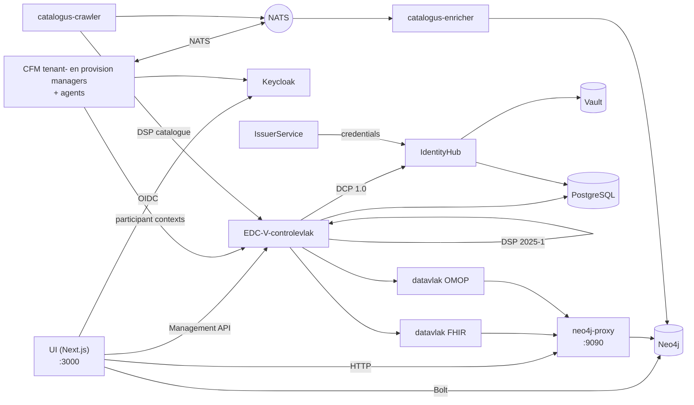

# De stack en de ontwikkelomgeving

Hoe elk onderdeel van de hub heet, wat het doet en hoe de onderdelen
samenhangen, gevolgd door hoe u ze op een laptop draait. De beslissingen achter elk
onderdeel staan in de ADR's die vanuit de rij ervan zijn gelinkt; het volledige logboek van valkuilen is
[`docs/gotchas.md`](../gotchas.md).

## Woordenlijst

### Protocollen

| Term              | Wat het is                                                                                                                                                                                                                                                                                         | Beslissing                                                              |
| ----------------- | -------------------------------------------------------------------------------------------------------------------------------------------------------------------------------------------------------------------------------------------------------------------------------------------------- | ----------------------------------------------------------------------- |
| **DSP 2025-1**    | Het Eclipse Dataspace Protocol, versie 2025-1: hoe twee connectoren een catalogus uitwisselen (DCAT), over een contract onderhandelen op basis van een ODRL-aanbod en een overdracht uitvoeren. Het controlevlak spreekt het onder `/api/dsp/<participant>/2025-1/`.                               | [ADR-007](../ADRs/ADR-007-did-web-dsp-negotiation.md)                   |
| **DCP 1.0**       | Het Decentralised Claims Protocol: hoe een deelnemer bewijst wie hij is. Elke deelnemer heeft een `did:web`-DID en houdt verifieerbare credentials (een `MembershipCredential`, EHDS-rolcredentials); een tegenpartij vraagt om een presentatie in plaats van op een centrale login te vertrouwen. | [ADR-009](../ADRs/ADR-009-issuerservice-credential-fix.md)              |
| **ODRL 2.2**      | De beleidstaal van een aanbod: wie een dataset mag gebruiken, voor welk doel, onder welke vergunning.                                                                                                                                                                                              | [ADR-013](../ADRs/ADR-013-simpl-open-alignment.md)                      |
| **HealthDCAT-AP** | Het catalogusvocabulaire voor gezondheidsdatasets, Release 8 sinds #700.                                                                                                                                                                                                                           | [ADR-063](../ADRs/ADR-063-healthdcat-ap-release-8-and-its-namespace.md) |
| **did:web**       | Een DID die via HTTPS wordt opgelost. Er bestaan twee vormen naast elkaar, een stabiele in de graaf en de UI en een oplosbare in de EDC-laag; [`api-conventions.md`](https://github.com/ma3u/MinimumViableHealthDataspacev2/blob/main/.claude/rules/api-conventions.md) legt uit welke waar hoort. | [ADR-007](../ADRs/ADR-007-did-web-dsp-negotiation.md)                   |

### De connector: EDC-V

| Term              | Wat het is                                                                                                                                                                                                                                                                                                                                     | Beslissing                                                                                                                              |
| ----------------- | ---------------------------------------------------------------------------------------------------------------------------------------------------------------------------------------------------------------------------------------------------------------------------------------------------------------------------------------------- | --------------------------------------------------------------------------------------------------------------------------------------- |
| **EDC-V**         | Eclipse Dataspace Components, virtueel: één multi-tenant EDC-runtime waarin elke deelnemer een _participant context_ is in plaats van een eigen connector. De hub draait EDC 0.18 uit de JAD-images.                                                                                                                                           | [ADR-024](../ADRs/ADR-024-full-edc-provisioning-per-participant.md), [ADR-055](../ADRs/ADR-055-azure-runs-the-compose-jad-build.md)     |
| **Controlevlak**  | De EDC-V-runtime die assets, beleid en contractdefinities bevat, via DSP over contracten onderhandelt en overdrachten start. Management API op `:11003`.                                                                                                                                                                                       | [ADR-002](../ADRs/ADR-002-edc-data-plane-architecture.md)                                                                               |
| **Datavlakken**   | Twee, één per overdrachtstype: `dataplane-fhir` pusht FHIR R4 (`:11002`), `dataplane-omop` levert OMOP CDM via pull (`:11012`). Ze verplaatsen de gegevens waarover het controlevlak overeenstemming heeft bereikt en controleren het EDR-token van elk verzoek.                                                                               | [ADR-002](../ADRs/ADR-002-edc-data-plane-architecture.md)                                                                               |
| **IdentityHub**   | De DCP-wallet van elke deelnemer: zijn DID-document, zijn sleutels (in Vault) en de credentials die hij houdt; hij beantwoordt verzoeken om presentaties. `:11005`.                                                                                                                                                                            | [ADR-009](../ADRs/ADR-009-issuerservice-credential-fix.md)                                                                              |
| **IssuerService** | De uitgever van credentials van de hub: hij bevat de credentialdefinities en geeft via DCP credentials uit aan houders. `:10013`. Een tweede instantie, `simpl-ga-issuer` (`:10023`), speelt de governance-autoriteit van Simpl; `rogue-issuer` (`:10033`) staat op geen enkele vertrouwenslijst en start alleen voor de identiteitscontroles. | [ADR-009](../ADRs/ADR-009-issuerservice-credential-fix.md), [ADR-064](../ADRs/ADR-064-simpl-open-through-the-outside-agent-dcp-path.md) |
| **Siglet**        | Ondertekent de tokens van de EDC 0.18-datavlakken (Eclipse Dataplane Core).                                                                                                                                                                                                                                                                    | [ADR-055](../ADRs/ADR-055-azure-runs-the-compose-jad-build.md)                                                                          |

### Het draaien: JAD en CFM

| Term           | Wat het is                                                                                                                                                                                                                                                                                                                                                                               | Beslissing                                                                                                                          |
| -------------- | ---------------------------------------------------------------------------------------------------------------------------------------------------------------------------------------------------------------------------------------------------------------------------------------------------------------------------------------------------------------------------------------- | ----------------------------------------------------------------------------------------------------------------------------------- |
| **JAD**        | De Joint Architecture Demo: de referentie-deployment van EDC-V (`ghcr.io/metaform/jad/*`-images, vastgepind op commit). Hier is dat `docker-compose.jad.yml` plus de seeds en configuratie in `jad/`, gelaagd op `docker-compose.yml`. Azure draait dezelfde build.                                                                                                                      | [ADR-005](../ADRs/ADR-005-jad-cfm-source-builds.md), [ADR-055](../ADRs/ADR-055-azure-runs-the-compose-jad-build.md)                 |
| **CFM**        | De Connector Fabric Manager, het beheervlak boven EDC-V: de **tenant manager** (`:11006`) maakt per organisatie een tenant aan, de **provision manager** (`:11007`) richt in wat die nodig heeft, en vier **agents** doen het werk (Keycloak-client, EDC-V-participant context, registratie, onboarding). `cfm-cp-shim` overbrugt de vastgepinde agents naar de API-versie van EDC 0.18. | [ADR-005](../ADRs/ADR-005-jad-cfm-source-builds.md)                                                                                 |
| **Vault**      | HashiCorp Vault bewaart de privésleutels van elke deelnemer en de EDC-geheimen. Lokaal sinds 2026-09-26 op bestanden opgeslagen (`jad/vault.hcl`, met een `vault-unseal`-sidecar), op Azure op de Flexible Server. Nooit `-dev`: een herstart zou elke sleutel meenemen.                                                                                                                 | [ADR-046](../ADRs/ADR-046-vault-keeps-its-state-on-the-flexible-server.md), [ADR-047](../ADRs/ADR-047-vault-stays-up-off-hours.md)  |
| **Keycloak**   | OIDC-aanmelding voor de UI en de serviceclients, realm `edcv`, `:8080`. De UI-client is confidential met PKCE S256.                                                                                                                                                                                                                                                                      | [ADR-025](../ADRs/ADR-025-keycloak-custom-domain.md)                                                                                |
| **PostgreSQL** | De runtime-opslag van de EDC-diensten en Keycloak, elk met een eigen database (`jad/init-postgres.sql`). Op Azure de Flexible Server.                                                                                                                                                                                                                                                    | [ADR-001](../ADRs/ADR-001-postgresql-neo4j-split.md), [ADR-041](../ADRs/ADR-041-managed-postgres-on-azure-containerised-locally.md) |
| **NATS**       | Het event-mesh (JetStream) tussen de managers en agents van CFM, en tussen de catalogus-crawler en -enricher. `:4222`.                                                                                                                                                                                                                                                                   | [ADR-020](../ADRs/ADR-020-cross-participant-dataset-discovery.md)                                                                   |
| **Traefik**    | De gateway voor de JAD-diensten, `:80`, dashboard op `:8090`.                                                                                                                                                                                                                                                                                                                            |                                                                                                                                     |

### De eigen diensten van de hub

| Term                         | Wat het is                                                                                                                                                                                                                                                                                                                                                                                                                                                     | Beslissing                                                                                                                                                                           |
| ---------------------------- | -------------------------------------------------------------------------------------------------------------------------------------------------------------------------------------------------------------------------------------------------------------------------------------------------------------------------------------------------------------------------------------------------------------------------------------------------------------- | ------------------------------------------------------------------------------------------------------------------------------------------------------------------------------------ |
| **UI**                       | De Next.js-app in `ui/`: de pagina's van elke persona en de `/api/*`-routes daarachter. Container `health-dataspace-ui`.                                                                                                                                                                                                                                                                                                                                       | [ADR-004](../ADRs/ADR-004-nextjs-unified-frontend.md), [ADR-044](../ADRs/ADR-044-every-api-route-needs-a-session.md)                                                                 |
| **Neo4j**                    | De kennisgraaf van vijf lagen: marktplaats (DSP), HealthDCAT-AP, FHIR R4, OMOP CDM en ontologieën. Neo4j 5.26 LTS Community met APOC, APOC Extended, Graph Data Science en n10s. Geen object mapper en geen GraphQL-laag: de UI, de proxy en de SPE-loader gebruiken de officiële `neo4j-driver` met geparametriseerde Cypher (`runQuery()` in `ui/src/lib/neo4j.ts`), de catalogusdiensten de officiële Python-driver `neo4j`. `:7474` browser, `:7687` Bolt. | [ADR-001](../ADRs/ADR-001-postgresql-neo4j-split.md), [ADR-030](../ADRs/ADR-030-neo4j-2025-lts-migration.md), [ADR-043](../ADRs/ADR-043-graph-access-direct-or-through-the-proxy.md) |
| **neo4j-proxy**              | `services/neo4j-proxy/`, Express op `:9090`: de FHIR- en OMOP-endpoints die de datavlakken aanroepen, de engine voor vragen in natuurlijke taal, de gefedereerde query en de catalogus in HealthDCAT-AP.                                                                                                                                                                                                                                                       | [ADR-043](../ADRs/ADR-043-graph-access-direct-or-through-the-proxy.md)                                                                                                               |
| **Catalog crawler**          | `services/catalog-crawler/`, Python: haalt elke vijf minuten de DSP-catalogus van elke deelnemer op en publiceert die op NATS (`dataspace.catalog.raw`).                                                                                                                                                                                                                                                                                                       | [ADR-020](../ADRs/ADR-020-cross-participant-dataset-discovery.md)                                                                                                                    |
| **Catalog enricher**         | `services/catalog-enricher/`, Python: leest die catalogi van NATS, zet ze om naar HealthDCAT-AP en voegt ze in Neo4j samen als `:HealthDataset`-knooppunten, zodat een vraag over datasets die van elke deelnemer bereikt.                                                                                                                                                                                                                                     | [ADR-020](../ADRs/ADR-020-cross-participant-dataset-discovery.md), [ADR-003](../ADRs/ADR-003-healthdcat-ap-alignment.md)                                                             |
| **SPE-werkruimten, Trustee** | `services/spe-loader/` en `trustee/`: de twee beveiligde verwerkingsomgevingen (art. 73), confidential containers met AMD SEV-SNP op Azure, waarvan een Trustee van de toegangsinstantie de verzegelde gegevens alleen ontgrendelt voor de workload die de vergunning noemt. Zie [de beveiligde verwerkingsomgeving](secure-processing-environment.md).                                                                                                        | [ADR-068](../ADRs/ADR-068-a-sovereign-confidential-spe-on-confidential-containers-and-trustee.md), [ADR-069](../ADRs/ADR-069-two-spe-workspaces-as-aci-confidential-containers.md)   |
| **Klarbefund**               | De iPhone-app in `clients/ios/`: scant een laboratoriumrapport op het toestel en verbindt met de hub als het EPD van de patiënt.                                                                                                                                                                                                                                                                                                                               | [ADR-033](../ADRs/ADR-033-lab-report-extraction-pipeline.md), [ADR-049](../ADRs/ADR-049-klarbefund-connects-by-device-grant.md)                                                      |

### Hoe ze samenhangen



Een deelnemer wordt één keer door CFM aangemaakt: de tenant manager maakt de tenant aan,
de agents geven hem een Keycloak-client, een participant context in EDC-V en een DID
in de IdentityHub, en de IssuerService geeft zijn credentials uit. Vanaf dan
onderhandelt het controlevlak namens hem via DSP, bewijst het via
DCP wie hij is, en verplaatst een datavlak de gegevens vanuit de Neo4j-proxy zodra een contract
geldt. De UI leest de graaf rechtstreeks voor zijn pagina's en gaat via het
controlevlak voor alles wat een uitwisseling is.

## Ontwikkelomgeving

### Vereisten

| Nodig                                 | Voor                                                                                                 |
| ------------------------------------- | ---------------------------------------------------------------------------------------------------- |
| Node.js 20 of later, npm              | de UI en de Neo4j-proxy                                                                              |
| Docker met Compose v2                 | Neo4j en de volledige JAD-stack; geef Docker **8 GB geheugen** voor JAD                              |
| Python 3.11 of later                  | de controles van de repository (`scripts/*.py`) en de catalogusdiensten                              |
| `pre-commit`                          | de hooks: `pip install pre-commit && pre-commit install --hook-type pre-commit --hook-type pre-push` |
| gitleaks, semgrep, actionlint, lychee | lokaal optioneel (elke hook waarschuwt en slaat over zonder); de PR Gate voert uit wat ertoe doet    |
| Xcode 27 en `xcodegen`                | alleen voor de iPhone-app (iOS 26 SDK)                                                               |

### Twee manieren om het te draaien

| Stack            | Starten                                                                                                                            | Wat u krijgt                                                                                                                    |
| ---------------- | ---------------------------------------------------------------------------------------------------------------------------------- | ------------------------------------------------------------------------------------------------------------------------------- |
| **Minimaal**     | `docker compose up -d neo4j`, schema en gegevens laden, `cd ui && npm install && npm run dev`                                      | de graaf en elke pagina die hem leest, op http://localhost:3000; geen Keycloak, dus aanmelden vereist de statische personamodus |
| **Volledig JAD** | `docker compose -f docker-compose.yml -f docker-compose.jad.yml up -d`, daarna `./scripts/bootstrap-jad.sh` en `./jad/seed-all.sh` | elke dienst uit de woordenlijst, de UI-container op http://localhost:3003, aanmelden via Keycloak                               |

De graaf laden voor de minimale stack (beide bestanden zijn idempotent):

```bash
cat neo4j/init-schema.cypher | docker exec -i health-dataspace-neo4j \
  cypher-shell -u neo4j -p healthdataspace
cat neo4j/insert-synthetic-schema-data.cypher | docker exec -i health-dataspace-neo4j \
  cypher-shell -u neo4j -p healthdataspace
```

`docker compose up -d` zonder dienstnaam bouwt ook de UI als de
container `health-dataspace-ui` op `:3000` en `:3003`; start alleen `neo4j`
als u `npm run dev` op `:3000` wilt.

### De seedfasen, op volgorde

`./jad/seed-all.sh` voert zeven fasen uit, en elke fase heeft de vorige nodig, dus een
mislukte fase maakt elke latere ongeldig. Hervat met `--from N`, voer er één uit met
`--only N`.

| Fase | Script                         | Doet                                                          |
| ---: | ------------------------------ | ------------------------------------------------------------- |
|    1 | `seed-health-tenants.sh`       | vijf deelnemertenants via CFM                                 |
|    2 | `seed-ehds-credentials.sh`     | de EHDS-credentialtypen op de IssuerService                   |
|    3 | `seed-ehds-policies.sh`        | ODRL-beleid voor elke deelnemer                               |
|    4 | `seed-data-assets.sh`          | data-assets en contractdefinities op EDC-V                    |
|    5 | `seed-contract-negotiation.sh` | onderhandelingen van PharmaCo met AlphaKlinik en datavlakken  |
|    6 | `seed-federated-catalog.sh`    | catalogusonderhandeling van MedReg met Limburg Medical Centre |
|    7 | `seed-data-transfer.sh`        | EDR-tokens en overdrachten via de datavlakken                 |

Het runbook is [JAD-stack seeden](../knowledge/runbooks/jad-stack-seeding.md).

### Poorten

| Poort      | Dienst                             | Poort        | Dienst                           |
| ---------- | ---------------------------------- | ------------ | -------------------------------- |
| 3000       | UI (`npm run dev` of de container) | 11002        | datavlak FHIR                    |
| 3003       | UI-container (JAD)                 | 11003        | controlevlak, Management API     |
| 7474, 7687 | Neo4j-browser, Bolt                | 11005        | IdentityHub                      |
| 8080, 9000 | Keycloak, zijn beheerpoort         | 11006, 11007 | CFM tenant en provision managers |
| 8200       | Vault                              | 11012        | datavlak OMOP                    |
| 9090       | neo4j-proxy                        | 10013        | IssuerService                    |
| 4222, 8222 | NATS, zijn monitoring              | 10023, 10033 | Simpl GA-issuer, rogue issuer    |
| 5432       | PostgreSQL                         | 80, 8090     | Traefik, zijn dashboard          |

### Omgevingsvariabelen

De UI leest zijn configuratie uit de omgeving; `ui/.env.example` en
`ui/.env.local.example` zijn de sjablonen om te kopiëren. De variabelen die u als eerste tegenkomt:

| Variabele                                                                                                         | Wat die instelt                                                          |
| ----------------------------------------------------------------------------------------------------------------- | ------------------------------------------------------------------------ |
| `NEO4J_URI`, `NEO4J_USER`, `NEO4J_PASSWORD`                                                                       | de graaf; `neo4j` / `healthdataspace` is alleen voor lokale ontwikkeling |
| `NEO4J_PROXY_URL`                                                                                                 | de proxy, standaard `http://localhost:9090` (`ui/src/lib/proxy.ts`)      |
| `NEXTAUTH_URL`, `NEXTAUTH_SECRET`                                                                                 | NextAuth; het geheim ondertekent ook de sessies die de API-tests smeden  |
| `KEYCLOAK_PUBLIC_URL`, `KEYCLOAK_INTERNAL_URL`, `KEYCLOAK_ISSUER`, `KEYCLOAK_CLIENT_ID`, `KEYCLOAK_CLIENT_SECRET` | aanmelden; nooit `wellKnown` (valkuil 5 in `CLAUDE.md`)                  |
| `EDC_MANAGEMENT_URL`, `EDC_IDENTITY_URL`, `EDC_ISSUER_URL`, `EDC_TENANT_URL`, `EDC_PROVISION_URL`                 | de diensten van EDC-V en CFM                                             |
| `NEXT_PUBLIC_STATIC_EXPORT=true`                                                                                  | de GitHub Pages-build: geen API-routes, fixtures uit `ui/public/mock/`   |

### De iPhone-app

`clients/ios/` is een Swift-pakket en een XcodeGen-project; het heeft
de hub niet nodig om te bouwen of om zijn tests uit te voeren.

```bash
cd clients/ios
brew install xcodegen      # once
swift test                 # the parser and provenance model
xcodegen generate && open MeinBefund.xcodeproj
```

De simulatorbuild heeft een ad-hocsignatuur nodig (`CODE_SIGN_IDENTITY="-"`), anders
faalt elke Keychain-aanroep. Een build voor een toestel en een upload naar TestFlight hebben een Apple
Developer-team nodig: `Scripts/install-device.sh`, `Scripts/archive-and-upload.sh`.
De [ontwikkelaarshandleiding van Klarbefund](../klarbefund/developer-guide.md) bevat de
rest, en `Scripts/run-ui-tests.sh` voert de tests op het scherm uit.

### Valkuilen die u op de eerste dag moet kennen

Het volledige logboek, met data, is [`docs/gotchas.md`](../gotchas.md). Deze kostten
de meeste tijd:

- **Vault moet zijn toestand behouden.** Als de IdentityHub `Private key ... not
found` logt, controleer dan of `health-dataspace-vault-unseal` `ready` heeft gemeld.
- **Seedfasen hebben een strikte volgorde**; hervat een mislukte run met `--from`.
- **De statische export heeft geen API-routes.** Elke pagina die `/api/...` leest,
  heeft een fixture in `ui/public/mock/` nodig, en zonder die fixture faalt een test.
- **Pre-commit herschrijft bestanden** (Prettier, de docs facts). Stage ze opnieuw
  en commit opnieuw; controleer of `HEAD` is verschoven.
- **Een 200 van Keycloak-discovery bewijst niets**: die komt uit de cache. Bewijs het aanmelden
  met `scripts/azure/check-keycloak-health.sh`.
- **Container Apps cachen `:latest`**; een deploy pusht een nieuwe revisie in plaats
  van te herstarten.
