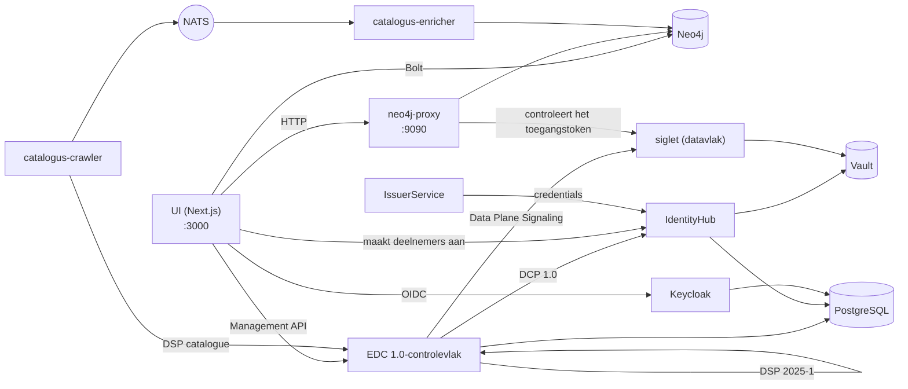

# De stack en de ontwikkelomgeving

Hoe elk onderdeel van de hub heet, wat het doet en hoe de onderdelen
samenhangen, gevolgd door hoe u ze op een laptop draait. De beslissingen achter elk
onderdeel staan in de ADR's die vanuit de rij ervan zijn gelinkt; het volledige logboek van valkuilen is
[`docs/gotchas.md`](../gotchas.md).

## Woordenlijst

### Protocollen

| Term                                                                                          | Wat het is                                                                                                                                                                                                                                                                                                                                                                                  | Beslissing                                                              |
| --------------------------------------------------------------------------------------------- | ------------------------------------------------------------------------------------------------------------------------------------------------------------------------------------------------------------------------------------------------------------------------------------------------------------------------------------------------------------------------------------------- | ----------------------------------------------------------------------- |
| **[DSP 2025-1](https://eclipse-dataspace-protocol-base.github.io/DataspaceProtocol/2025-1/)** | Het Eclipse Dataspace Protocol, versie 2025-1: hoe twee connectoren een catalogus uitwisselen ([DCAT](https://www.w3.org/TR/vocab-dcat-3/)), over een contract onderhandelen op basis van een [ODRL](https://www.w3.org/TR/odrl-model/)-aanbod en een overdracht uitvoeren. Het controlevlak spreekt het onder `/api/dsp/<participant>/2025-1/`.                                            | [ADR-007](../ADRs/ADR-007-did-web-dsp-negotiation.md)                   |
| **[DCP 1.0](https://eclipse-dataspace-dcp.github.io/decentralized-claims-protocol/v1.0/)**    | Het Decentralised Claims Protocol: hoe een deelnemer bewijst wie hij is. Elke deelnemer heeft een [`did:web`](https://w3c-ccg.github.io/did-method-web/)-DID en houdt [verifieerbare credentials](https://www.w3.org/TR/vc-data-model-2.0/) (een `MembershipCredential`, EHDS-rolcredentials); een tegenpartij vraagt om een presentatie in plaats van op een centrale login te vertrouwen. | [ADR-009](../ADRs/ADR-009-issuerservice-credential-fix.md)              |
| **[ODRL](https://www.w3.org/TR/odrl-model/) 2.2**                                             | De beleidstaal van een aanbod: wie een dataset mag gebruiken, voor welk doel, onder welke vergunning.                                                                                                                                                                                                                                                                                       | [ADR-013](../ADRs/ADR-013-simpl-open-alignment.md)                      |
| **[HealthDCAT-AP](https://data.health.europa.eu/healthdcat-ap/releases/release-8/)**          | Het catalogusvocabulaire voor gezondheidsdatasets, Release 8 sinds [#700](https://github.com/ma3u/MinimumViableHealthDataspacev2/issues/700).                                                                                                                                                                                                                                               | [ADR-063](../ADRs/ADR-063-healthdcat-ap-release-8-and-its-namespace.md) |
| **[did:web](https://w3c-ccg.github.io/did-method-web/)**                                      | Een DID die via HTTPS wordt opgelost. Er bestaan twee vormen naast elkaar, een stabiele in de graaf en de UI en een oplosbare in de EDC-laag; [`api-conventions.md`](https://github.com/ma3u/MinimumViableHealthDataspacev2/blob/main/.claude/rules/api-conventions.md) legt uit welke waar hoort.                                                                                          | [ADR-007](../ADRs/ADR-007-did-web-dsp-negotiation.md)                   |

### De connector: EDC-V

| Term                                                                                  | Wat het is                                                                                                                                                                                                                                                                                                                                                                                                                                                                                                                                                       | Beslissing                                                                                                                              |
| ------------------------------------------------------------------------------------- | ---------------------------------------------------------------------------------------------------------------------------------------------------------------------------------------------------------------------------------------------------------------------------------------------------------------------------------------------------------------------------------------------------------------------------------------------------------------------------------------------------------------------------------------------------------------- | --------------------------------------------------------------------------------------------------------------------------------------- |
| **EDC-V**                                                                             | Eclipse Dataspace Components, virtueel: één multi-tenant EDC-runtime waarin elke deelnemer een _participant context_ is in plaats van een eigen connector. De hub draait [EDC 1.0](https://github.com/eclipse-edc/Connector/releases/tag/v1.0.0-RC5) (`1.0.0-RC5`): controlevlak, IdentityHub en IssuerService zijn eigen launchers, gebouwd uit [`runtimes/edc`](../../runtimes/edc). EDC 0.18 uit de JAD-images start alleen nog in het Compose-profiel `edc018`, dat met [#927](https://github.com/ma3u/MinimumViableHealthDataspacev2/issues/927) verdwijnt. | [ADR-024](../ADRs/ADR-024-full-edc-provisioning-per-participant.md), [ADR-078](../ADRs/ADR-078-edc-1-on-container-apps-without-cfm.md)  |
| **Controlevlak**                                                                      | De EDC-runtime die assets, beleid en contractdefinities bevat, via DSP over contracten onderhandelt en overdrachten start (`controlplane` in [`docker-compose.jad.yml`](../../docker-compose.jad.yml#L277)). Management API op `:11003`.                                                                                                                                                                                                                                                                                                                         | [ADR-002](../ADRs/ADR-002-edc-data-plane-architecture.md), [ADR-078](../ADRs/ADR-078-edc-1-on-container-apps-without-cfm.md)            |
| **Siglet**                                                                            | Het datavlak onder EDC 1.0: [siglet 0.1.6](https://github.com/eclipse-dataplane-core/dsdk-facet-rs/releases/tag/siglet-v0.1.6) uit Eclipse Dataplane Core. Het controlevlak signaleert het per participant context; het geeft het toegangstoken (EDR) van een overdracht uit, en de neo4j-proxy levert de gegevens onder `/dataspace/data` nadat hij dat token tegen de sleutels van siglet heeft gecontroleerd ([`jad/siglet-edc1.toml`](../../jad/siglet-edc1.toml)). Geen hostpoort.                                                                          | [ADR-078](../ADRs/ADR-078-edc-1-on-container-apps-without-cfm.md#decision)                                                              |
| **[IdentityHub](https://github.com/eclipse-edc/IdentityHub/releases/tag/v1.0.0-RC5)** | De DCP-wallet van elke deelnemer: zijn DID-document, zijn sleutels (in Vault) en de credentials die hij houdt; hij beantwoordt verzoeken om presentaties. `:11005`.                                                                                                                                                                                                                                                                                                                                                                                              | [ADR-009](../ADRs/ADR-009-issuerservice-credential-fix.md)                                                                              |
| **IssuerService**                                                                     | De uitgever van credentials van de hub: hij bevat de credentialdefinities en geeft via DCP credentials uit aan houders. `:10013`. Een tweede instantie, `simpl-ga-issuer` (`:10023`), speelt de governance-autoriteit van [Simpl](https://code.europa.eu/simpl/simpl-open); `rogue-issuer` (`:10033`) staat op geen enkele vertrouwenslijst en start alleen voor de identiteitscontroles.                                                                                                                                                                        | [ADR-009](../ADRs/ADR-009-issuerservice-credential-fix.md), [ADR-064](../ADRs/ADR-064-simpl-open-through-the-outside-agent-dcp-path.md) |
| **DCore-datavlakken**                                                                 | Alleen EDC 0.18, in het profiel `edc018`: `dataplane-fhir` pushte FHIR R4 (`:11002`), `dataplane-omop` leverde OMOP CDM via pull (`:11012`); beide controleerden het EDR-token van elk verzoek.                                                                                                                                                                                                                                                                                                                                                                  | [ADR-002](../ADRs/ADR-002-edc-data-plane-architecture.md)                                                                               |

### Het draaien: JAD en CFM

| Term                                                                     | Wat het is                                                                                                                                                                                                                                                                                                                                                                                                                                                                                                                                                                                                                                                                                                                                                 | Beslissing                                                                                                                          |
| ------------------------------------------------------------------------ | ---------------------------------------------------------------------------------------------------------------------------------------------------------------------------------------------------------------------------------------------------------------------------------------------------------------------------------------------------------------------------------------------------------------------------------------------------------------------------------------------------------------------------------------------------------------------------------------------------------------------------------------------------------------------------------------------------------------------------------------------------------- | ----------------------------------------------------------------------------------------------------------------------------------- |
| **JAD**                                                                  | Just Another Demonstrator: de [Eclipse-demonstrator](https://github.com/eclipse-dataspace-hub/jad) die een volledige dataspace als dienst op Kubernetes uitrolt. De hub heeft de opzet naar Docker Compose overgezet: hier is JAD [`docker-compose.jad.yml`](../../docker-compose.jad.yml) plus de seeds en configuratie in [`jad/`](../../jad), gelaagd op [`docker-compose.yml`](../../docker-compose.yml). De images ervan (`ghcr.io/metaform/jad/*`) bestaan alleen nog in het profiel `edc018`. Azure draait dezelfde build.                                                                                                                                                                                                                          | [ADR-055](../ADRs/ADR-055-azure-runs-the-compose-jad-build.md), [ADR-078](../ADRs/ADR-078-edc-1-on-container-apps-without-cfm.md)   |
| **CFM**                                                                  | De Connector Fabric Manager, het beheervlak boven EDC-V onder EDC 0.18: de **tenant manager** (`:11006`) maakte per organisatie een tenant aan, de **provision manager** (`:11007`) richtte die in, en vier **agents** deden het werk (Keycloak-client, participant context, registratie, onboarding), waarbij [`cfm-cp-shim`](../../docker-compose.jad.yml#L934) de agents verbond met de API-versie van het controlevlak. EDC 1.0 draait zonder: de agents van 2026-03 roepen API's van IdentityHub en IssuerService aan die 1.0 niet meer heeft, dus maakt de hub deelnemers zelf aan. CFM, zijn agents en de shim starten alleen in het profiel `edc018`, dat met [#927](https://github.com/ma3u/MinimumViableHealthDataspacev2/issues/927) verdwijnt. | [ADR-078](../ADRs/ADR-078-edc-1-on-container-apps-without-cfm.md#context), [ADR-005](../ADRs/ADR-005-jad-cfm-source-builds.md)      |
| **Vault**                                                                | [HashiCorp Vault](https://github.com/hashicorp/vault/releases/tag/v2.0.0) bewaart de privésleutels van elke deelnemer en de EDC-geheimen. Lokaal sinds 2026-09-26 op bestanden opgeslagen ([`jad/vault.hcl`](../../jad/vault.hcl), met een `vault-unseal`-sidecar), op Azure op de [Flexible Server](https://learn.microsoft.com/en-us/azure/postgresql/flexible-server/overview). Nooit [`-dev`](https://developer.hashicorp.com/vault/docs/concepts/dev-server): een herstart zou elke sleutel meenemen.                                                                                                                                                                                                                                                 | [ADR-046](../ADRs/ADR-046-vault-keeps-its-state-on-the-flexible-server.md), [ADR-047](../ADRs/ADR-047-vault-stays-up-off-hours.md)  |
| **[Keycloak](https://github.com/keycloak/keycloak/releases/tag/26.8.0)** | [OIDC](https://openid.net/specs/openid-connect-core-1_0.html)-aanmelding voor de UI en de serviceclients, realm `edcv`, `:8080`. De UI-client is confidential met [PKCE S256](https://datatracker.ietf.org/doc/html/rfc7636#section-4.2).                                                                                                                                                                                                                                                                                                                                                                                                                                                                                                                  | [ADR-025](../ADRs/ADR-025-keycloak-custom-domain.md)                                                                                |
| **[PostgreSQL](https://www.postgresql.org/docs/release/17.7/)**          | De runtime-opslag van de EDC-diensten en Keycloak, elk met een eigen database ([`jad/init-postgres.sql`](../../jad/init-postgres.sql)). Op Azure de [Flexible Server](https://learn.microsoft.com/en-us/azure/postgresql/flexible-server/overview).                                                                                                                                                                                                                                                                                                                                                                                                                                                                                                        | [ADR-001](../ADRs/ADR-001-postgresql-neo4j-split.md), [ADR-041](../ADRs/ADR-041-managed-postgres-on-azure-containerised-locally.md) |
| **[NATS](https://github.com/nats-io/nats-server/releases/tag/v2.14.3)**  | Het event-mesh ([JetStream](https://docs.nats.io/nats-concepts/jetstream)) tussen de catalogus-crawler en -enricher, en in het profiel `edc018` tussen de managers en agents van CFM. `:4222`.                                                                                                                                                                                                                                                                                                                                                                                                                                                                                                                                                             | [ADR-020](../ADRs/ADR-020-cross-participant-dataset-discovery.md)                                                                   |
| **[Traefik](https://doc.traefik.io/traefik/v3.7/)**                      | De gateway voor de JAD-diensten, `:80`, dashboard op `:8090`.                                                                                                                                                                                                                                                                                                                                                                                                                                                                                                                                                                                                                                                                                              |                                                                                                                                     |

### De eigen diensten van de hub

| Term                         | Wat het is                                                                                                                                                                                                                                                                                                                                                                                                                                                                                                                                                                                                                                                                                                                                                                                                                                                                                                                                                                                                | Beslissing                                                                                                                                                                           |
| ---------------------------- | --------------------------------------------------------------------------------------------------------------------------------------------------------------------------------------------------------------------------------------------------------------------------------------------------------------------------------------------------------------------------------------------------------------------------------------------------------------------------------------------------------------------------------------------------------------------------------------------------------------------------------------------------------------------------------------------------------------------------------------------------------------------------------------------------------------------------------------------------------------------------------------------------------------------------------------------------------------------------------------------------------- | ------------------------------------------------------------------------------------------------------------------------------------------------------------------------------------ |
| **UI**                       | De [Next.js](https://github.com/vercel/next.js/releases/tag/v15.5.28)-app in [`ui/`](../../ui): de pagina's van elke persona en de `/api/*`-routes daarachter. Container `health-dataspace-ui`.                                                                                                                                                                                                                                                                                                                                                                                                                                                                                                                                                                                                                                                                                                                                                                                                           | [ADR-004](../ADRs/ADR-004-nextjs-unified-frontend.md), [ADR-044](../ADRs/ADR-044-every-api-route-needs-a-session.md)                                                                 |
| **Neo4j**                    | De kennisgraaf van vijf lagen: marktplaats (DSP), [HealthDCAT-AP](https://data.health.europa.eu/healthdcat-ap/releases/release-8/), [FHIR R4](https://hl7.org/fhir/R4/), [OMOP CDM](https://ohdsi.github.io/CommonDataModel/cdm54.html) en ontologieën. [Neo4j 5.26](https://neo4j.com/release-notes/database/neo4j-5/) LTS Community met [APOC](https://neo4j.com/docs/apoc/5/), [APOC Extended](https://github.com/neo4j-contrib/neo4j-apoc-procedures), [Graph Data Science](https://neo4j.com/docs/graph-data-science/current/) en [n10s](https://neo4j.com/labs/neosemantics/). Geen object mapper en geen GraphQL-laag: de UI, de proxy en de SPE-loader gebruiken de officiële [`neo4j-driver`](https://neo4j.com/docs/javascript-manual/current/) met geparametriseerde Cypher ([`runQuery()`](../../ui/src/lib/neo4j.ts#L65) in `ui/src/lib/neo4j.ts`), de catalogusdiensten de officiële Python-driver [`neo4j`](https://neo4j.com/docs/python-manual/current/). `:7474` browser, `:7687` Bolt. | [ADR-001](../ADRs/ADR-001-postgresql-neo4j-split.md), [ADR-030](../ADRs/ADR-030-neo4j-2025-lts-migration.md), [ADR-043](../ADRs/ADR-043-graph-access-direct-or-through-the-proxy.md) |
| **neo4j-proxy**              | [`services/neo4j-proxy/`](../../services/neo4j-proxy), [Express](https://expressjs.com/en/5x/api.html) op `:9090`: de FHIR- en OMOP-endpoints die een overdracht leest (`/dataspace/data`), de engine voor vragen in natuurlijke taal, de gefedereerde query en de catalogus in HealthDCAT-AP.                                                                                                                                                                                                                                                                                                                                                                                                                                                                                                                                                                                                                                                                                                            | [ADR-043](../ADRs/ADR-043-graph-access-direct-or-through-the-proxy.md)                                                                                                               |
| **Catalog crawler**          | [`services/catalog-crawler/`](../../services/catalog-crawler), Python: haalt elke vijf minuten de DSP-catalogus van elke deelnemer op en publiceert die op NATS (`dataspace.catalog.raw`).                                                                                                                                                                                                                                                                                                                                                                                                                                                                                                                                                                                                                                                                                                                                                                                                                | [ADR-020](../ADRs/ADR-020-cross-participant-dataset-discovery.md)                                                                                                                    |
| **Catalog enricher**         | [`services/catalog-enricher/`](../../services/catalog-enricher), Python: leest die catalogi van NATS, zet ze om naar HealthDCAT-AP en voegt ze in Neo4j samen als `:HealthDataset`-knooppunten, zodat een vraag over datasets die van elke deelnemer bereikt.                                                                                                                                                                                                                                                                                                                                                                                                                                                                                                                                                                                                                                                                                                                                             | [ADR-020](../ADRs/ADR-020-cross-participant-dataset-discovery.md), [ADR-003](../ADRs/ADR-003-healthdcat-ap-alignment.md)                                                             |
| **SPE-werkruimten, Trustee** | [`services/spe-loader/`](../../services/spe-loader) en [`trustee/`](../../trustee): de twee beveiligde verwerkingsomgevingen ([art. 73](https://eur-lex.europa.eu/eli/reg/2025/327/oj/eng#art_73)), confidential containers met [AMD SEV-SNP](https://docs.kernel.org/arch/x86/amd-memory-encryption.html#secure-nested-paging-snp) op Azure, waarvan een Trustee van de toegangsinstantie de verzegelde gegevens alleen ontgrendelt voor de workload die de vergunning noemt. Zie [de beveiligde verwerkingsomgeving](secure-processing-environment.md).                                                                                                                                                                                                                                                                                                                                                                                                                                                 | [ADR-068](../ADRs/ADR-068-a-sovereign-confidential-spe-on-confidential-containers-and-trustee.md), [ADR-069](../ADRs/ADR-069-two-spe-workspaces-as-aci-confidential-containers.md)   |
| **Klarbefund**               | De iPhone-app in [`clients/ios/`](../../clients/ios): scant een laboratoriumrapport op het toestel en verbindt met de hub als het EPD van de patiënt.                                                                                                                                                                                                                                                                                                                                                                                                                                                                                                                                                                                                                                                                                                                                                                                                                                                     | [ADR-033](../ADRs/ADR-033-lab-report-extraction-pipeline.md), [ADR-049](../ADRs/ADR-049-klarbefund-connects-by-device-grant.md)                                                      |

### Hoe ze samenhangen



Een deelnemer wordt één keer aangemaakt, door de hub zelf ([`ui/src/lib/edc/provision.ts`](../../ui/src/lib/edc/provision.ts),
achter `POST /api/participants`; [ADR-078](../ADRs/ADR-078-edc-1-on-container-apps-without-cfm.md#decision)): een participant
context op het controlevlak, dezelfde deelnemer met zijn DID en sleutels in de
IdentityHub, zijn DSP-profiel, een houder in de IssuerService en een
MembershipCredential die via DCP wordt uitgegeven. Een mislukte stap draait de
eerdere terug; seedfase 1 voert dezelfde reeks uit. Vanaf dan onderhandelt het
controlevlak namens hem via DSP en bewijst het via DCP wie hij is; zodra een
contract geldt, geeft siglet het toegangstoken uit en levert de neo4j-proxy de
gegevens op dat token. De UI leest de graaf rechtstreeks voor zijn pagina's en
gaat via het controlevlak voor alles wat een uitwisseling is. In het profiel
`edc018` maakte CFM de deelnemers aan.

## Ontwikkelomgeving

### Vereisten

| Nodig                                                                                                                                                                                                           | Voor                                                                                                                                            |
| --------------------------------------------------------------------------------------------------------------------------------------------------------------------------------------------------------------- | ----------------------------------------------------------------------------------------------------------------------------------------------- |
| [Node.js](https://nodejs.org/en/about/previous-releases) 22 of later, npm                                                                                                                                       | de UI en de Neo4j-proxy ([`engines`](../../services/neo4j-proxy/package.json#L47), [`ui/Dockerfile`](../../ui/Dockerfile#L1))                   |
| Docker met [Compose v2](https://docs.docker.com/compose/)                                                                                                                                                       | Neo4j en de volledige JAD-stack; geef Docker **8 GB geheugen** voor JAD                                                                         |
| [Python](https://docs.python.org/3.12/) 3.12 of later                                                                                                                                                           | de controles van de repository (`scripts/*.py`) en de catalogusdiensten ([`requires-python`](../../services/catalog-crawler/pyproject.toml#L5)) |
| [`pre-commit`](https://pre-commit.com/)                                                                                                                                                                         | de hooks: `pip install pre-commit && pre-commit install --hook-type pre-commit --hook-type pre-push`                                            |
| [gitleaks](https://github.com/gitleaks/gitleaks/releases/tag/v8.29.0), [semgrep](https://semgrep.dev/docs/), [actionlint](https://github.com/rhysd/actionlint), [lychee](https://github.com/lycheeverse/lychee) | lokaal optioneel (elke hook waarschuwt en slaat over zonder); de PR Gate voert uit wat ertoe doet                                               |
| [Xcode 27](https://developer.apple.com/xcode/) en [`xcodegen`](https://github.com/yonaskolb/XcodeGen)                                                                                                           | alleen voor de iPhone-app ([iOS 26](../../clients/ios/project.yml#L6) SDK)                                                                      |

### Twee manieren om het te draaien

| Stack            | Starten                                                                                                                                                                                       | Wat u krijgt                                                                                                                    |
| ---------------- | --------------------------------------------------------------------------------------------------------------------------------------------------------------------------------------------- | ------------------------------------------------------------------------------------------------------------------------------- |
| **Minimaal**     | `docker compose up -d neo4j`, schema en gegevens laden, `cd ui && npm install && npm run dev`                                                                                                 | de graaf en elke pagina die hem leest, op http://localhost:3000; geen Keycloak, dus aanmelden vereist de statische personamodus |
| **Volledig JAD** | `docker compose -f docker-compose.yml -f docker-compose.jad.yml up -d`, daarna [`./scripts/bootstrap-jad.sh`](../../scripts/bootstrap-jad.sh) en [`./jad/seed-all.sh`](../../jad/seed-all.sh) | elke dienst uit de woordenlijst, de UI-container op http://localhost:3003, aanmelden via Keycloak                               |

De graaf laden voor de minimale stack (beide bestanden, [`neo4j/init-schema.cypher`](../../neo4j/init-schema.cypher) en [`neo4j/insert-synthetic-schema-data.cypher`](../../neo4j/insert-synthetic-schema-data.cypher), zijn idempotent):

```bash
cat neo4j/init-schema.cypher | docker exec -i health-dataspace-neo4j \
  cypher-shell -u neo4j -p healthdataspace
cat neo4j/insert-synthetic-schema-data.cypher | docker exec -i health-dataspace-neo4j \
  cypher-shell -u neo4j -p healthdataspace
```

`docker compose up -d` zonder dienstnaam bouwt ook de UI als de
container `health-dataspace-ui` op `:3000` en `:3003`; start alleen `neo4j`
als u `npm run dev` op `:3000` wilt.

### De seedfasen, op volgorde

[`./jad/seed-all.sh`](../../jad/seed-all.sh) voert zeven fasen uit, en elke fase heeft de vorige nodig, dus een
mislukte fase maakt elke latere ongeldig. Hervat met `--from N`, voer er één uit met
`--only N`.

| Fase | Script                                                                      | Doet                                                                                                                                                                                                  |
| ---: | --------------------------------------------------------------------------- | ----------------------------------------------------------------------------------------------------------------------------------------------------------------------------------------------------- |
|    1 | [`../scripts/seed-identity-layer.sh`](../../scripts/seed-identity-layer.sh) | de vijf deelnemers onder EDC 1.0: contexten op het controlevlak, IdentityHub, de identiteit van de uitgever, houders, elk een MembershipCredential (onder 0.18 liep `seed-health-tenants.sh` via CFM) |
|    2 | [`seed-ehds-credentials.sh`](../../jad/seed-ehds-credentials.sh)            | de EHDS-credentialtypen op de IssuerService                                                                                                                                                           |
|    3 | [`seed-ehds-policies.sh`](../../jad/seed-ehds-policies.sh)                  | ODRL-beleid voor elke deelnemer                                                                                                                                                                       |
|    4 | [`seed-data-assets.sh`](../../jad/seed-data-assets.sh)                      | data-assets en contractdefinities op EDC-V                                                                                                                                                            |
|    5 | [`seed-contract-negotiation.sh`](../../jad/seed-contract-negotiation.sh)    | siglet als datavlak van elke deelnemer, daarna onderhandelingen van PharmaCo met AlphaKlinik, waarvan één geweigerd (TERMINATED)                                                                      |
|    6 | [`seed-federated-catalog.sh`](../../jad/seed-federated-catalog.sh)          | catalogusonderhandeling van MedReg met Limburg Medical Centre                                                                                                                                         |
|    7 | [`seed-data-transfer.sh`](../../jad/seed-data-transfer.sh)                  | EDR-tokens van siglet en de overdrachten die de neo4j-proxy levert                                                                                                                                    |

Het runbook is [JAD-stack seeden](../knowledge/runbooks/jad-stack-seeding.md).

### Poorten

| Poort      | Dienst                             | Poort    | Dienst                               |
| ---------- | ---------------------------------- | -------- | ------------------------------------ |
| 3000       | UI (`npm run dev` of de container) | 11003    | controlevlak, Management API         |
| 3003       | UI-container (JAD)                 | 11005    | IdentityHub                          |
| 7474, 7687 | Neo4j-browser, Bolt                | 10013    | IssuerService                        |
| 8080, 9000 | Keycloak, zijn beheerpoort         | 10023    | Simpl GA-issuer                      |
| 8200       | Vault                              | 10033    | rogue issuer (profiel `trust-check`) |
| 9090       | neo4j-proxy                        | 80, 8090 | Traefik, zijn dashboard              |
| 4222, 8222 | NATS, zijn monitoring              | 5432     | PostgreSQL                           |

Siglet heeft geen hostpoort. Het profiel `edc018` voegt 11002 en 11012 toe (de DCore-datavlakken) en 11006, 11007 (de tenant en provision manager van CFM).

### Omgevingsvariabelen

De UI leest zijn configuratie uit de omgeving; [`ui/.env.example`](../../ui/.env.example) en
[`ui/.env.local.example`](../../ui/.env.local.example) zijn de sjablonen om te kopiëren. De variabelen die u als eerste tegenkomt:

| Variabele                                                                                                         | Wat die instelt                                                                                                                                    |
| ----------------------------------------------------------------------------------------------------------------- | -------------------------------------------------------------------------------------------------------------------------------------------------- |
| `NEO4J_URI`, `NEO4J_USER`, `NEO4J_PASSWORD`                                                                       | de graaf; `neo4j` / `healthdataspace` is alleen voor lokale ontwikkeling                                                                           |
| `NEO4J_PROXY_URL`                                                                                                 | de proxy, standaard `http://localhost:9090` ([`ui/src/lib/proxy.ts`](../../ui/src/lib/proxy.ts#L8))                                                |
| `NEXTAUTH_URL`, `NEXTAUTH_SECRET`                                                                                 | [NextAuth](https://next-auth.js.org/); het geheim ondertekent ook de sessies die de API-tests smeden                                               |
| `KEYCLOAK_PUBLIC_URL`, `KEYCLOAK_INTERNAL_URL`, `KEYCLOAK_ISSUER`, `KEYCLOAK_CLIENT_ID`, `KEYCLOAK_CLIENT_SECRET` | aanmelden; nooit `wellKnown` (valkuil 5 in [`CLAUDE.md`](../../CLAUDE.md#L71))                                                                     |
| `EDC_MANAGEMENT_URL`, `EDC_IDENTITY_URL`, `EDC_ISSUER_URL`, `EDC_TENANT_URL`, `EDC_PROVISION_URL`                 | de EDC-diensten ([`docker-compose.yml`](../../docker-compose.yml#L78-L82)); de laatste twee wijzen naar CFM, dat alleen het profiel `edc018` start |
| `NEXT_PUBLIC_STATIC_EXPORT=true`                                                                                  | de GitHub Pages-build: geen API-routes, fixtures uit [`ui/public/mock/`](../../ui/public/mock)                                                     |

### De iPhone-app

[`clients/ios/`](../../clients/ios) is een Swift-pakket en een [XcodeGen](https://github.com/yonaskolb/XcodeGen)-project; het heeft
de hub niet nodig om te bouwen of om zijn tests uit te voeren.

```bash
cd clients/ios
brew install xcodegen      # once
swift test                 # the parser and provenance model
xcodegen generate && open MeinBefund.xcodeproj
```

De simulatorbuild heeft een ad-hocsignatuur nodig (`CODE_SIGN_IDENTITY="-"`), anders
faalt elke Keychain-aanroep. Een build voor een toestel en een upload naar TestFlight hebben een Apple
Developer-team nodig: [`Scripts/install-device.sh`](../../clients/ios/Scripts/install-device.sh), [`Scripts/archive-and-upload.sh`](../../clients/ios/Scripts/archive-and-upload.sh).
De [ontwikkelaarshandleiding van Klarbefund](../klarbefund/developer-guide.md) bevat de
rest, en [`Scripts/run-ui-tests.sh`](../../clients/ios/Scripts/run-ui-tests.sh) voert de tests op het scherm uit.

### Valkuilen die u op de eerste dag moet kennen

Het volledige logboek, met data, is [`docs/gotchas.md`](../gotchas.md). Deze kostten
de meeste tijd:

- **Vault moet zijn toestand behouden.** Als de IdentityHub `Private key ... not
found` logt, controleer dan of [`health-dataspace-vault-unseal`](../../docker-compose.jad.yml#L138) `ready` heeft gemeld.
- **Seedfasen hebben een strikte volgorde**; hervat een mislukte run met [`--from`](../../jad/seed-all.sh#L71).
- **De statische export heeft geen API-routes.** Elke pagina die `/api/...` leest,
  heeft een fixture in [`ui/public/mock/`](../../ui/public/mock) nodig, en zonder die fixture faalt een test.
- **Pre-commit herschrijft bestanden** ([Prettier](https://prettier.io/), de docs facts). Stage ze opnieuw
  en commit opnieuw; controleer of `HEAD` is verschoven.
- **Een 200 van Keycloak-discovery bewijst niets**: die komt uit de cache. Bewijs het aanmelden
  met [`scripts/azure/check-keycloak-health.sh`](../../scripts/azure/check-keycloak-health.sh).
- **Container Apps cachen [`:latest`](../../CLAUDE.md#L75)**; een deploy pusht een nieuwe revisie in plaats
  van te herstarten.
