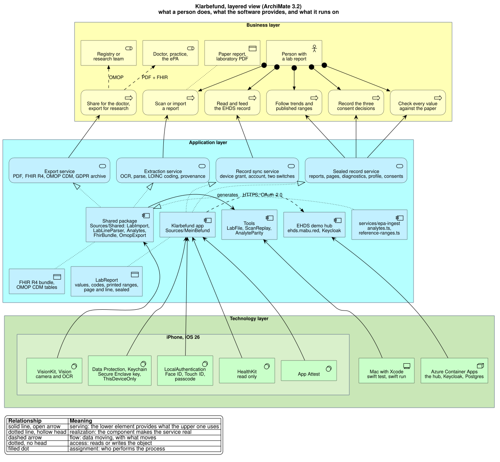

# Klarbefund developer guide

How to build, run, test and change the iPhone app in
[`clients/ios/`](../../clients/ios/). The [user guide](user-guide.md) shows
what a person sees; this guide shows what makes it so. The short command card
is [`clients/ios/README.md`](../../clients/ios/README.md); the work is tracked
in [issue #186](https://github.com/ma3u/MinimumViableHealthDataspacev2/issues/186).

Every screenshot and every number in this guide comes from the app's own
fictional development dataset. No real report is involved anywhere in the
repository, and [the two rules at the end](#two-rules-that-are-not-negotiable)
say why that is not negotiable.

## What you need

| Tool               | Version                 | Why                                                                                            |
| ------------------ | ----------------------- | ---------------------------------------------------------------------------------------------- |
| macOS with Xcode   | Xcode 27, iOS 26 SDK    | The app targets iOS 26; the Swift package declares macOS 26 for the tools                      |
| Swift              | 6.0, strict concurrency | `Package.swift` and `project.yml` both pin it                                                  |
| XcodeGen           | `brew install xcodegen` | The `.xcodeproj` is generated from `project.yml` and never committed                           |
| Node               | as for `ui/`            | Only to regenerate the dictionary from `services/epa-ingest`                                   |
| PlantUML, Graphviz | `brew install plantuml` | Only to re-render the diagrams in this guide                                                   |
| An iPhone          | iOS 26 or later         | Only for the camera, Face ID, App Attest and TestFlight; everything else runs in the simulator |

## How it is put together



Source: [`diagrams/klarbefund-architecture.puml`](diagrams/klarbefund-architecture.puml),
rendered with `scripts/render-plantuml.sh docs/klarbefund/diagrams/*.puml`.

Three layers, and a rule about the boundary between them:

- **`Sources/Shared`** is a Swift package that compiles for iOS and macOS. It
  holds the parser, the recogniser's post-processing, the generated analyte
  dictionary and reference ranges, the record model with its provenance, and
  the export formats (FHIR R4, OMOP CDM, the diagnostics bundle). Nothing in
  it touches the network, the Keychain or the store, which is why every
  number the app computes can be reproduced on a Mac with `swift test`.
- **`Sources/MeinBefund`** is the app: SwiftUI views, VisionKit scanning, the
  sealed store, the exports' share sheet, the EHDS connection, the app lock,
  the analysis providers, and the debug-only demo data and self-test.
- **`Tools/`** are four command-line programs over the Shared package:
  `LabFile` imports a PDF or image exactly as the app would, `ScanReplay`
  re-runs a diagnostics export through the current parser, `AnalyteParity`
  proves the generated dictionary equals its TypeScript source, and `IconGen`
  draws the app icon.

```
clients/ios/
  project.yml                    XcodeGen spec: the Shared framework and the MeinBefund app
  Package.swift                  SwiftPM: Shared, the four tools, SharedTests
  Sources/Shared/                parser, provenance model, formats; *.generated.swift are generated
  Sources/MeinBefund/            the app; en.lproj and de.lproj hold the strings
  Tools/{LabFile,ScanReplay,AnalyteParity,IconGen}/
  Tests/SharedTests/             Swift Testing: what the app computes
  Tests/UITests/                 XCUITest: what it shows, and what a tap does
  Scripts/                       build, install, upload, screenshots, localisation, CodeQL
  appstore/                      App Store Connect texts and the screenshot upload
```

## Build and run

```bash
cd clients/ios
brew install xcodegen                          # once
swift test                                     # the Shared package, on the Mac
swift run AnalyteParity                        # the generated table agrees with its source
xcodegen generate && open MeinBefund.xcodeproj # then run the MeinBefund scheme in Xcode
```

From the command line into a simulator, note the **ad-hoc signature**:
without it every Keychain call fails with `-34018` and the store cannot
create its key.

```bash
xcodebuild -project MeinBefund.xcodeproj -scheme MeinBefund \
  -sdk iphonesimulator -destination 'platform=iOS Simulator,name=iPhone 17 Pro' \
  CODE_SIGN_IDENTITY="-" CODE_SIGNING_REQUIRED=YES build
```

Onto a connected iPhone: `Scripts/install-device.sh`. The generated project
carries no signing team, so a plain `xcodebuild` for a device fails; the
script supplies one from `TEAM_ID` or from the keychain, and installs what it
built. TestFlight: `Scripts/archive-and-upload.sh`; its header names the four
things that must exist in the Apple Developer account first. The version is
pinned in `project.yml`: `MARKETING_VERSION` matches the App Store Connect
record and `CURRENT_PROJECT_VERSION` rises with every upload, because App
Store Connect refuses a build number it has already seen, after the upload.

## Demo data and launch arguments

 

Every launch argument below exists only in a Debug build. The checks are
`#if DEBUG`, not a flag alone: a flag can be discovered, code that is not
compiled cannot.

| Argument               | What it does                                                                                                                                        |
| ---------------------- | --------------------------------------------------------------------------------------------------------------------------------------------------- |
| `-MBDemoSeed`          | Two fictional reports, in memory only. Enough for a screenshot; what every UI test launches with.                                                   |
| `-MBDevData`           | Seven fictional reports across three years and four sources, built in code: a trend has shape, the unmatched list has rows, every report has pages. |
| `-MBShot <screen>`     | Opens a screen directly once the reports are loaded: `list detail scan trends reference history profile consent settings privacy consents connect`. |
| `-MBSelfTest`          | Drives one synthetic report through the whole pipeline in the app target and logs 27 checks (see [The self-test](#the-self-test)).                  |
| `-MBExportDiagnostics` | Builds the diagnostics archive into the app's temporary directory for `Scripts/pull-diagnostics.sh`.                                                |

The dev dataset is **built, not stored**. A row states the label, the value,
the unit and the range the laboratory printed, and `Analytes.lookup` codes it
exactly as it codes a scan. No code in the dataset can be wrong, a row the
dictionary cannot code lands in the unmatched list of its own accord, and the
dataset follows the dictionary when the dictionary changes. The pages are
drawn by `SyntheticSheet`, the same renderer the tests read.

A demo launch never locks: the app lock reads the seed flag and stays open,
so the UI tests and the screenshot script run where nobody can answer a
passcode prompt. On a release build neither the flag nor the exception exists.

Screenshots for the documentation and the App Store come from one script,
which launches each screen by argument rather than by scripted taps, so a
re-shoot after a layout change needs no new coordinates:

```bash
SEED=-MBDevData OUT=/tmp/shots SCREENS="list detail trends" Scripts/capture-screenshots.sh
Scripts/capture-screenshots.sh                 # the App Store set, size-checked, into appstore/screenshots/en
```

## From the camera to the store


Source: [`diagrams/klarbefund-scan-pipeline.puml`](diagrams/klarbefund-scan-pipeline.puml).

The order is fixed and each step has one owner
([ADR-033](../ADRs/ADR-033-lab-report-extraction-pipeline.md)):

1. **Provenance first.** `LabImport` decides on the file, never its
   extension: a PDF carrying the laboratory's own text layer is
   `lab-issued-digital` and its Observations are `final`; anything that has to
   go through the recogniser is `ocr-transcribed` and `preliminary`. It is
   strict on purpose, because marking a transcription `final` is the failure
   that matters.
2. **Recognition.** `VisionDocumentReader` runs two Vision passes, German and
   English, with language correction **off**: "correcting" `Lp(a)` or a
   decimal comma is actively harmful. `DocumentReconciler` merges the passes
   and `TableRoles` infers which column holds the label, the value, the unit
   and the range, per table.
3. **Parsing.** `LabLineParser` reads every row. When the ordinary parse finds
   nothing, the sheet readers take their turn: ambulatory blood pressure,
   resting and exercise ECG, Holter, cardiopulmonary exercise test, lactate,
   CGM glucose profile, DXA, and a body-composition scale's screen, which is
   a dashboard and not a report and is read for its headline value only.
4. **Coding.** `Analytes.lookup(label, unit)` picks the LOINC code. The unit
   decides, never the name alone. A quantity LOINC does not code (visceral fat
   as a mass, a water ratio) is carried with its unit, no code and a required
   reason; an organism from a stool report carries its NCBI Taxonomy id,
   because LOINC names tests and not organisms.
5. **The header.** `ReportMetadata` and `PrintedFields` read the laboratory,
   the lab date, the issue date and the report number from the sheet; the lab
   date is preferred over the receipt and issue dates and the person confirms
   it before saving.
6. **Conservation.** Every row that looks like a measurement ends up coded,
   unmatched or unread. A row in none of the three is indistinguishable from
   a row that was never printed, and that is exactly how an HbA1c row went
   missing once (`docs/gotchas.md`, 2026-09-19). The self-test asserts it.
7. **Review and save.** `ReviewViews` shows what was read; `ReportStore`
   seals it.

`swift run LabFile ~/Downloads/befund.pdf` runs steps 1 to 6 on a Mac and
prints the provenance, the header, and every row as coded, unmatched or
unread; `--values` adds the numbers, `--rows` adds the recogniser's layout.
It refuses a path inside this repository.

## The store and the lock

Three sealed files per report under `Application Support/Reports`, each
AES-GCM under the same Keychain key, complete file protection, excluded from
backup:

```
<id>.sealed         the record (LabReport)
<id>.scan.sealed    the pages as one PDF
<id>.diag.sealed    the scan's diagnostics (ScanDiagnostics)
profile.sealed      sex, date of birth, height (Profile)
consents.sealed     the three consent decisions (ConsentLedger)
```

The key is `ThisDeviceOnly` and unavailable while the phone is locked, so a
container copy yields ciphertext and the system's own snapshot of the app
fails with `EPERM`; `SecurityPostureTests` pins the build settings and the
[self-assessment](self-assessment.md) records the measurement. Records
written before a field existed still decode: every later field is optional or
defaulted.

The app lock ([ADR-060](../ADRs/ADR-060-the-app-locks-with-face-id-and-answers-pinning-and-jailbreak-detection.md))
is two types. `AppLockPolicy` in Shared decides _whether_ a challenge is due
and is pure, so `AppLockPolicyTests` runs on a Mac; `AppLock` in the app asks
LocalAuthentication _how_, Face ID, Touch ID or the passcode, and
`PrivacyCover` draws the cover the app switcher sees. The same ADR says why
certificate pinning and jailbreak detection were declined.

## The dictionary is generated, never copied

`Sources/Shared/Analytes.generated.swift`, `ReferenceRanges.generated.swift`
and `PromptText.generated.swift` are produced from
[`services/epa-ingest`](../../services/epa-ingest):

```bash
cd services/epa-ingest && npm run generate:swift
cd clients/ios && swift run AnalyteParity      # 1589 codings, 71 units today
```

Do not hand-edit them. Add an analyte to `analytes.ts` or a range to
`reference-ranges.ts`, regenerate, commit both. CI fails when a generated file
is out of date with its source, because a stale copy is exactly the silent
divergence the monorepo was chosen to prevent: an iPhone coding Lp(a) one way
and the ingest service another, noticed when a value reaches a doctor.

The reference-range generator refuses a range whose analyte the dictionary
does not know or whose unit that analyte is not defined in. Only analytes with
a citable published source get a band
([ADR-039](../ADRs/ADR-039-published-reference-ranges.md)); for every other
analyte the Trends screen draws the range the person's own laboratory printed.

## Tests, and what each is for

```bash
swift test                                     # Swift Testing: what the app computes
Scripts/run-ui-tests.sh                        # XCUITest: what it shows, and what a tap does
swift test --filter ExtractionAccuracyTests    # the accuracy benchmark, JSON to docs/klarbefund/accuracy-benchmark.json
swift test --filter SecurityPostureTests       # the build settings the self-assessment relies on
```

**The unit suite** (`Tests/SharedTests/`) is the larger one and catches what
can be reasoned about: a unit that picks the wrong code, a date read from the
wrong line, an export column in the wrong place. `FhirBundleParityTests` pins
the bundle to the golden bundle `services/epa-ingest` writes, so both writers
emit the same FHIR for the same sheet.

**The UI suite** (`Tests/UITests/`) exists because the unit suite caught none
of the last several defects: a card clipped at the chart's edge, a selection
that forgot itself on the next render, `LOINC Optional("2093-3")` on the one
screen a person compares with their own paper. Every test launches with
`-MBDemoSeed` and reaches its screen with `-MBShot`, so it breaks when what it
checks changes and not when a button moves. Three things learned the hard way
are in `docs/gotchas.md`: an `accessibilityIdentifier` on a container renames
everything inside it; a `Button` whose label is `Color.clear` is not in the
accessibility tree; Swift Charts' selection answers a finger and not a
synthesised tap, so real buttons sit over the marks.

### The self-test

Everything after the camera runs in the app target and therefore not in
`swift test`: the sealed store, the PDF of the pages, the export. `-MBSelfTest`
drives one synthetic report through the whole chain and logs each of its 27
checks: recognition and coding, a citation per value, the lab date read from
the header, the pages as a PDF, the three sealed files decrypting, the replay
of the diagnostics record reproducing the extraction exactly, the archive
building, and the doctor export fitting the ePA's 25 MB with the pages
appended.

```bash
xcrun simctl launch <udid> red.mabu.meinbefund -MBSelfTest
xcrun simctl spawn <udid> log show --last 2m --predicate 'subsystem == "red.mabu.meinbefund"' --style compact
```

### The accuracy benchmark

`ExtractionAccuracyTests` reads synthetic sheets of known content and writes
field-level accuracy to `docs/klarbefund/accuracy-benchmark.json`; the
[evidence](evidence.md) page quotes it and [run-on-mac](run-on-mac.md)
reproduces every number. A real report is measured the same way, on the
person's own Mac and never in the repository, with `ScanReplay --truth`
against a hand-written `truth.json` beside the export: it prints which fields
of which rows were wrong, never the values.

## Debugging a misread sheet

The store yields ciphertext, so evidence leaves the phone through the app's
own **Export diagnostics**, which asks for confirmation in words and hands a
zip to the share sheet
([ADR-038](../ADRs/ADR-038-scan-retained-diagnostics-export.md)):

```
klarbefund-diagnostics-<date>/
  about.json                 build, device, dictionary size, counts
  log.txt                    this session's log lines: counts and codes only
  <title>-<id8>/
    report.json              the stored record: values, metadata, page text
    diagnostics.json         both Vision passes, the reconciled rows, the layout
    scan.pdf                 the pages as scanned
```

With the phone on USB and a Debug build installed,
`Scripts/pull-diagnostics.sh` does the export and the unzip in one go, under
`~/Downloads`. Unzip **outside this repository**, then:

```bash
swift run ScanReplay ~/Downloads/klarbefund-diagnostics-<date>          # every report, with the current parser
swift run ScanReplay ~/Downloads/klarbefund-diagnostics-<date> --ocr    # re-run Vision on scan.pdf
swift run ScanReplay ~/Downloads/klarbefund-diagnostics-<date> --truth  # accuracy against truth.json
```

The replay prints what the phone coded, what codes now, what is newly coded
or lost, and every row with its reason. Add an analyte to `analytes.ts`,
regenerate, replay, and watch the real sheet's rows move from unmatched to
coded without scanning it again. Both tools refuse a path inside
`clients/ios/`.

## The connection to the EHDS hub

The patient screen of the hub starts an OAuth 2.0 device grant for the public
Keycloak client `klarbefund-app` and shows it as a QR code carrying a
`klarbefund://connect` link; the app polls Keycloak for the token and
registers with the hub
([ADR-049](../ADRs/ADR-049-klarbefund-connects-by-device-grant.md)).

- `Shared/EHDSConnect.swift`: the link, refused unless its hub and issuer are
  on `TrustedHub.production` (plus `.development` in a debug build), and the
  poller with its four answers. `EHDSConnectTests` covers each.
- `EHDSConnection.swift`: tokens and a device id in the Keychain as
  `ThisDeviceOnly`, refresh, register, read the record, disconnect (which
  revokes the refresh token at Keycloak), and the two sync switches.
- `ConnectView.swift`: the sheet, VisionKit's data scanner for QR codes only,
  a paste field, and "Is this your account?".
- **Create an EHDS account** ([ADR-054](../ADRs/ADR-054-klarbefund-creates-a-sandbox-account-with-app-attest.md))
  calls the two routes on the hub that answer without a session; the account
  is created only for a request whose Apple App Attest attestation verifies,
  which is why the simulator shows the button disabled with its reason.
- **Send my reports** and **Send my device trends**
  ([ADR-057](../ADRs/ADR-057-klarbefund-sends-weekly-device-means.md)) post
  to the person's own record; the record itself holds reports, vaccinations
  and the medication plan ([ADR-059](../ADRs/ADR-059-the-record-holds-reports-vaccinations-and-the-medication-plan.md)).
- `ConnectUITests` and `AccountUITests` run against `DemoEHDSTransport` under
  `-MBDemoSeed`; `LiveConnectUITests` and `LiveAccountUITests` run against a
  real hub when given a fresh link
  (`docs/knowledge/runbooks/klarbefund-connect.md`).

## Exports

| Action                     | Writer                       | Contents                                                                |
| -------------------------- | ---------------------------- | ----------------------------------------------------------------------- |
| Share for my doctor        | `ReportExport`, `FhirBundle` | PDF summary with the original pages appended, plus a FHIR R4 bundle     |
| Export for research (OMOP) | `OmopExport`                 | OMOP CDM v5.4 `measurement.csv`, `person.csv`, `observation_period.csv` |
| Export all my data         | `DataExport`                 | every report, page, value, profile field and consent, as JSON and PDFs  |
| Export diagnostics         | `DiagnosticsBundle`          | the record, both Vision passes, the pages, the session log              |

The OMOP tables carry `measurement_concept_id = 0` throughout, deliberately:
mapping LOINC to an OMOP concept needs the Athena vocabulary, which is not on
a phone, and inventing an id would put a wrong identifier on a real
measurement. The printed range is kept verbatim in `RawLabValue.referenceText`
and travels as `referenceRange.text`; a range with no number in it survives
only there, and FHIR's rng-2 allows that.

## Languages

English is the base, German the translation, following the phone's language.
`Scripts/check-localization.sh` fails when a user-visible string has no
German or when a German sentence was left in the English base; it uses
`xcodebuild -exportLocalizations`, the same extractor Xcode's editor uses, so
it sees SwiftUI `Text` literals and `INFOPLIST_KEY_*` values that no grep of
the sources would find. The camera permission prompt once shipped in German to
every English phone, which is why the script exists.

## Static analysis and CI

```bash
Scripts/codeql-swift.sh                        # CodeQL on the app and Shared, about 15 minutes
```

CodeQL needs a real build to see Swift, so on GitHub it runs only when
`clients/ios/` changes (`.github/workflows/codeql-swift.yml`), on a macOS
runner. The `codeql-swift` pre-push hook runs the same suite when a push
changes the Swift sources; it exits 1 on any finding not listed, with its
reason, in `Scripts/codeql-accepted.txt`. Swift needs a macOS runner, which
has lower concurrency than Linux, so the iOS job is path-filtered to
`clients/ios/**` and never gates the web or service suites; conversely, the
`ui/**` and `services/**` workflows exclude `clients/ios/**`.

The security posture of the app, its threat model and what an independent
test would add are in the [threat model](../security/threat-model-klarbefund.md),
the [security test report](../security/security-test-report-2026-10-15.md)
and the [self-assessment](self-assessment.md).

## Two rules that are not negotiable

1. **No health data in `clients/ios/`, ever.** No lab reports, no scans, no
   exported HealthKit archives, no screenshots containing real values, not
   even temporarily, not even gitignored. Test fixtures are synthetic, the way
   `services/epa-ingest/__tests__/fixtures/` already is. The tools refuse a
   path inside the repository for the same reason.
2. **No real organisation in demo content.** `CLAUDE.md` forbids it outside
   the `NEXT_PUBLIC_DEMO_TK` flag. The study this app is built for is real;
   the demo centre, the laboratory and the practice in the dev dataset are
   fictional.

## Where the decisions are

| ADR                                                                                                  | Decides                                                    |
| ---------------------------------------------------------------------------------------------------- | ---------------------------------------------------------- |
| [ADR-033](../ADRs/ADR-033-lab-report-extraction-pipeline.md)                                         | The extraction pipeline and its order                      |
| [ADR-038](../ADRs/ADR-038-scan-retained-diagnostics-export.md)                                       | Diagnostics kept with the scan, exported on request        |
| [ADR-039](../ADRs/ADR-039-published-reference-ranges.md)                                             | Only citable published ranges, beside the laboratory's own |
| [ADR-049](../ADRs/ADR-049-klarbefund-connects-by-device-grant.md)                                    | Connecting by OAuth device grant and QR code               |
| [ADR-050](../ADRs/ADR-050-klarbefund-beta-by-public-testflight-link.md)                              | The beta by public TestFlight link                         |
| [ADR-054](../ADRs/ADR-054-klarbefund-creates-a-sandbox-account-with-app-attest.md)                   | Creating an account, gated by App Attest                   |
| [ADR-057](../ADRs/ADR-057-klarbefund-sends-weekly-device-means.md)                                   | Sending weekly device means, behind a switch of its own    |
| [ADR-059](../ADRs/ADR-059-the-record-holds-reports-vaccinations-and-the-medication-plan.md)          | What the record holds                                      |
| [ADR-060](../ADRs/ADR-060-the-app-locks-with-face-id-and-answers-pinning-and-jailbreak-detection.md) | The app lock; pinning and jailbreak detection declined     |
