# Klarbefund user guide

Klarbefund turns a paper lab report into values you can read, check against
the paper, and follow over time. Everything runs on the phone: the scan, the
reading, the coding, the store and the exports. Nothing needs an account, and
nothing leaves the device unless you send it.

This guide walks through the app as a person uses it, task by task. The
developer side (building, testing, the shared dictionary, the store layout) is
the [developer guide](developer-guide.md). The work is tracked in
[issue #186](https://github.com/ma3u/MinimumViableHealthDataspacev2/issues/186).

Every screenshot in this guide shows invented data. The laboratory, the
practice, the patient and every number come from the app's own fictional
development dataset, so a screenshot can be published without a real report
ever being involved. How they are made is at the
[end of this guide](#how-these-screenshots-are-made).

| App name  | Klarbefund, in English and German                                                                             |
| --------- | ------------------------------------------------------------------------------------------------------------- |
| Runs on   | iPhone, iOS 26 or later                                                                                       |
| Get it    | [Public TestFlight beta](https://testflight.apple.com/join/ssADSXX6), 200 places                              |
| Languages | English and German, following the phone's language                                                            |
| Source    | [`clients/ios/`](../../clients/ios/)                                                                          |
| Privacy   | [Privacy policy](https://ma3u.github.io/MinimumViableHealthDataspacev2/meinbefund/privacy.html)               |
| Not       | a medical device: it explains what a measurement is and never judges a value ([below](#not-a-medical-device)) |

## Getting started

1. On the iPhone, open the [TestFlight link](https://testflight.apple.com/join/ssADSXX6).
   TestFlight installs itself first if it is missing, then offers Klarbefund.
2. Open Klarbefund. There is no sign-up and no account: the app is ready for
   the first scan.
3. The first time you scan, iOS asks for the camera. The app uses it only for
   the pages of a report and for the QR code that connects it to your record;
   the photographs stay on the phone.

**The lock.** By default the app asks for Face ID, Touch ID or the passcode
every time it comes to the front, so your results are not on show to
whoever holds the unlocked phone. The switch is under **Analysis provider**
in the **⋯** menu, section **Protection**. A phone without a passcode has
nothing to ask for, and the lock then opens by itself.

## Your reports

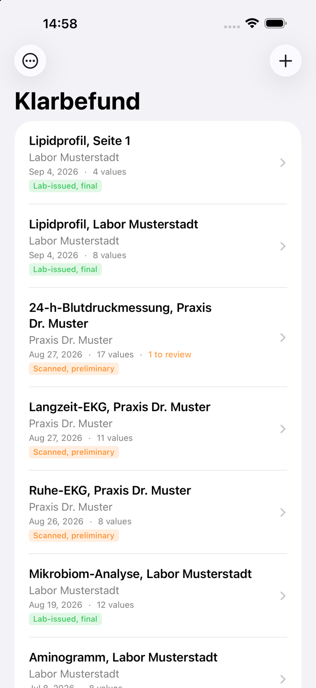

The home screen lists every report, newest first: the title, the laboratory,
practice or device it came from, the date it was taken and how many values
were read. **1 to review** marks a report with a value you have not yet
checked against the paper.

The coloured badge is the report's **provenance**, and it matters more than it
looks. **Lab-issued, final** means the values came out of a PDF that carried
the laboratory's own text, so nothing was guessed. **Scanned, preliminary**
means the values were read from a photograph, of a paper sheet or of a
device's screen, and a photograph can be misread. A value stays preliminary
until you have checked it against the original.

The **+** button starts a scan or an import. The **⋯** button holds everything
else: trends, reference values, your profile, earlier measurements, consents,
the connection to the EHDS, exports, privacy and the analysis provider.

## Getting a report in

There are three ways, and the document decides what its values are worth.

- **Scan report** opens the camera for a paper report. The app finds the page
  edges, reads the table on the device, and keeps the pages as a PDF next to
  the values. Multi-page reports are fine.
- **Import a PDF or photo** takes a file your laboratory or portal gave you. If
  the PDF carries the laboratory's own text layer, the values are marked
  final; a PDF that is only a picture goes through the recogniser like a scan.
- **Import from Photos** takes photographs already on the phone, up to twelve
  at a time.

The app reads more than laboratory sheets. A **24-hour blood pressure
measurement**, a **resting or exercise ECG**, a **Holter report**, a
**spirometry**, a **lactate test**, a **CGM glucose profile**, a **DXA scan**
and a **gut microbiome analysis** each have their own reader, so the values a
practice prints on those sheets arrive with the right codes and units.

A **body-composition scale** photographed in a gym is recognised as what it
is: a dashboard, not a report. The app reads the metric, its current value and
the date the scale shows, and where the scale plots a history it measures the
points on the chart and marks those values as estimates. The scale's own
verdicts ("Normal", "Low") are ignored; they are the manufacturer's bands, not
a guideline's.

Before anything is saved, the app shows what it read and asks you to confirm
the laboratory date it found on the sheet. A report that looks like one you
already have is pointed out; **Find duplicate reports** in the menu does the
same for the whole list later.

## Checking a report, value by value

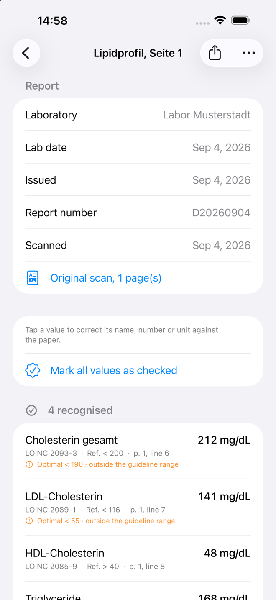

The top of a report is what the app read from the sheet's header: the
laboratory, the date the sample was taken, the date the report was issued, the
report number, and a link to the original pages.

Then every measurement, and under each one the four things that make it
checkable:

- **the LOINC code** it was matched to, so the value means the same thing in
  every system it is exported to. The unit picks the code, never the name:
  lipoprotein(a) in mg/dL and in nmol/L are different measurements with
  different codes. A quantity LOINC does not code says so plainly instead of
  showing a near-enough code, and an organism from a stool report shows its
  NCBI Taxonomy id instead, because LOINC names tests and not organisms;
- **the reference range your laboratory printed**, exactly as printed, never
  normalised;
- **the page and line** it was read from, so any number can be checked
  against the paper in front of you;
- **the published band**, where a guideline or a named study states one, with
  the words and a symbol beside the colour: "in the optimal band", "outside
  the optimal band", "outside the guideline range". This is a comparison to a
  number somebody published. It is not a finding.

**Checking against the paper.** Tap a value to correct its name, number or
unit; the correction is kept beside what the recogniser read, so the paper
trail stays. **Mark all values as checked** turns the report's values from
preliminary into checked once you have compared them. A report with values
still to check carries **to review** in the list.

Below the recognised values come two lists the app never hides: the lines that
looked like measurements but matched nothing in the dictionary, and the lines
that could not be read at all. A row that vanished silently would be
indistinguishable from a row that was never printed, so no row vanishes.
**Report missing values** in the report's menu sends the developers the
labels of such rows, never the values, so the dictionary can grow.

The share button offers the exports described further down. The menu lets you
read the report again with the current version of the reader, scan the paper
again, edit its name and laboratory, export its diagnostics, or delete it.

## The original pages

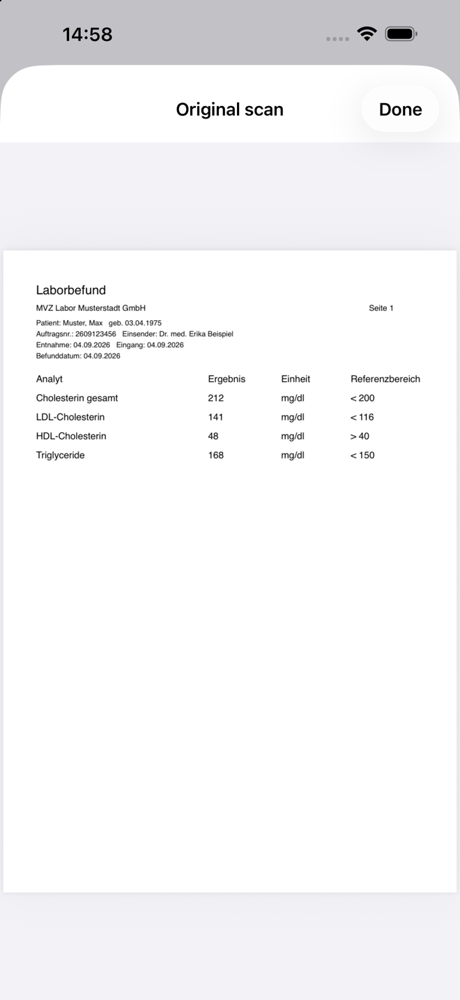

Every report keeps its pages, as one PDF, encrypted like the values. **Original
scan** shows them back, so the source is always one tap away from the reading.

## Trends

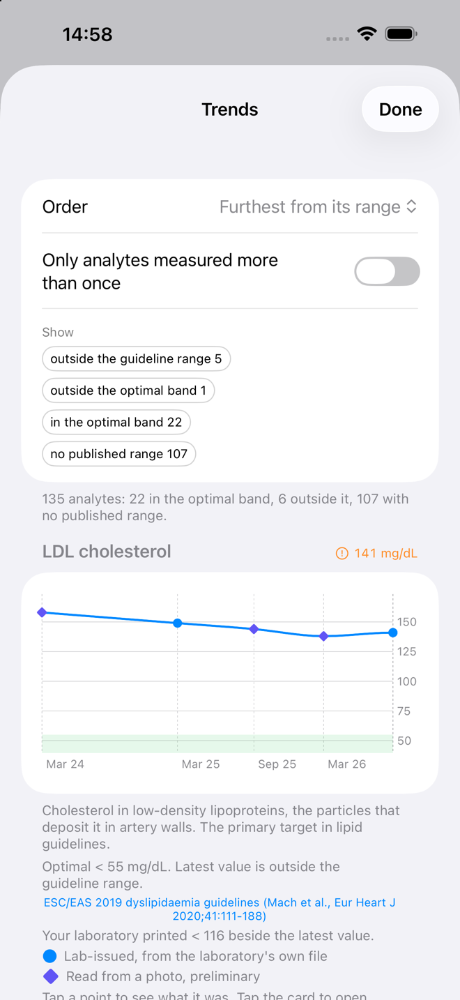

**Trends** draws one chart per measurement across every report, ordered by
what is furthest from its range. The filters narrow it to what matters: only
analytes measured more than once, or only those outside a band.

Each chart says what it is showing. Every kind of evidence has its own shape:
a circle came from a laboratory's own file, a diamond was read from a
photograph and is preliminary, and a triangle was entered by you or taken from
a device. A legend under every chart that mixes them names each shape in
words, so nothing depends on colour or on tapping a point. The green band is
the published optimal band where one exists; for everything else the band
drawn is the range your own laboratory printed, in its own colour and named as
such. Under the chart every point is listed with its date, where it came from
and which report it belongs to, and tapping a point opens that report.

A sentence under each chart says **what the measurement is**: a definition of
the test, in English or German. It is never a reading of your own value.

At the bottom, **Show trends from Apple Health** reads your resting heart
rate, heart rate variability, steps and weight, after asking once for
permission. They appear in their own section, **From your devices**, as grey
dashed lines of weekly means on the same months as your reports, with a thin
blue line on each report's day so the two can be read against each other.
They are never drawn as a lab value: no range, no comparison, no colour that
means anything, and they go into no export. The app reads them while the
screen is open, writes nothing to Health and keeps no copy.

## Reference values

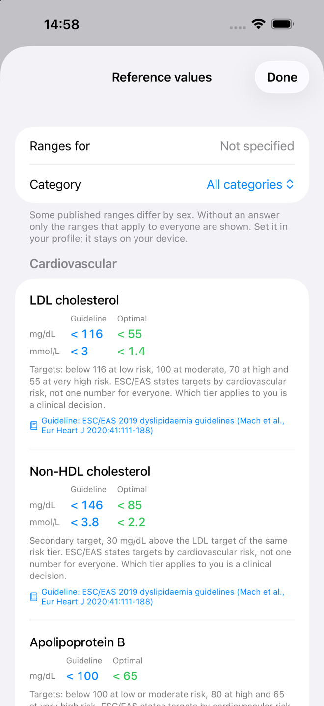

**Reference values** is the table behind the bands. One card per measurement,
a line per unit, two columns: **Guideline**, the threshold a guideline body
states for adults, and **Optimal**, the lowest-risk band the same source
names. Every card names its source and links to it; where a source
partitions by risk tier or by age, the card says so and leaves the choice of
tier to a clinician.

A measurement with no citable source is simply absent. That is the difference
from the longevity tables this screen was modelled on, which quote numbers
nobody can check. The category menu narrows the list to one panel, and setting
your sex in the profile adds the ranges that differ by sex.

## Profile and earlier measurements

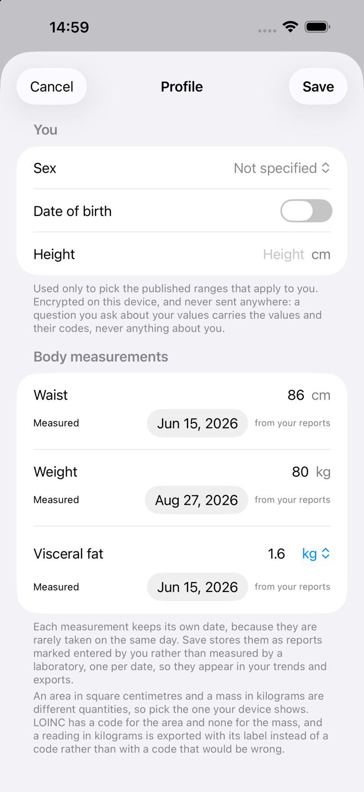 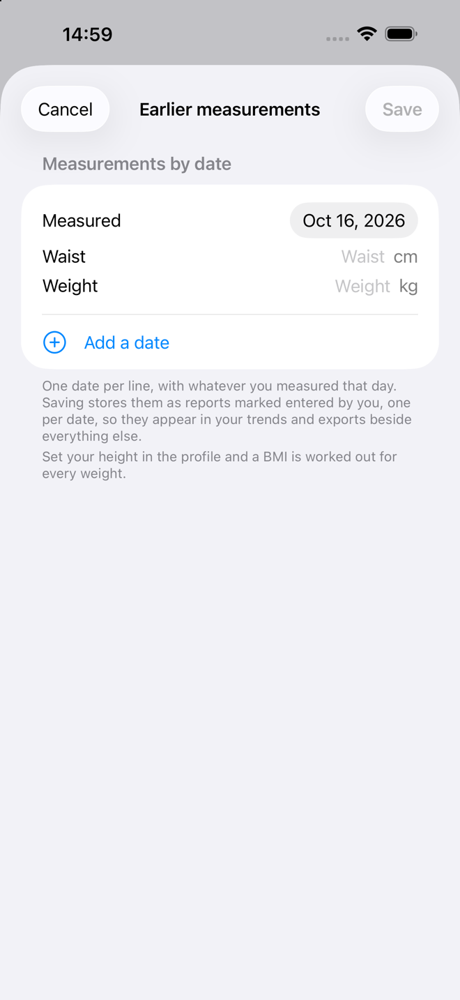

The **profile** holds sex, date of birth and height, used only to pick the
published ranges that apply to you, and the body measurements: waist, weight
and visceral fat. Each measurement keeps its own date and says where it came
from. A value read from a scale's photograph is labelled as such; one you type
is labelled as entered by you.

**Earlier measurements** is for catching up: one date per line, with whatever
you measured that day. Saving stores each date as its own report, marked as
entered by you, and works out the BMI and waist-to-height ratio from the
height in the profile. They join the trends and the exports through the same
path as a laboratory's values.

## Asking what a value is

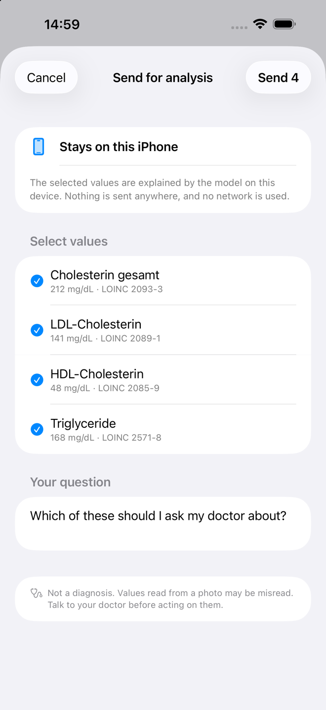 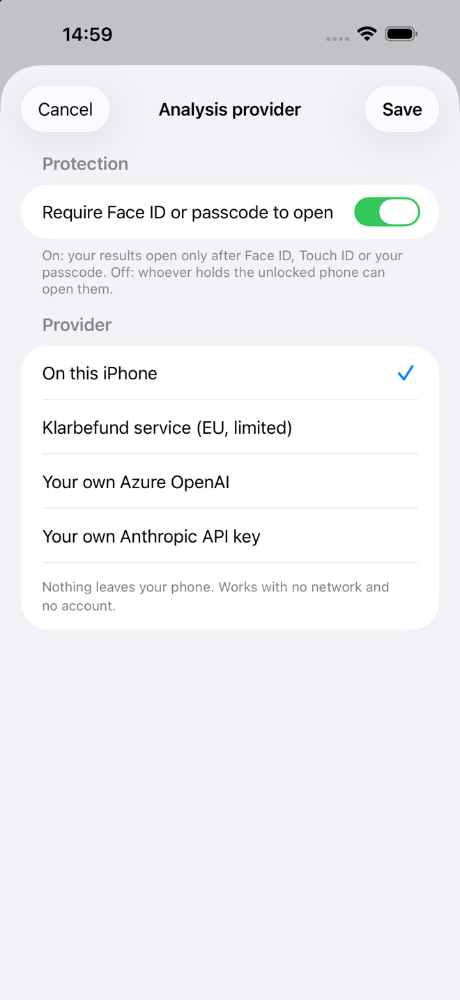

You can ask the app to explain a set of values. By default the model on the
iPhone answers, so the question never reaches a network at all.

If you would rather use a service, you pick the values, see them listed with
their codes, and confirm before anything is sent. Only those values and your
question travel. Your name, date of birth and insurance number are never
sent, because the app does not hold them; they may be printed on the scanned
page, which stays on the phone. Whichever provider is in use is named on the
screen before you send.

**Analysis provider** in the menu chooses where an answer comes from: on this
iPhone, the Klarbefund service in the EU, or your own Azure OpenAI resource or
Anthropic key. With your own service the phone talks to it directly, and
neither the key nor the values reach the provider of this app. The same
screen holds the **Protection** switch for the Face ID lock.

## Consents

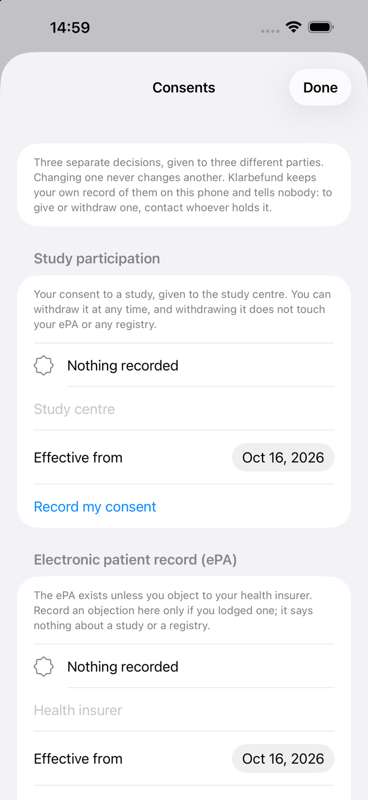

**Consents**, in the menu, keeps your own record of three decisions that are
easy to confuse and must never be one switch:

- **Study participation**, your consent to a study, held by the study centre;
- **Electronic patient record (ePA)**, an _objection_, because the ePA exists
  unless you object to your health insurer;
- **Registry and research use**, your consent for a registry or research
  database to use your values.

Each has its own state, date, holder and button, and changing one never
changes another. Withdrawing keeps the earlier grant in the history, so you can
still show when you gave it. The app tells nobody: to give or withdraw one,
contact whoever holds it. Two places use the record. **Export for research**
asks once before exporting when no registry consent is recorded, and **Share
for my doctor** reminds you, when you recorded an objection to the ePA, that
there is no ePA to upload to while it stands.

## Connect to EHDS

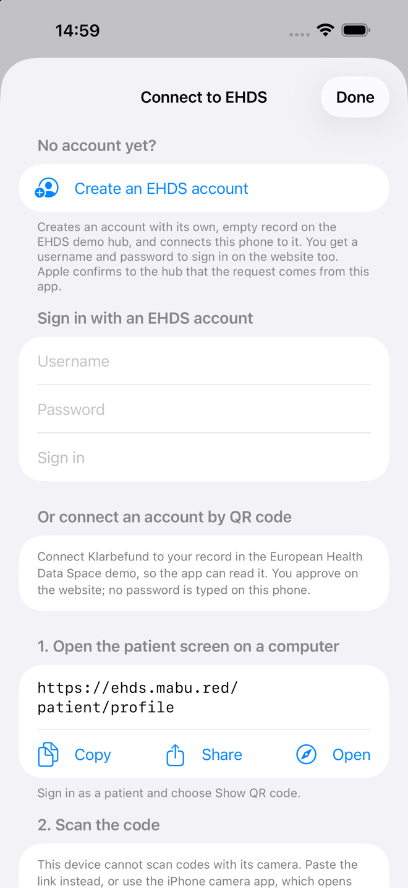

**Connect to EHDS**, in the menu, connects the app to your record in the
European Health Data Space demo hub, so it can read it and, if you decide so,
add to it. There are three ways in, and no password is typed into a web page
on the phone:

- **Create an EHDS account** makes an account with its own, empty record on
  the demo hub and connects the phone to it. You get a username and password
  to sign in on the website too. Apple confirms to the hub that the request
  comes from the genuine app on a real device, which is why a simulator
  cannot do this.
- **Sign in with an EHDS account** you already have.
- **Connect by QR code**, from the patient screen on a computer:
  1. On the computer, open the patient screen (the app shows the address, to
     copy, share or open) and sign in as a patient. Choose **Show QR code**.
  2. In the app, **Scan QR code**. On the computer, **Approve on this
     computer** opens Keycloak's consent page; check that the code shown there
     is the one the app shows, and approve.
  3. The app says which account it connected to and asks **Is this your
     account?** A code someone else showed you would connect the phone to
     their account, so if the name is not yours, choose **Not me,
     disconnect**.

Once connected, **Show my EHDS record** lists what the hub holds for you:
measurements with their printed ranges and dates, reports, vaccinations and
the medication plan. On the demo hub every record is synthetic, and the
screen says so. The record is read when you open it, kept nowhere, and never
mixed into your scanned reports.

Two switches decide what goes the other way, and both are off until you turn
them on:

- **Send my reports to my EHDS record**: while it is on, every report you
  scan or read again goes to your own record, as preliminary values marked as
  read from a scan. Values without a LOINC code stay on the phone.
- **Send my device trends to my EHDS record**: the weekly means from Apple
  Health that the Trends screen shows, never a single day or a single
  reading; each sync replaces the last.

Switching either off stops further sending; what was sent stays in the record
until you delete the account. **Disconnect** is in the app and on the patient
screen, where every connected phone is listed. On a phone holding the patient
screen itself, **Open in Klarbefund** does the same as the QR code, and the
iPhone's camera app opens Klarbefund from the code too. The code works once,
for two minutes.

## Exports and your data rights

Everything the app holds can leave it, in the form the recipient needs, and
only when you say so.

| Action                     | For                 | What you get                                                            |
| -------------------------- | ------------------- | ----------------------------------------------------------------------- |
| Share for my doctor        | a practice, the ePA | a PDF summary with the original pages appended, plus a FHIR R4 bundle   |
| Export for research (OMOP) | an analytics team   | OMOP CDM v5.4 `measurement.csv`, `person.csv`, `observation_period.csv` |
| Export all my data         | you, under GDPR     | every report, page, value, profile field and consent, in one archive    |
| Delete all my data         | you                 | the store is wiped for good, and the app says so before it does it      |
| Export diagnostics         | the developers      | the recognised text and both recogniser passes, to fix a misread line   |

The FHIR bundle carries every value with its LOINC code, its UCUM unit, the
range the laboratory printed (as numbers where they can be read, and always as
the printed text in `referenceRange.text`), and the page and line it was read
from. A value read from a photograph is marked preliminary in the bundle too.
The doctor export fits the ePA's 25 MB limit with the pages attached.

Everything goes through the system share sheet: to the ePA app, Files,
AirDrop, or mail. There is deliberately no upload of its own, because there is
no API into the ePA for an app like this, and the citizen is the integration
point.

## Privacy and safety

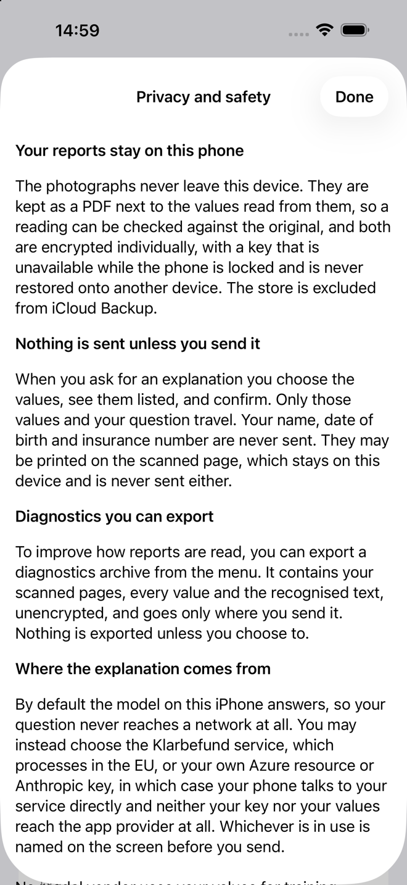

The photographs never leave the device. Values, pages and diagnostics are
encrypted individually with a key that is unavailable while the phone is
locked and is never restored onto another device. The store is excluded from
iCloud Backup. When the app is not in front, its content is covered, so the
app switcher shows nothing, and coming back asks for Face ID or the passcode.

This was checked, not assumed: with the phone on a cable, copying a stored
record, an export left in the temporary folder, or the system's own snapshot
of the app all fail with a permission error, which is what complete file
protection looks like from outside. The full assessment, objective by
objective, is the [self-assessment](self-assessment.md); what was tested and
how is in [evidence](evidence.md).

## Not a medical device

Klarbefund explains what a measurement is. It does not diagnose, does not
assess your risk and does not recommend treatment. No screen says normal or
abnormal, scores anything, or advises. A value read from a photograph can be
misread and is marked preliminary until you check it against the paper.
Reference ranges are shown exactly as your laboratory printed them, and the
published bands beside them are quotations with a source, not a verdict.

Always consult a doctor before making any decision about your health.

## When something is read wrong

A recogniser reads a photograph, and photographs get misread. Three things
help, in this order:

1. **Compare with the paper.** The page and line under every value is there
   for this. Tap the value to correct it; the correction is kept beside the
   reading.
2. **Read again with this version**, in the report's menu, after an app
   update: the pages are kept, so a better reader can read them again. A
   re-read that finds fewer values than are stored is discarded, never saved
   over the better reading.
3. **Report missing values**, in the report's menu, sends the labels of the
   rows the app could not code, never your numbers, so the dictionary can
   learn the laboratory's spelling. **Export diagnostics** hands you an
   archive with the recognised text to attach to an
   [issue](https://github.com/ma3u/MinimumViableHealthDataspacev2/issues/186);
   it leaves the phone only through the share sheet, when you send it.

## How these screenshots are made

The images in this guide are shot from a simulator by
[`clients/ios/Scripts/capture-screenshots.sh`](../../clients/ios/Scripts/capture-screenshots.sh),
launching the app straight into each screen with the fictional development
dataset:

```bash
cd clients/ios
SEED=-MBDevData OUT=/tmp/shots \
  SCREENS="list detail scan trends reference history profile consent settings privacy consents connect" \
  Scripts/capture-screenshots.sh
for f in /tmp/shots/*.png; do sips --resampleWidth 660 "$f" --out "../../docs/klarbefund/img/$(basename "$f")"; done
```

The dataset is built in code, in memory, and is compiled out of a release
build. Every laboratory and practice in it is invented and every value made
up, which is the only reason a screenshot may be committed at all: the rule in
the [developer guide](developer-guide.md#two-rules-that-are-not-negotiable) is
that no real health data enters the repository, not even as a picture, not
even temporarily.
