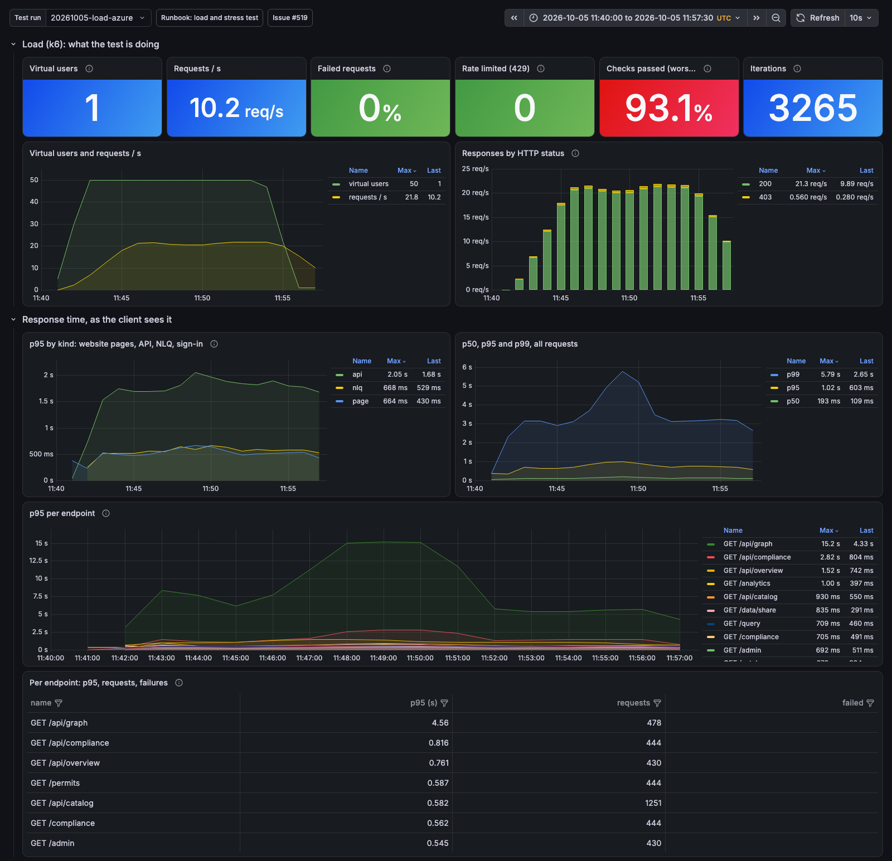

# Load, stress and spike tests: results and dashboards

What the live hub at https://ehds.mabu.red does under load, measured with the
k6 suite in [`load-tests/`](../../load-tests/) and recorded on the platform's
Grafana. This page is the index: every run, what it found, what changed
because of it, and the runs still to do. The detailed reports are linked, and
every live run has its dashboard link.

The dashboards need a sign-in on <https://grafana.ehds.mabu.red> and show
data only while the stack is up (it stops off hours, ADR-053). Each link
opens the **Load and stress test** dashboard on the run's `testid` and time
range; the raw k6 summaries are on the laptop that ran them
(`load-tests/results/<testid>*`) and in the issues.

| Scenario    | What it does                                                | Last run live     | Result                                                                  |
| ----------- | ----------------------------------------------------------- | ----------------- | ----------------------------------------------------------------------- |
| `smoke`     | 1 user, 30 s, every endpoint once                           | 2026-10-05        | passes                                                                  |
| `load`      | 50 users, 15 min, the persona mix                           | 2026-10-06, 21:15 | **passes every SLO**: p95 155 ms API, 43 ms pages, 217 ms NLQ, 0 failed |
| `audited`   | 1 to 20 parallel NLQ queries through the audit chain        | 2026-10-05        | passes after #534 and #536 (per-user rate limit)                        |
| `contracts` | up to 10 users negotiating and transferring through the EDC | 2026-10-06, 13:52 | passes: 578 requests, 0 failed, p95 287 ms                              |
| `stress`    | 50, 100, 200, 400 users, abort on failed requests           | 2026-10-06, 21:40 | **400 users, 0 failed**; latency SLOs break from 200 users, ceiling: UI |
| `spike`     | a sudden jump to many users and back                        | not yet           | next, after `size-ui.sh` (ADR-061)                                      |
| `soak`      | a steady load for two hours                                 | not yet           | after `spike`; measures the Postgres burst credits                      |
| `signin`    | 5 to 50 sign-ins a minute against Keycloak                  | not yet live      | compose: 12 of 127 sign-ins over 3 s                                    |
| `proxy`     | the proxy alone, 5 to 25 users                              | not yet live      | needs a job inside the environment; compose passes                      |

## The live runs, newest first

### 2026-10-06 evening: load and stress after the fixes of the day

Stack: Neo4j at 2 vCPU and 4 GiB (ADR-056), the graph views capped at the
newest 30 access events (#580), the onboarding agent's retry loop fixed (#581),
the task store on the Flexible Server (#589).

| Run                                                                                                                                                                       | Users             | Requests        | Failed     | p95 all / API / pages / NLQ       | Verdict                                                      |
| ------------------------------------------------------------------------------------------------------------------------------------------------------------------------- | ----------------- | --------------- | ---------- | --------------------------------- | ------------------------------------------------------------ |
| [`20261006-2115-load-aca`](https://grafana.ehds.mabu.red/d/mvhd-load-test/load-and-stress-test?var-testid=20261006-2115-load-aca&from=1791321300000&to=1791322320000)     | 50 for 15 min     | 19,509 (21.5/s) | **0.00 %** | 146 ms / 155 ms / 43 ms / 217 ms  | every SLO held, checks 99.97 %                               |
| [`20261006-2140-stress-aca`](https://grafana.ehds.mabu.red/d/mvhd-load-test/load-and-stress-test?var-testid=20261006-2140-stress-aca&from=1791322800000&to=1791324300000) | 50 to 400, 20 min | 81,518 (63.6/s) | **0.00 %** | 3.35 s / 3.53 s / 3.23 s / 4.93 s | latency SLOs crossed from 200 users on; every answer correct |

The ceiling was the UI: three replicas of half a core at 99 % CPU from the
400-user stage on, Neo4j at 0.82 of its 2 cores and 2.66 GB of 4 GiB, the
proxy at 0.06 cores. The errors in the logs were the UI calling the EDC
management API at the wrong address (about 8,900 404 lines in the stress run),
which #648 pins on every deploy; the EDC pages did no real work in these runs,
so the next `load` after it moves the numbers.

What changed because of it: [ADR-061](../ADRs/ADR-061-the-ui-scales-out-on-whole-cores.md),
a whole core per UI replica, up to six replicas on an HTTP concurrency rule of
15, applied by `scripts/azure/size-ui.sh`; a deploy now waits while a run is on
(`LOAD_TEST_RUNNING`), because a merge on 2026-10-06 redeployed the UI and the
proxy in the middle of a run.

### 2026-10-06 afternoon: the first stress run to 400 users

| Run                                                                                                                                                                       | Users         | Requests      | Failed           | p95 API / pages / NLQ        | Verdict                                                             |
| ------------------------------------------------------------------------------------------------------------------------------------------------------------------------- | ------------- | ------------- | ---------------- | ---------------------------- | ------------------------------------------------------------------- |
| [`20261006-1728-stress-aca`](https://grafana.ehds.mabu.red/d/mvhd-load-test/load-and-stress-test?var-testid=20261006-1728-stress-aca&from=1791307740000&to=1791309060000) | 50 to 400     | 84,624 (66/s) | **0.00 %**       | 3.19 s / 2.8 s / 4.35 s      | all stages reached; Neo4j did not restart after ADR-056             |
| [`20261006-1455-load-aca`](https://grafana.ehds.mabu.red/d/mvhd-load-test/load-and-stress-test?var-testid=20261006-1455-load-aca&from=1791298500000&to=1791299520000)     | 50 for 15 min | 10,000+       | 0.03 %           | pages and API under the SLOs | with #580 and #579 deployed; both audit chains intact after the run |
| [`20261006-1152-load-aca`](https://grafana.ehds.mabu.red/d/mvhd-load-test/load-and-stress-test?var-testid=20261006-1152-load-aca&from=1791287580000&to=1791288600000)     | 50 for 15 min |               | 0                | 151 ms overall               | with #576; ran beside the onboarding agent's retry loop (#577)      |
| [`20261006-stress-aca`](https://grafana.ehds.mabu.red/d/mvhd-load-test/load-and-stress-test?var-testid=20261006-stress-aca&from=1791274440000&to=1791275580000)           | 50 to 400     |               | 2.1 % at the end | `/api/graph` 64 s at the end | aborted at about 300 users: Neo4j killed for memory (exit 137)      |
| [`20261006-load-aca`](https://grafana.ehds.mabu.red/d/mvhd-load-test/load-and-stress-test?var-testid=20261006-load-aca&from=1791273300000&to=1791274320000)               | 50 for 15 min |               | 0                |                              | the morning baseline inside the environment                         |

The morning stress run found Neo4j's ceiling by memory; the afternoon run,
after `size-neo4j.sh` (2 vCPU, 4 GiB, heap 1.5 GiB, page cache 1 GiB), reached
400 users with no failed request and moved the ceiling to the UI. A load run in
between (`20261006-1359-load-aca`) failed on latency because the onboarding
agent was retrying a stuck credential request thirty times a second in the
background (#577); the fix (#581) went out before the evening runs.

### 2026-10-05: the baseline

The first runs against the live hub, from a laptop in Berlin, with the
platform's side from Azure Monitor: [the Azure baseline](2026-10-baseline.md).
50 users for 15 minutes passed with no failed request but an API p95 of
1.8 s, with `/api/graph` at 10 s; the audited queries hit the proxy's rate
limit (83.6 % 429 before #534, 23.2 % after). Neo4j at 97 % of its 2 GiB was
the first ceiling. The same suite against [the compose stack](2026-10-05-local.md)
on a laptop, for comparison: load passes every SLO at 50 users, stress breaks
between 100 and 200 users on the UI's CPU.



## What the dashboard shows

The **Load and stress test** dashboard (`observability/grafana/dashboards-azure/load-stress-test.json`)
has three rows, each filtered by the run's `testid`:

- **Load (k6): what the test is doing**: virtual users, requests per second,
  failed requests, p95 per group (pages, API, NLQ), the slowest endpoints.
- **Server side: the proxy**: requests and p95 by route, rate-limit refusals,
  the audit chain's records per transaction, the log lines of this run.
- **Containers**: CPU and memory of the UI, the proxy, Neo4j, Keycloak and the
  connectors, replicas, and the Flexible Server's burst credits.

The **EDC contracts and transfers** dashboard (`mvhd-edc-dsp`) follows the
negotiations and transfers a `contracts` run drives through the connectors.
How to read a result, hypothesis by hypothesis, is in the
[runbook](../knowledge/runbooks/load-and-stress-test.md).

## The runs still to do

1. `stress` after `scripts/azure/size-ui.sh` (ADR-061): where the 1 s API SLO
   first breaks with whole-core replicas; the per-stage p95 goes into the
   ADR's table.
2. `spike`, then `soak` for two hours: the Postgres burst credits (hypothesis
   4 of the runbook) and the cost per 1,000 requests from Cost Management over
   the soak window.
3. `signin` live: whether sign-in is a singleton (hypothesis 6).
4. `load` once more with the EDC pages doing real work (#648 pins the
   connector's address on every deploy).

Each inside office hours, announced, one at a time; a deploy waits while a run
is on. The procedure is the [runbook](../knowledge/runbooks/load-and-stress-test.md);
the open items are tracked in [#571](https://github.com/ma3u/MinimumViableHealthDataspacev2/issues/571).

## Reproduce

```bash
scripts/azure/run-load-test.sh load            # inside Azure, as a Container Apps job
ABORT_ON=failures scripts/azure/run-load-test.sh stress
load-tests/run.sh load azure                   # from a laptop, metrics to a local Grafana
```

The sessions are forged for ten users per persona and handed to the job as a
secret; nothing real signs in. The suite, its scenarios and its thresholds are
documented in [`load-tests/README.md`](../../load-tests/README.md).
