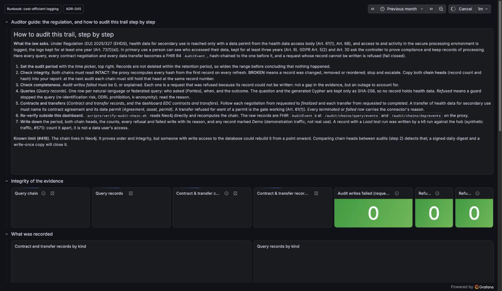
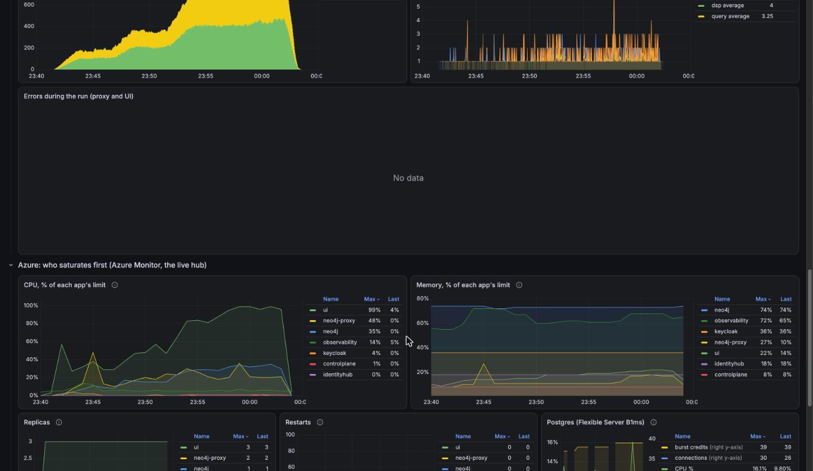

# The dashboards

Three Grafana dashboards show what the live hub does: the contracts and
transfers the connectors negotiate, the regulatory audit trail and its
integrity, and the platform under a load test. They run on the hub's own
Grafana at <https://grafana.ehds.mabu.red>, part of the observability stack
of [ADR-045](../ADRs/ADR-045-observability-and-regulatory-audit-trail.md)
(OpenTelemetry collector, Prometheus, Loki, Tempo, Grafana, with Azure
Monitor and Log Analytics for the containers and the connectors' logs).

| Dashboard                                                                                                                                               | Id                | Answers                                                                         | Default range, refresh |
| ------------------------------------------------------------------------------------------------------------------------------------------------------- | ----------------- | ------------------------------------------------------------------------------- | ---------------------- |
| [EDC contracts and transfers](https://grafana.ehds.mabu.red/d/mvhd-edc-dsp/edc-contracts-and-transfers?from=now-90d&to=now&timezone=browser&refresh=1m) | `mvhd-edc-dsp`    | What did the connectors negotiate and transfer, what was refused and why        | 24 hours, 1 minute     |
| [EHDS audit trail](https://grafana.ehds.mabu.red/d/mvhd-ehds-audit/ehds-audit-trail?from=now-30d&to=now&timezone=browser&refresh=1m)                    | `mvhd-ehds-audit` | Is the evidence intact, what was recorded, what does an auditor copy            | 24 hours, 1 minute     |
| [Load and stress test](https://grafana.ehds.mabu.red/d/mvhd-load-test/load-and-stress-test)                                                             | `mvhd-load-test`  | What is k6 doing, how fast does the hub answer, which container saturates first | 1 hour, 10 seconds     |

**Signing in.** Grafana asks for its own sign-in. The operator account's
password is the Key Vault secret `grafana-admin-password` in
`kv-mvhd-b53a0449`; the auditor's read-only account is
`keycloak-user-mvhd-auditor-password`. Nothing on these dashboards is a
patient's data: the audit trail keeps questions and queries as SHA-256 only,
and the load tests run against synthetic patients.

**When there is nothing to see.** The stack stops outside office hours
([ADR-053](../ADRs/ADR-053-everything-stops-off-hours.md)), so the panels
that read the proxy or the connectors are empty then; the ones that read
Azure Monitor keep their history. Widen the time range before concluding
that nothing happened; the **Newest record** panel says when the last thing
did.

**Where they come from.** The dashboards are JSON under
[`observability/grafana/dashboards-azure/`](../../observability/grafana/dashboards-azure/)
(the Azure variants read Azure Monitor and Log Analytics) and
[`observability/grafana/dashboards/`](../../observability/grafana/dashboards/)
(the compose stack reads Prometheus and Loki), generated by
`observability/grafana/build-dashboards.py` and provisioned with the
observability app. A change to a dashboard is a change to its JSON, reviewed
like code.

## EDC contracts and transfers

Every DSP contract negotiation and data transfer, counted from the `dsp`
hash chain of the audit trail: the hub writes a record when it asks the
connector (requested) or refuses a transfer for want of a data permit, and
the connectors' callbacks write every later state (agreed, finalized,
started, completed, terminated). The dashboard is the operator's view of the
same records the auditor reads on the audit-trail dashboard.

| Row                                          | Panels                                                                                                 | How to read it                                                                                                                                                                                                            |
| -------------------------------------------- | ------------------------------------------------------------------------------------------------------ | ------------------------------------------------------------------------------------------------------------------------------------------------------------------------------------------------------------------------- |
| Header                                       | What this shows; **Newest record**                                                                     | The newest record in the chain whatever the time range. "9 days ago" with empty panels means nothing was negotiated since: widen the range.                                                                               |
| Contract negotiations (DSP)                  | Requested, Agreed, Finalized, Terminated or failed; **Negotiation states** over time                   | Requested and finalized should match over a quiet period; a gap is a negotiation that never came back from the connector, which the **Connector services** row explains. "Agreed" is a transient state and is normally 0. |
| Data transfers                               | Requested, Started, Completed, **Refused (no data permit)**, Terminated or failed; **Transfer states** | Refused is the gate working: Art. 61(1), no access without a permit (Art. 68). The k6 contract journey asks for one on purpose, one time in four, so refusals carry a _Load test run_ tag and are expected (#571).        |
| Refused, terminated and failed, with reasons | **Not completed** table                                                                                | Every record that is not a success, with the connector's reason, the parties and the run it belongs to.                                                                                                                   |
| Connector services (EDC)                     | Errors by service, log lines by service, latest connector errors (Log Analytics)                       | ERROR and SEVERE lines per connector service, without the OpenTelemetry agent's own export errors. Zero is the normal case; the EDC services log at INFO only at start and on trouble, so a quiet hour is a healthy one.  |

The numbers in the screenshot are the load tests of 5 and 6 October 2026:
about 2,800 negotiations and transfers in a few hours, every negotiation
finalized, and 794 transfers refused because the journey asked without a
permit. "Completed" stays at 0 because the data planes of the demo answer
with a started transfer and no completion callback; the transfer counts in
the [load-test results](../loadtest/README.md) are the started ones.

The lower rows in the screenshot: every refused transfer of the stress run
with `did:web:pharmaco.de` as the party and the reason, and the connectors'
error lines over 90 days, where the one spike is the day the identity layer
was reseeded.

## EHDS audit trail

The regulatory audit trail of [ADR-045](../ADRs/ADR-045-observability-and-regulatory-audit-trail.md):
every natural-language or federated query, every contract negotiation and
every transfer is a FHIR R4 `AuditEvent`, hash-chained to the one before it,
and a request whose record cannot be written is refused. The dashboard opens
with the auditor's guide, which an auditor can follow without the project:

| Row                               | Panels                                                                                                                                              | How to read it                                                                                                                                                                                                                        |
| --------------------------------- | --------------------------------------------------------------------------------------------------------------------------------------------------- | ------------------------------------------------------------------------------------------------------------------------------------------------------------------------------------------------------------------------------------- |
| Auditor guide                     | The regulation (Art. 61(1), 68, 73(1)(e), 9; GDPR Art. 5(2), 30) and seven steps                                                                    | The procedure of an audit, from the time picker to the report. Follow it in order.                                                                                                                                                    |
| Integrity of the evidence         | **Query chain**, Query records, **Contract & transfer chain**, Contract & transfer records, Audit writes failed, Refused queries, Refused transfers | Both chains must read **INTACT**: the proxy recomputes every hash from the first record on every refresh. **BROKEN** means a record was changed, removed or reordered: stop and escalate. Audit writes failed must be 0 or explained. |
| What was recorded                 | Contract and transfer records by kind; query records by kind                                                                                        | The volume over time, by record kind; a load test shows as a spike tagged with its run.                                                                                                                                               |
| Records, newest first             | Contract and transfer records; query records                                                                                                        | One row per record: agreement, asset and permit, demo flag, hash, load-test run, outcome, parties, reason, time, who reported it, sequence number, what. Questions and Cypher appear as SHA-256 only.                                 |
| For the audit report: chain heads | Query chain head; contract & transfer chain head                                                                                                    | Copy both values, record count and hash, into the audit report. At the next audit the chain must still hold the same head at the same record number; if not, records were rewritten after the fact.                                   |

Two things an auditor should know, both on the dashboard itself: a record
marked **Demo** is demonstration traffic, not a real use; a record with a
**Load test run** was written by a k6 run against the hub with synthetic
traffic and is counted apart. And the known limit (#418): the chain lives in
Neo4j and proves order and integrity, but someone with write access to the
database could rebuild it from a point onward; comparing chain heads between
audits detects that, and a signed daily digest with a write-once copy is
what closes it. The raw records are FHIR `AuditEvent`s at
`/audit/chains/query/events` and `/audit/chains/dsp/events` on the proxy;
`scripts/verify-audit-chain.sh` recomputes the chain outside Grafana.

## Load and stress test

What to watch while k6 runs against the hub (#519): the load the test
applies, the response time the client sees by kind and by endpoint, the
proxy's own view of the same run, and which container saturates first. The
dashboard is filtered by the run's **Test run** id (`testid`), so two runs
never mix; the links in the [load-test results](../loadtest/README.md) open
each run on its own id and time range.

| Row                                  | Panels                                                                                                                                                                | How to read it                                                                                                                                                                                                                                             |
| ------------------------------------ | --------------------------------------------------------------------------------------------------------------------------------------------------------------------- | ---------------------------------------------------------------------------------------------------------------------------------------------------------------------------------------------------------------------------------------------------------- |
| Load (k6): what the test is doing    | Virtual users, requests / s, **Failed requests**, Rate limited (429), Checks passed (worst check), Iterations; users and requests over time; responses by HTTP status | Failed is the share of requests with a status the step did not expect; the SLO is under 1 %. 429 is the rate limit, 5xx the hub failing, 0 a request that got no answer. The worst check names the SLO that broke first, "api under 1000 ms" for instance. |
| Response time, as the client sees it | **p95 by kind**: pages, API, NLQ, sign-in; p50, p95 and p99; p95 per endpoint; per endpoint table                                                                     | The SLOs: pages under 2 s, API under 1 s, NLQ under 3 s. The endpoint table is sorted by p95; routes are named by their pattern, never by a URL with an id.                                                                                                |
| Server side: the proxy               | Requests / s by route, p95 by route, responses per minute by status, **audit records per transaction**, errors during the run                                         | Measured in the proxy; the difference to the client-side p95 is the UI and the network. Audit records per transaction above 1 means the batch writer takes the load (hypothesis 2 of the runbook); at 1 every query waits for its own transaction.         |
| Azure: who saturates first           | CPU and memory as % of each app's limit, replicas, restarts, Postgres burst credits (Azure Monitor)                                                                   | Neo4j at 100 % CPU is the ceiling; Neo4j near 100 % memory ends in an out-of-memory kill (exit 137); replicas climbing is the scale rule; Postgres credits under about 10 throttle everything that shares the server.                                      |

The screenshots are `20261006-2140-stress-aca`, the run that reached 400 users
with no failed request and moved the ceiling to the UI's CPU. How to read a
result hypothesis by hypothesis, and what each number meant for the sizing
decisions ([ADR-056](../ADRs/ADR-056-neo4j-grows-to-2-vcpu-and-4-gib.md),
[ADR-061](../ADRs/ADR-061-the-ui-scales-out-on-whole-cores.md)), is the
[runbook](../knowledge/runbooks/load-and-stress-test.md).

## Keeping the screenshots current

The screenshots on this page were taken on 2026-10-16 from the live Grafana
in kiosk mode (`&kiosk` on the URL hides the chrome), at 1600 by 1200
pixels. A dashboard that changes gets a new screenshot the same way; the
files live in `docs/operations/img/` and the content generator copies them
to the hub.
