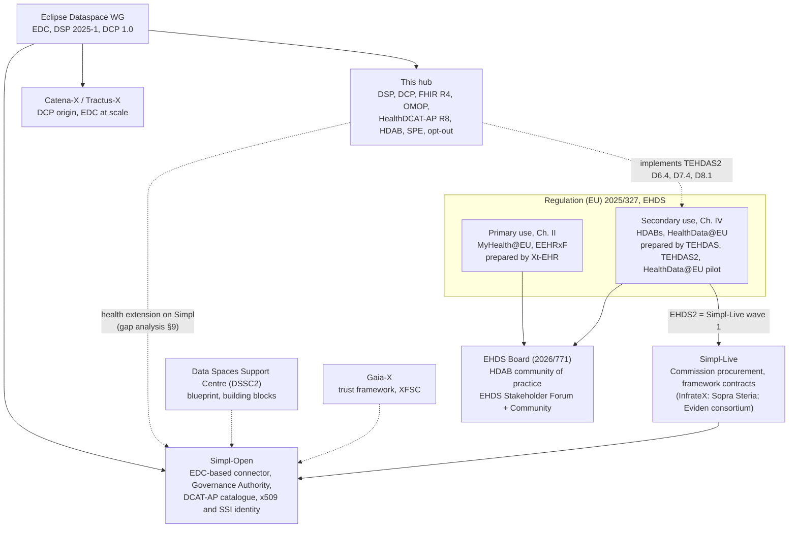

# Simpl-Live wave 1, the EHDS programmes and who to partner with, researched 2026-11-05

Desk research on public sources, to decide whether the hub can join
Simpl-Live wave 1, and where else to look for a consortium. Every fact carries its source;
**[I]** marks an inference, everything else is stated by the source. Real organisations and
people appear here because this is partner research; the fictional-organisation policy
still applies to demo data and the site. No tender material and nothing from
`docs/sphin-x/` is used. Sibling note (local, not in the repo): EHDS tenders and
cooperation partners, 2026-10-09.

## Answer in six lines

1. **Nobody applies to Simpl-Live.** It is a Commission procurement (DIGITAL Work
   Programme 2025-2027, topic 2.1.1, EUR 52.9M, "type of beneficiaries: not applicable"),
   carried out through the Simpl framework contracts. Wave 1 is six EU-level initiatives,
   EHDS2 (HealthData@EU) among them; wave 2 is five others; no wave 3 is announced.
2. **The EHDS2 integration is done by the Simpl framework contractors:** InfrateX (led by
   Sopra Steria Benelux) and the Eviden-led consortium on framework contract
   CNECT/2022/OP/0132. Which of them delivers EHDS2 is not public.
3. **The EHTEL call is not a joint action.** It is DG SANTE's new **EHDS Stakeholder
   Forum** (up to 80 members, industry and SMEs eligible, **apply by 10 Dec 2026**) and the
   open EHDS Stakeholders' Community. Both are open to us.
4. **TEHDAS2 ends 31 Dec 2026** with no announced successor. Its specifications (DAAMS,
   SPE, opt-out, data description) are what the hub already implements; the work moves to
   the EHDS Board, the HDAB community of practice and the Stakeholder Forum. Final
   conference **16 Nov 2026**, Brussels and online.
5. **Best-fitting partners:** imec (Flemish Health Data Space on EDC, DSP, ODRL),
   HUVR-IBiS / FEDERA Salud (the first Simpl health deployment, Andalusia) and Fraunhofer
   ISST (EDC in health, sphin-X, coordinator of DSSC2). Countries: Spain, Belgium, Germany.

6. **The best-fitting money is not Simpl-Live but EU4Health DI-g-26-23**, the EHDS Readiness
   Package for secondary use (EUR 14.35M, call expected Q4 2026, enterprises eligible): its
   mandatory toolbox of open-source modules for applications, dataset descriptions,
   HealthData@EU connectors, SPE and opt-out is what the hub already is. All dated calls and
   tenders are in section 10.

## 1. Simpl-Live wave 1

**What it is.** Simpl-Live is "the journey of data initiatives towards Simpl-Open
adoption", in two phases: a feasibility study (collect, assess, map, conclude, define) and
an implementation (revision, technical validation, acceptance, operational deployment,
maintenance) ([Simpl-Live](https://simpl-programme.ec.europa.eu/programme/simpl-live)).
The Commission calls them instances "where the European Commission actively helps manage
them" ([Simpl policy page](https://digital-strategy.ec.europa.eu/en/policies/simpl),
updated 22 Jun 2026). Feasibility studies ran from January 2024; integration started
February 2026 and the factsheet timeline runs into 2027 and 2028
([factsheet, May 2026](https://simpl-programme.ec.europa.eu/system/files/2026-05/Factsheet_Simpl-Live_A4%2016.pdf)).
The implementation phase opened with workshops on 27 May 2026
([newsroom](https://ec.europa.eu/newsroom/simpl/redirection/item/940026)).

**Funding.** DIGITAL Work Programme 2025-2027, topic 2.1.1 "Simpl": procurement by the
Commission, EUR 52.9M, 48 months, "using the framework contracts signed in the context of
Work Programme 2021-2022"; deliverables are "studies, implementations and operational
support of Simpl-Open integrations"
([unofficial consolidated WP, FFG, amendments to 19 Mar 2026](https://www.ffg.at/sites/default/files/2026-05/DIGITAL%20WP%2025-27_Unofficial%20version%20with%20amendments.pdf)).
The integration runs "in parallel with the grant agreement" of each data initiative
(factsheet).

**Who is in wave 1** ([wave 1 page](https://simpl-programme.ec.europa.eu/programme/simpl-live/wave-1),
milestones as of 24 Aug 2026):

| Initiative                                    | Integration scenario        | Status (24 Aug 2026)                |
| --------------------------------------------- | --------------------------- | ----------------------------------- |
| PPDS, Public Procurement Data Space           | Gateway                     | Revision ongoing                    |
| **EHDS2, EHDS secondary use (HealthData@EU)** | Between Enabler and Gateway | Revision ongoing                    |
| LDS, Language Data Space                      | Between                     | Revision done, technical validation |
| EOSC, European Open Science Cloud             | Gateway                     | Revision ongoing                    |
| DestinE, Destination Earth                    | Gateway                     | Revision ongoing                    |
| SCDS, Smart Communities Data Space            | Enabler                     | Revision ongoing                    |

No page names coordinators, countries or consortium partners: the members are EU-level
initiatives, not national consortia. The only contact given is cnect-simpl@ec.europa.eu.
The consolidated feasibility study carries Eviden labels in its metadata, which suggests
the Eviden-led consortium wrote it [I]
([feasibility study v1.2](https://simpl-programme.ec.europa.eu/system/files/2025-06/Simpl-Live-Feasibility-Study-Report-%28Consolidated%29_Simpl_20250328_V1.2%28A%29.pdf)).

**EHDS2 in the feasibility study.** Simpl-Open "can support EHDS2 in operational and
functional processes", with requirements many of which are marked "to be assessed":
central platform login (Keycloak, EU Login, eIDAS), DG SANTE authorisation, national
contact point onboarding, EU metadata models with validation and publishing, results
publishing, SPE upload and privacy checks, HDAB and data holder onboarding (same study,
Table 4). These map closely onto the hub's access-body, catalogue and SPE features [I];
our own reading is in the
[gap analysis](https://github.com/ma3u/MinimumViableHealthDataspacev2/blob/main/docs/simpl-ehds-gap-analysis.md)
and discussion [#701](https://github.com/ma3u/MinimumViableHealthDataspacev2/discussions/701).

**Wave 2 and after.** Wave 2 (2025 cohort): CEEDS (energy), CEADS (agriculture), EMDS
(mobility), GDDS (Green Deal), EuroCloud; integration from about October 2027
([wave 2](https://simpl-programme.ec.europa.eu/programme/simpl-live/wave-2); factsheet).
No wave 3 is announced. The work programme speaks only of "further European data spaces
and public sector cloud federations" and names health as an earlier data space whose
integration with others is key. No Simpl-Live open call or cascade funding exists
([how to contribute](https://simpl-programme.ec.europa.eu/dashboard/how-contribute)).
FEDERA Salud is in neither wave.

**Who holds the contracts.** The Simpl multiple framework contract CNECT/2022/OP/0132 went
to two consortia in October 2023 ([Simpl policy page](https://digital-strategy.ec.europa.eu/en/policies/simpl)):

- **InfrateX**, led by Sopra Steria Benelux with NTT DATA Belgique
  ([TED award 623496-2023](https://ted.europa.eu/en/notice/623496-2023/pdf);
  [Sopra Steria press release](https://www.soprasteria.com/newsroom/press-releases/details/infratex-consortium-led-by-sopra-steria-awarded-simpl-a-major-multiple-framework-contract-by-european-commission-s-dg-connect)),
  26 companies in 14 countries ([Clever Cloud](https://www.clever.cloud/blog/press/2023/11/13/infratex)).
- **The Eviden-led consortium** (Aruba, Capgemini Nederland, Engineering, IONOS, COSMOTE),
  which builds Simpl-Open under the first specific contract
  ([Eviden](https://eviden.com/insights/news/eviden-leads-consortium-to-provide-simpl-open-oss-data-spaces-middleware-to-the-european-commission)).
- Indra holds a separate contract for administrative and quality assessment.

Simpl-Live work in 2025-2027 is ordered under these framework contracts, so the framework
consortia compete for its specific contracts [I]. The framework's four-year term suggests it runs
to about October 2027 [I].

**Open community routes.** Code at [code.europa.eu/simpl](https://code.europa.eu/simpl),
[issues](https://code.europa.eu/groups/simpl/-/issues),
[requirements](https://simpl-programme.ec.europa.eu/documentation/requirements),
[forum](https://simpl-programme.ec.europa.eu/group/simpl-forum/about) (commenting needs a
verified account). Organisations that are not data spaces "can be onboarded as participants of a
Simpl-enabled data space via Simpl agents"
([Q&A](https://simpl-programme.ec.europa.eu/landing-page/from-feasibility-to-operation-qa)).
Events, checked 2026-11-05:

- Coffee with Simpl, 5th edition: **12 Nov 2026, 14:00 to 15:00 CET**, online via Webex, not
  recorded, questions beforehand to CNECT-SIMPL@ec.europa.eu
  ([event](https://simpl-programme.ec.europa.eu/event/coffee-simpl-5th-edition)).
- Simpl Hackathon: **9 Dec 2026, Brussels**, registration open by email to
  cnect-simpl@ec.europa.eu, subject "Hackathon Registration", no deadline stated
  ([hackathon](https://simpl-programme.ec.europa.eu/events/hackathon)).
- 3rd Annual Community Event: **10 Dec 2026**, Brussels and online, registered separately
  ([event](https://simpl-programme.ec.europa.eu/events/annual-event-2026-pre-event)).

## 2. EHTEL "Get involved in the future of the EHDS"

Source: [EHTEL news, 14 Oct 2026](https://www.ehtel.eu/media-room/latest-news/369-get-involved-in-the-future-of-the-ehds-express-your-interest.html)
(the text says "13 October 2027", a typo for 2026 [I]).

- **What:** DG SANTE's new **EHDS Stakeholder Forum**, which replaces the eHealth
  Stakeholders Group: up to 80 appointed members from patient and citizen groups, health
  professionals, academia and research, and industry "including large enterprises, small-
  and medium-sized enterprises, and start-ups". Members are appointed by March 2027.
  Alongside it, the open **EHDS Stakeholders' Community** for "all EU/EEA-based entities
  and health data stakeholders".
- **Who runs it:** the consultancy IDOM with the Aragon Institute for Health Sciences
  (IACS). EHTEL only relays the call.
- **Deadline:** Forum applications **by 10 December 2026**. The Community has none.
- **How:** Forum application [lnkd.in/eG8VY4P5](https://lnkd.in/eG8VY4P5); expression of
  interest with onboarding guide [lnkd.in/egw8xW3y](https://lnkd.in/egw8xW3y); Community
  information [lnkd.in/eX2q5j83](https://lnkd.in/eX2q5j83) and sign-up on the EU Health
  Policy Platform (form linked on the EHTEL page); support@ehdscommunity.com.
- **EHTEL membership** is not needed for either. Fees per year before VAT: listed companies
  EUR 5,100, private companies trading for more than five years EUR 3,800
  ([join us](https://ehtel.eu/join-us.html)). Secretary General Marc Lange.

## 3. TEHDAS, TEHDAS2, HealthData@EU, Xt-EHR and the implementing acts

**TEHDAS (2021 to 2023).** Joint action under the 3rd Health Programme, coordinated by
Sitra, 25 countries ([final forum](https://tehdas.eu/event/tehdas-stakeholder-forum-2023/)).

**TEHDAS2 (1 May 2024 to 31 Dec 2026).** EU4Health joint action, coordinated by Sitra, 29
countries, EUR 6.7M ([project](https://tehdas.eu/project/);
[budget](https://tehdas.eu/news/sitra-has-been-appointed-to-lead-a-project-of-29-countries-to-realise-the-european-health-data-space/)).
Work packages ([packages](https://tehdas.eu/packages/)):

| WP  | Topic                                                              | Lead                                                                                                                                                                                                                                      |
| --- | ------------------------------------------------------------------ | ----------------------------------------------------------------------------------------------------------------------------------------------------------------------------------------------------------------------------------------- |
| 1-2 | Coordination, communication                                        | Sitra (FI)                                                                                                                                                                                                                                |
| 3   | Evaluation                                                         | CIPH (HR)                                                                                                                                                                                                                                 |
| 4   | Collaboration models: fees, penalties, third-country access        | Danish Health Data Authority ([source](https://english.sundhedsdatastyrelsen.dk/health-data-and-registers/european-health-data-space/tehdas2))                                                                                            |
| 5   | Data discovery: data descriptions, national metadata catalogue     | Sciensano (BE) ([source](https://sciensano.be/en/node/75765))                                                                                                                                                                             |
| 6   | Access to data: applications, the DAAMS system                     | RIVM (NL) co-coordinates ([source](https://www.rivm.nl/en/international-projects/tehdas2))                                                                                                                                                |
| 7   | Safe processing: SPEs, de-identification, common IT infrastructure | Probably CSC (FI) [I], lead author of the [SPE specification draft](https://health-ri.github.io/data-station-specification/appendix/TEHDAS2/draft-technical-functional-and-security-specifications-of-secure-processing-environments.pdf) |
| 8   | Serving citizens: opt-out, significant findings                    | not found                                                                                                                                                                                                                                 |

Deliverables that match the hub ([results](https://tehdas.eu/results-by-user-group/)):
D5.1 data description and D5.3 national metadata catalogue (Oct 2025); D4.1 fees, D6.3
access procedures, D7.3 common IT infrastructure (May 2026); D6.4 DAAMS specification, D7.2
pseudonymisation and synthetic data, D7.4 SPE specification, D8.1 opt-out, D8.2 significant
findings (Jun 2026). D6.4, D7.4 and D8.1 are the hub's permit workflow, SPE routing and
Art. 71 opt-out [I].

**After 31 Dec 2026.** No successor joint action is announced. An invitation-only workshop
on "gaps and future needs" ran on 29 May 2026
([event](https://tehdas.eu/event/workshop-on-gaps-and-future-needs-for-ehds-implementation-invitation-only/)).
The 2026 EU4Health line found is a direct grant to member-state authorities for HDABs,
EU4H-2026-DGA-MS-SANTE-IBA-03, EUR 14.4M
([gov.pl](https://www.gov.pl/web/zdrowie/joint-actions-and-direct-grants-to-member-states-authorities-other-than-joint-actions)).
The work moves to the EHDS Board (Implementing Regulation
[2026/771](https://eur-lex.europa.eu/eli/reg_impl/2026/771/oj/eng)), the HDAB community of
practice and the Stakeholder Forum [I]. **Final conference: 16 Nov 2026**, Spark meetings,
Rue Ravenstein 60, Brussels, and online, free with registration
([event](https://tehdas.eu/event/tehdas2-final-conference/)).

**HealthData@EU pilot (Oct 2022 to Dec 2024).** Coordinated by the French Health Data Hub,
17 partners, EUR 5M, EU4Health 101079839
([HDH](https://health-data-hub.fr/page/healthdataeu-pilot)); results include a metadata
discovery service, a common data access request and the interoperability deliverables on
[Zenodo](https://zenodo.org/records/15096761). The central platform is now being procured:
**EC-SANTE/2026/OP/0035**, EUR 7M, HealthData@EU platform, Health Data IT portal and EHR
systems database ([TED 533039-2026](https://ted.europa.eu/fr/notice/533039-2026/pdf),
[amendment](https://ted.europa.eu/da/notice/629828-2026/pdf)); no award published. A draft
implementing act on HealthData@EU technical requirements was open for feedback 1 to 29 Sep
2026 ([europalov](https://europalov.no/rettsakt/europeisk-helsedataomrade-ehds-gjennomforingsbestemmelser-om-tekniske-krav-til-healthdataeu/id-35465)).

**Xt-EHR (primary use, EEHRxF).** Coordinated by the Cyprus National eHealth Authority,
about 50 partners in 25 countries plus Norway ([Xt-EHR](https://www.xt-ehr.eu/)); 1 Nov 2023
to about 30 Apr 2026 ([NIJZ](https://nijz.si/en/projects/xt-ehr)); patient summary and
ePrescription guides and a 2026 projectathon. No follow-on found.

**Implementing acts.** Adopted: 2026/771 (EHDS Board), 2026/2083 (MyHealth@EU,
[streamlex](https://streamlex.eu/law-resources/implementing-regulation-2026-2083-myhealth-eu/)),
2026/2098 (dataset description metadata, Art. 77(4), applies 26 Mar 2029,
[digitalpolicyalert](https://digitalpolicyalert.org/change/21536)), 2026/2099 (cross-border
identification and healthcare attestations in the EUDI Wallet,
[lawplayer](https://lawplayer.com/eu/act/32026R2099)). Still due by 26 Mar 2027: the EEHRxF
specifications (Art. 15(1)), the HealthData@EU technical act and about ten others
([Belgian HDA](https://academy.hda.belgium.be/pluginfile.php/1683/mod_resource/content/1/artikel%2013%20EHDS%201%20year%20further%21%20anniversary%20article.pdf)).
TEHDAS2 feeds the secondary-use acts, Xt-EHR the EEHRxF; the hub tracks them in
[#697](https://github.com/ma3u/MinimumViableHealthDataspacev2/issues/697).

## 4. How the programmes fit together

| Programme            | Layer                         | Run by                                   | Status 2026-11              | Our door                                                   |
| -------------------- | ----------------------------- | ---------------------------------------- | --------------------------- | ---------------------------------------------------------- |
| EHDS, Reg. 2025/327  | Law                           | DG SANTE, EHDS Board                     | Applies from 26 Mar 2027 on | Implement it; Stakeholder Forum                            |
| HealthData@EU        | Secondary use infrastructure  | DG SANTE, national contact points        | Central platform tender     | Subcontract to the winner; NCP adapter (#713)              |
| MyHealth@EU          | Primary use infrastructure    | DG SANTE, national contact points        | Running, 2026/2083          | Not our focus; EEHRxF portability (#718)                   |
| TEHDAS2              | Specifications, secondary use | Sitra, 29 countries                      | Ends 31 Dec 2026            | Final conference 16 Nov; reference implementation of specs |
| Xt-EHR               | Specifications, primary use   | NeHA (CY)                                | Ended about Apr 2026        | none                                                       |
| Simpl / Simpl-Open   | Generic middleware            | DG CNECT, Eviden consortium              | Hamburg 4.1, Innsbruck 5.0  | Requirements, forum, code, hackathon                       |
| Simpl-Live           | Integration of EU data spaces | DG CNECT, framework contractors          | Wave 1 in implementation    | Framework contractors                                      |
| DSSC2                | Blueprint, community          | Fraunhofer, 23 partners, 05/2026-04/2029 | Running                     | Community, expert network                                  |
| Gaia-X               | Trust framework               | Gaia-X AISBL, national hubs              | Running                     | Spain and Euskadi hubs                                     |
| Eclipse Dataspace WG | Protocols and EDC             | Eclipse Foundation                       | DSP, DCP to ISO/IEC PAS     | Already on it; TCK results                                 |
| Catena-X             | Automotive data space         | Catena-X e.V.                            | Running                     | Reuse of DCP and EDC patterns only                         |

Sources for the rows not cited above: [DSSC2](https://www.isst.fraunhofer.de/en/publications/press_releases/2026/data-spaces-support-centre.html),
[Eclipse DSP and DCP to ISO](https://newsroom.eclipse.org/node/43194).

## 5. Who is active

| Actor                                        | What they do now                                                                                                                                                                                                                                                                                                                                                                                                                                                                                                                                                                                                                                                 | Stack                                                     | Fit for us                                    |
| -------------------------------------------- | ---------------------------------------------------------------------------------------------------------------------------------------------------------------------------------------------------------------------------------------------------------------------------------------------------------------------------------------------------------------------------------------------------------------------------------------------------------------------------------------------------------------------------------------------------------------------------------------------------------------------------------------------------------------- | --------------------------------------------------------- | --------------------------------------------- |
| **imec** (BE)                                | Flemish Health Data Space, final report Feb 2025 ([report](https://www.vlaanderen.be/publicaties/vlaamse-health-data-space-project-eindrapport), [CEUR paper](https://ceur-ws.org/Vol-4007/02short.pdf), [FHIR IG](https://github.com/imec-int/hds-fhir))                                                                                                                                                                                                                                                                                                                                                                                                        | EDC, DSP, Keycloak, ODRL, FHIR, VC-ready                  | Highest: same stack, natural DCP co-applicant |
| **HUVR-IBiS, FEDERA Salud** (ES, Andalusia)  | First Spanish Simpl-based federated repository, 01/2025 to 06/2026, EUR 424k from SEDIA, linked to EUCAIM ([FEDERA Salud](https://www.federasalud.eu/home), [MIE 2026](https://ebooks.iospress.nl/doi/10.3233/SHTI260423))                                                                                                                                                                                                                                                                                                                                                                                                                                       | Simpl MVP, HealthDCAT-AP, OMOP                            | High: funding ended, follow-on needed         |
| **Fraunhofer ISST** (DE)                     | EDC in health ([EDC](https://isst.fraunhofer.de/en/departments/healthcare/technologies/Eclipse-Dataspace-Components.html)), HealthTrack-X with Roche, adesso, Siemens Healthineers to 06/2026 ([project](https://isst.fraunhofer.de/en/departments/healthcare/projects/HealthTrack-X.html)), HEALTH-X dataLOFT closed, Fraunhofer coordinates DSSC2                                                                                                                                                                                                                                                                                                              | EDC, XFSC, Gaia-X                                         | High: EDC-native research lead                |
| **sphin-X e.V.** (DE)                        | Health data space association; architecture names open-source connector and identity tools plus wallets ([MII deck](https://www.medizininformatik-initiative.de/sites/default/files/2026-03/S10.5%20_Bader.pdf))                                                                                                                                                                                                                                                                                                                                                                                                                                                 | Connector, IDs, wallets                                   | Medium: low-cost entry for German industry    |
| **Sciensano / Belgian HDA** (BE)             | Leads HealthDCAT-AP, handed to the EC Sep 2025; leads TEHDAS2 WP5 ([HealthDCAT-AP](https://healthdataeu.pages.code.europa.eu/healthdcat-ap/releases/release-5/))                                                                                                                                                                                                                                                                                                                                                                                                                                                                                                 | HealthDCAT-AP                                             | Medium: metadata conformance partner          |
| **Health-RI with TNO** (NL)                  | National data station specification, trust layer with Nuts and eIDAS, VCs by TNO ([spec](https://health-ri.github.io/data-station-specification/en))                                                                                                                                                                                                                                                                                                                                                                                                                                                                                                             | DCAT, VCs                                                 | Medium: credential conformance                |
| **Sitra / Findata** (FI)                     | TEHDAS2 coordinator; Findata becomes Finland's coordinating HDAB ([agendadigitale](https://www.agendadigitale.eu/?p=283704))                                                                                                                                                                                                                                                                                                                                                                                                                                                                                                                                     | DAAMS and SPE specs                                       | Medium: specification owner                   |
| **Health Data Hub** (FR)                     | Coordinated the HealthData@EU pilot; migrating to Scaleway ([LMI](https://www.lemondeinformatique.fr/actualites/lire-scaleway-devient-l-hebergeur-du-health-data-hub-99998.html))                                                                                                                                                                                                                                                                                                                                                                                                                                                                                | HealthDCAT-AP co-author                                   | Medium: HealthData@EU reference               |
| **Fraunhofer FIT** (DE)                      | EHDS-compatible pilot with ITMP and AstraZeneca ([FIT](https://www.fit.fraunhofer.de/en/publikationen/annual-report-2024/Successful-pilot-for-the-European-Health-Data-Space.html))                                                                                                                                                                                                                                                                                                                                                                                                                                                                              | FHIR, SNOMED, SPE                                         | Medium                                        |
| **Ministerio de Sanidad / SEDIA, ENDS** (ES) | National health data space since 29 Jan 2026: EUR 70M infrastructure, EUR 28M regions, 48 health projects worth EUR 78M, federated central and regional nodes, 330+ datasets ([press](https://digital.gob.es/comunicacion/notas-prensa/mtdfp/2026/01/el-gobierno-abre-el-espacio-nacional-de-datos-de-salud-para-impu), [data holder guide](https://ends.gob.es/content/dam/endatossalud/documentos/Gu%C3%ADa%20para%20la%20incorporaci%C3%B3n%20de%20tenedores%20de%20datos%20en%20el%20ENDS-NP.pdf))                                                                                                                                                           | HealthDCAT-AP, HealthData@EU bridge; connector not public | High: money flowing, connector layer open     |
| **INCLIVA** (ES, Valencia)                   | Integra Data Space, SEDIA grant ([INCLIVA](https://www.incliva.es/en/services/platforms/data-science-platform/data-space))                                                                                                                                                                                                                                                                                                                                                                                                                                                                                                                                       | OMOP, FHIR, HealthDCAT-AP, IDSA, Gaia-X                   | Medium                                        |
| **Basque Country**                           | EUR 1.35M to Osakidetza for its ENDS node; Vicomtech designed the Osakidetza/BIOEF research HDAB model ([euskadi.eus](https://www.euskadi.eus/gobierno-vasco/-/noticia/2025/euskadi-dedicara-1-35-millones-fondos-europeos-creacion-del-espacio-nacional-datos-salud-consejo-gobierno-18-02-2025/), [Vicomtech](https://www.vicomtech.org/en/rdi-tangible/projects/project/design-and-support-for-the-implementation-of-the-basque-health-system-health-data-management-model-and-platform-for-its-use-in-research)); HodeiX lists health ([HodeiX](https://ayesa-digital.com/wp-content/uploads/2026/06/HodeiX-Contribucion-del-ecosistema-vasco-a-GAIA-X.pdf)) | No connector named                                        | Regional pilot partners: Vicomtech, Tecnalia  |
| **Eclipse Dataspace WG**                     | DSP and DCP submitted to ISO/IEC PAS ([newsroom](https://newsroom.eclipse.org/node/43194))                                                                                                                                                                                                                                                                                                                                                                                                                                                                                                                                                                       | EDC, DSP, DCP                                             | Standards home; TCK                           |
| **IDSA**                                     | Health Solutions Arena Feb 2026 with sphin-X ([IDSA](https://internationaldataspaces.org/events/solutions-arena-call-let-the-patient-lead-health-data-spaces-built-around-real-control/)); no health working group found                                                                                                                                                                                                                                                                                                                                                                                                                                         | DSP                                                       | Low                                           |
| GMV, Gradiant (ES)                           | GMV: OmicSpace and EHDEN-certified ([GMV](https://www.gmv.com/en-de/communication/news/gmv-has-been-certified-european-health-data-and-evidence-network-ehden)); Gradiant tested EDC and Tractus-X                                                                                                                                                                                                                                                                                                                                                                                                                                                               | OMOP; EDC                                                 | Medium: Spanish industry partners             |

Not found or nothing current: Fraunhofer FOKUS, Think-it, a Danish HDAB designation, an
IDSA health working group, any public role for EJIE in health data, a Gaia-X health domain
in 2026.

**Countries that make sense.**

- **Spain** first: money is flowing (ENDS, regional nodes), the catalogue is HealthDCAT-AP,
  the connector layer is not yet specified, and Andalusia already runs Simpl in health. The
  hub's Spanish demo work (#27) and a Basque regional pilot both build on this [I].
- **Belgium** second: imec runs the same stack, Sciensano owns HealthDCAT-AP, and Brussels
  hosts the TEHDAS2, Simpl and Stakeholder Forum events.
- **Germany** third: densest EDC-in-health community (Fraunhofer ISST, sphin-X, MII), and
  the national HDAB (DACO) build is procured after GeDIG (see the sibling note).

## 6. Plan

Ordered steps with triggers. Nothing is sent or posted without Matthias's OK.

| #   | Step                                                                                                                                                                                       | Trigger or deadline                                          |
| --- | ------------------------------------------------------------------------------------------------------------------------------------------------------------------------------------------ | ------------------------------------------------------------ |
| 1   | Find out which framework contractor delivers the Simpl-Live EHDS2 integration, and offer the hub as the health test bed.                                                                   | Now; before step 2                                           |
| 2   | Join Coffee with Simpl; send one question beforehand: how will EHDS2 onboard HDABs and national contact points that run their own DSP connectors outside the Simpl-Open agent?             | 12 Nov 2026, 14:00 CET                                       |
| 3   | Register for the TEHDAS2 final conference; bring the hub's mapping to D6.4, D7.4, D8.1 and 2026/2098; ask Sitra what follows after 31 Dec.                                                 | 16 Nov 2026, Brussels or online                              |
| 4   | Sign up to the EHDS Stakeholders' Community; ask for the onboarding guide.                                                                                                                 | Now                                                          |
| 5   | Done 2026-11-05: partner discussion [#895](https://github.com/ma3u/MinimumViableHealthDataspacev2/discussions/895).                                                                        | After Matthias's OK                                          |
| 6   | Write to imec, HUVR-IBiS (FEDERA Salud) and Fraunhofer ISST: one short question each, leading with the concrete ask (section 7).                                                           | After step 5, so the mail can link it                        |
| 7   | Apply to the EHDS Stakeholder Forum (under industry).                                                                                                                                      | Deadline 10 Dec 2026                                         |
| 8   | Register for the Simpl Hackathon with a DSP 2025-1 / DCP interoperability challenge between the hub and a Simpl-Open agent (#711); attend the Annual Community Event.                      | 9 and 10 Dec 2026, Brussels                                  |
| 9   | Contact the winner of EC-SANTE/2026/OP/0035 for subcontracting or a test bed role.                                                                                                         | When the award is published on TED                           |
| 10  | Apply to the DIGITAL-2026-BESTUSE-10-EHDS cascade call (secondary-use toolbox, SME training).                                                                                              | When the grant is signed and the cascade call opens (2027)   |
| 11  | Join a consortium for the next DIGITAL or EU4Health health call that requires Simpl and HealthData@EU interoperability (2027 call set: medical imaging, Virtual Human Twins).              | When the 2027 call texts publish                             |
| 12  | Reassess Simpl-Live entry.                                                                                                                                                                 | When a wave 3 or a new Simpl framework contract is announced |
| 13  | Pre-register interest with a Czech partner for the NCEZ dynamic purchasing system (secondary-use category).                                                                                | 26 Nov 2026, 10:00 CET                                       |
| 14  | Find the consortium for EU4H DI-g-26-23 (EHDS Readiness Package): HDABs, an ERIC or EDIC, imec, Fraunhofer ISST; offer the hub as the toolbox (DAAMS, catalogue, connector, SPE, opt-out). | Now; deadline when the call is published (Q4 2026)           |
| 15  | Apply to NGI Restack for the open-source DSP, DCP and HealthDCAT-AP building blocks.                                                                                                       | 3 Jan 2027                                                   |
| 16  | Join a Horizon consortium as data space and federation partner: HLTH-2027-01-CARE-02 or -02-TOOL-01 (17 Feb 2027), CL4-2027-04-DATA-03 (18 Mar 2027).                                      | Partner search now                                           |
| 17  | Find a French partner to lead an AMI BOAS proposal.                                                                                                                                        | 4 Jan 2027, 12:00 Paris                                      |

## 7. Who to contact

Public professional sources only. Profile links are what the research found; check each
before writing.

| Person                       | Role, organisation                                         | Public profile                                                                                                                                   | Ask                                                                                                       |
| ---------------------------- | ---------------------------------------------------------- | ------------------------------------------------------------------------------------------------------------------------------------------------ | --------------------------------------------------------------------------------------------------------- |
| Simpl team                   | DG CNECT, Simpl programme                                  | cnect-simpl@ec.europa.eu                                                                                                                         | Outside-agent DSP/DCP path for EHDS2 participants; hackathon challenge                                    |
| Matthias Stevens             | imec, Flemish Health Data Space                            | [ORCID](https://orcid.org/0000-0001-6636-0672)                                                                                                   | A DSP/DCP interoperability test between our two EDC health data spaces                                    |
| Bart Matthys                 | imec, Flemish Health Data Space                            | [ORCID](https://orcid.org/0000-0002-0231-6901)                                                                                                   | as above                                                                                                  |
| Carlos Luis Parra-Calderón   | Head of Technological Innovation, HUVR, FEDERA Salud       | [CVN](https://cvn.fecyt.es/editor/cvnOnline/0000-0003-2609-575X)                                                                                 | A FEDERA Salud follow-on that bridges Simpl-Open and EDC/DSP connectors                                   |
| Paloma Bravo-del-Cid         | FEDERA Salud project contact, first author MIE 2026        | [FEDERA Salud](https://www.federasalud.eu/home)                                                                                                  | as above, technical                                                                                       |
| Dr. Anja Burmann             | Head of Healthcare, Fraunhofer ISST                        | [ISST](https://www.isst.fraunhofer.de/en/departments/healthcare.html)                                                                            | Joint consortium for EHDS calls; DSSC2 health building blocks                                             |
| Prof. Boris Otto             | Director, Fraunhofer ISST; sphin-X board                   | [adesso PR](https://www.adesso.de/en/news/presse/one-space-for-health-data-adesso-and-sphin-x-e-v-strengthen-germany-as-a-research-location.jsp) | sphin-X membership terms for Sopra Steria                                                                 |
| Markus Kalliola              | Programme Director, Sitra; TEHDAS and TEHDAS2 coordinator  | [LinkedIn](https://fi.linkedin.com/in/markuskalliola)                                                                                            | What follows TEHDAS2; would a reference implementation of D6.4, D7.4, D8.1 help the EHDS Board subgroups? |
| Pascal Derycke               | Sciensano, HealthDCAT-AP                                   | [ORCID](https://orcid.org/0000-0002-4658-5185)                                                                                                   | Review of our HealthDCAT-AP Release 8 profile and SHACL run                                               |
| Maarten Kollenstart          | TNO, verifiable credentials for Health-RI                  | [Health-RI spec](https://health-ri.github.io/data-station-specification/en)                                                                      | DCP and Nuts credential alignment                                                                         |
| Marc Lange                   | Secretary General, EHTEL                                   | [EHTELconnect](https://www.ehtel.eu/activities/ehtelconnect/25-wg-tasks-forces/86-ehtelconnect.html)                                             | Whether EHTEL hosts an EHDS implementers' working group                                                   |
| Juan Fernando Muñoz Montalvo | Secretary General of Digital Health, Ministerio de Sanidad | [BOE](https://boe.es/boe/dias/2026/04/04/pdfs/BOE-A-2026-7699.pdf)                                                                               | Through #27 only: connector layer for ENDS regional nodes                                                 |
| Borja Bonail                 | Tecnalia Digital Health                                    | [Tecnalia](https://tecnalia.com/en/agenda/opportunities-of-the-new-health-data-space)                                                            | Basque research partner for a regional pilot                                                              |

## 8. What we can offer

Each item exists in the hub or is planned in a numbered issue.

1. **A DSP 2025-1 / DCP 1.0 conformance run against a Simpl-Open agent**, both directions,
   with the TCK in CI (#711). Answers the feasibility study's open question on connectors
   outside the agent.
2. **HealthDCAT-AP Release 8 with the official SHACL shapes in CI**, as a profile of Simpl's
   DCAT-AP (#719); matches EHDS2's "EU metadata models, validation and publishing" and
   2026/2098.
3. **The access body's procedures as running code**: application, permit, one DSP agreement
   per holder (#720), Art. 71 opt-out at the holder (#721), SPE gate and audit (#716),
   Art. 62 fees (#723); a reference implementation of TEHDAS2 D6.4, D7.4 and D8.1.
4. **A test bed with synthetic data**: 127 FHIR R4 patients mapped to OMOP 5.4, five
   fictional participants, reproducible on a laptop; for EHDS2 technical validation, the
   HealthData@EU platform contractor and HDAB onboarding.
5. **EUDI Wallet sign-in to 2026/2099** (#708) and a national contact point adapter over
   eDelivery (#713).
6. **Training material** for the BESTUSE-EHDS SME training strand: the static docs and API
   collection by EHDS persona.

## 9. GitHub Discussion (posted 2026-11-05, updated the same day with links and section 10's calls)

Posted with Matthias's OK as [#895](https://github.com/ma3u/MinimumViableHealthDataspacev2/discussions/895)
in Ideas. It names no person and no employer. The text as posted:

> **Title:** Looking for partners: EHDS secondary use on DSP, DCP and Simpl, who wants to test, build or bid together?
>
> **Are you building a health data access body, a HealthData@EU node or a Simpl-Live integration, and would an open-source EHDS reference implementation help you test it?** We are looking for consortia and partners for 2027 and want to hear from you.
>
> This repository implements the secondary-use path of Regulation (EU) 2025/327 on open protocols: a data holder publishes HealthDCAT-AP Release 8 descriptions, an access body decides applications and issues permits, a researcher negotiates under the Dataspace Protocol 2025-1 with DCP 1.0 credentials, the Art. 71 opt-out is enforced at the holder, and results leave a secure processing environment only after review. FHIR R4 and OMOP CDM 5.4 sit behind the data planes. Apache 2.0, synthetic data, fictional organisations.
>
> **What we can bring**
>
> - A DSP and DCP conformance run against your connector, or against a Simpl-Open agent
> - HealthDCAT-AP Release 8 descriptions validated with the official SHACL shapes
> - Running code for the TEHDAS2 specifications on applications, SPEs and opt-out
> - A test bed with synthetic FHIR and OMOP data that runs on a laptop
>
> **What we are looking for**
>
> - Access bodies, national contact points and regional health data spaces that want a reference or a test partner
> - Consortia preparing DIGITAL, EU4Health or Horizon Europe health data proposals that need Simpl and HealthData@EU interoperability
> - Teams running EDC-based health data spaces who want an interoperability test
> - Simpl-Open developers interested in a health extension on the outside-agent path
>
> **Calls and tenders we want to answer together** (deadlines checked on 5 Nov 2026; Horizon deadlines 17:00 Brussels)
>
> | Deadline                      | Call or tender                                                                                                       | What it is                                                                                                                                                                                                                                                   | Link                                                                                                                                                                                                                                                                                           |
> | ----------------------------- | -------------------------------------------------------------------------------------------------------------------- | ------------------------------------------------------------------------------------------------------------------------------------------------------------------------------------------------------------------------------------------------------------ | ---------------------------------------------------------------------------------------------------------------------------------------------------------------------------------------------------------------------------------------------------------------------------------------------- |
> | Q4 2026, publication expected | EU4Health DI-g-26-23, EHDS Readiness Package for secondary use, EUR 14.35M                                           | Implementation labs for access bodies and a toolbox of open-source modules: data access applications, dataset descriptions, HealthData@EU connectors, SPE starter kits, opt-out with national eID. Open to enterprises, research, hospitals, ERICs and EDICs | [work programme annex, p. 83](https://health.ec.europa.eu/document/download/b719a2ab-481c-4904-805d-ce4457cf10dc_en?filename=funding_c2026_7403_annex_en.pdf)                                                                                                                                  |
> | Q4 2026, publication expected | EU4Health DI-g-26-24, AI for EHDS compliance support, EUR 3M                                                         | AI for metadata, data quality, application screening                                                                                                                                                                                                         | same annex                                                                                                                                                                                                                                                                                     |
> | 11 Nov 2026, 12:00            | Coordination of the Data Spaces Hub Germany (BMDS)                                                                   | Contact point and advice for data spaces in Germany                                                                                                                                                                                                          | [TED 734872-2026](https://ted.europa.eu/en/notice/-/detail/734872-2026)                                                                                                                                                                                                                        |
> | 26 Nov 2026, 10:00 CET        | Czech Ministry of Health, dynamic purchasing system for experts in interoperability and secondary use of health data | Looking for a Czech partner                                                                                                                                                                                                                                  | [TED 742028-2026](https://ted.europa.eu/en/notice/-/detail/742028-2026)                                                                                                                                                                                                                        |
> | 10 Dec 2026                   | UNITE Open Call 2, interregional digital health                                                                      | Cascade funding for cross-regional consortia                                                                                                                                                                                                                 | [portal](https://ec.europa.eu/info/funding-tenders/opportunities/portal/screen/opportunities/competitive-calls-cs/45659376)                                                                                                                                                                    |
> | 3 Jan 2027                    | NGI Restack (NLnet)                                                                                                  | Funding for open-source middleware, here DSP, DCP and HealthDCAT-AP building blocks                                                                                                                                                                          | [portal](https://ec.europa.eu/info/funding-tenders/opportunities/portal/screen/opportunities/competitive-calls-cs/48400841)                                                                                                                                                                    |
> | 4 Jan 2027, 12:00 Paris       | AMI BOAS, open-source tools for the French SNDS                                                                      | Needs a French lead                                                                                                                                                                                                                                          | [Health Data Hub](https://health-data-hub.fr/ami-boas)                                                                                                                                                                                                                                         |
> | 17 Feb 2027                   | HORIZON-HLTH-2027-01-CARE-02 (adverse drug reactions) and HORIZON-HLTH-2027-02-TOOL-01 stage 1 (AI biomarkers)       | We would be the data space and federation partner                                                                                                                                                                                                            | [CARE-02](https://ec.europa.eu/info/funding-tenders/opportunities/portal/screen/opportunities/topic-details/HORIZON-HLTH-2027-01-CARE-02), [TOOL-01](https://ec.europa.eu/info/funding-tenders/opportunities/portal/screen/opportunities/topic-details/HORIZON-HLTH-2027-02-TOOL-01-two-stage) |
> | 18 Mar 2027                   | HORIZON-CL4-2027-04-DATA-03, federated AI data processing, opens 17 Nov 2026                                         | Federated analytics and secure processing                                                                                                                                                                                                                    | [topic](https://ec.europa.eu/info/funding-tenders/opportunities/portal/screen/opportunities/topic-details/HORIZON-CL4-2027-04-DATA-03)                                                                                                                                                         |
> | 16 Sep 2027                   | HORIZON-HLTH-2027-03-TOOL-08, frontier AI models for healthcare, opens 3 Jun 2027                                    | Names federated infrastructures and the EHDS                                                                                                                                                                                                                 | [topic](https://ec.europa.eu/info/funding-tenders/opportunities/portal/screen/opportunities/topic-details/HORIZON-HLTH-2027-03-TOOL-08)                                                                                                                                                        |
> | 2027, after grant signature   | DIGITAL-2026-BESTUSE-10-EHDS cascade calls                                                                           | Financial support for data holders and training for service providers                                                                                                                                                                                        | [HaDEA](https://hadea.ec.europa.eu/news/new-calls-proposals-under-digital-europe-programme-published-2026-04-10_en)                                                                                                                                                                            |
> | Award pending                 | EC-SANTE/2026/OP/0035, EHDS IT systems incl. the HealthData@EU central platform                                      | We offer the winner a test bed and subcontracting                                                                                                                                                                                                            | [TED 629828-2026](https://ted.europa.eu/en/notice/-/detail/629828-2026)                                                                                                                                                                                                                        |
>
> Also open: applications to the [EHDS Stakeholder Forum](https://www.ehtel.eu/media-room/latest-news/369-get-involved-in-the-future-of-the-ehds-express-your-interest.html) close on **10 Dec 2026**.
>
> **Where we will be:**
>
> - [TEHDAS2 final conference](https://tehdas.eu/event/tehdas2-final-conference/), 16 Nov 2026, Brussels and online
> - [Simpl Hackathon](https://simpl-programme.ec.europa.eu/events/hackathon), 9 Dec 2026, Brussels
> - [Simpl Annual Community Event](https://simpl-programme.ec.europa.eu/events/annual-event-2026-pre-event), 10 Dec 2026, Brussels and online
>
> Reply here, or open an issue, with what you are working on and what you would test or build together.
>
> - What the hub implements, article by article: https://ma3u.github.io/MinimumViableHealthDataspacev2/docs/ehds
> - Regulation implementation: https://ma3u.github.io/MinimumViableHealthDataspacev2/docs/ehds/regulation-implementation
> - Simpl-Open and EHDS gap analysis: https://github.com/ma3u/MinimumViableHealthDataspacev2/blob/main/docs/simpl-ehds-gap-analysis.md
> - Earlier discussion on Simpl-Open: https://github.com/ma3u/MinimumViableHealthDataspacev2/discussions/701

## 10. Tenders and calls with submission dates

Researched 2026-11-05 through the Funding & Tenders search API (all open and forthcoming
calls and tenders), the TED v3 API and the EU4Health 2026 work programme annex. The TED
deadlines and the Horizon dates below were read again from the APIs on the same day.
Excluded on purpose: the sphin-X iGW-NeX procurement and any Spanish national HDAB tender
(confidential bids). Times are the buyer's local time unless stated; Horizon and DIGITAL
deadlines are 17:00 Brussels unless the topic says otherwise.

### Open now

| Deadline                         | What                                                                                                                                | Buyer / funder                          | Type                              | Value                   | Fit and rules                                                                          | Source                                                                                                                                            |
| -------------------------------- | ----------------------------------------------------------------------------------------------------------------------------------- | --------------------------------------- | --------------------------------- | ----------------------- | -------------------------------------------------------------------------------------- | ------------------------------------------------------------------------------------------------------------------------------------------------- |
| 9 Nov 2026, 12:00 UTC (requests) | HSE Enterprise Integration Platform as a Service, national interoperability layer preparing for EHDS                                | HSE, Ireland                            | Procurement, restricted, 15 years | not stated              | Medium; a product vendor is needed                                                     | [TED 757162-2026](https://ted.europa.eu/en/notice/-/detail/757162-2026)                                                                           |
| 11 Nov 2026, 12:00               | Coordination of the Data Spaces Hub Germany (contact point, Gaia-X multiplier, technical and legal advice)                          | BMDS, Germany                           | Procurement, open                 | not stated              | Medium-high; cross-sector data spaces, DSP and EDC know-how                            | [TED 734872-2026](https://ted.europa.eu/en/notice/-/detail/734872-2026)                                                                           |
| 12 Nov 2026, 17:00               | DIGIT solutions and support services                                                                                                | DG DIGIT                                | Procurement, open                 | not stated              | Low                                                                                    | Funding & Tenders, EC-DIGIT/2025/OP/0071                                                                                                          |
| 19 Nov 2026, 23:59 CET           | New case-handling system for the Swedish HDAB                                                                                       | Socialstyrelsen, Sweden                 | Competitive dialogue              | about SEK 378 to 398M   | Low-medium; scope of permit casework unclear                                           | [TED 729154-2026](https://ted.europa.eu/en/notice/-/detail/729154-2026)                                                                           |
| 23 Nov 2026, 11:00 (requests)    | Workflow service and TI platform ("HCC-Cloud"), e-prescription and e-referral                                                       | gematik, Germany                        | Negotiated with call              | not stated              | Low-medium; primary use                                                                | [TED 721788-2026](https://ted.europa.eu/en/notice/-/detail/721788-2026)                                                                           |
| 26 Nov 2026, 10:00 (requests)    | Dynamic purchasing system: experts in digital health, interoperability, **secondary use of health data**, cybersecurity, for NCEZ   | Ministry of Health, Czechia             | DPS, restricted, 4 categories     | not stated              | **High**; work in Czech, so with a Czech partner; a DPS stays open to new entrants [I] | [TED 742028-2026](https://ted.europa.eu/en/notice/-/detail/742028-2026)                                                                           |
| 30 Nov 2026, 12:00               | IR\* Progedo information system: warehouse, catalogue, secure research environment live in 2027                                     | CNRS, France                            | Framework agreement, open         | EUR 500,000             | Low-medium; social science data, but SPE and catalogue                                 | [TED 757815-2026](https://ted.europa.eu/en/notice/-/detail/757815-2026)                                                                           |
| 10 Dec 2026                      | EHDS Stakeholder Forum application                                                                                                  | DG SANTE (run by IDOM with IACS)        | Membership                        | n/a                     | High                                                                                   | [EHTEL](https://www.ehtel.eu/media-room/latest-news/369-get-involved-in-the-future-of-the-ehds-express-your-interest.html)                        |
| 10 Dec 2026                      | UNITE Open Call 2, interregional deep-tech digital health                                                                           | UNITE (Horizon Europe)                  | Cascade                           | EUR 6M total            | Medium-high; cross-regional consortia                                                  | [portal](https://ec.europa.eu/info/funding-tenders/opportunities/portal/screen/opportunities/competitive-calls-cs/45659376)                       |
| 3 Jan 2027                       | NGI Restack, open internet stack and middleware (rolling every two months [I])                                                      | NLnet / NGI                             | Cascade                           | EUR 5,000 to 50,000     | **High** for the open-source building blocks (DSP, DCP, HealthDCAT-AP)                 | [portal](https://ec.europa.eu/info/funding-tenders/opportunities/portal/screen/opportunities/competitive-calls-cs/48400841)                       |
| 4 Jan 2027, 12:00 Paris          | AMI BOAS, 11th edition: open-source tools for the SNDS                                                                              | Plateforme des données de santé, France | Grant plus 24 months support      | under EUR 100,000       | Medium; lead must be a French legal entity; code open source                           | [HDH](https://health-data-hub.fr/ami-boas)                                                                                                        |
| 13 Jan 2027                      | EIT Health Innovation Validation Call 2027                                                                                          | EIT Health                              | Cascade                           | not given               | Medium                                                                                 | [portal](https://ec.europa.eu/info/funding-tenders/opportunities/portal/screen/opportunities/competitive-calls-cs/48939726)                       |
| 17 Feb 2027                      | Adverse drug reactions from multiple medications (HORIZON-HLTH-2027-01-CARE-02)                                                     | HaDEA                                   | Horizon RIA                       | EUR 38M, 8 to 10M each  | Medium; real-world data and OMOP partner                                               | [topic](https://ec.europa.eu/info/funding-tenders/opportunities/portal/screen/opportunities/topic-details/HORIZON-HLTH-2027-01-CARE-02)           |
| 17 Feb 2027 (stage 1)            | AI predictive biomarkers for chronic NCDs (HORIZON-HLTH-2027-02-TOOL-01-two-stage); stage 2 16 Sep 2027                             | HaDEA                                   | Horizon, two-stage                | EUR 44.2M, 6 to 8M each | Medium; data space and federation partner                                              | [topic](https://ec.europa.eu/info/funding-tenders/opportunities/portal/screen/opportunities/topic-details/HORIZON-HLTH-2027-02-TOOL-01-two-stage) |
| 4 Mar 2027                       | Eurostars call 12 (opens 17 Dec 2026)                                                                                               | EUREKA, national funders                | SME-led R&D                       | national budgets        | Medium-high only with an SME lead                                                      | [portal](https://ec.europa.eu/info/funding-tenders/opportunities/portal/screen/opportunities/competitive-calls-cs/44087099)                       |
| 18 Mar 2027 (opens 17 Nov 2026)  | Decentralised, federated and sustainable AI data processing (HORIZON-CL4-2027-04-DATA-03)                                           | HaDEA                                   | Horizon RIA                       | EUR 35M, 2 projects     | Medium-high; federated analytics and SPEs                                              | [topic](https://ec.europa.eu/info/funding-tenders/opportunities/portal/screen/opportunities/topic-details/HORIZON-CL4-2027-04-DATA-03)            |
| 16 Sep 2027 (opens 3 Jun 2027)   | Virtual Human Twins for clinical decision support (HORIZON-HLTH-2027-03-TOOL-04); frontier AI models for healthcare (-TOOL-08, CSA) | HaDEA                                   | Horizon                           | EUR 39.3M; EUR 2.9M     | Medium; TOOL-08 names EHDS access                                                      | [TOOL-08](https://ec.europa.eu/info/funding-tenders/opportunities/portal/screen/opportunities/topic-details/HORIZON-HLTH-2027-03-TOOL-08)         |
| 8 Apr 2028 / 21 Jan 2028         | PROSERV and CLOUD III dynamic purchasing systems, join any time                                                                     | DG DIGIT                                | DPS                               | EUR 1.2bn each          | Medium; entry route to Commission IT mini-competitions                                 | Funding & Tenders, EC-DIGIT/2024/DPS/0001, DIGIT/2023/DPS/0031                                                                                    |

### Announced, not yet published (trigger: publication on the portal or TED)

| Expected                    | What                                                                                                                                                                                                                                                                                                            | Value                                  | Who may apply                                                                              | Fit                                                |
| --------------------------- | --------------------------------------------------------------------------------------------------------------------------------------------------------------------------------------------------------------------------------------------------------------------------------------------------------------- | -------------------------------------- | ------------------------------------------------------------------------------------------ | -------------------------------------------------- |
| Q4 2026                     | **EU4H DI-g-26-23, EHDS Readiness Package for secondary use**: EHDS2 Implementation Labs, HDAB community of practice, SPE starter kits, opt-out systems interoperable with national eID; mandatory toolbox of open-source modules for DAAMS, dataset descriptions, HealthData@EU connectors, SPE, opt-out, fees | EUR 14.35M, open call, HaDEA           | MS authorities, academia, research, hospitals, ERICs, EDICs, enterprises, private entities | **Highest of all**: the toolbox is what the hub is |
| Q4 2026                     | EU4H DI-g-26-24, AI for smart EHDS compliance support (metadata, data quality, application screening)                                                                                                                                                                                                           | EUR 3M                                 | as above plus CSOs                                                                         | Medium-high                                        |
| 2026-27                     | EU4H DI-p-26-61 Health Data IT portal and SPE operational setup; DI-p-26-65 HealthData@EU central services, EHR database, testing environments; DI-p-26-66 EEHRxF maintenance                                                                                                                                   | EUR 5.5M, 5.5M, 5M                     | procurement, possibly through existing framework contracts that never reach TED            | High, as subcontractor                             |
| Award pending               | EC-SANTE/2026/OP/0035 EHDS IT systems (closed 2 Oct 2026 by corrigendum 629828-2026); DARWIN EU Coordination Centre 2.0 (EMA, closed 23 Jun 2026, EUR 65M)                                                                                                                                                      | EUR 7M; EUR 65M                        | winners subcontract                                                                        | High; Medium (OMOP)                                |
| 2027, after grant signature | DIGITAL-2026-BESTUSE-10-EHDS cascade calls (closed 1 Oct 2026, one EUR 14.4M grant, financial support to third parties, training of service providers)                                                                                                                                                          | from EUR 14.4M                         | authorities, providers, data holders, service providers                                    | High                                               |
| Q1 2027 open, Q2 2027 close | DIGITAL fourth call set: Virtual Human Twins validation (EUR 7.2M), cloud-edge reference deployments (EUR 9M), multi-country projects and Apply AI                                                                                                                                                              | see WP                                 | partly restricted under Art. 12(6)                                                         | Medium                                             |
| overdue against PIN         | Simpl Programme Support Office II, EC-CNECT/2026/OP/0127 (quality management and IV&V)                                                                                                                                                                                                                          | EUR 20M, 48 months                     | open procedure                                                                             | Medium                                             |
| early 2027                  | IHI calls 14 and 15 (no EHDS topic in the drafts)                                                                                                                                                                                                                                                               | n/a                                    | industry plus academia                                                                     | Low                                                |
| Q1 2027 [I]                 | BMFTR SPE pilot projects, stage 2 (stage 1 closed 28 Oct 2026); BMG national EHDS network, stage 2                                                                                                                                                                                                              | grants                                 | research leads only for BMFTR; companies as subcontractors                                 | High, as subcontractor                             |
| after GeDIG passes          | BfArM / DACO build: permit system, catalogue, SPE (GeDIG 2nd and 3rd readings not scheduled yet)                                                                                                                                                                                                                | about EUR 11.3M one-off (sibling note) | open procurement [I]                                                                       | High                                               |
| after national laws         | Netherlands (Wet GIS, Gezondheidsdata-autoriteit), Finland (Findata central application system), Sweden (SPE proposal due 31 Mar 2027), Italy (AGENAS), Castilla-La Mancha data space (PIN TED 607698-2026)                                                                                                     | n/a                                    | national procurement                                                                       | Medium                                             |

Source for the EU4Health rows: [EU4Health 2026 work programme annex, C(2026) 7403](https://health.ec.europa.eu/document/download/b719a2ab-481c-4904-805d-ce4457cf10dc_en?filename=funding_c2026_7403_annex_en.pdf),
adopted 19 Oct 2026. For DIGITAL: the [consolidated work programme](https://www.ffg.at/sites/default/files/2026-05/DIGITAL%20WP%2025-27_Unofficial%20version%20with%20amendments.pdf).
For the BMFTR and BMG calls: [BMFTR](https://www.gesundheitsforschung-bmftr.de/de/19026.php),
[PtJ](https://www.ptj.de/foerdermoeglichkeiten/lebenswissenschaften/ehds).

### Events with submission dates

- IHE-Europe Connectathon, 19 to 23 Apr 2027, The Hague: registration date not yet shown (in
  2026 it closed mid November) ([IHE](https://connectathon.ihe-europe.net/node/325)).
- MIE 2027, Tallinn, 26 to 30 Apr 2027: papers closed 20 Oct 2026; workshops and panels
  "January 2027" ([EFMI](https://efmi.org/2026/09/08/call-for-papers-open-mie-2027-tallinn-26-to-30-april-2027/)).
- HL7 FHIR DevDays 2027, Amsterdam, June: call for presentations opens December 2026
  ([DevDays](https://devdays.com/)).

## 11. Funded projects, primary and secondary use: funding and partner analysis

Posted as a [comment on #895](https://github.com/ma3u/MinimumViableHealthDataspacev2/discussions/895#discussioncomment-19427064)
on 2026-11-05 at Matthias's request. Method: participant lists of 12 primary-use projects
(CORDIS XML, Funding & Tenders project database) and 29 secondary-use consortia (Funding &
Tenders API), counted per organisation. Topic budgets for BESTUSE-10-EHDS (one grant),
CARE-02 (EUR 38M, 4 grants of 8 to 10M) and EOSC-01 (one EUR 40M cofund, dropped as a
fit) were read from the topic JSON, because the two research passes disagreed.

Large IT integrators are absent from the secondary-use consortia and win the Commission's
tenders and framework contracts instead. The HDAB direct grants (2022 and 2026 rounds) go to
national bodies alone; suppliers come in as subcontractors.

The comment as posted:

> **Who is building the consortium for the EU4Health "EHDS Readiness Package" (DI-g-26-23, EUR 14.35M, call expected Q4 2026), and who is preparing primary-use work on the European exchange format for 2027?** We would like to join as the open-source toolbox and test bed partner. Below: the funding coming up, split by primary and secondary use, and who has won the EU health data projects so far.
>
> Sources: the [EU4Health 2026 work programme annex](https://health.ec.europa.eu/document/download/b719a2ab-481c-4904-805d-ce4457cf10dc_en?filename=funding_c2026_7403_annex_en.pdf) (adopted 19 Oct 2026), the Funding & Tenders portal and CORDIS participant lists, read on 5 Nov 2026. Counts are over the projects listed here, not all of CORDIS.
>
> ### Upcoming funding: primary use (EHDS Chapter II and III)
>
> | When                           | What                                                                                                                                                                               | Value     | Notes                                                                                                                                   |
> | ------------------------------ | ---------------------------------------------------------------------------------------------------------------------------------------------------------------------------------- | --------- | --------------------------------------------------------------------------------------------------------------------------------------- |
> | Q4 2026                        | EU4H **DI-g-26-24**, AI for EHDS compliance support, primary and secondary use, incl. tools for EHR system manufacturers                                                           | EUR 3M    | open call, HaDEA; enterprises eligible                                                                                                  |
> | Q4 2026                        | EU4H **HS-g-26-16**, emerging AI tools in primary care                                                                                                                             | EUR 2.5M  | open call                                                                                                                               |
> | 2026-27                        | EU4H **DI-p-26-64**, MyHealth@EU central services                                                                                                                                  | EUR 3M    | existing framework contracts                                                                                                            |
> | 2026-27                        | EU4H **DI-p-26-66**, maintenance of the EEHRxF and EHR common specifications                                                                                                       | EUR 5M    | open tender or new framework contract                                                                                                   |
> | Jan-Feb 2027 result, then 2027 | **DIGITAL-2026-BESTUSE-10-EHDS** (closed 1 Oct 2026): one grant that funds third parties, incl. EEHRxF deployment and training of service providers                                | one grant | [topic](https://ec.europa.eu/info/funding-tenders/opportunities/portal/screen/opportunities/topic-details/DIGITAL-2026-BESTUSE-10-EHDS) |
> | 30 Sep 2027                    | MyHealth@EU change proposals, wave 12: images, lab results, discharge reports (wave 11 closed 30 Sep 2026: FHIR proof of concept, patient summary and ePrescription in the EEHRxF) | n/a       | national contact points                                                                                                                 |
> | by 26 Mar 2027                 | Implementing acts with the EEHRxF specifications; EHR certification and testing work follows into 2029                                                                             | n/a       |                                                                                                                                         |
>
> The 2026 work programme has no new MyHealth@EU direct grants; the 2026 member-state direct grants go to access bodies (secondary use).
>
> ### Upcoming funding: secondary use (EHDS Chapter IV)
>
> | When          | What                                                                                                                                                                                                                                                                    | Value               | Notes                                                                                                                                   |
> | ------------- | ----------------------------------------------------------------------------------------------------------------------------------------------------------------------------------------------------------------------------------------------------------------------- | ------------------- | --------------------------------------------------------------------------------------------------------------------------------------- |
> | Q4 2026       | EU4H **DI-g-26-23**, EHDS Readiness Package: EHDS2 implementation labs, the HDAB community of practice, SPE starter kits, opt-out with national eID; mandatory open-source toolbox for applications, dataset descriptions, HealthData@EU connectors, SPE, opt-out, fees | EUR 14.35M          | open call, HaDEA; authorities, research, hospitals, ERICs, EDICs, enterprises                                                           |
> | 2026-27       | EU4H **DI-p-26-61** Health Data IT portal and SPE operational setup; **DI-p-26-65** HealthData@EU central services, EHR database, testing environments                                                                                                                  | EUR 5.5M each       | tenders or framework contracts                                                                                                          |
> | award pending | **EC-SANTE/2026/OP/0035**, EHDS IT systems incl. the HealthData@EU central platform                                                                                                                                                                                     | EUR 7M, 48 months   | [TED](https://ted.europa.eu/en/notice/-/detail/629828-2026)                                                                             |
> | award pending | **DARWIN EU Coordination Centre 2.0** (EMA, OMOP network)                                                                                                                                                                                                               | EUR 65M, 60 months  | [TED](https://ted.europa.eu/en/notice/-/detail/366419-2026)                                                                             |
> | 17 Feb 2027   | **HORIZON-HLTH-2027-01-CARE-02**, adverse drug reactions, real-world data                                                                                                                                                                                               | EUR 38M, 4 x 8-10M  | [topic](https://ec.europa.eu/info/funding-tenders/opportunities/portal/screen/opportunities/topic-details/HORIZON-HLTH-2027-01-CARE-02) |
> | 18 Mar 2027   | **HORIZON-CL4-2027-04-DATA-03**, federated AI data processing                                                                                                                                                                                                           | EUR 35M, 2 projects | [topic](https://ec.europa.eu/info/funding-tenders/opportunities/portal/screen/opportunities/topic-details/HORIZON-CL4-2027-04-DATA-03)  |
> | 16 Sep 2027   | **HORIZON-HLTH-2027-03-TOOL-08**, frontier AI models for healthcare (cites the EHDS)                                                                                                                                                                                    | EUR 2.9M            | [topic](https://ec.europa.eu/info/funding-tenders/opportunities/portal/screen/opportunities/topic-details/HORIZON-HLTH-2027-03-TOOL-08) |
>
> ### Who wins primary-use projects
>
> 12 projects: Xt-EHR, XpanDH, xShare, i2X, myHealth@myHands, POTENTIAL, PATHED, UNICOM, Gravitate-Health, X-eHealth, Smart4Health, InteropEHRate.
>
> | Project                                                                                                                                             | Programme              | Runs             | Coordinator                     | What                                                  |
> | --------------------------------------------------------------------------------------------------------------------------------------------------- | ---------------------- | ---------------- | ------------------------------- | ----------------------------------------------------- |
> | [Xt-EHR](https://www.xt-ehr.eu/)                                                                                                                    | EU4Health joint action | 2023 to Apr 2026 | NeHA (CY)                       | EEHRxF logical models, now in the HL7 Europe guides   |
> | [xShare](https://cordis.europa.eu/project/id/101136734)                                                                                             | Horizon                | to Nov 2026      | MedCom (DK)                     | "Yellow Button" FHIR guide, 8 adoption sites          |
> | [i2X](https://ec.europa.eu/info/funding-tenders/opportunities/portal/screen/opportunities/projects-details/43152860/101195323/DIGITAL)              | DIGITAL                | 2025 to 2029     | UpHill (PT)                     | EEHRxF in service, 38 partners                        |
> | [myHealth@myHands](https://ec.europa.eu/info/funding-tenders/opportunities/portal/screen/opportunities/projects-details/43152860/101195425/DIGITAL) | DIGITAL                | 2025 to 2029     | Department of Health (IE)       | patient access through the EUDI Wallet on MyHealth@EU |
> | [POTENTIAL](https://ec.europa.eu/info/funding-tenders/opportunities/portal/screen/opportunities/projects-details/43152860/101102655/DIGITAL)        | DIGITAL                | ended 2025       | French Ministry of the Interior | EUDI Wallet pilot with an ePrescription use case      |
>
> - **In 7 of the 12:** HL7 Europe, IDIKA (EL), SPMS (PT), Spanish Ministry of Health, Irish Department of Health. **In 6:** ARIA (IT), NeHA (CY), IHE-Europe with IHE Catalyst. **In 5:** empirica (DE), Gnomon (EL), ESZFK (HU), Nictiz (NL), EHTEL, gematik (DE), ANS (FR).
> - **Companies** that win repeatedly are SMEs: empirica, Gnomon, DataWizard, UpHill, Kereval, Better Standards for e-Health. Large integrators appear once each.
> - **Portugal coordinates 4 of the 12.** The 40+ MyHealth@EU direct grants go to national eHealth bodies alone, so suppliers come in as subcontractors.
> - The EEHRxF Support Centre (HaDEA/2024/OP/0014) runs the community of practice for the exchange format.
>
> ### Who wins secondary-use projects
>
> 29 consortia: the EHDS2 pilot, TEHDAS2, QUANTUM, SHAIPED, SCAILED, CHAIN, FORTIFY, the HDAB direct grants, GDI, Genome of Europe, EUCAIM, INDICATE, EOSC-ENTRUST, EHDEN, DARWIN EU, IDERHA, DataTools4Heart, PHEMS and others.
>
> | Project                                                                                                                                     | Programme      | Runs                      | Coordinator                                 | What                                                                     |
> | ------------------------------------------------------------------------------------------------------------------------------------------- | -------------- | ------------------------- | ------------------------------------------- | ------------------------------------------------------------------------ |
> | [SCAILED](https://ec.europa.eu/info/funding-tenders/opportunities/portal/screen/opportunities/projects-details/43332642/101314097/EU4H)     | EU4Health, new | Oct 2026 to 2029, EUR 18M | PNED GIE (LU), 50 partners                  | biotech AI on EHDS data: genomics, imaging, brain health                 |
> | [CHAIN](https://ec.europa.eu/info/funding-tenders/opportunities/portal/screen/opportunities/projects-details/43332642/101314833/EU4H)       | EU4Health, new | Oct 2026 to 2029, EUR 25M | European Society of Cardiology, 53 partners | federated cardiovascular data and AI network, builds on EHDEN and EUCAIM |
> | [SHAIPED](https://ec.europa.eu/info/funding-tenders/opportunities/portal/screen/opportunities/projects-details/43152860/101195135/DIGITAL)  | DIGITAL        | 2025 to 2028              | Health Data Hub (FR)                        | access body pathways for AI                                              |
> | [FORTIFY](https://cordis.europa.eu/project/id/101251225)                                                                                    | IHI            | 2026 to 2029              | Karolinska Institutet (SE)                  | IP and trade-secret safeguards in permit access                          |
> | [QUANTUM](https://ec.europa.eu/info/funding-tenders/opportunities/portal/screen/opportunities/projects-details/43108390/101137057/HORIZON)  | Horizon        | ended Jun 2026            | IACS (ES), 42 partners                      | data quality and utility label                                           |
> | [GDI](https://ec.europa.eu/info/funding-tenders/opportunities/portal/screen/opportunities/projects-details/43152860/101081813/DIGITAL)      | DIGITAL        | to Mar 2027               | EMBL, 73 partners                           | genomics: Beacon, GA4GH Passports                                        |
> | [EUCAIM](https://ec.europa.eu/info/funding-tenders/opportunities/portal/screen/opportunities/projects-details/43152860/101100633/DIGITAL)   | DIGITAL        | to Dec 2026               | EIBIR (AT), 97 partners                     | federated cancer imaging                                                 |
> | [INDICATE](https://ec.europa.eu/info/funding-tenders/opportunities/portal/screen/opportunities/projects-details/43152860/101167778/DIGITAL) | DIGITAL        | to May 2028               | Erasmus MC (NL)                             | federated ICU data, OMOP and FHIR                                        |
>
> - **Most frequent participants:** Sciensano 12, Erasmus MC 11, Barcelona Supercomputing Center 10, Masaryk University 10, EMBL 9, Health-RI 9, THL 9, Charité 8, Health Data Hub 8, BfArM 6, IACS 6, plus, with IDOM, the HaDEA contract supporting stakeholders on secondary use (Stakeholder Forum and Community, HADEA/2024/OP/0034).
> - **Companies:** empirica (4), The Hyve, IQVIA, Odysseus, Lynkeus, SRDC, Aridhia, Decentriq, BC Platforms, Bahia Software, Siemens Healthineers, Philips. Large IT integrators are absent from these consortia; they compete for the Commission's tenders instead.
> - **Countries by participations:** Spain 111, France 83, Germany 79, Netherlands 75, Italy 61, Belgium 57. Repeat coordinators: EMBL, Erasmus MC, Health Data Hub, IACS, PNED.
>
> ### Where this stack fits
>
> | Use       | Partners that fit                       | Why                                                                                                                                                                        |
> | --------- | --------------------------------------- | -------------------------------------------------------------------------------------------------------------------------------------------------------------------------- |
> | Secondary | IACS, Health Data Hub, Sciensano        | quality label, HDAB pathways and HealthDCAT-AP; our HealthDCAT-AP Release 8 with SHACL in CI and the permit workflow are reference implementations of their specifications |
> | Secondary | Erasmus MC / EHDEN Foundation, The Hyve | OMOP federations; a DSP and DCP layer in front of OMOP is what we run                                                                                                      |
> | Secondary | BfArM, Health-RI, PNED                  | operating or building national access bodies; test bed for DAAMS, SPE and opt-out                                                                                          |
> | Primary   | HL7 Europe, IHE-Europe                  | our FHIR R4 layer as a reference implementation of the EEHRxF guides; Connectathon testing                                                                                 |
> | Primary   | UpHill, Gnomon, empirica                | they coordinate or integrate i2X, myHealth@myHands and UNICOM; the EUDI Wallet sign-in and consent overlap with myHealth@myHands                                           |
>
> If you are in one of these consortia, or forming one for the calls above, reply here or open an issue.

## Limits

- Not confirmed: which contractor delivers the EHDS2 integration; the EHDS2 individual feasibility report; any wave 3; the
  Catalonia governance decree; a TEHDAS2 WP8 lead.
- Secondary sources for EUR-Lex texts (EUR-Lex did not render for the fetcher).
- The Simpl-Live, EHTEL, Hackathon, Coffee with Simpl and TEHDAS2 conference facts were
  checked again on 2026-11-05.
