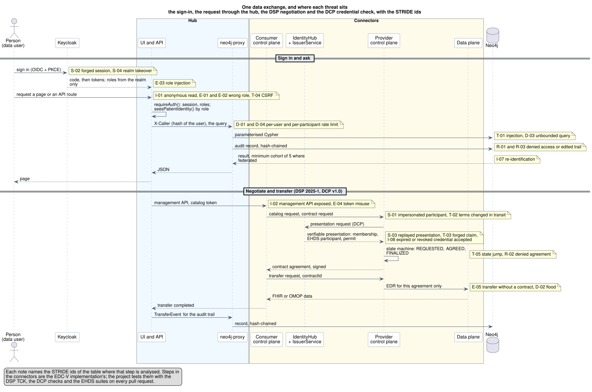

# Threat model: the EHDS Integration Hub

STRIDE, for the hub as it runs on Azure Container Apps: the UI and its API
(Next.js 15), Keycloak 26.8, the neo4j-proxy, the EDC-V connectors with their
IdentityHub and IssuerService, Neo4j 5.26 and the PostgreSQL Flexible Server.
Written 2026-10-16; each mitigation names the code, the test or the decision
that shows it. The app that connects to the hub has its own model,
[`threat-model-klarbefund.md`](threat-model-klarbefund.md). What the project
tested and found is the
[security test report](security-test-report-2026-10-15.md); how the platform
would be run for real data is the
[operational guideline](operational-guideline.md).

The data on the hub is synthetic: 127 generated patients, fictional
organisations, forged load-test sessions. The threats below are assessed as
if the data were real, because the hub is a reference implementation for a
platform that will hold real data; where a mitigation is enough for the demo
and not for real data, the table says so.

## How to read this model

STRIDE asks six questions of every data flow: can the sender be spoofed, the
data tampered with, the action repudiated, information disclosed, the service
denied, privilege elevated. The system context in section 1 numbers the data
flows and the trust boundaries they cross; the sequence in section 3 shows one
complete exchange with the id of every threat at the step where it would
happen; the six tables then hold one row per threat with the flow it sits on,
its status, and the mitigation with the evidence. The evidence is a file, a
test, a script or a decision in this repository, so each row can be checked
without asking anyone.

Four attackers are assumed, and every row names at least one implicitly by
its flow:

| Attacker                        | Reaches                                         | Holds                                                        | Wants                                                                                             |
| ------------------------------- | ----------------------------------------------- | ------------------------------------------------------------ | ------------------------------------------------------------------------------------------------- |
| Anyone on the internet          | B1: the hub's pages and API, Keycloak's sign-in | Nothing; or a leaked cookie, token or password               | A patient's record, a session, the admin console, the platform offline                            |
| A signed-in participant         | B1 with a valid session, as its role            | A legitimate account in one role                             | Data outside its role or its permit, another patient's record, a louder voice than its rate limit |
| A peer connector                | B2 through the public control plane             | Its own DID and credentials; forged or stolen ones           | A contract it is not entitled to, data without an agreement, a false identity                     |
| An insider with operator rights | B2 and B3 through `az`, `gh` and the scripts    | Subscription rights, the deploy identity, the admin password | Secrets, a silent change, a cleared audit trail                                                   |

A fifth, the supply chain, has no flow of its own: a compromised dependency or
image arrives through the deploy (F7) and is treated under tampering (T-07).

## 1. System context: data flows and trust boundaries


Source: [`diagrams/hub-trust-boundaries.puml`](diagrams/hub-trust-boundaries.puml),
rendered with `scripts/render-plantuml.sh`.

Three boundaries, and what crossing each one means:

| Boundary              | Who can send a request across it                   | What proves identity                                                                   |
| --------------------- | -------------------------------------------------- | -------------------------------------------------------------------------------------- |
| B1, the internet edge | Anyone                                             | The session cookie (NextAuth JWT), a bearer token from Keycloak, or a DCP credential   |
| B2, the environment   | The hub's own apps and jobs, over internal ingress | The caller header the hub sets (`X-Caller`), the catalog token, the connector's DID    |
| B3, data and secrets  | The environment only                               | The managed identity (Key Vault references), the Vault token, the database credentials |

The numbered flows (F1 to F21) are what the STRIDE tables refer to. The ones
that matter most, and why:

| Flow       | What crosses                                         | Why it is the one to watch                                                                                            |
| ---------- | ---------------------------------------------------- | --------------------------------------------------------------------------------------------------------------------- |
| F1         | Every page and API request, with the session cookie  | The only path an anonymous attacker has to the data; every route behind it needs a session (ADR-044)                  |
| F2, F8     | Sign-in and the token exchange with Keycloak         | A forged or over-scoped token is a forged identity for everything downstream                                          |
| F3, F4     | The app's bearer token and its account creation      | A phone is outside anyone's control; App Attest is what keeps account creation to the genuine app                     |
| F5         | DSP and DCP between connectors                       | The one flow where a stranger's software talks to ours by design; identity is the DID and the credential, not a login |
| F9         | The hub's call to the proxy, with the caller header  | The proxy trusts the header because only the hub can reach it; the boundary B2 is what makes that trust sound         |
| F10, F11   | The management API and the catalog token             | Full control of the connectors; internal ingress and one token in Key Vault are the whole defence                     |
| F14, F15   | Reads and writes to the graph, and the audit records | Where the patient data and the evidence live; parameterised queries and the hash chain are the controls               |
| F19 to F21 | Keys and secrets                                     | Vault, its sealed state and Key Vault; nothing here is ever copied into an app                                        |

## 2. Assets

| Asset                                                                          | Sensitivity | Where it lives                                  | Notes                                                                                       |
| ------------------------------------------------------------------------------ | ----------- | ----------------------------------------------- | ------------------------------------------------------------------------------------------- |
| Patient records (FHIR, OMOP)                                                   | High        | Neo4j (B3)                                      | Synthetic today; the model treats them as real                                              |
| Who read whose record, the audit chain                                         | High        | Neo4j, hash-chained (B3)                        | Regulatory evidence (Art. 73); ten years ([retention policy](../audit-retention-policy.md)) |
| Participant signing keys                                                       | High        | Vault, state on the Flexible Server (B3)        | Never leave Vault; ADR-046                                                                  |
| Operator secrets: `NEXTAUTH_SECRET`, DB and admin passwords, the catalog token | High        | Azure Key Vault, referenced by the apps (B3)    | ADR-036; the live `NEXTAUTH_SECRET` was rotated after it had been a published default       |
| Sessions and tokens                                                            | High        | Cookie in the browser, bearer in the app        | NextAuth JWT; Keycloak access and refresh tokens                                            |
| Verifiable credentials and permits                                             | Medium      | IdentityHub (B2)                                | Membership, EHDS participant, purpose, quality label, the permit as a credential            |
| Contracts, transfers, tasks                                                    | Medium      | EDC state in PostgreSQL (B3), mirrored to Neo4j | ODRL policies, agreements, `TransferEvent` nodes                                            |
| Catalogue metadata                                                             | Low         | Neo4j, the connectors                           | HealthDCAT-AP; public by design                                                             |
| The graph schema and the code                                                  | Low         | GitHub, public                                  | The documentation is the schema                                                             |

## 3. STRIDE



Source: [`diagrams/hub-exchange-threats.puml`](diagrams/hub-exchange-threats.puml).

Status: **closed** means a test or a build setting pins it; **in place** means
the code does it and a test exercises it indirectly; **demo** means enough for
synthetic data and named as open for real data; **open** means nothing does it
yet.

### Spoofing

| ID   | Threat                                 | Flow   | Status   | Mitigation and evidence                                                                                                                                                                                                                                                                                       |
| ---- | -------------------------------------- | ------ | -------- | ------------------------------------------------------------------------------------------------------------------------------------------------------------------------------------------------------------------------------------------------------------------------------------------------------------- |
| S-01 | A connector impersonates a participant | F5     | In place | `did:web` resolution against the IdentityHub's DID document, one per participant; the DCP presentation carries the membership credential (ADR-007, ADR-009). Checked by `scripts/run-ehds-identity-checks.sh` on every pull request.                                                                          |
| S-02 | A forged session reaches an API route  | F1     | Closed   | NextAuth JWT signed with `NEXTAUTH_SECRET` from Key Vault; `requireAuth()` in every handler, pinned by `ui/__tests__/unit/api/every-route-needs-a-session.test.ts` (ADR-044).                                                                                                                                 |
| S-03 | A replayed credential presentation     | F5     | In place | The EDC-V DCP implementation binds the presentation to the request; the DCP checks of `compliance.yml` run it. Not re-verified by the hub itself.                                                                                                                                                             |
| S-04 | Keycloak realm or console takeover     | F2, F6 | Closed   | The admin console is off the internet (`guard-keycloak-console.sh`, F10 of the test report); the admin password lives in Key Vault; the realm is version-controlled and drift-checked ([runbook](../knowledge/runbooks/keycloak-realm-drift.md)). MFA on the admin is for the operator (guideline, identity). |
| S-05 | A fake Klarbefund creates accounts     | F3     | In place | Account creation answers only a request whose Apple App Attest attestation verifies (ADR-054); the challenge is signed and lives five minutes.                                                                                                                                                                |

### Tampering

| ID   | Threat                                            | Flow     | Status   | Mitigation and evidence                                                                                                                                                                                                              |
| ---- | ------------------------------------------------- | -------- | -------- | ------------------------------------------------------------------------------------------------------------------------------------------------------------------------------------------------------------------------------------ |
| T-01 | Cypher injection                                  | F14, F15 | Closed   | Parameterised Cypher everywhere; the NLQ engine refuses a query that would read a patient's identity unless the UI says the role may (`revealsPatientIdentity()`); tests in `services/neo4j-proxy/__tests__/`.                       |
| T-02 | Contract terms changed in transit                 | F5       | In place | TLS at the edge; the agreement is signed by the provider's connector. Mutually authenticated DSP endpoints are a guideline item for real data.                                                                                       |
| T-03 | A forged credential claim                         | F5       | In place | Credentials are issued and verified by the IssuerService and IdentityHub (EDC-V); the hub shows, it does not re-sign. An HSM for the issuer key is a guideline item.                                                                 |
| T-04 | Cross-site request forgery on a mutation          | F1       | In place | `SameSite=Lax` session cookie (NextAuth); the CSP forbids inline scripts; no mutation reads its parameters from a GET.                                                                                                               |
| T-05 | A state jump in the negotiation                   | F5       | In place | The state machines live in the EDC-V control plane (REQUESTED, AGREED, FINALIZED; transfers REQUESTED to COMPLETED) and are leased in PostgreSQL; the hub mirrors, it does not drive. The DSP 2025-1 TCK runs on every pull request. |
| T-06 | The audit trail edited                            | F15      | Closed   | Each record carries the hash of its predecessor, SHA-256 over canonical JSON; `verifyChain()` reports any change, removal or reordering (ADR-045, `audit-chain.ts`). Both chains were intact after every load run.                   |
| T-07 | A supply-chain change in a dependency or an image | F7       | Closed   | One CycloneDX bill per part, checked against the lockfiles; grype and trivy on every push; npm audit in pre-push with time-boxed exceptions; images pinned; CodeQL. [SBOM](../sbom/README.md), `security-scan.yml`.                  |

### Repudiation

| ID   | Threat                                           | Flow     | Status   | Mitigation and evidence                                                                                                                                                                        |
| ---- | ------------------------------------------------ | -------- | -------- | ---------------------------------------------------------------------------------------------------------------------------------------------------------------------------------------------- |
| R-01 | A party denies a transfer happened               | F15      | Closed   | `TransferEvent` with sender and receiver DID and timestamp, in the hash-chained `dsp` chain (ADR-045).                                                                                         |
| R-02 | A party denies agreeing to a contract            | F5       | In place | The agreement is signed by the connector and stored in the EDC state; mirrored to the graph with its id.                                                                                       |
| R-03 | A read of a patient's record is denied or hidden | F14, F15 | Closed   | Every access the proxy serves is an access event in the `query` chain; the patient sees who read their record on their own page; retention ten years ([policy](../audit-retention-policy.md)). |
| R-04 | An operator action leaves no trace               | F6, F7   | In place | Keycloak login events kept seven days; deploys are GitHub Actions runs; every live step is a script under `scripts/azure/` and recorded in the gotchas or an ADR. A SIEM is a guideline item.  |

### Information disclosure

| ID   | Threat                                                | Flow       | Status   | Mitigation and evidence                                                                                                                                                                                                                |
| ---- | ----------------------------------------------------- | ---------- | -------- | -------------------------------------------------------------------------------------------------------------------------------------------------------------------------------------------------------------------------------------- |
| I-01 | An anonymous caller reads data                        | F1         | Closed   | Every API route needs a session (ADR-044); the pages that read them are in `PROTECTED_PATHS` and redirect; 40 black-box checks of the live hub confirm the 401s and redirects (`check-hub-blackbox.sh`).                               |
| I-02 | The connectors' management API reachable from outside | F10        | In place | Internal ingress only; the UI reaches it by its internal name, pinned on every deploy (#648). The catalog crawler sends its token only to listed hosts.                                                                                |
| I-03 | Secrets in the page or the repository                 | F1, F7     | Closed   | Server-side environment only; Key Vault references (ADR-036); gitleaks in the hooks and in CI; a test asserts no secret reaches the HTML.                                                                                              |
| I-04 | Cross-site scripting exfiltrates a session            | F1         | Closed   | A per-request nonce in the CSP with `strict-dynamic`, no `unsafe-inline` for scripts; `HttpOnly` session cookie; headers pinned by `next.config.js` and checked black-box. The off-hours page missed some headers once (F8, observe).  |
| I-05 | A database reachable from the internet                | F14 to F20 | Closed   | Neo4j, PostgreSQL and Vault have no public ingress; the Flexible Server allows the environment only.                                                                                                                                   |
| I-06 | Clickjacking                                          | F1         | Closed   | `X-Frame-Options: DENY` and `frame-ancestors 'none'`, black-box checked.                                                                                                                                                               |
| I-07 | Re-identification from a cohort                       | F9, F12    | In place | `MIN_COHORT_SIZE` of 5 in the proxy for federated queries; roles other than the holder and the operator see a pseudonym, the birth year and no residence (#475). Output control by the access body is a process the demo does not run. |
| I-08 | An expired or revoked credential accepted             | F5         | Demo     | The IdentityHub checks expiry; there is no revocation list in the demo. Status lists and a revocation procedure are guideline items for real data.                                                                                     |
| I-09 | Logs carry personal data                              | F13        | In place | The proxy logs counts and codes, the caller as a hash; Azure Monitor keeps 30 days; the operational logs are separate from the audit chain (ADR-045).                                                                                  |

### Denial of service

| ID   | Threat                                    | Flow     | Status   | Mitigation and evidence                                                                                                                                                                                                                                                                 |
| ---- | ----------------------------------------- | -------- | -------- | --------------------------------------------------------------------------------------------------------------------------------------------------------------------------------------------------------------------------------------------------------------------------------------- |
| D-01 | One user exhausts the proxy               | F9       | Closed   | Per user: `RATE_LIMIT_MAX` requests and `RATE_LIMIT_HEAVY_MAX` analytical queries per `RATE_LIMIT_WINDOW_MS`; per participant ten times that for callers that name no user; the audit route has its own. Measured: 83.6 % refused before, 23.2 % after the per-user limit (2026-10-05). |
| D-02 | A flood of DSP messages at the connectors | F5       | Demo     | The EDC-V control plane leases its state machines in PostgreSQL and times out; no rate limit at the connector's edge. A WAF and rate limits per hostname are guideline items.                                                                                                           |
| D-03 | An unbounded query                        | F14, F15 | Closed   | `LIMIT` on every list route; the graph views capped at the newest 30 access events (#580), which removed the one request that took the UI down at 90 concurrent users; every outbound call has a timeout.                                                                               |
| D-04 | Load takes the platform down              | F1       | In place | 400 users with no failed request (2026-10-06); the UI scales on an HTTP concurrency rule to six whole-core replicas (ADR-061); health checks on every image; a deploy waits while a load test runs. The latency SLOs break from 200 users; measured next.                               |
| D-05 | The stack is off                          | F1       | Accepted | Everything stops off hours by decision (ADR-053) and the UI says so; a 24x7 contract removes the schedule (guideline, availability).                                                                                                                                                    |

### Elevation of privilege

| ID   | Threat                                             | Flow     | Status   | Mitigation and evidence                                                                                                                                                                                                    |
| ---- | -------------------------------------------------- | -------- | -------- | -------------------------------------------------------------------------------------------------------------------------------------------------------------------------------------------------------------------------- |
| E-01 | A patient reaches an admin route                   | F1       | Closed   | `requireAuth(["EDC_ADMIN"])` on the admin routes, 403 for any other role; the role matrix in `.claude/rules/api-conventions.md`; Bruno folder `09 Access control` asserts it against a real server.                        |
| E-02 | A researcher reads a patient's identity            | F1, F9   | Closed   | `seesPatientIdentity()` decides by role; `refuseForeignRecord()` answers 403 for another patient's record; the NLQ proxy refuses identity reads without the UI's header (#475). Bruno `09 Access control/28` to `/30`.     |
| E-03 | Roles injected into the token                      | F2, F8   | Closed   | Roles come from the realm's claims only; the UI client has full scope off and exactly the seven EHDS roles in scope (#648, `wire-ui-client-scope.sh`); `auth.ts` maps nothing else.                                        |
| E-04 | The catalog token used from elsewhere              | F10, F11 | In place | One token in Key Vault, reaching the UI and the crawler as a reference; the crawler sends it only to `DSP_CATALOG_TOKEN_HOSTS`; a wrong token is 401, never a fall back to the session (ADR-020, ADR-036).                 |
| E-05 | A transfer without an agreement                    | F5, F12  | In place | The data plane hands out an EDR for a finalised agreement only (EDC-V); the hub records the `contractId` with every transfer. The TCK covers the protocol.                                                                 |
| E-06 | The operator account `edcadmin` on a demo password | F2       | Open     | `EDC_ADMIN` reads a patient's record without a contract negotiation. `scripts/azure/secure-accounts.sh` moves it and every non-demo account to a generated password in Key Vault; to be run against the live realm (#671). |

### Summary

| Category               | Threats | Closed | In place |  Demo |  Open | Accepted |
| ---------------------- | ------: | -----: | -------: | ----: | ----: | -------: |
| Spoofing               |       5 |      2 |        3 |     0 |     0 |        0 |
| Tampering              |       7 |      3 |        4 |     0 |     0 |        0 |
| Repudiation            |       4 |      2 |        2 |     0 |     0 |        0 |
| Information disclosure |       9 |      5 |        3 |     1 |     0 |        0 |
| Denial of service      |       5 |      2 |        1 |     1 |     0 |        1 |
| Elevation of privilege |       6 |      3 |        2 |     0 |     1 |        0 |
| **All**                |  **36** | **17** |   **15** | **2** | **1** |    **1** |

Closed and in place differ in how they are proven: a closed row has a test or
a build setting that fails when the mitigation goes; an in-place row relies on
the code doing it and on the suites that exercise it. Turning in-place rows
into closed ones is the ordinary work of this model.

## 4. What the demo accepts, and what real data needs

| Residual risk                                | Why it is accepted for the demo                                       | What closes it                                                                     |
| -------------------------------------------- | --------------------------------------------------------------------- | ---------------------------------------------------------------------------------- |
| No revocation of credentials (I-08)          | Every credential is issued to a fictional participant by the demo     | A status list in the IssuerService and a revocation procedure; guideline, identity |
| No rate limit at the connectors' edge (D-02) | The connectors talk to fictional peers only                           | A WAF and per-hostname limits; guideline, edge                                     |
| No mTLS between apps (T-02)                  | One environment, internal ingress                                     | Private endpoints and mutually authenticated DSP endpoints; guideline, connectors  |
| Neo4j has one database user                  | Access is decided in the hub and the proxy, and the data is synthetic | Neo4j Enterprise or a managed graph with roles and backups; guideline, data        |
| Operator accounts on demo passwords (E-06)   | Nobody's real data is behind them                                     | `secure-accounts.sh --all-non-demo`; #671                                          |
| No independent test                          | The project's own tests are the evidence so far                       | A penetration test of the hub; test report, last section; #655                     |
| The stack is off outside office hours (D-05) | A cost decision for a demo                                            | A 24x7 service contract; guideline, availability                                   |

## 5. How this model is kept true

- A new API route needs a session or a superseding ADR; the test
  `every-route-needs-a-session.test.ts` fails otherwise.
- A new route that returns patient fields asks `seesPatientIdentity()`
  first, and the Bruno collection gets a request that asserts the refusal.
- Every change runs the security scan, CodeQL, the compliance suites and the
  black-box checks; a finding goes into the security test report with a
  status, never only into a commit message.
- The diagrams are PlantUML sources under `diagrams/`, rendered by
  `scripts/render-plantuml.sh`; a flow added to the system gets a number here
  and a row in the table that analyses it.

## 6. How to verify this model yourself

Every closed row has a check that can be run on a laptop or read in CI:

```bash
cd ui && npx vitest run __tests__/unit/api/every-route-needs-a-session.test.ts   # S-02, I-01, E-01
cd ui && npx vitest run __tests__/unit/api/patient-route.test.ts                   # E-02, I-07
scripts/security/check-hub-blackbox.sh                                             # I-01, I-04, I-06, S-04 against the live hub
scripts/security/scan-repo.sh                                                      # T-07: grype, npm audit, trivy, gitleaks, semgrep, hadolint, shellcheck
scripts/security/generate-sbom.sh --check                                          # T-07: the bills match the lockfiles
./scripts/run-api-tests.sh Azure-Dev "09 Access control"                           # E-01, E-02, E-04 by persona, against a real server
scripts/azure/guard-keycloak-console.sh --check                                    # S-04: console 403, admin REST 401, master realm 401
cd services/neo4j-proxy && npm test                                                # T-01, T-06, D-01, D-03
```

The compliance suites (`compliance.yml`: the DSP 2025-1 TCK, the DCP checks,
the EHDS suites) cover the connector rows, S-01, S-03, T-05, E-05, on every
pull request. A row whose check is missing from this list is an in-place row,
and the next step for it is the test that would move it.
