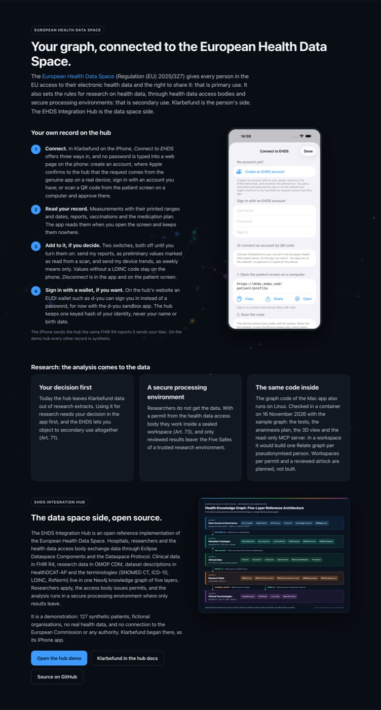
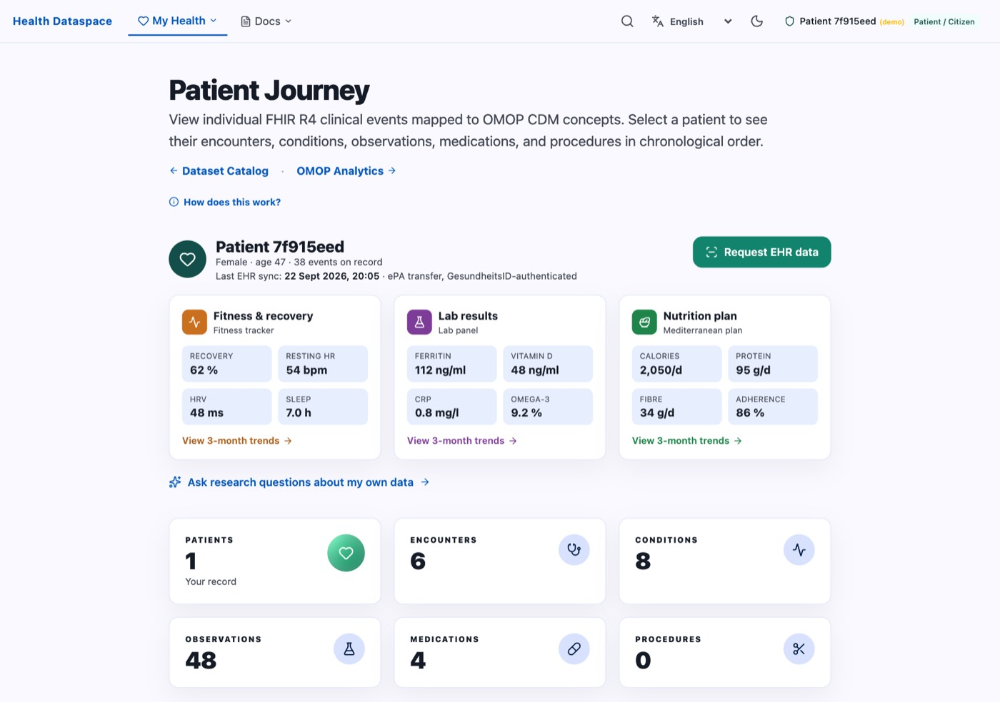
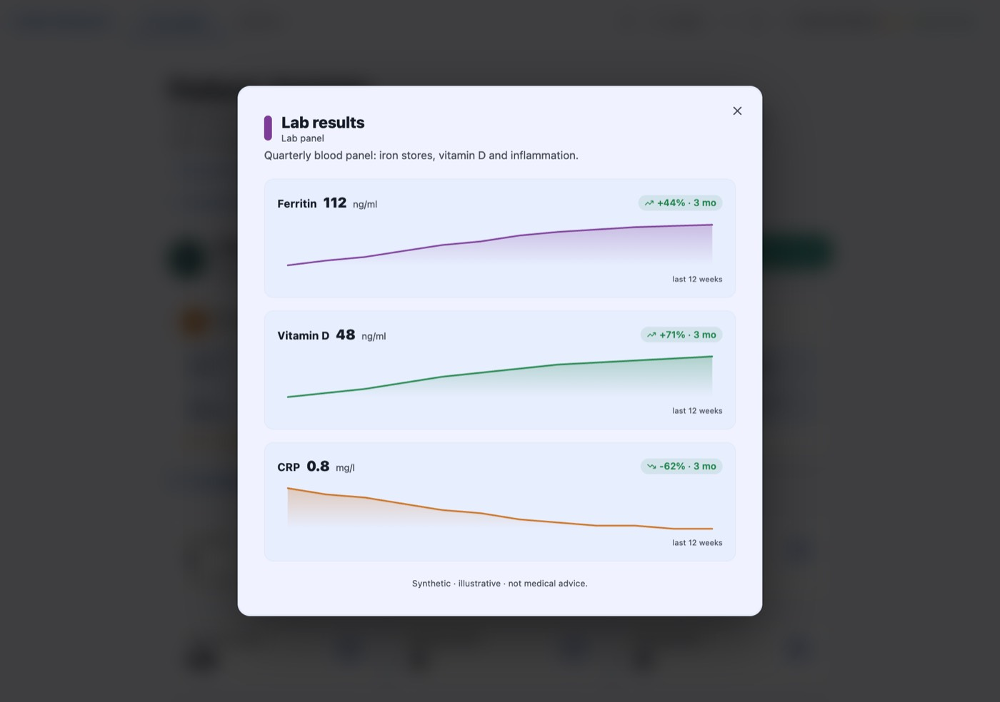

# Who I am

I am a patient who keeps years of laboratory reports from different laboratories, mostly on paper. I take part in medical studies and use my data for prevention (longevity, supplements), under Articles 3, 5 and 7 of the EHDS Regulation. I am also an open-source developer and a contributor to Eclipse Dataspace Components (<https://github.com/eclipse-edc>). The Minimum Viable Health Dataspace, which I build, is an open-source reference implementation of Regulation (EU) 2025/327. It combines the Dataspace Protocol, HL7 FHIR R4, OMOP CDM 5.4 and biomedical terminologies in one knowledge graph, with synthetic patients and fictional organisations only.

- Source code: <https://github.com/ma3u/MinimumViableHealthDataspacev2>
- Documentation: <https://ma3u.github.io/MinimumViableHealthDataspacev2/docs>
- EEHRxF coverage view: <https://ma3u.github.io/MinimumViableHealthDataspacev2/eehrxf>
- Klarbefund app: <https://klarbefund.mabu.red>

My iPhone app (Klarbefund) reads paper laboratory reports and Apple Watch data on the device and exports them as FHIR R4 DiagnosticReport and Observation resources. That is the primary-use situation of Articles 3, 5 and 7: a person holds, adds to and forwards their own data.

What the hub tracks today: the six Art. 14(1) categories and 16 HL7 Europe profiles. The HL7 FHIR Validator 7.0.5 checks a sample of the hub's own resources against them (synthetic Synthea patients, FHIR documents built from the graph, the FHIR facade, and the app's output): 148 of 192 resources pass (77%), 5 profiles pass completely, and 6 have nothing to test yet (eDispensation, the patient summary Composition, the discharge report Composition, ImagingStudy, Practitioner, PractitionerRole). By category: patient summary 66 of 76, ePrescription 31 of 31, imaging report 0 of 3, laboratory 39 of 80, discharge report 50 of 60. Codes are checked for shape only; see point 8.

# 1. Adding and exporting single values

**Situation:** I want to add a single value to my record (a value I measured, or one from a paper report I scanned), push it from my app through an interface, and export all my values for trend analysis. Today I can do none of this with my record.

**What the German ePA offers today:** insured people can add their own documents, for example old paper reports, through their insurer's ePA app. The official page names no file format, no way to add a single value, no interface for the person's own app, and no download or export of the data ([gesund.bund.de](https://gesund.bund.de/die-elektronische-patientenakte), as of 1 September 2025).

**What the GDPR gives me:**

- **Art. 15(3):** a copy of the data, and for a request made electronically, "in a commonly used electronic form". That is a copy, not necessarily structured data, and not an interface.
- **Art. 16:** the right to have incomplete data completed, "including by means of providing a supplementary statement". That is a request to the controller, not a way to write a value myself.
- **Art. 20:** a structured, machine-readable copy and its transmission, but only of data I provided, and only where processing rests on consent or a contract. Care records usually rest on Art. 9(2)(h) and the duty to document care, not on consent, so Art. 20 does not usually reach them.

So the GDPR gives me a copy, but not the structured export and the write access I need. The EHDS (Art. 3, 5 and 7) closes this gap, and the EEHRxF decides whether it works in practice.

**Draft:** Annex II names the "HL7 FHIR REST API" as content transmission for every category, but only between systems.

**Request:**

- State that the HL7 FHIR REST API of Annex II is open to an application the natural person chooses, with patient-facing authorisation (for example SMART App Launch), for reading every category (Art. 3) and writing single values the person inserts (Art. 5), marked as theirs (point 2).
- State that the download of Art. 3(2) can be a FHIR Bundle with every Observation, so a person can run their own trend analysis.

**It works already.** The screenshots in the section "How it can be solved" show Klarbefund and the demo hub doing this with synthetic data.

# 2. Information inserted by the person

**Draft:** Annex III tables 1 and 2, and every category header (e.g. Annex IV p. 11, Annex VIII p. 40), allow `author` = EHDSHealthProfessional, EHDSOrganisation or EHDSDevice; `attester` = EHDSHealthProfessional or EHDSDevice. EHDSLaboratoryObservation (Annex X table 19) allows the patient as `performer`, but not as author.

**Regulation:** Article 5 of Regulation (EU) 2025/327 gives natural persons the right to insert information into their own EHR, clearly distinguishable as inserted by them or their representative.

**Experience:** my app distinguishes values printed on a lab report, values the person confirmed or corrected, values the person measured, and wearable summaries. OCR-read values carry status `preliminary`; only a lab-issued digital text layer gives `final`. None of this can be expressed with the draft data model, so I use custom extensions (source kind, OCR confidence, source line, verified by patient, original reading, source region).

**Request:**

- Add EHDSPatient and EHDSRelatedPerson to `author` in Annex III and the category headers.
- Add a coded element for the information source, with a Union value set, for example: issued by a provider; digitised by the person from a provider document; measured by the person; device generated; reported by the person.

# 3. Access to the raw data, study results and supplements

**Situation:** I take part in medical studies and use my data for prevention: longevity markers, and the supplements I take. For that I need the data itself, in full, not a summary.

**Draft:**

- Recital 3: the EEHRxF "does not establish a minimum or maximum set of data". Article 1(2)(a) covers the download of an electronic copy under Article 3(2).
- Annex II allows a PDF as the unstructured representation of medical imaging studies.
- EHDSMedicationUse (Annex X table 23) describes "a use of a single medicinal product", with `author` limited to health professional, organisation or device.
- Nothing in Annexes IV to X marks a result as coming from a research study visit.

**Request:**

- State that a download under Article 3(2) contains every registered result in full: value, unit, method, specimen, reference range and the earlier results (`previousResults`), not only what a summary selects.
- For imaging studies, the person can download the DICOM objects themselves, not only a PDF.
- Allow a result recorded during a research study visit to be exchanged as a medical test result with a reference to the study (for example an EU trial number), so it is not lost to the person's record.
- When a person donates data to a study or takes part in a trial, the person can receive the study's result and their own measured values (laboratory values, and imaging as DICOM) back in the EEHRxF, as FHIR. Today the person gets at most the lay summary that Regulation (EU) No 536/2014 requires for clinical trials, and in Germany § 27(2) BDSG allows research to restrict the GDPR right of access. The EEHRxF is the natural format for returning these values into the person's record, where the person can discuss them with their family doctor.
- Extend EHDSMedicationUse, or add a data group, for food supplements and other non-medicinal products, with the person as author (see point 2).

# 4. Reference ranges

**Draft:** Annex X table 19, `referenceRange` with low, high, normalValue, type, appliesTo, age, text. `previousResults` links earlier results of the same test.

**Experience:** ranges differ between laboratories and methods, and guideline-based targets change with guideline editions (e.g. lipid targets). When previous results come from other laboratories, a reader compares values against ranges that no longer apply. The hub keeps every published range with its source and a validity period, and always shows the range printed on the report first.

**Request:** add `referenceRange.source` (laboratory or guideline, with citation) and `referenceRange.validity` (Period).

# 5. Integrity of forwarded copies

**Draft:** EHDSAttachment (Annex X table 6) has contentType, language, data, url, size, title.

**Request:** add `hash` and `creation` as in the FHIR R4 Attachment type, and make `contentType` mandatory. A provider receiving a copy forwarded by the person (Article 7(4)) should be able to check that it is unchanged.

# 6. PDF version

**Draft:** Annex II footnote 1: PDF/A-1a or PDF/A-1b.

**Request:** allow PDF/A-2 and PDF/A-3. PDF/A-1 (2005) does not support embedded files; PDF/A-3 can carry the structured FHIR document inside the human-readable PDF, which serves both Article 3(1)(a) and (c) in one file.

# 7. Units and LOINC

**Draft:** Annex I defines Quantity as "a unit of measure, preferably expressed as a coded concept"; Annex X binds UCUM for units.

**Experience:**

- Printed lab reports use units that are not UCUM codes (for example "Mio/µl", "/nl", "G/l"), and OCR adds errors ("U/I" for "U/l"). My app accepts a repair only if it yields exactly one UCUM code.
- The unit determines the LOINC code: Lp(a) in mg/dL is 10835-7, in nmol/L 43583-4; HbA1c in % is 4548-4, in mmol/mol 59261-8. A converter that changes the unit without changing the code produces a wrong record.
- Some measurements have no LOINC code (e.g. visceral fat mass in kg from body composition analysers).

**Request:**

- Make the UCUM code mandatory for laboratory quantities and keep the printed unit as text, analogous to `originalName`.
- State in the implementation guide that a unit conversion may require a different observation code.
- Publish a Union mapping of common printed unit strings to UCUM through the terminology service of Article 6(5).
- Allow a text-only observation type with an English designation where no code exists, as Article 6(3) already does for national codes.

# 8. Implementation guide, versions and testing

**Draft:** Article 9(2): first implementation guide by 31 October 2027. The act names no FHIR implementation guide or version.

**Experience:** the HL7 Europe guides moved faster than my hub could follow:

- I first pinned Laboratory 0.1.1; the hub now validates against 2.1.0, and the build is at 2.2.0-ci (9 November 2026).
- I first recorded Imaging as a FHIR R5 guide; there is now an R4 ballot, version 1.0.0-ballot, matching Article 3(2).
- Hospital discharge report and prescription/dispense guides were ci-builds without fixed versions when I first pinned them.
- The most common failures are document-level requirements, not clinical content: a missing required extension slice on DiagnosticReport, Bundle.type `collection` instead of `document`, and a missing performer on laboratory observations (20 of 37).
- The hub runs the validator without a terminology server, so codes are checked for shape, not against SNOMED CT, LOINC or the value sets.

An implementer cannot target a moving draft, and a conformance claim nobody can test is worth little.

**Request:** state in Article 9 that

- the implementation guide is published as a versioned FHIR package with stable canonical URLs;
- it comes with an open-source validator configuration, synthetic test data under an open licence and a public test bed;
- the logical information models of Article 9(1) are published before 31 October 2027, so manufacturers can start;
- the version applicable on a given date is unambiguous, including transition periods;
- the versioned terminology service of Article 6(5) is openly usable by such test runs, so codes can be checked against the value sets.

**National profiles (Article 10):** national profiles under Article 10 should be published as machine-readable FHIR packages that declare their derivation from the EU package, so conformance of national data to the EEHRxF can be tested automatically rather than asserted.

# 9. Terminology: SNOMED GPS and ICD-10

**Draft:** the annexes never name SNOMED CT. They bind **SNOMED GPS**, the Global Patient Set, a free subset of SNOMED CT published by SNOMED International (70 mentions, often as the preferred system, for example for conditions, procedures, body sites and interpretations). For diagnoses the alternatives are **ICD-10** (14 mentions) and Orphacode. **ICD-11**, in force at WHO since 1 January 2022, is not mentioned. Article 6(1) lets a Member State keep another coding system only with mapping rules to a listed one.

**Problem:** a Member State that licenses full SNOMED CT, as Germany does, records concepts outside the Global Patient Set. Under the draft those codes cannot be exchanged as they are: they are lost, or they need a mapping to a coarser code. The same holds for a country moving to ICD-11.

**Request:**

- Allow full SNOMED CT wherever the sender holds a licence, with SNOMED GPS as the minimum every receiver must understand.
- Name ICD-11 next to ICD-10 in the binding requirements, with a transition, since WHO and Member States are moving to it.
- Publish the GPS-to-SNOMED CT and ICD-10-to-ICD-11 relationships through the terminology service of Article 6(5).

# 10. Editorial

- Annex I, data type "EHDS[Name of the data group]": refers to "Annex IX"; the common data groups are in Annex X.
- Annex III, footnote 4: "BCP 47: Best Current Practice 13, Media Type Specifications and Registration Procedures". BCP 47 is Tags for Identifying Languages; BCP 13 is media types.
- The title alternates between "European health record exchange format" (act cover page, annex) and "European electronic health record exchange format" (act title).
- Recital 13 still begins with a drafting note on national profiles, in square brackets.
- Article 9(4): "requirements o the implementation guide".
- The cover page still shows a 2024 draft reference without a number.

# How it can be solved: screenshots

All screenshots show synthetic data. Each links to the public page it was taken from.

**Klarbefund on the iPhone: from a paper report to coded FHIR values.** The app reads the report on the device, codes each value with LOINC and UCUM, keeps the page and line it was read from, and marks scanned values preliminary until the person checks them. Source: <https://klarbefund.mabu.red/#iphone>

**Klarbefund and the hub: the person decides what goes into the record.** Connect, read your record, and add to it with two switches, off until turned on: send my reports, send my device trends. Source: <https://klarbefund.mabu.red/#ehds>

**The hub: the person's own record with values from devices and reports.** Source: <https://ma3u.github.io/MinimumViableHealthDataspacev2/patient> (sign in as the demo patient)

**The hub: trend view of the person's lab values.** Source: the same page, "View 3-month trends" on Lab results.

# Sources

The draft and the law:

- Draft implementing act, Ares(2026)10884928: <https://ec.europa.eu/info/law/better-regulation/api/download/090166e5374c0181>
- Annexes I to X: <https://ec.europa.eu/info/law/better-regulation/api/download/090166e5374c0182>
- Feedback page, initiative 17512: <https://ec.europa.eu/info/law/better-regulation/have-your-say/initiatives/17512-European-Health-Data-Space-specifications-for-the-European-electronic-health-exchange-format-EEHRxF-_en>
- Regulation (EU) 2025/327 (EHDS), Articles 3, 5 and 7: <https://eur-lex.europa.eu/eli/reg/2025/327/oj/eng>
- Regulation (EU) No 536/2014 on clinical trials (lay summaries): <https://eur-lex.europa.eu/eli/reg/2014/536/oj/eng>
- German Federal Data Protection Act, § 27: <https://www.gesetze-im-internet.de/bdsg_2018/__27.html>
- GDPR Art. 15 (right of access, copy): <https://gdpr-info.eu/art-15-gdpr/>
- GDPR Art. 16 (rectification and completion): <https://gdpr-info.eu/art-16-gdpr/>
- GDPR Art. 20 (data portability): <https://gdpr-info.eu/art-20-gdpr/>
- German ePA, what insured people can do: <https://gesund.bund.de/die-elektronische-patientenakte>
- SMART App Launch (patient-facing FHIR authorisation): <https://hl7.org/fhir/smart-app-launch/>
- SNOMED GPS, the Global Patient Set: <https://www.snomed.org/gps>
- SNOMED CT in Germany (national release centre at BfArM): <https://www.bfarm.de/DE/Kodiersysteme/Terminologien/SNOMED-CT/_node.html>
- ICD-11 (WHO): <https://icd.who.int/en>

The HL7 Europe guides the hub validates against:

- Laboratory Report: <https://hl7.eu/fhir/laboratory/>
- Imaging Report (R4 ballot): <https://hl7.eu/fhir/imaging/1.0.0-ballot/en/>
- Base and Core: <https://hl7.eu/fhir/base/>

Evidence in my own code:

- Validation report, 148 of 192 resources: <https://github.com/ma3u/MinimumViableHealthDataspacev2/blob/main/scripts/eehrxf/validation-report.json>
- Profiles and guide versions: <https://github.com/ma3u/MinimumViableHealthDataspacev2/blob/main/scripts/eehrxf/profiles.json>
- Klarbefund FHIR writer with its custom extensions: <https://github.com/ma3u/MinimumViableHealthDataspacev2/blob/main/clients/ios/Sources/Shared/FhirBundle.swift>
- The unit decides the LOINC code (ADR-033): <https://github.com/ma3u/MinimumViableHealthDataspacev2/blob/main/docs/ADRs/ADR-033-lab-report-extraction-pipeline.md#L33>
- Published reference ranges next to the printed ones (ADR-039): <https://github.com/ma3u/MinimumViableHealthDataspacev2/blob/main/docs/ADRs/ADR-039-published-reference-ranges.md>
- OCR misreads of units such as U/l: <https://github.com/ma3u/MinimumViableHealthDataspacev2/blob/main/docs/gotchas.md#L1659>
