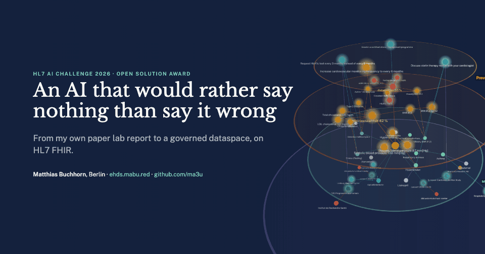

# HL7 AI Challenge 2026 — Submission Materials

Submission package for the **2026 HL7 AI Challenge** (https://info.hl7.org/ai-challenge).
Tracked in **issue #66**.

- **Title:** FHIR-Grounded, Governed AI for the European Health Data Space
- **Deadline:** 30 June 2026 · **Entry form:** https://1ag54.share.hsforms.com/29QP4fNVDROyNOrcXTQxsfg
- **Team:** Minimum Viable Health Dataspace (MVHD) — Matthias Buchhorn (@ma3u)

## Files

| File                                      | Purpose                                                             |
| ----------------------------------------- | ------------------------------------------------------------------- |
| `submission.html`                         | The source document (edit this).                                    |
| `HL7-AI-Challenge-2026-EHDS-Platform.pdf` | The generated 4-page PDF uploaded to the challenge (≤10 pages).     |
| `make_pdf.js`                             | Regenerates the PDF from `submission.html` via Playwright/Chromium. |
| `blog-article.md`                         | Guest article for the HL7 blog (Winners Showcase, Oct 2026, #252).  |

## Regenerate the PDF

Playwright (Chromium) is already installed under `ui/`. From the repo root:

```bash
NODE_PATH=ui/node_modules node docs/submissions/hl7-ai-challenge-2026/make_pdf.js
```

The PDF is written next to the script. Keep it **≤10 pages** — the challenge does not
evaluate pages beyond the tenth.

## Regenerate the animations

`img/ehds-researcher-journey.gif` (also shown in the deck under
`ui/public/presentations/hl7-showcase-2026/img/`) is recorded on the live platform as the
researcher persona: the overview the login lands on, dataset discovery, the negotiation
history, the OMOP analytics. From `ui/`:

```bash
PLAYWRIGHT_BASE_URL=https://ehds.mabu.red OUT=/tmp/researcher npx tsx scripts/record-researcher-journey.ts
python3 scripts/frames-to-gif.py /tmp/researcher ../docs/submissions/hl7-ai-challenge-2026/img/ehds-researcher-journey.gif
cp ../docs/submissions/hl7-ai-challenge-2026/img/ehds-researcher-journey.gif public/presentations/hl7-showcase-2026/img/
```

The person's journey on the platform, shown in the deck under the person's swimlane, is
recorded the same way as the patient persona: the overview the login lands on, the own
record, the research programmes with their consents, the findings that came back.

```bash
PLAYWRIGHT_BASE_URL=https://ehds.mabu.red OUT=/tmp/patient npx tsx scripts/record-patient-journey.ts
python3 scripts/frames-to-gif.py /tmp/patient public/presentations/hl7-showcase-2026/img/ehds-patient-journey.gif
```

The frames are screenshots taken at chosen moments, so loading time never ends up in the
animation; about 57 frames, 22 seconds, under 2 MB. The 16 November 2026 recordings were made on the static demo instead of the live hub:
it needs no password, and it shows only the mock fixtures, so no end-to-end leftovers and
no organisation that is not fictional reach the animation. Set `RECORD_PERSONA` and point
the base URL at the Pages site:

```bash
PLAYWRIGHT_BASE_URL=https://ma3u.github.io/MinimumViableHealthDataspacev2 RECORD_PERSONA=researcher OUT=/tmp/researcher npx tsx scripts/record-researcher-journey.ts
PLAYWRIGHT_BASE_URL=https://ma3u.github.io/MinimumViableHealthDataspacev2 RECORD_PERSONA=patient1 OUT=/tmp/patient npx tsx scripts/record-patient-journey.ts
```

`img/klarbefund-tour.gif` (article) and the deck's `img/klarbefund-tour.webp` are ten app
screens from the current build with the fictional development dataset, 2.2 s each with a
short crossfade: reports, a report, the original scan, trends, reference values, the health
graph, export to my Mac, connect to EHDS, consents, privacy. Shoot them from
`clients/ios` with

```bash
NAME=MB-Blog-Tour DEVICE=com.apple.CoreSimulator.SimDeviceType.iPhone-17-Pro SEED=-MBDevData OUT=/tmp/tour SCREENS="list detail scan trends reference relatePaired connect consents privacy" Scripts/capture-screenshots.sh
```

and take the health graph from `docs/klarbefund/img/graph.png` (`-MBShot graph` opens the
list with the development dataset). The deck keeps its own copy because off hours the hub
answers `/klarbefund/` with the offline page (ADR-053), and only `presentations/` is served
regardless. The start page's video tour (`ui/public/klarbefund/klarbefund-tour.mp4`, #578)
is a separate screen recording and was not re-shot.

`img/klarbefund-relate-claude.gif` is the copy of `docs/klarbefund/img/klarbefund-relate-claude.gif`
(#1101): the phone sends to the person's encrypted graph on their Mac, and Claude Desktop
reads it over a read-only MCP server.

## Regenerate the deck's preview card and animation

The deck's head carries Open Graph and Twitter card tags, a canonical link to the GitHub
Pages copy and a JSON-LD description, so a pasted link shows a title, a text and a picture.
The picture is `img/og-image.png` (1200 x 630) and the animation the README shows is
`img/preview.gif`: both the cover slide as it renders, with the knowledge graph turning
behind the title. From `ui/`, after the deck is deployed:



```bash
npx tsx scripts/record-deck-preview.ts
python3 scripts/frames-to-gif.py recordings/deck public/presentations/hl7-showcase-2026/img/preview.gif
```

Social networks cache a card by URL; after a change, ask LinkedIn's Post Inspector or
Facebook's Sharing Debugger to fetch the GitHub Pages address again.

## Notes

- Figures in the document are drawn from this repository and marked approximate; verify
  against the current build before each submission.
- Readiness is stated as **prototype on synthetic data** (no real-world clinical deployment).
- The PDF covers the challenge's three evaluation areas: Innovation & Impact, Technical
  Solution, and Contextual Factors.
