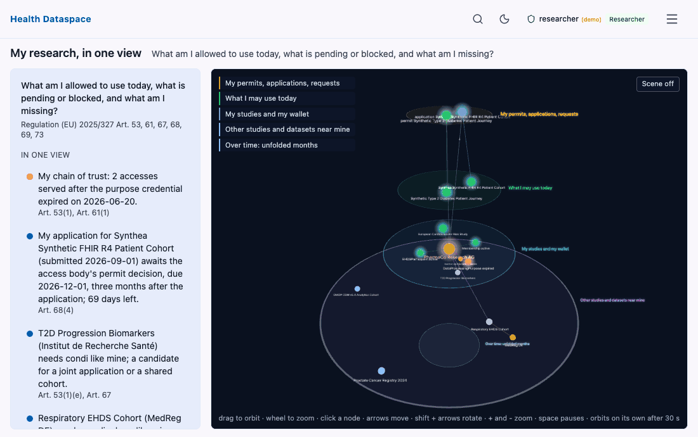

# From a paper lab report to a knowledge graph I control: FHIR, OMOP and the codes that carry the meaning

_Guest article for the HL7 blog, by Matthias Buchhorn, Berlin. The EHDS Demo & Integration
Platform received the Open Solution Award in the 2026 HL7 AI Challenge. The slides from the
Winners Showcase on 14 October 2026 are online:
[An AI that would rather say nothing than say it wrong](https://ma3u.github.io/MinimumViableHealthDataspacev2/presentations/hl7-showcase-2026/)
(arrows to move, S for the speaker notes)._

## What I need as a patient

I take part in a cardiovascular prevention study. My results reach me as most people's do in
Europe: on paper. Nothing pushes them into my national patient record, because only the
provider who ordered a test may write to it, and a cohort study is not treatment. I am the
only integration point there is.

So I need three things, in this order:

1. **The raw data.** The report as the laboratory printed it, every value with its unit and
   its reference range verbatim, and the page and line it came from. Not a summary, not an
   interpretation.
2. **My copy, encrypted on my own device.** Readable by me, by nobody else, and useful there:
   a timeline per measurement, across laboratories.
3. **A pseudonymised copy in a secure processing environment in the cloud, as a knowledge
   graph.** Linked to the terminologies, so research can ask questions of it, while nobody
   in that environment can tell it is mine.

All three only work if every value carries a code. FHIR moves the data; the codes carry the
meaning; OMOP is where the meaning is counted.

## The codes carry the meaning

| Code system         | What it names                       | In the hub's knowledge graph                                                                                                                                                                    | In Klarbefund                     |
| ------------------- | ----------------------------------- | ----------------------------------------------------------------------------------------------------------------------------------------------------------------------------------------------- | --------------------------------- |
| **LOINC** with UCUM | The test, and the unit it reports   | `LoincCode` nodes; Observations point at them (`CODED_BY`)                                                                                                                                      | Every value, on the device        |
| **SNOMED CT**       | The clinical meaning of a condition | `SnomedConcept` nodes; FHIR Conditions and their OMOP rows point at them                                                                                                                        | Not yet                           |
| **ICD-10**          | The diagnosis as it is billed       | `ICD10Code` nodes in the seed; [dataset descriptions](https://github.com/ma3u/MinimumViableHealthDataspacev2/blob/main/neo4j/register-healthdcat-ap-r8.cypher) name their cohorts' ICD-10 codes | Not yet: the app reads lab sheets |

A FHIR resource without a code is JSON that travels well and means nothing at the other end.
With a code, a value read from my paper on an iPhone and a value loaded from a hospital's
FHIR server are the same measurement, and the transform to OMOP is written once.

LOINC is where we are furthest. The analyte dictionary exists once, in TypeScript
([`analytes.ts`](https://github.com/ma3u/MinimumViableHealthDataspacev2/blob/main/services/epa-ingest/src/analytes.ts)),
with more than two hundred LOINC codes, each chosen by unit. The Swift table on the phone is
generated from it, and CI fails when the two drift. SNOMED CT and ICD-10 are in the graph but
thin: a demo seed, not a terminology server. A discharge letter carries its diagnoses in
ICD-10, so they are next for the app.

## Primary use: the person's own copy

[Klarbefund](https://ma3u.github.io/MinimumViableHealthDataspacev2/docs/klarbefund/klarbefund-user-guide)
is an iPhone app. Point the camera at a lab sheet, or import the laboratory's PDF. The table
is read on the device, and every value is matched to a LOINC code and a UCUM unit.

**The raw data stays.** The scanned pages are kept as a PDF next to the record. Under each
value the app shows the label, the unit and the range exactly as the laboratory printed them,
and the page and line they were read from, so anyone can check a number against the paper. A
PDF with the laboratory's own text layer yields final observations; anything that went
through a recogniser is preliminary until the person confirms it. Lines that matched
nothing are listed, not dropped.

**Encrypted on the device.** Each record and its pages are sealed with AES-GCM under a
256-bit key that lives in the Keychain, readable only while this device is unlocked and never
copied to another device
([`ReportStore.swift`](https://github.com/ma3u/MinimumViableHealthDataspacev2/blob/main/clients/ios/Sources/MeinBefund/ReportStore.swift#L175-L178)).
The files use complete file protection and stay out of backups, and the app opens with Face
ID or the passcode. Nothing leaves the phone unless the person sends it.

The payoff is the timeline: results from the study centre, the family doctor and a gym scale
on one chart per measurement. What the app never does is interpret. It names the test, with a
source, and leaves the reading of a value to a doctor. That is the medical-device line.

## My graph at home, and Claude reads it

The coded values do not have to stay a list. On the phone they form a health graph:
every value is `CODED_BY` its LOINC code, sits under its report, and is linked to the
same value seen in another report, in [Relate](https://github.com/relatedb/relate), an
embedded graph database. **Export to my Mac** keeps that graph on a Mac the person owns,
inside an AES-256 encrypted disk image whose password stays in the Mac's Keychain. The
phone sends only to the Mac whose certificate it paired with, over TLS, on the person's
own Wi-Fi or a USB cable; no cloud is involved.

On that Mac, [Claude Desktop](https://claude.ai/download) can use the graph as a
memory of the person's own results, through a local MCP server that is read-only. Asked
how LDL cholesterol developed, Claude writes a Cypher query over the LOINC code and
answers with five values, each with the range the laboratory printed and where it was
read. The codes are what make that answer exact: the question is about LOINC 2089-1,
not about a word on five differently printed sheets
([user guide](https://ma3u.github.io/MinimumViableHealthDataspacev2/docs/klarbefund/klarbefund-user-guide)).

## FHIR: what leaves the phone

A FHIR R4 bundle: one Observation per value with its LOINC coding, UCUM quantity, the printed
referenceRange and a status of final or preliminary, extensions for the source kind, line and
box on the page, plus a DiagnosticReport, a DocumentReference for the paper and a Provenance.
A doctor gets a PDF with the pages appended, the patient record gets the bundle, research gets
OMOP rows. The two FHIR writers must reproduce one golden bundle byte for byte.

## OMOP: where meaning is counted

OMOP CDM 5.4 is where analysis happens, and both the phone and the hub write it. The phone
writes measurement, person and observation_period tables with the printed range in range_low
and range_high
([`OmopExport.swift`](https://github.com/ma3u/MinimumViableHealthDataspacev2/blob/main/clients/ios/Sources/Shared/OmopExport.swift)).
The hub derives OMOP from its FHIR layer
([`fhir-to-omop-transform.cypher`](https://github.com/ma3u/MinimumViableHealthDataspacev2/blob/main/neo4j/fhir-to-omop-transform.cypher)).

Both write concept_id 0 and keep the source code, LOINC or SNOMED CT, in the source value,
deliberately. The standard concept comes from the Athena vocabulary, which is not on a phone,
and an invented id would be a wrong identifier on a real measurement. In the graph every OMOP
row still points at its code node, so the meaning is not lost; the mapping to standard
concepts belongs where the vocabulary lives. That step is the gap between "coded" and
"countable across countries", and it is the one we want to close next.

## Secondary use: the knowledge graph in the secure processing environment

The dataspace half runs on the Eclipse Dataspace Components with the EHDS roles on top. A
researcher [discovers datasets](https://ma3u.github.io/MinimumViableHealthDataspacev2/data/discover)
through HealthDCAT-AP, applies for a permit,
[negotiates](https://ma3u.github.io/MinimumViableHealthDataspacev2/negotiate) and transfers
over the Dataspace Protocol, and [analyses](https://ma3u.github.io/MinimumViableHealthDataspacev2/analytics)
on OMOP. Underneath is a five-layer knowledge graph: dataspace, catalogue, FHIR R4, OMOP and
terminology, with 127 synthetic patients. A
[natural-language layer](https://ma3u.github.io/MinimumViableHealthDataspacev2/query) turns a
question into a graph query and answers only from what the graph holds.

Under a permit, the graph moves into a secure processing environment: a workspace in a
confidential container that runs its own graph database, loaded from an extract sealed with
AES-256-GCM
([ADR-069](https://github.com/ma3u/MinimumViableHealthDataspacev2/blob/main/docs/ADRs/ADR-069-two-spe-workspaces-as-aci-confidential-containers.md)).
The codes travel with the records, so a researcher's question about LOINC 2093-3 means the
same in the workspace as on my phone. A person's opt-out travels as a label.

Here my third need is not met yet, and I want to say so plainly. The workspace holds the
synthetic cohort only. Data a real person sends from the app is excluded from every extract on
purpose, because it belongs on the hub that person chose
([`hub.ts`](https://github.com/ma3u/MinimumViableHealthDataspacev2/blob/main/services/spe-loader/src/hub.ts#L28-L33)).
The extract is not pseudonymised either: it is synthetic, so it did not need to be. To take my
own values in, three things are missing: my consent for that copy, a pseudonym issued per
permit by a trusted party rather than a derived label, and a pseudonymisation that removes
identity but keeps every code.

## What we found

- **The unit selects the code.** Lipoprotein(a) in mg/dL and in nmol/L are two measurements
  with two LOINC codes. Trusting the label alone put wrong codes on real values until the rule
  became absolute.
- **Refusing is a feature.** Both LOINC codes for RDW-SD are deprecated, so the value is
  carried unmatched rather than mis-coded. A wrong code is worse than no code.
- **LOINC names tests, not organisms.** A stool report lists 57 taxa with no LOINC term. They
  carry their [NCBI Taxonomy](https://www.ncbi.nlm.nih.gov/taxonomy) id as an Observation
  component under LOINC 41852-5; the abundance stays a text-only code with a
  data-absent-reason.
- **A printed range is assay-specific.** It travels unchanged. Replacing it with a published
  band destroys what a clinician needs.
- **Provenance must be first-class.** Final versus preliminary is decided by the document,
  never by its file extension. Marking a transcription final is the failure that matters.

## What we need from the FHIR community

1. An agreed extension for transcribed observations: source kind, source line, page and box,
   recogniser confidence, so any receiver can treat a scanned value with the right caution.
2. A pattern for microbiome relative abundance. Is a text-only code plus an NCBI Taxonomy
   component the shape the community wants?
3. LOINC terms for what consumer devices print: visceral fat as a mass, the
   extracellular-to-total water ratio, remnant cholesterol, the triglyceride-to-HDL ratio.
4. A citizen-upload profile in the [HL7 Europe Laboratory Report](https://hl7.eu/fhir/laboratory/):
   what a person-submitted result must carry so a record system and a GP can read it with its
   provenance intact.
5. Written FHIR-to-OMOP conventions for the uncoded and the not-yet-mapped case: source value,
   concept_id 0, and when the standard concept is filled in, so two mappings never drift.
6. A pseudonymisation pattern for a person's own FHIR data on its way into a secure processing
   environment, one that removes identity and keeps every LOINC, SNOMED CT and ICD-10 code.

## Try it

The [slides](https://ma3u.github.io/MinimumViableHealthDataspacev2/presentations/hl7-showcase-2026/)
walk both journeys in twelve minutes. The
[static demo](https://ma3u.github.io/MinimumViableHealthDataspacev2/) needs no sign-in, the
[journeys page](https://ma3u.github.io/MinimumViableHealthDataspacev2/journeys) shows every
step with what is implemented and what is planned, and the whole stack runs on a laptop.
Source, decisions and the app guide:
[github.com/ma3u/MinimumViableHealthDataspacev2](https://github.com/ma3u/MinimumViableHealthDataspacev2),
Apache 2.0. Pull requests are welcome!
