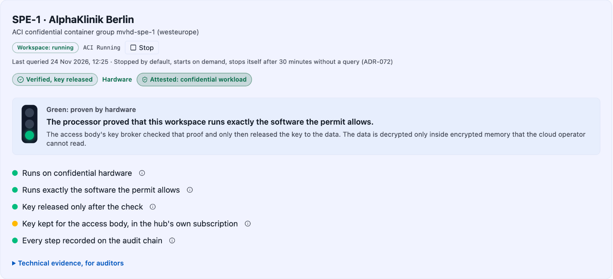
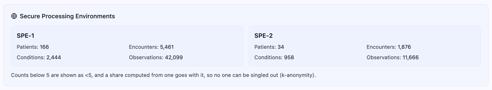

# Who I am

I am an experienced dataspace architect. I built the operating company for Catena-X (<https://catena-x.net>), the dataspace of the global automotive supply chain, so I know what it takes to run a dataspace with many independent participants, not only to specify one. I also contribute to Eclipse Dataspace Components (<https://github.com/eclipse-edc>), the open-source connector that Catena-X runs on. I build the Minimum Viable Health Dataspace, an open-source reference implementation of Regulation (EU) 2025/327.

> **A non-commercial demo.** The Minimum Viable Health Dataspace is not a product and is not for sale. No company stands behind it, nothing is offered as a service, and it holds no real health data: its patients are synthetic and its organisations (AlphaKlinik Berlin, Limburg Medical Centre, PharmaCo Research AG, MedReg DE) are fictional. It exists to show the EHDS standards working together, so that access bodies, data holders and developers can see, test and question them before 2029. Everything is published under an open-source licence.

It combines the Dataspace Protocol, the Decentralised Claims Protocol, HL7 FHIR R4, OMOP CDM 5.4, HealthDCAT-AP, ODRL policies and CNCF Confidential Containers in one knowledge graph. It plays all roles of Chapter IV: a health data access body, two data holders and a data user.

- Try the demo (no sign-in, synthetic data): <https://ma3u.github.io/MinimumViableHealthDataspacev2>
- Documentation: <https://ma3u.github.io/MinimumViableHealthDataspacev2/docs>
- Source code: <https://github.com/ma3u/MinimumViableHealthDataspacev2>

# How the hub's secure processing environment works

Each data holder has a workspace: a confidential container group on AMD SEV-SNP hardware, built on CNCF Confidential Containers. The workspace's data arrives encrypted. The key is held by a key broker (Trustee) that the access body runs. Trustee releases the key only when the CPU-signed attestation report proves that the workspace runs exactly the images, commands and settings bound to the data permit. A changed tool gives a different policy hash, and the key is not released. The data lives only in encrypted memory and is gone when the workspace stops.

Two workspaces answer federated queries. A query goes to each workspace, runs there, and only aggregates with every group below five suppressed return to the data user. Every attestation, key release, refusal, load and deletion is written to a hash-chained audit log.

The decisions behind this are public:

- Confidential containers with remote attestation: [ADR-037](https://github.com/ma3u/MinimumViableHealthDataspacev2/blob/main/docs/ADRs/ADR-037-secure-processing-environment-confidential-computing.md)
- A Trustee the access body runs, data loaded per permit: [ADR-068](https://github.com/ma3u/MinimumViableHealthDataspacev2/blob/main/docs/ADRs/ADR-068-a-sovereign-confidential-spe-on-confidential-containers-and-trustee.md)
- The policy hash bound to the permit: [ADR-069](https://github.com/ma3u/MinimumViableHealthDataspacev2/blob/main/docs/ADRs/ADR-069-two-spe-workspaces-as-aci-confidential-containers.md)
- Workspaces start on demand: [ADR-072](https://github.com/ma3u/MinimumViableHealthDataspacev2/blob/main/docs/ADRs/ADR-072-spe-workspaces-start-on-demand.md)
- The developer's explanation: [secure-processing-environment.md](https://github.com/ma3u/MinimumViableHealthDataspacev2/blob/main/docs/developer/secure-processing-environment.md)

The hub is a demonstrator. It is not an SPE that holds real data, and it does not claim to comply with the draft. I checked it against the draft article by article (table at the end) to find out what the text asks in practice. The points below come from that check.

Article 18's paragraphs are numbered 8 to 11 in the draft; I cite them by position, as 18(1) to 18(4).

# The SPE in the demo

The screenshots come from the public demo, viewed as its demo administrator persona (no account is needed). Each page can be opened at the link under it. The public demo is a static build and shows a recorded run from a laptop, which has no confidential hardware, so it is labelled "Simulated attestation": the Trustee, the policy, the key release and the audit record are real, the hardware proof is not. The same flow runs with AMD SEV-SNP evidence in the Azure deployment (ADR-069).

SPE attestation: <https://ma3u.github.io/MinimumViableHealthDataspacev2/admin/attestation>

Natural-language and federated query: <https://ma3u.github.io/MinimumViableHealthDataspacev2/query>

Audit and provenance, tab "Secure processing": <https://ma3u.github.io/MinimumViableHealthDataspacev2/admin/audit>

# 1. Protection of data in use

**Draft:** Art. 13(2) and (3) require encryption at rest and in transit. Art. 12(1)(a) asks a third-party operator not to access personal data "except when strictly necessary". Art. 5(1) and (2) ask the operator and the access body to verify, and to monitor for the permit's lifetime, that an instance matches the permit, including its tools.

**Experience:** data at rest and in transit are protected by encryption, but during processing the data sits in plain memory, readable by whoever runs the host: the operator, a cloud provider, or an attacker with administrator rights. Art. 12 answers this with a duty, not a measure. Confidential computing answers it with hardware: memory is encrypted per instance, and the CPU signs a report of what runs in it. In the hub, that report is also how the access body verifies the instance (Art. 5): the key is released only to an instance whose measured images match the permit.

**Request:**

- Require state-of-the-art protection of electronic health data in use where a third-party operator or a cloud service operates the SPE (Art. 12, recital 4).
- Name remote attestation as a means to verify the configuration of an instance before and during access (Art. 5(1), (2)).
- Leave the technology open (AMD SEV-SNP, Intel TDX, Arm CCA, or others).

# 2. Disclosure control on aggregates inside a federation

**Draft:** Art. 2(12) defines federated processing as an exchange of "queries, code, aggregated results or model parameters". Art. 18(3) exempts parameters, weights and gradients from the export control of Art. 7. Art. 18(4) applies Art. 7 only to exports out of the federation.

**Experience:** a coordinator that receives per-site aggregates can recover what a site would have suppressed. If three sites report 40, 37 and a suppressed count, and the coordinator sees a total of 80, the suppressed count is 3. The hub met this twice:

- Its federated statistics needed a rule for totals as well as for each site. A total now leaves out the site counts below the threshold unless together they reach it, and a total below the threshold is itself suppressed ([`combineCounts()`](https://github.com/ma3u/MinimumViableHealthDataspacev2/blob/e84f2716/services/neo4j-proxy/src/k-anonymity.ts#L148)).
- Its federated query applies k-anonymity at the coordinator, after the per-site results have left each workspace ([federated.ts](https://github.com/ma3u/MinimumViableHealthDataspacev2/blob/e84f2716/services/neo4j-proxy/src/routes/federated.ts#L191)). Under the draft, the check belongs in each instance. I found this gap by reading the draft.

Model updates carry the known risks of membership inference and gradient inversion.

**Request:**

- Require that each instance applies disclosure control to aggregated results before they leave it, and that the coordinating operator applies it again to combined results, including totals.
- In the guidelines of Art. 22, name secure aggregation and differential privacy as measures for Art. 18(3).

# 3. Query-only and batch SPEs

**Draft:** Art. 6(1) and (2) require, in every instance, general-purpose data-processing tools and collaboration tools. Art. 14(3) allows batch execution.

**Experience:** a health data request (Art. 69) answers with anonymised statistics, and a feasibility query with a count. Neither needs a notebook, a remote desktop or a shared folder, and each of those enlarges the attack surface (Art. 7(2), concealment in exports). The hub's federated SPE is query-only today; an interactive workspace per permit is planned separately.

**Request:** apply Art. 6 "where the data permit provides for interactive processing", and state that an instance limited to batch or query execution under Art. 14(3) complies.

# 4. Log retention

**Draft:** Art. 16(4): logs are kept "for a period of five years or for one year following the end of validity of the data permit, whichever period is shorter". Regulation (EU) 2025/327 Art. 73(1)(e) requires "at least one year".

**Experience:** implementing this as a retention date per log entry, the start of the five years is unclear. If they count from each entry, the rule gives min(entry + 5 years, permit end + 1 year), which is never less than one year after the entry. If they count from the start of the permit, an entry written in the sixth year of a long permit would be due for deletion at once. The hub today keeps entries 12 months, which meets Art. 73 but not this draft for long permits.

**Request:** state that the five years count from each log entry, and that no entry is kept less than one year (Art. 73(1)(e)).

# 5. Deletion and reproducibility

**Draft:** Art. 8(5): secure deletion of the instance within six months after the permit ends.

**Guidance:** TEHDAS2 D7.1 provides for a reduced archive to reproduce results and for keeping analysis scripts for the access body. Results are published within 18 months (Regulation Art. 61).

**Request:**

- Delete "without undue delay and at the latest within six months".
- Allow the analysis scripts and the outputs already released under Art. 7, never row-level data, to be kept outside the instance for verification and reproducibility.

# 6. Common standards for federations

**Draft:** Art. 18(2)(a) to (c) require common data models, metadata standards, query languages, remote execution interfaces and interoperable user management within a federation, and Art. 20 leaves their choice to each federation's agreement.

**Experience:** the hub's two workspaces federate because they share OMOP CDM 5.4, FHIR R4, LOINC and SNOMED CT, and describe themselves in HealthDCAT-AP. Two federations that choose differently cannot later join, and a cross-border request through HealthData@EU would meet as many choices as there are federations. Catena-X shows the alternative: its participants interoperate because they implement published, versioned standards and are checked against them before they join, while an operating company runs the shared services. Art. 20 leaves exactly these choices to each federation.

**Request:** refer to the specifications under Art. 75 (HealthData@EU) and Art. 77 (HealthDCAT-AP), to OMOP CDM and HL7 FHIR as common data models, and to organisation identities based on the European Digital Identity framework, as the default a federation departs from only with a reason.

# 7. Machine-readable public information

**Draft:** Art. 9(2) asks for public information on capabilities and tools; Art. 18(1) on the members of a federation.

**Request:** publish both in the national dataset catalogue as HealthDCAT-AP data services (`dcat:DataService`), linked to the datasets they serve, so an applicant can choose an SPE in the application (Art. 67) and HealthData@EU can show them across borders.

# 8. Authentication of machines

**Draft:** Art. 10(4) requires strong user authentication (eIDAS Art. 3(51)) "for all users"; recital 7 asks for European Digital Identity Wallet support.

**Experience:** batch jobs (Art. 14(3)), API clients (Art. 14(1)) and federated instances (Art. 18(2)(d)) are systems, not natural persons. They authenticate with workload identities, certificates or verifiable credentials, as the Dataspace Protocol and the Decentralised Claims Protocol do in the hub.

**Request:** add a rule for workload and organisation identities, consistent with Art. 18(2)(d), and keep strong user authentication for natural persons. The hub's EUDI Wallet sign-in shows the person side is feasible.

# 9. Editorial

- Art. 1 is numbered (14) and (15).
- Art. 2 starts at point (2).
- Art. 8 starts at paragraph 4.
- Art. 18 is numbered 8 to 11, while Art. 20(1)(b) refers to Art. 18(2).
- Art. 19(2) refers to Art. 20(1), point (a); Art. 20(1) uses letters a. to d.
- Art. 21(3) has two points (a).
- Art. 13(2): "within an shall be encrypted" (the noun is missing).
- Art. 14(3)(b): "execute model training these tasks".
- Recital 7: "sensisity", "processsed"; Art. 20(1): "sercure".

# Annex: the hub checked against the draft

This shows what an implementer meets in each article. Status as of 24 November 2026.

| Article       | Requirement                                                  | The hub                                                         |
| ------------- | ------------------------------------------------------------ | --------------------------------------------------------------- |
| 3             | An instance per permit, segregated, allowed connections only | A workspace per data holder; per permit is planned              |
| 4             | Staging, verification and preparation by the access body     | Encrypted extract per holder; no staging for data users         |
| 5(1), (2)     | Verify and monitor that the instance matches the permit      | Hardware attestation bound to the permit's policy hash          |
| 5(3)          | Separation across one user's concurrent permits              | One key per workspace, not per permit                           |
| 6             | Data-science and collaboration tools                         | Query-only; an interactive workspace is planned                 |
| 7             | Export only after approval; automated and manual checks      | Automatic suppression of groups below five; no approval step    |
| 8             | Revoke at expiry; delete within six months                   | Data deleted when a workspace stops; not triggered by expiry    |
| 9             | Public documentation and capabilities                        | Developer documentation public; no capability statement         |
| 10            | Role-based access, strong authentication                     | Roles from the identity provider; EUDI Wallet sign-in available |
| 13            | Isolation, encryption at rest and in transit                 | Encrypted memory per workspace, TLS                             |
| 14(3)         | Batch execution with the same output control                 | Synchronous queries with the same output control                |
| 16            | Tamper-evident, write-once logs; retention                   | Hash-chained log; 12-month retention                            |
| 18(2)(e), (g) | Local execution; no sourced data between instances           | Local execution; suppression applied at the coordinator         |
| 18(2)(f)      | Federation-wide logging                                      | Each workspace's events collected into one chain                |
| 19            | Federated learning                                           | Not built                                                       |
| 20            | Written governance agreement                                 | None (a demonstrator with one operator)                         |

# Sources

- Draft implementing regulation, Ares(2026)10903532: <https://ec.europa.eu/info/law/better-regulation/api/download/090166e53752f4ab>
- Feedback page, initiative 17192: <https://ec.europa.eu/info/law/better-regulation/have-your-say/initiatives/17192-European-Health-Data-Space-requirements-for-secure-processing-environments_en>
- Regulation (EU) 2025/327 (EHDS), Articles 61, 67, 69, 73, 75 and 77: <https://eur-lex.europa.eu/eli/reg/2025/327/oj/eng>
- Regulation (EU) No 910/2014 (eIDAS), Art. 3(51): <https://eur-lex.europa.eu/eli/reg/2014/910/oj/eng>
- TEHDAS2 D7.4, SPE specification for access bodies: <https://zenodo.org/records/20266473>
- TEHDAS2 results by user group: <https://tehdas.eu/results-by-user-group/>
- CNCF Confidential Containers: <https://confidentialcontainers.org/>
- Trustee (key broker and attestation service): <https://github.com/confidential-containers/trustee>
- AMD SEV-SNP: <https://docs.kernel.org/arch/x86/amd-memory-encryption.html#secure-nested-paging-snp>
- HealthDCAT-AP, release 8: <https://data.health.europa.eu/healthdcat-ap/releases/release-8/>
- OMOP CDM 5.4: <https://ohdsi.github.io/CommonDataModel/cdm54.html>

Evidence in my own code (commit e84f2716):

- Small-count suppression and the totals rule: <https://github.com/ma3u/MinimumViableHealthDataspacev2/blob/e84f2716/services/neo4j-proxy/src/k-anonymity.ts>
- The federated query and where it suppresses: <https://github.com/ma3u/MinimumViableHealthDataspacev2/blob/e84f2716/services/neo4j-proxy/src/routes/federated.ts#L191>
- The hash-chained audit log: <https://github.com/ma3u/MinimumViableHealthDataspacev2/blob/e84f2716/services/neo4j-proxy/src/audit-chain.ts>
- Log retention today: <https://github.com/ma3u/MinimumViableHealthDataspacev2/blob/e84f2716/services/neo4j-proxy/src/audit.ts#L70>
